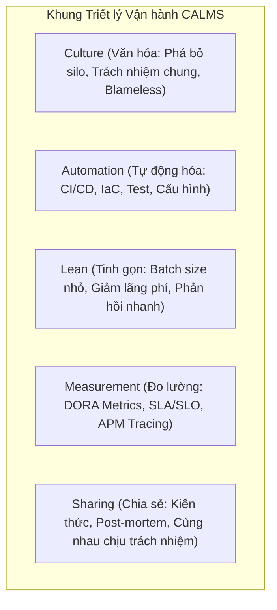
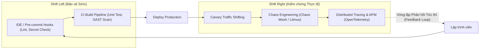
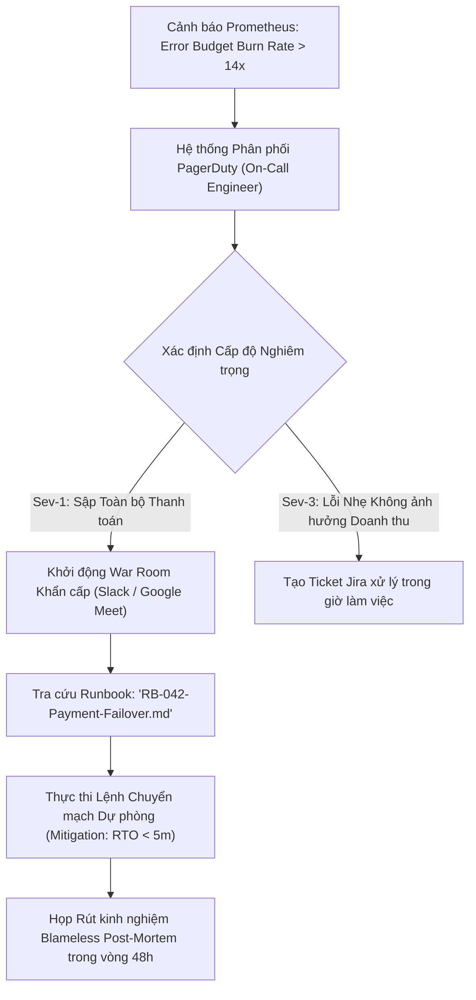
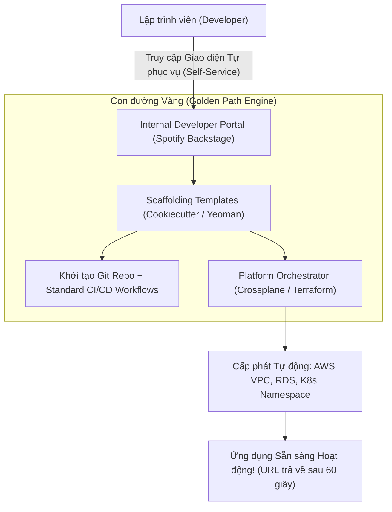

# 11.1. Culture, Platform Engineering and Practices (Văn hóa DevOps, Kỹ thuật Nền tảng và Thực hành Vận hành)

## Tổng quan về Văn hóa DevOps và Kỹ thuật Nền tảng
DevOps không đơn thuần là một chức danh công việc hay một tập hợp công cụ kỹ thuật, mà là sự chuyển đổi văn hóa kết hợp giữa triết lý phát triển phần mềm (Software Development) và vận hành hệ thống (IT Operations). Mục tiêu tối thượng của DevOps là rút ngắn chu kỳ phát triển hệ thống (Systems Development Life Cycle), tăng tần suất phát hành (High Deployment Frequency), và mang lại các bản cập nhật đáng tin cậy cao phù hợp với mục tiêu kinh doanh.

Về mặt đo lường hiệu năng kỹ thuật theo tiêu chuẩn DORA (**DevOps Research and Assessment**):
Hiệu năng vận hành của một tổ chức kỹ thuật được định lượng qua 4 chỉ số vàng (**4 DORA Metrics**):
$$\begin{aligned}
\textbf{1. Deployment Frequency (DF):} & \quad \text{Tần suất đưa code thành công lên Production (Ưu tú: Nhiều lần mỗi ngày).} \\
\textbf{2. Lead Time for Changes (LTTC):} & \quad \text{Thời gian từ lúc commit code đến khi code chạy trên Prod (Ưu tú: } < 1\text{ giờ).} \\
\textbf{3. Change Failure Rate (CFR):} & \quad \text{Tỷ lệ phần trăm các lần deploy gây ra sự cố cần rollback (Ưu tú: } 0\% - 15\%). \\
\textbf{4. Time to Restore Service (MTTR):} & \quad \text{Thời gian trung bình để phục hồi hệ thống khi có sự cố (Ưu tú: } < 1\text{ giờ).}
\end{aligned}$$



---

## 2. Chi tiết từng Keyword (Under-the-Hood Deep Dive)

---

### 1. DevOps Culture, CALMS Framework & Shift Left / Shift Right

#### 1. Khái niệm bản chất (What & Why)
- **CALMS Framework**: Khung đánh giá năng lực sẵn sàng DevOps của tổ chức (Culture, Automation, Lean, Measurement, Sharing).
- **Shift Left (Dịch chuyển sang Trái)**: Đưa các hoạt động kiểm thử (Unit test, Integration test), phân tích bảo mật (SAST, SCA, Secret Scanning) và kiểm tra chính sách (Policy as Code) về giai đoạn sớm nhất của chu trình phát triển (ngay trên máy tính của lập trình viên và trong các job CI đầu tiên).
- **Shift Right (Dịch chuyển sang Phải)**: Mở rộng các hoạt động kiểm soát chất lượng sang môi trường sản xuất thực tế: Thử nghiệm thực tế với người dùng (Canary, A/B Testing), Kỹ thuật kiểm thử hỗn loạn (**Chaos Engineering** - chủ động tiêm lỗi để kiểm tra sức chịu đựng của hệ thống), và giám sát trải nghiệm người dùng thực (Real User Monitoring - RUM).
- **Feedback Loops & Continuous Improvement**: Thu ngắn vòng lặp phản hồi. Lập trình viên nhận được thông báo lỗi kiểm thử chỉ sau vài phút sau khi commit, thay vì phải đợi hàng tuần để bộ phận QA kiểm thử thủ công.

#### 2. Cơ chế hoạt động sâu (Under the hood / Hardcore Internals)
- **Phân rã Kích thước Lô (Small Batch Size Economics)**:
  - Về mặt lý thuyết xếp hàng (Queuing Theory), khi kích thước của một đợt phát hành (Batch Size) lớn (ví dụ: tích lũy 6 tháng mới deploy 1 lần gồm 500 tính năng):
    1. Thời gian kiểm thử tăng theo hàm số mũ.
    2. Nếu xảy ra lỗi, việc tìm kiếm nguyên nhân gốc rễ (Root Cause Analysis) trong hàng vạn dòng code thay đổi là cực kỳ khó khăn.
    3. Nguy cơ tắc nghẽn hàng đợi (Queue Jam) và gây tê liệt hệ thống.
  - DevOps ép buộc chia nhỏ kích thước phát hành thành các thay đổi cực nhỏ (Micro-commits, deploy nhiều lần mỗi ngày). Nếu có lỗi, kỹ sư xác định chính xác commit gây lỗi chỉ trong vài giây.

#### 3. Sơ đồ minh họa


#### 4. Code ví dụ thực chiến (TypeScript Git Pre-commit Hook for Secret Prevention)
Script Node.js chặn đứng việc lập trình viên vô tình commit file chứa API Keys hoặc Private Keys lên Git repository:

```typescript
import { execSync } from "child_process";
import * as fs from "fs";

// Các mẫu biểu thức chính quy (Regex) phát hiện khóa bí mật kinh điển
const SECRET_PATTERNS = [
  /AKIA[0-9A-Z]{16}/, // AWS Access Key ID
  /ghp_[0-9a-zA-Z]{36}/, // GitHub Personal Access Token
  /-----BEGIN (RSA|EC|OPENSSH) PRIVATE KEY-----/, // Private Keys
  /postgres:\/\/[^:]+:[^@]+@/, // Database Connection String chứa mật khẩu
];

function scanStagedFiles(): void {
  console.log("[Shift-Left Security] Đang quét các file chuẩn bị commit để tìm mã khóa bí mật...");

  // Lấy danh sách các file đang được staged trong Git
  const stagedFiles = execSync("git diff --cached --name-only", { encoding: "utf-8" })
    .split("\n")
    .filter((f) => f.trim() !== "");

  let violationsFound = false;

  for (const file of stagedFiles) {
    if (!fs.existsSync(file)) continue;
    const content = fs.readFileSync(file, "utf-8");

    for (const pattern of SECRET_PATTERNS) {
      if (pattern.test(content)) {
        console.error(`\n[CHẶN COMMIT BẢO MẬT] Phát hiện chuỗi bí mật nguy hiểm trong file: ${file}!`);
        console.error(`-> Khớp với mẫu Regex: ${pattern.toString()}`);
        violationsFound = true;
      }
    }
  }

  if (violationsFound) {
    console.error("\n[LỖI NGHIÊM TRỌNG] Vui lòng loại bỏ chuỗi mật khẩu khỏi mã nguồn trước khi commit!");
    process.exit(1); // Trả về mã lỗi để hủy lệnh git commit
  }

  console.log("[Shift-Left Security] An toàn! Không phát hiện khóa bí mật trong commit.");
}

scanStagedFiles();
```

#### 5. Ưu / Nhược điểm, Pitfalls & Anti-patterns
- **Ưu điểm**: Giảm $90\%$ lỗi phát sinh trên môi trường sản xuất; tăng năng suất làm việc của đội ngũ kỹ thuật.
- **Pitfall**: Hiểu sai về Shift Left mà bắt lập trình viên phải tự cấu hình toàn bộ hạ tầng mạng, DNS và chứng chỉ số phức tạp từ đầu mà không có sự hỗ trợ của nền tảng tự động, dẫn đến hiện tượng quá tải nhận thức (Developer Cognitive Overload).

#### 6. Ứng dụng thực tế trong Backend / Systems
- Thiết lập quy trình Blameless Post-Mortem (Kiểm điểm Không đổ lỗi) sau mỗi sự cố hệ thống: Tập trung phân tích lỗ hổng trong quy trình tự động hóa thay vì trừng phạt cá nhân thao tác nhầm.

---

### 2. Operational Readiness, Runbooks & Incident Response

#### 1. Khái niệm bản chất (What & Why)
- **Operational Readiness (Sự sẵn sàng Vận hành)**: Tiêu chuẩn đánh giá một dịch vụ phần mềm đã đủ điều kiện để chạy trên Production hay chưa (Kiểm tra xem đã có Dashboard giám sát chưa, đã cấu hình cảnh báo chưa, đã có tài liệu hướng dẫn khắc phục sự cố chưa).
- **Runbooks vs Playbooks**:
  - *Runbook*: Tài liệu kỹ thuật chi tiết từng bước (Step-by-step Procedures) hướng dẫn cách thực thi một tác vụ vận hành cụ thể (ví dụ: cách khởi động lại database cluster, cách mở rộng dung lượng đĩa EBS khi đầy). Thường được tự động hóa thành các đoạn script có thể thực thi được (Executable Runbooks).
  - *Playbook*: Bản kế hoạch hành động chiến lược cấp cao khi xảy ra các tình huống khẩn cấp (ví dụ: Kịch bản ứng phó sự cố tấn công mạng Ransomware, Kịch bản khắc phục thảm họa toàn bộ Data Center).
- **Incident Response Lifecycle (Chu trình Ứng phó Sự cố)**:
  $$\text{Triage (Phân loại cấp độ Sev-1/Sev-2)} \longrightarrow \text{Mobilization (Họp khẩn War Room)} \longrightarrow \text{Mitigation (Cắt đứt sự cố)} \longrightarrow \text{Resolution (Khắc phục triệt để)} \longrightarrow \text{Post-Mortem}$$
- **Environment Management & Parity (Quản lý Môi trường)**: Duy trì sự tương đồng tối đa giữa các môi trường Development, Staging và Production (Nguyên tắc số 10 của 12-Factor App) để loại bỏ hoàn toàn câu nói kinh điển: *"Code chạy ngon trên máy em mà sao lên Production lại lỗi?"*.

#### 2. Cơ chế hoạt động sâu (Under the hood / Hardcore Internals)
- **Vòng tuần hoàn Cảnh báo & Tránh Báo động Giả (Alert Fatigue Mitigation)**:
  - Nếu hệ thống gửi cảnh báo PagerDuty mỗi khi CPU tăng lên $80\%$ trong 10 giây, kỹ sư trực on-call sẽ bị ngập trong hàng ngàn tin nhắn vô nghĩa, dẫn đến hiện tượng chai sạn cảm xúc (**Alert Fatigue**) và bỏ qua các sự cố nghiêm trọng thực sự.
  - Các nguyên tắc thiết lập cảnh báo chuẩn SRE:
    1. Chỉ cảnh báo dựa trên các triệu chứng ảnh hưởng trực tiếp đến người dùng cuối (**Symptoms-based Alerting**: Tỷ lệ lỗi HTTP 5xx tăng, Latency vượt SLA), không cảnh báo dựa trên các nguyên nhân nội tại đơn lẻ (CPU cao nhưng web vẫn phục vụ bình thường thì không đánh thức kỹ sư giữa đêm).
    2. Cảnh báo bắt buộc phải đi kèm đường dẫn trực tiếp tới **Runbook** hướng dẫn xử lý.

#### 3. Sơ đồ minh họa


#### 4. Code ví dụ thực chiến (TypeScript Automated Health Check & Diagnostic Script)
Mô phỏng một đoạn mã Runbook tự động (Executable Runbook) kiểm tra toàn diện tính sẵn sàng của hạ tầng trước khi triển khai:

```typescript
export interface DiagnosticResult {
  component: string;
  healthy: boolean;
  latencyMs: number;
  details: string;
}

export class OperationalReadinessValidator {
  public static async runDiagnostics(): Promise<void> {
    console.log("=== BẮT ĐẦU KIỂM TRA SỰ SẴN SÀNG VẬN HÀNH (OPERATIONAL READINESS) ===");

    const checks: Array<() => Promise<DiagnosticResult>> = [
      async () => {
        // Giả lập kiểm tra Database Ping
        const start = Date.now();
        await new Promise((res) => setTimeout(res, 35));
        return { component: "Primary PostgreSQL", healthy: true, latencyMs: Date.now() - start, details: "Max connections: 45/500" };
      },
      async () => {
        // Giả lập kiểm tra Redis Cluster Ping
        const start = Date.now();
        await new Promise((res) => setTimeout(res, 5));
        return { component: "ElastiCache Redis", healthy: true, latencyMs: Date.now() - start, details: "Memory usage: 42% (Normal)" };
      },
      async () => {
        // Giả lập kiểm tra dung lượng ổ đĩa Disk Space
        return { component: "Block Storage RootFS", healthy: true, latencyMs: 1, details: "Disk usage: 55% (< 80% threshold)" };
      },
    ];

    const results = await Promise.all(checks.map((fn) => fn()));
    console.table(results);

    const allPassed = results.every((r) => r.healthy);
    if (!allPassed) {
      console.error("[CẢNH BÁO] Hệ thống không đủ điều kiện vận hành sản xuất! Vui lòng kiểm tra Runbook.");
      process.exit(1);
    }

    console.log("[THÀNH CÔNG] Toàn bộ hệ thống đạt chuẩn sẵn sàng phục vụ Production!");
  }
}

if (process.env.NODE_ENV !== "test") {
  OperationalReadinessValidator.runDiagnostics().catch(console.error);
}
```

#### 5. Ưu / Nhược điểm, Pitfalls & Anti-patterns
- **Executable Runbooks**: Giảm thời gian phục hồi hệ thống (MTTR) từ 2 giờ xuống còn 10 phút.
- **Pitfall**: Viết Runbook dạng văn bản tài liệu Word lưu trong ổ cứng cá nhân và không bao giờ cập nhật. Khi sự cố xảy ra giữa đêm, tài liệu đã lỗi thời 2 năm và các câu lệnh hướng dẫn trong đó hoàn toàn sai biệt với kiến trúc thực tế.

#### 6. Ứng dụng thực tế trong Backend / Systems
- Thiết lập hệ thống On-Call luân phiên tự động trên PagerDuty: Nếu kỹ sư trực chính không phản hồi trong vòng 5 phút, cuộc gọi cảnh báo sẽ tự động leo thang (Escalate) lên Quản lý Kỹ thuật (Engineering Manager).

---

### 3. Platform Engineering, Internal Developer Platforms (IDP) & DevSecOps

#### 1. Khái niệm bản chất (What & Why)
- **Platform Engineering (Kỹ thuật Nền tảng)**: Bộ môn kỹ thuật phần mềm thiết kế và xây dựng các chuỗi công cụ và quy trình làm việc cho phép các nhóm phát triển phần mềm **tự phục vụ (Developer Self-Service)** trong kỷ nguyên điện toán đám mây.
- **Vấn đề Anti-pattern của DevOps Cũ**:
  - Mô hình DevOps cũ thường vô tình biến đội ngũ DevOps thành một "bộ phận tạo vé hỗ trợ" (Ticketing Bottleneck): Mỗi khi lập trình viên cần 1 database mới hay 1 chứng chỉ SSL, họ phải mở ticket Jira và ngồi chờ DevOps duyệt trong vài ngày.
- **Internal Developer Platform (IDP)**: Nền tảng kỹ thuật nội bộ của công ty (được xây dựng bởi đội ngũ Platform Engineering). Cung cấp một giao diện web thống nhất hoặc API cho phép lập trình viên tự tạo môi trường, cấp phát database, triển khai ứng dụng chỉ bằng 1 nút bấm (Self-Service) mà không cần hiểu sâu về Terraform hay Kubernetes internals.
- **Golden Paths (Con đường Vàng / Paved Roads)**: Tập hợp các mẫu kiến trúc, công cụ và quy trình chuẩn hóa đã được đội ngũ nền tảng kiểm duyệt sẵn về bảo mật, hiệu năng và chi phí. Lập trình viên đi theo Golden Path sẽ được hỗ trợ tối đa và deploy an toàn; nếu cố tình đi chệch khỏi con đường này, họ phải tự chịu trách nhiệm vận hành.
- **Spotify Backstage**: Nền tảng mã nguồn mở hàng đầu thế giới để xây dựng Developer Portals:
  - *Software Catalog*: Quản lý danh mục toàn bộ các microservices, thư viện, APIs của công ty và ai là chủ sở hữu (Owner).
  - *Software Templates*: Tạo mới một dự án microservice hoàn chỉnh (kèm Dockerfile, Helm Chart, CI/CD, SonarQube) chỉ trong 30 giây.
  - *TechDocs*: Tài liệu kỹ thuật dạng Markdown được lưu trữ trực tiếp cùng kho mã nguồn (Docs as Code).
- **Hội tụ các Mô hình Vận hành (Ops Convergence)**:
  - *DevSecOps*: Tích hợp bảo mật vào mọi bước của chu trình phát triển.
  - *FinOps*: Tích hợp kiểm soát chi phí đám mây vào quyết định kiến trúc của kỹ sư.
  - *ChatOps*: Tương tác và điều khiển hạ tầng trực tiếp thông qua các chatbot trong phòng chat làm việc (Slack, Discord, Microsoft Teams).

#### 2. Cơ chế hoạt động sâu (Under the hood / Hardcore Internals)
- **Kiến trúc Tự phục vụ của IDP (Self-Service Abstraction)**:
  - Khi lập trình viên truy cập Backstage Portal và chọn: *"Tạo một Microservice mới kèm Database PostgreSQL"*:
  - Backstage gửi yêu cầu tới Orchestrator Engine (như Kratix hoặc Crossplane).
  - Crossplane dịch yêu cầu này thành một Custom Resource (ví dụ: `kind: AppEnvironment`).
  - Bộ điều khiển nền tảng tự động kích hoạt Terraform Cloud để tạo RDS Database, tạo IAM Role, tạo kho GitHub Repository, cấu hình sẵn CI/CD Pipeline và triển khai sẵn Pod lên cụm Kubernetes Staging. Lập trình viên nhận lại URL của ứng dụng sẵn sàng hoạt động mà không cần gõ 1 dòng lệnh `kubectl` nào.

#### 3. Sơ đồ minh họa


#### 4. Code ví dụ thực chiến (Backstage Software Template Definition)
File khai báo mẫu ứng dụng (`template.yaml`) chuẩn mực của Spotify Backstage:

```yaml
apiVersion: scaffolder.backstage.io/v1beta3
kind: Template
metadata:
  name: standard-nodejs-microservice
  title: Standard Node.js Microservice Golden Path
  description: Tạo một microservice Node.js chuẩn Enterprise với Docker, CI/CD và K8s Helm Chart tích hợp sẵn
spec:
  owner: platform-team
  type: service

  # Các câu hỏi tương tác trên giao diện Web UI
  parameters:
    - title: Thông tin Cơ bản của Dịch vụ
      required:
        - component_id
        - owner
      properties:
        component_id:
          title: Tên Microservice
          type: string
          description: Định danh duy nhất (vd: payment-gateway)
        owner:
          title: Đội ngũ Sở hữu
          type: string
          description: Tên nhóm kỹ thuật chịu trách nhiệm (vd: team-checkout)

  # Các bước tự động hóa được thực thi ngầm
  steps:
    - id: fetch-base
      name: Tải Mã nguồn Mẫu Chuẩn hóa
      action: fetch:template
      input:
        url: ./skeleton
        values:
          component_id: ${{ parameters.component_id }}
          owner: ${{ parameters.owner }}

    - id: publish-github
      name: Khởi tạo Kho Mã nguồn GitHub
      action: publish:github
      input:
        repoUrl: github.com?owner=my-company&repo=${{ parameters.component_id }}
        access: "public"

  output:
    links:
      - title: Mở Kho Mã nguồn Vừa Tạo
        url: ${{ steps['publish-github'].output.remoteUrl }}
```

#### 5. Ưu / Nhược điểm, Pitfalls & Anti-patterns
- **Platform Engineering**: Giảm thời gian hòa nhập (Onboarding Time) của kỹ sư mới từ 3 tuần xuống còn 1 ngày; tăng năng suất và trải nghiệm của lập trình viên (DevEx).
- **Pitfall**: Xây dựng IDP một cách biệt lập trong "tháp ngà" mà không lắng nghe nhu cầu thực tế của các nhóm phát triển sản phẩm. Nếu nền tảng quá phức tạp hoặc gò bó cứng nhắc, các kỹ sư sẽ tìm cách lách luật (Shadow IT).

#### 6. Ứng dụng thực tế trong Backend / Systems
- Triển khai Spotify Backstage làm cổng thông tin trung tâm cho hơn 500 kỹ sư phần mềm trong doanh nghiệp, quản lý tập trung hơn 300 microservices và hàng ngàn APIs nội bộ.
