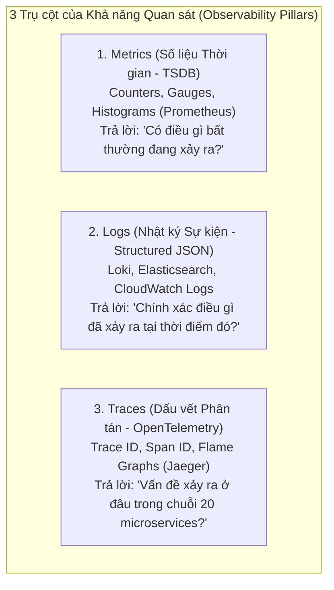
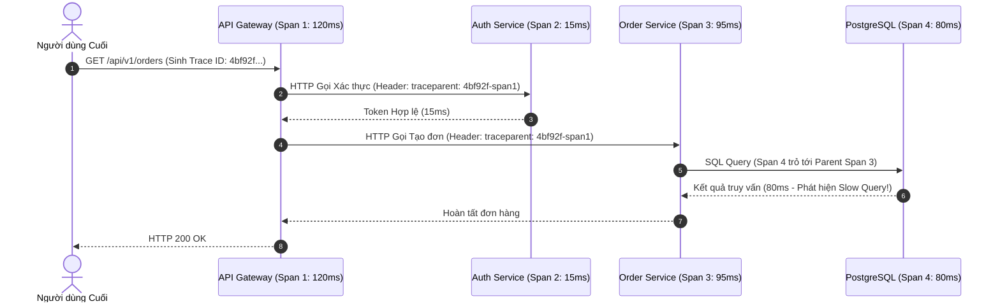
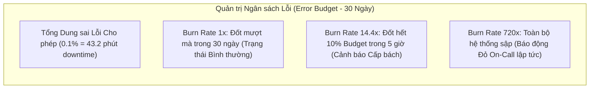
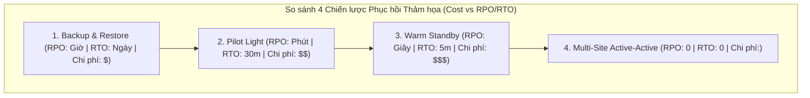

# 12.1. Cloud Observability and Operations (Khả năng Quan sát và Vận hành Đám mây)

## Tổng quan về Khả năng Quan sát và Vận hành Đám mây
Khả năng quan sát (Observability) là năng lực suy luận trạng thái nội tại của một hệ thống phân tán phức tạp dựa trên các dữ liệu đầu ra bên ngoài của nó (Telemetry Data). Khác với việc giám sát truyền thống (Monitoring - chỉ trả lời câu hỏi: *"Hệ thống có đang chết không?"*), Observability cho phép kỹ sư trả lời câu hỏi: *"Tại sao hệ thống lại bị chậm hoặc lỗi trong một trường hợp cụ thể kỳ dị chưa từng thấy trước đây?"*.

Về mặt toán học và lý thuyết độ tin cậy của Google SRE:
Khung quản lý độ tin cậy hệ thống dựa trên 3 khái niệm đo lường cốt lõi:
1. **SLI (Service Level Indicator - Chỉ số Mức độ Dịch vụ)**: Tỷ lệ phần trăm các sự kiện tốt trên tổng số sự kiện hợp lệ:
   $$\text{SLI} = \frac{\sum \text{Successful Requests (HTTP Status } < 500 \land \text{Latency } < 200\text{ms})}{\sum \text{Total Valid Requests}} \times 100\%$$
2. **SLO (Service Level Objective - Mục tiêu Mức độ Dịch vụ)**: Cam kết mục tiêu nội bộ của đội ngũ kỹ thuật trong một khoảng thời gian trượt (ví dụ: $\text{SLO} = 99.9\%$ trong 30 ngày).
3. **Error Budget (Ngân sách Lỗi)**: Dung sai thất bại cho phép của hệ thống mà không làm vi phạm cam kết với khách hàng:
   $$\text{Error Budget} = 100\% - \text{SLO} = 100\% - 99.9\% = 0.1\%$$
Nếu ngân sách lỗi còn dồi dào, đội ngũ được phép đẩy nhanh tốc độ triển khai tính năng mới; nếu ngân sách lỗi bị cạn kiệt (Burn Rate quá cao), mọi đợt deploy tính năng mới đều bị đóng băng để ưu tiên tối thượng cho việc sửa lỗi và tăng cường độ ổn định.



---

## 2. Chi tiết từng Keyword (Under-the-Hood Deep Dive)

---

### 1. The Three Pillars of Observability: Metrics, Logs & Distributed Tracing

#### 1. Khái niệm bản chất (What & Why)
- **Cloud Metrics**: Dữ liệu số học được gắn mốc thời gian (Time-series data). Có kích thước lưu trữ cực nhỏ, tối ưu cho việc vẽ biểu đồ theo thời gian thực và kích hoạt cảnh báo:
  - *Counter*: Giá trị số chỉ tăng (ví dụ: tổng số request HTTP đã nhận).
  - *Gauge*: Giá trị số có thể tăng hoặc giảm (ví dụ: dung lượng RAM tiêu thụ, số kết nối kết nối socket đang mở).
  - *Histogram / Summary*: Đo lường sự phân bố của các giá trị (ví dụ: đo đạc phân vị thời gian phản hồi: P50, P90, P99).
- **Centralized Logging (Ghi log Tập trung)**: Thay vì lưu log rải rác trên từng máy chủ, một Agent nhẹ (như FluentBit, Vector) liên tục đọc log từ `/var/log/pods` và đẩy về một cụm lưu trữ tập trung (Elasticsearch, Loki, CloudWatch Logs). Mọi dòng log bắt buộc phải được định dạng chuẩn **Structured JSON** có gắn nhãn ngữ cảnh (`trace_id`, `user_id`, `environment`).
- **Distributed Tracing (Bắt vết Phân tán - OpenTelemetry)**: Kỹ thuật theo dõi hành trình của một request khi nó đi xuyên qua hàng chục microservices độc lập, hàng đợi tin nhắn và cơ sở dữ liệu.
  - *Trace ID*: Mã định danh duy nhất của toàn bộ hành trình yêu cầu.
  - *Span ID*: Đại diện cho một đoạn xử lý công việc cụ thể bên trong một dịch vụ đơn lẻ (bao gồm thời gian bắt đầu, thời gian kết thúc và siêu dữ liệu).

#### 2. Cơ chế hoạt động sâu (Under the hood / Hardcore Internals)
- **Truyền bá Ngữ cảnh Phân tán theo Chuẩn W3C Trace Context (`traceparent`)**:
  - Khi Service A gửi request HTTP tới Service B, nó bắt buộc phải tiêm một HTTP Header chuẩn hóa có tên là **`traceparent`**:
    `traceparent: 00-4bf92f3577b34da6a3ce929d0e0e4736-00f067aa0ba902b7-01`
  - Cấu trúc 4 trường phân tách bởi dấu gạch ngang:
    1. `00`: Phiên bản chuẩn W3C.
    2. `4bf92f35...`: **Trace ID** toàn cục (16 bytes hex). Giữ nguyên không đổi xuyên suốt toàn bộ chuỗi cuộc gọi.
    3. `00f067aa...`: **Parent Span ID** (8 bytes hex). Service B sẽ lấy giá trị này làm parent của span mới mà nó chuẩn bị tạo.
    4. `01`: **Trace Flags** (bit 1 bật nghĩa là request này được chọn để lấy mẫu dữ liệu - Sampled).
  - Nhờ cơ chế này, công cụ APM có thể ghép nối hàng trăm span rời rạc thành một biểu đồ thác nước (Waterfall Graph) thể hiện chính xác microservice nào đang gây nghẽn cổ chai.

#### 3. Sơ đồ minh họa


#### 4. Code ví dụ thực chiến (C++ W3C Traceparent Header Parser & Context Propagator)
Chương trình C++ phân tích cú pháp chuỗi W3C Traceparent header để duy trì tính liên tục của dấu vết phân tán:

```cpp
#include <iostream>
#include <string>
#include <vector>
#include <sstream>
#include <iomanip>

struct W3cTraceContext {
    std::string version;
    std::string trace_id;
    std::string parent_span_id;
    std::string trace_flags;
    bool is_valid{false};
};

class TraceContextPropagator {
public:
    static W3cTraceContext parseTraceparent(const std::string& header_value) {
        W3cTraceContext ctx;
        std::stringstream ss(header_value);
        std::string segment;
        std::vector<std::string> parts;

        while (std::getline(ss, segment, '-')) {
            parts.push_back(segment);
        }

        if (parts.size() != 4 || parts[0] != "00" || parts[1].length() != 32 || parts[2].length() != 16) {
            std::cerr << "[Tracing Error] Định dạng W3C traceparent header không hợp lệ: " << header_value << "\n";
            return ctx;
        }

        ctx.version = parts[0];
        ctx.trace_id = parts[1];
        ctx.parent_span_id = parts[2];
        ctx.trace_flags = parts[3];
        ctx.is_valid = true;

        return ctx;
    }

    static std::string createChildSpanHeader(const W3cTraceContext& parent_ctx, const std::string& new_span_id) {
        return parent_ctx.version + "-" + parent_ctx.trace_id + "-" + new_span_id + "-" + parent_ctx.trace_flags;
    }
};

int main() {
    std::string incoming_header = "00-4bf92f3577b34da6a3ce929d0e0e4736-00f067aa0ba902b7-01";
    std::cout << "--- Phân tích Distributed Tracing Header ---\n";
    auto ctx = TraceContextPropagator::parseTraceparent(incoming_header);

    if (ctx.is_valid) {
        std::cout << "Trace ID      : " << ctx.trace_id << " (Dùng chung cho toàn bộ chuỗi Request)\n";
        std::cout << "Parent Span ID: " << ctx.parent_span_id << "\n";
        std::cout << "Sampled       : " << (ctx.trace_flags == "01" ? "CÓ" : "KHÔNG") << "\n";

        // Tạo span mới cho downstream microservice tiếp theo
        std::string new_child_span = "a1b2c3d4e5f60718";
        std::string outgoing_header = TraceContextPropagator::createChildSpanHeader(ctx, new_child_span);
        std::cout << "Outgoing Downstream traceparent Header: " << outgoing_header << "\n";
    }

    return 0;
}
```

#### 5. Ưu / Nhược điểm, Pitfalls & Anti-patterns
- **Distributed Tracing**: Công cụ duy nhất có thể chẩn đoán chính xác nguyên nhân gây trễ trong hệ thống có hàng trăm microservices.
- **Pitfall**: Bật tỷ lệ lấy mẫu trace $100\%$ (Sampling Rate = 100%) trong một hệ thống có thông lượng hàng trăm ngàn request/giây. Dung lượng mạng và chi phí lưu trữ trace telemetry sẽ còn tốn kém hơn toàn bộ chi phí chạy cụm ứng dụng chính!

#### 6. Ứng dụng thực tế trong Backend / Systems
- Tích hợp OpenTelemetry SDK vào tất cả các vi dịch vụ Go/Node.js/Java, đẩy toàn bộ dữ liệu spans về Jaeger và Prometheus để hiển thị bản đồ trực quan hóa độ trễ thời gian thực.

---

### 2. SLA, SLO, SLI & Multi-Window Burn Rate Alerting

#### 1. Khái niệm bản chất (What & Why)
- **SLA (Service Level Agreement - Thỏa thuận Mức Dịch vụ)**: Bản hợp đồng pháp lý giữa nhà cung cấp dịch vụ và khách hàng, có điều khoản bồi thường tài chính nếu chất lượng dịch vụ không đạt cam kết (ví dụ: cam kết Uptime $99.9\%$, nếu không đạt sẽ hoàn lại $20\%$ cước phí).
- **SLO (Service Level Objective - Mục tiêu Mức Dịch vụ)**: Mục tiêu kỹ thuật nội bộ nghiêm ngặt hơn SLA (ví dụ: cam kết nội bộ $99.95\%$ để tạo một khoảng đệm an toàn trước khi vi phạm SLA $99.9\%$).
- **SLI (Service Level Indicator - Chỉ số Đo lường Dịch vụ)**: Số liệu thực tế được tính toán từ hệ thống quan sát.
- **Error Budget Burn Rate (Tốc độ Đốt Ngân sách Lỗi)**:
  - Nếu ngân sách lỗi của 30 ngày bị tiêu thụ hết đúng trong 30 ngày, hệ thống có $\text{Burn Rate} = 1$.
  - Nếu xảy ra một sự cố nghiêm trọng khiến toàn bộ ngân sách lỗi của cả tháng bị đốt sạch chỉ trong vòng **1 giờ**, hệ thống đang có:
    $$\text{Burn Rate} = \frac{30 \times 24 \text{ hours}}{1 \text{ hour}} = 720\text{x}$$

#### 2. Cơ chế hoạt động sâu (Under the hood / Hardcore Internals)
- **Thuật toán Cảnh báo Đa Cửa sổ Đa Tốc độ (Multi-Window Multi-Burn-Rate Alerts)**:
  - Để vừa phát hiện sự cố cực nhanh (trong 2 phút), vừa không bị báo động giả khi có đợt tăng lỗi tạm thời trong 10 giây, Google SRE phát triển thuật toán cảnh báo đa cửa sổ:
  - Một cảnh báo khẩn cấp (Page Alert) chỉ được phát ra khi đồng thời **cả cửa sổ ngắn (Short Window) và cửa sổ dài (Long Window)** đều ghi nhận tốc độ đốt vượt ngưỡng:
    - *Cửa sổ 1 giờ (Long Window)*: Burn Rate $> 14.4$ (Tương đương đốt hết $2\%$ ngân sách lỗi trong 1 giờ).
    - *Cửa sổ 5 phút (Short Window)*: Burn Rate $> 14.4$ (Đảm bảo sự cố vẫn đang tiếp tục diễn ra ở thời điểm hiện tại).

#### 3. Sơ đồ minh họa


#### 4. Code ví dụ thực chiến (Prometheus PromQL Multi-Burn-Rate Alert Rule)
Quy tắc cảnh báo PromQL chuẩn mực của Google SRE: Phát hiện tốc độ đốt ngân sách lỗi vượt ngưỡng 14.4x trên cả 2 khung thời gian 1 giờ và 5 phút:

```yaml
groups:
  - name: service_slo_alerts
    rules:
      - alert: HighErrorBudgetBurnRate
        # Đốt hơn 2% Error Budget trong 1 giờ (Burn Rate > 14.4)
        expr: |
          (
            sum(rate(http_requests_total{status=~"5.."}[1h])) 
            / 
            sum(rate(http_requests_total[1h]))
          ) > (1 - 0.999) * 14.4
          and
          (
            sum(rate(http_requests_total{status=~"5.."}[5m])) 
            / 
            sum(rate(http_requests_total[5m]))
          ) > (1 - 0.999) * 14.4
        for: 2m
        labels:
          severity: page # Đánh thức kỹ sư trực khẩn cấp
        annotations:
          summary: "Tốc độ đốt ngân sách lỗi (Error Budget Burn Rate) vượt quá 14.4x!"
          description: "Dịch vụ đang tiêu thụ ngân sách lỗi với tốc độ nghiêm trọng trên cả cửa sổ 1h và 5m. Nguy cơ vi phạm SLA!"
          runbook_url: "https://wiki.company.com/runbooks/high-error-rate"
```

#### 5. Ưu / Nhược điểm, Pitfalls & Anti-patterns
- **Multi-Burn-Rate Alerting**: Triệt tiêu $95\%$ các cảnh báo báo động giả giữa đêm, chỉ gọi điện thoại đánh thức kỹ sư khi sự cố thực sự đe dọa đến cam kết dịch vụ.
- **Pitfall**: Đặt mục tiêu SLO quá hoàn hảo ($100\%$). Trong hệ thống phân tán, đạt được $100\%$ là bất khả thi về mặt vật lý và sẽ làm tê liệt toàn bộ khả năng đổi mới sáng tạo của doanh nghiệp vì không ai dám deploy code mới.

#### 6. Ứng dụng thực tế trong Backend / Systems
- Thiết lập bảng điều khiển Grafana SLO Dashboard cho toàn bộ các dịch vụ thanh toán, liên tục hiển thị lượng Error Budget còn lại trong tháng của từng nhóm sản phẩm.

---

### 3. Cloud Disaster Recovery (DR) Strategies

#### 1. Khái niệm bản chất (What & Why)
- **Disaster Recovery (DR - Phục hồi sau Thảm họa)**: Kế hoạch và quy trình kỹ thuật nhằm khôi phục toàn bộ hoạt động của hệ thống công nghệ thông tin khi trung tâm dữ liệu chính hoặc cả một vùng địa lý (Region) bị phá hủy bởi động đất, lũ lụt, chiến tranh, hoặc lỗi cáp biển diện rộng.
- **4 Chiến lược Khôi phục sau Thảm họa Đám mây (Sắp xếp theo chi phí và tốc độ)**:
  1. **Backup and Restore (Sao lưu và Phục hồi)**: Dữ liệu được sao lưu định kỳ sang Region khác. Khi sự cố xảy ra, kỹ sư dùng mã IaC tạo lại toàn bộ hạ tầng từ đầu và nạp lại dữ liệu từ bản backup. Rẻ nhất nhưng RTO mất nhiều giờ/ngày, RPO phụ thuộc vào chu kỳ backup.
  2. **Pilot Light (Đèn báo Chờ)**: Dữ liệu cốt lõi (Database) liên tục được sao chép đồng bộ/bất đồng bộ sang Region dự phòng. Tuy nhiên, tầng tính toán (Compute/API) chỉ chạy ở mức tối thiểu (hoặc tắt hoàn toàn). Khi thảm họa xảy ra, hệ thống tự động scale-out số lượng máy ảo lên kích thước đầy đủ. RPO tính bằng phút, RTO mất $10 - 30$ phút.
  3. **Warm Standby (Dự phòng Ấm)**: Một bản sao thu nhỏ ($20\% - 30\%$ dung lượng) của toàn bộ hệ thống luôn chạy sẵn sàng tại Region thứ hai. Khi sự cố xảy ra, chỉ cần mở rộng dung lượng lên $100\%$ và chuyển hướng DNS. RPO tính bằng giây, RTO $< 5$ phút.
  4. **Multi-Site Active-Active (Đa Vùng Hoạt động Kép)**: Cả hai Region đều mở cửa phục vụ $50\%$ lưu lượng truy cập thực tế cùng lúc. Dữ liệu được đồng bộ liên tục hai chiều. Nếu một Region sập, Region còn lại tiếp nhận ngay $100\%$ lưu lượng mà không cần bất kỳ sự can thiệp nào. Đắt đỏ nhất nhưng $\text{RPO} \approx 0$ và $\text{RTO} \approx 0$.

#### 2. Cơ chế hoạt động sâu (Under the hood / Hardcore Internals)
- **Cơ chế Chuyển mạch Thảm họa DNS Failover (Route 53 Health Checks)**:
  - Hệ thống DNS toàn cầu liên tục gửi gói tin thăm dò (Health Check Probes) từ 8 thành phố trên thế giới tới API Endpoint của Region chính mỗi 10 giây.
  - Nếu Endpoint tại Region chính không phản hồi hoặc trả về HTTP 5xx liên tiếp 3 lần, DNS Server tự động cập nhật bản ghi Anycast, định tuyến toàn bộ người dùng sang VIP của Region dự phòng (Warm Standby / Active-Active).

#### 3. Sơ đồ minh họa


#### 4. Code ví dụ thực chiến (TypeScript Disaster Recovery Health Check & Failover Simulator)
Mô phỏng bộ kiểm tra sức khỏe và tự động kích hoạt kịch bản chuyển mạch thảm họa:

```typescript
export interface RegionHealth {
  region: string;
  healthy: boolean;
  consecutiveFailures: number;
}

export class DisasterRecoveryCoordinator {
  private primaryRegion: RegionHealth = { region: "ap-southeast-1", healthy: true, consecutiveFailures: 0 };
  private drRegion: RegionHealth = { region: "ap-northeast-1", healthy: true, consecutiveFailures: 0 };
  private activeServingRegion: string = "ap-southeast-1";

  public reportProbeResult(isSuccess: boolean): void {
    if (isSuccess) {
      this.primaryRegion.consecutiveFailures = 0;
      this.primaryRegion.healthy = true;
    } else {
      this.primaryRegion.consecutiveFailures++;
      console.warn(`[DR Probe Warning] Region Chính thất bại lần ${this.primaryRegion.consecutiveFailures}/3!`);

      // Nếu thất bại 3 lần liên tiếp: Kích hoạt quy trình chuyển mạch thảm họa
      if (this.primaryRegion.consecutiveFailures >= 3 && this.activeServingRegion === this.primaryRegion.region) {
        this.triggerAutomatedFailover();
      }
    }
  }

  private triggerAutomatedFailover(): void {
    console.error("==================================================================");
    console.error("[CẢNH BÁO THẢM HỌA KHẨN CẤP] Region Chính bị mất liên lạc hoàn toàn!");
    console.error(`-> Bắt đầu kích hoạt Failover chuyển mạch sang Region Dự phòng: ${this.drRegion.region}...`);

    // 1. Nâng cấp Read Replica tại DR Region thành Primary
    console.log("  [Step 1] Thăng cấp Cross-Region Aurora Replica thành Master Read/Write.");
    // 2. Mở rộng Auto Scaling Group từ 20% lên 100% capacity
    console.log("  [Step 2] Scale-out cụm Kubernetes tại DR Region lên 100% tài nguyên.");
    // 3. Đảo DNS Route 53
    console.log("  [Step 3] Cập nhật bản ghi DNS Route 53 trỏ về Load Balancer của DR Region.");

    this.activeServingRegion = this.drRegion.region;
    console.error(`[FAILOVER HOÀN TẤT] Hệ thống đã phục hồi dịch vụ tại ${this.activeServingRegion} (RTO < 3 phút)!`);
    console.error("==================================================================");
  }
}

// Chạy thử nghiệm giả lập sự cố mất điện toàn vùng
const dr = new DisasterRecoveryCoordinator();
dr.reportProbeResult(false); // Lỗi lần 1
dr.reportProbeResult(false); // Lỗi lần 2
dr.reportProbeResult(false); // Lỗi lần 3 -> Kích hoạt Failover tức thì!
```

#### 5. Ưu / Nhược điểm, Pitfalls & Anti-patterns
- **Active-Active**: Tốc độ phục hồi thảm họa gần như tức thời; nhưng chi phí hạ tầng gấp đôi và phát sinh bài toán xung đột dữ liệu đa vùng (Cross-Region Write Conflicts / Split-Brain).
- **Pitfall**: Có kế hoạch DR trên giấy nhưng không bao giờ tổ chức diễn tập thực tế (GameDay / DR Drill). Đến khi thảm họa xảy ra, các bản sao lưu database bị lỗi không giải nén được hoặc mật khẩu tài khoản vùng dự phòng đã bị hết hạn.

#### 6. Ứng dụng thực tế trong Backend / Systems
- Thiết lập kịch bản Warm Standby cho hệ thống ngân hàng số: Duy trì cụm hạ tầng dự phòng tối thiểu tại Tokyo, định kỳ 6 tháng một lần thực hiện diễn tập chuyển toàn bộ $100\%$ giao dịch người dùng sang Tokyo trong 2 giờ rồi chuyển ngược lại.
