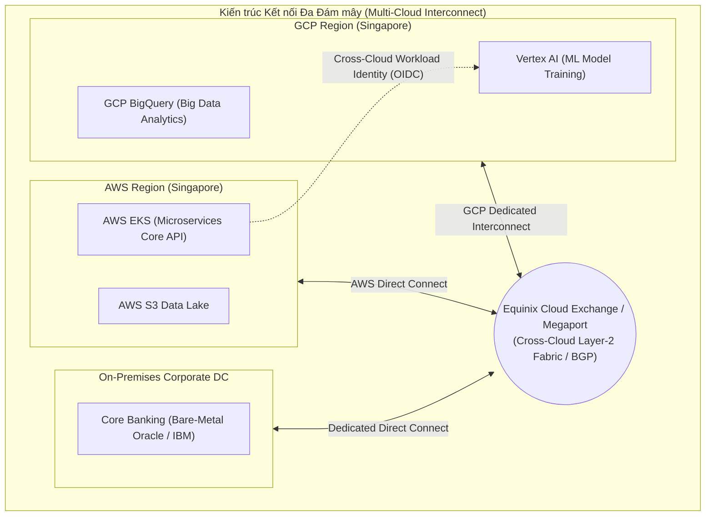
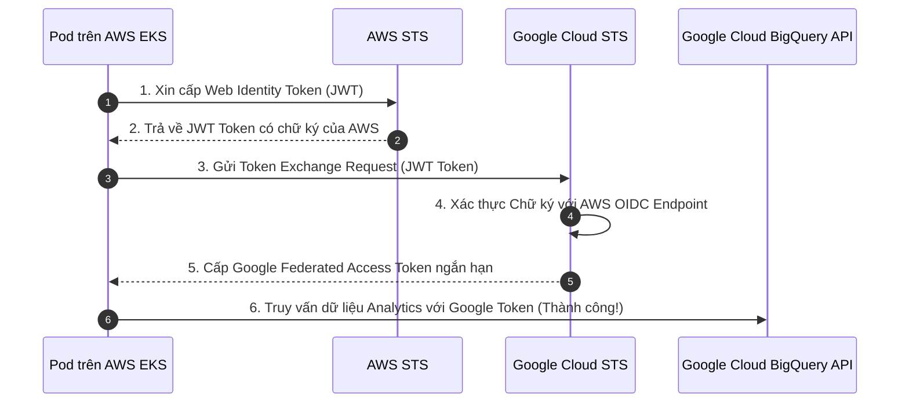
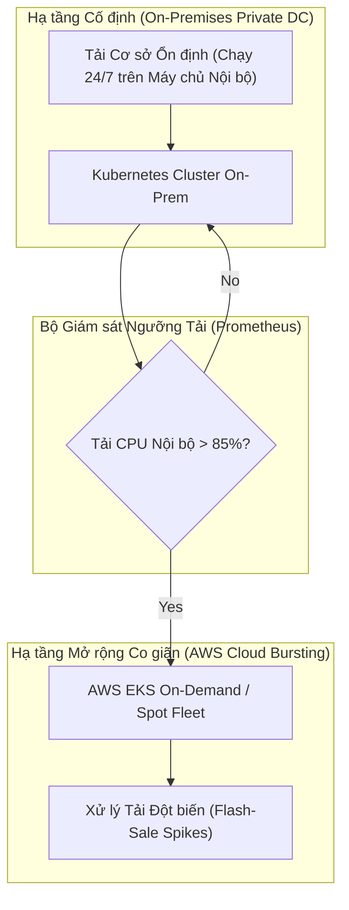

# 13.1. Multi-Cloud and Hybrid Cloud Architectures (Kiến trúc Đa Đám mây và Đám mây Lai)

## Tổng quan về Kiến trúc Đa Đám mây và Đám mây Lai
Kiến trúc Đa Đám mây (Multi-Cloud Architecture) và Đám mây Lai (Hybrid Cloud Architecture) là chiến lược kết hợp giữa hạ tầng máy chủ cục bộ (On-premises Data Center / Private Cloud) với hai hoặc nhiều nhà cung cấp đám mây công cộng độc lập (Public Cloud Providers: AWS, GCP, Azure, Oracle Cloud). Mục tiêu chiến lược là tránh bị khóa chặt vào một nhà cung cấp duy nhất (Vendor Lock-in Mitigation), tối ưu hóa bài toán phân bổ công việc (Optimal Workload Placement), tuân thủ chủ quyền dữ liệu (Data Residency) và xây dựng kế hoạch rút lui an toàn (Cloud Exit Strategy).

Về mặt kinh tế học và chi phí truyền tải dữ liệu xuyên đám mây (Cross-Cloud Egress Cost Model):
Mặc dù Multi-Cloud mang lại tính độc lập cao, nó phải đối mặt với **"Cái bẫy chi phí Egress" (Egress Data Transfer Trap)**:
$$\text{Cost}_{\text{Cross-Cloud}} = \sum \text{Egress}_{\text{Provider A} \to \text{Provider B}} \times \text{Rate}_{\text{Egress}} + \text{Tunnel Fee} + \Delta_{\text{Latency Overhead}}$$
Do các CSP áp dụng mức phí dữ liệu đi ra ngoài rất cao ($\approx \$0.08 - \$0.12/\text{GB}$), bất kỳ kiến trúc phân tán nào thực hiện các câu truy vấn cơ sở dữ liệu đồng bộ hoặc truyền tải các tập dữ liệu lớn liên tục giữa AWS và GCP đều sẽ khiến chi phí vận hành tăng vọt theo cấp số nhân và làm suy giảm hiệu năng do độ trễ truyền thông xuyên lục địa.



---

## 2. Chi tiết từng Keyword (Under-the-Hood Deep Dive)

---

### 1. Cross-Cloud Networking, Identity & Security Federation

#### 1. Khái niệm bản chất (What & Why)
- **Cross-Cloud Networking (Kết nối Mạng Xuyên Đám mây)**: Thiết lập kênh truyền thông bảo mật, băng thông cao và độ trễ thấp giữa VPC của AWS, VNet của Azure và VPC của GCP:
  - *IPsec VPN*: Kênh truyền mã hóa qua Internet công cộng. Dễ cấu hình, chi phí thấp nhưng băng thông bị giới hạn ($1.25\text{Gbps}$ mỗi tunnel).
  - *Cloud Interconnect Fabric (Megaport, Equinix Cloud Exchange)*: Tuyến kết nối vật lý Layer-2 chuyên dụng nối trực tiếp router biên của AWS và GCP tại cùng một tòa nhà trung tâm dữ liệu (Colocation Facility), đem lại độ trễ sub-millisecond ($< 2\text{ms}$) và băng thông lên tới $100\text{Gbps}$.
- **Cross-Cloud Identity & Security Federation (Liên đoàn Định danh Xuyên Đám mây)**:
  - Cơ chế cho phép một ứng dụng chạy trên AWS EKS có thể truy cập an toàn vào cơ sở dữ liệu BigQuery của Google Cloud mà **hoàn toàn không cần tạo và lưu trữ Service Account Key JSON của GCP trên AWS**.
  - Tận dụng chuẩn mở **OIDC (OpenID Connect)**: Pod trên AWS lấy token JWT từ AWS STS, sau đó gửi sang GCP Security Token Service để đổi lấy Access Token tạm thời của Google Cloud (Workload Identity Federation).
- **Cloud Federation & Interoperability**: Khả năng các hệ thống đám mây khác nhau có thể phối hợp trao đổi dữ liệu mượt mà thông qua các chuẩn giao tiếp mở của CNCF (Kubernetes, OpenTelemetry, gRPC).

#### 2. Cơ chế hoạt động sâu (Under the hood / Hardcore Internals)
- **Quy trình Trao đổi Token trong GCP Workload Identity Federation**:
  1. Microservice trên AWS EKS yêu cầu AWS STS cấp phát một JWT Web Identity Token có chữ ký của AWS.
  2. Microservice gửi JWT này tới **GCP Security Token Service (STS)** endpoint: `https://sts.googleapis.com/v1/token`.
  3. GCP STS kết nối tới AWS OIDC Discovery endpoint (`https://oidc.eks.ap-southeast-1.amazonaws.com/...`) để kiểm tra chữ ký mật mã của token.
  4. Sau khi xác thực danh tính, GCP STS sinh ra một Google Federated Access Token ngắn hạn (hiệu lực 60 phút).
  5. Ứng dụng dùng token này để gọi API của Google BigQuery hoặc Vertex AI một cách hoàn toàn hợp lệ mà không có bất kỳ thông tin mật tĩnh nào bị để lộ.

#### 3. Sơ đồ minh họa


#### 4. Code ví dụ thực chiến (TypeScript Cross-Cloud Identity Token Exchange)
Minh họa việc đổi Token giữa AWS và Google Cloud để thực hiện liên đoàn định danh không dùng password:

```typescript
import axios from "axios";

export interface GcpFederatedTokenResponse {
  access_token: string;
  token_type: string;
  expires_in: number;
}

export class CrossCloudIdentityBroker {
  private gcpAudience: string;
  private gcpServiceAccountEmail: string;

  constructor(gcpProjectNumber: string, poolId: string, providerId: string, saEmail: string) {
    // Định danh Audience của GCP Workload Identity Pool
    this.gcpAudience = `//iam.googleapis.com/projects/${gcpProjectNumber}/locations/global/workloadIdentityPools/${poolId}/providers/${providerId}`;
    this.gcpServiceAccountEmail = saEmail;
  }

  /**
   * Đổi AWS OIDC Token lấy Google Cloud Access Token ngắn hạn
   */
  public async exchangeAwsTokenForGcpAccess(awsOidcToken: string): Promise<string> {
    console.log("[Cross-Cloud IAM] Đang bắt tay trao đổi danh tính giữa AWS và Google Cloud...");

    // BƯỚC 1: Đổi AWS JWT lấy Federated Token từ Google STS
    const stsResponse = await axios.post<GcpFederatedTokenResponse>(
      "https://sts.googleapis.com/v1/token",
      {
        audience: this.gcpAudience,
        grantType: "urn:ietf:params:oauth:grant-type:token-exchange",
        requestedTokenType: "urn:ietf:params:oauth:token-type:access_token",
        scope: "https://www.googleapis.com/auth/cloud-platform",
        subjectTokenType: "urn:ietf:params:oauth:token-type:jwt",
        subjectToken: awsOidcToken,
      }
    );

    const federatedToken = stsResponse.data.access_token;
    console.log("[Cross-Cloud IAM] Trao đổi thành công Federated Token. Đang impersonate Service Account...");

    // BƯỚC 2: Đóng vai Google Service Account thực tế
    const iamResponse = await axios.post<{ accessToken: string }>(
      `https://iamcredentials.googleapis.com/v1/projects/-/serviceAccounts/${this.gcpServiceAccountEmail}:generateAccessToken`,
      { scope: ["https://www.googleapis.com/auth/bigquery"] },
      { headers: { Authorization: `Bearer ${federatedToken}` } }
    );

    console.log("[Cross-Cloud IAM] Nhận Google Access Token thành công! Thời hạn: 3600s.");
    return iamResponse.data.accessToken;
  }
}
```

#### 5. Ưu / Nhược điểm, Pitfalls & Anti-patterns
- **Ưu điểm**: Bảo mật tối đa, loại bỏ hoàn toàn các file Service Account Key JSON (nguyên nhân hàng đầu gây rò rỉ dữ liệu khi đẩy lên GitHub).
- **Pitfall**: Thiết kế ứng dụng ghi dữ liệu vào AWS S3 nhưng bắt microservice trên Google Cloud đọc trực tiếp từ S3 qua mạng công cộng. Băng thông Egress của AWS sẽ bị tính phí nặng nề; giải pháp đúng là dùng công cụ đồng bộ dữ liệu theo lô hoặc đặt dịch vụ gần nguồn dữ liệu nhất.

#### 6. Ứng dụng thực tế trong Backend / Systems
- Hệ thống phân tích bán lẻ đa quốc gia: Ứng dụng backend phục vụ đơn hàng chạy trên AWS EKS, nhưng toàn bộ dữ liệu log được chuyển giao bất đồng bộ sang Google BigQuery để chạy các mô hình AI Machine Learning mà không cần lưu giữ secret tĩnh.

---

### 2. Workload Placement, Cloud Bursting & Cloud Exit Strategy

#### 1. Khái niệm bản chất (What & Why)
- **Optimal Workload Placement (Định vị Workload Tối ưu)**: Chiến lược đặt từng loại tác vụ vào đúng nền tảng đám mây có lợi thế cạnh tranh cao nhất:
  - Chạy các thuật toán Big Data / AI / LLM trên Google Cloud (Vertex AI, BigQuery, TPU).
  - Chạy hệ sinh thái doanh nghiệp Windows / Active Directory / .NET trên Microsoft Azure.
  - Chạy hạ tầng tính toán quy mô khổng lồ và các dịch vụ phi máy chủ trên AWS.
- **Cloud Bursting (Vọt tải Lên Đám mây)**: Mô hình kiến trúc trong đó hệ thống bình thường chỉ chạy trên hạ tầng máy chủ nội bộ (Private Cloud / On-premises) để tiết kiệm chi phí cơ bản. Khi có các đợt lưu lượng tăng đột biến vượt quá công suất (Peak Traffic Burst như sự kiện Black Friday), hệ thống tự động tràn (Burst) một phần các Worker Pods sang Public Cloud để xử lý tải tạm thời, và tự động thu hồi khi tải hạ nhiệt.
- **Cloud Exit Strategy (Chiến lược Thoát lui Đám mây)**: Bản kế hoạch kỹ thuật và tài chính bắt buộc (theo quy định của các ngân hàng trung ương và cơ quan quản lý tài chính châu Âu - EBA Guidelines) mô tả cách thức doanh nghiệp có thể di dời toàn bộ hệ thống và dữ liệu rời khỏi một Cloud Provider trong vòng 6 tháng mà không làm gián đoạn hoạt động kinh doanh.
- **Bẫy "Mẫu số Chung Nhỏ nhất" (Lowest Common Denominator Trap)**: Sai lầm phổ biến khi cố gắng xây dựng hệ thống hoàn toàn độc lập với Cloud (Cloud-Agnostic) đến mức từ chối sử dụng toàn bộ các dịch vụ Managed Services mạnh mẽ của CSP (như S3, DynamoDB, SQS), mà tự cài đặt MinIO, Cassandra, RabbitMQ trên VM. Kết quả là chi phí nhân sự vận hành tăng gấp 5 lần và mất đi lợi thế cạnh tranh về tốc độ.

#### 2. Cơ chế hoạt động sâu (Under the hood / Hardcore Internals)
- **Kiến trúc Cloud Bursting qua Kubernetes Cluster Federation (KubeFed / Liqo)**:
  - Sử dụng các giải pháp mở rộng cụm như **Liqo**:
  - Cụm Kubernetes On-premises tự động thiết lập một kết nối VPN WireGuard ngang hàng bảo mật tới cụm Kubernetes trên AWS EKS.
  - Các Worker Nodes trên AWS xuất hiện trong cụm On-premises dưới dạng các nút ảo (**Virtual Kubelet**).
  - Khi CPU của cụm On-premises đạt $85\%$, Scheduler tự động lập lịch các Pod tiếp theo sang các Virtual Nodes trên AWS EKS để mở rộng tải tức thì.

#### 3. Sơ đồ minh họa


#### 4. Code ví dụ thực chiến (C++ Cloud Bursting Capacity Dispatcher)
Mô phỏng thuật toán điều phối luồng công việc quyết định xem tác vụ nào chạy tại Data Center nội bộ và tác vụ nào cần Burst lên Public Cloud:

```cpp
#include <iostream>
#include <string>
#include <vector>

struct WorkloadTask {
    std::string task_id;
    int required_cpu_cores;
    bool contains_pii_data; // Dữ liệu định danh cá nhân nhạy cảm
};

class CloudBurstingDispatcher {
private:
    int local_available_cores;
    const int max_local_capacity;

public:
    explicit CloudBurstingDispatcher(int capacity) 
        : local_available_cores(capacity), max_local_capacity(capacity) {}

    void dispatchTask(const WorkloadTask& task) {
        std::cout << "[Dispatcher] Tiếp nhận Task #" << task.task_id 
                  << " (Cần " << task.required_cpu_cores << " Cores)...\n";

        // 1. Kiểm tra tuân thủ dữ liệu (Data Sovereignty Compliance)
        if (task.contains_pii_data) {
            std::cout << "  -> [Bắt buộc On-Prem] Task chứa dữ liệu PII nhạy cảm! Bắt buộc chạy trên Private Datacenter.\n";
            local_available_cores -= task.required_cpu_cores;
            return;
        }

        // 2. Kiểm tra dung lượng khả dụng của Data Center nội bộ
        if (local_available_cores >= task.required_cpu_cores) {
            local_available_cores -= task.required_cpu_cores;
            std::cout << "  -> [Cấp phát Nội bộ] Chạy trên Private Cluster (Cores nội bộ còn lại: " 
                      << local_available_cores << ")\n";
        } else {
            // Hết công suất nội bộ -> Kích hoạt Cloud Bursting lên AWS Public Cloud
            std::cout << "  -> [CLOUD BURSTING] Hạ tầng nội bộ đã đầy (Cores còn: " << local_available_cores << ")! "
                      << "Tự động phân bổ Task #" << task.task_id << " lên AWS EKS Spot Instances!\n";
        }
    }
};

int main() {
    // Data Center nội bộ có công suất tối đa 16 Cores
    CloudBurstingDispatcher dispatcher(16);

    dispatcher.dispatchTask({ "TASK-001", 8, false });
    dispatcher.dispatchTask({ "TASK-002", 6, false });
    // Tác vụ này vượt quá 16 Cores khả dụng -> Kích hoạt Bursting
    dispatcher.dispatchTask({ "TASK-003", 8, false });
    // Tác vụ chứa dữ liệu nhạy cảm
    dispatcher.dispatchTask({ "TASK-004", 4, true });

    return 0;
}
```

#### 5. Ưu / Nhược điểm, Pitfalls & Anti-patterns
- **Cloud Bursting**: Tối ưu hóa chi phí vốn (CapEx), không phải mua sắm máy chủ thừa thãi chỉ để phục vụ vài ngày cao điểm trong năm.
- **Pitfall**: Cố gắng trừu tượng hóa toàn bộ hệ thống để đạt tính "Cloud-Agnostic" tuyệt đối, dẫn đến việc không thể tận dụng các dịch vụ đột phá của từng cloud và làm phức tạp hóa kiến trúc gấp nhiều lần.

#### 6. Ứng dụng thực tế trong Backend / Systems
- Hệ thống xử lý báo cáo thuế hoặc kết quả thi đại học quốc gia: Duy trì cụm máy chủ nội bộ trong năm, và tự động kích hoạt Cloud Bursting lên AWS để xử lý hàng triệu lượt tra cứu điểm thi chỉ trong 3 ngày công bố kết quả.
