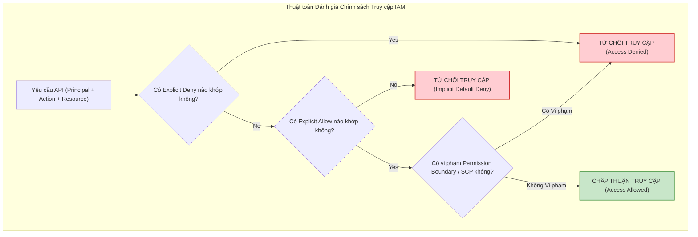
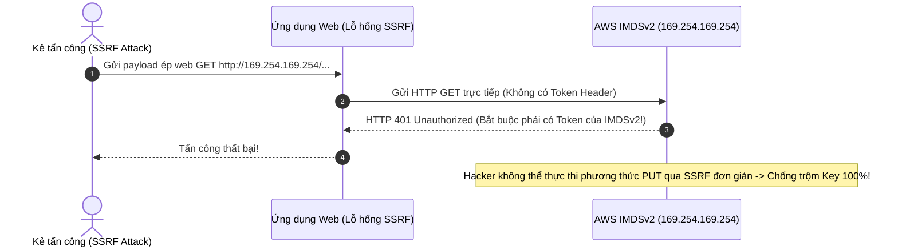
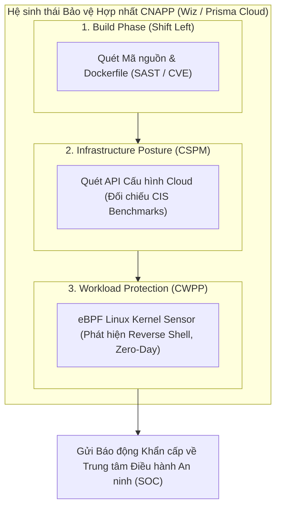
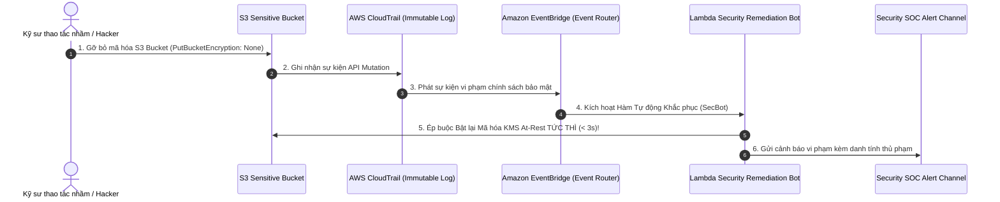

# 14.1. Cloud Identity, Compliance and Workload Protection (Quản trị Định danh, Tuân thủ và Bảo vệ Tải công việc Đám mây)

## Tổng quan về An toàn Thông tin và Quản trị Bảo mật Đám mây
Bảo mật đám mây hiện đại vận hành theo mô hình **Không tin cậy (Zero-Trust Architecture)**: *"Không bao giờ tin tưởng, luôn luôn xác thực"* (Never Trust, Always Verify). Mọi yêu cầu truy cập — cho dù xuất phát từ bên ngoài Internet hay từ một vi dịch vụ nội bộ bên trong VPC — đều bắt buộc phải được định danh (Authentication), phân quyền tối thiểu (Authorization with Least Privilege), mã hóa đầu cuối và lưu vết kiểm toán bất biến (Immutable Audit Trail).

Về mặt logic toán học của bộ máy đánh giá chính sách truy cập IAM (IAM Policy Evaluation Logic):
Cơ chế đánh giá quyền hạn của các nhà cung cấp đám mây (AWS, GCP, Azure) tuân theo một thuật toán quyết định nghiêm ngặt:
$$\text{Decision} = \begin{cases} 
\mathbf{DENY}, & \text{nếu tồn tại ít nhất một Explicit Deny} \\
\mathbf{ALLOW}, & \text{nếu có ít nhất một Explicit Allow } \land \text{ không có Deny} \\
\mathbf{DENY}, & \text{mặc định (Implicit Default Deny)}
\end{cases}$$
Quy tắc **Phủ quyết Tuyệt đối (Explicit Deny Overrides All)** luôn có quyền lực tối cao nhất. Nếu một người dùng được cấp quyền `AdministratorAccess` (Allow `*`) nhưng bị một chính sách bảo vệ cấp độ tổ chức (như AWS Service Control Policy) gắn cờ `Deny: s3:DeleteBucket`, hành động xóa bucket sẽ bị chặn đứng ngay lập tức.



---

## 2. Chi tiết từng Keyword (Under-the-Hood Deep Dive)

---

### 1. Identity & Access Management (IAM): RBAC, ABAC & Workload Identity

#### 1. Khái niệm bản chất (What & Why)
- **Cloud IAM (Identity and Access Management)**: Hệ thống quản lý quyền truy cập tập trung, xác định **Ai (Who)** có thể làm **Gì (What)** trên **Tài nguyên nào (Which Resource)** và trong **Điều kiện nào (Under Which Conditions)**:
  - *IAM Users*: Tài khoản định danh của con người (hạn chế dùng trong production, ưu tiên dùng Single Sign-On / SSO).
  - *IAM Groups*: Nhóm gom các người dùng có chung nhiệm vụ để gán quyền hàng loạt.
  - *IAM Roles & Temporary Credentials*: Danh tính không gắn liền với một người dùng cụ thể, không sở hữu mật khẩu tĩnh hay Access Keys dài hạn. Được dùng bởi các máy ảo (EC2 Instance Profile), Pods (IRSA) hoặc các dịch vụ đám mây thông qua việc xin cấp phát các mã khóa tạm thời có chữ ký số (ngắn hạn từ 15 phút đến 12 giờ) từ AWS STS.
  - *IAM Policies*: Văn bản JSON định nghĩa quyền hạn (Identity-based Policies gắn vào User/Role; Resource-based Policies gắn trực tiếp vào tài nguyên như S3 Bucket Policy, KMS Key Policy).
- **RBAC (Role-Based Access Control) vs ABAC (Attribute-Based Access Control)**:
  - *RBAC*: Cấp quyền dựa trên vai trò tĩnh (ví dụ: Role `DatabaseAdmin`, Role `BillingViewer`). Khi công ty tăng trưởng lên hàng ngàn nhân viên và dịch vụ, số lượng role sẽ bùng nổ mất kiểm soát (Role Explosion).
  - *ABAC*: Cấp quyền động dựa trên **Thẻ nhãn thuộc tính (Tags)** của cả người dùng và tài nguyên. Ví dụ một chính sách duy nhất: *"Cho phép kỹ sư truy cập máy ảo nếu thẻ `${aws:PrincipalTag/Department}` trùng khớp với thẻ `${aws:ResourceTag/Department}`"*.
- **Workload Identity (Danh tính Tải công việc)**: Cơ chế gán quyền IAM cho các container hoặc Pods mà không cần mount file credentials vào container.

#### 2. Cơ chế hoạt động sâu (Under the hood / Hardcore Internals)
- **Phòng chống Tấn công SSRF bằng IMDSv2 (Instance Metadata Service Version 2)**:
  - Dịch vụ Metadata của máy ảo đám mây chạy trên địa chỉ Link-local IP: `http://169.254.169.254`.
  - Trong chuẩn cũ (IMDSv1), nếu ứng dụng web bị lỗi bảo mật **Server-Side Request Forgery (SSRF)**, kẻ tấn công có thể ép web server gửi lệnh `GET http://169.254.169.254/latest/meta-data/iam/security-credentials/` để lấy trộm toàn bộ Access Key và Secret Key của máy ảo.
  - **IMDSv2 khắc phục triệt để bằng cơ chế bắt tay phiên 2 bước (Session-oriented)**:
    1. Bước 1: Ứng dụng bắt buộc phải gửi request `PUT` với header `X-aws-ec2-metadata-token-ttl-seconds: 60` để xin một Token bí mật.
    2. Bước 2: Dùng Token đó trong header `X-aws-ec2-metadata-token` của lệnh `GET` tiếp theo.
    3. Quan trọng nhất: IMDSv2 đặt giá trị **IP TTL = 1** cho gói tin phản hồi của token. Khi hacker khai thác qua proxy/WAF hoặc SSRF nhiều bước, gói tin sẽ bị Router/Kernel hủy ngay lập tức vì TTL giảm về 0, bảo vệ an toàn tuyệt đối cho credentials của máy ảo.

#### 3. Sơ đồ minh họa


#### 4. Code ví dụ thực chiến (JSON AWS ABAC Least-Privilege IAM Policy)
Chính sách IAM ABAC chuẩn mực: Cho phép nhà phát triển chỉ được phép khởi động/tắt các máy ảo có nhãn Project trùng khớp với nhãn Project của chính họ:

```json
{
  "Version": "2012-10-17",
  "Statement": [
    {
      "Sid": "AllowStartStopInstancesWithMatchingDepartmentTag",
      "Effect": "Allow",
      "Action": [
        "ec2:StartInstances",
        "ec2:StopInstances"
      ],
      "Resource": "arn:aws:ec2:*:*:instance/*",
      "Condition": {
        "StringEquals": {
          "aws:ResourceTag/Project": "${aws:PrincipalTag/Project}",
          "aws:ResourceTag/Environment": "Development"
        }
      }
    }
  ]
}
```

#### 5. Ưu / Nhược điểm, Pitfalls & Anti-patterns
- **ABAC & Temporary Roles**: Khả năng mở rộng quản trị không giới hạn; giảm $99\%$ rủi ro bị lộ khóa tĩnh dài hạn.
- **Pitfall**: Sử dụng ký tự đại diện wildcard quá lỏng lẻo (`Action: "*"` hoặc `Resource: "*"`). Nếu ứng dụng bị chiếm quyền, hacker có thể xóa sạch cơ sở dữ liệu và mã hóa toàn bộ dữ liệu đòi tiền chuộc.

#### 6. Ứng dụng thực tế trong Backend / Systems
- Thiết lập IAM Roles for Service Accounts (IRSA) trong EKS: Gán trực tiếp một IAM Role với quyền đọc ghi S3 cho duy nhất một Pod xử lý hóa đơn, đảm bảo các Pod khác chạy trên cùng một máy chủ vật lý hoàn toàn không có quyền truy cập vào bucket đó.

---

### 2. Cloud Security Architecture: CSPM, CWPP, CNAPP & Benchmarks

#### 1. Khái niệm bản chất (What & Why)
- **CSPM (Cloud Security Posture Management - Quản trị Tư thế An ninh Đám mây)**:
  - Công cụ liên tục kiểm toán và đối chiếu cấu hình của toàn bộ Control Plane đám mây thông qua API (không cần cài agent).
  - Phát hiện các cấu hình sai lầm kinh điển: S3 Bucket bị mở Public, Security Group mở cổng SSH `0.0.0.0/0`, tài khoản Root không bật MFA, thiếu mã hóa KMS.
- **CWPP (Cloud Workload Protection Platform - Nền tảng Bảo vệ Tải công việc)**:
  - Công cụ bảo vệ chạy trực tiếp bên trong máy chủ hoặc container (sử dụng Agent hoặc **eBPF Kernel Sensor**).
  - Giám sát hành vi thời gian thực ở cấp độ nhân Linux: Phát hiện các cuộc tấn công đào tiền ảo ngầm, mở reverse shell, tiêm mã độc vào bộ nhớ hoặc quét cổng trái phép từ bên trong container.
- **CNAPP (Cloud-Native Application Protection Platform)**:
  - Nền tảng hợp nhất hiện đại kết hợp toàn bộ sức mạnh của: **CSPM + CWPP + Quét lỗ hổng CI/CD Artifacts (SAST/DAST) + Quản trị phân quyền đám mây (CIEM)** vào một giao diện tập trung duy nhất (ví dụ: Palo Alto Prisma Cloud, Wiz, Sysdig).
- **CIS Benchmarks (Center for Internet Security)**: Bộ tiêu chuẩn cấu hình an ninh độc lập chuẩn mực quốc tế dành cho AWS, Azure, GCP, Linux OS và Kubernetes. Được coi là thước đo vàng cho mọi cuộc đánh giá kiểm toán bảo mật.

#### 2. Cơ chế hoạt động sâu (Under the hood / Hardcore Internals)
- **Giám sát Kernel Runtime bằng eBPF Sensor trong CWPP**:
  - Các công cụ bảo vệ hiện đại (như Falco, Cilium Tetragon) không sử dụng kernel modules cũ (dễ gây kernel panic làm sập máy chủ).
  - Chúng gắn các chương trình **eBPF kprobes** vào các hàm xử lý system call nhạy cảm của Linux Kernel (`sys_execve`, `sys_socket`, `sys_ptrace`).
  - Khi một tiến trình bên trong container cố gắng chạy một nhị phân bất thường (ví dụ tự dưng gọi `/bin/sh` bên trong một container chỉ chạy Nginx), eBPF sensor phát hiện trong vòng vài microsecond và có thể phát lệnh `SIGKILL` tiêu diệt tiến trình đó ngay lập tức tại tầng kernel trước khi mã độc kịp thực thi.

#### 3. Sơ đồ minh họa


#### 4. Code ví dụ thực chiến (Falco eBPF Security Detection Rule)
Quy tắc bảo mật định nghĩa bằng Falco YAML: Phát hiện hành vi mở Interactive Shell bất thường bên trong một Production Container:

```yaml
- rule: Shell Spawned in Production Container
  desc: Phát hiện hành vi khởi tạo một shell (/bin/bash, /bin/sh) bên trong container sản xuất
  condition: >
    container.id != host and
    evt.type = execve and
    evt.dir = < and
    proc.name in (bash, sh, zsh, ksh, csh) and
    k8s.ns.name = "production"
  output: >
    [CẢNH BÁO BẢO MẬT KHẨN CẤP] Phát hiện Shell được thực thi trong container production!
    (User: %user.name | Pod: %k8s.pod.name | Container: %container.name | Command: %proc.cmdline)
  priority: CRITICAL
  tags: [container, security, mitre_execution]
```

#### 5. Ưu / Nhược điểm, Pitfalls & Anti-patterns
- **CNAPP & CIS Benchmarks**: Đảm bảo tuân thủ đầy đủ các chuẩn mực bảo mật quốc tế khắt khe nhất (SOC 2, ISO 27001, PCI-DSS).
- **Pitfall**: Triển khai CWPP Agent thế hệ cũ chạy nặng nề trên từng Node, tiêu tốn $15\% - 20\%$ CPU của máy chủ và gây xung đột với các phiên bản Linux Kernel mới.

#### 6. Ứng dụng thực tế trong Backend / Systems
- Thiết lập hệ thống kiểm toán tự động với AWS Security Hub kết hợp CIS AWS Foundations Benchmark: Tự động phát hiện và gửi thông báo khẩn cấp lên kênh Slack của đội bảo mật nếu có bất kỳ kỹ sư nào tạo một Security Group mở port Database 5432 ra Internet.

---

### 3. Cloud Audit Trails, Threat Detection & Incident Response

#### 1. Khái niệm bản chất (What & Why)
- **Cloud Audit Trails (AWS CloudTrail, GCP Cloud Audit Logs, Azure Activity Log)**: Dịch vụ ghi lại toàn bộ lịch sử các lệnh gọi API được thực hiện trên tài khoản đám mây (Ghi nhận: Ai gọi, từ địa chỉ IP nào, vào thời điểm nào, gọi hàm gì và tham số là gì).
- **Tính Bất biến của Log Kiểm toán (Log File Integrity Validation)**: Tệp log kiểm toán sau khi ghi xuống S3 được bảo vệ bằng tính năng **S3 Object Lock (WORM - Write Once, Read Many)** và ký băm SHA256 kèm mã hóa công khai RSA. Ngay cả tài khoản Root của công ty cũng không thể chỉnh sửa hoặc xóa các dòng log này, đảm bảo tính pháp lý trước tòa án khi điều tra tội phạm mạng.
- **Cloud Threat Detection (Phát hiện Mối đe dọa - AWS GuardDuty, Google Security Command Center)**: Dịch vụ phát hiện xâm nhập thông minh sử dụng thuật toán Machine Learning để liên tục phân tích hàng tỷ sự kiện từ DNS logs, VPC Flow Logs và CloudTrail:
  - Phát hiện hành vi chiếm dụng tài khoản (Compromised IAM Credentials: ví dụ tài khoản vừa gọi API từ Hà Nội nhưng 2 phút sau lại gọi API từ Nga).
  - Phát hiện máy ảo bị nhiễm mã độc điều khiển từ xa (Command & Control Botnet) hoặc rò rỉ dữ liệu qua DNS (DNS Exfiltration).
- **Compliance as Code (Tuân thủ dưới dạng Mã nguồn)**: Sử dụng các công cụ như AWS Config để liên tục đánh giá trạng thái hạ tầng theo thời gian thực; tự động kích hoạt hành động khắc phục (Automated Remediation) ngay khi có vi phạm.

#### 2. Cơ chế hoạt động sâu (Under the hood / Hardcore Internals)
- **Vòng tuần hoàn Tự động Khắc phục Sự cố An ninh (Automated Remediation Loop)**:
  - Khi một kỹ sư lỡ tay mở Public Access cho một S3 Bucket chứa dữ liệu mật:
    1. CloudTrail ghi nhận sự kiện `PutBucketAcl (public-read)`.
    2. CloudTrail phát sự kiện sang **Amazon EventBridge**.
    3. EventBridge khớp Rule và kích hoạt một hàm **AWS Lambda Security Bot**.
    4. Hàm Lambda này thực thi lệnh gọi ngược lại S3 API để khóa ngay lập tức tính năng Public (`PutPublicAccessBlock`), đồng thời thu hồi quyền hạn của kỹ sư vừa tạo và gửi cảnh báo đỏ về điện thoại của Trưởng ban An ninh Thông tin (CISO).
    5. Toàn bộ chu trình phát hiện và khắc phục diễn ra tự động hoàn toàn chỉ trong **dưới 3 giây**!

#### 3. Sơ đồ minh họa


#### 4. Code ví dụ thực chiến (TypeScript Automated Security Remediation Handler)
Hàm Lambda tự động khóa lại S3 Bucket khi phát hiện bị mở quyền Public trái phép:

```typescript
export interface CloudTrailEventBridgePayload {
  detail: {
    eventSource: string;
    eventName: string;
    requestParameters: {
      bucketName: string;
    };
    userIdentity: {
      arn: string;
    };
  };
}

export const securityRemediationHandler = async (event: CloudTrailEventBridgePayload) => {
  const bucketName = event.detail.requestParameters.bucketName;
  const offendingUser = event.detail.userIdentity.arn;

  console.error("==================================================================");
  console.error(`[CẢNH BÁO BẢO MẬT] Phát hiện S3 Bucket '${bucketName}' bị mở Public bởi User: ${offendingUser}!`);
  console.error("-> Kích hoạt cơ chế tự động khắc phục (Automated Security Remediation)...");

  // Giả lập lệnh gọi AWS SDK để khóa lại Bucket:
  // s3.putPublicAccessBlock({ Bucket: bucketName, PublicAccessBlockConfiguration: { BlockPublicAcls: true, ... } })
  console.log(`[Auto Remediation] Đã thiết lập khóa chặn Public Access Block thành công cho Bucket: ${bucketName}`);
  console.log(`[Auto Remediation] Đã cô lập quyền hạn của User: ${offendingUser} để điều tra an ninh.`);
  console.error("==================================================================");

  return { status: "REMEDIATED", bucket: bucketName };
};
```

#### 5. Ưu / Nhược điểm, Pitfalls & Anti-patterns
- **Automated Remediation**: Thu hẹp thời gian phản ứng với sự cố an ninh từ vài ngày xuống còn vài giây.
- **Pitfall**: Tắt tính năng CloudTrail trên các Region không sử dụng để tiết kiệm tiền. Hacker sau khi chiếm được tài khoản sẽ lập tức nhảy sang các Region không bật log đó (như `ap-southeast-3` hoặc `eu-north-1`) để tạo máy chủ đào tiền ảo và tấn công hệ thống khác mà hoàn toàn không để lại dấu vết.

#### 6. Ứng dụng thực tế trong Backend / Systems
- Thiết lập GuardDuty và CloudWatch Alarms: Tự động khóa và thu hồi phiên đăng nhập của bất kỳ IAM User nào có dấu hiệu bị lộ Access Keys trên GitHub chỉ trong vòng 30 giây kể từ khi sự cố xảy ra.
