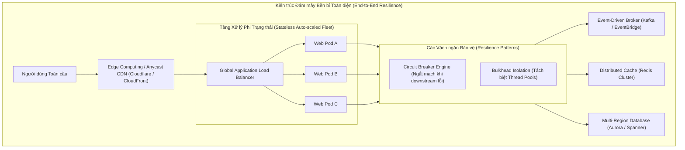
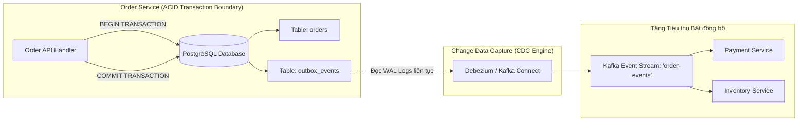
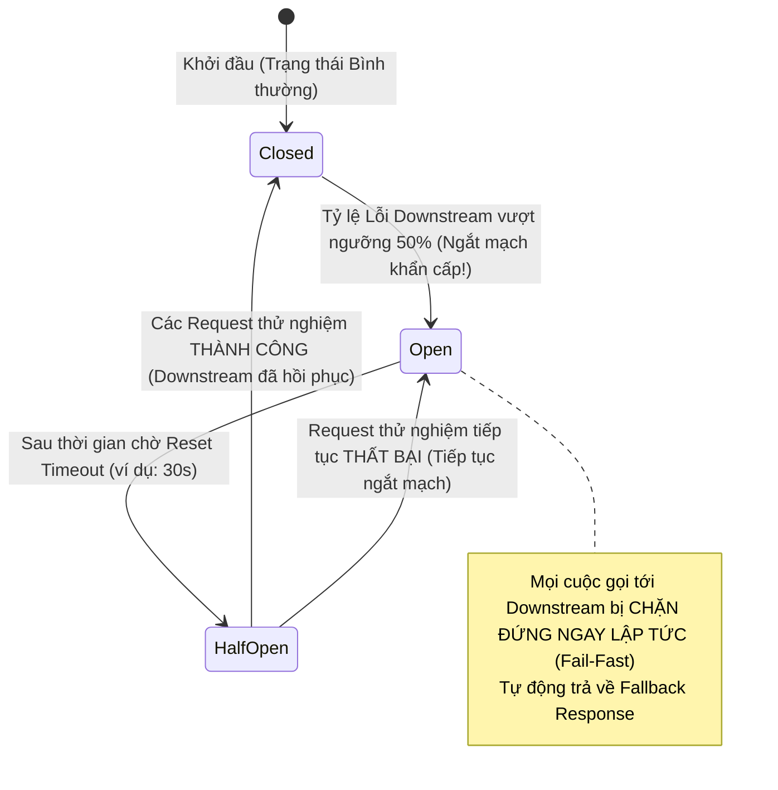

# 15.1. Cloud Architecture Patterns and Resilience (Các Mẫu Kiến trúc Đám mây và Tính Bền bỉ Hệ thống)

## Tổng quan về Các Mẫu Kiến trúc Đám mây và Độ Bền bỉ
Kiến trúc hệ thống đám mây (Cloud Architecture Patterns) là tập hợp các giải pháp thiết kế đã được chứng minh qua thực tiễn (Best Practices & Battle-tested Design Patterns) nhằm giải quyết các thách thức kinh điển của hệ thống phân tán: khả năng mở rộng không giới hạn (Scalability), tính sẵn sàng cao (High Availability), khả năng chịu lỗi (Fault Tolerance) và phục hồi sau thảm họa (Disaster Recovery).

Về mặt lý thuyết toán học phân tán và độ tin cậy hệ thống:
Một hệ thống bao gồm $N$ thành phần độc lập nối tiếp nhau sẽ có độ khả dụng tổng thể ($\mathcal{A}_{\text{total}}$) giảm dần theo số lượng thành phần:
$$\mathcal{A}_{\text{serial}} = \prod_{i=1}^{N} A_i \quad \implies \quad 0.999 \times 0.999 \times 0.999 = 0.997 \quad (\text{Suy giảm tính sẵn sàng})$$
Để đảo ngược hiện tượng này, các mẫu kiến trúc đám mây áp dụng kỹ thuật **Dự phòng Song song (Parallel Redundancy)** và **Cách ly Thất bại (Failure Isolation)**:
$$\mathcal{A}_{\text{parallel}} = 1 - \prod_{j=1}^{M} (1 - A_j) \quad \implies \quad 1 - (1 - 0.999)^2 = 0.999999 \quad (\text{Đạt 6 số 9})$$
Kết hợp với các mô hình **Circuit Breaker**, **Bulkhead** và **Outbox Pattern**, hệ thống đảm bảo một sự cố tại một điểm đơn lẻ (Single Point of Failure) không bao giờ có thể gây ra hiện tượng sụp đổ dây chuyền (Cascading Failure) trên toàn bộ hệ sinh thái.



---

## 2. Chi tiết từng Keyword (Under-the-Hood Deep Dive)

---

### 1. Multi-Tier, Stateless vs Stateful & Event-Driven Cloud Architectures

#### 1. Khái niệm bản chất (What & Why)
- **Multi-Tier Cloud Architecture (Kiến trúc Đa Tầng)**: Mô hình phân rã hệ thống thành các lớp logic biệt lập có ranh giới mạng riêng biệt (3-Tier Architecture):
  - *Presentation Tier (Tầng Trình diễn)*: Web Frontend, CDN, Ingress Gateway đặt tại Public Subnet.
  - *Application Tier (Tầng Nghiệp vụ)*: Microservices xử lý logic kinh doanh đặt tại Private Subnet không có Public IP.
  - *Data Tier (Tầng Dữ liệu)*: Cơ sở dữ liệu và cache đặt tại Database Subnet hoàn toàn cô lập, không có kết nối ra Internet.
- **Stateless vs Stateful Application Architecture**:
  - *Stateless (Phi Trạng thái)*: Ứng dụng không lưu giữ bất kỳ trạng thái phiên làm việc nào (Session State) trong bộ nhớ RAM hoặc ổ đĩa cục bộ của nó. Mọi trạng thái người dùng được chuyển giao ra bên ngoài cho các dịch vụ lưu trữ phân tán độc lập (Redis, DynamoDB). Nhờ đó, bất kỳ máy chủ nào cũng có thể xử lý bất kỳ request nào của người dùng, cho phép hệ thống tự do scale-out từ 2 lên 200 instances và scale-in về 0 bất cứ lúc nào mà không làm rớt phiên đăng nhập của khách hàng.
  - *Stateful (Có Trạng thái)*: Ứng dụng lưu giữ trạng thái, kết nối socket hoặc dữ liệu bền bỉ trên đĩa cục bộ (ví dụ: Cơ sở dữ liệu, Kafka Brokers). Đòi hỏi cơ chế quản lý vòng đời nghiêm ngặt (StatefulSets, volume gắn kết cố định).
- **Event-Driven Cloud Architecture (Kiến trúc Hướng Sự kiện - EDA)**:
  - Thay vì các microservices giao tiếp đồng bộ qua HTTP REST (dễ gây nghẽn và phụ thuộc lẫn nhau - Tight Coupling), các dịch vụ giao tiếp hoàn toàn **Bất đồng bộ (Asynchronous)** thông qua các sự kiện (Events).
  - Khi một đơn hàng được tạo, Order Service chỉ cần phát ra sự kiện `OrderPlaced` lên Event Broker (SNS/SQS, EventBridge, Kafka). Toàn bộ các dịch vụ downstream (Inventory, Payment, Shipping, Email Notification) tự động lắng nghe và xử lý độc lập mà không cần Order Service phải biết chúng là ai.

#### 2. Cơ chế hoạt động sâu (Under the hood / Hardcore Internals)
- **Giải quyết Bài toán Nhất quán Hai Pha bằng Transactional Outbox Pattern**:
  - Khi Order Service nhận request, nó cần làm 2 việc: (1) Lưu bản ghi vào Database cục bộ, và (2) Gửi tin nhắn sự kiện sang Message Broker.
  - Nếu bước 1 thành công nhưng bước 2 bị lỗi mạng, hệ thống sẽ bị mất tính nhất quán (Dữ liệu có trong DB nhưng không có tin nhắn gửi đi). Nếu đảo ngược thứ tự, tin nhắn gửi đi nhưng DB bị lỗi rollback, khách hàng bị trừ tiền mà không có đơn hàng!
  - **Cơ chế Outbox Pattern**:
    1. Bổ sung một bảng `outbox` ngay bên trong cùng một Database của Order Service.
    2. Cả bản ghi `orders` và bản ghi sự kiện `outbox` được ghi đồng thời trong **duy nhất một Database Transaction cục bộ (ACID Transaction)**.
    3. Một tiến trình nền riêng biệt (**Change Data Capture - Debezium** hoặc Poller Engine) đọc bảng `outbox` (hoặc phân tích Transaction Log: MySQL binlog / Postgres WAL) và gửi sang Kafka. Đảm bảo cam kết giao hàng ít nhất một lần (**At-Least-Once Delivery**) tuyệt đối mà không cần dùng giao thức 2-Phase Commit (2PC) chậm chạp.

#### 3. Sơ đồ minh họa


#### 4. Code ví dụ thực chiến (TypeScript Transactional Outbox Pattern Implementation)
Minh họa triển khai Transactional Outbox Pattern đảm bảo toàn vẹn dữ liệu trong kiến trúc Event-Driven:

```typescript
export interface Order {
  id: string;
  userId: string;
  amount: number;
}

export interface OutboxEvent {
  id: string;
  eventType: string;
  payload: string;
  createdAt: number;
  processed: boolean;
}

export class OrderServiceWithOutbox {
  private ordersTable: Map<string, Order> = new Map();
  private outboxTable: OutboxEvent[] = [];

  /**
   * Tạo đơn hàng với tính chất nguyên tử ACID: Lưu Order và Outbox Event trong cùng 1 khối logic
   */
  public async createOrder(order: Order): Promise<void> {
    console.log(`[Order Service] Tiếp nhận đơn hàng #${order.id}. Bắt đầu Local Transaction...`);

    // Ghi vào bảng Orders
    this.ordersTable.set(order.id, order);

    // Ghi sự kiện vào bảng Outbox
    const outboxRecord: OutboxEvent = {
      id: `evt-${Date.now()}`,
      eventType: "ORDER_CREATED",
      payload: JSON.stringify(order),
      createdAt: Date.now(),
      processed: false,
    };
    this.outboxTable.push(outboxRecord);

    console.log(`[Transaction Committed] Đã lưu Order #${order.id} VÀ ghi Outbox Event #${outboxRecord.id} thành công!`);
  }

  /**
   * Tiến trình Worker độc lập: Quét bảng Outbox và phát tán sự kiện sang Message Broker
   */
  public async processOutboxEvents(brokerPublishFn: (event: OutboxEvent) => Promise<void>): Promise<void> {
    const pendingEvents = this.outboxTable.filter((e) => !e.processed);

    for (const evt of pendingEvents) {
      try {
        await brokerPublishFn(evt);
        evt.processed = true;
        console.log(`[Outbox Publisher] Đã xuất bản thành công Event #${evt.id} sang Kafka/SQS.`);
      } catch (err: any) {
        console.error(`[Outbox Publisher Error] Lỗi đẩy sự kiện #${evt.id}: ${err.message}. Sẽ thử lại lần sau!`);
      }
    }
  }
}

// Chạy thử nghiệm
async function runDemo() {
  const service = new OrderServiceWithOutbox();
  await service.createOrder({ id: "ORD-5544", userId: "usr-99", amount: 250 });

  // Mô phỏng đẩy sang Kafka
  const mockKafka = async (evt: OutboxEvent) => {
    console.log(`  -> [Kafka Broker] Nhận thông điệp Topic: ${evt.eventType} | Data: ${evt.payload}`);
  };

  await service.processOutboxEvents(mockKafka);
}

if (process.env.NODE_ENV !== "test") {
  runDemo().catch(console.error);
}
```

#### 5. Ưu / Nhược điểm, Pitfalls & Anti-patterns
- **Event-Driven Architecture**: Khả năng mở rộng vô tận, các dịch vụ hoàn toàn độc lập (Decoupled); nếu một dịch vụ downstream bị sập, các tin nhắn vẫn được lưu an toàn trong hàng đợi mà không làm mất đơn hàng của khách.
- **Pitfall**: Sử dụng kiến trúc Stateless nhưng vẫn vô tình lưu trữ trạng thái phiên làm việc trong biến bộ nhớ `Map` cục bộ trên Node.js hoặc trong thư mục `/tmp` của máy ảo. Khi Auto Scaling tạo thêm máy mới, người dùng sẽ liên tục bị văng đăng nhập mỗi khi request bị định tuyến sang máy khác.

#### 6. Ứng dụng thực tế trong Backend / Systems
- Thiết kế hệ thống bán hàng Flash-Sale chịu tải hàng triệu người dùng: Tầng Stateless API tiếp nhận request đẩy ngay vào AWS SQS, sau đó các Worker Pools phía sau tiêu thụ sự kiện với tốc độ ổn định mà không đánh sập cơ sở dữ liệu quan hệ.

---

### 2. Multi-Region Active-Active & Fault-Tolerant Patterns: Circuit Breaker & Bulkhead

#### 1. Khái niệm bản chất (What & Why)
- **Multi-Region Active-Active Architecture**: Mô hình phân tán cao cấp nhất. Hệ thống được triển khai hoạt động đồng thời tại nhiều khu vực địa lý khác nhau trên thế giới (ví dụ: Singapore và Frankfurt). Cả hai Region đều tiếp nhận cả thao tác Đọc và Ghi của người dùng cùng lúc.
- **Circuit Breaker Pattern (Ngắt Mạch Bảo vệ)**: Tương tự như cầu dao điện trong nhà. Khi một dịch vụ downstream (ví dụ dịch vụ Gửi SMS) liên tục bị lỗi hoặc timeout:
  - Cầu dao chuyển từ trạng thái **`Closed` (Bình thường)** sang **`Open` (Ngắt mạch)**.
  - Mọi request tiếp theo sẽ bị từ chối ngay lập tức (Fail Fast) và kích hoạt phương án dự phòng (Fallback) mà không cần gửi gói tin qua mạng, bảo vệ hệ thống khỏi việc bị cạn kiệt thread pool và cho dịch vụ downstream thời gian để hồi phục.
  - Sau một khoảng thời gian chờ, cầu dao chuyển sang **`Half-Open`**, cho phép một vài request thử nghiệm đi qua để kiểm tra xem downstream đã sống lại hay chưa.
- **Bulkhead Pattern (Vách ngăn Khoang Tàu)**: Mô phỏng thiết kế khoang tàu thủy chống chìm (nếu một khoang bị thủng, các vách ngăn đóng lại để nước không tràn sang các khoang khác). Trong phần mềm, Bulkhead tách biệt các nhóm tài nguyên (Thread Pools, Connection Pools, Memory Buffers): Nếu một tác vụ phân tích báo cáo bị nghẽn, nó chỉ tiêu tốn thread pool của riêng nó và không thể làm ảnh hưởng đến thread pool phục vụ khách mua hàng.

#### 2. Cơ chế hoạt động sâu (Under the hood / Hardcore Internals)
- **Giải quyết Xung đột Ghi Đa Vùng (Cross-Region Write Conflict Resolution)**:
  - Trong kiến trúc Multi-Region Active-Active, bài toán kinh điển xảy ra khi cùng 1 người dùng gửi lệnh cập nhật số dư tại Region A ($t_1$) và rút tiền tại Region B ($t_1 + 5\text{ms}$).
  - Các giải pháp kỹ thuật cốt lõi:
    1. *Active-Active with Single-Leader per Key*: Phân vùng dữ liệu (Partitioning) sao cho toàn bộ dữ liệu của User Châu Á luôn có Master nằm tại Singapore, User Châu Âu có Master tại Frankfurt.
    2. *CRDTs (Conflict-free Replicated Data Types)*: Cấu trúc dữ liệu phân tán có khả năng tự động hợp nhất trạng thái mà không bao giờ xảy ra xung đột (ví dụ: PN-Counters, Observed-Removed Sets).
    3. *Last-Write-Wins (LWW) with TrueTime*: Sử dụng đồng hồ vệ tinh GPS/Atomic Clocks (như Google Spanner) để xác định trật tự thời gian tuyệt đối của các giao dịch trên toàn cầu.

#### 3. Sơ đồ minh họa


#### 4. Code ví dụ thực chiến (C++ High-Performance Thread-Safe Circuit Breaker)
Chương trình C++ triển khai bộ ngắt mạch Circuit Breaker thread-safe hoàn chỉnh với đầy đủ 3 trạng thái `Closed`, `Open`, `Half-Open`:

```cpp
#include <iostream>
#include <chrono>
#include <atomic>
#include <mutex>
#include <functional>

enum class CircuitState { CLOSED, OPEN, HALF_OPEN };

class CircuitBreaker {
private:
    std::atomic<CircuitState> state{CircuitState::CLOSED};
    std::atomic<int> failure_count{0};
    const int failure_threshold{3};
    const std::chrono::milliseconds reset_timeout{3000}; // 3 giây
    std::chrono::steady_clock::time_point last_state_change;
    std::mutex state_mutex;

public:
    CircuitBreaker() : last_state_change(std::chrono::steady_clock::now()) {}

    bool allowRequest() {
        if (state == CircuitState::OPEN) {
            auto now = std::chrono::steady_clock::now();
            if (now - last_state_change > reset_timeout) {
                std::lock_guard<std::mutex> lock(state_mutex);
                if (state == CircuitState::OPEN) {
                    state = CircuitState::HALF_OPEN;
                    std::cout << "[Circuit Breaker] Hết thời gian chờ -> Chuyển sang trạng thái HALF-OPEN (Thử nghiệm)...\n";
                    return true;
                }
            }
            return false; // Vẫn đang trong trạng thái OPEN: Chặn đứng request!
        }
        return true;
    }

    void recordSuccess() {
        if (state == CircuitState::HALF_OPEN) {
            std::lock_guard<std::mutex> lock(state_mutex);
            state = CircuitState::CLOSED;
            failure_count = 0;
            std::cout << "[Circuit Breaker] Request thử nghiệm THÀNH CÔNG -> Đóng cầu dao (CLOSED). Hệ thống ổn định trở lại!\n";
        }
    }

    void recordFailure() {
        failure_count++;
        std::cout << "[Circuit Breaker] Ghi nhận thất bại (" << failure_count << "/" << failure_threshold << ").\n";
        if (failure_count >= failure_threshold) {
            std::lock_guard<std::mutex> lock(state_mutex);
            state = CircuitState::OPEN;
            last_state_change = std::chrono::steady_clock::now();
            std::cerr << "[Circuit Breaker ALERT] Vượt ngưỡng lỗi -> NGẮT MẠCH (OPEN)! Từ chối mọi request tiếp theo!\n";
        }
    }
};

int main() {
    CircuitBreaker breaker;

    // Giả lập 3 lần gọi downstream service bị lỗi
    for (int i = 1; i <= 3; ++i) {
        if (breaker.allowRequest()) {
            breaker.recordFailure();
        }
    }

    // Lần gọi thứ 4: Cầu dao đã OPEN -> Bị chặn đứng ngay lập tức (Fail Fast)
    if (!breaker.allowRequest()) {
        std::cout << "[Fast-Fail] Request bị từ chối ngay tức thì bởi Circuit Breaker (Zero Network Overhead).\n";
    }

    return 0;
}
```

#### 5. Ưu / Nhược điểm, Pitfalls & Anti-patterns
- **Circuit Breaker & Bulkhead**: Ngăn chặn hoàn toàn hiện tượng sụp đổ dây chuyền (Cascading Failure); duy trì khả năng phục vụ một phần (Graceful Degradation) cho người dùng ngay cả khi một nửa hệ thống gặp sự cố.
- **Pitfall**: Triển khai Active-Active xuyên lục địa nhưng sử dụng các giao thức khóa phân tán đồng bộ (Distributed Locking qua mạng WAN). Độ trễ RTT giữa hai bán cầu sẽ khiến thời gian xử lý giao dịch tăng từ $5\text{ms}$ lên $300\text{ms}$, làm tê liệt toàn bộ throughput của hệ thống.

#### 6. Ứng dụng thực tế trong Backend / Systems
- Thiết lập Bulkhead Pattern cho cổng thanh toán điện tử: Tách riêng Thread Pool phục vụ thanh toán qua Thẻ Quốc tế (Visa/Mastercard) độc lập hoàn toàn với Thread Pool phục vụ Ví điện tử nội địa, đảm bảo sự cố mất mạng của đối tác quốc tế không thể làm tê liệt hệ thống thanh toán nội địa.
