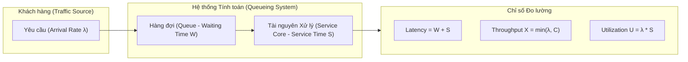
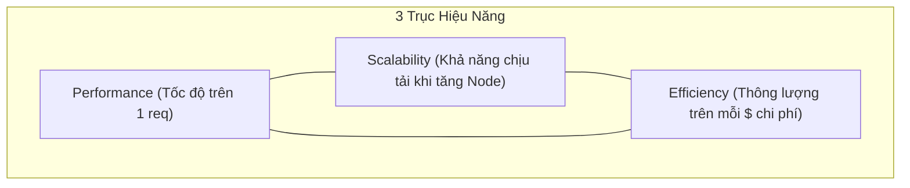
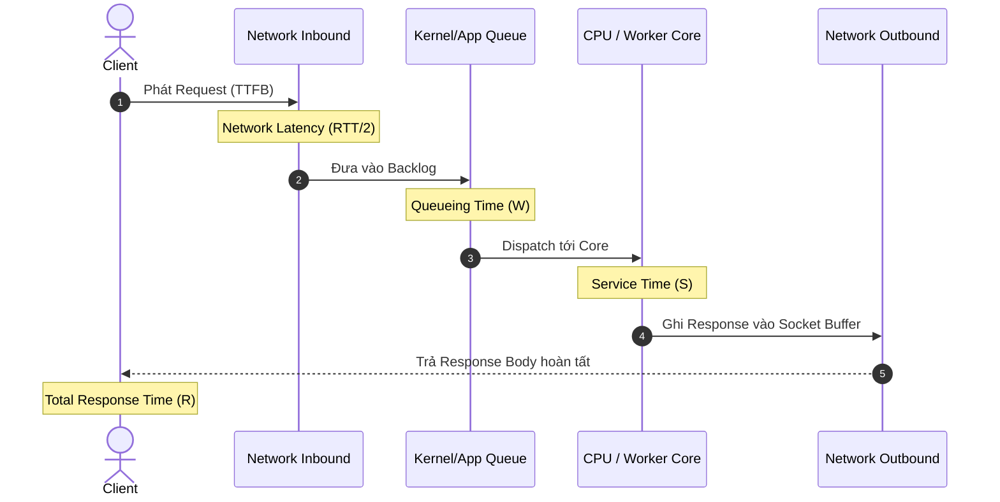

# 1.1. Core Metrics: Latency, Throughput, and Utilization (Các Chỉ Số Cốt Lõi)

## Tổng quan về Hiệu Năng Hệ Thống (Performance Fundamentals)

Performance Engineering (Kỹ nghệ Hiệu năng) không đơn thuần là việc "tối ưu code cho chạy nhanh", mà là một nhánh khoa học thực nghiệm và định lượng nhằm phân tích, mô hình hóa, đo lường và tối ưu hóa toàn diện dòng luân chuyển tài nguyên trong hệ thống tính toán.

Trong kiến trúc Backend hiện đại, hiệu năng được định nghĩa thông qua mối quan hệ toán học giữa tải công việc (Workload), tài nguyên phần cứng (Hardware Resources), và chất lượng dịch vụ (Quality of Service - QoS).



---

## 2. Chi tiết từng Keyword (Under-the-Hood Deep Dive)

### 1. Performance Engineering Fundamentals

#### 1. Khái niệm bản chất (What & Why)
Performance Engineering là tập hợp các nguyên lý, quy trình và phương pháp luận kỹ thuật được tích hợp xuyên suốt vòng đời phát triển phần mềm (SDLC), nhằm đảm bảo hệ thống đáp ứng các yêu cầu phi chức năng (Non-Functional Requirements - NFR) về độ trễ, băng thông, thông lượng và khả năng mở rộng với chi phí tài nguyên tối ưu.

#### 2. Cơ chế hoạt động sâu (Under the hood)
Khác với việc "chữa cháy" (tuning sau khi gặp sự cố prod), Performance Engineering thiết lập một vòng lặp liên tục:
$$\text{Workload Specification} \longrightarrow \text{Performance Modeling} \longrightarrow \text{Measurement & Profiling} \longrightarrow \text{Optimization}$$
Tại tầng phần cứng, hiệu năng bị giới hạn bởi 4 yếu tố vật lý cơ bản:
1. **CPU Execution Cycle**: Tốc độ chuyển trạng thái clock cycle và IPC (Instructions Per Cycle).
2. **Memory Bandwidth & Latency**: Giới hạn bus RAM, độ trễ phân cấp L1/L2/L3 và RAM DRAM.
3. **Storage I/O**: IOPS và bus protocol (NVMe, PCIe lanes).
4. **Network Transmission**: Giới hạn tốc độ ánh sáng trong sợi quang ($\approx 200,000 \text{ km/s}$) và chuyển mạch packet.

---

### 2. Performance vs Scalability vs Efficiency

#### 1. Khái niệm bản chất (What & Why)
Ba khái niệm này thường bị nhầm lẫn trong kỹ thuật phần mềm:
- **Performance (Hiệu năng)**: Thời gian hoặc tài nguyên mà hệ thống tiêu tốn để hoàn thành **một đơn vị công việc** đơn lẻ (tốc độ).
- **Scalability (Khả năng mở rộng)**: Khả năng của hệ thống duy trì hiệu năng hoặc tăng thông lượng tỷ lệ thuận khi được cấp thêm tài nguyên phần cứng (scale up hoặc scale out).
- **Efficiency (Hiệu suất tài nguyên)**: Tỷ số giữa khối lượng công việc hữu ích hoàn thành trên một đơn vị tài nguyên tiêu thụ ($\frac{\text{Throughput}}{\text{Resource Cost}}$).

#### 2. Cơ chế hoạt động sâu (Under the hood)
Một hệ thống có thể:
- Hiệu năng cực cao (Low Latency) nhưng không thể mở rộng (Poor Scalability) vì vướng một Single Point of Contention (ví dụ: dùng chung một Global Mutex).
- Có khả năng mở rộng tốt (High Scalability) nhưng kém hiệu năng (Low Performance) vì mỗi node xử lý rất chậm và cồng kềnh, nhưng có thể cắm thêm 1000 node để gánh tải.
- Kém hiệu quả (Low Efficiency) nếu cần 128 vCPU chỉ để xử lý 10,000 RPS mà một binary C++ viết tốt chỉ cần 2 vCPU.



---

### 3. Latency, Response Time, Processing Time, Queueing Time, Service Time

#### 1. Khái niệm bản chất (What & Why)
Đây là các thành phần cấu thành nên tổng thời gian xử lý một tác vụ từ góc nhìn Client và Server:
- **Service Time ($S$)**: Thời gian thực tế mà tài nguyên (CPU, Disk, NIC) trực tiếp tiêu tốn để thực hiện lệnh tính toán cho request (không bao gồm thời gian chờ).
- **Queueing Time ($W$)**: Thời gian request phải nằm đợi trong hàng đợi (Socket backlog, OS runqueue, DB connection pool, Thread pool queue) trước khi được phục vụ.
- **Processing Time / Execution Time**: Tổng thời gian xử lý nội bộ trong máy chủ ($T_{process} = W + S$).
- **Response Time ($R$)**: Tổng thời gian tính từ lúc Client phát đi byte đầu tiên cho đến khi Client nhận được byte cuối cùng của phản hồi.
- **Latency ($L$)**: Thường được dùng đồng nghĩa với Response Time, nhưng trong viễn thông kỹ thuật, Latency là khoảng trễ tĩnh để tín hiệu lan truyền từ điểm A đến điểm B (Propagation delay + Transmission delay).

#### 2. Cơ chế hoạt động sâu (Under the hood)
Mối quan hệ toán học cơ bản trong lý thuyết hàng đợi:
$$R = T_{\text{network\_in}} + W_{\text{system}} + S_{\text{system}} + T_{\text{network\_out}}$$
Khi hệ thống đạt ngưỡng bão hòa (Saturation), $W$ tăng theo hàm số mũ tiệm cận vô cực, trong khi $S$ vẫn giữ nguyên hoặc chỉ tăng nhẹ do cache thrashing.



---

### 4. End-to-End Latency, RTT, TTFB, Time to Last Byte

#### 1. Khái niệm bản chất (What & Why)
- **End-to-End Latency**: Độ trễ toàn trình đo từ lớp ứng dụng người dùng cuối (giao diện Client) xuyên qua mạng Internet, CDN, API Gateway, Microservices, Database và quay ngược lại.
- **Round-Trip Time (RTT)**: Thời gian cần thiết để một gói tin đi từ nguồn tới đích và gói tin xác nhận (ACK) quay trở về nguồn.
- **Time to First Byte (TTFB)**: Khoảng thời gian từ khi Client bắt đầu gửi HTTP Request cho tới khi nhận được byte đầu tiên của gói tin HTTP Response từ Server. TTFB đo lường tốc độ thiết lập kết nối + thời gian máy chủ xử lý xong header.
- **Time to Last Byte (TTLB)**: Khoảng thời gian từ khi gửi request đến khi Client nhận đầy đủ byte cuối cùng của response payload.

#### 2. Cơ chế hoạt động sâu (Under the hood)
TTFB bị chi phối sâu sắc bởi:
$$\text{TTFB} = T_{\text{DNS}} + T_{\text{TCP Handshake}} + T_{\text{TLS Handshake}} + T_{\text{Request Transfer}} + T_{\text{Server Processing}}$$
Nếu mạng có RTT cao (ví dụ xuyên lục địa 150ms), riêng việc thiết lập TCP (1 RTT) và TLS 1.3 (1 RTT) đã tiêu tốn $300\text{ms}$ trước khi máy chủ kịp nhận byte dữ liệu đầu tiên.

---

### 5. Throughput, Bandwidth, RPS, QPS, TPS

#### 1. Khái niệm bản chất (What & Why)
- **Bandwidth (Băng thông)**: Năng lực truyền dẫn lý thuyết tối đa của một kênh truyền vật lý (đo bằng bits/giây, ví dụ: 10 Gbps Ethernet).
- **Throughput (Thông lượng)**: Tốc độ thực tế mà dữ liệu hữu ích (Goodput) hoặc tác vụ hữu ích được hệ thống xử lý thành công trên một đơn vị thời gian.
- **Requests Per Second (RPS)**: Số lượng HTTP/gRPC request mà hệ thống xử lý hoàn tất trong 1 giây.
- **Queries Per Second (QPS)**: Số lượng truy vấn tìm kiếm hoặc câu lệnh truy vấn dữ liệu được thực thi trong 1 giây (thường áp dụng cho Database hoặc Search Engine). Một RPS từ client có thể kích hoạt 5 - 10 QPS tới Database nội bộ.
- **Transactions Per Second (TPS)**: Số lượng giao dịch ACID trọn vẹn (Transaction) được commit thành công vào hệ cơ sở dữ liệu hoặc hệ thống tài chính phân tán trong 1 giây.

#### 2. Cơ chế hoạt động sâu (Under the hood)
Sự khác biệt giữa Bandwidth và Throughput tương tự như đường kính của ống nước (Bandwidth) so với lưu lượng nước thực tế chảy qua vòi sau khi trừ ma sát và áp lực (Throughput).
$$\text{Throughput} \le \min(\text{Bandwidth}, \frac{\text{Concurrency}}{\text{Response Time}})$$

---

### 6. Concurrent Connections vs Concurrency

#### 1. Khái niệm bản chất (What & Why)
- **Concurrent Connections**: Số lượng kết nối mạng (TCP sockets) đang được duy trì mở đồng thời tại một thời điểm giữa các client và server (ví dụ: WebSocket, HTTP/2 multiplexed streams, Long polling).
- **Concurrency (Độ tương tranh)**: Số lượng tác vụ hoặc luồng thực thi đang tích cực tiêu thụ tài nguyên tính toán (CPU, Memory, I/O) song song tại cùng một thời điểm.

#### 2. Cơ chế hoạt động sâu (Under the hood)
Một server Linux với kiến trúc I/O Multiplexing (`epoll`) có thể dễ dàng duy trì **1,000,000 Concurrent Connections** (vấn đề C1000K) ở trạng thái idle, chỉ tốn khoảng $1\text{GB} - 2\text{GB}$ RAM cho Socket File Descriptors và buffer. Tuy nhiên, nếu cả 1,000,000 connection này đồng thời gửi request (High Concurrency), hệ thống 32 vCPU sẽ lập tức quá tải CPU và sập vì queueing explosion.

---

### 7. Utilization vs Saturation

#### 1. Khái niệm bản chất (What & Why)
- **Utilization (Độ sử dụng)**: Tỷ lệ phần trăm thời gian mà một tài nguyên phần cứng (CPU core, Disk channel, Memory bus, Network interface) đang bận phục vụ công việc trong một chu kỳ đo lường:
  $$U = \frac{\text{Busy Time}}{\text{Total Time}}$$
- **Saturation (Độ bão hòa)**: Mức độ mà khối lượng công việc vượt quá năng lực phục vụ của tài nguyên, dẫn đến việc các tác vụ phát sinh phải bị xếp hàng chờ (Queue Backlog) hoặc bị hủy bỏ (Dropped).

#### 2. Cơ chế hoạt động sâu (Under the hood)
Theo quy luật hàng đợi M/M/1, khi độ sử dụng $U$ tiến gần đến $100\%$ ($1.0$), độ trễ hàng đợi $W$ tăng vọt phi tuyến:
$$W = \frac{U}{1 - U} \times S$$
- Tại $U = 50\%$: $W = 1 \times S$.
- Tại $U = 80\%$: $W = 4 \times S$.
- Tại $U = 95\%$: $W = 19 \times S$.
- Tại $U = 99\%$: $W = 99 \times S$.
Do đó, độ bão hòa (Saturation) xuất hiện ngay cả khi $U$ chưa chạm $100\%$, biểu hiện qua việc CPU Runqueue length $> \text{Core count}$ hoặc Disk I/O wait queue bị dồn ứ.

---

## Code Ví Dụ Thực Chiến (C++20)

Minh họa đo lường độ trễ cấp độ Microsecond ($\mu s$) với độ phân giải cao và tính toán chính xác Response Time, Service Time và Queueing Time:

```cpp
#include <iostream>
#include <chrono>
#include <thread>
#include <vector>
#include <numeric>
#include <algorithm>
#include <iomanip>

// Cấu trúc mô phỏng một Request với mốc thời gian chi tiết
struct RequestTelemetry {
    uint64_t request_id;
    std::chrono::high_resolution_clock::time_point arrival_time;
    std::chrono::high_resolution_clock::time_point start_service_time;
    std::chrono::high_resolution_clock::time_point finish_service_time;

    // Queueing Time W: Thời gian nằm đợi trong hàng đợi
    [[nodiscard]] double queueing_time_us() const {
        return std::chrono::duration<double, std::micro>(start_service_time - arrival_time).count();
    }

    // Service Time S: Thời gian thực tế CPU/I/O xử lý
    [[nodiscard]] double service_time_us() const {
        return std::chrono::duration<double, std::micro>(finish_service_time - start_service_time).count();
    }

    // Total Response Time R = W + S
    [[nodiscard]] double total_latency_us() const {
        return std::chrono::duration<double, std::micro>(finish_service_time - arrival_time).count();
    }
};

// Hàm giả lập xử lý một request tính toán
void process_task(RequestTelemetry& req) {
    // Ghi nhận thời điểm luồng bắt đầu phục vụ
    req.start_service_time = std::chrono::high_resolution_clock::now();

    // Giả lập tính toán bận (Service Time) khoảng 250 microsecond
    auto target_duration = std::chrono::microseconds(250);
    auto start = std::chrono::high_resolution_clock::now();
    while (std::chrono::high_resolution_clock::now() - start < target_duration) {
        // CPU busy work để tránh compiler optimize out
        asm volatile("" : : : "memory");
    }

    // Ghi nhận thời điểm hoàn tất
    req.finish_service_time = std::chrono::high_resolution_clock::now();
}

int main() {
    constexpr size_t NUM_REQUESTS = 1000;
    std::vector<RequestTelemetry> batch(NUM_REQUESTS);

    // Giả lập luồng request tràn vào hàng đợi
    auto batch_start = std::chrono::high_resolution_clock::now();
    for (size_t i = 0; i < NUM_REQUESTS; ++i) {
        batch[i].request_id = i + 1;
        batch[i].arrival_time = std::chrono::high_resolution_clock::now();
        // Giả lập khoảng cách giữa các request gửi đến (Arrival interval 100us)
        std::this_thread::sleep_for(std::chrono::microseconds(100));
    }

    // Giả lập worker đơn luồng tiêu thụ hàng đợi (Single Server M/M/1 queue)
    for (size_t i = 0; i < NUM_REQUESTS; ++i) {
        process_task(batch[i]);
    }
    auto batch_end = std::chrono::high_resolution_clock::now();

    // Tính toán thống kê
    std::vector<double> latencies;
    latencies.reserve(NUM_REQUESTS);
    double total_service = 0.0;
    double total_queueing = 0.0;

    for (const auto& r : batch) {
        latencies.push_back(r.total_latency_us());
        total_service += r.service_time_us();
        total_queueing += r.queueing_time_us();
    }

    std::sort(latencies.begin(), latencies.end());

    double total_time_sec = std::chrono::duration<double>(batch_end - batch_start).count();
    double throughput_rps = static_cast<double>(NUM_REQUESTS) / total_time_sec;

    std::cout << "========== PERFORMANCE METRICS SUMMARY ==========\n";
    std::cout << std::fixed << std::setprecision(2);
    std::cout << "Total Completed Tasks : " << NUM_REQUESTS << " reqs\n";
    std::cout << "Throughput (RPS)      : " << throughput_rps << " req/sec\n";
    std::cout << "Average Service Time  : " << (total_service / NUM_REQUESTS) << " us\n";
    std::cout << "Average Queueing Time : " << (total_queueing / NUM_REQUESTS) << " us\n";
    std::cout << "Latency P50 (Median)  : " << latencies[NUM_REQUESTS * 50 / 100] << " us\n";
    std::cout << "Latency P99           : " << latencies[NUM_REQUESTS * 99 / 100] << " us\n";
    std::cout << "Latency P99.9         : " << latencies[NUM_REQUESTS * 999 / 1000] << " us\n";
    std::cout << "=================================================\n";

    return 0;
}
```

---

## Cạm bẫy & Sai lầm Kinh điển (Pitfalls & Anti-Patterns)

1. **Flaw of Averages (Cạm bẫy giá trị trung bình)**:
   - Dùng độ trễ trung bình (Mean/Average Latency) để báo cáo SLA. Giá trị trung bình che giấu hoàn toàn các spike cực lớn ở đuôi (Tail Latency). Ví dụ: 99% request mất 5ms, 1% request mất 10,000ms $\rightarrow$ Average vẫn rất đẹp ở mức 105ms, nhưng 1% user mua hàng giá trị cao đã bỏ đi vì timeout.
2. **Đồng nhất Concurrent Connections với Concurrency**:
   - Tăng giới hạn connection pool lên 10,000 kết nối tới Postgres DB vì tưởng rằng "nhiều kết nối = xử lý nhanh hơn". Kết quả: Database sập do CPU context switching và lock contention trên buffer pool. Concurrency thực tế của PostgreSQL tối ưu nhất thường chỉ bằng $2 \times \text{Core count} + \text{Disk count}$.
3. **Bỏ qua Saturation khi CPU chưa đạt 100%**:
   - Hệ thống có 32 cores, CPU tổng thể hiển thị 25%, nhưng hệ thống đã bắt đầu nghẽn. Lý do: Một single-threaded lock manager hoặc thread socket listener bị nghẽn 100% trên 1 core duy nhất, trong khi 31 core còn lại rảnh rỗi.

---

## Ứng dụng Thực chiến trong Backend & Hệ thống Lớn

- **SRE & SLO Definition**: Xác định ranh giới giữa Service Time và Network Time để định nghĩa SLI/SLO chuẩn xác cho API Gateway (ví dụ Envoy/NGINX upstream response time vs client round-trip time).
- **Auto-scaling Logic**: Không kích hoạt Auto-scaler dựa trên CPU Utilization thuần túy (vì CPU có thể bị kéo ảo bởi busy-polling loop). Hãy kích hoạt dựa trên **Queueing Saturation** (độ dài hàng đợi Kafka Lag hoặc Backlog size trên worker pool).
- **Capacity Dimensioning**: Áp dụng định luật cơ bản để tính toán đúng lượng memory cần thiết cho các connection socket idle trên server WebSockets/Push notifications.
