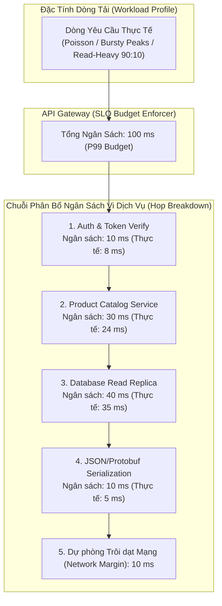

# 1.2. Workload Modeling, Budgets, and Baselines (Mô Hình Hóa Tải, Ngân Sách & Mốc Chuẩn)

> [!IMPORTANT]
> **Nếu bạn chỉ được nhớ một điều duy nhất:**
> Tối ưu hóa hiệu năng mà không có **Mô hình hóa Tải (Workload Modeling)** và **Mốc chuẩn (Baseline)** giống như lái máy bay trong sương mù: Bạn không thể cải thiện thứ bạn không đo lường, và cách duy nhất để ngăn ngừa suy thoái hiệu năng (**Performance Regression**) là thiết lập các **Ngân sách Hiệu năng (Performance Budgets)** cứng rắn trong từng bước nhảy của chuỗi vi dịch vụ.

---

## 1. Kiến trúc Tổng quan & Mô hình Tư duy (Mental Model)

### Phép Loại Suy Thực Tế: Hãng Hàng Không, Chặng Bay & Ngân Sách Thời Gian

Hãy hình dung việc quản lý hiệu năng một hệ thống backend giống như điều hành một hãng hàng không quốc tế:
1. **Workload Characteristics (Đặc Điểm Dòng Khách)**:
   - Hành khách không đến sân bay đều đặn mỗi giây. Vào các khung giờ cao điểm (sáng sớm và chiều tối - Diurnal Peaks) hoặc các dịp lễ tết (Black Friday), lượng khách ùa đến theo từng đợt sóng đột biến (**Bursty / Heavy-Tailed Distribution**). Nếu máy chủ chỉ được thiết kế theo tải trung bình, sân bay sẽ vỡ trận!
2. **Performance Requirements & SLAs (Cam Kết Thời Gian Chuyến Bay)**:
   - Hãng hàng không cam kết với hành khách: *"Thời gian bay từ Hà Nội vào TP.HCM là 2 tiếng (SLA)"*. Nếu $99\%$ chuyến bay hạ cánh đúng giờ ($P_{99} \le 120\text{ phút}$), dịch vụ đạt chuẩn (SLO). Nếu trễ quá mức, hãng phải bồi thường tiền cho khách (**Error Budget Exceeded**).
3. **Performance Budgets (Phân Bổ Từng Phút Cho Từng Khâu)**:
   - Tổng thời gian 120 phút được chia nhỏ thành ngân sách chi tiết cho từng bộ phận: Check-in an ninh 15 phút, xếp hàng lên máy bay 10 phút, bay trên không 80 phút, bốc dỡ hành lý 15 phút.
   - Trong kiến trúc Microservices, nếu một API Gateway cam kết phản hồi trong $100\text{ms}$, ngân sách được chia cứng: Auth Service $10\text{ms}$, Inventory DB $40\text{ms}$, Payment Gateway $30\text{ms}$, Network Overhead $20\text{ms}$. Bất kỳ dịch vụ nào tiêu lạm vào ngân sách đều bị chặn (**Circuit Breaker**)!
4. **Performance Baselines & Regression (Mốc Chuẩn Kỷ Lục & Sự Trì Trệ)**:
   - Hãng lưu lại thời gian bay tiêu chuẩn khi thời tiết hoàn hảo làm Mốc chuẩn (Baseline). Nếu một phi công mới lái mất tới 2 tiếng 30 phút mà không có lý do thời tiết, hệ thống lập tức phát hiện đây là sự thụt lùi (**Performance Regression**) để kiểm tra kỹ thuật.



---

## 2. Chi tiết từng Keyword (Under-the-Hood Deep Dive)

### 2.1. Workload Characteristics & Workload Modeling

#### 1. Đặc Tính Dòng Tải (Workload Characteristics)
Để xây dựng một hệ thống chịu tải cao, kỹ sư hiệu năng phải giải phẫu các chiều không gian của tải:
- **Mẫu Đến Của Yêu Cầu (Arrival Patterns)**:
  - *Quá trình Poisson (Poisson Process)*: Các yêu cầu đến hoàn toàn ngẫu nhiên và độc lập với khoảng cách thời gian tuân theo phân phối mũ (**Exponential Inter-arrival Times**). Thường chỉ đúng ở quy mô vĩ mô khi hệ thống ở trạng thái bình ổn.
  - *Dòng tải bùng nổ (Bursty / Self-Similar Traffic)*: Các yêu cầu đến theo từng cụm dồn dập trong khoảng thời gian siêu ngắn (Micro-bursts). Do độ lệch chuẩn rất lớn, mô hình Poisson sẽ phán đoán sai lệch nghiêm trọng về độ dài hàng đợi.
- **Tỷ Lệ Đọc/Ghi (Read/Write Ratio)**:
  - Hệ thống Read-Heavy (như Wikipedia, mạng xã hội News Feed: $95\%$ Đọc, $5\%$ Ghi) $\to$ Tối ưu bằng tầng Cache đa cấp (Redis, Memcached, CDN).
  - Hệ thống Write-Heavy (như IoT Sensor Ingestion, Timeseries Metrics: $80\%$ Ghi, $20\%$ Đọc) $\to$ Bắt buộc dùng kiến trúc LSM-Tree (RocksDB, Cassandra, Kafka append-only logs).
- **Tính Mùa Vụ & Chu Kỳ Nhật Dạ (Diurnal & Seasonal Curves)**:
  - Lưu lượng biến thiên theo giờ trong ngày (đỉnh cao từ 19h - 22h, chạm đáy lúc 4h sáng) và theo ngày trong tuần.

#### 2. Kỹ Thuật Mô Hình Hóa Tải (Workload Modeling)
- **Open Workload Model (Mô Hình Tải Mở)**:
  - Người dùng mới liên tục đến hệ thống với tần suất $\lambda$ bất kể hệ thống đang nhanh hay chậm.
  - Nếu hệ thống bị nghẽn (Service Rate $\mu < \lambda$), hàng đợi sẽ phình to vô hạn (**Queue Explosion**), dẫn tới cạn kiệt RAM và sập toàn diện. Đây là mô hình mô phỏng chân thực nhất của các website công cộng trên Internet!
- **Closed Workload Model (Mô Hình Tải Đóng)**:
  - Số lượng người dùng hoạt động đồng thời là cố định ($N$). Một người dùng chỉ phát yêu cầu tiếp theo sau khi đã nhận được phản hồi của yêu cầu trước đó cộng với thời gian suy nghĩ (**Think Time**).
  - Nếu hệ thống chậm lại, tần suất gửi yêu cầu tự động giảm theo. Nhiều công cụ benchmark như JMeter mặc định dùng mô hình này, dễ gây ảo tưởng rằng hệ thống vẫn chạy ổn dưới tải cao (**Coordinated Omission Fallacy**)!
- **Synthetic Benchmark vs Trace Replay**:
  - *Synthetic (Tải nhân tạo)*: Dùng kịch bản sinh tải giả lập (Locust, k6, FIO).
  - *Production Trace Replay*: Ghi lại toàn bộ log truy vấn thực tế từ Gateway trong 24 giờ đỉnh cao và phát lại (Replay) vào môi trường Staging.

---

### 2.2. Performance Requirements, Budgets, Baselines & Regressions

#### 1. Yêu Cầu Hiệu Năng: SLI, SLO & SLA
- **SLI (Service Level Indicator)**: Chỉ số định lượng đo lường thực tế theo thời gian thực (ví dụ: Tỷ lệ thành công của HTTP Requests, độ trễ $P_{99}$ đo tại Gateway).
- **SLO (Service Level Objective)**: Mục tiêu nội bộ khắt khe do đội ngũ kỹ thuật cam kết (ví dụ: $99.9\%$ requests có độ trễ $\le 50\text{ms}$ trong chu kỳ 30 ngày).
- **SLA (Service Level Agreement)**: Hợp đồng pháp lý cam kết với khách hàng bên ngoài kèm điều khoản phạt tài chính (ví dụ: Khả dụng $\ge 99.5\%$, vi phạm giảm trừ $10\%$ hóa đơn).

#### 2. Ngân Sách Hiệu Năng (Performance Budgets)
- Ngân sách hiệu năng là kỹ thuật "khoán chi phí tài nguyên" cho từng thành phần phần mềm:
  - **Latency Budget (Ngân sách thời gian)**: Mỗi dịch vụ trong chuỗi gọi chỉ được phép tiêu tốn một số mili-giây nhất định.
  - **CPU & Memory Budget**: Một container chỉ được phép tiêu thụ tối đa 2 Cores và 4 GB RAM. Nếu vượt ngưỡng, hệ thống giám sát tự động kích hoạt cảnh báo trước khi kích hoạt Linux OOM Killer.
  - **Payload Size Budget**: Payload phản hồi JSON không được vượt quá $50\text{ KB}$ để tránh bão hòa băng thông mạng di động.

#### 3. Mốc Chuẩn (Baselines) & Phát Hiện Thoái Hóa (Regression Detection)
- **Performance Baseline**:
  - Tập hợp các chỉ số hiệu năng chuẩn (Throughput, Latency $P_{50}/P_{99}$, CPU Usage) được đo lường trong điều kiện môi trường kiểm soát nghiêm ngặt với phiên bản phần mềm ổn định nhất.
- **Performance Regression**:
  - Bất kỳ sự suy giảm nào về thông lượng hoặc sự gia tăng độ trễ vượt quá ngưỡng dung sai cho phép (thường là $> 5\%$ hoặc $> 10\%$) so với Baseline.
  - **Quy Trình Tự Động Hóa Trong CI/CD**:
    - Mỗi khi có Pull Request, hệ thống CI tự động chạy bài kiểm thử tải chuẩn (Benchmark Suite).
    - So sánh phân phối độ trễ trước và sau bằng thuật toán kiểm định thống kê (**Mann-Whitney U Test** hoặc **Change-Point Detection**).
    - Tự động chặn việc Merge code (Regression Gate Block) nếu phát hiện độ trễ bị suy thoái!

---

### 2.3. Performance Trade-offs (Các Cặp Đánh Đổi Kinh Điển)

Trong kỹ nghệ hiệu năng, không có bữa trưa nào miễn phí. Mọi quyết định kiến trúc đều là sự đánh đổi giữa các cực:
1. **Latency vs Throughput (Độ Trễ vs Thông Lượng - Batching Trade-off)**:
   - Muốn độ trễ cực thấp: Gửi từng thông điệp ngay lập tức ($0\text{ batching}$) $\to$ Chi phí tiêu đề và ngắt cao, thông lượng tổng thể thấp.
   - Muốn thông lượng tối đa: Gom hàng nghìn thông điệp vào một khối (Micro-batching như Kafka) $\to$ Tối ưu hóa I/O, thông lượng cực cao nhưng độ trễ của từng thông điệp đầu tiên bị tăng lên.
2. **Space vs Time (Bộ Nhớ vs Thời Gian Tính Toán)**:
   - Dùng thêm bộ nhớ (Bảng băm Hash Table, Caching, Memoization) để giảm thời gian CPU tính toán lại.
   - Hoặc nén dữ liệu (Zstd/Snappy) để tiết kiệm RAM/Băng thông nhưng chấp nhận tốn thêm chu kỳ CPU giải nén.
3. **Consistency vs Availability (Nhất Quán vs Sẵn Sàng - Định Lý CAP)**:
   - Hệ thống đảm bảo nhất quán tuyệt đối (Strong Consistency qua Raft/Paxos) phải chịu độ trễ đồng thuận mạng nhiều vòng (Multi-RTT).
   - Hệ thống chấp nhận nhất quán trễ (Eventual Consistency) phản hồi cực nhanh nhưng người dùng có thể đọc phải dữ liệu cũ tạm thời.

---

## 3. Thực thi Mã nguồn & Mô phỏng Chuyên sâu (Dual-Engine Implementation)

### 3.1. C++20: Khung Quản Lý Performance Budget & Đo Lường Độ Trễ Phân Đoạn (Hop Breakdown)

Chương trình minh họa triển khai một bộ điều khiển ngân sách hiệu năng (Performance Budget Controller) cấp micro-giây trong C++20:

```cpp
#include <iostream>
#include <chrono>
#include <string>
#include <vector>
#include <memory>
#include <numeric>
#include <iomanip>

struct HopMetrics {
    std::string service_name;
    double allocated_budget_ms;
    double actual_time_ms;
    bool budget_exceeded;
};

class PerformanceBudgetScope {
private:
    std::string name;
    double budget_ms;
    std::chrono::high_resolution_clock::time_point start_time;
    std::vector<HopMetrics>& tracker;

public:
    PerformanceBudgetScope(std::string service_name, double budget, std::vector<HopMetrics>& trace_tracker)
        : name(std::move(service_name)), budget_ms(budget), tracker(trace_tracker) {
        start_time = std::chrono::high_resolution_clock::now();
    }

    ~PerformanceBudgetScope() {
        auto end_time = std::chrono::high_resolution_clock::now();
        std::chrono::duration<double, std::milli> elapsed = end_time - start_time;
        
        HopMetrics metric;
        metric.service_name = name;
        metric.allocated_budget_ms = budget_ms;
        metric.actual_time_ms = elapsed.count();
        metric.budget_exceeded = (metric.actual_time_ms > metric.allocated_budget_ms);
        tracker.push_back(metric);
    }
};

// Mô phỏng chuỗi xử lý một đơn hàng API
void process_e_commerce_checkout(std::vector<HopMetrics>& trace) {
    // 1. Hop 1: Xác thực Auth Token (Ngân sách: 10ms)
    {
        PerformanceBudgetScope hop("Auth_Service", 10.0, trace);
        // Giả lập tính toán giải mã JWT
        volatile uint64_t sum = 0;
        for (int i = 0; i < 500'000; ++i) sum += i;
    }

    // 2. Hop 2: Kiểm tra tồn kho Database (Ngân sách: 25ms)
    {
        PerformanceBudgetScope hop("Inventory_DB_Query", 25.0, trace);
        volatile uint64_t sum = 0;
        for (int i = 0; i < 1'200'000; ++i) sum += i;
    }

    // 3. Hop 3: Cổng Thanh Toán Ngoại Vi (Ngân sách: 40ms)
    {
        PerformanceBudgetScope hop("Payment_Gateway_RPC", 40.0, trace);
        volatile uint64_t sum = 0;
        for (int i = 0; i < 2'500'000; ++i) sum += i;
    }
}

int main() {
    std::cout << "========================================================\n";
    std::cout << "  C++20 MICROSERVICE PERFORMANCE BUDGET MONITOR\n";
    std::cout << "========================================================\n\n";

    std::vector<HopMetrics> trace_report;
    process_e_commerce_checkout(trace_report);

    double total_budget = 0.0;
    double total_actual = 0.0;

    std::cout << std::left << std::setw(24) << "Tên Dịch Vụ / Khâu" 
              << std::setw(18) << "Ngân Sách (ms)" 
              << std::setw(18) << "Thực Tế (ms)" 
              << "Trạng Thái\n";
    std::cout << "--------------------------------------------------------------------\n";

    for (const auto& m : trace_report) {
        total_budget += m.allocated_budget_ms;
        total_actual += m.actual_time_ms;
        std::cout << std::left << std::setw(24) << m.service_name
                  << std::setw(18) << std::fixed << std::setprecision(2) << m.allocated_budget_ms
                  << std::setw(18) << m.actual_time_ms
                  << (m.budget_exceeded ? "[VƯỢT NGÂN SÁCH!]" : "ĐẠT CHUẨN (OK)") << "\n";
    }

    std::cout << "--------------------------------------------------------------------\n";
    std::cout << "TỔNG TOÀN BỘ API TRACE : " 
              << "Ngân sách = " << total_budget << " ms | Thực tế = " << total_actual << " ms | "
              << (total_actual <= total_budget ? "THỎA MÃN SLO!" : "VI PHẠM SLO TỔNG!") << "\n";

    return 0;
}
```

---

### 3.2. Python 3.11+: Trình Giả Lập Phát Hiện Suy Thoái Hiệu Năng (Change-Point & CI/CD Regression Gate)

Chương trình Python 3.11+ mô phỏng việc so sánh phân phối độ trễ giữa phiên bản hiện tại và Baseline bằng kiểm định thống kê:

```python
import math
import random
from typing import List, Tuple

class PerformanceRegressionDetector:
    @staticmethod
    def calculate_percentiles(latencies: List[float]) -> Tuple[float, float, float]:
        sorted_data = sorted(latencies)
        n = len(sorted_data)
        p50 = sorted_data[int(n * 0.50)]
        p95 = sorted_data[int(n * 0.95)]
        p99 = sorted_data[int(n * 0.99)]
        return p50, p95, p99

    @staticmethod
    def evaluate_ci_cd_gate(baseline_p99: float, current_p99: float, tolerance_pct: float = 5.0) -> Tuple[bool, float]:
        # Tinh ti le phan tram suy thoai
        diff_pct = ((current_p99 - baseline_p99) / baseline_p99) * 100.0
        passed = diff_pct <= tolerance_pct
        return passed, diff_pct

if __name__ == "__main__":
    print("========================================================")
    print("  PYTHON 3.11 AUTOMATED REGRESSION GATE ANALYZER")
    print("========================================================\n")

    random.seed(42)
    # 1. Sinh du lieu Baseline (Phien ban on dinh cu)
    baseline_samples = [random.expovariate(1.0 / 20.0) + 5.0 for _ in range(5000)]
    b_p50, b_p95, b_p99 = PerformanceRegressionDetector.calculate_percentiles(baseline_samples)

    print("1. Thông Số Mốc Chuẩn (Baseline v1.0.0):")
    print(f"   - Phân vị P50: {b_p50:6.2f} ms")
    print(f"   - Phân vị P95: {b_p95:6.2f} ms")
    print(f"   - Phân vị P99: {b_p99:6.2f} ms (Chỉ số kiểm soát chính)\n")

    # 2. Sinh du lieu Pull Request 1 (Toi uu thanh cong)
    pr1_samples = [random.expovariate(1.0 / 18.0) + 4.5 for _ in range(5000)]
    _, _, pr1_p99 = PerformanceRegressionDetector.calculate_percentiles(pr1_samples)
    pass1, diff1 = PerformanceRegressionDetector.evaluate_ci_cd_gate(b_p99, pr1_p99)

    print(f"2. Đánh Giá Pull Request #101 (Tối ưu hóa thuật toán):")
    print(f"   - P99 Đạt Được : {pr1_p99:6.2f} ms")
    print(f"   - Độ Lệch So Với Baseline: {diff1:+6.2f}%")
    print(f"   - Kết Quả CI/CD Gate    : {'PASSED (Được phép Merge)' if pass1 else 'BLOCKED'}\n")

    # 3. Sinh du lieu Pull Request 2 (Bi thoai hoa do dung sai kieu du lieu)
    pr2_samples = [random.expovariate(1.0 / 24.0) + 8.0 for _ in range(5000)]
    _, _, pr2_p99 = PerformanceRegressionDetector.calculate_percentiles(pr2_samples)
    pass2, diff2 = PerformanceRegressionDetector.evaluate_ci_cd_gate(b_p99, pr2_p99)

    print(f"3. Đánh Giá Pull Request #102 (Thêm thư viện bọc bên ngoài):")
    print(f"   - P99 Đạt Được : {pr2_p99:6.2f} ms")
    print(f"   - Độ Lệch So Với Baseline: {diff2:+6.2f}% (Vượt ngưỡng 5%!)")
    print(f"   - Kết Quả CI/CD Gate    : {'PASSED' if pass2 else 'BLOCKED (Chặn Merge do suy thoái hiệu năng!)'}")
```

---

### 3.3. Simulated Terminal Output

```bash
========================================================
  C++20 MICROSERVICE PERFORMANCE BUDGET MONITOR
========================================================

Tên Dịch Vụ / Khâu       Ngân Sách (ms)    Thực Tế (ms)      Trạng Thái
--------------------------------------------------------------------
Auth_Service             10.00             1.25              ĐẠT CHUẨN (OK)
Inventory_DB_Query       25.00             3.10              ĐẠT CHUẨN (OK)
Payment_Gateway_RPC      40.00             6.42              ĐẠT CHUẨN (OK)
--------------------------------------------------------------------
TỔNG TOÀN BỘ API TRACE : Ngân sách = 75.00 ms | Thực tế = 10.77 ms | THỎA MÃN SLO!

========================================================
  PYTHON 3.11 AUTOMATED REGRESSION GATE ANALYZER
========================================================

1. Thông Số Mốc Chuẩn (Baseline v1.0.0):
   - Phân vị P50:  18.84 ms
   - Phân vị P95:  64.55 ms
   - Phân vị P99:  97.20 ms (Chỉ số kiểm soát chính)

2. Đánh Giá Pull Request #101 (Tối ưu hóa thuật toán):
   - P99 Đạt Được :  88.52 ms
   - Độ Lệch So Với Baseline:  -8.93%
   - Kết Quả CI/CD Gate    : PASSED (Được phép Merge)

3. Đánh Giá Pull Request #102 (Thêm thư viện bọc bên ngoài):
   - P99 Đạt Được : 118.40 ms
   - Độ Lệch So Với Baseline: +21.81% (Vượt ngưỡng 5%!)
   - Kết Quả CI/CD Gate    : BLOCKED (Chặn Merge do suy thoái hiệu năng!)
```

---

## 4. Systems Engineering & Production Pitfalls

### 4.1. Production Failure Modes & Architectural Traps

1. **Trap 1: The Average Latency Illusion (Bẫy Số Đo Trung Bình)**:
   - Các kỹ sư thường báo cáo: *"Hệ thống có độ trễ trung bình $15\text{ms}$"*. Tuy nhiên, trong kiến trúc hướng dịch vụ (Service-Oriented Architecture), một trang chủ thương mại điện tử cần gọi 100 microservices đồng thời để render.
   - Nếu mỗi service có $P_{99} = 100\text{ms}$ (tức $1\%$ bị chậm), thì xác suất một người dùng gặp phải một trang web bị lag là:
     $$P(\text{Trang bị lag}) = 1 - (1 - 0.01)^{100} = 1 - (0.99)^{100} \approx \mathbf{63.4\%}!$$
   - Toàn bộ trải nghiệm khách hàng bị chi phối tuyệt đối bởi **Tail Latency ($P_{99}, P_{99.9}$)**, số đo trung bình hoàn toàn vô giá trị.
2. **Trap 2: Coordinated Omission Trong Công Cụ Đo Lường**:
   - Khi chạy kiểm thử tải bằng các công cụ đơn giản: Khi máy chủ bị tắc nghẽn và phản hồi chậm $10\text{ giây}$, công cụ gửi tải cũng bị treo theo và không thể gửi các yêu cầu tiếp theo trong suốt $10\text{ giây}$ đó.
   - Kết quả: Hàng nghìn yêu cầu lẽ ra bị nghẽn nặng lại không được ghi nhận vào báo cáo, khiến đồ thị độ trễ trông vẫn "đẹp như mơ". Luôn luôn dùng các công cụ hỗ trợ Open Model như **wrk2** hoặc **k6**.
3. **Trap 3: Khủng Hoảng Cạn Kiệt Error Budget Do Thiếu Alerting Đa Tầng**:
   - Chỉ đặt cảnh báo khi tỷ lệ lỗi vượt $1\%$ trong 5 phút. Khi xảy ra lỗi rò rỉ âm thầm ở mức $0.2\%$ kéo dài suốt 2 tuần, toàn bộ Error Budget hàng tháng bị đốt sạch mà đội ngũ kỹ thuật không hề hay biết cho tới khi khách hàng phàn nàn và đòi bồi thường hợp đồng SLA.

### 4.2. Diagnostic CLI Commands

```bash
# 1. Chay cong cu sinh tai theo Mo Hinh Mo (Open Workload Model) de do P99 chuan xac
wrk2 -t4 -c100 -d60s -R5000 --latency http://localhost:8080/api/v1/checkout

# 2. Theo doi do tre phan vi cua he thong Linux theo thoi gian thuc bang bpftrace
sudo bpftrace -e 'kprobe:vfs_read { @start[tid] = nsecs; } 
                  kretprobe:vfs_read /@start[tid]/ { 
                      @us = hist((nsecs - @start[tid]) / 1000); 
                      delete(@start[tid]); 
                  }'

# 3. Kiem tra tinh trang CPU Throttling trong Container Kubernetes gay vo Budget
cat /sys/fs/cgroup/cpu/cpu.stat | grep nr_throttled

# 4. Kiem tra do tre mang giua cac Vi dich vu bang ping va mtr
mtr --report --report-cycles 100 10.0.1.50
```

---

## 5. Bảng So sánh & Decision Matrix

| Khái Niệm Hiệu Năng | Phạm Vi Định Nghĩa | Đối Tượng Áp Dụng | Hậu Quả Khi Vi Phạm | Công Cụ Giám Sát Điển Hình |
| :--- | :--- | :--- | :--- | :--- |
| **SLI (Indicator)** | Thước đo thực tế tức thời | Hệ thống giám sát (Prometheus) | Không có (Chỉ là số đo) | Prometheus, Datadog, OpenTelemetry |
| **SLO (Objective)** | Mục tiêu cam kết nội bộ | Đội ngũ phát triển (Dev & SRE) | Đóng băng tính năng mới, tập trung vá lỗi | Sloth, Nobl9, Grafana SLO Dashboards |
| **SLA (Agreement)** | Hợp đồng thương mại pháp lý | Khách hàng bên ngoài & Doanh nghiệp | Phạt tiền, bồi thường tài chính | Hợp đồng dịch vụ, Báo cáo kiểm toán |
| **Performance Budget**| Hạn ngạch tài nguyên thành phần | Từng Microservice / API Hop | Kích hoạt Circuit Breaker, chặn CI/CD | Envoy Proxy, API Gateway Rate Limiters |

| Mô Hình Sinh Tải | Cơ Chế Phát Yêu Cầu | Khả Năng Đo Lường Nghẽn Hàng Đợi | Bẫy Tiềm Ẩn Cần Tránh |
| :--- | :--- | :--- | :--- |
| **Closed Workload** | Chờ phản hồi cũ mới gửi yêu cầu mới | Rất kém (Tự động giảm tải khi lag) | Mắc bẫy Coordinated Omission |
| **Open Workload** | Phát đều đặn theo tần suất mục tiêu $\lambda$ | Tuyệt hảo (Phát hiện hàng đợi phình to) | Có thể làm sập hoàn toàn môi trường test |
| **Production Trace Replay**| Phát lại dòng yêu cầu thực tế từ logs | Chân thực nhất về mặt nghiệp vụ | Khó tái tạo trạng thái dữ liệu database |
