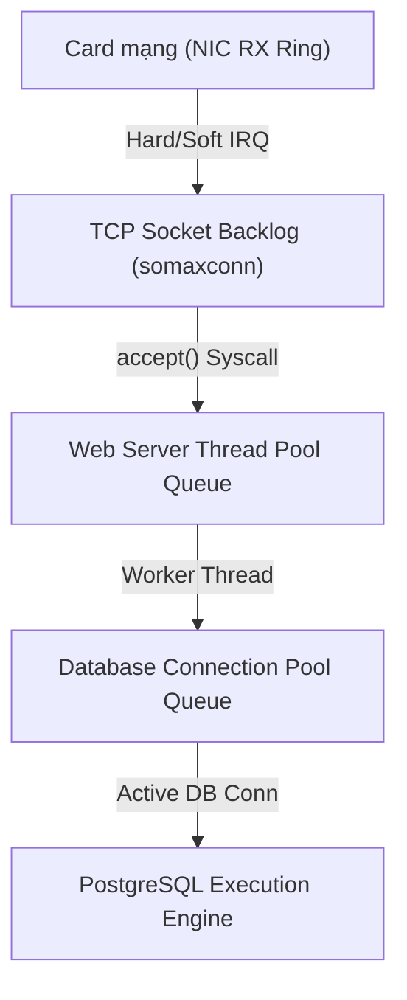

# 2.1. Latency Decomposition and System Breakdown (Phân Rã và Bóc Tách Độ Trễ)

## Tổng quan về Phân Rã Độ Trễ (Latency Decomposition)

Trong hệ thống Backend phân tán, một API request nhìn từ phía Client có vẻ như chỉ là một hành vi đơn lẻ. Tuy nhiên, đằng sau hậu trường là một chuỗi liên hoàn các tương tác phần cứng và phần mềm phức tạp.

**Latency Decomposition (Bóc tách độ trễ)** là kỹ thuật phân chia tổng thời gian phản hồi (End-to-End Latency) thành từng thành phần thời gian con rời rạc, có thể định lượng độc lập, từ đó xác định chính xác vị trí thời gian bị tiêu tốn nhiều nhất.

```mermaid
gantt
    title Phân Rã Thời Gian Của Một API Request (Latency Breakdown)
    dateFormat X
    axisFormat %s ms

    section Mạng Ngoại Vi
    DNS Lookup          :0, 15
    TCP Handshake       :15, 35
    TLS 1.3 Handshake   :35, 60
    HTTP Request Send   :60, 65

    section Gateway & App
    Scheduling & Queue  :65, 70
    Deserialization     :70, 73
    Lock Contention     :73, 76
    Cache Lookup        :76, 78

    section Downstream I/O
    DB Query & Disk I/O :78, 115
    Serialization       :115, 118

    section Mạng Phản Hồi
    HTTP Response Send  :118, 140
```



---

## 2. Chi tiết từng Keyword (Under-the-Hood Deep Dive)

### 1. Latency Decomposition & Latency Breakdown

#### 1. Khái niệm bản chất (What & Why)
- **Latency Breakdown**: Phân loại các lớp độ trễ theo mô hình phân tầng hệ thống (Network, OS Kernel, Application Runtime, Data Storage).
- **Latency Decomposition**: Phương pháp toán học mô hình hóa tổng độ trễ $T_{\text{total}}$ thành tổng các thành phần nối tiếp (Serial) và cực đại các thành phần song song (Parallel):
  $$T_{\text{total}} = \sum_{i \in \text{Serial}} T_i + \max_{j \in \text{Parallel}} (T_j)$$

#### 2. Cơ chế hoạt động sâu (Under the hood)
Trong một kiến trúc Microservices phân tán với RPC fan-out, nếu một service gọi đồng thời 10 service con:
- Độ trễ không phải là trung bình cộng, mà là thời gian của service con **chạy chậm nhất** (Straggler problem):
  $$T_{\text{fanout}} = \max(T_1, T_2, \dots, T_{10})$$

---

### 2. Network Latency, DNS, TCP, TLS & HTTP Request Latency

#### 1. Khái niệm bản chất (What & Why)
Đây là các tầng độ trễ phát sinh bên ngoài biên giới máy chủ xử lý:
- **Network Latency**: Thời gian truyền tải vật lý của các bit qua dây cáp quang, bộ định tuyến (Routers) và thiết bị chuyển mạch (Switches).
- **DNS Resolution Time**: Thời gian client truy vấn hệ thống phân giải tên miền để chuyển đổi Domain Name thành IP Address.
- **TCP Connection Time**: Thời gian thực hiện bắt tay 3 bước (SYN $\rightarrow$ SYN-ACK $\rightarrow$ ACK), tiêu tốn tối thiểu **1 RTT**.
- **TLS Handshake Time**: Thời gian trao đổi khóa mã hóa, kiểm tra chứng chỉ X.509. Với TLS 1.2 là **2 RTT**, TLS 1.3 giảm xuống **1 RTT** (hoặc 0-RTT với Early Data).
- **HTTP Request Latency**: Thời gian client đẩy toàn bộ header và body của request qua socket lên đường truyền mạng.

#### 2. Cơ chế hoạt động sâu (Under the hood)
Tại tầng Kernel của Linux, TCP Connection chịu sự chi phối của tham số TCP Slow Start (`initcwnd` - initial congestion window). Ban đầu, kernel chỉ cho phép gửi một số lượng gói tin giới hạn (mặc định 10 TCP segments $\approx 14.6\text{ KB}$). Nếu payload lớn hơn 14.6 KB, client buộc phải chờ ACK từ server trước khi gửi tiếp $\rightarrow$ Làm tăng thêm RTT.

---

### 3. Application Processing Latency, Scheduling & Lock Contention Latency

#### 1. Khái niệm bản chất (What & Why)
- **Application Processing Latency**: Thời gian CPU trực tiếp thực thi code business logic, tính toán dữ liệu, chạy vòng lặp và xử lý thuật toán.
- **Scheduling Latency**: Khoảng thời gian từ khi một luồng (Thread) sẵn sàng thực thi (Ready state trong OS Runqueue) cho đến khi Linux CFS (Completely Fair Scheduler) hoặc Go/Node.js runtime thực sự cấp phát CPU Core cho nó chạy.
- **Lock Contention Latency**: Thời gian một luồng bị block và chuyển sang trạng thái ngủ (Sleep/Futex wait) do cố gắng chiếm một khóa (Mutex, Read-Write Lock, Spinlock) đang bị giữ bởi luồng khác.

#### 2. Cơ chế hoạt động sâu (Under the hood)
Khi xảy ra Lock Contention:
1. Thread cố gắng thực hiện lệnh Atomic so sánh đổi giá trị (CAS - Compare-And-Swap).
2. Khi thất bại, thread có thể spin trong vài chục chu kỳ CPU (Adaptive Mutex).
3. Nếu vẫn không lấy được lock, thread gọi system call `sys_futex()` để yêu cầu Kernel đưa mình vào danh sách chờ (Wait queue) và nhường CPU.
4. Quá trình chuyển sang kernel space và context switch tiêu tốn khoảng **$1\mu s - 5\mu s$**, làm mất sạch L1/L2 Cache đã nạp trước đó.

---

### 4. Database Query Latency & Cache Latency

#### 1. Khái niệm bản chất (What & Why)
- **Cache Latency**: Thời gian truy xuất dữ liệu từ các lớp bộ nhớ đệm:
  - L1 CPU Cache: $\approx 1\text{ ns}$ (4 cycles).
  - L2 CPU Cache: $\approx 4\text{ ns}$ (14 cycles).
  - L3 CPU Cache: $\approx 10 - 20\text{ ns}$ (40 - 60 cycles).
  - In-memory Local Cache (Heap): $\approx 100\text{ ns}$.
  - Distributed Cache (Redis over Loopback/Local Network): $\approx 0.1\text{ms} - 0.5\text{ms}$.
- **Database Query Latency**: Tổng thời gian từ khi ứng dụng gửi câu lệnh SQL qua mạng nội bộ cho đến khi nhận được tập kết quả (Result set). Bao gồm: Parse SQL $\rightarrow$ Query Planner $\rightarrow$ Index scan / Table scan $\rightarrow$ Buffer pool cache check $\rightarrow$ Disk read (nếu miss) $\rightarrow$ Row serialization.

#### 2. Cơ chế hoạt động sâu (Under the hood)
Một câu lệnh SQL chậm không chỉ do thiếu Index, mà còn do Database Lock Contention (Row-level lock, Table-level lock, MVCC vacuum lock) hoặc Serialization Isolation Level phải abort giao dịch khi phát hiện xung đột dữ liệu.

---

### 5. Queueing Latency

#### 1. Khái niệm bản chất (What & Why)
Queueing Latency là thời gian request phải xếp hàng chờ đợi ở các điểm đệm (Buffers/Queues) trong hệ thống. Đây là thủ phạm số 1 gây ra bùng nổ độ trễ đuôi (Tail Latency Spikes).

#### 2. Cơ chế hoạt động sâu (Under the hood)
Các tầng hàng đợi ẩn mà một request phải đi qua trong hệ điều hành Linux:
1. **NIC Ring Buffer (Rx/Tx queues)**: Card mạng nhận frame Ethernet qua DMA.
2. **TCP Listen Queue (SYN Backlog & Accept Queue)**: Bị giới hạn bởi tham số `net.core.somaxconn`.
3. **Application Thread Pool Queue**: Nơi request nằm chờ worker thread rảnh để xử lý.
4. **Database Connection Pool Queue**: Nơi request chờ kết nối DB rảnh (HikariCP, pgx).



---

### 6. Serialization & Deserialization Latency

#### 1. Khái niệm bản chất (What & Why)
- **Serialization (Tuần tự hóa)**: Chuyển đổi cấu trúc dữ liệu trong bộ nhớ RAM (Objects, Structs, Maps) thành chuỗi byte có thể truyền qua mạng hoặc ghi xuống đĩa (JSON, Protobuf, Avro).
- **Deserialization (Giải tuần tự hóa)**: Phân tích cú pháp (Parsing) chuỗi byte nhận được từ mạng để tái tạo lại cấu trúc đối tượng trong bộ nhớ.

#### 2. Cơ chế hoạt động sâu (Under the hood)
JSON Serialization/Deserialization cực kỳ tốn kém vì:
- Là định dạng văn bản (Text-based): Đòi hỏi chu trình quét từng ký tự (Character-by-character scan), chuyển đổi số nguyên/thực thành chuỗi và ngược lại (ASCII $\leftrightarrow$ Binary conversion).
- Cần cấp phát bộ nhớ động liên tục (Dynamic Memory Allocations) cho từng trường String và Object tạm trên Heap, gây áp lực khủng khiếp lên Garbage Collector.

---

### 7. Disk I/O & Memory Access Latency

#### 1. Khái niệm bản chất (What & Why)
- **Memory Access Latency**: Thời gian đọc/ghi trực tiếp vào thanh RAM (DDR4/DDR5 $\approx 50 - 100\text{ ns}$).
- **Disk I/O Latency**: Thời gian truy xuất thiết bị lưu trữ thứ cấp:
  - NVMe SSD: $\approx 10 - 30\mu s$ (Random Read).
  - SATA SSD: $\approx 100 - 200\mu s$.
  - HDD (Cơ học): $\approx 5 - 10\text{ ms}$ (Chờ cơ cấu xoay đĩa và di chuyển đầu đọc).

#### 2. Bảng Thang Đo Độ Trễ Kinh Điển Của Kỹ Sư (Numbers Every Programmer Should Know)
Nhân hóa thời gian để thấy rõ mức độ chênh lệch khủng khiếp (1 chu kỳ CPU $\approx 1$ giây của con người):

| Hành động | Thời gian thực tế | Quy đổi tương đương con người |
| :--- | :--- | :--- |
| 1 Chu kỳ CPU (Lệnh đơn) | $0.3\text{ ns}$ | 1 Giây |
| L1 Cache Hit | $0.9\text{ ns}$ | 3 Giây |
| L2 Cache Hit | $2.8\text{ ns}$ | 9 Giây |
| L3 Cache Hit | $12.9\text{ ns}$ | 43 Giây |
| Truy xuất RAM chính (DRAM) | $60\text{ ns}$ | 3 Phút |
| Đọc ngẫu nhiên SSD NVMe | $20\mu s$ | 16 Giờ |
| Đọc ngẫu nhiên HDD | $5\text{ ms}$ | 6 Tháng |
| Gửi packet Hà Nội $\rightarrow$ California | $150\text{ ms}$ | 15 Năm |

---

## Code Ví Dụ Thực Chiến (C++20)

Minh họa đo lường chính xác các thành phần độ trễ trong quá trình xử lý một tác vụ với Clock Cycles (`__rdtsc`) và Hardware Time:

```cpp
#include <iostream>
#include <chrono>
#include <string>
#include <vector>
#include <x86intrin.h> // Hỗ trợ __rdtsc cho x86_64

// Đo lường CPU Cycles trực tiếp từ phần cứng
inline uint64_t rdtsc() {
    unsigned int lo, hi;
    __asm__ __volatile__ ("rdtsc" : "=a" (lo), "=d" (hi));
    return ((uint64_t)hi << 32) | lo;
}

// Bảng cấu trúc phân rã độ trễ của 1 Request nội bộ
struct RequestLatencyDecomposition {
    uint64_t parsing_cycles;
    uint64_t lock_contention_cycles;
    uint64_t db_query_cycles;
    uint64_t serialization_cycles;
    uint64_t total_cycles;

    void print_breakdown(double cpu_ghz = 3.0) const {
        auto cycles_to_us = [cpu_ghz](uint64_t cycles) {
            return (static_cast<double>(cycles) / (cpu_ghz * 1e3));
        };

        std::cout << "--- LATENCY DECOMPOSITION REPORT ---\n";
        std::cout << "1. Parsing/Deserialization : " << cycles_to_us(parsing_cycles) << " us (" 
                  << (parsing_cycles * 100.0 / total_cycles) << "%)\n";
        std::cout << "2. Lock Contention         : " << cycles_to_us(lock_contention_cycles) << " us (" 
                  << (lock_contention_cycles * 100.0 / total_cycles) << "%)\n";
        std::cout << "3. DB Query (I/O Wait)     : " << cycles_to_us(db_query_cycles) << " us (" 
                  << (db_query_cycles * 100.0 / total_cycles) << "%)\n";
        std::cout << "4. Response Serialization  : " << cycles_to_us(serialization_cycles) << " us (" 
                  << (serialization_cycles * 100.0 / total_cycles) << "%)\n";
        std::cout << "------------------------------------\n";
        std::cout << "Total Request Latency      : " << cycles_to_us(total_cycles) << " us\n";
    }
};

int main() {
    RequestLatencyDecomposition decomp{};
    uint64_t start_total = rdtsc();

    // 1. Giả lập Deserialization
    uint64_t s1 = rdtsc();
    // Busy work giả lập parse chuỗi
    std::string raw_input = "{\"user_id\": 10981, \"action\": \"checkout\"}";
    volatile size_t hash = 0;
    for (char c : raw_input) hash = hash * 31 + c;
    uint64_t e1 = rdtsc();
    decomp.parsing_cycles = e1 - s1;

    // 2. Giả lập Lock Contention
    uint64_t s2 = rdtsc();
    // Giả lập spinlock ngắn
    for (volatile int i = 0; i < 500; ++i) { asm volatile("pause"); }
    uint64_t e2 = rdtsc();
    decomp.lock_contention_cycles = e2 - s2;

    // 3. Giả lập Database Query I/O Wait
    uint64_t s3 = rdtsc();
    for (volatile int i = 0; i < 50000; ++i) { asm volatile(""); }
    uint64_t e3 = rdtsc();
    decomp.db_query_cycles = e3 - s3;

    // 4. Giả lập Serialization
    uint64_t s4 = rdtsc();
    std::string response = "{\"status\": \"success\", \"code\": 200}";
    for (char c : response) hash ^= c;
    uint64_t e4 = rdtsc();
    decomp.serialization_cycles = e4 - s4;

    uint64_t end_total = rdtsc();
    decomp.total_cycles = end_total - start_total;

    decomp.print_breakdown(3.2); // Giả định CPU 3.2 GHz

    return 0;
}
```

---

## Cạm bẫy & Sai lầm Kinh điển (Pitfalls & Anti-Patterns)

1. **Bỏ qua TLS & DNS trong đánh giá Web Latency**:
   - Khi đo lường microservice nội bộ trong mạng VPC, độ trễ mạng chỉ $0.5\text{ms}$. Nhưng khi cung cấp Public API cho app di động, DNS lookup chiếm tới $80\text{ms}$ trên mạng 4G/5G và TLS handshake chiếm $60\text{ms}$. Lỗi là chỉ nhìn vào server logs thay vì Client Real User Monitoring (RUM).
2. **"Microsecond Blindness" với JSON Parsing**:
   - Một API xử lý 50,000 RPS mà body JSON chứa mảng hàng trăm phần tử. Thời gian thực thi logic chỉ mất $100\mu s$ nhưng JSON deserialization chiếm tới $250\mu s$. Sử dụng sai thư viện JSON hoặc không chuyển sang Protobuf/FlatBuffers khiến 70% CPU server bị tiêu hao vô ích vào việc parse text.
3. **Queueing Latency che giấu Service Time thực tế**:
   - Khi server bị quá tải, thời gian response đo được tăng từ $10\text{ms}$ lên $5000\text{ms}$. Kỹ sư vội vã kết luận "Database bị chậm". Nhưng khi bóc tách, Database Service Time vẫn chỉ mất $5\text{ms}$, trong khi $4995\text{ms}$ còn lại là do request nằm chờ trong Application Queue vì thread pool bị cạn kiệt.

---

## Ứng dụng Thực chiến trong Backend & Hệ thống Lớn

- **Distributed Tracing (OpenTelemetry)**: Cấu hình Spans chi tiết tương ứng với các giai đoạn phân rã độ trễ để biểu diễn Waterfalls trên Jaeger/Zipkin.
- **Connection Keep-Alive & Connection Pooling**: Tận dụng triệt để HTTP Keep-Alive và TCP Connection Pooling để loại bỏ hoàn toàn chi phí DNS, TCP 3-way handshake và TLS handshake cho các lệnh gọi service-to-service.
- **Kernel Bypass & Zero-Copy**: Áp dụng kỹ thuật `sendfile` hoặc `io_uring` để loại bỏ việc copy dữ liệu giữa Kernel Space và User Space, giảm thiểu Disk và Network serialization latency.
