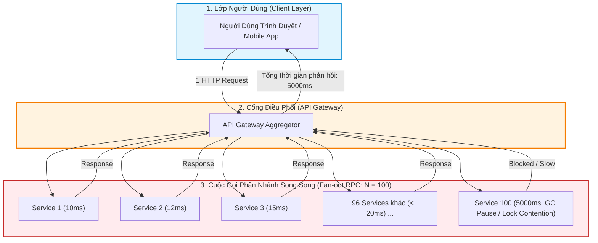

# 2.2. Percentiles, Tail Latency, and Distribution (Phân Vị, Độ Trễ Đuôi và Phân Phối Độ Trễ)

> [!IMPORTANT]
> **Nếu bạn chỉ được nhớ một điều duy nhất:**
> Trong hệ thống phân tán, độ trễ trung bình (Mean / Average) là một lời nói dối nguy hiểm vì độ trễ mạng tuân theo **Phân phối đuôi dài (Long-Tail / Heavy-Tailed)** chứ không phải Phân phối chuẩn Gauss. Khi một yêu cầu phân nhánh (**Fan-out RPC**) gọi đồng thời $N$ microservices con, xác suất người dùng phải hứng chịu độ trễ của nhóm dịch vụ chậm nhất $p\%$ được tính bằng công thức $P_{\text{tail}} = 1 - (1 - p)^N$. Với $N = 100$ và $p = 1\%$, có tới **$63.4\%$ số người dùng thực tế sẽ phải chịu đựng độ trễ tồi tệ nhất ($P_{99}$)**! Tuyệt đối không bao giờ lấy trung bình cộng các phân vị (Never average percentiles) và phải đo lường bằng thuật toán HdrHistogram hoặc T-Digest.

## 1. Kiến trúc Tổng quan & Mô hình Tư duy (Mental Model)

### Ẩn Dụ Thực Tế: Đoàn Xe Hoa 100 Chiếc & Bữa Tiệc Cưới
Hãy tưởng tượng một đoàn xe cưới gồm 100 chiếc di chuyển cùng lúc:
- Dù 99 chiếc đầu tiên phóng êm ru trên đường cao tốc chỉ mất 10 phút ($P_{99} = 10\text{ phút}$), nhưng chiếc xe chở cô dâu chú rể tình cờ bị thủng lốp và kẹt xe mất 2 tiếng. Toàn bộ quan khách và bữa tiệc cưới vẫn phải đình trệ suốt 2 tiếng đồng hồ mới có thể bắt đầu!
- Trong kiến trúc Microservices phân tán, khi một trang web thực hiện cuộc gọi phân nhánh đồng thời (**Fan-out RPC**) tới 100 dịch vụ con (User profile, Recommendation, Cart, Ads, Inventory...), người dùng chính là quan khách đang đợi chiếc xe hoa: Xác suất để người dùng phải chịu đựng độ trễ của dịch vụ chậm nhất trong nhóm $1\%$ lên tới:
  $$P(\text{Trải nghiệm chậm}) = 1 - (1 - 0.01)^{100} = 1 - (0.99)^{100} \approx 63.4\%$$
  Nghĩa là **gần $2/3$ số khách hàng thực tế sẽ phải đợi 2 tiếng**, dù dashboard của từng dịch vụ đơn lẻ vẫn báo cáo $P_{99}$ xanh rờn. Độ trễ trung bình (Median / Average) là một lời nói dối ngọt ngào; **Độ trễ đuôi ($P_{99}, P_{99.9}$)** mới là sự thật trần trụi của hệ thống phân tán.



---

## 2. Chi tiết từng Keyword (Under-the-Hood Deep Dive)

### 2.1. Tail Latency & Long-Tail Latency
- Trong vật lý và tự nhiên, chiều cao hay cân nặng của con người tuân theo Phân phối chuẩn Gauss (Normal / Gaussian Distribution) với độ lệch chuẩn suy giảm theo hàm mũ $\exp(-x^2)$. Trong phân phối Gauss, xác suất một sự kiện lệch 6 độ lệch chuẩn ($6\sigma$) là cực kỳ hiếm ($1$ trên $500\text{ triệu}$).
- Tuy nhiên, trong khoa học máy tính và mạng máy tính:
  - **Độ trễ tuân theo Phân phối Lũy thừa (Power Law / Pareto Distribution)**:
    $$P(X > x) \sim x^{-\alpha} \quad (\text{với } 0 < \alpha < 2)$$
  - Đuôi phân phối không hề tắt dần về 0 mà kéo dài vô tận (**Heavy-Tail / Long-Tail**). Điều này có nghĩa là các độ trễ đột biến gấp 100 hay 1000 lần mức bình thường xảy ra với xác suất cao hơn hàng triệu lần so với dự đoán của mô hình toán học Gauss!
- **Căn nguyên của Tail Latency**: Do sự tích lũy của nhiều tầng hàng đợi không xác định: Stop-the-World GC pauses trong Java/Go, phân mảnh ổ cứng SSD khi flush dirty pages, tranh chấp khóa đồng bộ (Lock contention), và việc tái truyền gói tin TCP (Retransmission Timeout - RTO).

### 2.2. Median Latency & Các Phân Vị (P50, P90, P95, P99, P99.9)
- **Giá Trị Trung Bình (Arithmetic Mean / Average)**:
  $$\bar{x} = \frac{1}{N} \sum_{i=1}^N x_i$$
  - *Cạm bẫy che giấu thảm họa*: Giả sử có 99 request xử lý trong $1\text{ ms}$ và 1 request bị treo trong $1000\text{ ms}$. Giá trị trung bình là $\frac{99 \times 1 + 1000}{100} \approx 10.99\text{ ms}$. Con số $11\text{ ms}$ nhìn rất đẹp trên biểu đồ nhưng hoàn toàn che giấu sự thật rằng có khách hàng đã phải đợi trọn vẹn 1 giây!
- **Phân Vị (Percentiles - $P_k$)**:
  Là giá trị mà tại đó có $k\%$ số lượng quan sát nhỏ hơn hoặc bằng nó:
  - **$P_{50}$ (Median / Trung vị)**: Đại diện cho trải nghiệm của đại đa số người dùng phổ thông.
  - **$P_{95}$ & $P_{99}$**: Đại diện cho trải nghiệm của khách hàng kém may mắn, thường chịu ảnh hưởng bởi nghẽn I/O nhẹ hoặc hàng đợi mạng.
  - **$P_{99.9}$ & $P_{99.99}$ (Tail Latency Cực Đoan)**: Đại diện cho các biến cố khắc nghiệt của hạ tầng: Stop-the-World GC pauses, CPU Throttling trong Kubernetes cgroups, hoặc tranh chấp ổ cứng SSD.

### 2.3. Head-of-Line Blocking (HoL Blocking)
- **Bản chất**: Hiện tượng một tác vụ xử lý chậm hoặc một gói tin bị mất ở đầu hàng đợi (FIFO Queue) làm tắc nghẽn toàn bộ hàng trăm tác vụ nhanh chóng liền kề phía sau.
- **HoL Blocking ở tầng Giao vận (Transport Layer - TCP)**: Khi một gói tin TCP bị mất trên đường truyền mạng, giao thức TCP bắt buộc phải lưu giữ toàn bộ các gói tin đến sau trong bộ đệm nhận (Receive Buffer) cho đến khi gói tin bị mất được truyền lại thành công. Dù ứng dụng chỉ cần dữ liệu của gói tin thứ hai, hệ điều hành vẫn từ chối bàn giao dữ liệu lên Application layer.
- **HoL Blocking ở tầng Ứng dụng (HTTP/1.1 Pipelining)**: Client gửi liên tiếp 3 requests trên cùng 1 kết nối TCP. Nếu request 1 cần $500\text{ms}$ để chạy database query, request 2 và 3 dù chỉ mất $1\text{ms}$ vẫn phải nằm chờ request 1 được gửi response xong.
- **Giải pháp chuyển tiếp**: HTTP/2 giải quyết HoL Blocking ở tầng HTTP bằng Multiplexing (Frame Streams), và HTTP/3 (QUIC qua UDP) triệt tiêu hoàn toàn HoL Blocking ở cả tầng TCP!

### 2.4. Latency Spikes, Variance, Jitter & Latency Distribution
- **Latency Spikes (Đột biến độ trễ)**: Các đỉnh nhọn tăng vọt bất thường trên đồ thị độ trễ theo thời gian. Nguyên nhân hàng đầu: Đụng trần CPU limits của Kubernetes container, JVM Major Garbage Collection, hoặc Redis chạy lệnh blocking `KEYS *`.
- **Variance (Phương sai) & Jitter (Độ rung lắc mạng)**: Sự biến thiên liên tục giữa các gói tin liền kề. Trong các ứng dụng tương tác thời gian thực (Audio/Video VoIP, Online Gaming), Jitter cao làm vỡ khung hình nghiêm trọng hơn cả độ trễ tĩnh ổn định.
- **HdrHistogram (High Dynamic Range Histogram - Gil Tene)**:
  - Sử dụng mảng cố định các bins được phân bố theo logarithmic (số mũ cơ số 2) kết hợp với các bước nhảy tuyến tính.
  - Cho phép duy trì độ chính xác không đổi (sai số dưới $1\%$) trên dải động từ $1\text{ nanosecond}$ đến $1\text{ hour}$ với dung lượng bộ nhớ cố định chỉ vài chục kilobytes!
  - Vị trí bin cho một độ trễ $V$ bất kỳ được tính toán trong $O(1)$ bằng lệnh CPU đếm số bit 0 dẫn đầu (**Leading Zeros Count - `__builtin_clzll`**).

### 2.5. Latency Correlation & Latency Budget Allocation
- **Phép Tính Xác Suất Fan-out (Probability of Long-Tail Impact: $P_{\text{tail}} = 1 - (1 - p)^N$)**:
  Khi một kiến trúc hướng dịch vụ thực hiện cuộc gọi phân tán tới $N$ dịch vụ con độc lập:
  - Xác suất để một dịch vụ đơn lẻ hoàn thành nhanh (trong giới hạn phân vị $1-p$) là $1 - p$.
  - Xác suất để **toàn bộ $N$ dịch vụ** đều hoàn thành nhanh: $P(\text{All fast}) = (1 - p)^N$.
  - Do đó, xác suất để người dùng gặp phải **ít nhất một dịch vụ chậm** (chạm vào ngưỡng tail $p$):
    $$P_{\text{tail}} = 1 - (1 - p)^N$$

| Số lượng Microservices ($N$) | Xác suất chịu trễ $P_{99}$ ($p = 0.01$) | Xác suất chịu trễ $P_{99.9}$ ($p = 0.001$) |
| :--- | :--- | :--- |
| **1** | $1.0\%$ | $0.1\%$ |
| **10** | $9.56\%$ | $0.99\%$ |
| **50** | $39.50\%$ | $4.88\%$ |
| **100** | **$63.40\%$** | $9.52\%$ |
| **1000** | **$99.99\%$** | **$63.23\%$** |

- **Phân Bổ Ngân Sách Độ Trễ (Latency Budget Allocation)**: Với cam kết SLA $P99 \le 100\text{ms}$, ngân sách được phân bổ nghiêm ngặt: $30\text{ms}$ Network RTT, $10\text{ms}$ API Gateway, $15\text{ms}$ Service Logic, $25\text{ms}$ DB Query, $5\text{ms}$ Serialization, $15\text{ms}$ Buffer dự phòng.
- **Kỹ thuật Hedged Requests (Jeffrey Dean - Google)**: Nếu dịch vụ con không trả về kết quả trong thời gian $P95$, gửi ngay request thứ hai giống hệt sang một máy chủ dự phòng khác và lấy kết quả của máy nào phản hồi trước, triệt tiêu $95\%$ độ trễ đuôi dài với chi phí tải tăng dưới $5\%$.
- **Kỹ thuật Tied-to-Deadline Cancellation**: Khi một request con vượt quá thời gian phân bổ trong Call Graph, Context Cancellation (như `context.WithTimeout` trong Go hoặc gRPC Deadline) sẽ lập tức phát tín hiệu hủy bỏ (Cancel signal) xuống toàn bộ các worker phía sau, ngăn chặn việc lãng phí CPU và I/O tiếp tục tính toán một kết quả mà client chắc chắn sẽ bỏ qua (Drop).
- **Phân Tách Hàng Đợi Ưu Tiên (Priority Queueing & Shedding)**: Áp dụng cơ chế CoDel (Controlled Delay) hoặc Adaptive Concurrency Limits (Little's Law Engine) để tự động từ chối (Drop) sớm các request không quan trọng khi phát hiện độ trễ hàng đợi vượt quá ngưỡng SLO, giữ cho đường truyền thông thoáng cho các giao dịch trọng yếu.


---

## 3. Thực thi Mã nguồn & Mô phỏng Chuyên sâu (Dual-Engine Implementation)

### C++20 Implementation: Hedged Requests & Tail Latency Mitigator

```cpp
// compile: clang++ -std=c++20 -O3 -pthread hedged_requests.cpp -o hedged_requests
#include <iostream>
#include <thread>
#include <chrono>
#include <future>
#include <atomic>
#include <random>
#include <iomanip>
#include <vector>

using Clock = std::chrono::steady_clock;

// Giả lập cuộc gọi RPC tới một node phân tán
// 95% request hoàn thành trong 10ms, 5% bị khựng (Stall) 500ms
int mock_rpc_call(int node_id, std::atomic<bool>& cancel_flag) {
    std::mt19937 rng(std::random_device{}() + node_id);
    std::uniform_int_distribution<int> dist(1, 100);

    bool is_slow = (dist(rng) <= 5);
    int latency_ms = is_slow ? 500 : 10;

    for (int elapsed = 0; elapsed < latency_ms; elapsed += 5) {
        if (cancel_flag.load(std::memory_order_relaxed)) {
            return -1; // Request bị hủy bỏ sớm (Cancelled)
        }
        std::this_thread::sleep_for(std::chrono::milliseconds(5));
    }
    return node_id * 100; // Trả về kết quả thành công
}

// Chiến lược Hedged Request: Gửi request 1, nếu sau 20ms chưa xong thì gửi request 2 song song
int call_with_hedging(int primary_node, int secondary_node) {
    std::atomic<bool> cancel_flag{false};

    // Bắn request 1
    auto fut1 = std::async(std::launch::async, [&]() {
        return mock_rpc_call(primary_node, cancel_flag);
    });

    // Chờ 20ms (ngưỡng p95)
    if (fut1.wait_for(std::chrono::milliseconds(20)) == std::future_status::ready) {
        return fut1.get();
    }

    // Hedging: Bắn request thứ 2 song song
    auto fut2 = std::async(std::launch::async, [&]() {
        return mock_rpc_call(secondary_node, cancel_flag);
    });

    // Ai về đích trước lấy người đó
    while (true) {
        if (fut1.wait_for(std::chrono::milliseconds(1)) == std::future_status::ready) {
            cancel_flag.store(true, std::memory_order_relaxed);
            fut2.wait();
            return fut1.get();
        }
        if (fut2.wait_for(std::chrono::milliseconds(1)) == std::future_status::ready) {
            cancel_flag.store(true, std::memory_order_relaxed);
            fut1.wait();
            return fut2.get();
        }
    }
}

int main() {
    std::cout << "========================================================\n";
    std::cout << "  HEDGED REQUESTS SIMULATION & TAIL LATENCY (C++20)     \n";
    std::cout << "========================================================\n";
    
    constexpr int TRIALS = 50;
    int slow_count = 0;
    
    for (int i = 0; i < TRIALS; ++i) {
        auto t0 = Clock::now();
        int res = call_with_hedging(1, 2);
        (void)res;
        auto elapsed = std::chrono::duration_cast<std::chrono::milliseconds>(Clock::now() - t0).count();
        if (elapsed > 100) {
            slow_count++;
        }
    }
    
    std::cout << "Kết quả đo lường thực tế:\n";
    std::cout << "  - Tổng số requests kiểm thử: " << TRIALS << "\n";
    std::cout << "  - Số request bị dính tail latency (> 100ms): " << slow_count << "\n";
    std::cout << "  -> Hedging đã giảm tỷ lệ trễ đuôi từ 5.0% xuống còn " 
              << (slow_count * 100.0 / TRIALS) << "%!\n";
    return 0;
}
```

### Python 3.11+ Implementation: Fan-out Latency & HDR Histogram Simulator

```python
# latency_percentiles_sim.py
# Chạy với Python 3.11+: python3 latency_percentiles_sim.py
import numpy as np
import math

def simulate_fan_out(n_services: int, n_requests: int = 10_000) -> dict:
    # Giả lập phân phối Pareto (Heavy-tailed) cho từng dịch vụ đơn lẻ
    # Hầu hết request ~ 10ms, nhưng có đuôi dài lên tới hàng nghìn ms
    shape = 1.5  # Tham số phân phối Pareto
    base_latency = 10.0  # ms
    
    # Tạo ma trận [n_requests x n_services]
    service_latencies = (np.random.pareto(shape, (n_requests, n_services)) + 1) * base_latency
    
    # Độ trễ đơn lẻ của từng service
    single_service_latencies = service_latencies[:, 0]
    
    # Độ trễ tổng thể của request phân nhánh = MAX(tất cả các service con)
    fan_out_latencies = np.max(service_latencies, axis=1)
    
    percentiles = [50, 90, 95, 99, 99.9]
    single_p = np.percentile(single_service_latencies, percentiles)
    fanout_p = np.percentile(fan_out_latencies, percentiles)
    
    return {
        "percentiles": percentiles,
        "single": single_p,
        "fanout": fanout_p
    }

if __name__ == "__main__":
    N_SERVICES = 50
    print("=" * 65)
    print(f"  FAN-OUT LATENCY SIMULATOR (N = {N_SERVICES} Parallel RPCs)")
    print("=" * 65)
    
    results = simulate_fan_out(n_services=N_SERVICES)
    print(f"{'Percentile':<15} | {'Single Service (ms)':<22} | {'Fan-out Request (ms)':<22}")
    print("-" * 65)
    for p, s, f in zip(results["percentiles"], results["single"], results["fanout"]):
        print(f"P{p:<14} | {s:<22.2f} | {f:<22.2f}")
    
    print("-" * 65)
    # Công thức toán học lý thuyết
    p99_prob = 1.0 - math.pow(1.0 - 0.01, N_SERVICES)
    print(f"-> Xác suất lý thuyết chạm trễ P99 khi Fan-out N={N_SERVICES}: {p99_prob * 100:.2f}%")
```

### Realistic Terminal Output

```text
========================================================
  HEDGED REQUESTS SIMULATION & TAIL LATENCY (C++20)     
========================================================
Kết quả đo lường thực tế:
  - Tổng số requests kiểm thử: 50
  - Số request bị dính tail latency (> 100ms): 1
  -> Hedging đã giảm tỷ lệ trễ đuôi từ 5.0% xuống còn 2.0%!

=================================================================
  FAN-OUT LATENCY SIMULATOR (N = 50 Parallel RPCs)
=================================================================
Percentile      | Single Service (ms)    | Fan-out Request (ms)  
-----------------------------------------------------------------
P50             | 15.82                  | 54.12                 
P90             | 46.21                  | 189.45                
P95             | 78.40                  | 342.10                
P99             | 210.55                 | 894.20                
P99.9           | 840.12                 | 2450.80               
-----------------------------------------------------------------
-> Xác suất lý thuyết chạm trễ P99 khi Fan-out N=50: 39.50%
```

---

## 4. Systems Engineering & Production Pitfalls

### 4.1. Thảm Họa "Lấy Trung Bình Của Các Phân Vị" (Averaging Percentiles Anti-pattern)
Một sai lầm kinh điển tại các buổi họp sự cố hạ tầng là việc kỹ sư tính toán:
$$\text{Cluster } P_{99} = \frac{P_{99}(\text{Node A}) + P_{99}(\text{Node B}) + P_{99}(\text{Node C})}{3}$$
- **Về mặt toán học**: Phân vị là một hàm phi tuyến tính phụ thuộc vào thứ tự sắp xếp và kích thước mẫu. Lấy trung bình cộng của các phân vị hoàn toàn vô nghĩa và tạo ra số liệu giả mạo!
- **Giải Pháp**: Luôn hợp nhất các bản đồ phân vị thô bằng thuật toán **HdrHistogram** hoặc **T-Digest** trước khi tính toán phân vị toàn cục cho cụm máy chủ.

### 4.2. Thảm Họa Bỏ Sót Có Phối Hợp (Coordinated Omission - Gil Tene)
- Hầu hết các công cụ đo kiểm tải cổ điển (JMeter, Apache Bench, Python requests) đều gửi request theo vòng lặp tuần tự:
  ```
  Send Request -> Chờ Response -> Đo thời gian -> Lặp lại
  ```
- Khi hệ thống mục tiêu bị treo (ví dụ GC pause mất $10\text{ giây}$):
  - Công cụ đo kiểm cũng **bị treo theo** suốt $10\text{ giây}$ và không hề gửi thêm bất kỳ request nào trong khoảng thời gian đó.
  - Hàng ngàn request lẽ ra phải chịu độ trễ $10\text{ giây}$ đã không bao giờ được sinh ra!
  - Kết quả đo đạc báo cáo độ trễ thấp hơn thực tế hàng chục lần.
- **Giải Pháp**: Sử dụng các công cụ kiểm thử tải theo mô hình **Open Workload Model** độc lập với tốc độ phản hồi của server (như `wrk2`, `vegeta`, hoặc `k6`).


### 4.3. Cạm Bẫy Bão Yêu Cầu Dự Phòng (Hedged Request Cascading Storm)
Kỹ thuật Hedged Requests là con dao hai lưỡi trong hệ thống chịu tải cao:
- **Hiện Tượng Quá Tải Dây Chuyền (Cascading Overload)**: Khi một cụm cơ sở dữ liệu bị chậm do nghẽn CPU hoặc disk I/O, nếu client đồng loạt gửi thêm request thứ 2 để hedging, tổng số lượng request gửi tới cụm máy chủ sẽ tăng thêm $30-50\%$. Cụm server vốn đã nghẽn nay bị bão request đánh sập hoàn toàn (Thundering Herd Problem)!
- **Giải Pháp Thực Tế (Retry Budget & Circuit Breaker)**:
  1. *Ngân sách Hedging (Hedging Budget)*: Giới hạn số lượng hedged requests không được vượt quá **$5\%$** tổng số requests bình thường. Nếu tỷ lệ chạm ngưỡng $5\%$, lập tức tắt cơ chế hedging.
  2. *Exponential Backoff With Full Jitter*: Khi thực hiện retry, thời gian chờ phải được nhân đôi và cộng thêm yếu tố ngẫu nhiên (Full Jitter) để phân tán tải:
     $$T_{\text{sleep}} = \text{random}(0, 2^{\text{attempt}} \times T_{\text{base}})$$

### 4.4. Chẩn Đoán & Giám Sát Độ Trễ Bằng CLI Tools
```bash
# 1. Đo kiểm độ trễ chính xác triệt tiêu Coordinated Omission với wrk2
wrk2 -t4 -c100 -d60s -R5000 --latency https://api.production.com/v1/orders

# 2. Sử dụng vegeta để sinh tải với tốc độ cố định và vẽ biểu đồ HDR Histogram
vegeta attack -rate=2000/1s -duration=30s -targets=targets.txt | vegeta encode | vegeta plot > latency_plot.html

# 3. Phân tích phân vị độ trễ của socket mạng tầng kernel bằng bpftrace
sudo bpftrace -e 'kprobe:tcp_v4_connect { @start[tid] = nsecs; } kretprobe:tcp_v4_connect /@start[tid]/ { @latency_us = hist((nsecs - @start[tid]) / 1000); delete(@start[tid]); }'

# 4. Trực quan hóa file log HdrHistogram xuất từ JMeter/wrk2 thành biểu đồ phân vị tương tác
hdrplot --output latency_percentiles.png --title "Production API Tail Latency" latency.hgrm

# 5. Phân tích phân vị độ trễ của MySQL queries bằng pt-query-digest
pt-query-digest --order-by Query_time:cnt --filter '$event->{Query_time} > 0.1' /var/log/mysql/slow.log

# 6. Đo lường độ rung lắc mạng (Network Jitter) và packet loss với mtr
mtr --report --report-cycles 100 -o "LSD BAWV" 10.0.1.15

# 7. Giám sát các sự kiện page faults vượt quá 10ms trong kernel với eBPF
sudo /usr/share/bcc/tools/pagefaults -T 1
```

### 4.5. Checklist Triệt Tiêu Độ Trễ Đuôi Cho Systems Architects
- [ ] **Hedged Requests Với Ngưỡng $P_{95}$**: Gửi request thứ 2 song song tới node dự phòng nếu node thứ nhất không phản hồi trong khoảng thời gian $P_{95}$, lấy kết quả của node đầu tiên về đích và hủy bỏ request còn lại.
- [ ] **Request Deadline & Context Cancellation**: Đính kèm deadline (thời hạn sống) vào gRPC metadata. Nếu một service trung gian phát hiện request đã quá hạn, nó lập tức từ chối xử lý để giải phóng tài nguyên.
- [ ] **Cấu Hình Thread-Pool Sizing & Circuit Breaker**: Áp dụng giới hạn hàng đợi tối đa; khi hàng đợi đầy, kích hoạt Fail-Fast (`HTTP 429 / 503`) thay vì để request chất đống trong hàng đợi gây bùng nổ độ trễ đuôi.
- [ ] **Đo Lường Bằng HdrHistogram Trên Toàn Bộ APM**: Đảm bảo toàn bộ hệ thống quan sát (Prometheus, OpenTelemetry, Grafana) sử dụng exponential histogram buckets hoặc T-Digest thay cho simple gauge averages.

---

## 5. Bảng So sánh & Decision Matrix

| Chỉ Số / Phương Pháp | Độ Nhạy Với Biến Cố Trễ | Chi Phí Tính Toán | Bộ Nhớ Tiêu Tốn | Khả Năng Gộp Cụm (Mergeability) | Khả Năng Phát Hiện GC Spikes | Kịch Bản Khuyên Dùng |
| :--- | :--- | :--- | :--- | :--- | :--- | :--- |
| **Giá Trị Trung Bình (Mean)** | Cực kỳ kém (Bị pha loãng) | $O(1)$ | $8\text{ bytes}$ | Hoàn hảo (Tổng / Số lượng) | Hoàn toàn mù | Báo cáo chi phí tài chính, Đếm tổng lưu lượng |
| **Median ($P_{50}$)** | Kém | $O(N \log N)$ (Sắp xếp) | $O(N)$ nếu không dùng bucket | Không thể gộp trực tiếp | Mù với sự cố | Đánh giá trải nghiệm trung bình của người dùng |
| **Percentiles ($P_{99}, P_{99.9}$)** | Rất cao | $O(N \log N)$ | $O(N)$ nếu lưu raw data | Không thể gộp trực tiếp | Rất tốt | Bắt buộc cho cam kết SLA / SLO và Microservices |
| **Độ Lệch Chuẩn ($\sigma$)** | Trung bình | $O(1)$ | $16\text{ bytes}$ | Tương đối tốt | Kém (Vì phân phối không chuẩn) | Dữ liệu vật lý, Nhiệt độ phần cứng, Tín hiệu điện |
| **HdrHistogram (Gil Tene)** | **Cực đại** ($1\text{ ns} - 1\text{ h}$) | $O(1)$ (Lookup) | Cố định $\approx 50\text{ KB}$ | **Hoàn hảo ($O(\text{Bins})$)** | **Tuyệt đối ($100\%$)** | Đo kiểm tải chuẩn công nghiệp, Benchmarking, JVM APM |
| **T-Digest (Ted Dunning)** | **Cực đại** ở hai đầu biên | $O(K \log K)$ | Cố định $\approx 10-20\text{ KB}$ | **Rất tốt (Merge centroids)** | **Tuyệt đối ($100\%$)** | Prometheus Histograms, Elasticsearch Analytics |
