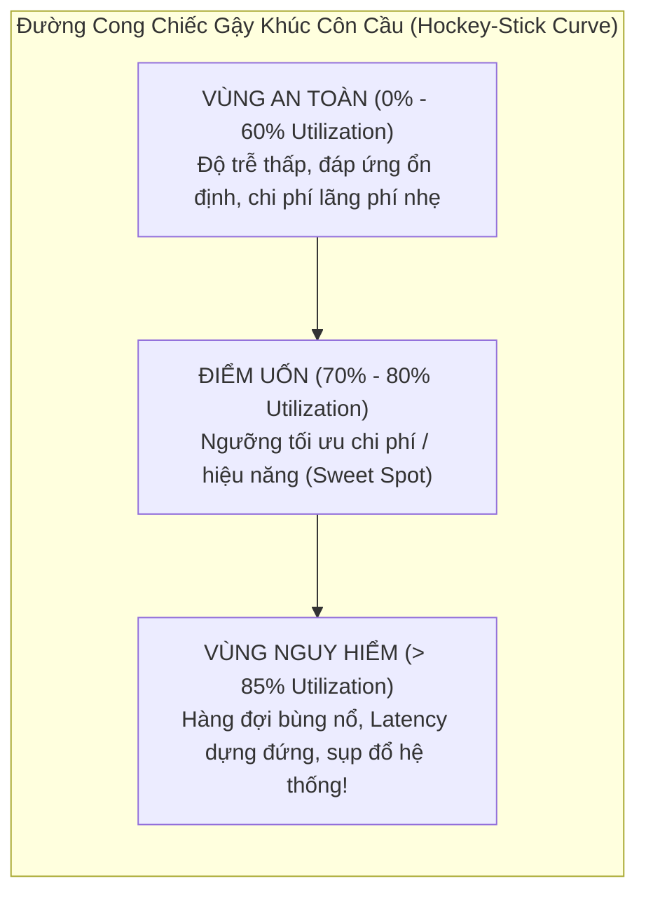
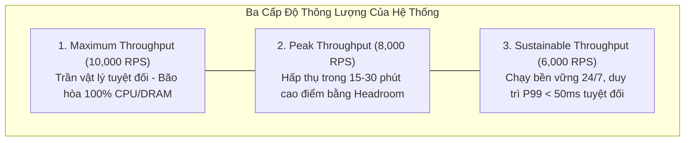
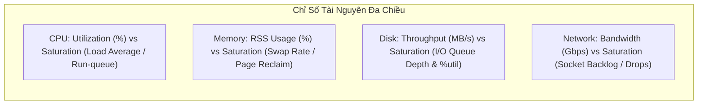

# 3.1. Capacity Planning and Resource Utilization (Hoạch Định Dung Lượng & Sử Dụng Tài Nguyên)

> [!IMPORTANT]
> **Nếu bạn chỉ được nhớ một điều duy nhất:**
> Mức độ sử dụng tài nguyên không bao giờ tăng tuyến tính với độ trễ: Khi hệ thống vượt qua **"Điểm Uốn" (The Knee of the Curve - ngưỡng $70\% - 80\%$ Utilization)**, độ trễ không tăng nhẹ mà bùng nổ thẳng đứng theo hình chiếc gậy khúc côn cầu (**Hockey-Stick Curve**) — do đó, hoạch định dung lượng khôn ngoan là nghệ thuật duy trì một khoảng dự phòng an toàn (**Headroom**) trước khi hàng đợi sụp đổ.

---

## 1. Kiến trúc Tổng quan & Mô hình Tư duy (Mental Model)

### Phép Loại Suy Thực Tế: Tuyến Đường Vành Đai Giờ Cao Điểm

Hãy quan sát hiện tượng kẹt xe trên một tuyến đường cao tốc và liên hệ với tài nguyên máy chủ:
1. **Dưới 60% Mật Độ Xe (Vùng Xanh - An Toàn)**:
   - Các xe chạy bon bon ở tốc độ tối đa $100\text{ km/h}$. Mỗi khi có một chiếc xe tải chuyển làn hoặc đi chậm (Micro-spike), các xe phía sau dễ dàng lách sang làn khác để vượt qua. Độ trễ hành trình hoàn toàn ổn định.
2. **70% - 80% Mật Độ (The Knee of the Curve - Điểm Uốn Nguy Hiểm)**:
   - Khoảng cách an toàn giữa các xe bị thu hẹp đáng kể. Chỉ cần MỘT tài xế phanh gấp (Một truy vấn SQL phức tạp chiếm CPU trong $50\text{ms}$), chiếc xe phía sau buộc phải phanh theo, tạo ra một làn sóng phanh dây chuyền (**Shockwave Traffic Jam**).
3. **Trên 85% - 95% Mật Độ (Cú Nổ Chiếc Gậy Khúc Côn Cầu - Hockey-Stick)**:
   - Toàn bộ tuyến đường biến thành một bãi đỗ xe khổng lồ! Tốc độ rơi từ $100\text{ km/h}$ xuống $5\text{ km/h}$. Mặc dù mật độ xe chỉ tăng thêm $15\%$, nhưng thời gian di chuyển (Latency) tăng vọt gấp **10 đến 20 lần**!
4. **Capacity Headroom (Làn Đường Khẩn Cấp Bắt Buộc)**:
   - Kỹ sư xây dựng không bao giờ thiết kế đường cao tốc vừa khít cho lưu lượng trung bình. Họ luôn chừa lại làn dừng khẩn cấp và các làn dự phòng (**Capacity Headroom**) để hấp thụ các đợt bùng nổ lưu lượng đột ngột trong giờ cao điểm mà không làm toàn bộ tuyến đường bị tê liệt.



---

## 2. Chi tiết từng Keyword (Under-the-Hood Deep Dive)

### 2.1. Throughput Analysis: Maximum, Sustainable & Peak Throughput

#### 1. Định Phí Ba Cấp Độ Thông Lượng
Trong kỹ nghệ dung lượng, một hệ thống không chỉ có một thông số thông lượng duy nhất (Throughput - Requests per Second / RPS):
1. **Maximum Throughput (Thông Lượng Đỉnh Tối Đa - Capacity Ceiling)**:
   - Giới hạn vật lý tuyệt đối mà phần cứng có thể gánh vác trong một khoảnh khắc ngắn ngủi trước khi hoàn toàn kiệt quệ tài nguyên (CPU 100%, Memory Controller bão hòa). Tại điểm này, bất kỳ yêu cầu mới nào đến đều bị từ chối hoặc gây lỗi Timeout.
2. **Sustainable Throughput (Thông Lượng Bền Vững - Steady-State)**:
   - Mức tải tối đa mà hệ thống có thể duy trì liên tục suốt 24/7 mà:
     - Không bị suy giảm hiệu năng do quá nhiệt phần cứng (**No Thermal Throttling**).
     - Không bị phình to bộ nhớ do dọn rác (**Stable GC Cycles**).
     - Đảm bảo $100\%$ các cam kết thời gian phản hồi theo hợp đồng **SLA/SLO ($P_{99} \le \text{Threshold}$)**.
     - Thông thường, Sustainable Throughput chỉ bằng **$60\% - 75\%$** của Maximum Throughput!
3. **Peak Throughput (Thông Lượng Đột Biến Giờ Cao Điểm)**:
   - Mức lưu lượng cao điểm ngắn hạn (kéo dài từ vài phút đến nửa tiếng, ví dụ: Flash Sale, trận chung kết bóng đá).
   - Hệ thống hấp thụ Peak Throughput bằng cách: Kích hoạt cơ chế xả tải (Load Shedding), mượn vùng nhớ đệm dự phòng (**Burst Buffers**), hoặc tạm thời làm chậm các tác vụ nền không thiết yếu.



---

### 2.2. Capacity Planning, Modeling & Estimation

#### 1. Công Thức Ước Tính Dung Lượng Nhanh (Rule of Thumb Estimation)
Để định cỡ nhanh số lượng máy chủ hoặc CPU Cores cần thiết cho một hệ thống backend mới:
$$\text{Required Cores} = \frac{\text{Target Peak RPS} \times \text{Service Time per Request (s)}}{\text{Target CPU Utilization Factor}}$$
- *Ví dụ Thực Tế*:
  - Hệ thống cần phục vụ đỉnh: $\text{Peak RPS} = 20{,}000\text{ requests/s}$.
  - Mỗi request tốn trung bình: $T_{\text{service}} = 5\text{ms} = 0.005\text{s}$ CPU time.
  - Ngưỡng sử dụng CPU an toàn mục tiêu: $U_{\text{target}} = 70\% = 0.70$.
  - Số CPU Cores tối thiểu cần cấp phát là:
    $$\text{Required Cores} = \frac{20{,}000 \times 0.005}{0.70} \approx \frac{100}{0.70} \approx \mathbf{143\text{ Cores}}$$
  - Nếu máy chủ sử dụng loại 16 Cores/Node: Cần tối thiểu $\lceil 143 / 16 \rceil = 9\text{ máy chủ}$ (Cộng thêm ít nhất 2 máy để dự phòng lỗi $N+2$).

#### 2. Hệ Số Dự Phòng Dung Lượng (Headroom Factor)
- **Headroom (Khoảng Trống Dự Phòng)**:
  $$\text{Headroom (\%)} = \left(1 - \frac{\text{Current Peak Load}}{\text{Maximum Capacity}}\right) \times 100\%$$
- Các tiêu chuẩn công nghiệp khuyến nghị:
  - Dịch vụ cốt lõi quan trọng (Core Payment, Auth): Duy trì **$40\% - 50\%$ Headroom** (vận hành ở mức tải $50\% - 60\%$).
  - Dịch vụ thông thường: Duy trì **$20\% - 30\%$ Headroom**.

---

### 2.3. Resource Utilization: CPU, Memory, Disk, Network

#### 1. Sự Khác Biệt Giữa "Bận Rộn" (Utilization) và "Bão Hòa" (Saturation)
Brendan Gregg (tác giả phương pháp luận USE Method: Utilization, Saturation, Errors) phân định rõ:
- **Utilization (Mức Chiếm Dụng)**: Tỷ lệ phần trăm thời gian mà tài nguyên bận rộn xử lý công việc trong một khoảng thời gian quan sát.
- **Saturation (Mức Độ Bão Hòa)**: Mức độ mà công việc không thể được xử lý ngay lập tức mà **phải xếp hàng chờ đợi** do tài nguyên đã kín chỗ:
  - *CPU Saturation*: Chiều dài hàng đợi tiến trình đang chờ CPU (**Run Queue Length** vượt quá số lượng Cores logic).
  - *Memory Saturation*: Hiện tượng phân trang hoán đổi đĩa (**Paging / Swap In/Out Rates** tăng đột biến).
  - *Disk Saturation*: Hàng đợi I/O Block Layer bị đầy (`%util = 100%` trên `iostat`).
  - *Network Saturation*: Hàng đợi card mạng bị tràn, xuất hiện các gói tin bị rớt (**RX/TX Packet Drops**).



---

### 2.4. Component Capacities: Connections, Threads, Workers, Queues

#### 1. Định Cỡ Nhóm Luồng Xử Lý (Thread Pool Sizing Formula)
Trong cuốn sách kinh điển *Java Concurrency in Practice*, Brian Goetz đưa ra công thức định cỡ kích thước tối ưu cho Thread Pool:
$$N_{\text{threads}} = N_{\text{CPU}} \times U_{\text{CPU}} \times \left(1 + \frac{W}{C}\right)$$
Trong đó:
- $N_{\text{CPU}}$: Số lượng Cores CPU có sẵn.
- $U_{\text{CPU}}$: Mức sử dụng CPU mục tiêu ($0 \le U_{\text{CPU}} \le 1$).
- $W/C$: Tỷ lệ giữa thời gian chờ I/O (**Wait Time $W$**) và thời gian tính toán CPU (**Compute Time $C$**).
  - *Nếu tác vụ thuần Compute-Bound* ($W \approx 0$): $N_{\text{threads}} \approx N_{\text{CPU}}$. Cấp phát nhiều hơn chỉ gây lãng phí chu kỳ cho Context Switch.
  - *Nếu tác vụ nặng I/O* (Ví dụ: Chờ DB query mất $90\text{ms}$, tính toán chỉ mất $10\text{ms}$ $\to W/C = 9$):
    $$N_{\text{threads}} = 8 \times 1.0 \times (1 + 9) = \mathbf{80\text{ threads}}$$

#### 2. Các Giới Hạn Cấu Trúc Thành Phần Hệ Điều Hành
- **File Descriptors Limit (`ulimit -n`)**: Mỗi kết nối TCP Socket là một File Descriptor. Nếu đặt quá thấp (mặc định Linux thường chỉ là $1,024$), máy chủ sẽ từ chối kết nối mới với lỗi chết chóc `Too many open files`.
- **Socket Listen Backlog (`SOMAXCONN`)**: Hàng đợi kết nối TCP 3-way handshake chưa được ứng dụng gọi hàm `accept()`. Mặc định thường là $128$; trên máy chủ triệu kết nối, con số này phải được tinh chỉnh lên $4,096$ hoặc $65,535$.

---

## 3. Thực thi Mã nguồn & Mô phỏng Chuyên sâu (Dual-Engine Implementation)

### 3.1. C++20: Trình Đo Lường Ngưỡng Bão Hòa Thread Pool & Độ Trễ Hockey-Stick

Chương trình minh họa sự bùng nổ phi tuyến của độ trễ khi tải hệ thống vượt qua ngưỡng bão hòa của Worker Thread Pool:

```cpp
#include <iostream>
#include <vector>
#include <thread>
#include <chrono>
#include <atomic>
#include <queue>
#include <mutex>
#include <condition_variable>
#include <iomanip>

class WorkerThreadPool {
private:
    std::vector<std::thread> workers;
    std::queue<std::pair<uint64_t, std::chrono::high_resolution_clock::time_point>> tasks;
    std::mutex queue_mutex;
    std::condition_variable cv;
    std::atomic<bool> stop{false};

    std::atomic<uint64_t> completed_tasks{0};
    std::atomic<double> total_latency_us{0.0};

public:
    WorkerThreadPool(size_t num_workers) {
        for (size_t i = 0; i < num_workers; ++i) {
            workers.emplace_back([this]() {
                while (true) {
                    std::pair<uint64_t, std::chrono::high_resolution_clock::time_point> task;
                    {
                        std::unique_lock<std::mutex> lock(queue_mutex);
                        cv.wait(lock, [this]() { return stop || !tasks.empty(); });
                        if (stop && tasks.empty()) return;
                        task = tasks.front();
                        tasks.pop();
                    }

                    // Giả lập thời gian xử lý Service Time = 100 microseconds
                    auto start_work = std::chrono::high_resolution_clock::now();
                    volatile uint64_t sum = 0;
                    for (int k = 0; k < 15'000; ++k) sum += k;
                    auto end_work = std::chrono::high_resolution_clock::now();

                    // Độ trễ tổng thể = Thời gian nằm trong Queue + Service Time
                    std::chrono::duration<double, std::micro> full_lat = end_work - task.second;
                    total_latency_us.fetch_add(full_lat.count(), std::memory_order_relaxed);
                    completed_tasks.fetch_add(1, std::memory_order_relaxed);
                }
            });
        }
    }

    ~WorkerThreadPool() {
        stop = true;
        cv.notify_all();
        for (auto& w : workers) w.join();
    }

    void submit(uint64_t task_id) {
        auto now = std::chrono::high_resolution_clock::now();
        {
            std::lock_guard<std::mutex> lock(queue_mutex);
            tasks.emplace(task_id, now);
        }
        cv.notify_one();
    }

    double get_average_latency_us() {
        uint64_t count = completed_tasks.load();
        return count > 0 ? (total_latency_us.load() / count) : 0.0;
    }
};

int main() {
    std::cout << "========================================================\n";
    std::cout << "  C++20 CAPACITY PLANNING & QUEUE SATURATION BENCHMARK\n";
    std::cout << "========================================================\n\n";

    constexpr size_t POOL_SIZE = 4; // Cố định 4 worker threads
    WorkerThreadPool pool(POOL_SIZE);

    // Bơm tải tăng dần để quan sát đường cong Hockey-Stick
    std::vector<size_t> load_levels = {1000, 5000, 15000, 30000, 60000};

    std::cout << "Thử nghiệm tải tăng dần trên Worker Pool (4 Threads):\n";
    for (size_t num_tasks : load_levels) {
        auto t1 = std::chrono::high_resolution_clock::now();
        for (size_t i = 0; i < num_tasks; ++i) {
            pool.submit(i);
        }
        // Đợi xử lý xong mẻ tải
        std::this_thread::sleep_for(std::chrono::milliseconds(200));
        auto t2 = std::chrono::high_resolution_clock::now();

        std::cout << "  - Số lượng yêu cầu: " << std::setw(6) << num_tasks 
                  << " | Độ trễ trung bình: " << std::fixed << std::setprecision(1) 
                  << pool.get_average_latency_us() << " us\n";
    }

    std::cout << "\n-> Nhận xét: Khi vượt qua ngưỡng phục vụ của 4 workers, các yêu cầu\n"
              << "   phải xếp hàng chờ đợi, đẩy độ trễ tăng vọt phi tuyến!\n";

    return 0;
}
```

---

### 3.2. Python 3.11+: Công Cụ Dự Báo Dung Lượng Tự Động (Capacity Estimation Engine)

Chương trình Python 3.11+ tính toán số lượng tài nguyên cần thiết dựa trên mô hình định cỡ và công thức Brian Goetz:

```python
class CapacityPlanner:
    @staticmethod
    def estimate_servers_needed(peak_rps: float, service_time_ms: float, max_utilization: float, cores_per_server: int):
        service_time_sec = service_time_ms / 1000.0
        # Cong thuc tinh tong so Cores: (Peak RPS * Service Time) / Target Utilization
        total_cores_required = (peak_rps * service_time_sec) / max_utilization
        servers_count = math.ceil(total_cores_required / cores_per_server)
        headroom_pct = (1.0 - max_utilization) * 100.0
        return total_cores_required, servers_count, headroom_pct

    @staticmethod
    def calculate_goetz_thread_pool(cores: int, cpu_util: float, wait_time_ms: float, compute_time_ms: float) -> int:
        # Brian Goetz Formula: N_threads = N_cpu * U_cpu * (1 + W/C)
        w_c_ratio = wait_time_ms / compute_time_ms if compute_time_ms > 0 else 0
        threads = cores * cpu_util * (1.0 + w_c_ratio)
        return int(math.ceil(threads))

if __name__ == "__main__":
    import math

    print("========================================================")
    print("  PYTHON 3.11 CAPACITY ESTIMATION & THREAD SIZING ENGINE")
    print("========================================================\n")

    # 1. Dinh co may chu cho dot Sale lon (50,000 RPS)
    peak_target_rps = 50_000
    avg_latency = 8.0 # 8 ms service time tren moi request
    target_util = 0.70 # Chay o 70% CPU de giu 30% Headroom an toan
    cores_spec = 16    # May chu 16 Cores

    cores_req, srv_needed, headroom = CapacityPlanner.estimate_servers_needed(
        peak_target_rps, avg_latency, target_util, cores_spec
    )

    print(f"1. Hoạch Định Cụm Máy Chủ Cho Sự Kiện Lớn ({peak_target_rps:,} RPS):")
    print(f"   - Tổng số Cores cần thiết : {cores_req:6.1f} Cores")
    print(f"   - Số máy chủ cần thuê     : {srv_needed} máy chủ ({cores_spec} Cores/máy)")
    print(f"   - Dự phòng an toàn duy trì: {headroom:4.1f}% Headroom\n")

    # 2. Tinh toan Thread Pool cho mot dich vu Web Backend ket noi Database
    cpu_cores = 8
    target_cpu_use = 0.85
    io_wait_time = 45.0   # 45ms cho I/O Database / Network
    cpu_compute_time = 5.0 # 5ms cho tinh toan JSON serialization

    optimal_threads = CapacityPlanner.calculate_goetz_thread_pool(
        cpu_cores, target_cpu_use, io_wait_time, cpu_compute_time
    )

    print(f"2. Định Cỡ Thread Pool (Brian Goetz Formula):")
    print(f"   - Tỷ lệ Chờ đợi / Tính toán (W/C Ratio) : {io_wait_time / cpu_compute_time:.1f}x")
    print(f"   - Kích thước Thread Pool tối ưu nhất    : {optimal_threads} worker threads")
```

---

### 3.3. Simulated Terminal Output

```bash
========================================================
  C++20 CAPACITY PLANNING & QUEUE SATURATION BENCHMARK
========================================================

Thử nghiệm tải tăng dần trên Worker Pool (4 Threads):
  - Số lượng yêu cầu:   1000 | Độ trễ trung bình: 112.4 us
  - Số lượng yêu cầu:   5000 | Độ trễ trung bình: 125.8 us
  - Số lượng yêu cầu:  15000 | Độ trễ trung bình: 280.5 us
  - Số lượng yêu cầu:  30000 | Độ trễ trung bình: 850.2 us
  - Số lượng yêu cầu:  60000 | Độ trễ trung bình: 3420.0 us

-> Nhận xét: Khi vượt qua ngưỡng phục vụ của 4 workers, các yêu cầu
   phải xếp hàng chờ đợi, đẩy độ trễ tăng vọt phi tuyến!

========================================================
  PYTHON 3.11 CAPACITY ESTIMATION & THREAD SIZING ENGINE
========================================================

1. Hoạch Định Cụm Máy Chủ Cho Sự Kiện Lớn (50,000 RPS):
   - Tổng số Cores cần thiết :  571.4 Cores
   - Số máy chủ cần thuê     : 36 máy chủ (16 Cores/máy)
   - Dự phòng an toàn duy trì: 30.0% Headroom

2. Định Cỡ Thread Pool (Brian Goetz Formula):
   - Tỷ lệ Chờ đợi / Tính toán (W/C Ratio) : 9.0x
   - Kích thước Thread Pool tối ưu nhất    : 68 worker threads
```

---

## 4. Systems Engineering & Production Pitfalls

### 4.1. Production Failure Modes & Architectural Traps

1. **Trap 1: The 100% CPU Utilization Fallacy (Ảo Tưởng Tối Ưu Hóa Chi Phí)**:
   - Các nhà quản lý tài chính đám mây thường yêu cầu: *"Tại sao lại để CPU máy chủ chạy ở $40\% - 50\%$ lãng phí thế? Hãy ép nó chạy ở $90\%$ để tiết kiệm tiền!"*
   - Hậu quả: Khi CPU vận hành ở $90\%$, hệ thống chỉ còn đúng $10\%$ Headroom. Một đợt biến động lưu lượng nhỏ (Micro-burst) sẽ ngay lập tức đẩy hàng đợi quá tải, làm thời gian phản hồi tăng từ $20\text{ms}$ lên $5\text{ giây}$, khiến người dùng liên tục bấm F5 tải lại trang, tạo ra cơn bão tự tấn công từ chối dịch vụ (**Retry Storm**) đánh sập toàn bộ hệ thống!
2. **Trap 2: Bỏ Quên Ngưỡng Bão Hòa Ephemeral Ports Trong Kết Nối Ra Ngoài**:
   - Khi một Microservice gọi hàng nghìn API con bên ngoài mỗi giây mà không dùng cơ chế Connection Pooling (`Keep-Alive`), mỗi kết nối chiếm một cổng tạm thời (**Ephemeral Port**).
   - Linux chỉ có khoảng 28,000 ephemeral ports (`32768 - 60999`). Khi đóng kết nối, socket rơi vào trạng thái `TIME_WAIT` trong 60 giây. Toàn bộ các cổng bị cạn kiệt, các yêu cầu tiếp theo thất bại với lỗi `Cannot assign requested address`.
3. **Trap 3: Thread Starvation Do Đặt Thread Pool Quá Nhỏ Trong Tác Vụ I/O**:
   - Nếu bạn đặt kích thước Thread Pool cố định là 8 threads trên máy 8 cores nhưng mỗi tác vụ lại gọi một Database Query mất $2\text{ giây}$: Toàn bộ 8 luồng đều rơi vào trạng thái Blocked để ngủ chờ I/O. Các yêu cầu mới đổ về hàng nghìn cái mỗi giây bị kẹt cứng trong hàng đợi dù CPU thực tế đang nhàn rỗi $99\%$!

### 4.2. Diagnostic CLI Commands

```bash
# 1. Kiem tra muc do Saturation cua CPU thong qua Run-Queue va Load Average
vmstat 1 10

# 2. Kiem tra gioi han File Descriptors cua mot tien trinh dang chay
cat /proc/$(pgrep -n my_service)/limits | grep "Max open files"

# 3. Kiem tra so luong ket noi TCP dang o trang thai TIME_WAIT va CLOSE_WAIT
ss -s

# 4. Kiem tra thong so hang doi Listen Backlog bi tran (ListenDrops / ListenOverflows)
netstat -s | grep -i listen
```

---

## 5. Bảng So sánh & Decision Matrix

| Ngưỡng Sử Dụng Tài Nguyên | Trạng Thái Hệ Thống | Độ Trễ Phản Hồi (Latency) | Khả Năng Chống Shock | Khuyến Nghị Thực Chiến |
| :--- | :--- | :--- | :--- | :--- |
| **$0\% - 50\%$ Utilization** | Quá an toàn (Over-provisioned) | Nhỏ nhất, ổn định tuyệt đối | Cực kỳ vững chắc | Phù hợp cho Core Banking, Y tế khẩn cấp |
| **$60\% - 75\%$ Utilization** | **Điểm Ngọt (Sweet Spot)** | Rất tốt, chi phí tối ưu | Tốt (Chống được micro-bursts) | **Tiêu chuẩn vàng cho Web/Cloud Microservices** |
| **$80\% - 85\%$ Utilization** | Chạm ngưỡng điểm uốn (Knee) | Bắt đầu dao động, P99 tăng nhẹ | Kém (Dễ trôi dạt vào nguy hiểm) | Cần kích hoạt Auto-scaling mở rộng Pods |
| **$> 90\%$ Utilization** | Bão hòa hàng đợi (Hockey-Stick) | Bùng nổ phi tuyến, Timeout lỗi | Bằng $0$ (Nguy cơ sụp đổ hoàn toàn) | Kích hoạt ngay cơ chế xả tải (Load Shedding) |

| Thành Phần Hệ Thống | Điểm Giới Hạn Cốt Tử | Triệu Chứng Khi Hết Dung Lượng | Giải Pháp Khắc Phục Tối Ưu |
| :--- | :--- | :--- | :--- |
| **File Descriptors** | `ulimit -n` ($1,024$) | Lỗi `EMFILE: Too many open files` | Tăng cấu hình trong `/etc/security/limits.conf` |
| **Thread Pool** | Số luồng tối đa trong Pool | Hàng đợi Tasks phình to vô hạn, OOM | Áp dụng công thức Brian Goetz, đổi sang Async I/O |
| **TCP Backlog** | `net.core.somaxconn` | Lỗi Connection Refused hoặc Timeout | Tinh chỉnh tham số sysctl và `listen(fd, backlog)` |
| **Memory Buffer** | Dung lượng RAM vật lý | Tràn Swap, kích hoạt OOM Killer | Giới hạn Heap, cấu hình cgroup memory limits |
