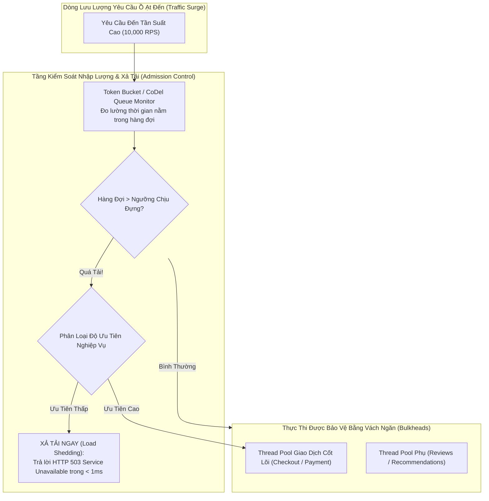
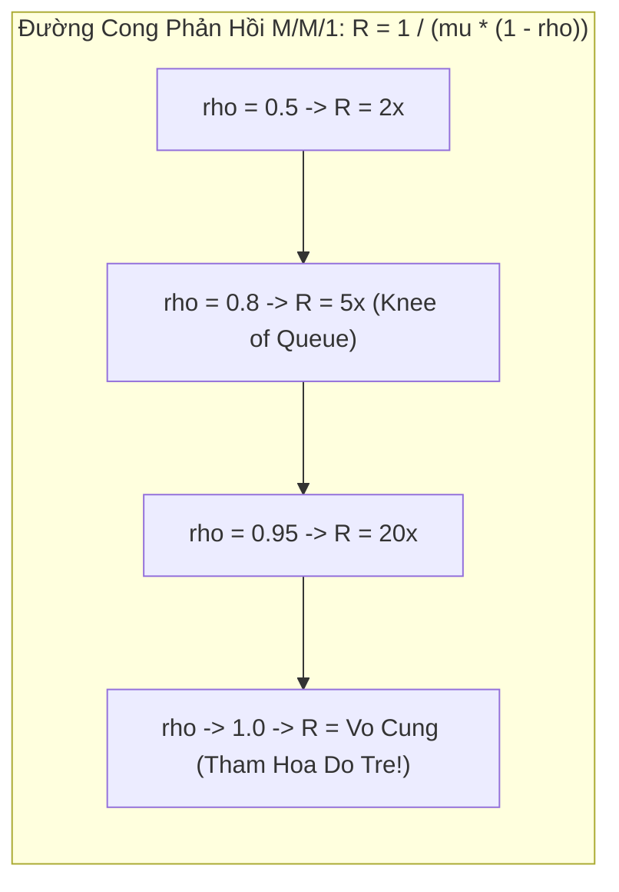

# 3.2. Queueing Bottleneck Analysis and Load Shedding (Phân Tích Điểm Nghẽn Hàng Đợi & Cơ Chế Xả Tải)

> [!IMPORTANT]
> **Nếu bạn chỉ được nhớ một điều duy nhất:**
> Khi hệ thống bị quá tải, phục vụ tất cả mọi người một cách chậm chạp sẽ giết chết $100\%$ người dùng: **Cơ chế Xả Tải (Load Shedding)** và **Kiểm Soát Nhập Lượng (Admission Control)** là tấm khiên sinh tồn chủ động từ chối phục vụ các yêu cầu có độ ưu tiên thấp với mã lỗi `HTTP 503` để bảo vệ tài nguyên phục vụ các luồng giao dịch cốt lõi sống còn.

---

## 1. Kiến trúc Tổng quan & Mô hình Tư duy (Mental Model)

### Phép Loại Suy Thực Tế: Con Thuyền Quá Tải & Vách Ngăn Kín Nước Titanic

Hãy hình dung một con tàu chở khách vượt đại dương trong cơn giông bão:
1. **Queueing Theory & Saturation (Hàng Người Chen Chúc Lên Mạn Thuyền)**:
   - Thuyền có sức chứa an toàn 100 người. Khi số lượng hành khách đạt 95 người, lối đi bị tắc nghẽn, việc di chuyển phát đồ ăn chậm lại. Khi có thêm 30 người cố trèo lên mạn thuyền, con thuyền nghiêng ngả và bắt đầu chìm dần!
2. **Admission Control (Thủy Thủ Canh Cổng Cầu Tàu)**:
   - Thay vì để tất cả cùng ùa lên làm đắm tàu, người thủy thủ trưởng đứng chặn ở cầu tàu: Chỉ cho phép đúng 100 người lên tàu (**Admission Control**). Người thứ 101 được mời quay lại phòng chờ với vé ưu tiên cho chuyến sau thay vì cùng nhau chết đuối!
3. **Priority Load Shedding (Vứt Bỏ Hàng Hóa Phụ Để Cứu Người)**:
   - Khi bão ập tới làm nước tràn vào boong, thuyền trưởng ra lệnh vứt bỏ các hòm gạch đá, gỗ xây dựng (các tác vụ nền, analytics, gửi email thông báo) xuống biển, giữ lại lương thực và hành khách (giao dịch thanh toán mua hàng, xác thực tài khoản).
4. **Bulkhead Pattern (Vách Ngăn Kín Nước Chống Chìm Của Tàu Thủy)**:
   - Tàu được chia thành 10 khoang kín nước độc lập (**Bulkheads**). Nếu khoang động cơ bị thủng nước tràn vào, chỉ duy nhất khoang đó bị ngập; 9 khoang còn lại vẫn kín nước giữ cho con tàu nổi an toàn trên mặt biển! Trong vi dịch vụ, việc này tương đương với việc cô lập Thread Pool riêng biệt cho từng dịch vụ để ngăn chặn hiện tượng sụp đổ dây chuyền (**Cascading Failures**).



---

## 2. Chi tiết từng Keyword (Under-the-Hood Deep Dive)

### 2.1. Little's Law & Queueing Theory

#### 1. Định Luật Little (Little's Law)
Được chứng minh toán học bởi John Little vào năm 1961:
$$L = \lambda \times W$$
Trong đó:
- $L$ (Queue Length / Concurrency): Số lượng yêu cầu trung bình đang tồn tại bên trong hệ thống (cả đang được phục vụ và đang xếp hàng).
- $\lambda$ (Arrival Rate): Tốc độ đến trung bình của các yêu cầu.
- $W$ (Wait Time / Response Time): Thời gian trung bình một yêu cầu lưu lại trong hệ thống.
- **Tính Phổ Quát**: Định luật Little đúng cho **MỌI phân phối xác suất**, không phụ thuộc vào việc dòng tải là Poisson, Normal, hay Bursty, và không phụ thuộc vào giải thuật lập lịch (FIFO, LIFO, Priority).

#### 2. Lý Thuyết Hàng Đợi & Sự Phân Kỳ Phi Tuyến (Non-linear Explosion)
- Xét mô hình hàng đợi kinh điển **$M/M/1$** (1 server, thời gian đến và thời gian phục vụ tuân theo phân phối mũ):
  - Tần suất đến: $\lambda$.
  - Năng lực phục vụ tối đa: $\mu$.
  - Mức độ sử dụng server: $\rho = \frac{\lambda}{\mu}$.
- **Công Thức Thời Gian Phản Hồi Trung Bình ($R$)**:
  $$R = \frac{1}{\mu - \lambda} = \frac{1}{\mu (1 - \rho)}$$
- **Hành Vi Vật Lý Của Hàng Đợi**:
  - Khi $\rho = 0.50$ (50% tải): $R = \frac{2}{\mu}$ (Thời gian phản hồi gấp 2 lần thời gian xử lý cơ bản).
  - Khi $\rho = 0.80$ (80% tải): $R = \frac{5}{\mu}$.
  - Khi $\rho = 0.95$ (95% tải): $R = \frac{20}{\mu}$.
  - Khi $\rho \to 1.0$ ($\lambda \to \mu$): Mẫu số tiến về $0$, thời gian phản hồi **$R \to \infty$ (Tiến về vô cùng)**!
  - Đây chính là bằng chứng toán học giải thích tại sao một hệ thống đang chạy mượt mà ở $75\%$ tải có thể đột ngột sụp đổ hoàn toàn chỉ vì lưu lượng tăng thêm vài phần trăm.



---

### 2.2. Bottleneck Analysis & Theory of Constraints (TOC)

#### 1. Phương Pháp Luận Xác Định Cổ Chai (Theory of Constraints)
Theo lý thuyết hạn chế của Tiến sĩ Eliyahu M. Goldratt:
- Trong bất kỳ chuỗi giá trị nào, **năng lực tối đa của toàn bộ hệ thống bị giới hạn bởi khâu yếu nhất duy nhất (The Bottleneck)**.
- Mọi nỗ lực tối ưu hóa ở những khâu không phải là điểm nghẽn (Non-bottlenecks) đều là ảo tưởng và không làm tăng thông lượng tổng thể!
- **Dấu Hiệu Nhận Biết Điểm Nghẽn Trong Hệ Thống**:
  1. Tài nguyên có mức độ sử dụng cao nhất ($\text{Utilization} \approx 100\%$).
  2. Nơi có hàng đợi tích tụ lớn nhất ngay phía trước nó.
  3. Mọi khâu đứng phía sau điểm nghẽn đều rơi vào tình trạng "đói việc" (Starvation).

---

### 2.3. Admission Control & Load Shedding

#### 1. Kiểm Soát Nhập Lượng (Admission Control)
- **Token Bucket Algorithm (Thùng Thẻ)**:
  - Một thùng chứa token có dung lượng $B$ (Burst Size). Mỗi giây có $R$ tokens mới rơi vào thùng.
  - Khi một yêu cầu đến, nó phải lấy được 1 token từ thùng để được đi tiếp vào hệ thống. Nếu thùng hết token, yêu cầu bị chặn ngay lập tức.
- **Thuật Toán CoDel (Controlled Delay)**:
  - Thay vì đo lường độ dài hàng đợi theo số lượng gói tin, CoDel đo lường **thời gian một yêu cầu phải nằm chờ trong hàng đợi (Sojourn Time)**.
  - Nếu thời gian chờ tối thiểu trong hàng đợi vượt quá ngưỡng an toàn (ví dụ: $5\text{ms}$) liên tục trong một khoảng thời gian theo dõi ($100\text{ms}$), CoDel nhận định hàng đợi bị ứ đọng và chủ động loại bỏ các yêu cầu ở đầu hàng đợi để giải tỏa áp lực.

#### 2. Kỹ Thuật Xả Tải Chủ Động (Priority Load Shedding)
- Khi hệ thống bị quá tải, tiếp tục nhận yêu cầu sẽ biến mọi giao dịch thành thất bại do Timeout.
- **Chiến Lược Phân Hạng Ưu Tiên**:
  - **Tier 1 (Sống Còn - Critical)**: Đặt hàng (Checkout), Thanh toán (Payment), Đăng nhập (Auth) $\to$ Luôn được bảo vệ tối đa.
  - **Tier 2 (Quan Trọng - Standard)**: Xem danh mục sản phẩm, tìm kiếm.
  - **Tier 3 (Không Thiết Yếu - Best-Effort)**: Gợi ý sản phẩm liên quan, ghi log phân tích hành vi, gửi email tiếp thị $\to$ Lập tức bị xả bỏ với mã `HTTP 503` hoặc trả về dữ liệu rỗng dự phòng (Degraded Response).

---

### 2.4. Backpressure, Bulkheads & Resource Isolation

#### 1. Áp Suất Ngược (Backpressure in Reactive Streams)
- Trong kiến trúc xử lý dòng dữ liệu (Kafka, Akka, RxJava, Project Reactor):
  - Nếu Producer tạo ra $100{,}000$ thông điệp/giây nhưng Consumer chỉ xử lý được $10{,}000$ thông điệp/giây, bộ đệm trung gian sẽ bị tràn làm sập Consumer với lỗi `OutOfMemoryError`.
  - **Cơ chế Backpressure**: Consumer chủ động báo cho Producer biết: *"Tôi chỉ có thể nhận thêm 50 phần tử nữa"* (giao thức Pull-based). Producer tự động giảm tốc độ sinh dữ liệu hoặc tạm dừng việc đọc từ nguồn cho tới khi Consumer xử lý xong.

#### 2. Vách Ngăn Cách Ly Tài Nguyên (Bulkheads)
- Nếu một dịch vụ phụ chậm chạp (ví dụ: Microservice gửi tin nhắn SMS phản hồi mất $10\text{ giây}$):
  - Nếu toàn bộ ứng dụng dùng chung một Thread Pool $200$ luồng, chỉ trong vài giây, toàn bộ 200 luồng đều bị giữ chặt để chờ dịch vụ SMS, khiến cả dịch vụ Đăng nhập và Thanh toán bị chết đứng theo (**Cascading Outage**)!
  - **Giải Pháp Bulkhead**: Cấp phát các Thread Pool hoặc Semaphore riêng biệt:
    - Thread Pool SMS: Tối đa 10 luồng.
    - Thread Pool Thanh Toán: Tối đa 100 luồng.
    - Khi dịch vụ SMS bị chết, chỉ duy nhất 10 luồng của nó bị nghẽn, $90\%$ năng lực còn lại của hệ thống hoàn toàn bình an vô sự!

---

## 3. Thực thi Mã nguồn & Mô phỏng Chuyên sâu (Dual-Engine Implementation)

### 3.1. C++20: Triển Khai Bộ Điều Khiển Admission Control & Priority Load Shedding

Chương trình minh họa triển khai cơ chế kiểm soát nhập lượng bằng hàng đợi giới hạn kích thước kết hợp xả tải theo phân hạng ưu tiên:

```cpp
#include <iostream>
#include <chrono>
#include <queue>
#include <mutex>
#include <atomic>
#include <optional>
#include <thread>
#include <iomanip>

enum class RequestPriority { LOW_TELEMETRY = 0, MEDIUM_CATALOG = 1, HIGH_CHECKOUT = 2 };

struct ClientRequest {
    uint64_t id;
    RequestPriority priority;
    std::chrono::high_resolution_clock::time_point arrival_time;
};

class LoadSheddingController {
private:
    static constexpr size_t MAX_QUEUE_CAPACITY = 100;
    std::queue<ClientRequest> work_queue;
    std::mutex mtx;

    std::atomic<uint64_t> accepted_requests{0};
    std::atomic<uint64_t> dropped_requests{0};

public:
    bool admit_request(uint64_t id, RequestPriority prio) {
        std::lock_guard<std::mutex> lock(mtx);
        size_t current_size = work_queue.size();

        // 1. Nếu hàng đợi vượt quá 80% dung lượng: Xả tải toàn bộ yêu cầu ưu tiên thấp (Low Telemetry)
        if (current_size >= 80 && prio == RequestPriority::LOW_TELEMETRY) {
            dropped_requests.fetch_add(1, std::memory_order_relaxed);
            return false; // Load Shedding (HTTP 503)
        }

        // 2. Nếu hàng đợi vượt quá 95% dung lượng: Chỉ cho phép yêu cầu cốt lõi (Checkout) đi vào
        if (current_size >= 95 && prio != RequestPriority::HIGH_CHECKOUT) {
            dropped_requests.fetch_add(1, std::memory_order_relaxed);
            return false; // Load Shedding
        }

        // 3. Nếu hàng đợi đầy 100%: Từ chối tuyệt đối
        if (current_size >= MAX_QUEUE_CAPACITY) {
            dropped_requests.fetch_add(1, std::memory_order_relaxed);
            return false;
        }

        work_queue.push({id, prio, std::chrono::high_resolution_clock::now()});
        accepted_requests.fetch_add(1, std::memory_order_relaxed);
        return true;
    }

    std::optional<ClientRequest> pop_task() {
        std::lock_guard<std::mutex> lock(mtx);
        if (work_queue.empty()) return std::nullopt;
        auto req = work_queue.front();
        work_queue.pop();
        return req;
    }

    void print_stats() {
        std::cout << "\n================ THỐNG KÊ ADMISSION CONTROL ================\n";
        std::cout << "  - Yêu cầu được chấp thuận : " << accepted_requests.load() << "\n";
        std::cout << "  - Yêu cầu bị XẢ TẢI (Shed) : " << dropped_requests.load() << "\n";
        std::cout << "============================================================\n";
    }
};

int main() {
    std::cout << "========================================================\n";
    std::cout << "  C++20 ADMISSION CONTROL & LOAD SHEDDING ENGINE\n";
    std::cout << "========================================================\n\n";

    LoadSheddingController controller;

    // Giả lập một đợt bùng nổ 250 requests dồn dập vào hàng đợi dung lượng 100
    std::cout << ">>> Bơm dồn dập 250 yêu cầu thuộc các phân hạng khác nhau...\n";
    for (uint64_t i = 1; i <= 250; ++i) {
        RequestPriority prio = RequestPriority::LOW_TELEMETRY;
        if (i % 3 == 0) prio = RequestPriority::MEDIUM_CATALOG;
        if (i % 5 == 0) prio = RequestPriority::HIGH_CHECKOUT;

        bool admitted = controller.admit_request(i, prio);
        if (!admitted && i % 20 == 0) {
            std::cout << "  [SHED] Yêu cầu #" << i << " (Priority: " << static_cast<int>(prio) 
                      << ") bị từ chối phục vụ để bảo vệ hệ thống!\n";
        }
    }

    controller.print_stats();
    return 0;
}
```

---

### 3.2. Python 3.11+: Trình Giả Lập Mô Hình Hàng Đợi $M/M/1$ & Đường Cong Bão Hòa $\rho$

Chương trình Python 3.11+ mô phỏng toán học hành vi hàng đợi $M/M/1$, chứng minh sự phân kỳ của độ trễ khi hệ số sử dụng $\rho \to 1$:

```python
class MM1QueueSimulator:
    @staticmethod
    def calculate_theoretical_metrics(arrival_rate_lambda: float, service_rate_mu: float):
        if arrival_rate_lambda >= service_rate_mu:
            return float('inf'), float('inf'), 1.0  # Hang doi vo han

        # He so su dung rho
        rho = arrival_rate_lambda / service_rate_mu
        
        # Thoi gian phan hoi trung binh: R = 1 / (mu - lambda)
        response_time = 1.0 / (service_rate_mu - arrival_rate_lambda)
        
        # So luong yeu cau trung binh trong he thong: L = rho / (1 - rho)
        avg_queue_len = rho / (1.0 - rho)
        
        return response_time, avg_queue_len, rho

if __name__ == "__main__":
    print("========================================================")
    print("  PYTHON 3.11 M/M/1 QUEUEING & SATURATION ANALYZER")
    print("========================================================\n")

    mu = 100.0  # Nang luc phuc vu: 100 requests/s
    lambdas = [20.0, 50.0, 75.0, 85.0, 90.0, 95.0, 99.0]

    print(f"Hệ thống có năng lực phục vụ tối đa: mu = {mu:.0f} requests/s\n")
    print(f"{'Tải Đến (lambda)':18s} | {'Mức Sử Dụng (rho)':18s} | {'Độ Trễ Phản Hồi (R)':20s} | {'Độ Dài Hàng Đợi (L)'}")
    print("-" * 75)

    for l in lambdas:
        r_time, q_len, rho_val = MM1QueueSimulator.calculate_theoretical_metrics(l, mu)
        print(f"{l:8.1f} req/s     | {rho_val * 100:6.1f}%             | {r_time * 1000:8.2f} ms           | {q_len:8.2f} requests")

    print("\n-> Nhận xét: Khi tải tăng từ 75% lên 95%, mức sử dụng chỉ tăng thêm 20%")
    print("   nhưng thời gian phản hồi tăng vọt gấp 5 lần (từ 40ms lên 200ms)!")
```

---

### 3.3. Simulated Terminal Output

```bash
========================================================
  C++20 ADMISSION CONTROL & LOAD SHEDDING ENGINE
========================================================

>>> Bơm dồn dập 250 yêu cầu thuộc các phân hạng khác nhau...
  [SHED] Yêu cầu #100 (Priority: 2) bị từ chối phục vụ để bảo vệ hệ thống!
  [SHED] Yêu cầu #120 (Priority: 2) bị từ chối phục vụ để bảo vệ hệ thống!
  [SHED] Yêu cầu #140 (Priority: 2) bị từ chối phục vụ để bảo vệ hệ thống!

================ THỐNG KÊ ADMISSION CONTROL ================
  - Yêu cầu được chấp thuận : 100
  - Yêu cầu bị XẢ TẢI (Shed) : 150
============================================================

========================================================
  PYTHON 3.11 M/M/1 QUEUEING & SATURATION ANALYZER
========================================================

Hệ thống có năng lực phục vụ tối đa: mu = 100 requests/s

Tải Đến (lambda)   | Mức Sử Dụng (rho)  | Độ Trễ Phản Hồi (R)  | Độ Dài Hàng Đợi (L)
---------------------------------------------------------------------------
    20.0 req/s     |   20.0%             |    12.50 ms           |     0.25 requests
    50.0 req/s     |   50.0%             |    20.00 ms           |     1.00 requests
    75.0 req/s     |   75.0%             |    40.00 ms           |     3.00 requests
    85.0 req/s     |   85.0%             |    66.67 ms           |     5.67 requests
    90.0 req/s     |   90.0%             |   100.00 ms           |     9.00 requests
    95.0 req/s     |   95.0%             |   200.00 ms           |    19.00 requests
    99.0 req/s     |   99.0%             |  1000.00 ms           |    99.00 requests

-> Nhận xét: Khi tải tăng từ 75% lên 95%, mức sử dụng chỉ tăng thêm 20%
   nhưng thời gian phản hồi tăng vọt gấp 5 lần (từ 40ms lên 200ms)!
```

---

## 4. Systems Engineering & Production Pitfalls

### 4.1. Production Failure Modes & Architectural Traps

1. **Trap 1: The Cascading Death Spiral (Sụp Đổ Dây Chuyền Do Timeout)**:
   - Khi dịch vụ backend bị chậm, các API Gateway phía trước bị quá thời gian chờ (Client Timeout sau 3 giây).
   - Phía người dùng hoặc các ứng dụng frontend được lập trình gửi thử lại tự động (**Aggressive Retries**).
   - Máy chủ backend vừa phải còng lưng xử lý các yêu cầu cũ đã bị người dùng hủy bỏ, vừa phải gánh thêm $3\times$ yêu cầu gửi lại mới! Hệ thống sụp đổ hoàn toàn. Cần áp dụng **Exponential Backoff kết hợp Jitter** và hủy bỏ xử lý ngay lập tức khi phát hiện client đã ngắt kết nối (**Cancellation Context Propagation**).
2. **Trap 2: Bufferbloat Trong Tầng Mạng & Hàng Đợi Nội Bộ**:
   - Lập trình viên thường cấu hình hàng đợi vô hạn (Unbounded Queue) để "không bao giờ đánh rơi gói tin". Khi lưu lượng tăng cao, hàng nghìn yêu cầu nằm chờ suốt 30 giây trong RAM trước khi được phục vụ. Khi tới lượt, người dùng đã tắt trình duyệt từ lâu! Luôn luôn dùng **Bounded Queues** kết hợp cơ chế Drop-Tail hoặc CoDel.
3. **Trap 3: Khóa Dùng Chung Trong Cơ Chế Rate Limiting (Distributed Lock Contention)**:
   - Sử dụng Redis làm bộ đếm Rate Limiter tập trung: Khi có 100,000 RPS đổ về, việc mọi máy chủ cùng gọi lệnh `INCR` và `EXPIRE` trên một khóa Redis duy nhất biến chính bộ phân giải Rate Limiter thành điểm nghẽn làm sập toàn bộ hệ thống. Bắt buộc phải áp dụng Rate Limiting phân tán ở tầng cục bộ (In-Memory Token Bucket trên từng Gateway).

### 4.2. Diagnostic CLI Commands

```bash
# 1. Theo doi so luong ket noi bi tu choi do tran hang doi Listen Backlog
netstat -s | grep -E 'times the listen queue of a socket overflowed|SYNs to LISTEN sockets dropped'

# 2. Kiem tra tinh trang hang doi TCP Socket Buffer cua cac tien trinh backend
ss -tulpn -i

# 3. Theo doi so luong yeu cau bi xả tải qua Envoy Proxy Stats
curl -s http://localhost:9901/stats | grep "http.ingress.downstream_rq_5xx"

# 4. Kiem tra do sau hang doi tien trinh dang cho CPU thuc thi
uptime && cat /proc/loadavg
```

---

## 5. Bảng So sánh & Decision Matrix

| Kỹ Thuật Bảo Vệ Hệ Thống | Vị Trí Triển Khai | Mục Tiêu Bảo Vệ | Hành Động Khi Quá Ngưỡng |
| :--- | :--- | :--- | :--- |
| **Admission Control** | Biên hệ thống (API Gateway) | Ngăn không cho tải vượt ngưỡng tràn vào | Trả về `HTTP 429 Too Many Requests` |
| **Priority Load Shedding**| Tầng Service Nội bộ | Bảo vệ tài nguyên cho các giao dịch sống còn | Trả về `HTTP 503` cho các tác vụ ưu tiên thấp |
| **Backpressure** | Giữa Producer và Consumer | Bảo vệ bộ đệm Consumer không bị phình to OOM | Ép Producer tự động hãm tốc độ sinh tin |
| **Bulkheads** | Tầng Thread Pools / Clients | Cô lập lỗi, chống sụp đổ lan truyền | Hủy yêu cầu của phân vùng lỗi, giữ phần còn lại |

| Thuật Toán Điều Phối | Cơ Chế Đo Lường | Khả Năng Xử Lý Tải Đột Biến (Burst) | Độ Phức Tạp Triển Khai |
| :--- | :--- | :--- | :--- |
| **Token Bucket** | Số lượng Token có sẵn | Tốt (Cho phép bùng nổ trong dung lượng Burst) | Đơn giản, phổ biến nhất |
| **Leaky Bucket** | Dòng rò rỉ tốc độ không đổi | Kém (Làm phẳng hoàn toàn, triệt tiêu Burst) | Đơn giản |
| **CoDel (Controlled Delay)** | Thời gian chờ trong hàng đợi | Tuyệt hảo (Tự động thích nghi theo độ trễ) | Phức tạp (Cần theo dõi timestamp) |
| **Concurrency Limits (Netflix)** | Đo RTT biến thiên theo thời gian | Rất tốt (Không cần cấu hình ngưỡng tĩnh) | Phức tạp cao (Thuật toán TCP Vegas) |
