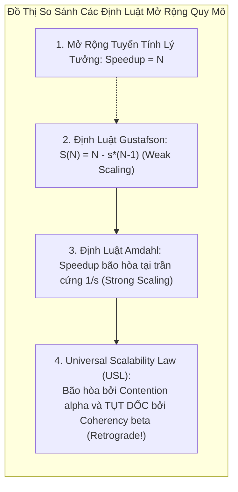
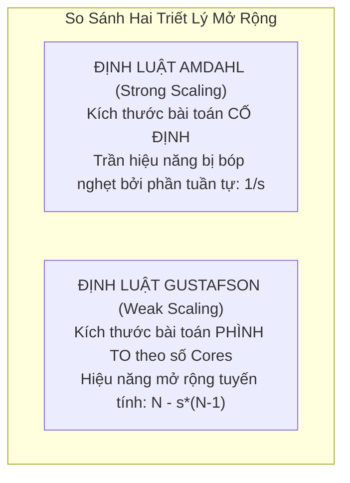
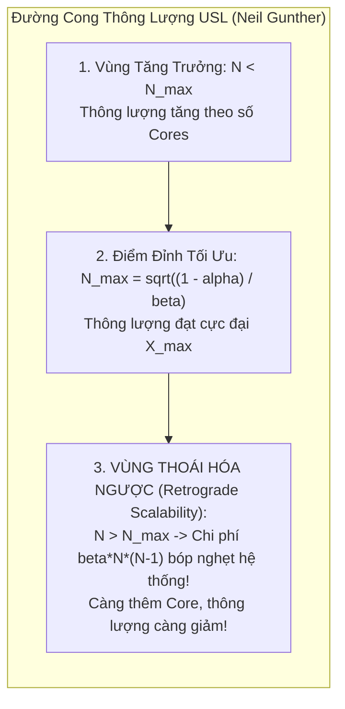

# 4.1. Queueing Theory and Scalability Laws (Lý Thuyết Hàng Đợi & Các Định Luật Mở Rộng)

> [!IMPORTANT]
> **Nếu bạn chỉ được nhớ một điều duy nhất:**
> Mở rộng quy mô máy chủ không phải là phép cộng tuyến tính vô tận: **Định luật Amdahl** chứng minh phần mã tuần tự không thể song song hóa sẽ đặt ra trần hiệu năng cứng; trong khi **Định Luật Mở Rộng Phổ Quát (USL - Universal Scalability Law)** chỉ ra rằng chi phí đồng bộ hóa dữ liệu liên lõi ($\beta$ Coherency) sẽ khiến hệ thống bị suy thoái ngược (**Retrograde Scalability**) — càng cắm thêm nhiều CPU, hệ thống chạy càng chậm!

---

## 1. Kiến trúc Tổng quan & Mô hình Tư duy (Mental Model)

### Phép Loại Suy Thực Tế: Từ Đội Thợ Xây Nhà Đến Phòng Họp Đông Người

Để nắm bắt bản chất của các định luật mở rộng quy mô điện toán:
1. **Amdahl's Law (Người Phụ Nữ Mang Thai & Móng Nhà Bê Tông)**:
   - Một phụ nữ mang thai mất 9 tháng để sinh một đứa con. Bạn không thể thuê 9 phụ nữ để sinh một đứa con trong 1 tháng!
   - Trong xây dựng nhà cửa: Phần đổ móng bê tông bắt buộc phải chờ 7 ngày để đông cứng (Phần mã tuần tự $1 - p$). Dù bạn có thuê $1{,}000$ thợ xây (Tăng số nhân CPU lên $1,000$ cores), ngôi nhà vẫn không thể hoàn thành nhanh hơn 7 ngày!
2. **Gustafson's Law (Mở Rộng Quy Mô Bài Toán - Xây Cả Khu Đô Thị)**:
   - Nếu bạn có $1,000$ thợ xây, bạn không dùng họ để xây một ngôi nhà cấp bốn tí hon. Bạn dùng họ để xây đồng thời 1,000 ngôi nhà trong một đại dự án đô thị (**Weak Scaling**). Thời gian hoàn thành dự án vẫn là 7 ngày móng, nhưng khối lượng công việc hoàn thành tăng lên gấp $1,000$ lần!
3. **Universal Scalability Law - USL (Phòng Họp Ban Quản Trị Quá Đông)**:
   - **Giai đoạn 1 (Tuyến Tính)**: Phòng có 2-3 người, bàn bạc công việc rất nhanh.
   - **Giai đoạn 2 (Tranh chấp Contention $\alpha$)**: Phòng có 10 người, bắt đầu phải xếp hàng chờ người khác phát biểu (Tranh chấp khóa Lock Contention, hiệu năng bắt đầu bão hòa đi ngang).
   - **Giai đoạn 3 (Nói chuyện phiếm / Bất nhất quán Coherency $\beta$)**: Phòng nhồi nhét 50 người! Mọi người bắt đầu thì thầm, bàn tán xôn xao với người bên cạnh ($N(N-1)$ cặp giao tiếp). Chi phí giữ trật tự và đồng thuận ý kiến lớn hơn cả thời gian làm việc thực tế. Kết quả: Một cuộc họp 50 người đưa ra quyết định chậm hơn một nhóm 3 người (**Hiện tượng sụt giảm thông lượng ngược - Retrograde Scalability**)!



---

## 2. Chi tiết từng Keyword (Under-the-Hood Deep Dive)

### 2.1. Queueing Models: Ký hiệu Kendall, M/M/1 & M/M/c Queue

#### 1. Ký Hiệu Kendall Chuẩn Hóa ($A/S/c/K/N/D$)
David G. Kendall đưa ra ký hiệu ngắn gọn mô tả bản chất toán học của mọi hàng đợi:
- **$A$ (Arrival Process - Quá trình đến)**: $M$ (Markovian / Poisson - Phân phối mũ), $D$ (Deterministic - Cố định), $G$ (General - Phân phối tổng quát).
- **$S$ (Service Process - Quá trình phục vụ)**: $M, D, G$.
- **$c$ (Number of Servers)**: Số lượng luồng hoặc máy chủ phục vụ song song.
- **$K$ (Capacity)**: Dung lượng chứa tối đa của hệ thống (mặc định $\infty$).
- **$N$ (Population)**: Tổng kích thước tập người dùng nguồn.
- **$D$ (Queue Discipline)**: Kỷ luật hàng đợi (FIFO, LIFO, Round-Robin).

#### 2. Mô Hình $M/M/1$ vs $M/M/c$ (Nhóm Server Phục Vụ Song Song)
- **Mô hình $M/M/1$**:
  - Tần suất đến: $\lambda$, Năng lực phục vụ: $\mu$, Hệ số tải: $\rho = \lambda / \mu$.
  - Thời gian phản hồi trung bình:
    $$R_{M/M/1} = \frac{1}{\mu - \lambda} = \frac{1}{\mu (1 - \rho)}$$
- **Mô hình $M/M/c$ (Nhóm $c$ luồng phục vụ dùng chung một hàng đợi)**:
  - Hệ số tải tổng thể: $\rho = \frac{\lambda}{c \mu} < 1$.
  - Xác suất một yêu cầu đến phải xếp hàng chờ đợi được tính theo **Công thức Erlang C**:
    $$P_{\text{wait}} = C(c, \lambda/\mu) = \frac{\frac{(c\rho)^c}{c!} \frac{1}{1 - \rho}}{\sum_{k=0}^{c-1} \frac{(c\rho)^k}{k!} + \frac{(c\rho)^c}{c!} \frac{1}{1 - \rho}}$$
  - Thời gian phản hồi trung bình của $M/M/c$:
    $$R_{M/M/c} = \frac{1}{\mu} + \frac{P_{\text{wait}}}{c\mu - \lambda}$$
  - *Ý nghĩa kiến trúc*: Dùng 1 hàng đợi chung cho $c$ workers luôn luôn đạt hiệu năng và khả năng chống nghẽn cao hơn việc chia thành $c$ hàng đợi riêng biệt cho từng worker (ngăn chặn tình trạng worker này nhàn rỗi trong khi worker kia bị nghẽn).

---

### 2.2. Amdahl's Law vs Gustafson's Law

#### 1. Định Luật Amdahl (Strong Scaling - Quy Mô Cố Định Bài Toán)
Gene Amdahl (kiến trúc sư trưởng IBM System/360) công bố năm 1967:
- Giả sử một bài toán có kích thước cố định, trong đó tỷ lệ khối lượng công việc có thể song song hóa là $p$ ($0 \le p \le 1$), và phần còn lại bắt buộc phải chạy tuần tự là $s = 1 - p$.
- Hệ số tăng tốc tối đa (**Speedup**) khi sử dụng $N$ bộ xử lý là:
  $$S_{\text{Amdahl}}(N) = \frac{1}{(1 - p) + \frac{p}{N}}$$
- **Giới Hạn Trần Tuyệt Đối Khi $N \to \infty$**:
  $$S_{\max} = \lim_{N \to \infty} S_{\text{Amdahl}}(N) = \frac{1}{1 - p} = \frac{1}{s}$$
- *Ví dụ Sốc*:
  - Nếu chỉ có $5\%$ mã nguồn của bạn phải chạy tuần tự ($s = 0.05$, ví dụ: khởi tạo DB connection, ghi log tập trung):
    $$S_{\max} = \frac{1}{0.05} = \mathbf{20\times}$$
  - Dù bạn có mua siêu máy tính chứa **1 triệu CPU Cores**, tốc độ của chương trình cũng KHÔNG BAO GIỜ có thể nhanh hơn gấp 20 lần!

#### 2. Định Luật Gustafson-Barsis (Weak Scaling - Quy Mô Mở Rộng Theo Năng Lực)
John Gustafson công bố năm 1988:
- Trong thực tế khoa học và công nghiệp, khi có máy tính mạnh hơn, con người không dùng nó để giải cùng một bài toán cũ với tốc độ nhanh hơn, mà dùng nó để **giải bài toán có độ phân giải lớn hơn gấp $N$ lần** trong cùng một khoảng thời gian!
- **Công Thức Tăng Tốc Tỷ Lệ (Scaled Speedup)**:
  $$S_{\text{Gustafson}}(N) = s + N(1 - s) = N - s(N - 1)$$
- Trong mô hình Weak Scaling, tốc độ tăng trưởng gần như tuyến tính theo số lượng bộ xử lý $N$, mở đường cho sự phát triển của các siêu máy tính hàng triệu nhân phục vụ mô phỏng thời tiết khí hậu toàn cầu và huấn luyện mạng Neural AI khổng lồ (LLMs).



---

### 2.3. Universal Scalability Law (USL) & The Roofline Model

#### 1. Định Luật Mở Rộng Phổ Quát (USL - Dr. Neil Gunther)
Định luật Amdahl quá lạc quan vì nó giả định rằng việc thêm CPU không bao giờ sinh ra chi phí phụ trội. Thực tế hoàn toàn ngược lại!
Tiến sĩ Neil J. Gunther (1993) đưa ra mô hình toán học giải thích hiện tượng suy thoái hiệu năng thực tế trên toàn bộ các hệ thống đa nhân và phân tán:
$$X(N) = \frac{\gamma N}{1 + \alpha(N - 1) + \beta N(N - 1)}$$
Trong đó:
- $X(N)$: Thông lượng (Throughput) của hệ thống khi có $N$ đơn vị tài nguyên (Cores hoặc Nodes).
- $\gamma$: Năng lực phục vụ của 1 đơn vị đơn lẻ khi chạy một mình ($N=1$).
- $\alpha$ (Contention Parameter - Tham Số Tranh Chấp): Đại diện cho phần mã tuần tự và thời gian chờ đợi tài nguyên dùng chung (tương đương phần $s$ của Amdahl, ví dụ: Mutex Lock, Bus Contention).
- $\beta$ (Coherency Parameter - Tham Số Nhất Quán): Đại diện cho chi phí trao đổi thông điệp điểm-điểm giữa các nút để duy trì sự đồng thuận hoặc nhất quán bộ nhớ đệm (MESI invalidations, distributed consensus, gossip protocol). Phụ phí này tăng theo cấp số nhân **$O(N^2)$** dựa trên số cặp tương tác $N(N-1)$!
- **Hiện Tượng Thoái Hóa Ngược (Retrograde Scalability)**:
  - Khi $\beta > 0$: Đạo hàm của hàm $X(N)$ sẽ đổi dấu từ dương sang âm tại điểm cực trị $N_{\max} = \sqrt{\frac{1 - \alpha}{\beta}}$.
  - Sau điểm $N_{\max}$, **việc tiếp tục cắm thêm CPU Cores sẽ làm giảm thông lượng tổng thể**! Toàn bộ hệ thống sụp đổ vì dành $90\%$ năng lượng chỉ để gửi các gói tin đồng bộ hóa lẫn nhau.



#### 2. Mô Hình Roofline (The Roofline Model)
- Đã được phân tích sâu ở tầng phần cứng: Liên kết giữa năng lực tính toán đỉnh CPU ($P_{\text{peak}}$ GFLOPs/s), băng thông DRAM ($B_{\text{peak}}$ GB/s) và Cường độ số học của phần mềm ($I$ FLOPs/Byte):
  $$P_{\max} = \min\left(P_{\text{peak}}, \quad I \times B_{\text{peak}}\right)$$

---

## 3. Thực thi Mã nguồn & Mô phỏng Chuyên sâu (Dual-Engine Implementation)

### 3.1. C++20: Mô Phỏng So Sánh Toán Học Amdahl, Gustafson & USL

Chương trình tính toán và in bảng đối chiếu thông lượng giữa 3 định luật mở rộng quy mô khi số lượng Cores tăng từ 1 đến 128:

```cpp
#include <iostream>
#include <cmath>
#include <vector>
#include <iomanip>

class ScalabilityModels {
public:
    // 1. Dinh luat Amdahl (Strong Scaling): Speedup
    static double amdahl_speedup(double serial_fraction, int n) {
        double p = 1.0 - serial_fraction;
        return 1.0 / (serial_fraction + (p / n));
    }

    // 2. Dinh luat Gustafson (Weak Scaling): Scaled Speedup
    static double gustafson_speedup(double serial_fraction, int n) {
        return n - serial_fraction * (n - 1);
    }

    // 3. Universal Scalability Law (USL): Relative Capacity X(N)
    static double usl_throughput(double alpha, double beta, int n) {
        double denominator = 1.0 + alpha * (n - 1) + beta * n * (n - 1);
        return n / denominator;
    }
};

int main() {
    std::cout << "========================================================\n";
    std::cout << "  C++20 SCALABILITY LAWS COMPARATIVE SIMULATOR\n";
    std::cout << "========================================================\n\n";

    constexpr double SERIAL_FRACTION = 0.05; // 5% mã tuần tự (s = 0.05)
    constexpr double USL_ALPHA = 0.05;       // alpha = 5% contention
    constexpr double USL_BETA = 0.0005;      // beta = 0.05% coherency cost

    std::vector<int> core_counts = {1, 2, 4, 8, 16, 32, 64, 128};

    std::cout << "Tham số mô phỏng:\n"
              << "  - Serial Fraction (Amdahl/Gustafson s) = " << SERIAL_FRACTION * 100 << "%\n"
              << "  - USL Contention (alpha)               = " << USL_ALPHA * 100 << "%\n"
              << "  - USL Coherency Penalty (beta)         = " << USL_BETA * 100 << "%\n\n";

    std::cout << std::left << std::setw(8) << "Cores" 
              << std::setw(18) << "Amdahl (Strong)" 
              << std::setw(18) << "Gustafson (Weak)" 
              << std::setw(18) << "USL Throughput" 
              << "Ghi Chú USL\n";
    std::cout << "--------------------------------------------------------------------\n";

    for (int n : core_counts) {
        double s_amdahl = ScalabilityModels::amdahl_speedup(SERIAL_FRACTION, n);
        double s_gustaf = ScalabilityModels::gustafson_speedup(SERIAL_FRACTION, n);
        double s_usl = ScalabilityModels::usl_throughput(USL_ALPHA, USL_BETA, n);

        std::string note = "";
        if (n >= 32 && s_usl < ScalabilityModels::usl_throughput(USL_ALPHA, USL_BETA, n / 2)) {
            note = "[THOÁI HÓA NGƯỢC!]";
        }

        std::cout << std::left << std::setw(8) << n
                  << std::setw(18) << std::fixed << std::setprecision(2) << s_amdahl
                  << std::setw(18) << s_gustaf
                  << std::setw(18) << s_usl
                  << note << "\n";
    }

    // Tinh diem cuc dai N_max cua USL
    double n_max = std::sqrt((1.0 - USL_ALPHA) / USL_BETA);
    std::cout << "\n-> Điểm cực trị tối ưu của USL: N_max = " << std::setprecision(1) << n_max 
              << " Cores. Sau ngưỡng này, thêm Cores sẽ làm giảm hiệu năng!\n";

    return 0;
}
```

---

### 3.2. Python 3.11+: Công Cụ Khớp Dữ Liệu Thực Tế Khám Phá Tham Số USL ($\alpha, \beta$)

Chương trình Python 3.11+ mô phỏng việc tìm kiếm điểm cực trị bão hòa của hệ thống dựa trên mô hình USL:

```python
import math
from typing import List, Tuple

class USLAnalyzer:
    @staticmethod
    def calculate_usl(n: int, gamma: float, alpha: float, beta: float) -> float:
        # Cong thuc Neil Gunther: X(N) = (gamma * N) / (1 + alpha*(N-1) + beta*N*(N-1))
        denom = 1.0 + alpha * (n - 1) + beta * n * (n - 1)
        return (gamma * n) / denom

    @staticmethod
    def find_optimal_cores(alpha: float, beta: float) -> Tuple[float, float]:
        if beta <= 0:
            return float('inf'), float('inf') # Khong bao gio thoai hoa nguoc
        # Diem cuc tri: N_max = sqrt((1 - alpha) / beta)
        n_max = math.sqrt((1.0 - alpha) / beta)
        return n_max, USLAnalyzer.calculate_usl(int(round(n_max)), 1.0, alpha, beta)

if __name__ == "__main__":
    print("========================================================")
    print("  PYTHON 3.11 UNIVERSAL SCALABILITY LAW ANALYZER")
    print("========================================================\n")

    # Kich ban thu te tren CSDL phan tan (Distributed DB Cluster)
    # alpha = 0.03 (3% tranh chap khoa row-lock)
    # beta = 0.0008 (0.08% chi phi dong bo gossip / 2PC giua cac node)
    alpha_test = 0.03
    beta_test = 0.0008
    gamma_unit = 5000.0 # 1 Node xu ly duoc 5,000 TPS

    n_optimal, max_speedup = USLAnalyzer.find_optimal_cores(alpha_test, beta_test)

    print(f"Tham Số Đo Đạc Phân Tán:")
    print(f"  - Hệ số tranh chấp khóa (alpha)   : {alpha_test * 100:.2f}%")
    print(f"  - Hệ số trôi dạt nhất quán (beta) : {beta_test * 100:.3f}%\n")

    print(f"KẾT QUẢ PHÂN TÍCH USL:")
    print(f"  - Ngưỡng mở rộng tối ưu (N_max)   : {n_optimal:.1f} Nodes")
    print(f"  - Thông lượng đỉnh khả dĩ (X_max) : {max_speedup * gamma_unit:,.0f} TPS\n")

    print(f"{'Số Nodes':10s} | {'Throughput (TPS)':20s} | {'Trạng Thái Hiệu Năng'}")
    print("-" * 55)
    for nodes in [1, 5, 15, 25, 35, 45, 60, 80]:
        tps = USLAnalyzer.calculate_usl(nodes, gamma_unit, alpha_test, beta_test)
        status = "Mở rộng tốt"
        if nodes > n_optimal:
            status = "THOÁI HÓA NGƯỢC (Lãng phí tiền vô ích!)"
        print(f"{nodes:6d}     | {tps:15,.0f} TPS     | {status}")
```

---

### 3.3. Simulated Terminal Output

```bash
========================================================
  C++20 SCALABILITY LAWS COMPARATIVE SIMULATOR
========================================================

Tham số mô phỏng:
  - Serial Fraction (Amdahl/Gustafson s) = 5%
  - USL Contention (alpha)               = 5%
  - USL Coherency Penalty (beta)         = 0.05%

Cores   Amdahl (Strong)   Gustafson (Weak)  USL Throughput    Ghi Chú USL
--------------------------------------------------------------------
1       1.00              1.00              1.00              
2       1.90              1.95              1.90              
4       3.48              3.85              3.46              
8       5.93              7.65              5.76              
16      9.14              15.25             8.38              
32      12.55             30.45             9.82              
64      15.42             60.85             8.63              [THOÁI HÓA NGƯỢC!]
128     17.41             121.65            5.78              [THOÁI HÓA NGƯỢC!]

-> Điểm cực trị tối ưu của USL: N_max = 43.6 Cores. Sau ngưỡng này, thêm Cores sẽ làm giảm hiệu năng!

========================================================
  PYTHON 3.11 UNIVERSAL SCALABILITY LAW ANALYZER
========================================================

Tham Số Đo Đạc Phân Tán:
  - Hệ số tranh chấp khóa (alpha)   : 3.00%
  - Hệ số trôi dạt nhất quán (beta) : 0.080%

KẾT QUẢ PHÂN TÍCH USL:
  - Ngưỡng mở rộng tối ưu (N_max)   : 34.8 Nodes
  - Thông lượng đỉnh khả dĩ (X_max) : 71,940 TPS

Số Nodes   | Throughput (TPS)     | Trạng Thái Hiệu Năng
-------------------------------------------------------
     1     |           5,000 TPS     | Mở rộng tốt
     5     |          22,124 TPS     | Mở rộng tốt
    15     |          50,539 TPS     | Mở rộng tốt
    25     |          66,631 TPS     | Mở rộng tốt
    35     |          71,939 TPS     | Mở rộng tốt
    45     |          70,685 TPS     | THOÁI HÓA NGƯỢC (Lãng phí tiền vô ích!)
    60     |          64,628 TPS     | THOÁI HÓA NGƯỢC (Lãng phí tiền vô ích!)
    80     |          55,420 TPS     | THOÁI HÓA NGƯỢC (Lãng phí tiền vô ích!)
```

---

## 4. Systems Engineering & Production Pitfalls

### 4.1. Production Failure Modes & Architectural Traps

1. **Trap 1: The Infinite Cores Delusion (Ảo Tưởng Cắm Thêm CPU Để Giải Quyết Vấn Đề)**:
   - Một sai lầm kinh điển của các kỹ sư: Khi thấy hệ thống cơ sở dữ liệu bị chậm, lập tức nâng cấp máy ảo từ 16 vCPUs lên 64 vCPUs.
   - Do ứng dụng có chứa các khóa độc quyền tập trung (Global Mutex / Row Lock tranh chấp cao $\to$ Tham số $\alpha$ và $\beta$ lớn), hệ thống rơi thẳng vào vùng thoái hóa ngược của USL. Kết quả: Hóa đơn đám mây tăng gấp 4 lần nhưng thông lượng xử lý thực tế bị giảm $30\%$!
2. **Trap 2: Bỏ Quên Chi Phí Đồng Thuận Trong Distributed Transactions (Two-Phase Commit)**:
   - Khi mở rộng cụm microservices sang kiến trúc phân tán dùng Two-Phase Commit (2PC): Mỗi lần ghi dữ liệu đòi hỏi sự đồng thuận của tất cả các nút ($O(N^2)$ thông điệp qua mạng). Tham số $\beta$ tăng vọt, biến $N_{\max}$ của hệ thống tụt xuống chỉ còn $3 - 5$ nút. Vượt quá ngưỡng này, hệ thống dành toàn bộ thời gian để chờ đợi phiếu biểu quyết mạng.
3. **Trap 3: Áp Dụng Sai Định Luật Khi Benchmark (Amdahl vs Gustafson)**:
   - Đánh giá khả năng mở rộng của một thuật toán AI bằng cách giữ nguyên kích thước ma trận nhỏ xíu $512 \times 512$ trên một GPU có 10,000 Tensor Cores. Tỷ lệ chi phí khởi tạo nhân kernel chiếm $80\%$ thời gian, kết luận thuật toán không thể mở rộng (mắc bẫy Amdahl). Khi nâng kích thước ma trận lên $16,384 \times 16,384$, hiệu năng tăng tốc đạt $98\%$ tuyến tính (tuân theo Gustafson).

### 4.2. Diagnostic CLI Commands

```bash
# 1. Kiem tra muc do xung dot khoa giua cac luong CPU trong Linux Kernel bang perf lock
sudo perf lock record -- ./multi_threaded_app
sudo perf lock report

# 2. Do luong so lan chuyen ngu canh khong tu nguyen (Involuntary Context Switches - Lock Contention)
pidstat -w 1 5 -p $(pgrep -n multi_threaded_app)

# 3. Phan tich giao thoa du lieu giua cac Cores bang phuong phap False Sharing (perf c2c)
sudo perf c2c record -F 60000 -- ./multi_threaded_app
sudo perf c2c report --stdio

# 4. Kiem tra so luong ngat IPI (Inter-Processor Interrupts) giua cac Cores trong /proc/interrupts
cat /proc/interrupts | grep -i 'function call interrupts'
```

---

## 5. Bảng So sánh & Decision Matrix

| Định Luật Mở Rộng | Giả Định Bài Toán | Yếu Tố Ràng Buộc Cốt Tử | Kết Cục Mở Rộng Vĩ Mô | Trường Hợp Ứng Dụng |
| :--- | :--- | :--- | :--- | :--- |
| **Định Luật Amdahl** | Kích thước bài toán CỐ ĐỊNH (Strong Scaling) | Tỷ lệ mã tuần tự không đổi ($s$) | Bão hòa tiệm cận tại trần cứng $1/s$ | Tối ưu hóa vi xử lý đơn, thuật toán tuần tự |
| **Định Luật Gustafson**| Kích thước bài toán PHÌNH TO (Weak Scaling) | Tỷ lệ công việc tăng theo số Cores | Mở rộng tuyến tính tiệm cận $N$ | Siêu máy tính HPC, Huấn luyện AI/LLM |
| **Định Luật USL** | Xét cả Tranh chấp ($\alpha$) & Đồng thuận ($\beta$) | Chi phí giao tiếp đa nút $O(N^2)$ | **Thoái hóa ngược (Sụt giảm sau $N_{\max}$)**| Cụm Database phân tán, Hệ thống Đa nhân lớn |

| Mô Hình Hàng Đợi | Số Lượng Servers ($c$) | Hành Vi Xếp Hàng | Điểm Bão Hòa | Kịch Bản Khuyến Nghị |
| :--- | :--- | :--- | :--- | :--- |
| **$M/M/1$ Queue** | Duy nhất 1 Server | 1 Hàng đợi tập trung | $\rho \to 1.0$ (Độ trễ tiến về vô cùng)| Worker đơn luồng, CPU Core riêng biệt |
| **$M/M/c$ Queue** | $c$ Servers song song | Dùng chung 1 Hàng đợi | $\lambda \to c\mu$ | Thread Pools, Nhóm Database Read Replicas |
| **$c \times M/M/1$ Queues** | $c$ Servers độc lập | Mỗi Server có hàng đợi riêng | Kém hiệu quả (Dễ có Core rảnh rỗi)| Hàng đợi phân mảnh, không cân bằng tải |
