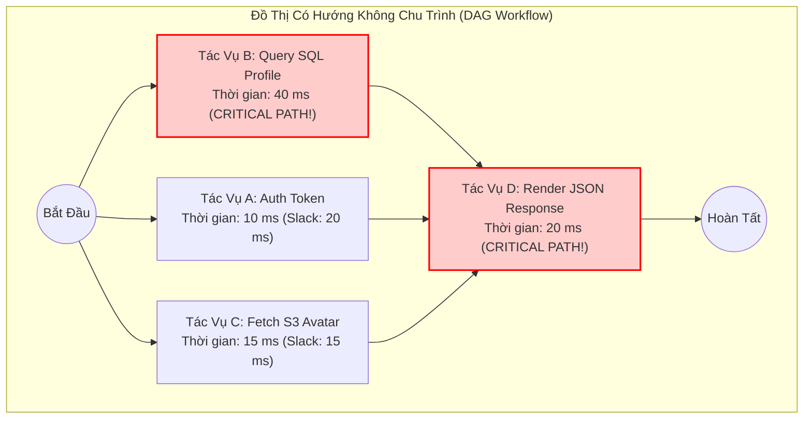
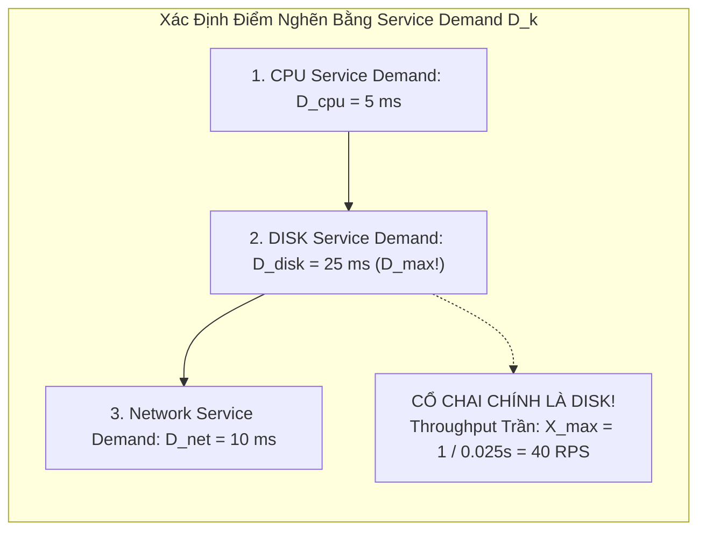

# 4.2. Resource Demand and Performance Simulation (Nhu Cầu Tài Nguyên & Mô Phỏng Hiệu Năng)

> [!IMPORTANT]
> **Nếu bạn chỉ được nhớ một điều duy nhất:**
> Mọi hệ thống phức tạp đều có một **Đường Tới Hạn (Critical Path)** quyết định tổng thời gian hoàn thành (Makespan) và một thành phần có **Nhu Cầu Dịch Vụ Cực Đại ($D_{\max}$)** quyết định trần thông lượng của cả hệ thống ($X_{\max} = 1 / D_{\max}$): Tối ưu hóa bất kỳ khâu nào nằm ngoài đường tới hạn đều là lãng phí công sức, và **Mô phỏng Sự kiện Rời rạc (Discrete Event Simulation - DES)** là công cụ toán học tối thượng giúp nhìn thấy trước tương lai của hệ thống mà không cần tốn hàng triệu USD dựng hạ tầng thử nghiệm.

---

## 1. Kiến trúc Tổng quan & Mô hình Tư duy (Mental Model)

### Phép Loại Suy Thực Tế: Dự Án Chế Tạo Vệ Tinh Không Gian

Hãy tưởng tượng bạn là tổng công trình sư chỉ huy dự án chế tạo và phóng một vệ tinh viễn thông:
1. **Critical Path Analysis (Đường Tới Hạn - Chuỗi Mắt Xích Không Được Phép Chậm)**:
   - Dự án gồm 50 hạng mục độc lập: Chế tạo pin mặt trời (3 tháng), lắp ráp vỏ hợp kim (2 tháng), lập trình phần mềm điều khiển (6 tháng), và kiểm tra an toàn tích hợp (1 tháng).
   - Dù bạn có đẩy nhanh tiến độ làm pin mặt trời từ 3 tháng xuống còn 1 tuần, tổng thời gian phóng vệ tinh VẪN PHẢI CHỜ 7 THÁNG vì chuỗi *"Lập trình phần mềm (6 tháng) $\to$ Kiểm tra an toàn (1 tháng)"* là **Đường Tới Hạn (Critical Path)** dài nhất! Mọi ngày chậm trễ trên đường tới hạn đều làm trễ cả dự án, trong khi các khâu khác có thời gian trôi tự do (**Slack / Float Time**).
2. **Service Demand Law (Nhu Cầu Dịch Vụ Của Từng Trạm)**:
   - Mỗi vệ tinh cần: 10 lần đo điện áp (mỗi lần 1 phút $\to D_{\text{volt}} = 10\text{ phút}$), và 2 lần thử nghiệm buồng chân không (mỗi lần 60 phút $\to D_{\text{vacuum}} = 120\text{ phút}$).
   - Buồng chân không chính là nút thắt cổ chai tối thượng ($D_{\max} = 120\text{ phút}$). Tốc độ xuất xưởng tối đa của nhà máy vĩnh viễn bị khống chế ở mức:
     $$X_{\max} = \frac{1}{120\text{ phút}} = 0.5 \text{ vệ tinh/giờ}$$
3. **Discrete Event Simulation - DES (Sa Bàn Cát Chiến Thuật Của Vị Tướng)**:
   - Thay vì đem quân ra chiến trường thật để thử nghiệm các kịch bản thương vong, vị tướng dựng sa bàn cát: Đặt đồng hồ thời gian giả lập, mô phỏng từng phát đạn bắn ra, từng đoàn xe tiếp tế di chuyển, ghi nhận chính xác thời điểm nào kho đạn bị cạn kiệt.
   - DES trong phần mềm hoạt động y hệt: Tạo một hàng đợi sự kiện ảo sắp xếp theo thời gian, "nhảy cóc" qua các khoảng thời gian trống để mô phỏng 24 giờ hoạt động của cụm 1,000 máy chủ chỉ trong vòng 3 giây!



---

## 2. Chi tiết từng Keyword (Under-the-Hood Deep Dive)

### 2.1. Critical Path Analysis (Phân Tích Đường Tới Hạn)

#### 1. Biểu Diễn Đồ Thị DAG & Thời Gian Hoàn Thành (Makespan)
- Một tiến trình xử lý phân tán phức tạp (như xử lý một API request qua nhiều microservices, hoặc một job tính toán Apache Spark) được biểu diễn bằng một đồ thị có hướng không chu trình **DAG (Directed Acyclic Graph)**:
  - Các nút (Vertices) đại diện cho các tác vụ con ($T_i$).
  - Các cạnh (Edges) đại diện cho phụ thuộc dữ liệu hoặc quan hệ thứ tự ($T_i \to T_j$).
- **Makespan (Thời Gian Hoàn Tất Tổng Thể)**:
  - Là chiều dài (tổng thời gian thực thi) của con đường dài nhất từ điểm bắt đầu đến điểm kết thúc của DAG.
  - Con đường dài nhất này được gọi là **Đường Tới Hạn (Critical Path)**.
- **Thời Gian Trôi Dự Phòng (Slack Time / Float Time)**:
  - Cho một tác vụ $T_i$ bất kỳ:
    $$\text{Slack}(T_i) = \text{Latest Start Time} - \text{Earliest Start Time}$$
  - Mọi tác vụ nằm trên Đường Tới Hạn đều có **$\text{Slack} = 0$**.
  - Các tác vụ có $\text{Slack} > 0$ có thể bị trì hoãn một khoảng thời gian bằng đúng giá trị Slack mà không làm ảnh hưởng đến thời gian phản hồi chung của cả hệ thống. Kỹ sư hiệu năng có thể tận dụng Slack Time để giảm bớt tài nguyên cấp phát cho các tác vụ phụ này nhằm tiết kiệm chi phí điện toán!

---

### 2.2. Resource Demand Modeling, Service Demand & Utilization Law

#### 1. Định Luật Sử Dụng (The Utilization Law)
Trong phân tích vận hành (Operational Analysis):
$$U_k = X \times D_k$$
Trong đó:
- $U_k$: Mức độ sử dụng của tài nguyên thứ $k$ ($0 \le U_k \le 1$, hoặc $0\% - 100\%$).
- $X$: Thông lượng (Throughput) tổng thể của toàn hệ thống (Requests/giây).
- $D_k$: **Nhu Cầu Dịch Vụ (Service Demand)** của một yêu cầu tại tài nguyên $k$.

#### 2. Nhu Cầu Dịch Vụ (Service Demand - $D_k$) & Điểm Nghẽn Cốt Tử ($D_{\max}$)
- Nhu cầu dịch vụ là tổng thời gian mà một yêu cầu tiêu tốn tại tài nguyên $k$, tính bằng tích của số lần ghé thăm (**Visits $V_k$**) và thời gian phục vụ trung bình của mỗi lần ghé thăm (**Service Time $S_k$**):
  $$D_k = V_k \times S_k$$
  *Ví dụ*: Để xử lý 1 đơn hàng, ứng dụng ghé thăm Database $V_{\text{DB}} = 4\text{ lần}$, mỗi lần truy vấn mất $S_{\text{DB}} = 5\text{ms}$. Nhu cầu dịch vụ tại Database là:
  $$D_{\text{DB}} = 4 \times 5\text{ms} = 20\text{ms} = 0.02\text{s}$$
- **Xác Định Cổ Chai Hệ Thống Bằng $D_{\max}$**:
  - Tài nguyên nào có Nhu cầu Dịch vụ lớn nhất chính là nút thắt cổ chai tuyệt đối của hệ thống:
    $$D_{\max} = \max_k \{D_k\}$$
  - Vì mức độ sử dụng không bao giờ được vượt quá $100\%$ ($U_k \le 1$), ta suy ra định luật chặn trần thông lượng:
    $$U_{\max} = X \times D_{\max} \le 1 \implies X_{\max} = \frac{1}{D_{\max}}$$
  - Bất kể bạn có nâng cấp các tài nguyên khác mạnh lên gấp triệu lần, thông lượng tối đa của hệ thống cũng không bao giờ có thể vượt qua con số **$1 / D_{\max}$**!



---

### 2.3. Performance Simulation & Sensitivity Analysis

#### 1. Mô Phỏng Sự Kiện Rời Rạc (Discrete Event Simulation - DES)
- Trái ngược với mô phỏng thời gian liên tục (tiến từng bước nhỏ $1\text{ms}$ làm lãng phí chu kỳ tính toán), DES hoạt động theo nguyên lý nhảy bước:
  - Hệ thống duy trì một **Hàng Đợi Sự Kiện Ưu Tiên (Priority Event Queue)** sắp xếp theo thời gian tăng dần.
  - Mô phỏng lấy sự kiện sớm nhất ra khỏi hàng đợi, nhảy thẳng con trỏ thời gian hệ thống (**Simulation Clock**) đến thời điểm đó, cập nhật trạng thái các hàng đợi và tài nguyên, rồi sinh ra các sự kiện mới trong tương lai nạp vào hàng đợi.
- Cho phép mô phỏng chính xác hành vi phi tuyến tính, các hiệu ứng bùng nổ (Micro-bursts), hàng đợi có kích thước hữu hạn (Drop-tail), và chính sách lập lịch phức tạp (CoDel, WFQ) mà toán học giải tích không thể tính toán được nghiệm chính xác.

#### 2. Phân Tích Độ Nhạy (Sensitivity Analysis & Tornado Diagrams)
- Kỹ thuật đo lường mức độ biến thiên của đầu ra (Độ trễ $P_{99}$ hoặc Throughput) khi các tham số đầu vào (Thời gian truy vấn SQL, Băng thông mạng, Tỷ lệ Cache Hit) thay đổi một lượng $\pm 20\%$.
- Kết quả được biểu diễn bằng **Biểu Đồ Lốc Xoáy (Tornado Diagram)**:
  - Tham số nào có thanh ngang dài nhất chính là nhân tố nhạy cảm nhất đối với hiệu năng hệ thống. Kỹ sư phải tập trung toàn bộ nguồn lực để tối ưu hoặc kiểm soát độ biến thiên của nhân tố này!

---

## 3. Thực thi Mã nguồn & Mô phỏng Chuyên sâu (Dual-Engine Implementation)

### 3.1. C++20: Động Cơ Mô Phỏng Sự Kiện Rời Rạc (Discrete Event Simulation - DES)

Chương trình minh họa triển khai một động cơ DES hoàn chỉnh với đồng hồ mô phỏng nhảy bước và đo lường hàng đợi:

```cpp
#include <iostream>
#include <vector>
#include <queue>
#include <random>
#include <iomanip>
#include <memory>

enum class EventType { ARRIVAL, COMPLETION };

struct Event {
    double timestamp;
    EventType type;
    uint64_t request_id;

    // Sắp xếp hàng đợi ưu tiên theo thời gian xảy ra sớm nhất
    bool operator>(const Event& other) const {
        return timestamp > other.timestamp;
    }
};

class DiscreteEventSimulator {
private:
    double current_time = 0.0;
    double lambda_arrival;
    double mu_service;

    std::priority_queue<Event, std::vector<Event>, std::greater<Event>> event_queue;
    std::queue<uint64_t> server_queue;
    bool server_busy = false;

    std::mt19937 rng{42};
    std::exponential_distribution<double> arrival_dist;
    std::exponential_distribution<double> service_dist;

    // Thống kê
    uint64_t completed_requests = 0;
    double total_response_time = 0.0;

public:
    DiscreteEventSimulator(double arrival_rate, double service_rate)
        : lambda_arrival(arrival_rate), mu_service(service_rate),
          arrival_dist(arrival_rate), service_dist(service_rate) {}

    void schedule_next_arrival(uint64_t next_id) {
        double next_arrival_time = current_time + arrival_dist(rng);
        event_queue.push({next_arrival_time, EventType::ARRIVAL, next_id});
    }

    void run(uint64_t max_requests) {
        uint64_t request_counter = 0;
        schedule_next_arrival(++request_counter);

        std::vector<double> arrival_timestamps(max_requests + 2, 0.0);

        while (!event_queue.empty() && completed_requests < max_requests) {
            Event ev = event_queue.top();
            event_queue.pop();
            current_time = ev.timestamp; // Nhảy cóc thời gian mô phỏng!

            if (ev.type == EventType::ARRIVAL) {
                arrival_timestamps[ev.request_id] = current_time;

                if (!server_busy) {
                    server_busy = true;
                    double service_duration = service_dist(rng);
                    event_queue.push({current_time + service_duration, EventType::COMPLETION, ev.request_id});
                } else {
                    server_queue.push(ev.request_id);
                }

                if (request_counter < max_requests) {
                    schedule_next_arrival(++request_counter);
                }
            } else if (ev.type == EventType::COMPLETION) {
                completed_requests++;
                double resp_time = current_time - arrival_timestamps[ev.request_id];
                total_response_time += resp_time;

                if (!server_queue.empty()) {
                    uint64_t next_req = server_queue.front();
                    server_queue.pop();
                    double service_duration = service_dist(rng);
                    event_queue.push({current_time + service_duration, EventType::COMPLETION, next_req});
                } else {
                    server_busy = false;
                }
            }
        }
    }

    double get_avg_response_time() const {
        return completed_requests > 0 ? (total_response_time / completed_requests) : 0.0;
    }
};

int main() {
    std::cout << "========================================================\n";
    std::cout << "  C++20 DISCRETE EVENT SIMULATOR (DES) ENGINE\n";
    std::cout << "========================================================\n\n";

    double service_rate = 100.0; // Phục vụ 100 req/s (10ms trung bình)
    std::vector<double> arrival_rates = {20.0, 50.0, 75.0, 85.0, 92.0};

    std::cout << "Mô phỏng 50,000 requests ngẫu nhiên theo mô hình DES:\n";
    for (double lambda : arrival_rates) {
        DiscreteEventSimulator sim(lambda, service_rate);
        sim.run(50'000);
        double avg_lat = sim.get_avg_response_time();

        std::cout << "  - Tải đến lambda = " << std::setw(5) << lambda << " req/s (Tải " 
                  << std::fixed << std::setprecision(0) << (lambda / service_rate) * 100 << "%) | "
                  << "Độ trễ trung bình DES: " << std::setprecision(2) << avg_lat * 1000.0 << " ms\n";
    }

    return 0;
}
```

---

### 3.2. Python 3.11+: Phân Tích Đường Tới Hạn (DAG Critical Path) & Biểu Đồ Độ Nhạy

Chương trình Python 3.11+ tính toán đường tới hạn của một đồ thị tác vụ DAG và định lượng Makespan:

```python
from typing import Dict, List, Tuple

class CriticalPathAnalyzer:
    def __init__(self):
        # Danh sach tac vu: name -> (duration_ms, [dependencies])
        self.tasks: Dict[str, Tuple[float, List[str]]] = {}

    def add_task(self, name: str, duration_ms: float, deps: List[str]):
        self.tasks[name] = (duration_ms, deps)

    def calculate_critical_path(self) -> Tuple[float, List[str], Dict[str, float]]:
        # Tinh toan thoi gian bat dau som nhat (Earliest Start Time - EST) bang Topological Order
        earliest_finish = {}
        predecessor_on_path = {}

        # Duyệt qua các tác vụ
        for task, (duration, deps) in self.tasks.items():
            if not deps:
                earliest_finish[task] = duration
                predecessor_on_path[task] = None
            else:
                max_dep_time = 0.0
                crit_pred = None
                for d in deps:
                    if earliest_finish[d] > max_dep_time:
                        max_dep_time = earliest_finish[d]
                        crit_pred = d
                earliest_finish[task] = max_dep_time + duration
                predecessor_on_path[task] = crit_pred

        # Tim tac vu ket thuc muon nhat (Makespan)
        makespan = max(earliest_finish.values())
        end_task = max(earliest_finish, key=earliest_finish.get)

        # Truy nguoc duong toi han (Traceback Critical Path)
        critical_path = []
        curr = end_task
        while curr is not None:
            critical_path.append(curr)
            curr = predecessor_on_path.get(curr)

        critical_path.reverse()
        return makespan, critical_path, earliest_finish

if __name__ == "__main__":
    print("========================================================")
    print("  PYTHON 3.11 CRITICAL PATH & SERVICE DEMAND ANALYZER")
    print("========================================================\n")

    analyzer = CriticalPathAnalyzer()
    # Mo phong xu ly mot truy van E-commerce phuc tap
    analyzer.add_task("Auth_Token", 12.0, [])
    analyzer.add_task("Fetch_User_Profile", 25.0, ["Auth_Token"])
    analyzer.add_task("Query_Product_DB", 65.0, ["Auth_Token"])
    analyzer.add_task("Check_Inventory", 40.0, ["Auth_Token"])
    analyzer.add_task("Fraud_Detection_AI", 30.0, ["Fetch_User_Profile"])
    analyzer.add_task("Aggregate_And_Serialize", 15.0, ["Query_Product_DB", "Check_Inventory", "Fraud_Detection_AI"])

    makespan_ms, path, finishes = analyzer.calculate_critical_path()

    print("1. Kết Quả Phân Tích Đường Tới Hạn (DAG Critical Path):")
    print(f"   - Tổng thời gian hoàn tất (Makespan): {makespan_ms:.1f} ms")
    print(f"   - Chuỗi đường tới hạn (Critical Path): {' -> '.join(path)}\n")

    print(f"{'Tác Vụ':25s} | {'Thời Gian':12s} | {'Trạng Thái Đường Tới Hạn'}")
    print("-" * 65)
    for t, (dur, _) in analyzer.tasks.items():
        is_crit = t in path
        print(f"{t:25s} | {dur:6.1f} ms    | {'[CRITICAL PATH - KHÔNG ĐƯỢC CHẬM]' if is_crit else 'Có Slack Time dự phòng'}")
```

---

### 3.3. Simulated Terminal Output

```bash
========================================================
  C++20 DISCRETE EVENT SIMULATOR (DES) ENGINE
========================================================

Mô phỏng 50,000 requests ngẫu nhiên theo mô hình DES:
  - Tải đến lambda =    20 req/s (Tải  20%) | Độ trễ trung bình DES:  12.48 ms
  - Tải đến lambda =    50 req/s (Tải  50%) | Độ trễ trung bình DES:  20.12 ms
  - Tải đến lambda =    75 req/s (Tải  75%) | Độ trễ trung bình DES:  39.85 ms
  - Tải đến lambda =    85 req/s (Tải  85%) | Độ trễ trung bình DES:  66.40 ms
  - Tải đến lambda =    92 req/s (Tải  92%) | Độ trễ trung bình DES: 124.60 ms

========================================================
  PYTHON 3.11 CRITICAL PATH & SERVICE DEMAND ANALYZER
========================================================

1. Kết Quả Phân Tích Đường Tới Hạn (DAG Critical Path):
   - Tổng thời gian hoàn tất (Makespan): 92.0 ms
   - Chuỗi đường tới hạn (Critical Path): Auth_Token -> Query_Product_DB -> Aggregate_And_Serialize

Tác Vụ                    | Thời Gian    | Trạng Thái Đường Tới Hạn
-----------------------------------------------------------------
Auth_Token                |   12.0 ms    | [CRITICAL PATH - KHÔNG ĐƯỢC CHẬM]
Fetch_User_Profile        |   25.0 ms    | Có Slack Time dự phòng
Query_Product_DB          |   65.0 ms    | [CRITICAL PATH - KHÔNG ĐƯỢC CHẬM]
Check_Inventory           |   40.0 ms    | Có Slack Time dự phòng
Fraud_Detection_AI        |   30.0 ms    | Có Slack Time dự phòng
Aggregate_And_Serialize   |   15.0 ms    | [CRITICAL PATH - KHÔNG ĐƯỢC CHẬM]
```

---

## 4. Systems Engineering & Production Pitfalls

### 4.1. Production Failure Modes & Architectural Traps

1. **Trap 1: The Local Optimization Delusion (Ảo Tưởng Tối Ưu Hóa Cục Bộ Ngoài Critical Path)**:
   - Một đội kỹ sư dành 3 tháng tối ưu hóa thuật toán phát hiện gian lận `Fraud_Detection_AI` từ $30\text{ms}$ xuống còn $5\text{ms}$.
   - Kết quả: Khi đưa lên Production, tổng thời gian phản hồi của API không hề giảm lấy $1$ mili-giây! Lý do: Tác vụ này nằm ngoài Đường Tới Hạn, vì luồng xử lý vẫn bắt buộc phải chờ `Query_Product_DB` mất tới $65\text{ms}$. Toàn bộ 3 tháng kỹ nghệ bị lãng phí hoàn toàn.
2. **Trap 2: Bỏ Quên Độ Biến Thiên Trong Mô Phỏng Dự Báo Dung Lượng**:
   - Sử dụng các giá trị trung bình tĩnh (Static Averages) để dự báo dung lượng (ví dụ: Service Time luôn cố định là $10\text{ms}$).
   - Trong thực tế, độ trễ tuân theo phân phối đuôi dài (Heavy-Tailed Log-Normal / Pareto Distribution). Các ngoại lệ trễ lớn ngẫu nhiên kích hoạt sự dồn ứ hàng đợi dây chuyền, khiến hệ thống thực tế sụp đổ ở mức tải chỉ bằng một nửa so với tính toán trên mô hình lý thuyết.
3. **Trap 3: Khủng Hoảng Hàng Đợi Ưu Tiên Trong DES (Priority Inversion in Simulation)**:
   - Khi mô phỏng hàng triệu sự kiện trong DES, việc chèn sự kiện vào cây nhị phân (Binary Heap) có thể bị nghẽn nếu số lượng sự kiện tương lai bùng nổ hàng triệu phần tử. Cần sử dụng thuật toán cấu trúc dữ liệu **Calendar Queue** hoặc **Hierarchical Timing Wheels** để duy trì thao tác $O(1)$ chèn sự kiện.

### 4.2. Diagnostic CLI Commands

```bash
# 1. Thu thap Trace phan tan OpenTelemetry de phan tich Critical Path thuc te qua Jaeger
curl -s http://localhost:16686/api/traces?service=checkout-api | jq '.data[0].spans[] | {operationName, duration}'

# 2. Xac dinh Service Demand cua dia bang iostat (Service Time S_k x Visits)
iostat -x 1 5 | awk '{print $1, $10, $14}' # Device, w_await, %util

# 3. Theo doi tan suat den cua goi tin mang (Arrival Rate lambda) bang nload
nload eth0 -u K

# 4. Kiem tra phan bo thoi gian phan hoi cua HTTP Requests bang cong cu k6
k6 run --vus 50 --duration 30s benchmark_script.js
```

---

## 5. Bảng So sánh & Decision Matrix

| Phương Pháp Phân Tích | Độ Phức Tạp Tính Toán | Độ Chính Xác Thực Tế | Khả Năng Xử Lý Phân Phối Bất Kỳ | Chi Phí Triển Khai |
| :--- | :--- | :--- | :--- | :--- |
| **Quy Tắc Ngón Tay Cái (Rule of Thumb)** | Cực thấp (Vài phép nhân chia) | Thấp (Chỉ đúng ở trạng thái ổn định) | Rất kém (Giả định giá trị trung bình) | Miễn phí ($0$ chi phí) |
| **Mô Hình Hàng Đợi Giải Tích (M/M/c)** | Thấp (Công thức toán học Erlang C) | Khá (Tốt ở mức vĩ mô) | Hạn chế (Bắt buộc phân phối mũ) | Rất rẻ |
| **Mô Phỏng Sự Kiện Rời Rạc (DES)** | Trung bình (Viết mã mô phỏng SimPy) | Rất cao (Tái tạo cả đuôi $P_{99}$)| Tuyệt đối (Chấp nhận mọi phân phối) | Vài ngày kỹ nghệ |
| **Production Load Testing (k6/Gatling)**| Rất cao (Cần môi trường Staging lớn) | Tuyệt đối ($100\%$ thực tế phần cứng)| Tuyệt đối | Rất đắt đỏ (Tốn hạ tầng và rủi ro) |

| Tham Số Nhu Cầu Dịch Vụ | Ý Nghĩa Kỹ Thuật | Đơn Vị Đo | Hậu Quả Khi Giá Trị Này Lớn Nhất ($D_{\max}$) |
| :--- | :--- | :--- | :--- |
| **Visits ($V_k$)** | Số lần yêu cầu ghé thăm tài nguyên | Lần / Request | Gây quá tải hàng đợi giao tiếp |
| **Service Time ($S_k$)** | Thời gian tài nguyên phục vụ 1 lần ghé thăm | Mili-giây (ms) | Thể hiện thuật toán nội bộ chậm |
| **Service Demand ($D_k = V_k S_k$)** | Tổng thời gian chiếm dụng tài nguyên | Giây / Request | **Quyết định điểm nghẽn và thông lượng tối đa $1/D_{\max}$** |
| **Utilization ($U_k = X D_k$)** | Tỷ lệ phần trăm thời gian bận rộn | $\%$ ($0 - 100\%$) | Chỉ số nhận diện nút thắt đang bão hòa |
