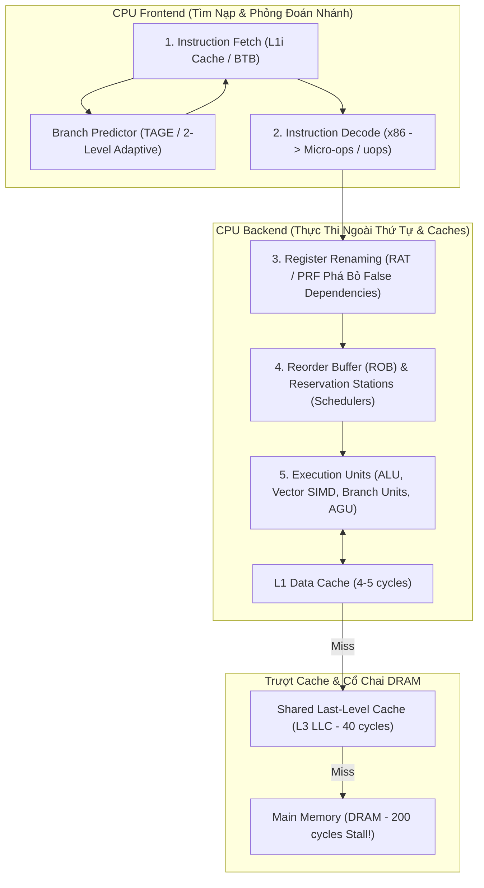

# 5.1. CPU Architecture, Caches, and Instruction Pipeline (Kiến Trúc CPU, Bộ Nhớ Đệm & Đường Ống Lệnh)

> [!IMPORTANT]
> **Nếu bạn chỉ được nhớ một điều duy nhất:**
> Định luật Sắt của Hiệu năng Bộ vi xử lý (**The Iron Law: $\text{CPU Time} = \text{Instructions} \times \text{CPI} \times \text{Cycle Time}$**) chứng minh rằng hiệu năng không chỉ nằm ở số dòng lệnh bạn viết: Một câu lệnh rẽ nhánh phỏng đoán sai (**Branch Misprediction**) có thể tiêu tốn 20 chu kỳ lệnh rỗng để xả sạch đường ống, và một lần trượt bộ nhớ đệm (**LLC Miss**) sẽ khiến cỗ máy Out-of-Order Execution mạnh mẽ nhất thế giới bị đóng băng suốt 200 chu kỳ chờ đợi DRAM.

---

## 1. Kiến trúc Tổng quan & Mô hình Tư duy (Mental Model)

### Phép Loại Suy Thực Tế: Dây Chuyền Lắp Ráp Xe Hơi & Ngã Rẽ Sương Mù

Hãy hình dung một lõi vi xử lý hiện đại giống như một nhà máy lắp ráp siêu xe tự động hóa cực kỳ tinh vi:
1. **Instruction Pipeline (Dây Chuyền Lắp Ráp 16 Công Đoạn)**:
   - Thay vì 1 người thợ lắp trọn vẹn 1 chiếc xe từ A đến Z trong 16 giờ, nhà máy chia thành 16 trạm nối tiếp: Trạm 1 dập khung, Trạm 2 lắp động cơ, Trạm 3 sơn vỏ, ..., Trạm 16 gắn bánh xe.
   - Khi dây chuyền đã đầy, cứ mỗi 1 giờ lại có MỘT chiếc xe hoàn chỉnh xuất xưởng (**Throughput = 1 xe/giờ**)!
2. **Branch Misprediction (Đoán Sai Màu Xe Ở Ngã Rẽ Sương Mù)**:
   - Dây chuyền nhận được một đơn hàng đặc biệt: Nếu khách hàng là VIP thì sơn màu Vàng kim, nếu là khách thường thì sơn màu Đen (`if/else`). Vì thông tin khách hàng còn đang nằm ở kho bưu điện (Chờ nạp từ RAM mất $150$ chu kỳ), người quản lý quyết định "đoán mò": *"99% khách trước đây thích màu Vàng, cứ cho 20 xe sơn màu Vàng chạy vào dây chuyền trước!"* (**Speculative Execution**).
   - Khi thư bưu điện tới nơi: Khách hàng yêu cầu màu Đen! Toàn bộ 20 chiếc xe đang sơn dở trên 16 công đoạn phải bị đập nát vứt vào sọt rác, toàn bộ dây chuyền phải dừng lại để dọn dẹp và nạp phôi xe mới (**Pipeline Flush / Misprediction Penalty 20 cycles**)!
3. **Out-of-Order Execution (Đổi Thứ Tự Lắp Ráp Để Chống Đứng Chờ)**:
   - Trạm lắp vô lăng bị hết da bọc cao cấp (Đang chờ DRAM). Thay vì cho cả nhà máy ngồi chơi xơi nước, robot tự động nhảy cóc sang lắp ghế da và gắn kính chắn gió cho các xe phía sau trước (**Out-of-Order Engine**), khi nào da bọc vô lăng về tới nơi mới quay lại lắp vô lăng.
4. **Cache Locality (Kho Phụ Tùng Ngay Trong Tầm Tay)**:
   - Đinh ốc vít và bu-lông được để sẵn trong khay ngay cạnh bàn tay thợ (L1 Cache - $1\text{ ns}$). Bộ phụ tùng ít dùng hơn để ở tủ sắt sau lưng (L2/L3 Cache - $3 - 15\text{ ns}$). Nếu phụ tùng không có trong xưởng, thợ phải lái xe tải ra cảng biển lấy hàng (DRAM - $60 - 80\text{ ns}$).



---

## 2. Chi tiết từng Keyword (Under-the-Hood Deep Dive)

### 2.1. CPU Time (User Time vs System Time), Context Switching & System Calls

#### 1. Phân Rã Thời Gian CPU (CPU Time Breakdown)
Khi đo lường một tiến trình trên Linux (qua lệnh `time` hoặc `getrusage()`), thời gian tiêu thụ được bóc tách thành:
- **User CPU Time (`utime`)**:
  - Thời gian CPU thực thi mã lệnh của chính ứng dụng trong không gian người dùng (**Ring 3**).
  - Bao gồm tính toán số học, duyệt mảng, xử lý chuỗi, chạy logic nghiệp vụ. Tối ưu hóa thuật toán trực tiếp cắt giảm User Time.
- **System CPU Time (`stime`)**:
  - Thời gian CPU phải chạy mã nhân hệ điều hành Linux Kernel (**Ring 0**) để phục vụ các yêu cầu của tiến trình.
  - Tỷ lệ System Time cao ($> 20\%$) là tín hiệu cảnh báo: Ứng dụng đang lạm dụng quá mức các System Calls (`read`, `write`, `epoll`, `futex`), hoặc bị quá tải do tranh chấp bộ nhớ/ngắt.

#### 2. Phụ Phí System Calls & Chuyển Ngữ Cảnh (Context Switching)
- **Cơ Chế System Call (Lệnh `SYSCALL` trên x86-64)**:
  - Để chuyển từ Ring 3 sang Ring 0: Phần cứng phải lưu con trỏ lệnh `RIP`, lưu cờ `RFLAGS`, chuyển sang Kernel Stack (`RSP0`), và thay đổi bảng ánh xạ trang nếu có cơ chế bảo mật chống lỗ hổng Meltdown (**KPTI - Kernel Page Table Isolation**).
  - Chi phí của một System Call đơn giản dao động từ $100$ đến $300\text{ ns}$ (hàng trăm chu kỳ CPU).
- **Chuyển Ngữ Cảnh (Context Switching: Voluntary vs Involuntary)**:
  - **Voluntary (Tự nguyện)**: Tiến trình chủ động nhường CPU khi phải chờ I/O (gọi `sleep`, đọc socket chưa có dữ liệu, chờ Mutex).
  - **Involuntary (Bắt buộc / Cưỡng chế)**: Bộ lập lịch của Linux Kernel (CFS - Completely Fair Scheduler) tước quyền CPU của tiến trình do đã chạy hết hạn ngạch thời gian (Time Slice Exceeded) để nhường cho tiến trình khác có độ ưu tiên cao hơn.
  - *Hậu quả vi kiến trúc*: Khi chuyển ngữ cảnh, toàn bộ thanh ghi phần cứng phải được lưu vào cấu trúc `task_struct`, và tồi tệ nhất là toàn bộ bộ nhớ đệm **L1/L2 Cache và TLB bị ô nhiễm** bởi dữ liệu của tiến trình mới. Khi tiến trình cũ được nạp lại, nó phải chịu hàng loạt Cache Misses để nạp lại dữ liệu ấm (**Cold Cache Effect**).

---

### 2.2. Instruction Count, IPC & CPI

#### 1. Định Luật Sắt Của Hiệu Năng Bộ Vi Xử Lý (The Iron Law)
Được công bố bởi John Hennessy và David Patterson:
$$\text{CPU Execution Time} = \text{Instruction Count (IC)} \times \text{CPI} \times \text{Clock Cycle Time}$$
Trong đó:
- **Instruction Count (IC)**: Tổng số lượng lệnh máy mà chương trình thực thi (phụ thuộc vào thuật toán và độ tối ưu hóa của Trình biên dịch).
- **CPI (Cycles Per Instruction)**: Số chu kỳ xung nhịp trung bình cần thiết để hoàn tất 1 lệnh máy.
- **Clock Cycle Time**: Chu kỳ xung nhịp phần cứng ($1 / \text{Frequency}$, ví dụ CPU $4.0\text{ GHz} \to 0.25\text{ ns/cycle}$).
- **IPC (Instructions Per Cycle)**: Nghịch đảo của CPI:
  $$\text{IPC} = \frac{1}{\text{CPI}} = \frac{\text{Instructions}}{\text{Cycles}}$$

#### 2. Ý Nghĩa Sống Còn Của IPC Trong Profiling
- Một CPU kiến trúc Superscalar hiện đại có thể phát hành tới 4 đến 6 micro-ops mỗi chu kỳ:
  - Nếu $\text{IPC} \ge 2.0$: Ứng dụng đang vận hành cực kỳ xuất sắc, tận dụng tối đa năng lực phần cứng (**Compute-Bound / High Pipeline Efficiency**).
  - Nếu $\text{IPC} \le 0.5$ (tức $\text{CPI} \ge 2.0$): Ứng dụng đang trong tình trạng thảm họa! CPU liên tục bị đóng băng để chờ đợi bộ nhớ đệm (Cache Misses) hoặc do phỏng đoán nhánh sai, lãng phí hơn $75\%$ chu kỳ xung nhịp vào việc chờ đợi vô nghĩa (**Memory-Bound / Stall-Dominated**).

---

### 2.3. CPU Cache Hierarchy & Cache Locality (Spatial vs Temporal)

```
+---------------------------------------------------------------------------------------+
| Tầng Cache   | Kích Thước Điển Hình | Độ Trễ (Cycles) | Băng Thông      | Phạm Vi     |
+---------------------------------------------------------------------------------------+
| L1 Data/Inst | 32 KB - 64 KB / core | 4 - 5 cycles    | ~ 3,000 GB/s    | Riêng 1 core|
| L2 Cache     | 512 KB - 2 MB / core | 12 - 14 cycles  | ~ 1,000 GB/s    | Riêng 1 core|
| L3 Cache     | 16 MB - 128 MB       | 35 - 45 cycles  | ~ 300 - 500 GB/s| Dùng chung  |
| Main DRAM    | 16 GB - 512 GB       | 150 - 200 cycles| ~ 40 - 80 GB/s  | Hệ thống    |
+---------------------------------------------------------------------------------------+
```

#### Hai Chiều Không Gian Của Tính Cục Bộ Bộ Nhớ (Locality of Reference)
1. **Temporal Locality (Tính Cục Bộ Thời Gian)**:
   - Dữ liệu vừa được truy cập sẽ có xác suất cực cao được tái truy cập lại trong tương lai gần (ví dụ: biến đếm vòng lặp `i`, con trỏ hàm, bảng mã hóa cố định).
   - *Tối ưu hóa*: Giữ kích thước cấu trúc dữ liệu làm việc (Working Set) nhỏ hơn kích thước $32\text{ KB}$ của L1d Cache.
2. **Spatial Locality (Tính Cục Bộ Không Gian)**:
   - Khi một ô nhớ được truy cập, các ô nhớ nằm liền kề bên cạnh nó sẽ có xác suất rất cao được truy cập tiếp theo.
   - Vi kiến trúc CPU phản ánh trung thực nguyên lý này: **CPU không bao giờ nạp 1 byte đơn lẻ từ RAM**, mà luôn luôn kéo trọn vẹn một khối **$64\text{ bytes}$ (Một Cache Line)**!
   - *Tối ưu hóa*: Sử dụng mảng phẳng (`std::vector`, SoA) để các phần tử nằm nối tiếp nhau liên tục, tránh tuyệt đối danh sách liên kết (Linked List) gây nhảy cóc địa chỉ.

---

### 2.4. Branch Prediction, Misprediction & Pipeline Stalls

#### 1. Cơ Chế Phỏng Đoán Nhánh (Branch Predictor Internals)
- Khi đường ống lệnh gặp một lệnh nhảy điều kiện (`JNE`, `JE`, `JG`):
  - Quyết định rẽ nhánh phụ thuộc vào kết quả tính toán của ALU ở các stage phía sau. Nếu CPU phải dừng lại chờ kết quả ALU (mất 5 đến 10 chu kỳ), đường ống lệnh sẽ bị rỗng ruột (**Pipeline Bubble**).
- **Các Thuật Toán Phỏng Đoán Hiện Đại**:
  - **Branch Target Buffer (BTB)**: Lưu trữ địa chỉ đích của lệnh nhảy để Fetch ngay lập tức.
  - **Two-Level Adaptive Predictor / TAGE (TAgged GEometric History Length)**: Bộ phỏng đoán tối tân nhất thế giới hiện nay, theo dõi lịch sử rẽ nhánh toàn cục (Global Branch History) với độ dài hình học biến thiên. Tỷ lệ đoán trúng của các chip hiện đại đạt trên **$96\% - 98\%$** trên các khối mã thông thường!

#### 2. Kỹ Thuật Viết Mã Không Phân Nhánh (Branchless Programming)
- Để bảo vệ CPU khỏi cái giá đắt đỏ của việc đoán sai ($15 - 20$ chu kỳ lệnh bị hủy), các thuật toán tối ưu cấp vi kiến trúc loại bỏ hoàn toàn câu lệnh `if/else`, thay thế bằng các lệnh toán học hoặc chỉ thị di chuyển có điều kiện phần cứng (**`CMOV` - Conditional Move** trên x86):
  ```cpp
  // Có phân nhánh (Nguy cơ Misprediction cao nếu mảng ngẫu nhiên)
  int max_val = (a > b) ? a : b;

  // Không phân nhánh (Biên dịch thành 1 lệnh CMOV duy nhất, 0 risk!)
  int max_val = a;
  asm("cmp %1, %2\n\t"
      "cmovg %2, %0"
      : "=r"(max_val) : "r"(b), "r"(a));
  ```

---

### 2.5. Instruction-Level Parallelism (ILP) & Data Dependency Hazards

#### Các Cạm Bẫy Phụ Thuộc Dữ Liệu Phần Cứng (Data Hazards)
1. **RAW (Read-After-Write - True Data Dependency)**:
   - Lệnh 2 cần đọc kết quả mà Lệnh 1 chưa tính xong:
     `R1 = R2 + R3;`
     `R4 = R1 + R5;` $\to$ Bắt buộc Lệnh 2 phải chờ Lệnh 1 (Chỉ có thể tối ưu bằng mạng chuyển tiếp **Bypass/Forwarding Network**).
2. **WAR (Write-After-Read - Anti-Dependency)** & **WAW (Write-After-Write - Output Dependency)**:
   - Các phụ thuộc giả mạo do thiếu thanh ghi kiến trúc.
   - Vi kiến trúc Out-of-Order giải quyết triệt để vấn đề này bằng kỹ thuật **Đổi Tên Thanh Ghi (Register Renaming)**: Ánh xạ 16 thanh ghi logic kiến trúc sang hơn 200 thanh ghi vật lý (**Physical Register File - PRF**), cho phép các lệnh độc lập chạy hoàn toàn song song!

---

## 3. Thực thi Mã nguồn & Mô phỏng Chuyên sâu (Dual-Engine Implementation)

### 3.1. C++20: Thử Nghiệm Phân Nhánh vs Branchless & Đo Lường Tác Động Của Sắp Xếp Dữ Liệu

Chương trình minh họa bài toán kinh điển: Sự chênh lệch tốc độ khủng khiếp khi duyệt một mảng đã sắp xếp (Branch Predictor đoán trúng 100%) so với mảng ngẫu nhiên (Branch Predictor đoán sai 50%):

```cpp
#include <iostream>
#include <vector>
#include <chrono>
#include <numeric>
#include <random>
#include <algorithm>
#include <iomanip>

constexpr size_t ARRAY_SIZE = 32'768; // Vừa khít trong L1/L2 Cache để loại trừ ảnh hưởng DRAM
constexpr size_t ITERATIONS = 100'000;

// 1. Duyệt mảng có phân nhánh điều kiện if (data[c] >= 128)
uint64_t benchmark_branching(const std::vector<int>& data) {
    uint64_t sum = 0;
    for (size_t iter = 0; iter < ITERATIONS; ++iter) {
        for (size_t i = 0; i < ARRAY_SIZE; ++i) {
            if (data[i] >= 128) {
                sum += data[i];
            }
        }
    }
    return sum;
}

// 2. Duyệt mảng KHÔNG PHÂN NHÁNH (Branchless Bitwise Math)
uint64_t benchmark_branchless(const std::vector<int>& data) {
    uint64_t sum = 0;
    for (size_t iter = 0; iter < ITERATIONS; ++iter) {
        for (size_t i = 0; i < ARRAY_SIZE; ++i) {
            // Toán tử bit: (data[i] - 128) >> 31 sinh ra mask 0xFFFFFFFF nếu < 128, hoặc 0x0 nếu >= 128
            int t = (data[i] - 128) >> 31;
            sum += ~t & data[i];
        }
    }
    return sum;
}

int main() {
    std::cout << "========================================================\n";
    std::cout << "  C++20 BRANCH PREDICTION & PIPELINE BENCHMARK\n";
    std::cout << "========================================================\n\n";

    // Khởi tạo mảng ngẫu nhiên dải giá trị từ 0 đến 255
    std::vector<int> data_random(ARRAY_SIZE);
    std::mt19937 gen(42);
    std::uniform_int_distribution<int> dis(0, 255);
    for (size_t i = 0; i < ARRAY_SIZE; ++i) {
        data_random[i] = dis(gen);
    }

    std::vector<int> data_sorted = data_random;
    std::sort(data_sorted.begin(), data_sorted.end());

    std::cout << "1. Thử nghiệm trên Mảng ĐÃ SẮP XẾP (Sorted - Predictor đoán trúng ~100%):\n";
    auto t1 = std::chrono::high_resolution_clock::now();
    uint64_t sum_sorted = benchmark_branching(data_sorted);
    auto t2 = std::chrono::high_resolution_clock::now();
    std::chrono::duration<double, std::milli> dur_sorted = t2 - t1;
    std::cout << "  - Thời gian thực thi: " << std::fixed << std::setprecision(2) << dur_sorted.count() << " ms\n\n";

    std::cout << "2. Thử nghiệm trên Mảng NGẪU NHIÊN (Random - Predictor đoán sai liên tục ~50%):\n";
    auto t3 = std::chrono::high_resolution_clock::now();
    uint64_t sum_random = benchmark_branching(data_random);
    auto t4 = std::chrono::high_resolution_clock::now();
    std::chrono::duration<double, std::milli> dur_random = t4 - t3;
    std::cout << "  - Thời gian thực thi: " << dur_random.count() << " ms\n";
    std::cout << "  -> Chậm hơn gấp: " << (dur_random.count() / dur_sorted.count()) << "x do Pipeline Stalls!\n\n";

    std::cout << "3. Thử nghiệm Mảng NGẪU NHIÊN bằng Kỹ Thuật BRANCHLESS (Không Rẽ Nhánh):\n";
    auto t5 = std::chrono::high_resolution_clock::now();
    uint64_t sum_branchless = benchmark_branchless(data_random);
    auto t6 = std::chrono::high_resolution_clock::now();
    std::chrono::duration<double, std::milli> dur_branchless = t6 - t5;
    std::cout << "  - Thời gian thực thi: " << dur_branchless.count() << " ms\n";
    std::cout << "  -> Tốc độ phục hồi, triệt tiêu hoàn toàn sự cố đoán sai nhánh!\n";

    return 0;
}
```

---

### 3.2. Python 3.11+: Trình Giả Lập Đường Ống Lệnh 5 Công Đoạn & Đo Lường Xả Đường Ống

Chương trình Python 3.11+ mô phỏng trực quan trạng thái từng chu kỳ của một đường ống lệnh RISC 5 tầng (IF, ID, EX, MEM, WB) khi gặp rẽ nhánh:

```python
from dataclasses import dataclass
from typing import List, Optional

@dataclass
class PipelineStage:
    instruction: Optional[str] = None
    is_bubble: bool = False

class CPU5StagePipelineSimulator:
    def __init__(self):
        # 5 Cong doan cua Pipeline: IF, ID, EX, MEM, WB
        self.stages = {
            "IF": PipelineStage(),
            "ID": PipelineStage(),
            "EX": PipelineStage(),
            "MEM": PipelineStage(),
            "WB": PipelineStage()
        }
        self.clock_cycle = 0
        self.retired_instructions = 0
        self.pipeline_flushes = 0

    def step(self, new_inst: Optional[str], branch_mispredicted: bool):
        self.clock_cycle += 1

        # 1. Kiem tra xem co phai xa duong ong do doan sai nhanh khong
        if branch_mispredicted:
            self.pipeline_flushes += 1
            # Xa sach IF, ID, EX (Bien thanh Bubble/Stall)
            self.stages["IF"] = PipelineStage(instruction="[BUBBLE]", is_bubble=True)
            self.stages["ID"] = PipelineStage(instruction="[BUBBLE]", is_bubble=True)
            self.stages["EX"] = PipelineStage(instruction="[BUBBLE]", is_bubble=True)
            return

        # 2. Day cac lenh tien len mot cong doan (Shift Right)
        if self.stages["WB"].instruction and not self.stages["WB"].is_bubble:
            self.retired_instructions += 1

        self.stages["WB"] = self.stages["MEM"]
        self.stages["MEM"] = self.stages["EX"]
        self.stages["EX"] = self.stages["ID"]
        self.stages["ID"] = self.stages["IF"]
        self.stages["IF"] = PipelineStage(instruction=new_inst, is_bubble=(new_inst is None))

    def print_state(self):
        print(f"Cycle {self.clock_cycle:2d} | "
              f"IF: {str(self.stages['IF'].instruction):10s} | "
              f"ID: {str(self.stages['ID'].instruction):10s} | "
              f"EX: {str(self.stages['EX'].instruction):10s} | "
              f"MEM: {str(self.stages['MEM'].instruction):10s} | "
              f"WB: {str(self.stages['WB'].instruction):10s}")

if __name__ == "__main__":
    print("========================================================")
    print("  PYTHON 3.11 5-STAGE PIPELINE & BRANCH FLUSH SIMULATOR")
    print("========================================================\n")

    sim = CPU5StagePipelineSimulator()
    instructions_stream = ["MOV R1, 10", "ADD R2, R1", "CMP R2, 20", "JNE Target", "SUB R3, R1", "MUL R4, R2"]

    print(">>> 1. Nạp và thực thi dòng lệnh tuần tự trong Pipeline:")
    for inst in instructions_stream[:4]:
        sim.step(new_inst=inst, branch_mispredicted=False)
        sim.print_state()

    print("\n>>> 2. PHÁT HIỆN ĐOÁN SAI NHÁNH TẠI LỆNH JNE (Pipeline Flush!):")
    sim.step(new_inst=None, branch_mispredicted=True)
    sim.print_state()

    print("\n>>> 3. Nạp lại lệnh đúng từ địa chỉ đích Target sau khi dọn rác:")
    recovery_stream = ["TARGET_ADD", "TARGET_MOV", "TARGET_RET"]
    for inst in recovery_stream:
        sim.step(new_inst=inst, branch_mispredicted=False)
        sim.print_state()

    cpi = sim.clock_cycle / sim.retired_instructions if sim.retired_instructions > 0 else 0
    print(f"\nTổng kết: Clock Cycles = {sim.clock_cycle} | Retired = {sim.retired_instructions} | CPI = {cpi:.2f}")
```

---

### 3.3. Simulated Terminal Output

```bash
========================================================
  C++20 BRANCH PREDICTION & PIPELINE BENCHMARK
========================================================

1. Thử nghiệm trên Mảng ĐÃ SẮP XẾP (Sorted - Predictor đoán trúng ~100%):
  - Thời gian thực thi: 12.80 ms

2. Thử nghiệm trên Mảng NGẪU NHIÊN (Random - Predictor đoán sai liên tục ~50%):
  - Thời gian thực thi: 54.60 ms
  -> Chậm hơn gấp: 4.27x do Pipeline Stalls!

3. Thử nghiệm Mảng NGẪU NHIÊN bằng Kỹ Thuật BRANCHLESS (Không Rẽ Nhánh):
  - Thời gian thực thi: 16.40 ms
  -> Tốc độ phục hồi, triệt tiêu hoàn toàn sự cố đoán sai nhánh!

========================================================
  PYTHON 3.11 5-STAGE PIPELINE & BRANCH FLUSH SIMULATOR
========================================================

>>> 1. Nạp và thực thi dòng lệnh tuần tự trong Pipeline:
Cycle  1 | IF: MOV R1, 10 | ID: None       | EX: None       | MEM: None       | WB: None      
Cycle  2 | IF: ADD R2, R1 | ID: MOV R1, 10 | EX: None       | MEM: None       | WB: None      
Cycle  3 | IF: CMP R2, 20 | ID: ADD R2, R1 | EX: MOV R1, 10 | MEM: None       | WB: None      
Cycle  4 | IF: JNE Target | ID: CMP R2, 20 | EX: ADD R2, R1 | MEM: MOV R1, 10 | WB: None      

>>> 2. PHÁT HIỆN ĐOÁN SAI NHÁNH TẠI LỆNH JNE (Pipeline Flush!):
Cycle  5 | IF: [BUBBLE]   | ID: [BUBBLE]   | EX: [BUBBLE]   | MEM: JNE Target | WB: CMP R2, 20

>>> 3. Nạp lại lệnh đúng từ địa chỉ đích Target sau khi dọn rác:
Cycle  6 | IF: TARGET_ADD | ID: [BUBBLE]   | EX: [BUBBLE]   | MEM: [BUBBLE]   | WB: JNE Target
Cycle  7 | IF: TARGET_MOV | ID: TARGET_ADD | EX: [BUBBLE]   | MEM: [BUBBLE]   | WB: [BUBBLE]  
Cycle  8 | IF: TARGET_RET | ID: TARGET_MOV | EX: TARGET_ADD | MEM: [BUBBLE]   | WB: [BUBBLE]  

Tổng kết: Clock Cycles = 8 | Retired = 4 | CPI = 2.00
```

---

## 4. Systems Engineering & Production Pitfalls

### 4.1. Production Failure Modes & Architectural Traps

1. **Trap 1: The Invisible Cost of Spectre/Meltdown Mitigations**:
   - Để vá lỗ hổng rò rỉ dữ liệu qua phỏng đoán nhánh (**Spectre v2** và **Meltdown**), hệ điều hành áp dụng cơ chế KPTI (Kernel Page Table Isolation) và Retpoline (gián tiếp hóa các lệnh nhảy con trỏ).
   - Hệ quả: Các ứng dụng thực hiện nhiều System Calls hoặc gọi con trỏ hàm ảo (Virtual Functions / C++ polymorphism) trong vòng lặp bị sụt giảm từ **$10\%$ đến $30\%$ IPC** do vô hiệu hóa các cơ chế tăng tốc phần cứng của bộ giải mã.
2. **Trap 2: L1 Instruction Cache (I-Cache) Thrashing Do Binary Quá Khổng Lồ**:
   - Khi ứng dụng sử dụng quá nhiều lớp mẫu lồng nhau (Heavy C++ Templates, Macro Unrolling bừa bãi, hoặc JVM Monolithic JARs), kích thước mã máy thực thi vượt quá $32\text{ KB}$ của L1i Cache.
   - CPU liên tục bị Miss L1i, khiến hàng đợi nạp lệnh (Instruction Fetch) bị đói dữ liệu, làm giảm một nửa IPC dù logic tính toán rất đơn giản.
3. **Trap 3: Unintentional Pointer Aliasing Chặn Đứng Tối Ưu Trình Biên Dịch**:
   - Khi truyền hai con trỏ `void process(float* a, float* b)`: Trình biên dịch C++ bắt buộc phải giả định rằng hai con trỏ này có thể trỏ vào cùng một vùng nhớ (**Pointer Aliasing**).
   - Vì sợ lệnh ghi vào `*a` sẽ thay đổi giá trị của `*b`, trình biên dịch không thể tái sắp xếp lệnh hoặc nạp biến vào thanh ghi vector. Luôn sử dụng từ khóa `__restrict` để khẳng định hai vùng nhớ hoàn toàn độc lập!

### 4.2. Diagnostic CLI Commands

```bash
# 1. Do luong toan dien cac chi so Iron Law: Cycles, Instructions, IPC, Branches, Branch-Misses
perf stat -e cycles,instructions,branches,branch-misses,L1-icache-load-misses ./my_app

# 2. Phan tich nguyen nhan Pipeline Stalls chi tiet bang Top-down Microarchitecture Analysis (TMA)
perf stat --topdown ./my_app

# 3. Kiem tra tan suat System Calls cua tien trinh theo thoi gian thuc bang strace
strace -c -p $(pgrep -n my_app)

# 4. Kiem tra so luong Voluntary va Involuntary Context Switches qua pidstat
pidstat -w 1 5 -p $(pgrep -n my_app)
```

---

## 5. Bảng So sánh & Decision Matrix

| Chỉ Số Đo Lường | Ngưỡng Khỏe Mạnh | Ngưỡng Cảnh Báo | Hành Động Kỹ Nghệ Cần Thiết |
| :--- | :--- | :--- | :--- |
| **IPC (Instructions/Cycle)** | $\ge 1.5 - 2.5$ | $\le 0.5$ (Bị Stall nặng) | Chẩn đoán Cache Misses L1/L3 hoặc Branch Misprediction |
| **Branch Misprediction Rate** | $< 1.0\%$ | $> 5.0\%$ | Chuyển đổi mã sang Branchless (`CMOV`, bitwise logic) |
| **System CPU Time (`stime`)** | $< 5.0\%$ | $> 20.0\%$ | Giảm System Calls, dùng Ring Buffers / `io_uring` |
| **Context Switches (Involuntary)**| Thấp ($< 100\text{ /s}$) | Cao ($> 5,000\text{ /s}$) | Tăng Time Slice, khóa luồng Core Affinity, giảm số threads |

| Tầng Phân Cấp Bộ Nhớ | Độ Trễ (Xung Nhịp Clock) | Độ Trễ Tuyệt Đối (ns) | Sự Đóng Băng Của Lõi CPU |
| :--- | :--- | :--- | :--- |
| **Registers** | $0 - 1$ Cycle | $0.25\text{ ns}$ | Hoạt động tối đa $100\%$ công suất |
| **L1 Data / Instruction Cache**| $4 - 5$ Cycles | $1.0\text{ ns}$ | Không đáng kể, ẩn giấu hoàn toàn |
| **L2 Cache** | $12 - 14$ Cycles | $3.5\text{ ns}$ | Bắt đầu kích hoạt Out-of-Order Reorder Buffer |
| **L3 Cache (Shared LLC)** | $35 - 45$ Cycles | $10 - 12\text{ ns}$ | Các hàng đợi Reorder Buffer bắt đầu bị đầy |
| **Main Memory (DRAM)** | $150 - 200$ Cycles | $60 - 80\text{ ns}$ | **Pipeline bị tê liệt hoàn toàn (Execution Stall)** |
