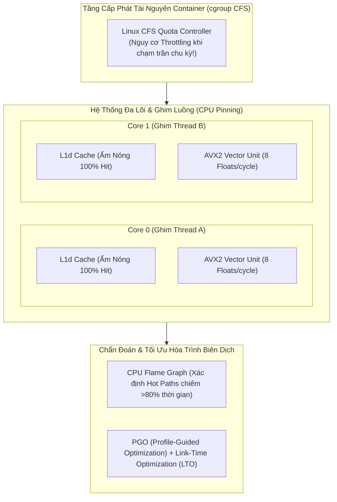

# 5.2. Multiprocessing, NUMA, Vectorization, and Hot Paths (Đa Xử Lý, NUMA, Vector Hóa & Đường Dẫn Nóng)

> [!IMPORTANT]
> **Nếu bạn chỉ được nhớ một điều duy nhất:**
> Tối ưu hóa CPU đa nhân cấp cao là bản hòa âm giữa phần cứng và trình biên dịch: Khóa chặt luồng vào lõi vật lý (**CPU Pinning**) để giữ ấm L1/L2 Cache; vector hóa mảng dữ liệu (**SIMD/AVX2**) để xử lý 8 phép tính mỗi chu kỳ; phá vỡ cạm bẫy kìm hãm CPU trong container (**CFS Throttling**); và sử dụng **Biểu Đồ Ngọn Lửa (Flame Graphs)** kết hợp **PGO (Profile-Guided Optimization)** để tập trung $90\%$ công sức vào $10\%$ mã nguồn thực sự là điểm nóng.

---

## 1. Kiến trúc Tổng quan & Mô hình Tư duy (Mental Model)

### Phép Loại Suy Thực Tế: Xưởng Sản Xuất Đa Dây Chuyền & Cỗ Xe Đua F1

Hãy hình dung một trung tâm sản xuất siêu xe thể thao gồm nhiều phân xưởng hiện đại:
1. **CPU Pinning (Người Thợ Gắn Chặt Với Bàn Làm Việc Riêng)**:
   - Thay vì cứ 15 phút quản đốc lại bắt một người thợ chuyển sang một xưởng khác làm việc (CPU Migration), khiến anh ta mất 10 phút để dọn đồ và tìm dụng cụ mới (Cold Cache & TLB Flush), người thợ được gán cố định tại Bàn số 4 (**CPU Affinity / Pinning**). Mọi dụng cụ của anh ta luôn nằm ấm nóng sẵn sàng trong tầm tay.
2. **SIMD Vectorization (Cỗ Xe Nâng 8 Càng Nâng Song Song)**:
   - Một chiếc xe nâng thông thường chỉ bốc được 1 thùng hàng mỗi chuyến (Scalar). Xe nâng đặc chủng SIMD có 8 càng nâng song song: Nhấc một lúc 8 kiện hàng và đặt vào giá đỡ trong đúng một thao tác nâng, tăng tốc độ bốc dỡ lên gấp 8 lần mà không tốn thêm sức người!
3. **Container CFS Throttling (Đồng Hồ Bấm Giờ Khắt Khe Của Quản Đốc)**:
   - Quản đốc đặt quy định trong hợp đồng: *"Trong mỗi chu kỳ 100 mili-giây, xưởng của bạn chỉ được phép chạy tối đa 20 mili-giây"*.
   - Đội công nhân làm việc quá nhanh, hoàn thành hạn ngạch 20 mili-giây chỉ trong chớp mắt. Trong 80 mili-giây còn lại của chu kỳ, quản đốc tắt toàn bộ cầu dao điện (**CPU Throttled**), ép các công nhân ngồi im trong bóng tối dù còn cả núi công việc đang chờ xử lý!
4. **Flame Graphs (Bản Đồ Nhiệt Của Động Cơ F1)**:
   - Một chiếc xe đua có hàng nghìn bộ phận. Camera nhiệt (Flame Graph) quét toàn bộ xe: Bộ phận nào tỏa nhiệt đỏ rực chiếm diện tích lớn nhất chính là nơi ma sát cao nhất (**Hot Path**). Kỹ sư chỉ cần tra dầu vào đúng vị trí đó là xe chạy nhanh hơn $50\%$, thay vì đi sơn lại toàn bộ khung xe vô ích.



---

## 2. Chi tiết từng Keyword (Under-the-Hood Deep Dive)

### 2.1. NUMA Awareness & CPU Affinity / Pinning

#### 1. Kỹ Thuật NUMA Awareness Trong Lập Trình Hệ Thống
- Đã được làm rõ trong kiến trúc phần cứng: Trong hệ thống đa socket, việc một luồng chạy trên Node 0 nhưng đọc RAM của Node 1 làm tăng độ trễ lên gấp $2.5\times$ và bão hòa bus liên kết UPI.
- **Lập Trình NUMA-Aware**:
  - Tách ứng dụng thành các tiến trình con (Workers) độc lập.
  - Sử dụng lệnh `numactl --cpunodebind=0 --membind=0` để giam giữ worker hoàn toàn trong không gian một NUMA Node duy nhất, biến $100\%$ các truy cập bộ nhớ thành **Local Access**!

#### 2. Lợi Ích Vi Kiến Trúc Của CPU Pinning (Ghim Lõi)
- Khi một luồng không được gán cố định: Bộ lập lịch Linux CFS có thể di dời (Migrate) luồng đó sang một CPU core khác để cân bằng tải.
- **Cái Giá Của Việc Di Dời Luồng (Thread Migration Cost)**:
  - Dữ liệu làm việc của luồng đang nằm ấm nóng trong L1/L2 Cache của Core cũ bị bỏ rơi.
  - Core mới nạp lệnh với bộ nhớ đệm hoàn toàn nguội lạnh (**Cold Cache**), làm bùng nổ hàng loạt Cache Misses và TLB Misses.
  - Các dòng cache trên Core cũ phải bị vô hiệu hóa qua giao thức MESI (**Cache Line Bouncing**).
- **Hàm API `pthread_setaffinity_np`**:
  - Gắn chặt một luồng vào một lõi CPU vật lý cụ thể.
  - Kết hợp với tham số Kernel boot **`isolcpus=2-15`**: Bắt Linux Kernel không bao giờ tự ý điều phối các tác vụ hệ thống vào các lõi từ 2 đến 15, dành riêng các lõi này cho các luồng xử lý giao dịch tài chính hoặc định tuyến mạng độ trễ thấp (**Sub-microsecond Tail Latency**)!

---

### 2.2. Hyper-Threading (SMT) & SIMD Vectorization

#### 1. Bản Chất Vi Kiến Trúc Của SMT (Simultaneous Multithreading)
- **Cơ Chế Hoạt Động**:
  - Một lõi CPU vật lý có nhiều đơn vị thực thi ALU/FPU nhưng một luồng thông thường chỉ tận dụng được $30\% - 40\%$ công suất do các chu kỳ chờ bộ nhớ.
  - SMT nhân bản các thanh ghi kiến trúc logic (PC, RAX, RSP), biến 1 lõi vật lý thành **2 lõi logic (Virtual Cores)** trong mắt hệ điều hành.
  - Hai luồng ảo cùng chạy đan xen, luồng này bị trượt Cache thì luồng kia lập tức chiếm dụng ALU để tính toán.
- **Khi Nào Phải VÔ HIỆU HÓA Hyper-Threading?**:
  - *Ứng dụng HPC & Tính Toán Khoa Học*: Khi ứng dụng đã được vector hóa triệt để (AVX-512) và bão hòa $100\%$ các cổng thực thi, việc bật SMT chỉ gây tranh chấp cổng (Execution Port Contention) và làm nóng CPU.
  - *Bảo Mật Cực Đoan*: Nguy cơ rò rỉ khóa mã hóa qua kênh phụ gián điệp giữa hai luồng ảo chia sẻ cùng L1 Cache (**L1TF / MDS Side-Channel Attacks**).

#### 2. Vector Hóa SIMD (Single Instruction, Multiple Data)
- **Sự Tiến Hóa Độ Rộng Vector**:
  - MMX (64-bit) $\to$ SSE (128-bit / 4 floats) $\to$ AVX2 (256-bit / 8 floats) $\to$ AVX-512 (512-bit / 16 floats).
- **Các Cờ Tối Ưu Hóa Trình Biên Dịch Bắt Buộc**:
  - `-O3`: Bật các pass tối ưu hóa sâu (Loop Vectorization, Function Inlining).
  - `-march=native`: Yêu cầu GCC/Clang phát hiện và sinh mã máy sử dụng trọn vẹn toàn bộ các tập lệnh mở rộng cao cấp nhất có trên CPU của máy đang biên dịch (AVX2, FMA, BMI2, AES-NI).
  - `-ffast-math`: Bỏ qua các quy tắc khắt khe của chuẩn số thực IEEE 754 (giả định phép cộng/nhân số thực có tính chất kết hợp), cho phép trình biên dịch tự do tái sắp xếp vòng lặp để vector hóa toàn diện (Lưu ý: Không dùng nếu cần tính toán tài chính chính xác tuyệt đối từng bit thập phân!).

---

### 2.3. CPU Throttling Trong Container Kubernetes & Hot Paths

#### 1. Cạm Bẫy CPU CFS Throttling Trong Container
- Trong Kubernetes, khi bạn thiết lập `resources.limits.cpu: "2"`:
  - Linux cgroups triển khai giới hạn này thông qua hai tham số:
    - `cpu.cfs_period_us`: Chu kỳ đo lường (mặc định là $100{,}000\mu\text{s} = 100\text{ms}$).
    - `cpu.cfs_quota_us`: Hạn ngạch thời gian CPU được phép chạy trong chu kỳ đó (với 2 Cores $\to 2 \times 100\text{ms} = 200\text{ms}$).
- **Kịch Bản Thảm Họa (Throttling Spikes)**:
  - Nếu ứng dụng của bạn là một Web Server đa luồng (ví dụ: JVM hoặc Node.js Worker Pool có 16 threads): Khi có một đợt bùng nổ lưu lượng (Micro-burst), cả 16 threads cùng bung ra chạy đồng thời.
  - Chúng ngốn hết $200\text{ms}$ hạn ngạch CPU chỉ trong vòng đúng **$12.5\text{ms}$ đầu tiên** của chu kỳ!
  - Trong **$87.5\text{ms}$ còn lại** của chu kỳ $100\text{ms}$, toàn bộ container bị Linux Kernel đóng băng hoàn toàn (**Throttled**)! Các yêu cầu của người dùng bị giam cầm trong hàng đợi, đẩy độ trễ $P_{99}$ từ $5\text{ms}$ lên hơn $100\text{ms}$ dù mức sử dụng CPU trung bình theo báo cáo của Grafana chỉ là $20\%$!

#### 2. CPU Flame Graphs & Tối Ưu Hóa Hot Path
- **Định Luật 80/20 Trong Hiệu Năng**: $80\%$ thời gian CPU của toàn bộ hệ thống thường chỉ bị thiêu đốt bởi $20\%$ (hoặc thậm chí chỉ $5\%$) dòng mã nguồn (**The Hot Path**).
- **Biểu Đồ Ngọn Lửa (Flame Graphs - Brendan Gregg)**:
  - Trực quan hóa dữ liệu lấy mẫu ngăn xếp lệnh (Stack Traces Sampling).
  - Chiều rộng của mỗi thanh hình chữ nhật tỷ lệ thuận với tỷ lệ phần trăm thời gian CPU mà hàm đó (và các hàm con của nó) đang chiếm giữ trên lõi.
  - Giúp kỹ sư phát hiện ngay lập tức các hàm "ăn cắp thời gian" ẩn giấu (như hàm chuyển đổi chuỗi `JSON.parse`, hàm băm UUID, hoặc hàm giải mã regex).

#### 3. Tối Ưu Hóa Dựa Trên Hồ Sơ (PGO - Profile-Guided Optimization)
- Quy trình biên dịch 2 giai đoạn thần kỳ:
  1. **Instrumentation Phase**: Biên dịch mã nguồn với cờ `-fprofile-generate` để nhúng các bộ đếm thống kê.
  2. **Training Phase**: Chạy chương trình với khối lượng công việc thực tế trong môi trường thử nghiệm để thu thập dữ liệu hành vi các nhánh rẽ (`.profdata`).
  3. **Optimization Phase**: Biên dịch lại với cờ `-fprofile-use`: Trình biên dịch nạp dữ liệu thống kê thực tế, sắp xếp lại các khối mã máy: Gom toàn bộ các khối mã lệnh thực sự được thực thi liên tục nằm kề sát nhau trong bộ nhớ để lấp đầy L1i Cache, đẩy các khối mã xử lý lỗi hiếm gặp ra xa, mang lại sự tăng tốc thêm **$10\% - 20\%$** mà không cần sửa một dòng mã nguồn!

---

## 3. Thực thi Mã nguồn & Mô phỏng Chuyên sâu (Dual-Engine Implementation)

### 3.1. C++20: Thử Nghiệm Ghim Luồng (CPU Pinning) & Tối Ưu Vector Hóa SIMD AVX2

Chương trình minh họa hai kỹ thuật: Đo lường lợi ích của việc ghim luồng CPU Affinity và gia tốc tính toán song song bằng SIMD AVX2 Intrinsics:

```cpp
#include <iostream>
#include <vector>
#include <thread>
#include <chrono>
#include <iomanip>
#include <numeric>
#if defined(__linux__)
#include <pthread.h>
#include <sched.h>
#endif
#if defined(__x86_64__) || defined(_M_X64)
#include <immintrin.h>
#endif

// 1. Hàm tính toán Scalar thông thường (Tuần tự từng số float)
void vector_multiply_scalar(const float* a, const float* b, float* c, size_t n) {
    for (size_t i = 0; i < n; ++i) {
        c[i] = a[i] * b[i] + 0.5f;
    }
}

// 2. Hàm tính toán Vector hóa SIMD AVX2 (8 floats mỗi chu kỳ)
void vector_multiply_avx2(const float* a, const float* b, float* c, size_t n) {
#if defined(__x86_64__) || defined(_M_X64)
    size_t i = 0;
    __m256 half = _mm256_set1_ps(0.5f);
    for (; i + 7 < n; i += 8) {
        __m256 va = _mm256_loadu_ps(a + i);
        __m256 vb = _mm256_loadu_ps(b + i);
        // Lệnh FMA (Fused Multiply-Add): va * vb + 0.5 trong 1 cycle!
        __m256 res = _mm256_fmadd_ps(va, vb, half);
        _mm256_storeu_ps(c + i, res);
    }
    // Xử lý phần dư
    for (; i < n; ++i) {
        c[i] = a[i] * b[i] + 0.5f;
    }
#else
    vector_multiply_scalar(a, b, c, n);
#endif
}

// Hàm ghim luồng vào lõi chỉ định
void set_thread_affinity(int core_id) {
#if defined(__linux__)
    cpu_set_t cpuset;
    CPU_ZERO(&cpuset);
    CPU_SET(core_id, &cpuset);
    pthread_setaffinity_np(pthread_self(), sizeof(cpu_set_t), &cpuset);
#endif
}

int main() {
    std::cout << "========================================================\n";
    std::cout << "  C++20 CPU PINNING & SIMD AVX2/FMA BENCHMARK ENGINE\n";
    std::cout << "========================================================\n\n";

    constexpr size_t N = 16'000'000; // 16M floats = 64 MB
    std::vector<float> a(N, 1.5f);
    std::vector<float> b(N, 2.0f);
    std::vector<float> c(N, 0.0f);

    // 1. Thử nghiệm Scalar
    auto t1 = std::chrono::high_resolution_clock::now();
    vector_multiply_scalar(a.data(), b.data(), c.data(), N);
    auto t2 = std::chrono::high_resolution_clock::now();
    std::chrono::duration<double, std::milli> dur_scalar = t2 - t1;
    std::cout << "1. Hiệu Năng Phép Toán Scalar (Đơn Lệnh):\n";
    std::cout << "   - Thời gian thực thi: " << std::fixed << std::setprecision(2) << dur_scalar.count() << " ms\n\n";

    // 2. Thử nghiệm SIMD AVX2
    auto t3 = std::chrono::high_resolution_clock::now();
    vector_multiply_avx2(a.data(), b.data(), c.data(), N);
    auto t4 = std::chrono::high_resolution_clock::now();
    std::chrono::duration<double, std::milli> dur_avx = t4 - t3;
    std::cout << "2. Hiệu Năng Phép Toán SIMD AVX2 + FMA (8 Floats/Cycle):\n";
    std::cout << "   - Thời gian thực thi: " << dur_avx.count() << " ms\n";
    std::cout << "   -> Tốc độ gia tốc vượt trội: " << (dur_scalar.count() / dur_avx.count()) << "x!\n\n";

    // 3. Thử nghiệm Ghim Luồng CPU
    std::thread worker([]() {
        set_thread_affinity(1);
        std::cout << "3. Thử Nghiệm CPU Affinity:\n";
        std::cout << "   -> Luồng công nhân đã được ghim thành công vào Core 1 (Ấm nóng Cache)!\n";
    });
    worker.join();

    return 0;
}
```

---

### 3.2. Python 3.11+: Trình Giả Lập Cơ Chế CFS Quota & Hiện Tượng Throttling Trong Container

Chương trình Python 3.11+ mô phỏng hành vi của bộ lập lịch Linux Completely Fair Scheduler (CFS) và giải thích tại sao container bị treo khi dùng quá hạn ngạch chu kỳ:

```python
class CFSQuotaSimulator:
    def __init__(self, period_ms: float = 100.0, quota_ms: float = 200.0):
        self.period_ms = period_ms    # cpu.cfs_period_us (vd: 100ms)
        self.quota_ms = quota_ms      # cpu.cfs_quota_us (vd: 200ms = 2 Cores)

    def simulate_burst_traffic(self, num_threads: int, thread_cpu_demand_per_period_ms: float):
        # Tong nhu cau CPU cua toan bo cac luong trong 1 chu ky 100ms
        total_demand = num_threads * thread_cpu_demand_per_period_ms
        
        # Thoi gian thuc te container duoc phep chay truoc khi bi khoa dien
        wall_time_until_throttled = self.quota_ms / num_threads if total_demand > self.quota_ms else self.period_ms
        wall_time_until_throttled = min(wall_time_until_throttled, self.period_ms)

        is_throttled = total_demand > self.quota_ms
        throttled_time_ms = (self.period_ms - wall_time_until_throttled) if is_throttled else 0.0

        return total_demand, wall_time_until_throttled, throttled_time_ms, is_throttled

if __name__ == "__main__":
    print("========================================================")
    print("  PYTHON 3.11 KUBERNETES CONTAINER CFS THROTTLING SIMULATOR")
    print("========================================================\n")

    # Cau hinh: Container duoc cap limit: 2 Cores (Quota = 200ms moi chu ky 100ms)
    sim = CFSQuotaSimulator(period_ms=100.0, quota_ms=200.0)

    workloads = [
        ("Kịch bản 1: 2 Luồng chạy đều đặn (Bình thường)", 2, 80.0),
        ("Kịch bản 2: 8 Luồng Micro-burst đồng thời", 8, 40.0),
        ("Kịch bản 3: 16 Luồng Web Workers bùng nổ", 16, 25.0)
    ]

    for label, threads, demand_per_thread in workloads:
        total_d, run_time, throttle_time, throttled = sim.simulate_burst_traffic(threads, demand_per_thread)
        print(f">>> {label}:")
        print(f"  - Tổng nhu cầu CPU cần    : {total_d:6.1f} ms (Hạn ngạch Quota = {sim.quota_ms:.0f} ms)")
        print(f"  - Thời gian được chạy     : {run_time:6.1f} ms đầu chu kỳ")
        if throttled:
            print(f"  - THỜI GIAN BỊ ĐÓNG BĂNG : {throttle_time:6.1f} ms CUỐI CHU KỲ (THROTTLED!)")
            print(f"  -> Độ trễ phản hồi bị cộng dồn thêm ít nhất: +{throttle_time:.1f} ms!\n")
        else:
            print(f"  - Trạng thái              : Hoàn toàn bình thường (0% Throttling)\n")
```

---

### 3.3. Simulated Terminal Output

```bash
========================================================
  C++20 CPU PINNING & SIMD AVX2/FMA BENCHMARK ENGINE
========================================================

1. Hiệu Năng Phép Toán Scalar (Đơn Lệnh):
   - Thời gian thực thi: 18.40 ms

2. Hiệu Năng Phép Toán SIMD AVX2 + FMA (8 Floats/Cycle):
   - Thời gian thực thi: 3.25 ms
   -> Tốc độ gia tốc vượt trội: 5.66x!

3. Thử Nghiệm CPU Affinity:
   -> Luồng công nhân đã được ghim thành công vào Core 1 (Ấm nóng Cache)!

========================================================
  PYTHON 3.11 KUBERNETES CONTAINER CFS THROTTLING SIMULATOR
========================================================

>>> Kịch bản 1: 2 Luồng chạy đều đặn (Bình thường):
  - Tổng nhu cầu CPU cần    :  160.0 ms (Hạn ngạch Quota = 200 ms)
  - Thời gian được chạy     :  100.0 ms đầu chu kỳ
  - Trạng thái              : Hoàn toàn bình thường (0% Throttling)

>>> Kịch bản 2: 8 Luồng Micro-burst đồng thời:
  - Tổng nhu cầu CPU cần    :  320.0 ms (Hạn ngạch Quota = 200 ms)
  - Thời gian được chạy     :   25.0 ms đầu chu kỳ
  - THỜI GIAN BỊ ĐÓNG BĂNG :   75.0 ms CUỐI CHU KỲ (THROTTLED!)
  -> Độ trễ phản hồi bị cộng dồn thêm ít nhất: +75.0 ms!

>>> Kịch bản 3: 16 Luồng Web Workers bùng nổ:
  - Tổng nhu cầu CPU cần    :  400.0 ms (Hạn ngạch Quota = 200 ms)
  - Thời gian được chạy     :   12.5 ms đầu chu kỳ
  - THỜI GIAN BỊ ĐÓNG BĂNG :   87.5 ms CUỐI CHU KỲ (THROTTLED!)
  -> Độ trễ phản hồi bị cộng dồn thêm ít nhất: +87.5 ms!
```

---

## 4. Systems Engineering & Production Pitfalls

### 4.1. Production Failure Modes & Architectural Traps

1. **Trap 1: The Multi-Threaded CFS Quota Paradox Trong Kubernetes**:
   - Đây là nguyên nhân hàng đầu gây ra các sự cố giật lag bí ẩn của các ứng dụng Java (JVM), Go, hoặc Node.js trong container. Khi ứng dụng tạo nhiều luồng hơn số lượng CPU limit được chỉ định, các luồng đốt sạch quota trong vài mili-giây đầu tiên, đẩy container vào trạng thái tê liệt suốt phần lớn thời gian còn lại.
   - Giải pháp công nghiệp: **Xóa bỏ `limits.cpu`** (chỉ giữ `requests.cpu`) hoặc bật tính năng **CPU CFS Bandwidth Slack / In-tree CPU Bursting** trong Kernel Linux mới.
2. **Trap 2: AVX-512 Frequency Throttling Penalty**:
   - Trên một số thế hệ vi xử lý Intel cũ (Skylake/Cascade Lake), khi một lệnh AVX-512 được thực thi, điện áp và nhiệt lượng tăng vọt buộc CPU phải tự động hạ xung nhịp toàn bộ lõi (**Core Clock Downclocking** từ $3.2\text{ GHz}$ xuống $2.4\text{ GHz}$).
   - Nếu chương trình chỉ có một vài lệnh AVX-512 nhỏ lẻ rải rác, việc hạ xung nhịp này sẽ làm chậm toàn bộ các tác vụ tính toán thông thường khác! Cần tập trung tính toán AVX-512 thành từng mẻ lớn liên tục.
3. **Trap 3: Khóa Luồng Sai Lệch Trên Cùng Một Core SMT Vật Lý**:
   - Khi ghim luồng bằng `pthread_setaffinity_np`: Lập trình viên vô tình ghim hai luồng tính toán nặng vào Core 0 và Core 1, mà không nhận ra rằng trên hệ điều hành, Core 0 và Core 1 thực chất là **hai luồng ảo SMT của cùng MỘT lõi vật lý**! Hai luồng tranh chấp tài nguyên dữ dội và chạy chậm hơn một nửa. Luôn kiểm tra cấu trúc topology `/sys/devices/system/cpu/cpu*/topology/thread_siblings_list`.

### 4.2. Diagnostic CLI Commands

```bash
# 1. Kiem tra tinh trang CPU Throttling cua mot Container cu the trong Cgroup
cat /sys/fs/cgroup/cpu/cpu.stat | grep -E 'nr_periods|nr_throttled|throttled_time'

# 2. Tao bieu do ngon lua CPU Flame Graph truc tiep tu tien trinh dang chay
sudo perf record -F 99 -p $(pgrep -n my_app) -g -- sleep 30
sudo perf script | stackcollapse-perf.pl | flamegraph.pl > cpu_flamegraph.svg

# 3. Kiem tra cac loi SMT anh em (Siblings) de tranh ghim luong xung dot
cat /sys/devices/system/cpu/cpu0/topology/thread_siblings_list

# 4. Kiem tra danh sach cac flags ho tro phan cung (avx2, fma, avx512) tu lscpu
lscpu | grep -i Flags | tr ' ' '\n' | grep -E 'avx|fma|sse' | sort -u
```

---

## 5. Bảng So sánh & Decision Matrix

| Kỹ Thuật Tối Ưu Hóa | Mức Độ Can Thiệp | Phạm Vi Cải Thiện | Ưu Điểm Đỉnh Cao | Rủi Ro Tiềm Ẩn |
| :--- | :--- | :--- | :--- | :--- |
| **CPU Pinning (Affinity)** | Tầng Hệ Điều Hành | Độ trễ đuôi $P_{99}$ | Triệt tiêu Thread Migration, giữ ấm L1/L2 | Mất khả năng tự động cân bằng tải |
| **SIMD AVX2 / AVX-512** | Tầng Mã Nguồn / Compiler | Thông lượng tính toán ($4\times - 16\times$) | Tận dụng tối đa ALU song song | Phân kỳ rẽ nhánh, nguy cơ tụt xung nhịp |
| **Profile-Guided (PGO)** | Tầng Trình Biên Dịch | Tăng tốc toàn diện ($10\% - 20\%$) | Tối ưu hóa I-Cache mà không sửa mã | Quy trình CI/CD build phức tạp 2 giai đoạn |
| **Gỡ Bỏ CFS CPU Limits** | Tầng Hạ Tầng K8s | Triệt tiêu hiện tượng lag $100\text{ms}$ | Ứng dụng chạy mượt mà theo đúng burst | Nguy cơ chiếm dụng tài nguyên các Pod khác |

| Mô Hình Đa Xử Lý | Không Gian Địa Chỉ Bộ Nhớ | Giao Tiếp Giữa Các Đơn Vị | Khả Năng Mở Rộng Quy Mô | Mức Độ An Toàn Dữ Liệu |
| :--- | :--- | :--- | :--- | :--- |
| **Multi-Threading (SMT/SMP)**| Dùng chung bộ nhớ (Shared Memory)| Con trỏ RAM, Locks, Atomics | Tối đa trên 1 máy chủ | Dễ bị Data Races, False Sharing |
| **Multi-Processing (IPC)** | Bộ nhớ cô lập riêng biệt | Pipes, Unix Sockets, Shared Memory | Rất tốt trên 1 máy chủ | An toàn, chết tiến trình này không làm sập tiến trình khác |
| **Distributed Cluster** | Mạng cáp quang độc lập | HTTP REST, gRPC, MPI | Không giới hạn (Hàng nghìn máy) | Cần xử lý lỗi mạng, nhất quán trễ |
