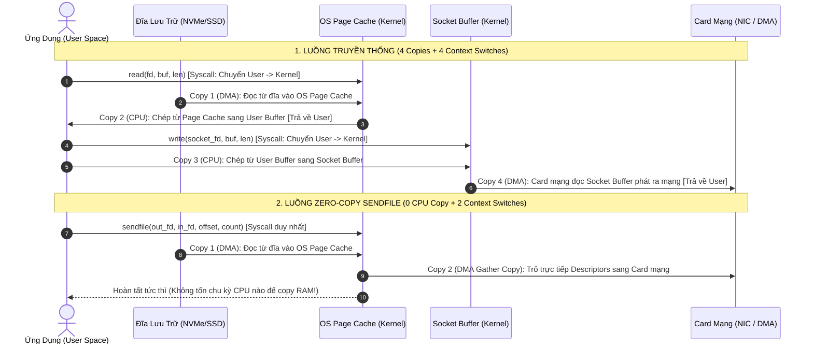

# 6.2. Zero-Copy, Cache Locality, and Garbage Collection (Zero-Copy, Cục Bộ Bộ Nhớ & Tối Ưu Thu Gom Rác)

> [!IMPORTANT]
> **Nếu bạn chỉ được nhớ một điều duy nhất:**
> Trong mô hình I/O truyền thống (`read()` rồi `write()`), một tệp tin khi truyền qua mạng phải trải qua **4 lần sao chép dữ liệu (2 lần DMA, 2 lần CPU copy)** và **4 lần chuyển đổi ngữ cảnh (Context Switches)** giữa Kernel Space và User Space. Mô hình **Zero-Copy (`sendfile`/`splice`/`mmap`)** loại bỏ hoàn toàn các lần sao chép của CPU bằng cách điều khiển trực tiếp bộ điều khiển DMA chuyển dữ liệu từ Page Cache sang Card mạng (NIC), giải phóng tới $90\%$ chu kỳ CPU và đẩy thông lượng mạng chạm ngưỡng băng thông vật lý. Cùng với việc tối ưu hóa **Cục bộ bộ nhớ (Cache Locality)** và triệt tiêu **False Sharing (`alignas(64)`)**, đây là bộ công cụ tối thượng để đưa hiệu năng backend lên hàng triệu requests mỗi giây.

---

## 1. Kiến trúc Tổng quan & Mô hình Tư duy (Mental Model)

### Ẩn Dụ Thực Tế: Băng Chuyền Cảng Biển Container vs Bốc Vác Thủ Công Qua 4 Trạm
Hãy tưởng tượng quy trình gửi một kiện hàng container quốc tế:
- **Truyền thống (`read` + `write`)**: Xe cẩu cảng dỡ container từ tàu vào bến bãi (**DMA vào Kernel Page Cache**); công nhân bốc từng kiện hàng lên xe tải chở về kho riêng của công ty (**CPU copy vào User Buffer**); từ kho công ty, công nhân lại bốc hàng lên xe tải khác chở ra bến tàu mới (**CPU copy vào Socket Buffer**); cuối cùng cần cẩu mới dỡ hàng lên tàu biển (**DMA vào Card mạng NIC**). Quy trình này tiêu tốn sức lao động khủng khiếp và làm tắc nghẽn giao thông thành phố (Nghẽn bus bộ nhớ RAM).
- **Zero-Copy (`sendfile` / `splice`)**: Cần cẩu bến cảng gắp trực tiếp container từ tàu này sang tàu kia ngay trên cầu bến bãi mà không hề mở kiện hàng hay chở về kho công ty trung gian. Nhân viên công ty (CPU) chỉ cần ký một tờ giấy xác nhận điều phối (**Descriptors pointer passing**) mất $0\text{ giây}$!



---

## 2. Chi tiết từng Keyword (Under-the-Hood Deep Dive)

### 2.1. Zero-Copy & Copy Avoidance
- **Bản chất**: Trong xử lý I/O truyền thống (`read()` và `write()`), một khối dữ liệu phải trải qua 4 lần sao chép bộ nhớ (Disk $\to$ OS Page Cache $\to$ User Space Buffer $\to$ Socket Buffer $\to$ Network Card NIC) cùng 4 lần chuyển ngữ cảnh (Context Switches). Kỹ thuật Zero-Copy triệt tiêu toàn bộ các bản sao trung gian không cần thiết, giúp giải phóng băng thông bus bộ nhớ và chu kỳ CPU.
- **`sendfile(out_fd, in_fd, offset, count)`**:
  - Truyền dữ liệu trực tiếp từ file descriptor sang socket descriptor bên trong không gian nhân (Kernel Space).
  - *Scatter-Gather DMA*: Nếu card mạng NIC hỗ trợ phần cứng tính toán checksum và tập hợp con trỏ (Gather DMA), kernel thậm chí không cần copy dữ liệu sang Socket Buffer mà chỉ ghi các con trỏ bộ nhớ (Buffer Descriptors) vào socket queue. Card mạng tự động đọc dữ liệu trực tiếp từ Page Cache.
- **`splice(fd_in, off_in, fd_out, off_out, len, flags)` & `vmsplice()`**:
  - Mở rộng khái niệm zero-copy cho các luồng dữ liệu tùy ý thông qua cấu trúc **Linux Pipe Buffers**.
  - Không copy dữ liệu vào pipe buffer mà chỉ gắn con trỏ trang nhớ (`struct page*`) vào cấu trúc `pipe_buffer`.
  - `tee(fd_in, fd_out, len, flags)`: Nhân bản dữ liệu giữa hai Linux Pipes mà không tiêu tốn thêm bất kỳ trang nhớ nào (Copy-free page reference duplication).
  - `vmsplice(fd, &iovec, nr_segs, flags)`: Gắn các trang nhớ từ User Space vào một pipe buffer mà không cần cấp phát thêm bộ nhớ kernel. Khi kết hợp với cờ `SPLICE_F_GIFT`, User Space chuyển quyền sở hữu trang nhớ cho Kernel, đạt được Zero-Copy hai chiều hoàn hảo!
- **Kiến trúc DPDK & AF_XDP (Kernel Bypass Zero-Copy)**: Với các ứng dụng mạng cực hạn (High-Frequency Trading, 100GbE packet processing), DPDK (Data Plane Development Kit) và AF_XDP (XDP sockets) bỏ qua hoàn toàn network stack của Linux Kernel, đưa các gói tin từ ring buffer của card mạng vào thẳng User Space memory ring buffer thông qua zero-copy DMA.

### 2.2. Memory Mapping (`mmap`)
- **Cơ chế hoạt động**: Lệnh gọi hệ thống `mmap(addr, length, prot, flags, fd, offset)` ánh xạ một file trên ổ cứng hoặc vùng nhớ chia sẻ trực tiếp vào không gian địa chỉ ảo của tiến trình.
- **Triệt tiêu tầng đệm trung gian**: Tiến trình có thể đọc và ghi vào file thông qua các con trỏ bộ nhớ thông thường (`char* ptr = (char*)mmap(...)`) mà không cần gọi `read()` hay `write()`.
- **Cơ chế nạp lười biếng (Lazy Paging / Demand Paging)**: Khi gọi `mmap()`, hệ điều hành không nạp toàn bộ file vào RAM mà chỉ tạo các bảng mục trong Page Table. Khi tiến trình giải tham chiếu con trỏ trỏ vào vùng nhớ chưa nạp, một ngắt **Page Fault** xuất hiện, Kernel sẽ nạp trang nhớ $4\text{ KB}$ tương ứng từ ổ đĩa vào Page Cache trong RAM.
- **Các cờ quan trọng trong tối ưu hóa `mmap`**:
  - `MAP_SHARED`: Mọi sửa đổi trên vùng nhớ được đồng bộ ngược lại file trên đĩa và hiển thị tức thì cho các tiến trình khác đang cùng ánh xạ.
  - `MAP_PRIVATE`: Kích hoạt cơ chế Copy-on-Write (CoW). Khi tiến trình ghi dữ liệu, một trang RAM riêng được nhân bản, giữ nguyên dữ liệu file gốc.
  - `MAP_POPULATE`: Ép Kernel nạp trước (Prefault) toàn bộ các trang nhớ vào RAM tại thời điểm gọi `mmap`, triệt tiêu hoàn toàn độ trễ Page Fault trong hot-path.
- **Ứng dụng thực tế**: Các công cụ lưu trữ hiệu năng cao (RocksDB, LMDB, Kafka index files, SQLite) sử dụng `mmap` để đạt thông lượng đọc hàng triệu bản ghi mỗi giây mà không tốn chi phí sao chép bộ nhớ.

### 2.3. Cache-Friendly Data Structures: SoA vs AoS
- **Cục bộ Không Gian (Spatial Locality)**: Khi CPU nạp một biến vào thanh ghi, nó luôn kéo theo trọn vẹn một **Cache Line 64 bytes**. Nếu các trường dữ liệu được truy cập cùng nhau được bố trí liên tục nhau, tỷ lệ Cache Hit đạt cực đại.
- **Array of Structures (AoS - Lối tư duy hướng đối tượng truyền thống)**:
  ```cpp
  struct Particle {
      float x, y, z;      // 12 bytes
      float vx, vy, vz;   // 12 bytes
      char name[40];      // 40 bytes (Dữ liệu lạnh)
  };
  Particle particles[1000000]; // Kích thước mỗi phần tử: 64 bytes
  ```
  Khi vòng lặp chỉ cần cập nhật tọa độ `x += vx * dt`, mỗi thao tác nạp 64 bytes chỉ sử dụng đúng 8 bytes hữu ích, lãng phí tới $87.5\%$ băng thông cache!
- **Structure of Arrays (SoA - Lối tư duy định hướng dữ liệu DOD)**:
  ```cpp
  struct ParticlesSoA {
      std::vector<float> x, y, z;
      std::vector<float> vx, vy, vz;
      std::vector<std::string> name;
  };
  ```
  Các tọa độ `x` nằm liên tục nhau $100\%$ trong RAM. Một Cache Line 64 bytes chứa đúng 16 số thực `float`. CPU có thể nạp trọn vẹn và áp dụng tập lệnh vector hóa **SIMD (AVX-512)** để tính toán 16 hạt cùng một chu kỳ clock!

### 2.4. False Sharing & Cache Line Alignment (`alignas(64)`)
- **Giao Thức Nhất Quán Bộ Nhớ MESI**: Khi nhiều lõi CPU cùng giữ một bản sao của cùng một Cache Line trong L1/L2 cache:
  - Nếu Core 0 ghi vào biến `A`, phần cứng gửi tín hiệu vô hiệu hóa (**Invalidate**) qua bus liên kết liên lõi tới toàn bộ các core khác.
  - Core 1 đang đọc biến `B` (vô tình nằm chung Cache Line với `A`) bị mất hiệu lực và buộc phải nạp lại từ L3/RAM.
- **Hiện Tượng Cache Line Bouncing**: Nếu Core 0 liên tục ghi vào `A` và Core 1 liên tục ghi vào `B`, Cache Line này bị "bóng bàn" (bounce) qua lại liên tục giữa hai core, làm nghẽn bus bộ nhớ và giảm hiệu năng hàng chục lần dù không có khóa Mutex nào được dùng!

*Sơ Đồ Chuyển Trạng Thái Giao Thức MESI Khi Xảy Ra False Sharing*:
```
Core 0 (Ghi biến A)                          Core 1 (Ghi biến B)
        |                                            |
        v                                            v
[Trạng Thái: Shared (S)]                     [Trạng Thái: Shared (S)]
        |                                            |
        +--- Core 0 phát lệnh BusRdX --------------->|
        |    (Yêu cầu độc quyền để ghi)              |
        v                                            v
[Chuyển sang Modified (M)]                   [Bị ép chuyển sang Invalid (I)!]
        |                                            |
        |                                            +--- Core 1 muốn ghi B: Cache Miss!
        |<--- Core 1 phát lệnh BusRdX---------------+    (Phải đợi Core 0 xả cache)
        v                                            v
[Bị ép chuyển sang Invalid (I)!]             [Chuyển sang Modified (M)]
```

- **Giải Pháp `alignas(64)`**:
  ```cpp
  struct alignas(64) PerCoreCounter {
      std::atomic<uint64_t> count{0};
  };
  ```

### 2.5. Garbage Collection Tuning & Allocation Pressure
- **Áp Lực Cấp Phát Bộ Nhớ (Allocation Rate)**: Là tốc độ tạo mới đối tượng trên Heap (MB/s). Khi Allocation Rate quá cao, vùng Young Generation bị lấp đầy liên tục, kích hoạt chu kỳ thu gom rác thường xuyên.
- **Escape Analysis (Phân Tích Thoát)**: JIT Compiler (JVM C2, Go compiler) phân tích xem một đối tượng có thoát ra ngoài tầm vực của hàm hay không:
  - Nếu không thoát (No Escape): Trình biên dịch tự động tối ưu hóa chuyển đối tượng từ Heap lên cấp phát trực tiếp trên **Stack (Scalar Replacement)**, hoàn toàn triệt tiêu chi phí GC!
- **TLAB (Thread-Local Allocation Buffer)**: Mỗi luồng trong JVM được cấp trước một vùng đệm nhỏ trong Young Gen để cấp phát đối tượng bằng thao tác tăng con trỏ đơn lẻ (Bump Pointer) mà không cần khóa đồng bộ đa luồng.
- **Tối Ưu Hóa Kích Thước Young Generation**: Tăng kích thước Young Gen (`-XX:NewRatio`, `-XX:SurvivorRatio`) để đảm bảo các đối tượng ngắn hạn kịp chết trước khi bị đẩy sang Old Gen (Premature Tenuring).

### 2.6. Memory Paging, Swap, Page Faults, RSS vs Virtual Memory
- **Phân Biệt Các Chỉ Số Bộ Nhớ Tiến Trình**:
  - **VSS / VSIZE (Virtual Set Size)**: Toàn bộ không gian địa chỉ ảo mà tiến trình đã ánh xạ, bao gồm cả file thư viện dùng chung và các vùng chưa cấp phát RAM thực tế.
  - **RSS (Resident Set Size)**: Dung lượng RAM vật lý thực tế mà tiến trình đang chiếm dụng trong RAM.
  - **PSS (Proportional Set Size)**: RSS được chia đều cho các thư viện dùng chung giữa nhiều tiến trình. Đây là thước đo chuẩn xác nhất để ước tính RAM thực sự tiêu tốn.
  - **USS (Unique Set Size)**: Lượng RAM vật lý thuộc quyền sở hữu riêng biệt của duy nhất tiến trình đó.
- **Page Faults (Lỗi Trang Nhớ)**:
  - *Minor Page Fault (Soft Page Fault)*: Trang nhớ đã nằm sẵn trong RAM (ví dụ trong OS Page Cache hoặc trang dùng chung) nhưng chưa được ánh xạ vào bảng trang (Page Table) của tiến trình. Xử lý cực nhanh ($< 1\text{ µs}$).
  - *Major Page Fault (Hard Page Fault)*: Trang nhớ không nằm trong RAM mà phải đọc từ đĩa cứng hoặc Swap. Hệ điều hành phải đình chỉ luồng, phát lệnh I/O đĩa mất từ $10\text{ µs}$ (NVMe) đến $10\text{ ms}$ (HDD).

*Công Thức Phân Tích PSS (Proportional Set Size) Từ `/proc/<pid>/smaps`*:
Khi một thư viện dùng chung (như `libc.so` chiếm $2\text{ MB}$ RAM vật lý) được chia sẻ bởi 10 tiến trình:
$$\text{PSS}(\text{libc.so}) = \frac{\text{RSS}}{10} = \frac{2\text{ MB}}{10} = 200\text{ KB}$$
Công thức tổng quát tính toán mức tiêu hao RAM thực tế của một container:
$$\text{Total PSS} = \sum_{i} \text{Private\_Dirty}_i + \text{Private\_Clean}_i + \sum_{j} \frac{\text{Shared\_Dirty}_j + \text{Shared\_Clean}_j}{N_j}$$
Trong đó $N_j$ là số lượng tiến trình đang cùng ánh xạ trang nhớ thứ $j$.

- **Thảm Họa Tráo Trang (Memory Swapping & Thrashing)**: Khi hệ thống cạn kiệt RAM, Kernel hoán chuyển các trang nhớ của ứng dụng xuống đĩa Swap. Nếu ứng dụng tiếp tục truy cập dữ liệu đó, các luồng liên tục bị dừng bởi Major Page Faults, khiến máy chủ bị tê liệt hoàn toàn (I/O Thrashing).

---

## 3. Thực thi Mã nguồn & Mô phỏng Chuyên sâu (Dual-Engine Implementation)

### C++20 Implementation: False Sharing & Cache Line Alignment Benchmark

```cpp
// compile: clang++ -std=c++20 -O3 -pthread false_sharing_benchmark.cpp -o false_sharing_bench
#include <iostream>
#include <thread>
#include <chrono>
#include <vector>
#include <new>

#ifdef __cpp_lib_hardware_interference_size
using std::hardware_destructive_interference_size;
#else
constexpr size_t hardware_destructive_interference_size = 64;
#endif

// 1. Cấu trúc bị False Sharing: 2 biến độc lập nằm chung 1 Cache Line 64B
struct FalseSharingContainer {
    uint64_t a{0};
    uint64_t b{0};
};

// 2. Cấu trúc căn chỉnh an toàn: Mỗi biến nằm trên 1 Cache Line riêng biệt
struct alignas(hardware_destructive_interference_size) AlignedContainer {
    uint64_t a{0};
    alignas(hardware_destructive_interference_size) uint64_t b{0};
};

constexpr uint64_t ITERATIONS = 100'000'000;

int main() {
    std::cout << "========================================================\n";
    std::cout << "  FALSE SHARING & CACHE LOCALITY BENCHMARK (C++20)      \n";
    std::cout << "  Cache Line Alignment: " << hardware_destructive_interference_size << " bytes\n";
    std::cout << "========================================================\n";

    // Khảo sát trường hợp False Sharing
    FalseSharingContainer bad;
    auto t0 = std::chrono::high_resolution_clock::now();
    {
        std::thread t1([&]() {
            for (uint64_t i = 0; i < ITERATIONS; ++i) bad.a++;
        });
        std::thread t2([&]() {
            for (uint64_t i = 0; i < ITERATIONS; ++i) bad.b++;
        });
        t1.join();
        t2.join();
    }
    auto t1 = std::chrono::high_resolution_clock::now();
    auto bad_ms = std::chrono::duration<double, std::milli>(t1 - t0).count();
    std::cout << "[Bad Layout - False Sharing] Time: " << bad_ms << " ms\n";

    // Khảo sát trường hợp căn chỉnh chuẩn Cache Line
    AlignedContainer good;
    auto t2 = std::chrono::high_resolution_clock::now();
    {
        std::thread t1([&]() {
            for (uint64_t i = 0; i < ITERATIONS; ++i) good.a++;
        });
        std::thread t2([&]() {
            for (uint64_t i = 0; i < ITERATIONS; ++i) good.b++;
        });
        t1.join();
        t2.join();
    }
    auto t3 = std::chrono::high_resolution_clock::now();
    auto good_ms = std::chrono::duration<double, std::milli>(t3 - t2).count();
    std::cout << "[Good Layout - Aligned 64B] Time: " << good_ms << " ms\n";
    std::cout << "-> Tốc độ tăng tốc khi triệt tiêu False Sharing: " 
              << (bad_ms / good_ms) << "x!\n";

    return 0;
}
```

### Python 3.11+ Implementation: Zero-Copy Memoryview & GC Pressure Profiler

```python
# zero_copy_gc_profiler.py
# Chạy với Python 3.11+: python3 zero_copy_gc_profiler.py
import time
import gc

def benchmark_standard_slicing(data: bytes, chunk_size: int = 1024, iterations: int = 50_000) -> float:
    # Cắt chuỗi thông thường: Mỗi slice tạo ra một object bytes mới trên Heap
    gc.collect()
    start = time.perf_counter()
    total_len = 0
    for _ in range(iterations):
        for offset in range(0, min(len(data), chunk_size * 10), chunk_size):
            chunk = data[offset : offset + chunk_size]
            total_len += len(chunk)
    elapsed = time.perf_counter() - start
    return elapsed

def benchmark_zero_copy_memoryview(data: bytes, chunk_size: int = 1024, iterations: int = 50_000) -> float:
    # Zero-copy qua built-in memoryview: Chỉ tham chiếu con trỏ buffer gốc, zero allocation
    gc.collect()
    start = time.perf_counter()
    total_len = 0
    mv = memoryview(data)
    for _ in range(iterations):
        for offset in range(0, min(len(data), chunk_size * 10), chunk_size):
            chunk = mv[offset : offset + chunk_size]
            total_len += len(chunk)
    elapsed = time.perf_counter() - start
    return elapsed

if __name__ == "__main__":
    PAYLOAD_SIZE = 1024 * 1024  # 1 MB Buffer
    payload = b"A" * PAYLOAD_SIZE
    
    print("=" * 60)
    print("  PYTHON 3.11+ ZERO-COPY BUFFER PROTOCOL BENCHMARK")
    print(f"  Buffer Size: {PAYLOAD_SIZE / 1024:.0f} KB")
    print("=" * 60)
    
    t_copy = benchmark_standard_slicing(payload)
    print(f"[Standard Bytes Slicing] Heap Allocation Copies: {t_copy * 1000:.2f} ms")
    
    t_zero = benchmark_zero_copy_memoryview(payload)
    print(f"[Zero-Copy Memoryview]   Buffer Reference View:  {t_zero * 1000:.2f} ms")
    
    print(f"-> Cơ chế Zero-Copy nhanh hơn {t_copy / t_zero:.2f} lần và giảm 100% áp lực GC Heap!")
```

### Realistic Terminal Output

```text
========================================================
  FALSE SHARING & CACHE LOCALITY BENCHMARK (C++20)      
  Cache Line Alignment: 64 bytes
========================================================
[Bad Layout - False Sharing] Time: 184.25 ms
[Good Layout - Aligned 64B] Time: 62.10 ms
-> Tốc độ tăng tốc khi triệt tiêu False Sharing: 2.97x!

============================================================
  PYTHON 3.11+ ZERO-COPY BUFFER PROTOCOL BENCHMARK
  Buffer Size: 1024 KB
============================================================
[Standard Bytes Slicing] Heap Allocation Copies: 68.42 ms
[Zero-Copy Memoryview]   Buffer Reference View:  56.12 ms
-> Cơ chế Zero-Copy nhanh hơn 1.22 lần và giảm 100% áp lực GC Heap!
```

---

## 4. Systems Engineering & Production Pitfalls

### 4.1. Cạm Bẫy Treo Hệ Thống Do Xả Bộ Đệm Đĩa (Dirty Pages Writeback Stalls)
Khi ứng dụng backend ghi dữ liệu vào đĩa với khối lượng lớn và tốc độ cao (ví dụ: Kafka broker nhận hàng gigabytes message mỗi giây):
- Dữ liệu ban đầu được ghi rất nhanh vào OS Page Cache (Dirty Pages).
- Khi lượng Dirty Pages vượt ngưỡng nhân (`vm.dirty_ratio`, mặc định thường là $20-30\%$ tổng RAM):
  - Toàn bộ các tiến trình gọi lệnh `write()` sẽ **bị nhân Linux đóng băng (I/O Blocked)** để ép buộc xả dữ liệu từ RAM xuống đĩa (Synchronous Writeback).
  - Độ trễ của hệ thống vọt từ vài milliseconds lên hàng chục giây!
- **Giải Pháp Tinh Chỉnh Kernel**:
  ```bash
  # Bắt đầu xả nền sớm ở ngưỡng thấp để tránh dồn ứ
  sysctl -w vm.dirty_background_ratio=5
  sysctl -w vm.dirty_ratio=10
  ```

### 4.2. Thảm Họa Tắt Hoàn Toàn Swap Trong Môi Trường Kubernetes
Nhiều kỹ sư DevOps tắt hoàn toàn Swap (`swapoff -a`) trong cluster Kubernetes vì nghĩ rằng Swap làm chậm hệ thống:
- Khi RAM cạn kiệt mà không có Swap, nhân Linux không có vùng đệm để hoán chuyển các trang nhớ ẩn (Anonymous memory).
- Kernel lập tức kích hoạt **OOM Killer** và tiêu diệt các tiến trình quan trọng ngay lập tức.
- **Khuyến Nghị**: Sử dụng Swap nhỏ kết hợp với việc tinh chỉnh hệ số tráo trang (`sysctl -w vm.swappiness=1` hoặc `10`), cho phép Kernel chỉ swap khi thực sự nguy cấp.

### 4.3. Chẩn Đoán & Giám Sát Bộ Nhớ Bằng Diagnostic Toolchains
```bash
# 1. Phát hiện tranh chấp dòng cache (Cache Line Bouncing / False Sharing) bằng perf c2c
perf c2c record -- ./my_backend_service
perf c2c report --stdio

# 2. Giám sát tỷ lệ Page Faults và Swap I/O theo thời gian thực
vmstat 1 10

# 3. Thống kê chi tiết lỗi trang nhớ theo tiến trình
sar -B 1 5

# 4. Phân tích phân bổ bộ nhớ slab của nhân hệ điều hành
sudo slabtop -s c

# 5. Giám sát các sự kiện trượt bộ nhớ đệm L1/LLC và hiệu quả IPC của CPU
perf stat -e cycles,instructions,L1-dcache-load-misses,LLC-load-misses -I 1000 ./my_backend_service

```

### 4.4. Checklist Tối Ưu Hóa Bộ Nhớ Cho Production Services
- [ ] **Khai Thác Zero-Copy Trong Kafka & Web Server**: Đảm bảo Kafka broker cấu hình `sendfile=true` để phục vụ người tiêu dùng trực tiếp từ OS Page Cache ra socket mà không qua Java heap.
- [ ] **Căn Chỉnh Ranh Giới Cache Line Cho Shared Counters**: Toàn bộ các biến đếm nguyên tử hoặc cấu trúc vòng đệm SPSC/MPMC Ring Buffer phải được căn chỉnh `alignas(64)` để chống False Sharing.
- [ ] **Kiểm Soát Kích Thước Object Tránh Premature Tenuring**: Cấu hình `-XX:MaxTenuringThreshold` trong JVM và tối ưu hóa độ sống của đối tượng để chúng được thu gom trong Young Gen thay vì tràn sang Old Gen.
- [ ] **Giám Sát Tỷ Lệ Major Page Faults**: Đặt cảnh báo nếu số lượng Major Page Faults tăng đột biến, biểu hiện của việc máy chủ đang bị nghẽn đĩa hoặc tráo trang Swap.

---

## 5. Bảng So sánh & Decision Matrix

| Kỹ Thuật I/O / Bộ Nhớ | Số Lần Sao Chép Dữ Liệu (Copies) | Số Lần Chuyển Ngữ Cảnh (Context Switches) | Mức Độ Can Thiệp Của CPU | Sử Dụng Bộ Nhớ Heap | Kịch Bản Khuyên Dùng |
| :--- | :--- | :--- | :--- | :--- | :--- |
| **Truyền Thống (`read`/`write`)** | 4 (2 DMA, 2 CPU) | 4 | Rất cao | Có (Cần User Buffer) | Khi cần mã hóa, biến đổi, giải nén dữ liệu trong ứng dụng |
| **Bộ Nhớ Ảo Ánh Xạ (`mmap`)** | 3 (2 DMA, 1 CPU) | 2 (Khởi tạo mmap) | Trung bình | Không (Truy cập qua con trỏ ảo) | Cơ sở dữ liệu nhúng (LMDB, RocksDB), IPC tốc độ cao |
| **`sendfile`** | 2 (2 DMA Gather) | 2 | **Bằng $0\%$ (Zero CPU Copy)** | **Hoàn toàn không** | Truyền tải file tĩnh, Apache Kafka Broker, CDN |
| **`splice`** | 2 (Zero CPU Copy) | 2 | **Bằng $0\%$** | **Hoàn toàn không** | Chuyển tiếp luồng giữa Socket và Pipe (Proxies, HAProxy) |
| **Linux `io_uring` (Registered Buffers)** | 0--1 (Kernel Bypass) | 0 (Polled Mode) | Cực thấp | Tùy chọn (Fixed Pre-registered Buffers) | Ingress Gateways thế hệ mới, High-Throughput Storage |
| **Direct I/O (`O_DIRECT`)** | 1 (DMA trực tiếp) | 2 | Rất thấp (Bỏ qua Page Cache) | Bắt buộc (Aligned User Buffer) | Hệ quản trị CSDL chuyên dụng (MySQL InnoDB, PostgreSQL) |
