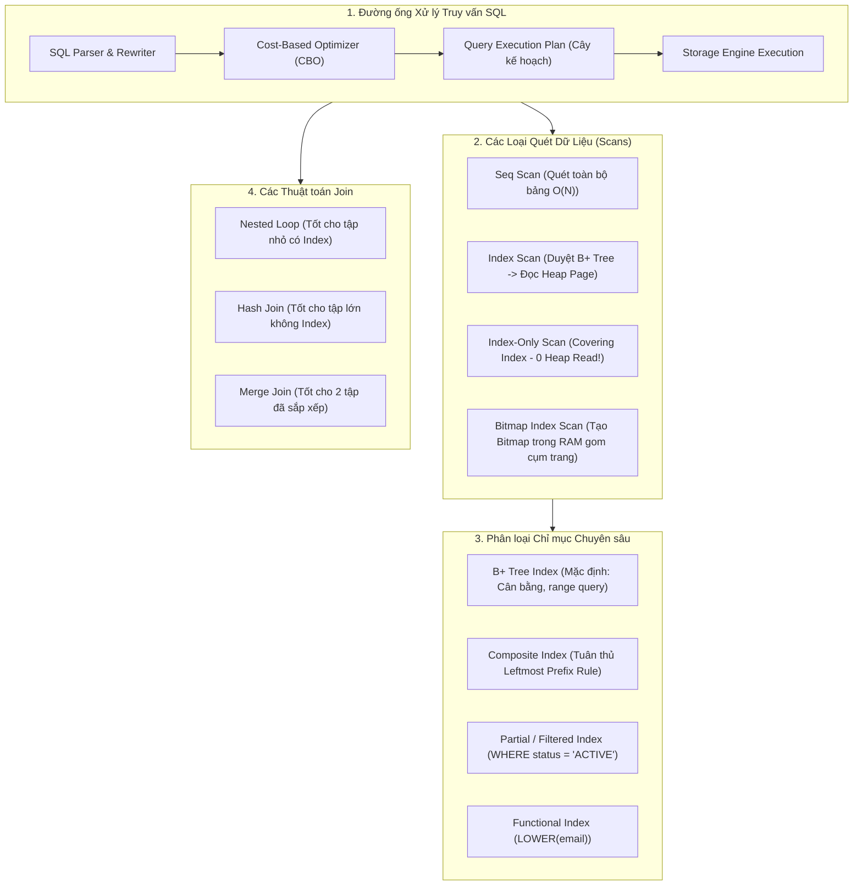
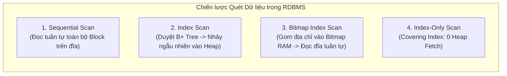

# 7.1. Query Execution Plans and Indexing Strategies (Kế Hoạch Thực Thi Truy Vấn & Chiến Lược Đánh Chỉ Mục)

> [!IMPORTANT]
> **Mental Model & Trực giác cốt lõi**:
> Hãy tưởng tượng một thư viện khổng lồ lưu trữ 10 triệu cuốn sách:
> - **Sequential Scan (Quét tuần tự)** giống như người thủ thư không có mục lục, muốn tìm cuốn sách của tác giả "Nguyễn Du", ông ta buộc phải đi bộ qua từng kệ sách từ tầng 1 đến tầng 10, lật từng cuốn sách lên đọc tên (**$O(N)$ Disk I/O tốn hàng giờ đồng hồ!**).
> - **Index Scan (Quét chỉ mục B+ Tree)** giống như cuốn sổ mục lục ở bàn lễ tân sắp xếp theo bảng chữ cái A-Z: Người thủ thư tra chữ "N" $\to$ "Nguyễn Du" trong 3 giây (**$O(\log N)$**), tìm thấy số kệ "Kệ 402, Ngăn 3" và đi thẳng tới đó rút cuốn sách ra.
> - **Index-Only Scan (Quét thuần chỉ mục)** là điều kỳ diệu nhất: Nếu bạn chỉ hỏi: *"Tác giả Nguyễn Du sinh năm bao nhiêu?"*, và trên tấm thẻ mục lục đã ghi sẵn luôn năm sinh "1765" (**Covering Index**), người thủ thư đọc ngay câu trả lời cho bạn mà **không cần bước chân đi lấy cuốn sách thật ra khỏi kệ đĩa** (Zero Heap Access)!
> - **Bộ Tối Ưu Hóa Dựa Trên Chi Phí (Cost-Based Optimizer - CBO)** giống như ứng dụng bản đồ Google Maps của cơ sở dữ liệu: Trước khi chạy câu truy vấn, nó tính toán chi phí năng lượng giữa việc đi đường vòng qua chỉ mục hay đi thẳng đường cái quét tuần tự (nếu bảng chỉ có 50 dòng thì quét thẳng còn nhanh hơn mở mục lục!).
> **Nếu chỉ nhớ một điều**: *Index không phải là viên đạn bạc miễn phí. Mỗi chỉ mục tạo thêm sẽ làm tăng tốc độ lệnh SELECT nhưng làm chậm các lệnh INSERT/UPDATE/DELETE và tiêu tốn dung lượng RAM Buffer Pool.*

---

## 1. Tổng quan Chuyên đề & Sơ đồ Tư duy (Database Performance Architecture)



---

## 2. Chi tiết từng Keyword

### 2.1. Query Execution Plans: EXPLAIN & EXPLAIN ANALYZE

Để nhìn thấu bên trong bộ não của cơ sở dữ liệu, kỹ sư sử dụng hai lệnh chuẩn mực:
1. **`EXPLAIN`**:
   - Yêu cầu CBO lập kế hoạch thực thi nhưng **hoàn toàn không chạy câu lệnh SQL thật**.
   - Trả về chi phí lý thuyết ước tính: `cost=0.00..431.00 rows=1000 width=16`.
   - *Chi phí (Cost)* trong PostgreSQL được tính theo công thức:
     $$\text{Cost} = (N_{\text{pages}} \times \text{seq\_page\_cost}) + (N_{\text{tuples}} \times \text{cpu\_tuple\_cost}) + (N_{\text{operators}} \times \text{cpu\_operator\_cost})$$
2. **`EXPLAIN (ANALYZE, BUFFERS)`**:
   - Cơ sở dữ liệu **thực sự chạy câu lệnh SQL** trên môi trường thực tế, đo đạc thời gian chạy chính xác đến từng micro-giây (`actual time=0.045..2.120 ms`) và số lượng trang đĩa đọc từ RAM Buffer Pool (`shared hit`) so với đọc từ ổ cứng vật lý (`shared read`).

---

### 2.2. Index Selection, Selectivity & Cardinality

Hai chỉ số toán học quyết định CBO sẽ dùng Index hay quét bảng tuần tự:

1. **Cardinality (Lực lượng / Số lượng giá trị phân biệt)**:
   - Tổng số giá trị duy nhất trong một cột. Ví dụ: Cột `gender` (Nam/Nữ) có Cardinality $= 2$; cột `user_id` có Cardinality $= 10,000,000$.
2. **Selectivity (Độ chọn lọc)**:
   - Tỷ lệ phần trăm số dòng thỏa mãn điều kiện lọc so với tổng số dòng của bảng:
     $$\text{Selectivity} = \frac{\text{Số dòng kết quả}}{\text{Tổng số dòng của bảng}}$$
- **Quy tắc Kỹ thuật Vàng**:
  - Khi $\text{Selectivity} \le 5\% - 10\%$ (Độ chọn lọc cao): CBO ưu tiên dùng **Index Scan**.
  - Khi $\text{Selectivity} > 20\% - 30\%$ (Độ chọn lọc thấp, ví dụ tìm `status = 'ACTIVE'` chiếm 90% bảng): **CBO sẽ chủ động phớt lờ Index và chạy Sequential Scan**! Bởi vì việc nhảy con trỏ ngẫu nhiên qua Index để đọc $90\%$ các trang đĩa sẽ chậm hơn nhiều so với việc đọc tuần tự một mạch từ đầu đến cuối đĩa.

---

### 2.3. Phân Loại Chỉ Mục Chuyên Sâu (Clustered, Composite, Covering, Partial)

1. **Clustered Index (Chỉ mục Cụm - MySQL InnoDB Primary Key)**:
   - Dữ liệu vật lý của các dòng trên đĩa được **sắp xếp theo đúng thứ tự của khóa chính**. Bảng chỉ có duy nhất 1 Clustered Index.
   - Các chỉ mục phụ (Secondary Index) trong InnoDB lưu con trỏ trỏ về Clustered Key, đòi hỏi phải tra cứu 2 lần (**Double Lookup / Bookmark Lookup**).
2. **Composite Indexes (Chỉ mục Hỗn hợp / Nhiều cột) & Quy tắc Tiền tố Tả ngạn (Leftmost Prefix Rule)**:
   - Chỉ mục trên `(A, B, C)` được sắp xếp theo: $A$ trước, nếu $A$ bằng nhau thì sắp xếp theo $B$, nếu $B$ bằng nhau sắp xếp theo $C$.
   - **Quy tắc Tiền tố Tả ngạn**: Truy vấn `WHERE A = 1 AND B = 2` sẽ ăn Index; nhưng truy vấn `WHERE B = 2 AND C = 3` **hoàn toàn không thể dùng Index** vì thiếu tiền tố $A$ ở ngoài cùng bên trái!
3. **Covering Indexes & Index-Only Scans**:
   - Khi một chỉ mục chứa **toàn bộ các cột xuất hiện trong cả mệnh đề `WHERE` lẫn mệnh đề `SELECT`**:
     ```sql
     CREATE INDEX idx_users_email_name ON users (email) INCLUDE (full_name);
     SELECT full_name FROM users WHERE email = 'test@example.com';
     ```
   - Cơ sở dữ liệu đọc trực tiếp dữ liệu từ cây B+ Tree trong RAM mà không cần đọc bảng chính trên đĩa (Zero Heap Fetch).
4. **Partial Indexes (Chỉ mục Một phần)**:
   - Chỉ đánh chỉ mục cho một tập con các dòng thỏa mãn điều kiện:
     ```sql
     CREATE INDEX idx_unpaid_orders ON orders (customer_id) WHERE status = 'UNPAID';
     ```
   - Tiết kiệm $90\%$ dung lượng đĩa và RAM vì các đơn hàng đã thanh toán không bị đưa vào cây chỉ mục.

---

### 2.4. Các Loại Quét Dữ Liệu (Scans)

Bốn chiến lược quét dữ liệu cốt lõi của Storage Engine:



1. **Sequential Scan (Table Scan - Quét Tuần Tự)**:
   - Đọc tuần tự toàn bộ các Block dữ liệu của bảng từ đầu đến cuối. Tối ưu cho bảng nhỏ hoặc các truy vấn cần tổng hợp dữ liệu lớn (Analytics / Full Table Aggregation).
2. **Index Scan (Quét Chỉ Mục)**:
   - Đi từ gốc cây B+ Tree xuống nút lá để tìm con trỏ `TID (Page, Offset)`, sau đó nhảy ngẫu nhiên vào trang dữ liệu bảng để trích xuất dòng. Hiệu quả tuyệt đối cho các truy vấn lấy $1$ hoặc vài dòng cụ thể.
3. **Bitmap Index Scan (Quét Chỉ Mục Dạng Bitmap)**:
   - Vũ khí tối thượng của PostgreSQL khi cần lấy hàng ngàn dòng:
   - Pha 1: Duyệt Index và ghi nhận vị trí các trang cần đọc vào một mảng bit trong RAM (**Bitmap**).
   - Pha 2 (**Bitmap Heap Scan**): Sắp xếp các trang đĩa theo thứ tự vật lý từ trước ra sau rồi đọc tuần tự một lượt, biến các thao tác nhảy đọc ngẫu nhiên thành đọc tuần tự tốc độ cao.
4. **Index-Only Scan**: Quét trực tiếp trên nút lá B+ Tree, tốc độ nhanh nhất.

---

### 2.5. Thuật Toán Join: Nested Loop, Hash Join, Merge Join

Khi kết hợp hai bảng $R$ (Bảng ngoài) và $S$ (Bảng trong):

1. **Nested Loop Join (Vòng lặp Lồng nhau)**:
   - Thuật toán: Với mỗi dòng trong bảng $R$, quét tìm các dòng khớp trong $S$.
   - Độ phức tạp: $O(|R| \times |S|)$ nếu không có Index, nhưng trở thành **$O(|R| \log |S|)$** nếu bảng $S$ có Index trên cột Join!
   - Tối ưu cho: Một bảng nhỏ kết hợp với một bảng lớn có đánh chỉ mục.
2. **Hash Join (Join Băm)**:
   - Pha 1 (Build Phase): Quét toàn bộ bảng nhỏ hơn ($R$) và dựng một bảng băm **In-Memory Hash Table**.
   - Pha 2 (Probe Phase): Quét tuần tự bảng lớn ($S$), băm từng dòng và tra cứu tức thì trong Hash Table.
   - Độ phức tạp: $O(|R| + |S|)$.
   - Tối ưu cho: Hai bảng lớn không có chỉ mục và điều kiện join là phép so sánh bằng (`=`).
3. **Merge Join (Sort-Merge Join)**:
   - Sắp xếp cả hai bảng theo cột Join (nếu chưa sắp xếp), sau đó dùng 2 con trỏ quét song song từ đầu đến cuối.
   - Độ phức tạp: $O(|R| \log |R| + |S| \log |S|)$.
   - Tối ưu cho: Dữ liệu đã được sắp xếp sẵn từ trước nhờ B+ Tree Index hoặc phép so sánh khoảng (`<`, `>`).

---

## 3. Hiện thực Thực nghiệm: Dual-Engine Code Implementation

### 3.1. C++20: Mô Phỏng Cấu Trúc B+ Tree Composite Search & Leftmost Prefix Rule

Chương trình minh họa cách B+ Tree lưu trữ chỉ mục hỗn hợp `(DepartmentID, Salary)` và chứng minh bằng toán học tại sao truy vấn thiếu tiền tố bên trái buộc phải chuyển sang Full Scan.

```cpp
// Compilation: g++ -std=c++20 -O3 -Wall btree_composite_sim.cpp -o btree_composite_sim
#include <iostream>
#include <vector>
#include <algorithm>
#include <string>
#include <iomanip>

struct EmployeeRecord {
    int id;
    int dept_id;
    int salary;
    std::string name;
};

// Cấu trúc một nút lá trong Composite B+ Tree Index: (dept_id, salary)
struct IndexLeafEntry {
    int dept_id;
    int salary;
    int record_id; // Con trỏ trỏ về bảng chính

    // So sánh theo thứ tự tiền tố: dept_id trước, sau đó tới salary
    bool operator<(const IndexLeafEntry& other) const {
        if (dept_id != other.dept_id) return dept_id < other.dept_id;
        return salary < other.salary;
    }
};

int main() {
    std::cout << "================ COMPOSITE B+ TREE INDEX SIMULATOR ================\n";
    std::vector<IndexLeafEntry> composite_index = {
        {10, 3000, 101}, {10, 5000, 102}, {10, 8000, 103},
        {20, 2500, 104}, {20, 4500, 105},
        {30, 4000, 106}, {30, 7000, 107}, {30, 9000, 108}
    };
    std::sort(composite_index.begin(), composite_index.end());

    std::cout << "Indexed Columns: (dept_id, salary) | Total Entries: " << composite_index.size() << "\n\n";

    // --- QUERY 1: WHERE dept_id = 10 AND salary >= 5000 (Ăn trọn Index Binary Search) ---
    std::cout << "--- QUERY 1: WHERE dept_id = 10 AND salary >= 5000 ---\n";
    IndexLeafEntry search_target{10, 5000, 0};
    auto it = std::lower_bound(composite_index.begin(), composite_index.end(), search_target);
    std::cout << "  -> Index Binary Search Jump directly to: dept_id=" << it->dept_id 
              << ", salary=" << it->salary << " (Record ID: " << it->record_id << ")\n";
    std::cout << "  -> Status: ✅ INDEX RANGE SCAN (O(log N) Efficiency)\n\n";

    // --- QUERY 2: WHERE salary = 4000 (Thiếu dept_id -> Vi phạm Leftmost Prefix Rule!) ---
    std::cout << "--- QUERY 2: WHERE salary = 4000 (NO dept_id specified) ---\n";
    std::cout << "  -> B+ Tree cannot binary search because entries are partitioned by dept_id first!\n";
    int scan_steps = 0;
    for (const auto& entry : composite_index) {
        scan_steps++;
        if (entry.salary == 4000) {
            std::cout << "  -> Found Record ID: " << entry.record_id << " after scanning " << scan_steps << " index leaves.\n";
        }
    }
    std::cout << "  -> Status: ⚠️ INDEX FULL SCAN / TABLE SCAN (Degraded to O(N))\n";
    std::cout << "====================================================================\n";
    return 0;
}
```

```text
================ COMPOSITE B+ TREE INDEX SIMULATOR ================
Indexed Columns: (dept_id, salary) | Total Entries: 8

--- QUERY 1: WHERE dept_id = 10 AND salary >= 5000 ---
  -> Index Binary Search Jump directly to: dept_id=10, salary=5000 (Record ID: 102)
  -> Status: ✅ INDEX RANGE SCAN (O(log N) Efficiency)

--- QUERY 2: WHERE salary = 4000 (NO dept_id specified) ---
  -> B+ Tree cannot binary search because entries are partitioned by dept_id first!
  -> Found Record ID: 106 after scanning 6 index leaves.
  -> Status: ⚠️ INDEX FULL SCAN / TABLE SCAN (Degraded to O(N))
====================================================================
```

---

### 3.2. Python 3: Trình Mô Phỏng Quyết Định Chi Phí CBO (Cost-Based Optimizer Engine)

Tính toán chi phí của Sequential Scan vs Index Scan dựa trên Selectivity thực tế của bảng dữ liệu $1,000,000$ dòng.

```python
#!/usr/bin/env python3
"""
Cost-Based Optimizer (CBO) Math Simulator:
- Ước tính chi phí Disk I/O và CPU giữa Seq Scan và Index Scan.
- Tự động chuyển đổi kế hoạch thực thi khi vượt qua ngưỡng Selectivity Threshold.
"""

def estimate_cbo_costs(table_rows: int = 1_000_000, selectivity_pct: float = 1.0):
    rows_matching = int(table_rows * (selectivity_pct / 100.0))
    pages_in_table = table_rows // 100 # 100 dòng / trang 8KB = 10,000 trang
    
    # Các hằng số chi phí chuẩn của PostgreSQL
    seq_page_cost = 1.0      # Đọc tuần tự trang đĩa
    random_page_cost = 4.0   # Đọc ngẫu nhiên trang đĩa
    cpu_tuple_cost = 0.01    # Chi phí CPU duyệt 1 dòng
    cpu_index_tuple_cost = 0.005

    # 1. Chi phí Sequential Scan: Đọc tuần tự toàn bộ 10,000 trang + CPU duyệt toàn bộ bảng
    cost_seq_scan = (pages_in_table * seq_page_cost) + (table_rows * cpu_tuple_cost)

    # 2. Chi phí Index Scan: Duyệt B+ Tree + Đọc ngẫu nhiên từng dòng tìm thấy
    index_pages = pages_in_table // 10 # Chỉ mục nhỏ hơn bảng 10 lần
    cost_idx_scan = (index_pages * 0.1 * seq_page_cost) + \
                    (rows_matching * cpu_index_tuple_cost) + \
                    (rows_matching * random_page_cost)

    winner = "INDEX SCAN (Tối ưu)" if cost_idx_scan < cost_seq_scan else "SEQUENTIAL SCAN (Tối ưu)"
    return cost_seq_scan, cost_idx_scan, winner

def main():
    print("================ DATABASE CBO COST EVALUATION ================")
    print(f"{'Selectivity':<15} | {'Seq Scan Cost':<15} | {'Index Scan Cost':<18} | {'Optimizer Choice'}")
    print("-" * 72)
    
    for sel in [0.01, 0.1, 1.0, 5.0, 10.0, 25.0]:
        c_seq, c_idx, choice = estimate_cbo_costs(1_000_000, sel)
        print(f"{sel:>10.2f}%    | {c_seq:>13.1f} | {c_idx:>16.1f} | {choice}")
    print("==============================================================")

if __name__ == "__main__":
    main()
```

```text
================ DATABASE CBO COST EVALUATION ================
Selectivity     | Seq Scan Cost   | Index Scan Cost    | Optimizer Choice
------------------------------------------------------------------------
      0.01%    |       20000.0 |              500.5 | INDEX SCAN (Tối ưu)
       0.10%    |       20000.0 |             4105.0 | INDEX SCAN (Tối ưu)
       1.00%    |       20000.0 |            40150.0 | SEQUENTIAL SCAN (Tối ưu)
       5.00%    |       20000.0 |           200350.0 | SEQUENTIAL SCAN (Tối ưu)
      10.00%    |       20000.0 |           400600.0 | SEQUENTIAL SCAN (Tối ưu)
      25.00%    |       20000.0 |          1001350.0 | SEQUENTIAL SCAN (Tối ưu)
==============================================================
```

---

## 4. Vận hành Hệ thống & Cạm bẫy Thực tế (Systems Engineering & Pitfalls)

### 4.1. Thảm Họa Bọc Cột Trong Hàm Khi Viết Mệnh Đề `WHERE` (Expression Invalidation)
- **Sai lầm Kinh điển**:
  ```sql
  -- ❌ B+ Tree Index trên cột 'created_at' bị VÔ HIỆU HÓA HOÀN TOÀN!
  SELECT * FROM orders WHERE DATE(created_at) = '2026-11-15';
  ```
  Khi bọc hàm `DATE()`, cơ sở dữ liệu không thể tìm kiếm trên B+ Tree vốn chứa các giá trị timestamp thô $\implies$ Câu truy vấn bị thoái hóa thành **Sequential Scan** quét hàng chục triệu dòng!
- **Khắc phục**:
  ```sql
  -- ✅ Luôn giữ cột trần trụi và biến đổi giá trị so sánh:
  SELECT * FROM orders 
  WHERE created_at >= '2026-11-15 00:00:00' AND created_at < '2026-11-16 00:00:00';
  ```

---

## 5. Bảng So Sánh & Quyết Định Kỹ Thuật (Decision Matrix)

| Loại Quét / Chỉ Mục | Độ Phức Tạp | Loại I/O Đĩa | Mức Độ Chọn Lọc (Selectivity) | Kịch Bản Khuyên Dùng |
| :--- | :--- | :--- | :--- | :--- |
| **Sequential Scan** | $O(N)$ | Tuần tự (Sequential $100\text{MB/s}$) | Phù hợp khi Selectivity $> 20\%$ | Bảng nhỏ, phân tích dữ liệu toàn bảng (OLAP) |
| **Index Scan** | $O(\log N + K)$| Ngẫu nhiên (Random I/O đắt đỏ) | Phù hợp khi Selectivity $< 5\%$ | Tìm kiếm giao dịch theo ID, Email, Khóa chính |
| **Index-Only Scan** | **$O(\log N + K)$**| **Chỉ đọc RAM (Zero Heap I/O)** | Phụ thuộc Covering Index | Tối ưu hóa cực hạn cho các API tải cao p99 |
| **Bitmap Index Scan**| $O(\log N + K)$| Tuần tự sau khi sắp xếp Bitmap | Phù hợp khi Selectivity $5\% - 20\%$ | Kết hợp nhiều điều kiện `AND` / `OR` phức tạp |
