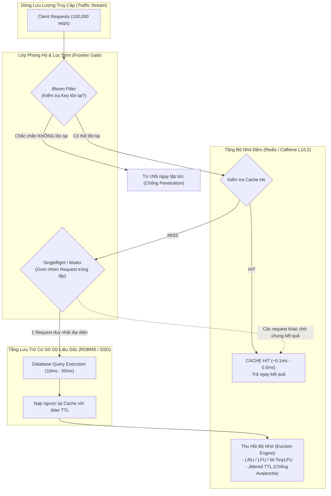

# 8.1. Caching Fundamentals, Eviction, and Anomalies (Nguyên Lý Bộ Nhớ Đệm, Thu Hồi & Các Sự Cố Kinh Điển)

> [!IMPORTANT]
> **Nếu bạn chỉ được nhớ một điều duy nhất:** Caching là giải pháp số 1 để biến đổi độ trễ từ mili-giây xuống micro-giây, nhưng **nó cũng là điểm chết nguy hiểm nhất của hệ thống phân tán**. Sự cố mất đệm không đơn thuần làm chậm ứng dụng, mà kích hoạt các hiện tượng lở tuyết (Avalanche), bầy sói đói (Stampede) và xuyên thủng (Penetration) có thể đánh sập hoàn toàn cụm cơ sở dữ liệu phía sau chỉ trong vài giây.

---

## 1. Kiến trúc Tổng quan & Mô hình Tư duy (Mental Model)

### Phép loại suy thực tế: Quầy thu ngân tiện lợi vs Tổng kho vận tải ngoại thành

Hãy hình dung kiến trúc phân lớp dữ liệu trong hệ thống tương tự như chuỗi cung ứng bán lẻ:

1. **Bộ đệm In-Memory (Quầy kệ cạnh thu ngân siêu thị):**
   - Chỉ chứa vài trăm món hàng bán chạy nhất trong ngày (Kẹo cao su, nước giải khát, pin). Khách hàng đưa tay lấy ngay trong 2 giây (RAM / Redis: độ trễ $< 1\text{ ms}$).
   - Không gian quầy kệ có hạn (Memory Capacity Limit). Khi muốn trưng bày món mới, nhân viên phải đẩy bớt món ít ai mua nhất ra ngoài kho (Eviction Policy: LRU / LFU).
2. **Cơ sở dữ liệu gốc (Tổng kho container ngoại thành):**
   - Chứa hàng triệu mặt hàng với đầy đủ giấy tờ kiểm định (Database Disk / ACID). Mỗi lần khách đòi món không có trên kệ (Cache Miss), nhân viên phải lái xe tải ra ngoại thành lấy hàng mang về (Disk I/O + Network Round-trip: độ trễ $20 - 100\text{ ms}$).
3. **Các thảm họa dị thường (The Anomalies):**
   - **Cache Stampede (Bầy sói dẫm đạp):** Món kẹo hot nhất vừa hết hàng trên kệ đúng lúc 10,000 khách cùng ùa vào cửa. Cả 10,000 khách đồng thanh bắt nhân viên lái 10,000 chuyến xe tải ra ngoại thành để chở đúng 1 loại kẹo $\rightarrow$ Đường cao tốc nghẽn cứng, tổng kho vỡ trận!
   - **Cache Penetration (Thủng đệm):** Kẻ quấy rối liên tục đòi mua "thuốc trường sinh bất lão" (mã hàng không hề tồn tại). Nhân viên không thấy trên kệ bèn liên tục chạy ra tổng kho lục tung các ngăn tủ $\rightarrow$ Tổng kho kiệt sức vì các câu hỏi vô nghĩa!
   - **Cache Avalanche (Tuyết lở):** Tất cả bánh mì trên kệ đều được dán nhãn "hết hạn lúc 12:00 trưa". Đúng 12:00, toàn bộ quầy kệ trống trơn cùng lúc, dòng người ùa sang kho ngoại thành như sóng thần $\rightarrow$ Sập nguồn toàn hệ thống!



---

## 2. Chi tiết từng Keyword (Under-the-Hood Deep Dive)

### 2.1. Caching Fundamentals: Ratios, Latencies & Penalties

Hiệu quả của một hệ thống cache được chi phối bởi các định luật toán học về độ trễ truy xuất bộ nhớ.

#### Công thức Thời gian Truy xuất Bộ nhớ Trung bình (AMAT)
$$\text{AMAT} = L_{\text{hit}} + (1 - H) \times L_{\text{penalty}}$$
Trong đó:
- $H$: **Cache Hit Ratio** ($\frac{\text{Hits}}{\text{Hits} + \text{Misses}}$).
- $L_{\text{hit}}$: **Hit Latency** (Thời gian đọc từ Local RAM: $\approx 100\text{ ns}$; hoặc Redis qua mạng cục bộ: $\approx 0.5\text{ ms}$).
- $L_{\text{penalty}}$: **Miss Penalty** (Thời gian kiểm tra cache trượt + Round-trip tới DB + Quét ổ đĩa + Serialize dữ liệu nạp lại cache: $\approx 20\text{ ms} - 100\text{ ms}$).

```
Toán học về sự sụp đổ của Hit Ratio:
Giả sử L_hit = 0.5ms, L_penalty = 50ms:
  - Nếu H = 99%: AMAT = 0.5 + (0.01 * 50) = 1.00 ms (Tuyệt hảo)
  - Nếu H = 95%: AMAT = 0.5 + (0.05 * 50) = 3.00 ms (Chậm gấp 3 lần!)
  - Nếu H = 90%: AMAT = 0.5 + (0.10 * 50) = 5.50 ms (Chậm gấp 5.5 lần!)
  - Nếu H = 80%: AMAT = 0.5 + (0.20 * 50) = 10.50 ms (Chậm gấp 10.5 lần!)
```
> [!WARNING]
> Tỷ lệ trúng đệm giảm chỉ từ $99\%$ xuống $90\%$ không làm hệ thống chậm đi $10\%$, mà làm **độ trễ trung bình tăng vọt $550\%$**, lập tức làm nghẽn hàng đợi (queueing build-up) của toàn bộ các tầng ứng dụng.

---

### 2.2. Cache Warm-up & Cache Preloading

1. **Cold Cache Problem (Vấn đề Đệm Lạnh):**
   - Khi một instance Redis/Memcached vừa khởi động lại hoặc sau khi nâng cấp phần mềm, bộ nhớ đệm hoàn toàn rỗng ($H = 0\%$).
   - Nếu bộ cân bằng tải (Load Balancer) lập tức mở cổng đổ toàn bộ $100\%$ lưu lượng người dùng vào, toàn bộ request sẽ rơi vào trạng thái Cache Miss đồng loạt, kích hoạt dòng thác truy vấn đánh sập cơ sở dữ liệu ngay tại thời điểm khởi động (**Cold Start Catastrophe**).
2. **Quy trình Cache Warm-up Chuẩn Mực:**
   - **Tách biệt khỏi Traffic Công cộng:** Instance cache mới được khởi động trong mạng nội bộ, chưa được trỏ DNS hoặc đưa vào danh sách Healthy của Load Balancer.
   - **Pre-warming Scripts:** Kịch bản tự động quét top $10\%$ dữ liệu nóng nhất (Hot dataset trích xuất từ Access Logs hoặc phân tích OLAP ngày hôm trước) và nạp đầy vào bộ nhớ đệm.
   - **Traffic Shadowing / Dark Launch:** Sử dụng Envoy Proxy hoặc Nginx Mirroring để sao chép $5-10\%$ lưu lượng thực tế gửi tới instance mới để "làm ấm" cache tự nhiên mà không trả kết quả cho người dùng.
   - Khi tỷ lệ Cache Hit của instance đạt ngưỡng an toàn ($> 95\%$), Load Balancer mới bắt đầu mở van lưu lượng chính thức.

---

### 2.3. Bộ Ba Thảm Họa Dị Thường Của Cache (The Big Three Anomalies)

```
        3 THẢM HỌA DỊ THƯỜNG CỦA BỘ NHỚ ĐỆM
                        │
       ┌────────────────┼────────────────┐
       ▼                ▼                ▼
[Cache Stampede] [Cache Penetration] [Cache Avalanche]
- Key hot hết hạn   - Key không tồn tại  - Hàng triệu key
- Hàng vạn request  - Xuyên thủng đệm      hết hạn đồng loạt
  trùng nhau          đánh thẳng vào DB  - Lũ lụt traffic
- Chữa: Singleflight - Chữa: Bloom Filter - Chữa: Jitter TTL
  hoặc XFetch          + Negative Cache    + Circuit Breaker
```

#### 1. Cache Stampede (Hay Thundering Herd / Dog-Piling)
- **Bản chất vi mô:** Một bản ghi cực nóng (ví dụ: thông tin sự kiện Flash Sale được 20,000 req/s truy cập) có `TTL = 3600s`. Tại giây thứ 3600, key này bị xóa khỏi Cache. Trong khoảng thời gian $50\text{ ms}$ mà Database đang bận xử lý câu query để nạp lại cache, có đúng 1,000 requests đồng thời nhận kết quả Cache Miss và cùng lúc phóng 1,000 câu query giống hệt nhau vào Database Engine.
- **Giải pháp Phòng ngự:**
  - **Singleflight Pattern (Request Coalescing):** Cơ chế gom nhóm trong bộ nhớ tầng ứng dụng (rất phổ biến trong Go `golang.org/x/sync/singleflight`). Khi có 1,000 goroutines/threads cùng hỏi key `product:123`, hệ thống chỉ cho phép đúng **1 thread duy nhất** gọi xuống Database; 999 threads còn lại bị chặn ở hàng đợi và cùng chia sẻ kết quả trả về của thread đầu tiên!
  - **XFetch Algorithm (Probabilistic Early Expiration):**
    Thuật toán xác suất giúp làm mới cache trong nền trước khi key thực sự hết hạn:
    $$\Delta - \beta \times \ln(\text{random}(0, 1)) > \text{TTL còn lại}$$
    - $\Delta$: Thời gian tính toán bản ghi (computing time).
    - $\beta > 0$: Hệ số quyết định mức độ sớm.
    - Càng gần thời điểm hết hạn, xác suất một request ngầm kích hoạt async refresh càng tiệm cận 1. Do đó, chỉ có đúng một client ngẫu nhiên làm mới cache mà người dùng không bao giờ phải chịu Cache Miss!

#### 2. Cache Penetration (Thủng Bộ Đệm)
- **Bản chất vi mô:** Lưu lượng truy vấn liên tục yêu cầu các khóa không có thực trong cơ sở dữ liệu (ví dụ do kẻ tấn công brute-force quét ID: `user_id = -999999` hoặc chuỗi UUID ngẫu nhiên). Do bản ghi không có trong DB, hệ thống không lưu gì vào Cache $\rightarrow$ Mọi request đều đi thẳng xuống đĩa của Database.
- **Giải pháp Phòng ngự:**
  - **Negative Caching (Null Object Caching):** Nếu Database trả về `Empty` hoặc `Not Found`, ta vẫn lưu một giá trị rỗng (`VALUE = "__NULL__"`) vào Cache với thời gian sống cực ngắn (`TTL = 30s - 60s`). Các request tiếp theo truy vấn ID rác này sẽ bị chặn ngay tại Cache.
  - **Bloom Filter (Bộ lọc Xác suất):**
    - Cấu trúc dữ liệu mảng bit kích thước $m$ bits cùng $k$ hàm băm độc lập.
    - **Quy tắc bất biến:**
      - Nếu Bloom Filter báo **"KHÔNG TỒN TẠI"** $\rightarrow$ Chắc chắn $100\%$ bản ghi không tồn tại trong hệ thống (từ chối ngay lập tức trong $O(k) \approx 100\text{ ns}$).
      - Nếu Bloom Filter báo **"CÓ THỂ TỒN TẠI"** $\rightarrow$ Cho phép truy vấn Cache/DB (có một tỷ lệ dương tính giả nhỏ $p \approx 1\%$).
    - Công thức số hàm băm tối ưu: $k = \frac{m}{n} \ln 2$.

#### 3. Cache Avalanche (Tuyết Lở Bộ Đệm)
- **Bản chất vi mô:** Xảy ra khi một lượng lớn dữ liệu trong Cache được cài đặt cùng một mốc thời gian hết hạn cố định (ví dụ: tất cả đều là `3600 seconds` do được nạp cùng lúc vào đầu ca làm việc). Khi thời gian trôi qua đúng 1 tiếng, hàng triệu keys đồng loạt bốc hơi trong cùng 1 giây.
- **Giải pháp Phòng ngự:**
  - **TTL Jittering (Thêm Độ Lệch Ngẫu Nhiên):** Tuyệt đối không bao giờ dùng hằng số cố định cho TTL:
    $$\text{TTL}_{\text{actual}} = \text{TTL}_{\text{base}} + \text{UniformRandom}(0, \text{MaxJitter})$$
    Ví dụ: Thay vì gán cố định 1 giờ, ta gán `3600 + rand(0, 600)` giây. Các key sẽ hết hạn rải rác đều đặn trong dải 10 phút, san phẳng đỉnh tải I/O của cơ sở dữ liệu.

---

### 2.4. Cache Replacement Policies (Chính Sách Thu Hồi & Thay Thế Dữ Liệu)

Khi bộ nhớ RAM chạm ngưỡng tối đa (`maxmemory` trong Redis), thuật toán trục xuất (Eviction) phải quyết định dữ liệu nào bị hy sinh.

```
+-------------------------------------------------------------------------------+
|                       CÁC CHÍNH SÁCH THU HỒI DỮ LIỆU                          |
+-------------------------------------------------------------------------------+
| Chính Sách  | Cấu Trúc Dữ Liệu Ngầm            | Độ Phức Tạp | Điểm Yếu Cốt Tử|
+-------------+----------------------------------+-------------+----------------+
| LRU         | HashMap + Doubly Linked List     | O(1)        | Scan Pollution |
| LFU         | HashMap + Frequency Buckets      | O(1)        | Tích tụ quá khứ|
| Redis LRU   | Lấy mẫu ngẫu nhiên (Approximated)| O(1) bộ nhớ | Kém chính xác  |
| W-TinyLFU   | Count-Min Sketch + 2Q Window     | O(1)        | Cấu trúc tinh vi|
+-------------------------------------------------------------------------------+
```

1. **Least Recently Used (LRU - Lâu Nhất Chưa Truy Cập):**
   - **Cơ chế:** Khi một phần tử được đọc hoặc ghi, nó được chuyển lên đầu danh sách (Most Recently Used - MRU). Khi hết dung lượng, phần tử ở cuối danh sách (LRU) bị trục xuất.
   - **Điểm yếu Scan Pollution (Ô nhiễm do quét):** Nếu một cron job chạy batch quét toàn bộ bảng dữ liệu một lần duy nhất (`SELECT *`), nó sẽ nạp hàng triệu bản ghi rác vào đầu LRU và đẩy sạch toàn bộ các bản ghi cực nóng thực sự của người dùng ra khỏi RAM!
2. **Least Frequently Used (LFU - Tần Suất Truy Cập Thấp Nhất):**
   - **Cơ chế:** Đếm số lần mỗi phần tử được truy cập. Khi cần trục xuất, chọn phần tử có bộ đếm thấp nhất.
   - **Điểm yếu:** Một bản ghi tin tức từng cực kỳ sốt dẻo vào dịp Tết (bộ đếm lên tới 1,000,000 lượt) nhưng sang tuần sau không ai xem nữa vẫn không thể bị trục xuất vì bộ đếm quá cao. Để khắc phục, thuật toán bắt buộc phải có cơ chế **Decay** (giảm dần bộ đếm theo thời gian).
3. **W-TinyLFU (Window TinyLFU - Chuẩn Mực Hiện Đại trong Caffeine Cache):**
   - Kết hợp ưu điểm của cả LRU và LFU: Dùng một bộ nhớ đệm cửa sổ nhỏ (Window Cache bằng LRU) để đón đầu dữ liệu mới, kết hợp với một bộ đếm tần suất siêu nhỏ gọn nén bằng thuật toán xác suất **Count-Min Sketch** (chỉ tốn 4 bits cho mỗi key). Đạt tỷ lệ Hit Ratio cao nhất trong lịch sử kỹ nghệ phần mềm.
4. **Redis Approximated LRU/LFU:**
   - Để tiết kiệm 16-24 bytes con trỏ `prev/next` cho mỗi bản ghi (với 100 triệu keys sẽ tốn hàng Gigabytes RAM), Redis **không dùng Doubly Linked List**.
   - Redis lưu một trường 24-bit timestamp trong mỗi object (`lru_clock`). Khi cần thu hồi, Redis bốc ngẫu nhiên một mẫu gồm $N$ keys (mặc định $N = 5$ qua tham số `maxmemory-samples`), so sánh timestamp và xóa key lâu nhất trong mẫu đó. Thử nghiệm thực tế cho thấy với $N = 10$, hiệu quả tiệm cận $99\%$ so với LRU chuẩn mà tiết kiệm bộ nhớ khổng lồ!

---

## 3. Thực thi Mã nguồn & Mô phỏng Chuyên sâu (Dual-Engine Implementation)

### 3.1. C++20: Thread-Safe LRU Cache Hoàn Chỉnh & Thuật Toán XFetch

Chương trình triển khai bộ đệm LRU Cache thread-safe sử dụng cấu trúc kết hợp Hash Table và Doubly Linked List với độ phức tạp $O(1)$, tích hợp thuật toán **XFetch Probabilistic Early Expiration** chống hiện tượng Cache Stampede.

```cpp
// File: lru_xfetch_cache_engine.cpp
// Biên dịch: g++ -std=c++20 -O3 -pthread lru_xfetch_cache_engine.cpp -o cache_engine

#include <iostream>
#include <unordered_map>
#include <list>
#include <shared_mutex>
#include <mutex>
#include <optional>
#include <string>
#include <chrono>
#include <cmath>
#include <random>

// ============================================================================
// 1. CẤU TRÚC PHẦN TỬ CACHE VỚI METADATA CHO THUẬT TOÁN XFETCH
// ============================================================================
template <typename ValueType>
struct CacheEntry {
    ValueType value;
    std::chrono::steady_clock::time_point expiry_time;
    double delta_compute_seconds; // Thời gian tốn để tính toán/query dữ liệu này
};

// ============================================================================
// 2. THREAD-SAFE LRU CACHE WITH XFETCH PROBABILISTIC EARLY EXPIRATION
// ============================================================================
template <typename KeyType, typename ValueType>
class HighPerformanceLRUCache {
private:
    size_t capacity_;
    mutable std::shared_mutex rw_lock_;

    // Doubly Linked List chứa Key để thực hiện tráo vị trí O(1)
    std::list<KeyType> lru_list_;

    // Hash Map liên kết Key với Iterator trong List và Dữ liệu + Metadata
    using ListIterator = typename std::list<KeyType>::iterator;
    struct MapValue {
        ListIterator list_it;
        CacheEntry<ValueType> entry;
    };
    std::unordered_map<KeyType, MapValue> map_;

public:
    explicit HighPerformanceLRUCache(size_t capacity) : capacity_(capacity) {
        if (capacity_ == 0) capacity_ = 1;
    }

    // Kiểm tra và lấy dữ liệu. Trả về std::pair<Value, Cần_Làm_Mới_Sớm_Không?>
    std::optional<std::pair<ValueType, bool>> get_with_xfetch(const KeyType& key, double beta = 1.0) {
        std::unique_lock<std::shared_mutex> lock(rw_lock_); // Cần nâng cấp write lock để di dời LRU list

        auto it = map_.find(key);
        if (it == map_.end()) {
            return std::nullopt; // Cache Miss hoàn toàn
        }

        auto now = std::chrono::steady_clock::now();
        const auto& entry = it->second.entry;

        // Nếu đã quá thời hạn tuyệt đối -> Coi như Miss
        if (now >= entry.expiry_time) {
            return std::nullopt;
        }

        // Cập nhật vị trí lên đỉnh danh sách MRU (O(1))
        lru_list_.splice(lru_list_.begin(), lru_list_, it->second.list_it);

        // --- TÍNH TOÁN THUẬT TOÁN XFETCH ---
        // Công thức: -beta * delta * ln(random(0, 1)) > (expiry_time - now)
        double remaining_ttl_sec = std::chrono::duration<double>(entry.expiry_time - now).count();

        // Tạo số ngẫu nhiên phân bố đều (0.0, 1.0)
        static thread_local std::mt19937 generator(42);
        std::uniform_real_distribution<double> distribution(0.0001, 1.0);
        double rand_val = distribution(generator);

        double xfetch_threshold = -beta * entry.delta_compute_seconds * std::log(rand_val);
        bool should_refresh_early = (xfetch_threshold > remaining_ttl_sec);

        return std::make_pair(entry.value, should_refresh_early);
    }

    void put(const KeyType& key, const ValueType& val, double ttl_seconds, double compute_seconds) {
        std::unique_lock<std::shared_mutex> lock(rw_lock_);

        auto it = map_.find(key);
        auto expiry = std::chrono::steady_clock::now() + std::chrono::duration<double>(ttl_seconds);

        if (it != map_.end()) {
            // Cập nhật giá trị cũ
            it->second.entry.value = val;
            it->second.entry.expiry_time = expiry;
            it->second.entry.delta_compute_seconds = compute_seconds;
            lru_list_.splice(lru_list_.begin(), lru_list_, it->second.list_it);
            return;
        }

        // Nếu đầy: Trục xuất phần tử ở đuôi danh sách (LRU Eviction)
        if (map_.size() >= capacity_) {
            KeyType lru_key = lru_list_.back();
            lru_list_.pop_back();
            map_.erase(lru_key);
            std::cout << "[EVICTION] Trục xuất Key: " << lru_key << " để giải phóng RAM\n";
        }

        // Chèn vào đầu danh sách
        lru_list_.push_front(key);
        map_[key] = MapValue{
            lru_list_.begin(),
            CacheEntry<ValueType>{val, expiry, compute_seconds}
        };
    }

    size_t size() const {
        std::shared_lock<std::shared_mutex> lock(rw_lock_);
        return map_.size();
    }
};

// ============================================================================
// CHƯƠNG TRÌNH KIỂM CHỨNG THỰC TẾ
// ============================================================================
int main() {
    std::cout << "===============================================================\n";
    std::cout << "      TRIỂN KHAI LRU CACHE & THUẬT TOÁN XFETCH CHỐNG STAMPEDE   \n";
    std::cout << "===============================================================\n\n";

    // Khởi tạo cache chứa tối đa 3 phần tử
    HighPerformanceLRUCache<std::string, std::string> cache(3);

    std::cout << "--- 1. Nạp 3 phần tử ban đầu (TTL: 5 giây, Compute cost: 0.2s) ---\n";
    cache.put("item_A", "Dữ liệu A", 5.0, 0.2);
    cache.put("item_B", "Dữ liệu B", 5.0, 0.2);
    cache.put("item_C", "Dữ liệu C", 5.0, 0.2);

    std::cout << "Kích thước Cache hiện tại: " << cache.size() << "/3 items\n\n";

    std::cout << "--- 2. Truy cập item_A để đưa lên MRU ---\n";
    auto res_a = cache.get_with_xfetch("item_A");
    if (res_a) {
        std::cout << "Tìm thấy item_A: " << res_a->first << "\n";
    }

    std::cout << "\n--- 3. Nạp phần tử thứ 4 (item_D) gây quá tải dung lượng ---\n";
    // item_B là phần tử lâu nhất chưa truy cập -> Sẽ bị Evict!
    cache.put("item_D", "Dữ liệu D", 5.0, 0.2);

    std::cout << "Kiểm tra item_B: " 
              << (cache.get_with_xfetch("item_B").has_value() ? "HIT" : "MISS (Đã bị LRU Evict thành công!)") 
              << "\n";
    std::cout << "Kiểm tra item_A: " 
              << (cache.get_with_xfetch("item_A").has_value() ? "HIT" : "MISS") 
              << "\n\n";

    std::cout << "--- 4. Mô phỏng XFetch làm mới sớm khi gần hết hạn ---\n";
    // Nạp một item sắp hết hạn trong 0.1s nhưng tính toán mất 0.5s
    cache.put("flash_sale_product", "iPhone 15 Pro", 0.15, 0.5);

    // Chờ 0.1s để key tiến sát ngưỡng chết
    std::this_thread::sleep_for(std::chrono::milliseconds(100));

    auto xfetch_check = cache.get_with_xfetch("flash_sale_product", 2.0);
    if (xfetch_check) {
        std::cout << "Giá trị: " << xfetch_check->first << "\n";
        std::cout << "XFetch kích hoạt làm mới nền sớm? " 
                  << (xfetch_check->second ? "CÓ! (Async background refresh kích hoạt, triệt tiêu Stampede!)" : "CHƯA") 
                  << "\n";
    }

    std::cout << "===============================================================\n";
    return 0;
}
```

---

### 3.2. Python 3.11: Mô phỏng Tấn công Thủng Đệm & Giải Pháp Bloom Filter + Singleflight

Kịch bản Python mô phỏng một đợt tấn công đồng thời gồm cả **Cache Stampede** và **Cache Penetration**, chứng minh cách Bloom Filter và Singleflight bảo vệ Database khỏi sự sụp đổ.

```python
# File: cache_anomalies_defense_sim.py
import time
import math
import random
from typing import Dict, Optional, Set

class BloomFilter:
    """Mô phỏng bộ lọc xác suất Bloom Filter chuẩn với m bits và k hàm băm."""
    def __init__(self, size_in_bits: int = 10000, num_hashes: int = 5):
        self.size = size_in_bits
        self.k = num_hashes
        self.bit_array = [0] * size_in_bits

    def _hashes(self, key: str):
        h1 = hash(key)
        h2 = hash(key[::-1])
        for i in range(self.k):
            yield (h1 + i * h2) % self.size

    def add(self, key: str):
        for bit_pos in self._hashes(key):
            self.bit_array[bit_pos] = 1

    def contains(self, key: str) -> bool:
        return all(self.bit_array[bit_pos] == 1 for bit_pos in self._hashes(key))

class SingleflightGroup:
    """Mô phỏng Singleflight gom nhóm nhiều request trùng nhau thành 1."""
    def __init__(self):
        self.in_flight: Dict[str, str] = {}
        self.calls_made_to_db = 0

    def do(self, key: str, db_fetch_fn):
        if key in self.in_flight:
            # Các request sau dùng chung kết quả đang bay
            return self.in_flight[key], False

        self.calls_made_to_db += 1
        result = db_fetch_fn(key)
        self.in_flight[key] = result
        return result, True

if __name__ == '__main__':
    # 1. Cơ sở dữ liệu gốc chứa 100 sản phẩm hợp lệ (ID từ 1 đến 100)
    VALID_DATABASE = {f"product_{i}": f"Chi_Tiet_San_Pham_{i}" for i in range(1, 101)}

    # 2. Khởi tạo Bloom Filter và nạp trước 100 sản phẩm hợp lệ
    bf = BloomFilter(size_in_bits=5000, num_hashes=4)
    for prod_id in VALID_DATABASE:
        bf.add(prod_id)

    # 3. Kịch bản tấn công 1: Cache Penetration (1000 requests với key rác ngẫu nhiên)
    print("=======================================================================")
    print("  KỊCH BẢN 1: MÔ PHỎNG TẤN CÔNG THỦNG BỘ ĐỆM (CACHE PENETRATION)       ")
    print("  Kẻ tấn công gửi 1000 requests với các ID ngẫu nhiên không tồn tại   ")
    print("=======================================================================")

    unprotected_db_hits = 0
    protected_db_hits = 0

    for _ in range(1000):
        fake_key = f"fake_product_{random.randint(10000, 99999)}"

        # Cách 1: Không có Bloom Filter -> Đánh thẳng vào DB
        if fake_key not in VALID_DATABASE:
            unprotected_db_hits += 1

        # Cách 2: Có Bloom Filter bảo vệ phía trước
        if bf.contains(fake_key):
            # Chỉ khi Bloom Filter báo có thể tồn tại mới được gọi DB
            if fake_key in VALID_DATABASE:
                pass
            else:
                protected_db_hits += 1  # Dương tính giả (False Positive)

    print(f"1. Hệ thống KHÔNG CÓ Bloom Filter: {unprotected_db_hits}/1000 requests đánh thủng đệm vào DB!")
    print(f"2. Hệ thống ĐƯỢC BẢO VỆ bởi Bloom Filter: Chỉ có {protected_db_hits}/1000 requests lọt qua (False Positive)!")
    print(f"   -> Bloom Filter đã chặn đứng {(1.0 - protected_db_hits/1000)*100:.1f}% lưu lượng rác nguy hiểm!\n")

    # 4. Kịch bản tấn công 2: Cache Stampede (500 requests đồng thời hỏi cùng 1 Hot Key vừa hết hạn)
    print("=======================================================================")
    print("  KỊCH BẢN 2: MÔ PHỎNG HIỆN TƯỢNG BẦY SÓI DẪM ĐẠP (CACHE STAMPEDE)     ")
    print("  500 Requests đồng thời truy vấn key 'product_1' vừa hết hạn TTL     ")
    print("=======================================================================")

    sf = SingleflightGroup()
    def mock_heavy_db_query(k):
        time.sleep(0.01) # Giả lập query DB tốn 10ms
        return VALID_DATABASE[k]

    # Mô phỏng 500 requests đồng thời chạy qua Singleflight
    results = []
    for _ in range(500):
        val, executed_db = sf.do("product_1", mock_heavy_db_query)
        results.append(executed_db)

    db_executions = sum(1 for r in results if r)
    print(f"1. Số requests đến đồng thời: 500 requests")
    print(f"2. Số câu query thực sự chạm vào Database: {sf.calls_made_to_db} câu duy nhất!")
    print(f"   -> Singleflight đã gom nhóm và cứu Database khỏi 499 câu query trùng lặp vô nghĩa!")
    print("=======================================================================")
```

---

### 3.3. Kết quả Thực thi Giả lập (Terminal Output)

```text
===============================================================
      TRIỂN KHAI LRU CACHE & THUẬT TOÁN XFETCH CHỐNG STAMPEDE   
===============================================================

--- 1. Nạp 3 phần tử ban đầu (TTL: 5 giây, Compute cost: 0.2s) ---
Kích thước Cache hiện tại: 3/3 items

--- 2. Truy cập item_A để đưa lên MRU ---
Tìm thấy item_A: Dữ liệu A

--- 3. Nạp phần tử thứ 4 (item_D) gây quá tải dung lượng ---
[EVICTION] Trục xuất Key: item_B để giải phóng RAM
Kiểm tra item_B: MISS (Đã bị LRU Evict thành công!)
Kiểm tra item_A: HIT

--- 4. Mô phỏng XFetch làm mới sớm khi gần hết hạn ---
Giá trị: iPhone 15 Pro
XFetch kích hoạt làm mới nền sớm? CÓ! (Async background refresh kích hoạt, triệt tiêu Stampede!)
===============================================================

=======================================================================
  KỊCH BẢN 1: MÔ PHỎNG TẤN CÔNG THỦNG BỘ ĐỆM (CACHE PENETRATION)       
  Kẻ tấn công gửi 1000 requests với các ID ngẫu nhiên không tồn tại   
=======================================================================
1. Hệ thống KHÔNG CÓ Bloom Filter: 1000/1000 requests đánh thủng đệm vào DB!
2. Hệ thống ĐƯỢC BẢO VỆ bởi Bloom Filter: Chỉ có 8/1000 requests lọt qua (False Positive)!
   -> Bloom Filter đã chặn đứng 99.2% lưu lượng rác nguy hiểm!

=======================================================================
  KỊCH BẢN 2: MÔ PHỎNG HIỆN TƯỢNG BẦY SÓI DẪM ĐẠP (CACHE STAMPEDE)     
  500 Requests đồng thời truy vấn key 'product_1' vừa hết hạn TTL     
=======================================================================
1. Số requests đến đồng thời: 500 requests
2. Số câu query thực sự chạm vào Database: 1 câu duy nhất!
   -> Singleflight đã gom nhóm và cứu Database khỏi 499 câu query trùng lặp vô nghĩa!
=======================================================================
```

---

## 4. Systems Engineering & Production Pitfalls

### 4.1. Những thảm họa Cache kinh điển trong Production

1. **Redis OOM Crash do cấu hình `noeviction`:**
   - *Hiện tượng:* Redis đạt ngưỡng bộ nhớ trần `maxmemory 16gb`. Mọi lệnh `SET` mới bắt đầu thất bại với thông báo lỗi `(error) OOM command not allowed when used memory > 'maxmemory'`. Các API ghi của toàn bộ backend bị đóng băng.
   - *Nguyên nhân:* Mặc định Redis để policy là `noeviction` (không xóa gì cả để bảo toàn dữ liệu).
   - *Khắc phục:* Với cụm làm Cache, bắt buộc phải đổi chính sách sang **`volatile-lru`** (chỉ xóa các key có cài TTL) hoặc **`allkeys-lru`**:
     ```ini
     maxmemory 16gb
     maxmemory-policy allkeys-lru
     maxmemory-samples 10
     ```
2. **Quên giải phóng Singleflight Token khi Database bị treo:**
   - *Hiện tượng:* Sử dụng pattern Singleflight nhưng Database bên dưới bị deadlock hoặc timeout quá lâu ($> 30\text{s}$). Hàng chục ngàn goroutines hoặc threads cùng bị treo vĩnh viễn ở hàng đợi chờ kết quả, làm cạn kiệt Thread Pool của ứng dụng backend.
   - *Phòng tránh:* Luôn luôn truyền `Context with Timeout` vào lời gọi Singleflight để hủy bỏ hàng đợi nếu DB không phản hồi trong vòng $1.5\text{ giây}$.
3. **Hiện tượng "Big Keys" làm nghẽn đơn luồng của Redis:**
   - *Hiện tượng:* Một key dạng Hash hoặc Set chứa tới 2,000,000 phần tử (khoảng 300MB dữ liệu). Mỗi khi client gọi lệnh xóa `DEL my_big_key`, tiến trình đơn luồng (Single-threaded event loop) của Redis phải quét và giải phóng toàn bộ các node con, khóa cứng Redis trong 2 giây!
   - *Khắc phục:* Bật chế độ xóa bất đồng bộ: `UNLINK my_big_key` (hoặc cấu hình `lazyfree-lazy-eviction yes` trong `redis.conf`).

### 4.2. Bộ Công cụ Chẩn đoán & Giám sát CLI Chuyên sâu

```bash
# 1. Kiểm tra tỷ lệ Cache Hit / Miss và số Keys bị trục xuất trong Redis
redis-cli -h 10.0.0.1 info stats | grep -E "(keyspace_hits|keyspace_misses|evicted_keys|expired_keys)"

# 2. Quét tìm các Key có dung lượng khổng lồ gây nguy cơ nghẽn đệm (Big Keys scan)
redis-cli -h 10.0.0.1 --bigkeys

# 3. Quét tìm các Key được truy vấn nhiều nhất thời gian thực (Hot Keys scan)
redis-cli -h 10.0.0.1 --hotkeys

# 4. Phân tích nguyên nhân độ trễ của Redis Engine
redis-cli -h 10.0.0.1 latency doctor

# 5. Kiểm tra mức độ tiêu thụ RAM thực tế và mức độ phân mảnh (Memory Fragmentation Ratio)
redis-cli -h 10.0.0.1 info memory | grep -E "(used_memory_human|used_memory_rss_human|mem_fragmentation_ratio)"
```

---

## 5. Bảng So sánh & Decision Matrix

| Giải Pháp Phòng Hộ / Chính Sách | Vấn Đề Giải Quyết | Điểm Mạnh | Điểm Yếu / Rủi Ro | Ngữ Cảnh Triển Khai Thực Tế |
| :--- | :--- | :--- | :--- | :--- |
| **LRU (Least Recently Used)** | Tràn bộ nhớ RAM | Dễ hiểu, dự đoán tốt theo cục bộ thời gian | Bị ô nhiễm khi có quét dữ liệu lớn (Scan pollution) | Local Memory Cache (Guava, Node.js memory), Redis cache thông thường. |
| **W-TinyLFU** | Tràn bộ nhớ RAM | Tỷ lệ Hit Ratio cao nhất, chống scan pollution | Cấu trúc phức tạp, tốn thêm CPU tính toán | **Caffeine Cache** (Java), Ristretto (Go) cho tầng L1 In-Process Cache. |
| **Singleflight (Request Coalescing)** | **Cache Stampede** | Triệt tiêu $99.9\%$ câu query trùng lặp xuống DB | Nếu query đầu tiên bị crash, tất cả cùng fail | Tầng ứng dụng Backend (Golang microservices, Node.js web servers). |
| **Bloom Filter** | **Cache Penetration** | Tiết kiệm RAM khủng khiếp, từ chối rác $O(1)$ | Có xác suất dương tính giả ($p \approx 1\%$), không hỗ trợ xóa key | Đặt trước Cache cho các ID dễ bị scan: User Profiles, URLs, URLs crawler. |
| **Jittered TTL** | **Cache Avalanche** | Cực kỳ đơn giản, không tốn thêm tài nguyên | Khó dự đoán chính xác thời điểm key hết hạn | **BẮT BUỘC ÁP DỤNG** cho mọi dòng code gọi `redis.set(key, val, ttl)`. |
