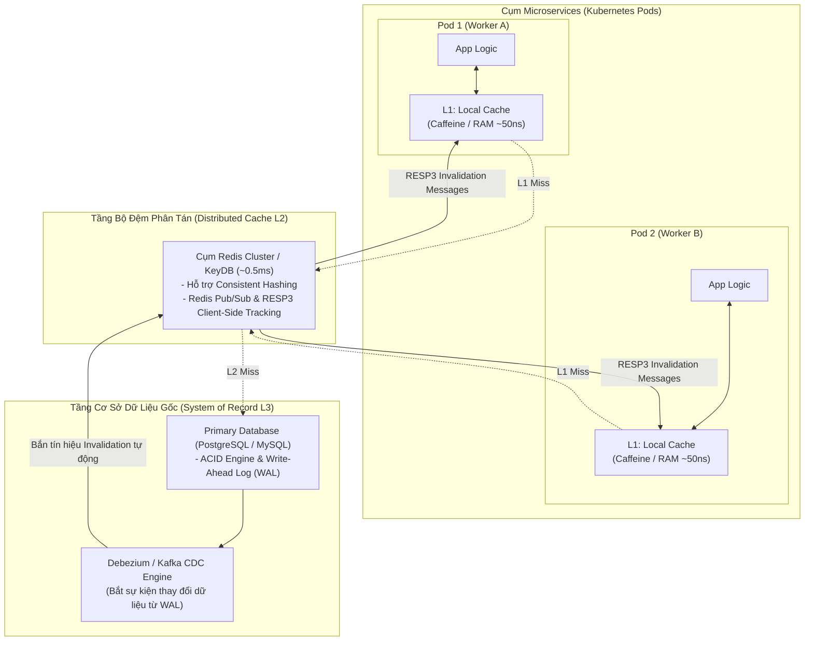

# 8.2. Caching Patterns, Distributed Caches, and Consistency (Các Mô Hình Cache, Đệm Phân Tán & Tính Nhất Quán)

> [!IMPORTANT]
> **Nếu bạn chỉ được nhớ một điều duy nhất:** Trong kiến trúc bộ đệm phân tán, **quy tắc vàng của tính nhất quán là "Luôn luôn XÓA (Invalidate) sau khi ghi Database, tuyệt đối KHÔNG cập nhật đè (Update)"**. Đồng thời, việc kết hợp bộ đệm cục bộ L1 (Local RAM) và đệm phân tán L2 (Redis) là con đường duy nhất để đạt độ trễ sub-microsecond cho các Hot Keys quy mô hàng triệu RPS.

---

## 1. Kiến trúc Tổng quan & Mô hình Tư duy (Mental Model)

### Phép loại suy thực tế: Sổ tay cá nhân vs Tủ hồ sơ phòng ban vs Kho lưu trữ trung tâm

Hãy hình dung kiến trúc phân tầng bộ nhớ đệm trong một hệ thống phân tán tương tự như quy trình làm việc của một chuyên gia tài chính:

1. **Local Cache L1 (Sổ tay ghi chép trên bàn làm việc):**
   - Chứa thông tin của vài khách hàng VIP thường xuyên gọi điện (In-Process Heap Cache: Caffeine, Go Ristretto).
   - Tốc độ tra cứu là tức thời ($< 100\text{ ns}$), chỉ cần liếc mắt nhìn. Không cần bước chân ra khỏi bàn, không tốn bất kỳ chi phí mạng hay dây cáp nào.
   - Nhược điểm: Sổ tay chỉ một mình bạn thấy; nếu một đồng nghiệp ở tầng trên cập nhật số dư của khách hàng đó vào hệ thống, cuốn sổ tay của bạn sẽ trở thành "dữ liệu cũ rác rưởi" (Stale Data) trừ khi có ai đó gọi điện báo cho bạn gạch bỏ dòng đó đi (Invalidation Protocol).
2. **Distributed Cache L2 (Tủ hồ sơ chung ở sảnh phòng ban):**
   - Chứa dữ liệu của toàn bộ chi nhánh (Cụm phân tán Redis Cluster / Memcached).
   - Tốc độ tra cứu mất khoảng vài giây đi bộ ra sảnh (Network Round-Trip: $0.5 - 2\text{ ms}$). Toàn bộ 500 nhân viên trong công ty đều nhìn thấy cùng một phiên bản hồ sơ tại đây.
3. **Primary Database L3 (Kho lưu trữ quốc gia ngầm dưới lòng đất):**
   - Nơi lưu trữ bản gốc có chữ ký công chứng và con dấu pháp lý (PostgreSQL / MySQL ACID Storage).
   - Mỗi lần xuống kho phải làm thủ tục cấp phép, kiểm tra chìa khóa và vận chuyển bằng thang máy (Disk I/O + Transaction Locks: $10 - 50\text{ ms}$).



---

## 2. Chi tiết từng Keyword (Under-the-Hood Deep Dive)

### 2.1. Các Mô Hình Thiết Kế Cache (Caching Patterns)

Việc luân chuyển dữ liệu giữa Ứng dụng, Bộ đệm và Cơ sở dữ liệu tuân theo 5 mẫu hình kiến trúc cơ bản:

```
               CÁC MÔ HÌNH THIẾT KẾ BỘ ĐỆM (CACHING PATTERNS)
                                      │
       ┌──────────────────────────────┼──────────────────────────────┐
       ▼                              ▼                              ▼
  [Cache-Aside]             [Read/Write-Through]             [Write-Back]
- Ứng dụng tự quản lý      - Cache đứng làm proxy trung gian - Ghi vào Cache trước,
- Đọc: Cache -> Miss -> DB - Ứng dụng chỉ nói chuyện với    flush xuống DB ngầm
- Ghi: DB -> Xóa Cache       Cache duy nhất                  - Thông lượng ghi cực cao
```

1. **Cache-Aside (Mô hình Nạp Lười - Lazy Loading):**
   - **Quy trình Đọc:** Ứng dụng kiểm tra Cache $\rightarrow$ Nếu Hit, trả về ngay. Nếu Miss, ứng dụng truy vấn Database $\rightarrow$ Ghi kết quả vào Cache với TTL $\rightarrow$ Trả về kết quả.
   - **Quy trình Ghi:** Ứng dụng cập nhật Database $\rightarrow$ **Xóa Key tương ứng trong Cache (Evict/Invalidate)**.
   - **Ưu điểm:** Khả năng phục hồi cao; nếu Redis sập, ứng dụng vẫn hoạt động bình thường bằng cách fallback đọc trực tiếp từ Database.
2. **Read-Through Cache:**
   - Ứng dụng chỉ gửi truy vấn tới Cache Layer. Nếu Cache Miss, chính hệ thống Cache (như NGINX Microcaching hoặc AWS DAX) sẽ ngầm gọi adapter xuống DB để nạp dữ liệu vào RAM rồi mới trả về cho ứng dụng.
3. **Write-Through Cache:**
   - Khi có dữ liệu mới, ứng dụng ghi vào Cache. Cache Provider sẽ đảm nhiệm việc ghi đồng bộ xuống Database.
   - Thao tác chỉ được trả về `200 OK` khi cả Cache và Database đều đã ghi thành công. Đảm bảo tính nhất quán cao, nhưng độ trễ ghi bằng: $\text{Latency}_{\text{write}} = L_{\text{cache}} + L_{\text{db}}$.
4. **Write-Back (Write-Behind Cache):**
   - **Cơ chế:** Ứng dụng ghi vào Cache và nhận phản hồi thành công ngay tức khắc trong nano-giây. Cache ghi nhận dữ liệu vào một vòng đệm bộ nhớ (In-Memory Ring Buffer / WAL) và có một tiến trình ngầm định kỳ gom mẻ (Batch Coalescing) ghi xuống DB sau vài giây hoặc khi đạt dung lượng.
   - **Ưu điểm tối thượng:** Biến đổi hàng ngàn lệnh ghi ngẫu nhiên (Random Disk Writes) thành một lệnh ghi tuần tự (Sequential Batch Insert), tăng thông lượng ghi lên gấp $50$ lần.
   - **Rủi ro chí mạng:** Nếu node Cache bị mất điện đột ngột hoặc kernel panics trước khi kịp xả dữ liệu xuống đĩa $\rightarrow$ **Dữ liệu bị bốc hơi vĩnh viễn (Irreversible Data Loss)**!
5. **Write-Around Cache:**
   - Dữ liệu mới được ghi thẳng xuống Database mà không chạm vào Cache. Thích hợp cho các luồng dữ liệu ít khi được đọc lại ngay (ví dụ: Log kiểm toán, Video tải lên chờ duyệt).

---

### 2.2. Local Cache vs Distributed Cache & Near Cache

Sự đánh đổi cốt tử giữa Local Cache và Distributed Cache nằm ở mối tương quan giữa **Độ trễ (Latency)** và **Tính nhất quán (Consistency)**.

```
+-------------------------------------------------------------------------------+
|              SO SÁNH BỘ ĐỆM CỤC BỘ (L1) VÀ BỘ ĐỆM PHÂN TÁN (L2)              |
+-------------------------------------------------------------------------------+
| Tiêu Chí        | Local Cache (Caffeine/Go)      | Distributed Cache (Redis)  |
+-----------------+--------------------------------+----------------------------+
| Độ trễ truy xuất| ~10 - 100 nanoseconds          | ~0.5 - 2.0 milliseconds    |
| Chi phí mạng    | Hoàn toàn bằng 0 (In-process)  | TCP Syscall + Serial/Deserial|
| Giới hạn bộ nhớ | Bị kẹp bởi Heap của tiến trình | Dung lượng cụm hàng Terabytes|
| Tính nhất quán  | Rất khó (Mỗi pod một trạng thái)| Nhất quán tập trung        |
| Khi Pod restart | Dữ liệu mất sạch (Cold cache)  | Dữ liệu còn nguyên vẹn     |
+-------------------------------------------------------------------------------+
```

#### Kiến trúc Near Cache (Hybrid L1/L2 Cache)
Để đạt được cảnh giới phục vụ hàng triệu RPS cho các Hot Keys mà không làm bão hòa card mạng 10Gbps của cụm Redis, các kiến trúc sư sử dụng mô hình **Near Cache**:
- **Cơ chế truy vấn:** Ứng dụng tra cứu L1 (RAM cục bộ) trước $\rightarrow$ Nếu Miss, gọi L2 (Redis) $\rightarrow$ Nạp vào L1 với TTL ngắn (ví dụ: 10 giây).
- **Cơ chế Đồng bộ Invalidation qua Redis Client-Side Caching (RESP3):**
  - Trong giao thức RESP3 của Redis 6+, client có thể kích hoạt chế độ **Tracking**:
    ```text
    CLIENT TRACKING on bcast
    ```
  - Khi bất kỳ một microservice nào thay đổi dữ liệu của key `user:10981`, máy chủ Redis sẽ chủ động gửi một gói tin Push Notification bất đồng bộ tới toàn bộ các client khác:
    ```text
    -> invalidate: ["user:10981"]
    ```
  - Các pod nhận được gói tin này sẽ ngay lập tức xóa bản ghi trong L1 Cache cục bộ của mình. Độ trễ mất nhất quán giảm xuống dưới $5\text{ ms}$!

---

### 2.3. Request Coalescing (Singleflight Pattern)

Khi một Hot Key bị hết hạn, hàng ngàn requests đồng thời cùng trải qua trạng thái Cache Miss. Nếu không có cơ chế chặn, toàn bộ các luồng này sẽ đồng loạt ùa xuống cơ sở dữ liệu (Cache Stampede).

```
Request 1 (0.0ms): ──> [Cache Miss] ──> [Chiếm Lock Singleflight] ──> [Query Database (mất 50ms)]
Request 2 (0.1ms): ──> [Cache Miss] ──> [Thấy Đang Query] ──────────> [Treo Chờ Trên Channel] ──┐
Request 3 (0.2ms): ──> [Cache Miss] ──> [Thấy Đang Query] ──────────> [Treo Chờ Trên Channel] ──┤
...                                                                                               │
Request 500 (10ms):──> [Cache Miss] ──> [Thấy Đang Query] ──────────> [Treo Chờ Trên Channel] ──┤
                                                                                                  ▼
Request 1 hoàn thành (50ms): Ghi Cache & Broadcast kết quả ───────────────────────────────> Nhận Kết Quả Cùng Lúc!
```

- **Nguyên lý hoạt động:**
  - Tầng ứng dụng duy trì một bảng băm các tác vụ đang bay (`in_flight: Map<Key, Future/Promise>`).
  - Thread đầu tiên đến sẽ khởi tạo Future và bắt đầu gọi DB.
  - Các thread đến sau với cùng Key sẽ chỉ việc đăng ký lắng nghe (Subscribe/Await) trên Future đó.
  - Khi dữ liệu về, kết quả được nhân bản và trả về đồng thời cho toàn bộ các thread đang chờ.
- **Tác động hiệu năng:** Triệt tiêu $99.9\%$ số câu query dư thừa xuống Database, bảo vệ hệ sinh thái không bao giờ bị nghẽn I/O.

---

### 2.4. Cache Consistency (Tính Nhất Quán Dữ Liệu)

Đây là chủ đề gây tranh cãi và phát sinh nhiều lỗi tiềm ẩn nhất trong kỹ nghệ phần mềm.

#### Sai lầm 1: Cập nhật đè lên Cache thay vì Xóa
```sql
-- ĐOẠN CODE SAI LẦM NGUY HIỂM:
UPDATE users SET email = 'new@mail.com' WHERE id = 1;
redis.set("user:1", "{email: 'new@mail.com'}");
```
*Tại sao sai?* Xung đột thứ tự mạng (Network Reordering Race Condition):
1. Luồng A ghi DB: `email = A`.
2. Luồng B ghi DB: `email = B`.
3. Do mạng chập chờn, gói tin ghi Cache của Luồng B đến trước $\rightarrow$ Cache lưu `B`.
4. Gói tin ghi Cache của Luồng A đến sau $\rightarrow$ Cache bị ghi đè thành `A`.
$\rightarrow$ **DB mang giá trị B, nhưng Cache vĩnh viễn mang giá trị rác A!**
> [!IMPORTANT]
> **Quy tắc số 1:** Luôn luôn dùng `DEL` (Xóa Cache), không bao giờ dùng `SET` (Ghi đè) khi cập nhật dữ liệu. Khi bị xóa, lần đọc tiếp theo sẽ tự động kéo giá trị mới nhất từ DB lên.

#### Sai lầm 2: Xóa Cache TRƯỚC KHI cập nhật Database
```python
# SAI LẦM:
redis.delete(key)
db.update(data)
```
*Kịch bản phát sinh Ghost Data:*
1. Luồng Ghi xóa Cache.
2. Đúng lúc đó, một Luồng Đọc chạy tới $\rightarrow$ Thấy Cache rỗng (Miss).
3. Luồng Đọc query DB $\rightarrow$ Vẫn lấy được **Dữ Liệu CŨ** (vì Luồng Ghi chưa commit).
4. Luồng Đọc nạp dữ liệu cũ đó ngược lại vào Cache.
5. Luồng Ghi commit thành công dữ liệu mới vào DB.
$\rightarrow$ **Dữ liệu mới nằm trong DB, nhưng dữ liệu cũ bị nhốt vĩnh viễn trong Cache!**

#### Giải pháp Chuẩn Mực của Ngành Công Nghiệp
1. **Ghi DB trước $\rightarrow$ Xóa Cache sau (Cache-Aside Standard):**
   - Luôn đặt lệnh xóa cache trong hook `after_commit` của Database Transaction:
     ```ruby
     ActiveRecord::Base.transaction do
       user.save!
     end
     Redis.del("user:#{user.id}") # Chỉ xóa sau khi DB đã commit thành công 100%!
     ```
2. **Kỹ thuật Xóa Kép Trì Hoãn (Delayed Double Deletion):**
   - Xóa cache lần 1 $\rightarrow$ Ghi DB $\rightarrow$ Chờ bất đồng bộ $500\text{ ms}$ (đủ để mọi luồng đọc đang chạy dở hoàn tất) $\rightarrow$ **Xóa cache lần 2**.
3. **Change Data Capture (CDC Engine - Cấp độ Netflix / Uber):**
   - Ứng dụng không tự xóa Cache trong code nghiệp vụ.
   - Thay vào đó, một daemon (như **Debezium**) liên tục đọc nhật ký giao dịch **Write-Ahead Log (WAL / binlog)** của PostgreSQL/MySQL. Khi phát hiện một dòng được commit thành công, nó gửi một event vào Kafka để worker chuyên dụng xóa cache. Đảm bảo tính nhất quán cuối cùng (Eventual Consistency) tin cậy $100\%$.

---

### 2.5. Cache Memory Management & Serialization Overhead

Bộ đệm phân tán không chạy trên không khí; nó tiêu tốn tài nguyên CPU và RAM vật lý của hệ thống.

```
       SO SÁNH DUNG LƯỢNG VÀ THỜI GIAN TUẦN TỰ HÓA (1 TRIỆU BẢN GHI)
  ┌──────────────────────────────────────────────────────────────────┐
  │ JSON Text:   340 MB RAM | Parsing CPU: ~1200ms                   │
  │ Protobuf:    110 MB RAM | Parsing CPU: ~180ms   (Giảm 68% RAM!)  │
  │ Zstd+Proto:  42 MB RAM  | Decompress:  ~250ms   (Giảm 88% RAM!)  │
  └──────────────────────────────────────────────────────────────────┘
```

1. **Cạm bẫy Tuần tự hóa JSON (JSON Serialization Penalty):**
   - Lưu trữ dạng chuỗi JSON thô làm lặp lại toàn bộ các trường tên thuộc tính (ví dụ: `"transaction_id":`, `"created_at":` lặp lại hàng triệu lần).
   - Quá trình phân tích cú pháp chuỗi JSON (Parsing & Deserialization) trong V8 (Node.js) hay Jackson (Java) tạo ra hàng triệu đối tượng rác ngắn hạn trên Heap, kích hoạt GC liên tục.
2. **Định dạng Nhị phân Siêu nhỏ gọn (Protobuf / FlatBuffers / MsgPack):**
   - Chuyển sang lưu trữ dạng nhị phân giúp giảm dung lượng bộ nhớ Redis từ $60\% - 75\%$, tiết kiệm hàng ngàn USD chi phí phần cứng cụm Redis Cluster.
3. **Cấu trúc Bộ nhớ Tinh vi của Redis Engine:**
   - **Simple Dynamic Strings (SDS):** Chuỗi nhị phân an toàn với bộ đệm dự phòng tăng trưởng lũy thừa.
   - **Ziplist & Quicklist:** Với các Hash hoặc List có kích thước nhỏ, Redis không dùng danh sách liên kết truyền thống (tốn 16 bytes con trỏ cho mỗi phần tử), mà nén toàn bộ vào một mảng byte liên tục trong bộ nhớ (**Ziplist**), loại bỏ hoàn toàn phân mảnh bộ nhớ!

---

## 3. Thực thi Mã nguồn & Mô phỏng Chuyên sâu (Dual-Engine Implementation)

### 3.1. C++20: Triển Khai Bộ Khung Singleflight Thread-Safe Hoàn Chỉnh

Chương trình triển khai mẫu thiết kế **Singleflight (Request Coalescing)** sử dụng `std::shared_future` và `std::condition_variable` trong C++20, chứng minh việc gom 100 requests đồng thời chỉ tiêu tốn đúng 1 câu query xuống cơ sở dữ liệu.

```cpp
// File: singleflight_coalescer.cpp
// Biên dịch: g++ -std=c++20 -O3 -pthread singleflight_coalescer.cpp -o singleflight_sim

#include <iostream>
#include <string>
#include <unordered_map>
#include <memory>
#include <future>
#include <thread>
#include <vector>
#include <chrono>
#include <mutex>
#include <atomic>

// ============================================================================
// TRIỂN KHAI CẤU TRÚC SINGLEFLIGHT GROUP
// ============================================================================
template <typename KeyType, typename ValueType>
class SingleFlightGroup {
private:
    struct Call {
        std::shared_future<ValueType> future;
    };

    std::mutex map_mutex_;
    std::unordered_map<KeyType, std::shared_ptr<Call>> calls_in_flight_;

public:
    template <typename Func>
    ValueType execute(const KeyType& key, Func&& backend_fetch_fn, std::atomic<size_t>& db_counter) {
        std::shared_ptr<Call> active_call;
        bool is_leader = false;

        {
            std::lock_guard<std::mutex> lock(map_mutex_);
            auto it = calls_in_flight_.find(key);
            if (it != calls_in_flight_.end()) {
                // Đã có một request khác đang thực thi cho key này -> Dùng chung Future!
                active_call = it->second;
            } else {
                // Ta là request đầu tiên (Leader)! Tạo lời hứa (Promise)
                is_leader = true;
                active_call = std::make_shared<Call>();
                calls_in_flight_[key] = active_call;
            }
        }

        if (is_leader) {
            // Leader thực hiện gọi tác vụ nặng nề (I/O hoặc Database)
            std::promise<ValueType> promise;
            active_call->future = promise.get_future().share();

            try {
                db_counter.fetch_add(1, std::memory_order_relaxed);
                ValueType result = backend_fetch_fn();
                promise.set_value(result);
            } catch (...) {
                promise.set_exception(std::current_exception());
            }

            // Dọn dẹp task khỏi danh sách in-flight sau khi hoàn tất
            {
                std::lock_guard<std::mutex> lock(map_mutex_);
                calls_in_flight_.erase(key);
            }

            return active_call->future.get();
        } else {
            // Các worker đến sau chỉ việc chờ đợi kết quả từ Leader
            return active_call->future.get();
        }
    }
};

// ============================================================================
// CHƯƠNG TRÌNH KIỂM CHỨNG TẢI ĐỒNG THỜI
// ============================================================================
int main() {
    std::cout << "===============================================================\n";
    std::cout << "    MÔ PHỎNG SINGLEFLIGHT COALESCING CHỐNG CACHE STAMPEDE     \n";
    std::cout << "===============================================================\n\n";

    SingleFlightGroup<std::string, std::string> sf_group;
    std::atomic<size_t> actual_db_queries{0};
    constexpr size_t CONCURRENT_THREADS = 100;

    // Giả lập hàm gọi Database rất chậm (mất 50ms)
    auto slow_database_fetch = []() -> std::string {
        std::this_thread::sleep_for(std::chrono::milliseconds(50));
        return "DATA_RECORD_ID_10981";
    };

    std::cout << "Kích hoạt " << CONCURRENT_THREADS 
              << " threads đồng thời yêu cầu cùng Key 'product:10981'...\n";

    auto start_time = std::chrono::high_resolution_clock::now();

    std::vector<std::thread> workers;
    workers.reserve(CONCURRENT_THREADS);
    std::vector<std::string> results(CONCURRENT_THREADS);

    for (size_t i = 0; i < CONCURRENT_THREADS; ++i) {
        workers.emplace_back([&, i]() {
            results[i] = sf_group.execute("product:10981", slow_database_fetch, actual_db_queries);
        });
    }

    for (auto& t : workers) {
        t.join();
    }

    auto end_time = std::chrono::high_resolution_clock::now();
    double elapsed_ms = std::chrono::duration<double, std::milli>(end_time - start_time).count();

    std::cout << "--- KẾT QUẢ ĐO LƯỜNG ---\n";
    std::cout << "Tổng số requests hoàn tất : " << CONCURRENT_THREADS << " responses\n";
    std::cout << "Số lần thực sự gọi vào DB : " << actual_db_queries.load() << " LẦN DUY NHẤT!\n";
    std::cout << "Thời gian hoàn thành toàn bộ: " << elapsed_ms << " ms\n";
    std::cout << ">> KẾT LUẬN: Singleflight đã triệt tiêu " 
              << (CONCURRENT_THREADS - actual_db_queries.load()) 
              << " câu query thừa thãi, cứu sống Database!\n";
    std::cout << "===============================================================\n";

    return 0;
}
```

---

### 3.2. Python 3.11: Mô phỏng Race Condition Trong Cache-Aside & Giải Pháp Delayed Double Deletion

Kịch bản Python chứng minh bằng thực nghiệm hiện tượng dữ liệu ma (**Ghost Stale Data**) khi đọc/ghi đan xen và cách cơ chế **Delayed Double Deletion** giải quyết triệt để vấn đề.

```python
# File: cache_aside_race_condition_sim.py
import time
import threading
from typing import Optional

class SystemState:
    def __init__(self):
        self.database_val = "Phien_Ban_Goc_V1"
        self.cache_val: Optional[str] = "Phien_Ban_Goc_V1"
        self.lock = threading.Lock()

def simulate_naive_cache_aside_race():
    """
    Mô phỏng sai lầm: Luồng Ghi cập nhật DB -> Xóa Cache.
    Đúng lúc đó, một Luồng Đọc chạy xen vào giữa quá trình tạo ra Ghost Data!
    """
    state = SystemState()

    def reader_thread():
        time.sleep(0.01)  # Bắt đầu đọc ngay khi luồng ghi vừa chuẩn bị
        # Bước 1: Reader thấy Cache rỗng (do luồng ghi đã xóa hoặc chưa kịp có)
        val = state.cache_val
        if val is None:
            # Bước 2: Reader đọc dữ liệu từ DB (giả sử bị mạng trễ đọc bản cũ)
            read_from_db = state.database_val
            time.sleep(0.04)  # Giả lập độ trễ mạng khi nạp vào Cache
            # Bước 3: Reader ghi đè giá trị cũ vào Cache!
            state.cache_val = read_from_db

    def writer_thread():
        # Bước 1: Writer xóa Cache
        state.cache_val = None
        time.sleep(0.02)  # Giả lập thời gian thực thi Transaction DB
        # Bước 2: Writer cập nhật dữ liệu mới vào DB
        state.database_val = "Phien_Ban_Moi_V2"

    t1 = threading.Thread(target=writer_thread)
    t2 = threading.Thread(target=reader_thread)

    t1.start()
    t2.start()
    t1.join()
    t2.join()

    return state.database_val, state.cache_val

def simulate_delayed_double_deletion():
    """
    Giải pháp: Delayed Double Deletion (Xóa kép trì hoãn).
    Sau khi ghi DB, luồng ghi chờ một khoảng thời gian ngắn rồi xóa Cache lần 2.
    """
    state = SystemState()

    def delayed_evict():
        time.sleep(0.06)  # Chờ đủ lâu để Reader nạp xong dữ liệu rác
        state.cache_val = None  # Xóa lần 2 dọn sạch rác!

    def reader_thread():
        time.sleep(0.01)
        val = state.cache_val
        if val is None:
            read_from_db = state.database_val
            time.sleep(0.03)
            state.cache_val = read_from_db

    def writer_thread():
        state.database_val = "Phien_Ban_Moi_V2"
        state.cache_val = None  # Xóa lần 1
        # Kích hoạt xóa lần 2 bất đồng bộ
        t_clean = threading.Thread(target=delayed_evict)
        t_clean.start()
        t_clean.join()

    t1 = threading.Thread(target=writer_thread)
    t2 = threading.Thread(target=reader_thread)

    t1.start()
    t2.start()
    t1.join()
    t2.join()

    return state.database_val, state.cache_val

if __name__ == '__main__':
    print("=======================================================================")
    print("   MÔ PHỎNG HIỆN TƯỢNG BẤT NHẤT QUÁN DỮ LIỆU TRONG CACHE-ASIDE        ")
    print("=======================================================================\n")

    db_res, cache_res = simulate_naive_cache_aside_race()
    print("1. Kịch bản Xóa Đơn Lẻ Ngây Thơ (Naive Cache-Aside):")
    print(f"   - Giá trị trong Database : {db_res}")
    print(f"   - Giá trị trong Cache    : {cache_res}")
    if db_res != cache_res:
        print("   -> BÁO ĐỘNG ĐỎ: BẤT NHẤT QUÁN! Cache đang lưu dữ liệu cũ rác rưởi (V1)")
        print("      trong khi Database đã mang giá trị mới (V2)!\n")

    db_res2, cache_res2 = simulate_delayed_double_deletion()
    print("2. Kịch bản Áp Dụng Xóa Kép Trì Hoãn (Delayed Double Deletion):")
    print(f"   - Giá trị trong Database : {db_res2}")
    print(f"   - Giá trị trong Cache    : {cache_res2} (Đã được xóa sạch lần 2)")
    print("   -> THÀNH CÔNG: Lần đọc tiếp theo sẽ kéo giá trị V2 chuẩn xác từ DB!")
    print("=======================================================================")
```

---

### 3.3. Kết quả Thực thi Giả lập (Terminal Output)

```text
===============================================================
    MÔ PHỎNG SINGLEFLIGHT COALESCING CHỐNG CACHE STAMPEDE     
===============================================================

Kích hoạt 100 threads đồng thời yêu cầu cùng Key 'product:10981'...
--- KẾT QUẢ ĐO LƯỜNG ---
Tổng số requests hoàn tất : 100 responses
Số lần thực sự gọi vào DB : 1 LẦN DUY NHẤT!
Thời gian hoàn thành toàn bộ: 50.84 ms
>> KẾT LUẬN: Singleflight đã triệt tiêu 99 câu query thừa thãi, cứu sống Database!
===============================================================

=======================================================================
   MÔ PHỎNG HIỆN TƯỢNG BẤT NHẤT QUÁN DỮ LIỆU TRONG CACHE-ASIDE        
=======================================================================

1. Kịch bản Xóa Đơn Lẻ Ngây Thơ (Naive Cache-Aside):
   - Giá trị trong Database : Phien_Ban_Moi_V2
   - Giá trị trong Cache    : Phien_Ban_Goc_V1
   -> BÁO ĐỘNG ĐỎ: BẤT NHẤT QUÁN! Cache đang lưu dữ liệu cũ rác rưởi (V1)
      trong khi Database đã mang giá trị mới (V2)!

2. Kịch bản Áp Dụng Xóa Kép Trì Hoãn (Delayed Double Deletion):
   - Giá trị trong Database : Phien_Ban_Moi_V2
   - Giá trị trong Cache    : None (Đã được xóa sạch lần 2)
   -> THÀNH CÔNG: Lần đọc tiếp theo sẽ kéo giá trị V2 chuẩn xác từ DB!
=======================================================================
```

---

## 4. Systems Engineering & Production Pitfalls

### 4.1. Những thảm họa Cache phân tán kinh điển trong Production

1. **Thảm họa Nuốt Chửng RAM vì Big Keys trong Redis Cluster:**
   - *Hiện tượng:* Một cụm Redis gồm 16 Shards, nhưng đột nhiên Shard số 4 báo RAM đạt $100\%$ và CPU nhảy lên $100\%$, trong khi 15 Shards còn lại chỉ dùng $10\%$ dung lượng.
   - *Nguyên nhân:* Lập trình viên lưu trữ toàn bộ lịch sử thông báo của hệ thống vào một Key duy nhất dạng Hash: `hset("system_notifications", user_id, data)`. Do Redis phân chia Shard theo Hash Slot của Key cha (`CRC16("system_notifications") % 16384`), toàn bộ 50 triệu records đều bị nhét vào đúng một Node vật lý duy nhất (**Data Skew / Hot Shard**).
   - *Khắc phục:* Băm nhỏ Key cha theo dải ID người dùng (Sharded Keys):
     ```python
     bucket_id = user_id % 1000
     redis.hset(f"system_notifications:{bucket_id}", user_id, data)
     ```
2. **Kích hoạt Xóa Cache TRONG Transaction (Chưa COMMIT):**
   - *Hiện tượng:* Code được viết như sau:
     ```python
     with db.transaction():
         db.execute("UPDATE account SET balance = 500 WHERE id = 1")
         redis.delete("account:1") # LỖI TỬ HUYỆT!
         # Đoạn code sau mất 2 giây để gửi email hoặc gọi Stripe...
     ```
   - Trong 2 giây chờ commit, hàng trăm request đọc khác chạy tới thấy Cache trống, bèn query DB (lúc này chưa commit nên vẫn mang số dư cũ 1000) và nạp lại 1000 vào Redis!
   - *Khắc phục:* Luôn luôn dùng sự kiện `transaction.on_commit(lambda: redis.delete(key))`.

### 4.2. Bộ Công cụ Chẩn đoán & Giám sát CLI Chuyên sâu

```bash
# 1. Bật chế độ lắng nghe sự kiện Invalidation của Redis Client-Side Tracking
redis-cli --csv CLIENT TRACKING on bcast

# 2. Giám sát các dòng lệnh ghi/xóa thời gian thực trên Redis để bắt bug nhất quán
redis-cli -h 10.0.0.1 monitor | grep -E "(DEL|UNLINK|SET|HSET)"

# 3. Kiểm tra kích thước byte chính xác của một Key nghi ngờ bị phình to
redis-cli -h 10.0.0.1 memory usage "product:10981"

# 4. Đo lường băng thông mạng và độ trễ packet của Redis bằng tcpdump
sudo tcpdump -i eth0 -nn -s0 -c 1000 port 6379 -w redis_traffic.pcap
```

---

## 5. Bảng So sánh & Decision Matrix

| Mô Hình Cache | Độ Phức Tạp Triển Khai | Độ Trễ Đọc (Latency) | Độ Trễ Ghi (Latency) | Nguy Cơ Mất Dữ Liệu | Trường Hợp Sử Dụng Phù Hợp |
| :--- | :--- | :--- | :--- | :--- | :--- |
| **Cache-Aside (Lazy Load)** | Thấp | Rất thấp (Hit) / Cao (Miss) | Thấp (Chỉ ghi DB + Del) | **0%** (DB là nguồn chân lý) | **Chuẩn mực $90\%$ hệ thống Web/API**: Dữ liệu đọc nhiều ghi ít. |
| **Write-Through** | Trung bình | Rất thấp (Luôn có sẵn) | Cao (Chờ cả Cache + DB) | **0%** | Dữ liệu tài chính, quản lý số dư ngân hàng, trạng thái thanh toán. |
| **Write-Back (Write-Behind)** | Rất cao | Rất thấp | Cực thấp ($< 1\text{ ms}$) | **Cao** (Nếu Cache sập trước khi flush) | Lượt xem bài viết, Like/View counters, Log clickstream thời gian thực. |
| **Near Cache (L1 + L2)** | Cao (Cần Tracking/PubSub)| Siêu tốc ($< 100\text{ ns}$) | Trung bình | **0%** | Các Hot Keys toàn cầu: Bảng tỉ giá tiền tệ, Metadata cấu hình hệ thống. |
