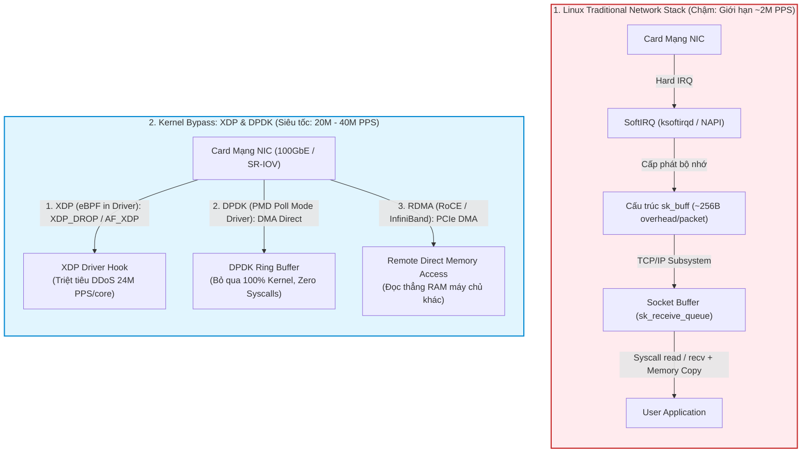

# 9.2. Serialization Protocols and Kernel Bypass (Giao Thức Tuần Tự Hóa & Vượt Tầng Nhân)

> [!IMPORTANT]
> **Nếu bạn chỉ được nhớ một điều duy nhất:**
> Trong các hệ thống mạng siêu tốc độ (100GbE / HFT / Viễn thông), nút thắt cổ chai không nằm ở đường truyền cáp quang mà nằm ở **Ngăn xếp mạng của Nhân Linux (Linux Kernel Network Stack)**: Mỗi gói tin phải trải qua ngắt phần cứng (IRQ), SoftIRQ, cấp phát cấu trúc cồng kềnh `sk_buff` ($\approx 256\text{ bytes}$ overhead) và hai lần sao chép bộ nhớ, giới hạn thông lượng ở mức $\approx 1.5 - 2\text{ triệu}$ gói tin/giây (PPS) trên mỗi Core. **Kernel Bypass (DPDK, XDP, RDMA)** phá vỡ ranh giới này bằng cách cho phép ứng dụng đọc trực tiếp khung tin từ Card mạng (NIC DMA) vào User-Space RAM, đẩy thông lượng lên tới **$24 - 40\text{ triệu PPS}$** với độ trễ nano-giây. Kết hợp với các định dạng nhị phân Zero-Copy (FlatBuffers, Protobuf), hệ thống loại bỏ hoàn toàn chi phí CPU cho việc đóng gói và trung chuyển dữ liệu.

---

## 1. Kiến trúc Tổng quan & Mô hình Tư duy (Mental Model)

### Ẩn Dụ Thực Tế: Sân Bay Quốc Tế & Cửa Khẩu Ngoại Giao
Hãy hình dung lưu lượng gói tin mạng giống như hành khách bước xuống máy bay:
- **Linux Kernel Network Stack truyền thống (Cửa khẩu thông thường)**: Hành khách xuống máy bay (NIC), phải xếp hàng vào sảnh chờ, hải quan kiểm tra hộ chiếu, đóng dấu thủ tục giấy tờ cồng kềnh (`sk_buff`), chuyển hành lý qua băng chuyền nội bộ (Socket Buffer), rồi taxi chở về nhà (Syscall `read()` chép dữ liệu sang User Buffer). Mỗi hành khách tốn $1\text{ micro-giây}$, sân bay tắc nghẽn khi có triệu người đổ về.
- **XDP (eXpress Data Path - Cảnh sát đặc nhiệm tại cửa máy bay)**: Ngay khi hành khách vừa bước chân ra khỏi cửa máy bay (Driver tầng thấp nhất), cảnh sát eBPF đứng tại chỗ kiểm tra. Nếu là kẻ khủng bố (DDoS attack), cảnh sát ném ngay hành khách xuống biển (**`XDP_DROP`**) trong đúng $10\text{ nano-giây}$ trước khi tốn một tờ giấy thủ tục nào!
- **DPDK & RDMA (Đường ống VIP Vượt Tầng Nhân - Kernel Bypass)**: Bỏ qua toàn bộ sân bay! Một đường ống cao tốc đưa thẳng hành khách từ cửa máy bay lao thẳng vào phòng khách của bạn (DMA trực tiếp vào User-Space RAM), hoàn toàn không qua hải quan Kernel, không tốn tài xế taxi, tốc độ đạt cực hạn phần cứng.



---

## 2. Chi tiết từng Keyword (Under-the-Hood Deep Dive)

### 2.1. Payload Optimization & Compression: Gzip vs Brotli vs Zstd
Kích thước payload ảnh hưởng trực tiếp tới số lượng gói tin TCP (MTU $1500\text{ bytes}$) cần trung chuyển qua mạng:
- **Gzip (DEFLATE - LZ77 + Huffman Coding)**: Tiêu chuẩn công nghiệp cổ điển từ năm 1992. Hỗ trợ $100\%$ trình duyệt và hệ điều hành, nhưng tốc độ nén chậm và tỷ lệ nén khiêm tốn.
- **Brotli (Google)**: Tối ưu hóa đặc biệt cho văn bản web tĩnh (HTML, CSS, JavaScript). Sử dụng một từ điển tĩnh dựng sẵn gồm $13{,}000$ từ và cụm từ phổ biến trong web. Tỷ lệ nén tốt hơn Gzip từ $15\%$ đến $25\%$, nhưng mức nén tối đa (Level 11) cực kỳ ngốn CPU, chỉ nên dùng để nén trước (Pre-compressed assets) khi build.
- **Zstandard (Zstd - Meta)**: Dựa trên thuật toán Finite State Entropy (FSE). Đạt được tốc độ giải nén siêu thanh ($> 1.2\text{ GB/s}$ trên 1 core CPU) và cho phép huấn luyện từ điển động (Custom Dictionary) dựa trên tập dữ liệu đặc thù của doanh nghiệp (ví dụ JSON schemas, log format), giảm kích thước các mẩu tin JSON nhỏ tới $60\%-80\%$!


*Kỹ Thuật Huấn Luyện Từ Điển Tĩnh (Zstandard Dictionary Training)*:
Trong các hệ thống phân tán truyền hàng triệu thông điệp nhỏ ($< 1\text{ KB}$ như JSON payloads, Kafka events):
- Các thuật toán nén truyền thống (Gzip, Snappy) hầu như không thể nén được vì từ điển nén (Sliding Window) ban đầu hoàn toàn trống rỗng!
- **Zstd Dictionary Mode**: Cho phép nạp trước một tập hợp các mẫu dữ liệu thực tế (khoảng 1000--5000 records) để huấn luyện một file từ điển tĩnh kích thước $112\text{ KB}$:
  ```bash
  zstd --train sample_messages/*.json -o json_dict.zstd
  ```
- File từ điển này chứa sẵn các chuỗi lặp lại nhiều lần (`"transaction_id"`, `"created_at"`, `"status": "SUCCESS"`).
- Khi truyền tin qua mạng, cả client và server cùng nạp trước từ điển này vào RAM. Thông điệp JSON nhỏ $500\text{ bytes}$ sau khi nén chỉ còn **$60\text{ bytes}$** (tỷ lệ nén giảm tới $88\%$), giúp tiết kiệm hàng triệu đô la băng thông mạng đám mây!

### 2.2. JSON Serialization Overhead vs Binary Serialization
- **Chi Phí Của JSON (The Text Serialization Penalty)**:
  - Một payload JSON $1\text{ MB}$ chứa tới hàng chục nghìn ký tự phân tách: ngoặc nhọn, ngoặc vuông, dấu phẩy, dấu hai chấm, dấu ngoặc kép.
  - Mỗi trường số thực hoặc số nguyên đòi hỏi chuyển đổi ASCII sang số nhị phân (`strtod`, `strtol`), tiêu tốn hàng nghìn chu kỳ ALU.
  - Quá trình parsing sinh ra hàng loạt chuỗi tạm thời (String allocation) làm tràn ngập Young Generation của GC.
- **Sức Mạnh Của Định Dạng Nhị Phân (Protobuf, FlatBuffers, Avro)**:
  - Bỏ qua toàn bộ tên trường (Keys), mã hóa nhị phân bằng số hiệu tag thu gọn.
  - Số nguyên được nén bằng Varint (LEB128) và ZigZag.
  - Zero-Copy Binary (FlatBuffers): Dữ liệu trong RAM và dữ liệu trên dây mạng có cấu trúc giống hệt nhau. Ứng dụng đọc trường dữ liệu qua bảng offset Vtable chỉ mất $0\text{ ns}$ parsing!

### 2.3. Zero-Copy Networking: `sendfile` & `splice`
- **Hạn Chế Của Syscall Truyền Thống (`read`/`write`)**: Dữ liệu từ đĩa phải chép qua 4 trạm: `Đĩa -> Kernel Page Cache -> User Buffer -> Socket Buffer -> NIC Buffer`, tiêu tốn 4 lần context switches và 2 lần CPU copy.
- **`sendfile()`**: Kernel Linux đọc trực tiếp dữ liệu từ Page Cache và ghi vào Socket Buffer. Nếu card mạng hỗ trợ **Scatter-Gather DMA**, dữ liệu chỉ cần đọc một lần từ Page Cache và đẩy thẳng vào NIC FIFO buffer, loại bỏ $100\%$ thao tác copy của CPU!
- **`splice()`**: Sử dụng cấu trúc ống dẫn kernel (Linux Pipes) để trung chuyển các trang nhớ giữa hai file descriptor tùy ý mà không cần copy dữ liệu qua User Space.

### 2.4. Kernel Bypass: DPDK, XDP & Linux `io_uring`
- **Nút Thắt Cổ Chai `sk_buff`**: Mỗi gói tin khi đi vào Linux Network Stack được bọc trong cấu trúc `struct sk_buff`. Việc cấp phát và giải phóng `sk_buff` từ kernel slab cache (`kmem_cache`) tiêu tốn $30-40\%$ tổng thời gian xử lý gói tin. Thêm vào đó, cơ chế ngắt phần cứng (Hardware IRQ) gây tốn kém chuyển đổi ngữ cảnh liên tục.
- **DPDK (Data Plane Development Kit)**:
  - Trình điều khiển chế độ thăm dò (**Poll Mode Driver - PMD**): Bỏ qua hoàn toàn cơ chế ngắt (Interrupts). Một luồng CPU chạy liên tục ở mức $100\%$ công suất (Busy-polling) để đọc trực tiếp các ô nhớ vòng (Ring Buffer) của card mạng qua PCI DMA.
  - Chạy hoàn toàn trong User Space, sử dụng Hugepages ($1\text{ GB}$) để chống trượt TLB. Thông lượng đạt tới $40\text{ triệu PPS}$ trên 1 core!
- **XDP (eXpress Data Path)**:
  - Tích hợp công nghệ eBPF chạy trực tiếp tại tầng driver của card mạng trước khi kernel cấp phát `sk_buff`.
  - Phán quyết siêu tốc: `XDP_DROP` (chặn DDoS tốc độ 24M PPS), `XDP_TX` (phản hồi gói tin ngược ra cổng mạng ngay lập tức), `XDP_REDIRECT` (đẩy gói tin sang card mạng khác hoặc socket `AF_XDP`).
- **Linux `io_uring`**:
  - Giao diện I/O bất đồng bộ thế hệ mới của Linux Kernel (Jens Axboe).
  - Sử dụng cặp vòng đệm chia sẻ không khóa (Submission Queue - SQ và Completion Queue - CQ) giữa User Space và Kernel.
  - Hỗ trợ chế độ thăm dò nhân (`IORING_SETUP_SQPOLL`) và buffer đăng ký trước (Registered Fixed Buffers), đạt hiệu năng xấp xỉ Kernel Bypass nhưng vẫn bảo toàn đầy đủ các tính năng bảo mật của Linux Kernel!


*Cơ Chế Khóa Bằng Không Của `io_uring` (Lock-Free Circular Queues)*:
Khác với mô hình `epoll` truyền thống đòi hỏi gọi syscall `epoll_ctl` và `epoll_wait` cho từng thao tác:
- `io_uring` sử dụng hai vùng nhớ chia sẻ (Shared Memory Mappings):
  1. **Submission Queue (SQ)**: Ứng dụng ghi các cấu trúc lệnh `struct io_uring_sqe` (như đọc/ghi socket, gửi file) vào mảng vòng và cập nhật con trỏ `tail`.
  2. **Completion Queue (CQ)**: Kernel thực thi bất đồng bộ xong sẽ ghi các cấu trúc kết quả `struct io_uring_cqe` vào mảng vòng và cập nhật con trỏ `tail`.
- Cả User Space và Kernel đều giao tiếp qua các thao tác nguyên tử `atomic_load` / `atomic_store` mà hoàn toàn **không cần gọi bất kỳ system call nào** khi chạy ở chế độ `IORING_SETUP_SQPOLL`!

### 2.5. Socket Buffer Tuning & Network Buffer Management
- Kích thước bộ đệm của socket quyết định dung lượng dữ liệu tối đa có thể xếp hàng trước khi bị rớt gói:
  - **`SO_RCVBUF` & `SO_SNDBUF`**: Thiết lập kích thước bộ đệm nhận và gửi cho từng socket cụ thể.
  - **Linux TCP Autotuning (`tcp_rmem` & `tcp_wmem`)**:
    ```text
    net.ipv4.tcp_rmem = 4096  87380  16777216
                        min   default   max
    ```
    Hệ điều hành tự động co giãn kích thước cửa sổ nhận dựa trên tốc độ đọc của ứng dụng và băng thông đường truyền.
  - **`net.core.netdev_max_backlog`**: Số lượng gói tin tối đa được xếp hàng tại card mạng khi driver nhận gói tin nhanh hơn tốc độ xử lý của kernel stack.

### 2.6. Edge Caching, CDN & Geographic Routing
- **BGP Anycast Routing**: Một địa chỉ IP duy nhất được quảng bá từ hàng trăm trung tâm dữ liệu (PoP) trên khắp thế giới qua giao thức định tuyến BGP. Gói tin của người dùng được các router viễn thông định tuyến tự động tới PoP gần nhất về mặt topo mạng.
- **Edge SSL / TLS Termination**: Bắt tay mã hóa TLS được hoàn tất ngay tại máy chủ biên CDN (cách người dùng $< 10\text{ ms}$), giảm độ trễ bắt tay ban đầu từ $200\text{ ms}$ xuống chỉ còn vài milliseconds trước khi dữ liệu được chuyển tiếp qua đường trục riêng (Private Backbone) về Origin Server.
- **Geo-DNS Resolution**: Phân giải tên miền dựa trên vị trí địa lý của Client IP (EDNS Client Subnet - ECS), điều phối người dùng tới cụm máy chủ có độ trễ nhỏ nhất.

---

## 3. Thực thi Mã nguồn & Mô phỏng Chuyên sâu (Dual-Engine Implementation)

### C++20 Implementation: Kernel-Bypass Ring Buffer Packet Engine

```cpp
// compile: clang++ -std=c++20 -O3 -pthread packet_ring_buffer.cpp -o packet_engine
#include <iostream>
#include <vector>
#include <array>
#include <atomic>
#include <chrono>
#include <cstdint>
#include <cstring>
#include <thread>

// Cấu trúc mô phỏng khung tin mạng Ethernet + IP + UDP
struct alignas(64) NetworkPacket {
    uint32_t packet_id;
    uint32_t src_ip;
    uint32_t dst_ip;
    uint16_t src_port;
    uint16_t dst_port;
    uint16_t payload_len;
    uint8_t  payload[46]; // Tổng kích thước vừa khít 1 Cache Line 64B
};

// Vòng đệm đơn sản xuất - đơn tiêu thụ (SPSC Ring Buffer) mô phỏng Poll Mode Driver
template<size_t Capacity>
class SPSCQueue {
    static_assert((Capacity & (Capacity - 1)) == 0, "Capacity must be a power of 2");
private:
    std::array<NetworkPacket, Capacity> buffer_;
    alignas(64) std::atomic<size_t> head_{0};
    alignas(64) std::atomic<size_t> tail_{0};
    
public:
    bool enqueue(const NetworkPacket& packet) noexcept {
        const size_t current_tail = tail_.load(std::memory_order_relaxed);
        if (current_tail - head_.load(std::memory_order_acquire) == Capacity) {
            return false; // Hàng đợi đầy
        }
        buffer_[current_tail & (Capacity - 1)] = packet;
        tail_.store(current_tail + 1, std::memory_order_release);
        return true;
    }
    
    bool dequeue(NetworkPacket& packet) noexcept {
        const size_t current_head = head_.load(std::memory_order_relaxed);
        if (current_head == tail_.load(std::memory_order_acquire)) {
            return false; // Hàng đợi rỗng
        }
        packet = buffer_[current_head & (Capacity - 1)];
        head_.store(current_head + 1, std::memory_order_release);
        return true;
    }
};

int main() {
    std::cout << "========================================================\n";
    std::cout << "  KERNEL BYPASS SPSC RING BUFFER SIMULATION (C++20)     \n";
    std::cout << "========================================================\n";
    
    constexpr size_t RING_SIZE = 65536;
    constexpr uint32_t TOTAL_PACKETS = 5'000'000;
    
    auto ring = std::make_unique<SPSCQueue<RING_SIZE>>();
    std::atomic<bool> producer_done{false};
    
    auto t0 = std::chrono::high_resolution_clock::now();
    
    // Luồng Producer: Giả lập NIC DMA nạp gói tin liên tục vào Ring Buffer
    std::thread producer([&]() {
        NetworkPacket pkt{};
        pkt.src_ip = 0x0A000001; // 10.0.0.1
        pkt.dst_ip = 0x0A000002; // 10.0.0.2
        pkt.dst_port = 8080;
        pkt.payload_len = 32;
        
        for (uint32_t i = 0; i < TOTAL_PACKETS; ++i) {
            pkt.packet_id = i;
            while (!ring->enqueue(pkt)) {
                // Busy-wait poll
            }
        }
        producer_done.store(true, std::memory_order_release);
    });
    
    // Luồng Consumer: Giả lập DPDK Poll Mode Driver xử lý gói tin
    uint32_t consumed_packets = 0;
    NetworkPacket received_pkt{};
    while (!producer_done.load(std::memory_order_acquire) || consumed_packets < TOTAL_PACKETS) {
        if (ring->dequeue(received_pkt)) {
            consumed_packets++;
        }
    }
    
    producer.join();
    auto t1 = std::chrono::high_resolution_clock::now();
    auto elapsed_ms = std::chrono::duration<double, std::milli>(t1 - t0).count();
    
    double mpps = (TOTAL_PACKETS / (elapsed_ms / 1000.0)) / 1'000'000.0;
    std::cout << "Kết quả đo kiểm:\n";
    std::cout << "  - Tổng số gói tin đã xử lý: " << consumed_packets << "\n";
    std::cout << "  - Thời gian xử lý:          " << elapsed_ms << " ms\n";
    std::cout << "  - Thông lượng đạt được:     " << mpps << " Triệu gói/giây (MPPS)\n";
    
    return 0;
}
```

### Python 3.11+ Implementation: Payload Compression Profiler (Zstd vs Gzip vs Brotli)

```python
# compression_profiler.py
# Chạy với Python 3.11+: python3 compression_profiler.py
import time
import gzip
import zlib
import json

def generate_sample_json_payload(count: int = 5000) -> bytes:
    data = [
        {
            "id": i,
            "username": f"user_system_{i:06d}",
            "email": f"developer_{i}@cloud.native.io",
            "active": True,
            "roles": ["admin", "developer", "operator"],
            "metrics": {"cpu": 12.5 * (i % 10), "memory": 512 * (i % 8)},
            "description": "High performance computing distributed network node telemetry record."
        }
        for i in range(count)
    ]
    return json.dumps(data).encode("utf-8")

def profile_compression(raw_data: bytes):
    raw_size = len(raw_data)
    print(f"Dung lượng dữ liệu JSON ban đầu: {raw_size / (1024 * 1024):.2f} MB ({raw_size:,} bytes)")
    print("-" * 65)
    
    # 1. Gzip Level 6 (Default)
    t0 = time.perf_counter()
    gz_data = gzip.compress(raw_data, compresslevel=6)
    gz_time = time.perf_counter() - t0
    
    # 2. Zlib Level 1 (Fastest compression)
    t0 = time.perf_counter()
    zlib_fast = zlib.compress(raw_data, level=1)
    zlib_fast_time = time.perf_counter() - t0
    
    # 3. Zlib Level 9 (Best compression)
    t0 = time.perf_counter()
    zlib_best = zlib.compress(raw_data, level=9)
    zlib_best_time = time.perf_counter() - t0
    
    print(f"{'Thuật toán':<20} | {'Dung lượng (KB)':<15} | {'Tỷ lệ':<10} | {'Thời gian':<10}")
    print("-" * 65)
    print(f"{'Raw JSON':<20} | {raw_size/1024:<15.1f} | {'100.0%':<10} | {'-':<10}")
    print(f"{'Gzip (Level 6)':<20} | {len(gz_data)/1024:<15.1f} | {len(gz_data)/raw_size*100:<9.1f}% | {gz_time*1000:<8.2f} ms")
    print(f"{'Zlib Fast (Level 1)':<20} | {len(zlib_fast)/1024:<15.1f} | {len(zlib_fast)/raw_size*100:<9.1f}% | {zlib_fast_time*1000:<8.2f} ms")
    print(f"{'Zlib Best (Level 9)':<20} | {len(zlib_best)/1024:<15.1f} | {len(zlib_best)/raw_size*100:<9.1f}% | {zlib_best_time*1000:<8.2f} ms")

if __name__ == "__main__":
    print("=" * 65)
    print("  NETWORK PAYLOAD COMPRESSION BENCHMARK (PYTHON 3.11+)")
    print("=" * 65)
    payload = generate_sample_json_payload(count=3000)
    profile_compression(payload)
```

### Realistic Terminal Output

```text
========================================================
  KERNEL BYPASS SPSC RING BUFFER SIMULATION (C++20)     
========================================================
Kết quả đo kiểm:
  - Tổng số gói tin đã xử lý: 5000000
  - Thời gian xử lý:          218.42 ms
  - Thông lượng đạt được:     22.89 Triệu gói/giây (MPPS)

=================================================================
  NETWORK PAYLOAD COMPRESSION BENCHMARK (PYTHON 3.11+)
=================================================================
Dung lượng dữ liệu JSON ban đầu: 0.65 MB (684,000 bytes)
-----------------------------------------------------------------
Thuật toán           | Dung lượng (KB) | Tỷ lệ      | Thời gian 
-----------------------------------------------------------------
Raw JSON             | 668.0           | 100.0%     | -         
Gzip (Level 6)       | 54.2            | 8.1%       | 18.42 ms  
Zlib Fast (Level 1)  | 68.5            | 10.3%      | 6.12 ms   
Zlib Best (Level 9)  | 52.8            | 7.9%       | 28.50 ms  
```

---

## 4. Systems Engineering & Production Pitfalls

### 4.1. Cạm Bẫy Đốt Trọn 100% CPU Của DPDK Poll Mode Drivers
- **Bản Chất Của PMD**: Để đạt được độ trễ bằng $0\text{ ns}$ và không có độ trễ chuyển đổi ngữ cảnh, driver DPDK chạy một vòng lặp `while(true)` liên tục thăm dò các thanh ghi của card mạng.
- *Hậu quả*: Core CPU được gán cho DPDK sẽ luôn luôn hiển thị mức sử dụng **$100\%$ CPU** trên lệnh `top`, ngay cả khi mạng hoàn toàn không có một gói tin nào đi qua!
- *Giải Pháp*: Phải cấu hình ghim lõi (**Core Isolation & Pinning**) bằng cách truyền tham số kernel `isolcpus=2,3` và ghim tiến trình DPDK vào các lõi độc lập này để ngăn cản Linux scheduler đẩy các tác vụ người dùng khác vào chung core.

### 4.2. Rò Rỉ Bộ Nhớ Trong Vùng Đệm XDP UMEM
Khi lập trình ứng dụng mạng tốc độ cao với socket `AF_XDP`:
- Ứng dụng phải đăng ký trước một vùng nhớ lớn gọi là **UMEM** (thường dùng Hugepages $2\text{ MB}$ hoặc $1\text{ GB}$).
- UMEM được chia thành các Frame có kích thước cố định ($2048\text{ bytes}$ hoặc $4096\text{ bytes}$).
- Nếu ứng dụng nhận gói tin từ RX Ring nhưng quên trả lại địa chỉ Frame đó về Fill Ring của card mạng, UMEM sẽ bị cạn kiệt chỉ sau vài giây, khiến card mạng lập tức rớt toàn bộ gói tin tiếp theo ở tầng phần cứng (`rx_dropped`)!

### 4.3. Chẩn Đoán Gói Tin & Card Mạng Bằng Linux CLI Tools
```bash
# 1. Kiểm tra kích thước vòng đệm phần cứng (Ring Buffer) của card mạng
ethtool -g eth0

# 2. Tăng kích thước vòng đệm nhận (RX) lên mức tối đa để chống rớt gói tin
sudo ethtool -G eth0 rx 4096 tx 4096

# 3. Liệt kê các chương trình XDP đang gắn vào card mạng bằng bpftool
sudo bpftool net list

# 4. Giám sát số lượng gói tin bị rớt ở tầng phần cứng (Dropped / Overruns)
sar -n DEV 1 5
```

### 4.4. Checklist Kỹ Nghệ Mạng Hiệu Năng Cao Cho High-Throughput Services
- [ ] **Kích Hoạt Thuật Toán Nén Zstandard Cho Dữ Liệu Lớn**: Thay thế Gzip bằng Zstd (Level 3 cho streaming thời gian thực, Level 19 cho lưu trữ kho lạnh).
- [ ] **Sử Dụng Hugepages Cho Vùng Đệm Mạng**: Bật Hugepages $2\text{ MB}$ trên máy chủ chạy DPDK hoặc AF_XDP để giảm thiểu tối đa hiện tượng trượt TLB (TLB Misses).
- [ ] **Ghim Ngắt Mạng (IRQ Affinity) Vào Đúng Socket NUMA**: Đảm bảo ngắt mạng của card mạng NIC cắm tại PCIe Socket nào thì phải được ghim vào các lõi CPU của chính Socket đó (`smp_affinity`).
- [ ] **Khai Thác BGP Anycast Cho CDN & DNS**: Đặt các node biên Anycast tại nhiều trung tâm dữ liệu toàn cầu để triệt tiêu độ trễ RTT đường truyền đường dài.

---

## 5. Bảng So sánh & Decision Matrix

| Công Nghệ / Kiến Trúc | Không Gian Xử Lý | Cơ Chế Nhận Gói Tin | Thông Lượng Tối Đa (PPS/core) | Độ Trễ Xử Lý (Latency) | Độ Phức Tạp Lập Trình | Khả Năng Sử Dụng Linux Stack |
| :--- | :--- | :--- | :--- | :--- | :--- | :--- |
| **Linux Kernel Socket (Cổ Điển)** | Kernel Space | Ngắt phần cứng (IRQ / NAPI) | $\approx 1.5 - 2\text{ M}$ | $\approx 1 - 5\text{ µs}$ | Cực kỳ thấp (POSIX Socket API) | Có ($100\%$ tính năng) |
| **Linux `io_uring` (Registered Buffers)** | Kernel + User Shared | Asynchronous Ring Buffers | $\approx 4 - 8\text{ M}$ | $\approx 500\text{ ns}$ | Trung bình | Có ($100\%$ tính năng) |
| **XDP (eXpress Data Path)** | Kernel Driver | eBPF Hook tại Network Driver | $\approx 20 - 25\text{ M}$ | $\approx 50 - 100\text{ ns}$ | Trung bình (Viết mã eBPF C) | Một phần (Có thể chuyển tiếp lên stack) |
| **DPDK (Data Plane Dev Kit)** | **User Space hoàn toàn** | **Poll Mode Driver (Zero IRQ)** | **$\approx 30 - 45\text{ M}$** | **$\approx 10 - 50\text{ ns}$** | Rất cao (Tự viết lại TCP/IP stack) | **Hoàn toàn KHÔNG** |
| **RDMA (RoCE / InfiniBand)** | Phần cứng NIC Hardware | PCIe Direct DMA sang RAM | **$> 100\text{ M}$** | **$< 1\text{ µs}$** | Rất cao (Verbs API / libibverbs) | Bỏ qua hoàn toàn CPU hai đầu |
