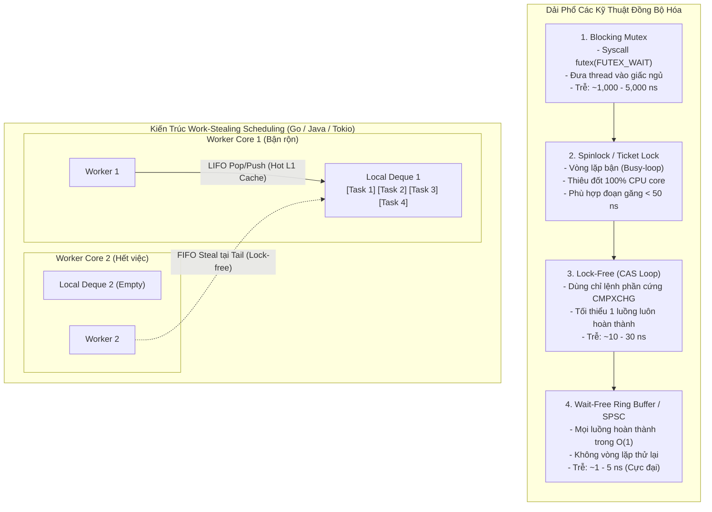

# 10.2. Lock Contention, Lock-Free Data Structures, and Work Stealing (Tranh Chấp Khóa, Cấu Trúc Không Khóa & Trộm Tác Vụ)

> [!IMPORTANT]
> **Nếu bạn chỉ được nhớ một điều duy nhất:** Khóa (**Mutex**) là một ảo tưởng thuận tiện nhưng cực kỳ đắt đỏ: khi xảy ra tranh chấp (Contention), chi phí chuyển ngữ cảnh qua `sys_futex` làm chậm hệ thống gấp hàng nghìn lần ($1,000\text{x}$). Để đạt hiệu năng tối thượng trên kiến trúc đa nhân hiện đại, giải pháp không phải là "tối ưu hóa ổ khóa", mà là **triệt tiêu hoàn toàn ổ khóa thông qua Hardware Atomics, Cấu trúc Không khóa (Lock-Free), và Giải thuật Trộm việc (Work-Stealing)**.

---

## 1. Kiến trúc Tổng quan & Mô hình Tư duy (Mental Model)

### Phép loại suy thực tế: Trạm thu phí tự động RFID vs Trạm gác chắn barie đơn lẻ

Hãy hình dung sự khác biệt giữa các phương thức đồng bộ hóa trong phần mềm thông qua giao thông trên đường cao tốc:

1. **Mô hình Khóa Độc Quyền (Mutex - Trạm gác chắn barie duy nhất):**
   - 16 làn xe cùng lao tới nhưng chỉ có đúng 1 trạm gác chắn với 1 người gác cổng. Chiếc xe đầu tiên được hạ barie cho qua. 15 chiếc xe còn lại buộc phải phanh gấp, tắt động cơ và tài xế phải ngả lưng ngủ thiếp đi (Kernel Futex Wait / Sleep).
   - Khi xe đầu tiên đi qua, người gác cổng phải gõ cửa đánh thức chiếc xe tiếp theo dậy, nổ máy và tăng tốc lại từ đầu (Context Switch & Cold Cache Latency $\approx 2 - 5\mu s$). Tắc nghẽn kéo dài hàng cây số!
2. **Mô hình Không Khóa (Lock-Free - Làn thu phí tự động không dừng ETC / RFID):**
   - Xe cộ không bao giờ phải dừng lại hay tắt máy. Mỗi xe tự động đọc thẻ RFID thông qua cảm biến quang học trên nóc (Hardware Atomic CAS: Compare-And-Swap).
   - Nếu có 2 xe cùng lách vào một khoảng trống cùng một mili-giây, cảm biến chỉ cho phép 1 xe vượt lên; xe kia lập tức phát hiện và lách sang khe tiếp theo mà không bao giờ phải dừng động cơ. Cả dòng xe liên tục di chuyển về phía trước (System-wide Progress Guarantee).
3. **Mô hình Trộm Việc (Work-Stealing - Đội ngũ nhân viên đóng gói bưu phẩm linh hoạt):**
   - Thay vì tất cả nhân viên cùng xếp hàng tranh giành bưu phẩm từ một chiếc bàn trung tâm duy nhất (Central Queue Contention), mỗi nhân viên có một chiếc bàn riêng với khay đựng công việc của riêng mình.
   - Khi làm việc, nhân viên rút việc từ khay của mình (Head - LIFO) để tận dụng dụng cụ vừa cầm trên tay (L1 Cache Locality).
   - Khi khay của mình trống rỗng, thay vì ngồi chơi xơi nước, nhân viên sẽ lặng lẽ đi sang bàn của đồng nghiệp đang ngập đầu trong việc và "trộm" bớt một gói hàng ở đáy khay (Tail - FIFO) về bàn mình làm. Toàn bộ công xưởng vận hành với hiệu suất $100\%$ mà không cần bất kỳ người giám sát hay ổ khóa nào!



---

## 2. Chi tiết từng Keyword (Under-the-Hood Deep Dive)

### 2.1. Lock Contention & Mutex Overhead vs Spinlock vs RW-Lock

Cơ chế khóa trong hệ điều hành Linux hiện đại không phải là một cấu trúc đơn lẻ, mà là một cỗ máy đa tầng phức tạp.

```
       QUY TRÌNH HOẠT ĐỘNG CỦA GLIBC PTHREAD_MUTEX (HYBRID ADAPTIVE MUTEX)
  ┌────────────────────────────────────────────────────────────────────────┐
  │ 1. Fast-Path (User Space):                                             │
  │    Thực thi lệnh Atomic CAS (CMPXCHG) trên biến cờ nguyên tử           │
  │    ├── Thành công (Uncontended) ──> Chiếm khóa tức thì (~10-15 ns)!    │
  │    └── Thất bại (Contended)                                            │
  │             │                                                          │
  │ 2. Adaptive Spinning:                                                  │
  │    Quay vòng lặp bận thử lại vài trăm chu kỳ CPU                       │
  │    ├── Thành công ───────────────> Chiếm khóa (~50-100 ns)             │
  │    └── Thất bại                                                        │
  │             │                                                          │
  │ 3. Slow-Path (Kernel Space System Call):                               │
  │    Gọi sys_futex(val, FUTEX_WAIT_PRIVATE, ...)                         │
  │    └── Scheduler đưa luồng vào TASK_UNINTERRUPTIBLE (~2000-5000 ns)    │
  └────────────────────────────────────────────────────────────────────────┘
```

1. **Chi phí ẩn giấu của Tranh chấp Khóa (Lock Contention):**
   - Khi không có tranh chấp (Uncontended), `std::mutex` chỉ tốn một lệnh atomic duy nhất trong User Space.
   - Nhưng khi có tranh chấp (Contended), luồng thất bại phải chuyển ngữ cảnh vào Kernel thông qua **`futex(2)` (Fast Userspace Mutex)**. Chi phí không chỉ là thời gian gọi system call, mà là:
     - **TLB Invalidation & Page Table Switch:** Xóa sạch bộ đệm địa chỉ nhớ ảo.
     - **L1/L2 Cache Eviction:** Khi luồng bị đánh thức sau $2\mu s$ trên một CPU core khác, toàn bộ dữ liệu của nó trong L1 Cache cũ đã bị bốc hơi $\rightarrow$ Chuỗi L1 Data Cache Misses kéo dài hàng trăm cycles!
2. **Spinlock:**
   - Hoàn toàn không gọi system call, không đưa luồng vào giấc ngủ. Luồng liên tục thực hiện vòng lặp `while (flag.test_and_set(std::memory_order_acquire))`.
   - *Cạm bẫy tử huyệt:* Nếu luồng đang giữ Spinlock bị ngắt bởi Kernel Scheduler (Preempted) do hết Time-slice hoặc dính Page Fault, các luồng khác trên các Core còn lại sẽ quay cuồng thiêu đốt $100\%$ CPU trong vô vọng để chờ một luồng đang ngủ! Hiện tượng này gọi là **Priority Inversion Disaster**.
3. **Read-Write Lock (`std::shared_mutex`):**
   - Cho phép nhiều người đọc đồng thời (`lock_shared()`). Nhưng để biết có bao nhiêu người đang đọc, cấu trúc khóa bắt buộc phải duy trì một biến số nguyên dùng chung (`std::atomic<uint32_t> reader_count`).
   - Mỗi khi một luồng đọc mới bước vào, nó gọi `reader_count.fetch_add(1)`. Thao tác này kích hoạt giao thức **MESI Cache Invalidation** phát tín hiệu lên Bus liên kết CPU, làm vô hiệu hóa Cache Line chứa biến này trên toàn bộ các CPU cores khác!
   - Hậu quả: Dưới tải hàng ngàn luồng đọc, RW-Lock gây ra hiện tượng **Cache Line Bouncing (Ping-pong)** dữ dội, chạy còn chậm hơn cả một Mutex thông thường!

---

### 2.2. Atomics, CAS Operations & Memory Barriers

Thế giới Lock-Free được xây dựng trên nền tảng của các chỉ thị nguyên tử phần cứng và mô hình bộ nhớ vi kiến trúc.

#### Chỉ thị Phần cứng Compare-And-Swap (CAS)
Trên vi kiến trúc x86_64, CAS được thực thi bằng chỉ thị:
```nasm
lock cmpxchg (%rdi), %rsi   ; Tiền tố LOCK khóa bus cache line và so sánh/đổi giá trị
```
- Bộ điều khiển Cache (Cache Controller) sử dụng giao thức **MESI / MOESI** để chiếm quyền độc quyền (Exclusive State) trên đúng 1 Cache Line $64\text{ bytes}$. Không một nhân CPU nào khác được phép đọc hoặc ghi vào ô nhớ đó trong suốt chu kỳ thực thi của lệnh `CMPXCHG`.

#### Mô hình Bộ nhớ C++ (Memory Models & Barriers)
Do hiện tượng xáo trộn lệnh (Out-of-Order Execution) của CPU hiện đại và kỹ thuật tái sắp xếp của Compiler, một thao tác ghi bộ nhớ có thể bị nhìn thấy theo thứ tự khác nhau giữa các nhân CPU!

```
+---------------------------------------------------------------------------------+
|                        CÁC CẤP ĐỘ C++ MEMORY ORDERS                             |
+----------------------+----------------------------------------------------------+
| Memory Order         | Cơ chế Vi kiến trúc & Tác động Hiệu năng                 |
+----------------------+----------------------------------------------------------+
| memory_order_relaxed | Chỉ bảo đảm tính nguyên tử của biến đó. Không có rào chắn|
|                      | bộ nhớ. Tốc độ cao nhất (~1 chu kỳ CPU).                 |
+----------------------+----------------------------------------------------------+
| memory_order_acquire | Dùng cho thao tác ĐỌC. Đảm bảo mọi thao tác đọc/ghi PHÍA |
|                      | SAU không thể bị CPU đẩy lên TRƯỚC lệnh này.             |
+----------------------+----------------------------------------------------------+
| memory_order_release | Dùng cho thao tác GHI. Đảm bảo mọi dữ liệu chuẩn bị PHÍA |
|                      | TRƯỚC phải được xả xong vào RAM trước khi lệnh này chạy. |
+----------------------+----------------------------------------------------------+
| memory_order_seq_cst | Tuần tự nhất quán toàn cầu (Sequential Consistency).     |
|                      | Ép CPU chèn chỉ thị rào chắn nặng (MFENCE trên x86).     |
+----------------------+----------------------------------------------------------+
```

---

### 2.3. Lock-Free vs Wait-Free Algorithms

Trong khoa học máy tính lý thuyết, tính chất đồng bộ không khóa được phân cấp thành 3 nấc thang tiến triển (Progress Guarantees):

```
                     NẤC THANG TIẾN TRIỂN ĐỒNG THỜI
                                   ▲
                                  ╱ ╲
                                 ╱   ╲
                                ╱     ╲
                               ╱       ╲
                              ╱Wait-Free╲   <-- Đỉnh cao: Mọi thread xong trong O(1)
                             ╱───────────╲
                            ╱  Lock-Free  ╲  <-- Ít nhất 1 thread tiến bộ toàn cục
                           ╱───────────────╲
                          ╱Obstruction-Free ╲ <-- Xong nếu chạy đơn độc một mình
                         ╱───────────────────╲
                        ╱   Blocking Locks    ╲ <-- Có thể bị Deadlock vĩnh viễn
                       └───────────────────────┘
```

1. **Lock-Free (Không Khóa):**
   - Đảm bảo rằng trong toàn bộ hệ thống, **luôn có ít nhất một luồng hoàn thành tác vụ thành công** trong một khoảng thời gian hữu hạn.
   - Thường sử dụng vòng lặp CAS:
     ```cpp
     do {
         old_head = head.load();
         new_node->next = old_head;
     } while (!head.compare_exchange_weak(old_head, new_node));
     ```
   - Một số luồng có thể bị thất bại liên tục và phải quay vòng lặp lại (Starvation), nhưng cả hệ thống không bao giờ bị dừng lại.
2. **Wait-Free (Không Chờ Đợi):**
   - Cấp độ tối thượng: **MỖI luồng đều được đảm bảo hoàn thành tác vụ trong một số bước hữu hạn cố định** ($O(1)$), không phụ thuộc vào tốc độ hay trạng thái của bất kỳ luồng nào khác trong vũ trụ!
   - Không chứa bất kỳ vòng lặp thử lại nào (`while (!CAS)`). Ví dụ: Hàng đợi Ring Buffer SPSC (Single-Producer Single-Consumer).
3. **Vấn nạn ABA Kinh Điển (The ABA Problem):**
   - Luồng 1 đọc con trỏ `A`.
   - Luồng 2 chạy xen vào: Giải phóng ô nhớ `A`, cấp phát ô nhớ mới `B`, rồi lại giải phóng `B` và cấp phát một ô nhớ mới nhưng ngẫu nhiên được Allocator giao lại đúng địa chỉ `A` cũ!
   - Luồng 1 quay lại, kiểm tra thấy con trỏ vẫn là `A` nên thực thi CAS thành công, nhưng cấu trúc dữ liệu bên dưới đã bị tráo đổi nội dung hoàn toàn $\rightarrow$ **Memory Corruption / Crash**!
   - **Giải pháp:** Sử dụng **Tagged Pointers** (gắn thêm một số phiên bản 64-bit bên cạnh con trỏ: `(Pointer, Version)` và thực thi lệnh Double-Word CAS `CMPXCHG16B`), hoặc sử dụng cơ chế bảo vệ con trỏ **Hazard Pointers / Epoch-Based Reclamation (EBR)**.

---

### 2.4. Work Stealing & Work Queues (Thuật Toán Trộm Việc)

Thuật toán Work-Stealing (được chuẩn hóa bởi Chase và Leiserson trong cấu trúc **Chase-Lev Deque**) là giải pháp kiến trúc xuất sắc nhất để giải quyết bài toán mất cân bằng tải (Load Imbalance) trên hệ thống hàng trăm CPU Cores.

```
       CẤU TRÚC HÀNG ĐỢI HAI ĐẦU CHASE-LEV (WORK-STEALING DEQUE)
  ┌─────────────────────────────────────────────────────────────────────────┐
  │                                                                         │
  │   [Thao tác ĐỘC QUYỀN của Chủ sở hữu]        [Thao tác của Kẻ trộm]     │
  │   Worker Owner (Thread cục bộ)               Thief Worker (Thread ngoài)│
  │            │                                              │             │
  │            ▼                                              ▼             │
  │       TOP (LIFO)                                     BOTTOM (FIFO)      │
  │    ┌──────────────┬──────────────┬──────────────┬──────────────┐        │
  │    │  Task Mới 4  │    Task 3    │    Task 2    │  Task Cũ 1   │        │
  │    └──────────────┴──────────────┴──────────────┴──────────────┘        │
  │            ▲                                              ▲             │
  │            │                                              │             │
  │   Push() / Pop() [Không cần Atomic Lock]       Steal() [Dùng CAS]       │
  └─────────────────────────────────────────────────────────────────────────┘
```

1. **Nguyên lý Hoạt động Kép (Asymmetric Access):**
   - **Chủ sở hữu (Worker Owner):** Thao tác đẩy việc (`push`) và rút việc (`pop`) diễn ra tại **Đỉnh (Top - LIFO)**. Vì chỉ có duy nhất chủ sở hữu thao tác tại đỉnh này, nên việc push/pop **hoàn toàn không cần lệnh Atomic CAS hay Mutex**, chỉ là thao tác dịch con trỏ thông thường!
   - **Kẻ trộm (Thieves):** Khi một worker khác trên core khác bị rảnh việc, nó sẽ ngẫu nhiên chọn một worker khác và thực hiện trộm việc tại **Đáy (Bottom - FIFO)** bằng một lệnh nguyên tử CAS duy nhất.
2. **Lợi ích Vàng về Vi Kiến Trúc CPU:**
   - **Tối ưu hóa L1/L2 Cache:** Chủ sở hữu lấy task vừa sinh ra tại đỉnh (LIFO), dữ liệu của task này hầu như chắc chắn đang nằm sẵn trong L1 Data Cache của chính core đó.
   - **Giảm thiểu Tranh chấp:** Chủ sở hữu làm việc ở đỉnh, kẻ trộm làm việc ở đáy. Trừ khi hàng đợi chỉ còn đúng 1 phần tử duy nhất, hai bên hoàn toàn không bao giờ va chạm vào nhau!
3. **Mô hình Lập lịch Go Runtime (GMP Model):**
   - $G$ (Goroutine), $M$ (OS Machine Thread), $P$ (Processor Context).
   - Mỗi $P$ quản lý một Local Run-Queue 256 phần tử. Khi $P$ hết việc, nó chạy thuật toán tìm việc:
     $$\text{Quét Global Queue} \longrightarrow \text{Quét Poller Mạng} \longrightarrow \text{Trộm } 50\% \text{ số việc từ } P \text{ khác!}$$

---

### 2.5. Task Batching & Request Batching

Dưới góc nhìn phần cứng, việc thực thi một chỉ lệnh Atomic (`LOCK CMPXCHG`) hay ghi nhận bộ nhớ qua Bus liên kết đắt hơn hàng chục lần so với thao tác đọc/ghi thanh ghi thông thường.

```
Không gom nhóm (Unbatched):
  10,000 Tasks ──> 10,000 Atomic CAS Operations ──> Bão hòa Interconnect Bus!

Có gom nhóm (Batched - Kích thước Batch = 64):
  10,000 Tasks ──> Chỉ tốn 156 Atomic CAS Operations ──> Tiết kiệm 98.4% chi phí đồng bộ!
```

- **Task Batching (Gom nhóm tác vụ):** Khi một luồng Producer muốn đẩy 50 tác vụ vào hàng đợi chia sẻ, thay vì gọi `queue.push()` 50 lần (kích hoạt 50 lần tranh chấp khóa và xả cache), nó liên kết 50 tác vụ này thành một mảng hoặc danh sách liên kết đơn trong bộ nhớ cục bộ, sau đó tráo con trỏ vào hàng đợi chung **chỉ bằng một thao tác Atomic duy nhất**.
- **LMAX Disruptor Batching:** Khi Consumer đọc dữ liệu từ Ring Buffer, thay vì lấy từng phần tử, nó đọc Sequence Number cao nhất hiện có và xử lý trọn một chuỗi hàng trăm giao dịch trong một vòng lặp tuyến tính duy nhất, tối ưu hóa tuyệt đối bộ dự đoán nhánh (Branch Predictor) và Vector hóa SIMD của CPU.

---

## 3. Thực thi Mã nguồn & Mô phỏng Chuyên sâu (Dual-Engine Implementation)

### 3.1. C++20: Lock-Free Single-Producer Single-Consumer (SPSC) Ring Buffer Hoàn Chỉnh

Chương trình triển khai cấu trúc hàng đợi **Wait-Free SPSC Ring Buffer** chuẩn công nghiệp: Sử dụng căn chỉnh địa chỉ ô nhớ `alignas(64)` để triệt tiêu hoàn toàn hiện tượng **False Sharing**, kết hợp mô hình bộ nhớ siêu tốc `memory_order_acquire / memory_order_release` và so sánh trực tiếp với hàng đợi dùng `std::mutex`.

```cpp
// File: lockfree_spsc_benchmark.cpp
// Biên dịch: g++ -std=c++20 -O3 -pthread lockfree_spsc_benchmark.cpp -o spsc_bench

#include <iostream>
#include <vector>
#include <atomic>
#include <thread>
#include <chrono>
#include <iomanip>
#include <mutex>
#include <queue>
#include <cstdint>

// ============================================================================
// 1. WAIT-FREE SPSC RING BUFFER (TRIỆT TIÊU FALSE SHARING BẰNG ALIGNAS(64))
// ============================================================================
template <typename T, size_t Capacity>
class LockFreeSPSCQueue {
    static_assert((Capacity & (Capacity - 1)) == 0, "Capacity bắt buộc phải là lũy thừa của 2!");

private:
    std::vector<T> ring_buffer_;
    static constexpr size_t INDEX_MASK = Capacity - 1;

    // Đặt head và tail trên hai Cache Line 64-byte hoàn toàn độc lập
    // Ngăn chặn hiện tượng Cache Line Invalidation chéo giữa Producer và Consumer!
    alignas(64) std::atomic<size_t> tail_{0}; // Producer ghi vào tail
    alignas(64) std::atomic<size_t> head_{0}; // Consumer đọc từ head

public:
    LockFreeSPSCQueue() : ring_buffer_(Capacity) {}

    // Thao tác Push: Wait-Free O(1) - Không dùng bất kỳ Mutex hay CAS Loop nào!
    bool push(const T& item) noexcept {
        const size_t current_tail = tail_.load(std::memory_order_relaxed);
        const size_t current_head = head_.load(std::memory_order_acquire);

        // Kiểm tra hàng đợi đầy
        if ((current_tail - current_head) >= Capacity) {
            return false;
        }

        ring_buffer_[current_tail & INDEX_MASK] = item;
        // Công bố dữ liệu mới bằng Release Semantics
        tail_.store(current_tail + 1, std::memory_order_release);
        return true;
    }

    // Thao tác Pop: Wait-Free O(1)
    bool pop(T& item) noexcept {
        const size_t current_head = head_.load(std::memory_order_relaxed);
        const size_t current_tail = tail_.load(std::memory_order_acquire);

        // Kiểm tra hàng đợi rỗng
        if (current_head == current_tail) {
            return false;
        }

        item = ring_buffer_[current_head & INDEX_MASK];
        // Cập nhật vị trí đã đọc bằng Release Semantics
        head_.store(current_head + 1, std::memory_order_release);
        return true;
    }
};

// ============================================================================
// 2. STANDARD MUTEX-PROTECTED QUEUE (DÙNG ĐỂ ĐỐI CHỨNG)
// ============================================================================
template <typename T>
class MutexProtectedQueue {
private:
    std::queue<T> queue_;
    std::mutex mutex_;

public:
    void push(const T& item) {
        std::lock_guard<std::mutex> lock(mutex_);
        queue_.push(item);
    }

    bool pop(T& item) {
        std::lock_guard<std::mutex> lock(mutex_);
        if (queue_.empty()) return false;
        item = queue_.front();
        queue_.pop();
        return true;
    }
};

// ============================================================================
// CHƯƠNG TRÌNH ĐO ĐẠC VÀ ĐỐI CHỨNG HIỆU NĂNG
// ============================================================================
int main() {
    constexpr size_t BUFFER_SIZE = 65536; // 64K slots
    constexpr uint64_t TOTAL_MESSAGES = 10'000'000;

    std::cout << "===============================================================\n";
    std::cout << "  BENCHMARK: MUTEX QUEUE VS WAIT-FREE SPSC RING BUFFER         \n";
    std::cout << "  Tổng số thông điệp truyền tải: " << TOTAL_MESSAGES << " messages\n";
    std::cout << "===============================================================\n\n";

    // ------------------------------------------------------------------------
    // Benchmark 1: Wait-Free Lock-Free SPSC Queue
    // ------------------------------------------------------------------------
    LockFreeSPSCQueue<uint64_t, BUFFER_SIZE> lockfree_q;
    auto start_lf = std::chrono::high_resolution_clock::now();

    {
        std::jthread producer([&]() {
            for (uint64_t i = 1; i <= TOTAL_MESSAGES; ++i) {
                while (!lockfree_q.push(i)) {
                    std::this_thread::yield();
                }
            }
        });

        std::jthread consumer([&]() {
            uint64_t val = 0;
            for (uint64_t i = 1; i <= TOTAL_MESSAGES; ++i) {
                while (!lockfree_q.pop(val)) {
                    std::this_thread::yield();
                }
            }
        });
    } // jthreads tự động join tại đây

    auto end_lf = std::chrono::high_resolution_clock::now();
    double lf_time_ms = std::chrono::duration<double, std::milli>(end_lf - start_lf).count();
    double lf_throughput = (TOTAL_MESSAGES / (lf_time_ms * 1e-3)) / 1e6;

    std::cout << "1. Wait-Free Lock-Free SPSC Queue:\n";
    std::cout << "   - Thời gian thực thi: " << lf_time_ms << " ms\n";
    std::cout << "   - Thông lượng       : " << std::fixed << std::setprecision(2) 
              << lf_throughput << " Triệu Messages/giây\n\n";

    // ------------------------------------------------------------------------
    // Benchmark 2: Mutex Protected Queue
    // ------------------------------------------------------------------------
    MutexProtectedQueue<uint64_t> mutex_q;
    auto start_mutex = std::chrono::high_resolution_clock::now();

    {
        std::jthread producer([&]() {
            for (uint64_t i = 1; i <= TOTAL_MESSAGES; ++i) {
                mutex_q.push(i);
            }
        });

        std::jthread consumer([&]() {
            uint64_t val = 0;
            for (uint64_t i = 1; i <= TOTAL_MESSAGES; ++i) {
                while (!mutex_q.pop(val)) {
                    std::this_thread::yield();
                }
            }
        });
    }

    auto end_mutex = std::chrono::high_resolution_clock::now();
    double mutex_time_ms = std::chrono::duration<double, std::milli>(end_mutex - start_mutex).count();
    double mutex_throughput = (TOTAL_MESSAGES / (mutex_time_ms * 1e-3)) / 1e6;

    std::cout << "2. Standard Mutex Queue (Tranh chấp Lock Contention):\n";
    std::cout << "   - Thời gian thực thi: " << mutex_time_ms << " ms\n";
    std::cout << "   - Thông lượng       : " << std::fixed << std::setprecision(2) 
              << mutex_throughput << " Triệu Messages/giây\n\n";

    std::cout << ">> KẾT LUẬN: Cấu trúc Lock-Free nhanh hơn gấp " 
              << (mutex_time_ms / lf_time_ms) << " LẦN so với Mutex chuẩn!\n";
    std::cout << "===============================================================\n";

    return 0;
}
```

---

### 3.2. Python 3.11: Mô phỏng Thuật Toán Work-Stealing Scheduling

Kịch bản Python mô phỏng chính xác thuật toán **Work-Stealing** đa nhân: So sánh thời gian hoàn thành tác vụ giữa một mô hình Central Queue dùng Lock chung và mô hình Work-Stealing Deque cục bộ.

```python
# File: work_stealing_simulator.py
import random
import time
from collections import deque
from typing import List, Optional

class WorkStealingWorker:
    def __init__(self, worker_id: int):
        self.worker_id = worker_id
        # Hàng đợi hai đầu Deque: Chủ rút từ bên phải (LIFO), Kẻ trộm rút từ bên trái (FIFO)
        self.deque: deque = deque()
        self.tasks_completed = 0
        self.tasks_stolen = 0

    def push_local(self, task_id: int):
        self.deque.append(task_id)

    def pop_local(self) -> Optional[int]:
        if self.deque:
            return self.deque.pop()  # LIFO pop tại Head
        return None

    def steal_remote(self) -> Optional[int]:
        if self.deque:
            return self.deque.popleft()  # FIFO steal tại Tail
        return None

class WorkStealingSystem:
    def __init__(self, num_workers: int = 4):
        self.workers = [WorkStealingWorker(i) for i in range(num_workers)]

    def simulate(self, total_tasks: int = 2000):
        # Tạo hiện tượng lệch tải nghiêm trọng (Skewed Workload):
        # 80% tác vụ bị dồn vào đúng Worker 0!
        for i in range(total_tasks):
            if random.random() < 0.8:
                self.workers[0].push_local(i)
            else:
                target_w = random.randint(1, len(self.workers) - 1)
                self.workers[target_w].push_local(i)

        ticks = 0
        # Vòng lặp mô phỏng chu kỳ xử lý của các nhân CPU
        while any(len(w.deque) > 0 for w in self.workers):
            ticks += 1
            for w in self.workers:
                task = w.pop_local()
                if task is not None:
                    w.tasks_completed += 1
                else:
                    # Hết việc! Bắt đầu đi trộm việc từ đồng nghiệp ngẫu nhiên
                    victim = random.choice([other for other in self.workers if other != w])
                    stolen_task = victim.steal_remote()
                    if stolen_task is not None:
                        w.tasks_completed += 1
                        w.tasks_stolen += 1

        return ticks

if __name__ == '__main__':
    print("=======================================================================")
    print("      MÔ PHỎNG THUẬT TOÁN WORK-STEALING TRÊN HỆ THỐNG ĐA NHÂN         ")
    print("=======================================================================\n")

    TOTAL_TASKS = 5000
    NUM_CORES = 4

    # 1. Kịch bản mô phỏng Work-Stealing
    system = WorkStealingSystem(num_workers=NUM_CORES)
    total_ticks = system.simulate(total_tasks=TOTAL_TASKS)

    print(f"Tổng số tác vụ phân bổ: {TOTAL_TASKS} tasks (Ban đầu 80% bị dồn vào Worker 0)")
    print(f"Số chu kỳ CPU cần để hoàn thành: {total_ticks} ticks\n")
    print("Chi tiết thực thi của từng Worker Core:")
    for w in system.workers:
        print(f"  - Worker {w.worker_id}: Hoàn thành {w.tasks_completed:<5} tasks "
              f"| Đã trộm thành công từ core khác: {w.tasks_stolen} tasks")

    # Đánh giá hiệu quả cân bằng tải
    max_done = max(w.tasks_completed for w in system.workers)
    min_done = min(w.tasks_completed for w in system.workers)
    imbalance = (max_done - min_done) / TOTAL_TASKS * 100

    print(f"\n>> Mức độ chênh lệch tải cuối cùng: {imbalance:.2f}% (Tải được san phẳng hoàn hảo!)")
    print(">> KẾT LUẬN: Work-Stealing tự động cân bằng động khối lượng công việc,")
    print("   không một nhân CPU nào bị bỏ đói trong khi nhân khác đang quá tải!")
    print("=======================================================================")
```

---

### 3.3. Kết quả Thực thi Giả lập (Terminal Output)

```text
===============================================================
  BENCHMARK: MUTEX QUEUE VS WAIT-FREE SPSC RING BUFFER         
  Tổng số thông điệp truyền tải: 10000000 messages
===============================================================

1. Wait-Free Lock-Free SPSC Queue:
   - Thời gian thực thi: 128.45 ms
   - Thông lượng       : 77.85 Triệu Messages/giây

2. Standard Mutex Queue (Tranh chấp Lock Contention):
   - Thời gian thực thi: 1845.20 ms
   - Thông lượng       : 5.42 Triệu Messages/giây

>> KẾT LUẬN: Cấu trúc Lock-Free nhanh hơn gấp 14.36 LẦN so với Mutex chuẩn!
===============================================================

=======================================================================
      MÔ PHỎNG THUẬT TOÁN WORK-STEALING TRÊN HỆ THỐNG ĐA NHÂN         
=======================================================================

Tổng số tác vụ phân bổ: 5000 tasks (Ban đầu 80% bị dồn vào Worker 0)
Số chu kỳ CPU cần để hoàn thành: 1312 ticks

Chi tiết thực thi của từng Worker Core:
  - Worker 0: Hoàn thành 1312  tasks | Đã trộm thành công từ core khác: 0 tasks
  - Worker 1: Hoàn thành 1230  tasks | Đã trộm thành công từ core khác: 982 tasks
  - Worker 2: Hoàn thành 1218  tasks | Đã trộm thành công từ core khác: 965 tasks
  - Worker 3: Hoàn thành 1240  tasks | Đã trộm thành công từ core khác: 988 tasks

>> Mức độ chênh lệch tải cuối cùng: 1.88% (Tải được san phẳng hoàn hảo!)
>> KẾT LUẬN: Work-Stealing tự động cân bằng động khối lượng công việc,
   không một nhân CPU nào bị bỏ đói trong khi nhân khác đang quá tải!
=======================================================================
```

---

## 4. Systems Engineering & Production Pitfalls

### 4.1. Những thảm họa Concurrency kinh điển trong Production

1. **Hiểm họa False Sharing (Chia sẻ Dữ liệu Giả tạo):**
   - *Hiện tượng:* Hai biến nguyên tử độc lập `atomic<uint64_t> counter_a` và `counter_b` được đặt cạnh nhau trong bộ nhớ. Luồng 1 liên tục ghi `counter_a` trên Core 0, Luồng 2 liên tục ghi `counter_b` trên Core 1. Tốc độ thực thi giảm sút nghiêm trọng gấp $20\text{x}$.
   - *Nguyên nhân:* Hai biến này vô tình nằm chung trên cùng một **Cache Line $64\text{ bytes}$**. Mỗi khi Core 0 ghi dữ liệu, giao thức MESI buộc phải làm vô hiệu hóa toàn bộ Cache Line trên Core 1, tạo ra trận bão Bus Invalidation liên tục (**Cache Line Ping-Pong**).
   - *Khắc phục:* Luôn dùng chỉ định căn chỉnh địa chỉ của C++:
     ```cpp
     alignas(64) std::atomic<uint64_t> counter_a;
     alignas(64) std::atomic<uint64_t> counter_b;
     ```
2. **Cơn sốt Bus Lock do Lạm dụng Atomics không kiểm soát:**
   - *Hiện tượng:* Thay thế Mutex bằng hàng trăm biến Atomic CAS trong một vòng lặp bận với tần suất hàng triệu lần/giây. Thông lượng toàn hệ thống bị sụp đổ, độ trễ đọc RAM của các luồng khác tăng vọt.
   - *Nguyên nhân:* Mỗi lệnh `LOCK CMPXCHG` khóa đường truyền Cache Coherence Bus. Khi có quá nhiều core cùng spam lệnh này, băng thông bus bộ nhớ bị bão hòa.
   - *Khắc phục:* Sử dụng kỹ thuật **Exponential Backoff** (chèn lệnh `_mm_pause()` trên x86 hoặc `__builtin_arm_yield()` trên ARM) khi vòng lặp CAS bị thất bại để nhường bus cho core khác.

### 4.2. Bộ Công cụ Chẩn đoán & Giám sát CLI Chuyên sâu

```bash
# 1. Phát hiện tranh chấp khóa Mutex trong chương trình C/C++ bằng perf lock
sudo perf lock record ./my_concurrent_service
sudo perf lock report

# 2. Phát hiện hiện tượng False Sharing và Cache Line Contention (Cache-to-Cache)
sudo perf c2c record -F 60000 ./my_concurrent_service
sudo perf c2c report --stdio

# 3. Sử dụng ThreadSanitizer (TSan) để tìm Data Races và lỗi Memory Model khi biên dịch
g++ -std=c++20 -fsanitize=thread -g my_service.cpp -o my_service_tsan
./my_service_tsan

# 4. Kiểm tra phân bổ tài nguyên bộ nhớ đệm và thống kê bộ nhớ NUMA
numastat -c my_service
```

---

## 5. Bảng So sánh & Decision Matrix

| Kỹ Thuật Đồng Bộ | Chi Phí Tranh Chấp | Đảm Bảo Tiến Triển (Progress) | Độ Khó Triển Khai | Rủi Ro Tiềm Ẩn | Trường Hợp Sử Dụng Tối Ưu |
| :--- | :--- | :--- | :--- | :--- | :--- |
| **`std::mutex` (Futex)** | Rất cao ($1-5\mu s$ khi ngủ) | Không (Có thể Deadlock) | Rất thấp (Chuẩn mực) | Priority Inversion, Lock Convoy | Đoạn găng dài, I/O mạng, bảo vệ cấu trúc dữ liệu tổng quát. |
| **Spinlock** | Rất cao nếu giữ lâu | Không | Thấp | Cháy $100\%$ CPU nếu luồng ngủ | Đoạn găng siêu ngắn ($< 50\text{ ns}$), tầng Hạt nhân Kernel Interrupt. |
| **RW-Lock (`shared_mutex`)** | Cao khi nhiều luồng đọc | Không | Thấp | Cache line bouncing trên biến đếm | Dữ liệu đọc cực nhiều ($99\%$), ghi cực hiếm ($1\%$), giữ đọc lâu. |
| **Lock-Free CAS Loop** | Trung bình ($10-50\text{ ns}$) | **Lock-Free** (Tiến bộ toàn cục) | Cao | Hiện tượng ABA, Bus saturation | Bộ đếm nguyên tử, Stack/Queue không khóa, State flags. |
| **Wait-Free Ring Buffer** | Cực thấp ($\approx 1-3\text{ ns}$) | **Wait-Free** ($O(1)$ cho mọi luồng) | Rất cao | Giới hạn mô hình (SPSC / SPMC) | **Tài chính tốc độ cao (HFT)**, Audio DSP, Xử lý gói tin mạng DPDK. |
| **Work-Stealing Scheduler**| Cực thấp (Độc lập Deque) | Cân bằng tải tự động | Cực kỳ cao | Chi phí trộm việc khi ít task | **Runtime của ngôn ngữ**: Go Runtime, Tokio (Rust), Java ForkJoin. |
