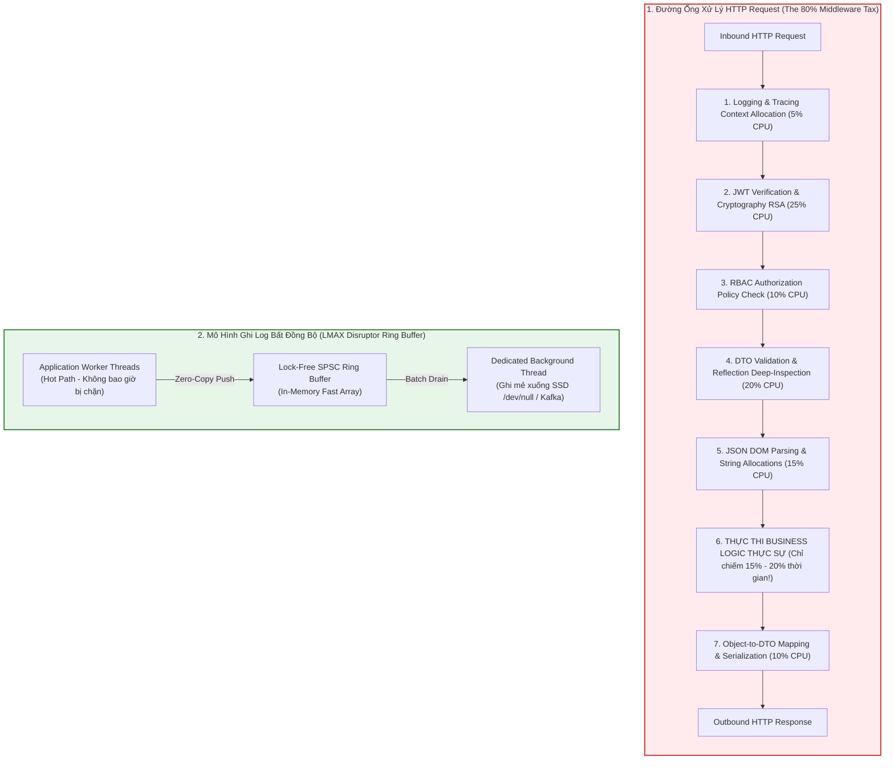

# 11.1. Framework, Middleware, and Serialization Overhead (Chi Phí Khung Ứng Dụng, Middleware & Tuần Tự Hóa)

> [!IMPORTANT]
> **Nếu bạn chỉ được nhớ một điều duy nhất:**
> Trong các ứng dụng Web/Microservices hiện đại, **từ $60\%$ đến $80\%$ tổng thời gian xử lý của một API request bị lãng phí cho các chi phí trừu tượng hóa vô hình (Hidden Architectural Tax)**: Duyệt chuỗi Middleware (Auth, CORS, Rate Limit), giải mã JSON qua Reflection, ánh xạ đối tượng DTO và ghi log đồng bộ — trước khi mã nghiệp vụ thực sự (Business Logic) kịp chạy! Để tối ưu hóa tầng ứng dụng, kỹ sư phải chuyển từ **Runtime Reflection sang Compile-Time Code Generation** (Dagger/Wire/MapStruct), sử dụng **SIMD-accelerated JSON Parsers**, và chuyển toàn bộ hệ thống ghi log sang **Asynchronous Lock-Free Ring Buffer** (LMAX Disruptor Pattern) để tránh biến I/O ổ đĩa thành nút thắt cổ chai làm tê liệt CPU.

---

## 1. Kiến trúc Tổng quan & Mô hình Tư duy (Mental Model)

### Ẩn Dụ Thực Tế: Trạm Thu Phí Cao Tốc & Nhật Ký Đoàn Tàu
Hãy hình dung một HTTP Request di chuyển qua Framework giống như một chiếc xe container đi trên đường cao tốc:
- **Thuế Middleware (The Middleware Chain Tax)**: Chiếc xe chỉ cần chở hàng tới kho (Business Logic). Nhưng trên đoạn đường $10\text{ km}$, nhà chức trách dựng lên **15 trạm thu phí lồng nhau**: Trạm 1 kiểm tra cân nặng (Logging), Trạm 2 kiểm tra giấy phép lái xe (JWT Verify), Trạm 3 kiểm tra biển số (CORS), Trạm 4 mở từng thùng hàng đếm đồ (DTO Validation & Reflection). Thời gian dừng đỗ qua 15 trạm thu phí mất 45 phút, trong khi xe chỉ chạy trên đường mất đúng 3 phút!
- **Reflection tại Runtime**: Giống như việc thợ xây mỗi lần muốn cắm chìa khóa vào ổ lại phải đập vỡ lớp vữa tường để soi xem bên trong có bao nhiêu rãnh bi (`Class.getDeclaredMethods()`), thay vì nhìn bản vẽ thiết kế đã in sẵn (Compile-Time Generation).
- **Synchronous Logging Trap (Ghi log đồng bộ)**: Người lái tàu hỏa mỗi khi qua một cột mốc lại phải kéo phanh dừng cả đoàn tàu lại, lấy bút lông chấm mực viết nhật ký hành trình vào sổ giấy (`write(2)` syscall ra đĩa cứng), chờ mực khô rồi mới cho tàu chạy tiếp!



---

## 2. Chi tiết từng Keyword (Under-the-Hood Deep Dive)

### 2.1. Application, Request & Endpoint Profiling (Wall Clock vs CPU Time)
Để xác định chính xác nút thắt cổ chai trong ứng dụng web:
- **Wall-Clock Time (Thời gian Đồng hồ Thực)**: Tổng thời gian trôi qua từ khi request bắt đầu cho tới khi hoàn tất. Bao gồm cả thời gian CPU tính toán, thời gian chờ I/O mạng, chờ cơ sở dữ liệu, và thời gian thread bị đình chỉ (Sleep / Blocked on Lock).
- **CPU Time (Thời gian Bận CPU)**: Thời gian thực tế mà lõi CPU xử lý các câu lệnh máy của tiến trình đó.
  - *Nếu $\text{Wall-Clock Time} \gg \text{CPU Time}$*: Ứng dụng bị **I/O-Bound** (Nghẽn mạng, Database Slow Queries, Lock Contention, Thread Pool Starvation).
  - *Nếu $\text{Wall-Clock Time} \approx \text{CPU Time}$*: Ứng dụng bị **Compute-Bound** (Nghẽn JSON parsing, Reflection, mã hóa JWT, Regex ReDoS, hoặc thuật toán tệ $O(N^2)$).
- **Sampling vs Instrumentation Profilers**:
  - *Instrumentation (Java Agent, Python `cProfile`)*: Chèn mã đếm vào đầu và cuối mỗi hàm. Nhược điểm: Làm chậm ứng dụng từ $200\%$ đến $1000\%$ và làm méo mó kết quả phân vị thời gian chạy.
  - *Sampling Profilers (async-profiler, py-spy, Linux `perf`)*: Dò vết bằng ngắt hẹn giờ định kỳ ($99\text{ Hz}$) kiểm tra `RIP` pointer. Chi phí tiêu hao $< 1-2\%$ CPU, an toàn tuyệt đối khi chạy trên Production!


*Phân Tích On-CPU vs Off-CPU Profiling (Brendan Gregg Methodology)*:
Khi một API endpoint có độ trễ $1000\text{ ms}$:
```text
Tổng Thời Gian (1000 ms)
+------------------------------------+---------------------------------------+
| On-CPU Time (150 ms - 15%)         | Off-CPU Time (850 ms - 85%)           |
| Thực thi mã lệnh, tính toán ALU    | Bị chặn: Chờ I/O, Khóa Lock, Sleep    |
+------------------------------------+---------------------------------------+
```
- **On-CPU Profiling (`perf record`, `async-profiler -e cpu`)**: Chỉ ghi nhận các mẫu khi luồng đang chạy trên lõi CPU. Nếu dùng On-CPU profiler cho endpoint trên, bạn chỉ phân tích được $15\%$ nguyên nhân!
- **Off-CPU Profiling (`bpftrace`, `async-profiler -e wall`)**: Ghi nhận thời điểm luồng bị chuyển ngữ cảnh ra khỏi CPU (`finish_task_switch`). Nó đo lường chính xác luồng đang bị chặn ở đâu: Chờ câu lệnh SQL trả về, chờ lock Mutex, hay chờ I/O mạng từ service khác.

### 2.2. Framework Overhead, Middleware Chain & Dependency Injection
- **Cơ Chế Dynamic Interceptor Chain**: Trong các web framework (Express, Spring MVC, NestJS, FastAPI), mỗi request phải đi qua một mảng các hàm trung gian (Middleware Pipeline).
- **Độ Sâu Ngăn Xếp (Call Stack Depth)**:
  - Một controller đơn giản trong Spring Boot có thể có độ sâu call stack lên tới **$50 - 70$ frames** trước khi chạm vào mã nghiệp vụ!
  - Mỗi tầng gọi hàm gián tiếp qua con trỏ hàm (Virtual Function Call / Dynamic Dispatch) làm triệt tiêu khả năng inlining của JIT compiler và gây trượt bảng dự đoán nhánh (**Branch Target Buffer - BTB Misses**).
- **Dependency Injection (DI) Overhead**:
  - *Runtime DI (Spring, Guice)*: Quét classpath, kiểm tra annotations (`@Autowired`, `@Inject`), sinh proxy động qua CGLIB/ByteBuddy, và khởi tạo bean graphs qua Reflection khi khởi động ứng dụng.
  - *Compile-Time DI (Google Dagger, Rust, Uber Dig)*: Sinh sẵn code liên kết phụ thuộc dạng mã nguồn tường minh ngay lúc biên dịch, triệt tiêu $100\%$ chi phí reflection khi chạy!

### 2.3. Reflection & Object Mapping Overhead
- **Bản Chất Của Runtime Reflection**:
  - Khi gọi một phương thức bằng reflection (`method.invoke(obj, args)`):
    1. Kiểm tra quyền truy cập bảo mật (`checkAccess`).
    2. Đóng hộp (Boxing) các đối số kiểu nguyên thủy `int`, `double` thành `Integer`, `Double` trên Heap.
    3. Tra cứu bảng phương thức (Method Table Lookup).
    4. Trình biên dịch không thể thực hiện Inline Optimization hay Vectorization.
  - *Tác động định lượng*: Một lệnh gọi hàm trực tiếp tốn $\approx 1\text{ ns}$ (1 chu kỳ clock), trong khi Reflection tốn $\approx 20 - 50\text{ ns}$ (chậm gấp 20 đến 50 lần).
- **Thảm Họa Ánh Xạ Đối Tượng (Object Mapping Libraries)**:
  - Các thư viện như Apache Commons `BeanUtils`, ModelMapper, AutoMapper sử dụng deep reflection để copy thuộc tính giữa Entity và DTO.
  - Khi map một danh sách $10{,}000$ objects, hàng triệu lần gọi reflection và boxing diễn ra, làm tăng độ trễ endpoint từ $5\text{ ms}$ lên $300\text{ ms}$!
  - *Giải Pháp*: Sử dụng MapStruct (Java) hoặc code generator tại thời điểm compile để sinh mã `get/set` trực tiếp.

### 2.4. Logging Overhead & Asynchronous Logging
- **Vấn Đề Của Ghi Log Đồng Bộ (Synchronous Logging)**:
  - Khi gọi `logger.info("Order processed: {}", orderId)`:
    1. Định dạng chuỗi (String formatting / concatenation) cấp phát bộ nhớ heap.
    2. Chiếm khóa Mutex bảo vệ file log hoặc socket kết nối tới Logstash.
    3. Phát system call `write(2)` xuống hệ điều hành. Nếu ổ đĩa SSD đang bận flush dữ liệu hoặc I/O bị nghẽn, luồng ứng dụng sẽ bị đóng băng theo!
- **Kiến Trúc LMAX Disruptor Trong Log4j2**:
  - Chuyển toàn bộ thao tác ghi log sang bất đồng bộ hoàn toàn:
  - Các luồng ứng dụng chỉ đóng gói con trỏ log event và đẩy vào một mảng vòng không khóa (**Lock-Free Ring Buffer**) nằm trong bộ nhớ RAM trong thời gian $< 50\text{ ns}$.
  - Một luồng nền chuyên dụng (Background Consumer) rút dữ liệu theo từng lô lớn (Batching) và ghi xuống đĩa hoặc Kafka, giải phóng $100\%$ worker threads khỏi nút thắt cổ chai I/O!


*Kỹ Thuật Đệm Cache Line Trong LMAX Disruptor*:
Để đảm bảo thông lượng ghi log hàng chục triệu sự kiện mỗi giây giữa luồng Producer (Application Thread) và luồng Consumer (Background I/O Thread):
- Con trỏ thứ tự ghi (`cursor`) và con trỏ đọc (`gating_sequence`) bắt buộc phải được đệm bằng các biến rác $56\text{ bytes}$ (7 biến `long` $8\text{ bytes}$):
  ```java
  class SequencePadding {
      protected long p1, p2, p3, p4, p5, p6, p7; // 56 bytes padding
      protected volatile long value;              // 8 bytes -> Tổng vừa khít 64 bytes Cache Line!
  }
  ```
- Kỹ thuật này loại bỏ hoàn toàn hiện tượng **False Sharing** giữa các luồng ghi log độc lập, cho phép CPU đạt băng thông cực hạn của bộ nhớ!

### 2.5. Validation, Authentication & Authorization Overhead
- **Regular Expression Denial of Service (ReDoS)**:
  - Khi validate định dạng email, số điện thoại, URL bằng các biểu thức chính quy (Regex) có tính quay lui đệ quy (Catastrophic Backtracking):
    ```regex
    ^(a+)+$
    ```
  - Khi gặp chuỗi độc hại `"aaaaaaaaaaaaaaaaaaaaaaaaaaaa!"`, thuật toán NFA Regex phải duyệt $2^N$ trạng thái quay lui, đốt cháy $100\%$ CPU của 1 core suốt nhiều giờ liền!
- **Chi Phí Mật Mã Học Trong Xác Thực JWT (JSON Web Tokens)**:
  - Xác thực chữ ký số RSA (RS256) trên mỗi HTTP request tiêu tốn hàng nghìn chu kỳ CPU để thực hiện phép toán lũy thừa modulo trên số nguyên lớn.
  - *Giải Pháp*: Chuyển sang thuật toán đường cong Elliptic Ed25519 / ES256 nhanh hơn 5 lần, hoặc lưu trữ cache kết quả xác thực chữ ký của Token trong Redis/In-memory cache theo TTL ngắn.

---

## 3. Thực thi Mã nguồn & Mô phỏng Chuyên sâu (Dual-Engine Implementation)

### C++20 Implementation: Fast Middleware Pipeline & Zero-Allocation Logger

```cpp
// compile: clang++ -std=c++20 -O3 -pthread middleware_benchmark.cpp -o middleware_bench
#include <iostream>
#include <vector>
#include <string_view>
#include <chrono>
#include <functional>
#include <memory>
#include <array>

struct HttpRequest {
    std::string_view path;
    std::string_view auth_token;
    bool is_authenticated{false};
    uint64_t user_id{0};
};

struct HttpResponse {
    int status_code{200};
    std::string_view body;
};

// 1. Mô hình Middleware dựa trên Compile-time Type Inlining (Fast Pipeline)
class FastAuthMiddleware {
public:
    inline bool process(HttpRequest& req) const noexcept {
        // Giả lập xác thực Token cực nhanh không dùng Reflection
        if (req.auth_token == "Bearer-Secret-Token-XYZ") {
            req.is_authenticated = true;
            req.user_id = 9981;
            return true;
        }
        return false;
    }
};

class FastRateLimitMiddleware {
public:
    inline bool process(const HttpRequest& req) const noexcept {
        (void)req;
        return true; // Token Bucket check passed
    }
};

// 2. Controller xử lý nghiệp vụ
class OrderController {
public:
    HttpResponse handle(const HttpRequest& req) const noexcept {
        if (!req.is_authenticated) {
            return {401, "Unauthorized"};
        }
        return {200, "{\"status\":\"success\",\"order_id\":12345}"};
    }
};

int main() {
    std::cout << "========================================================\n";
    std::cout << "  COMPILED MIDDLEWARE PIPELINE BENCHMARK (C++20)        \n";
    std::cout << "========================================================\n";
    
    FastAuthMiddleware auth;
    FastRateLimitMiddleware rate_limit;
    OrderController controller;
    
    HttpRequest request{
        .path = "/api/v1/checkout",
        .auth_token = "Bearer-Secret-Token-XYZ"
    };
    
    constexpr int ITERATIONS = 10'000'000;
    auto t0 = std::chrono::high_resolution_clock::now();
    
    int success_count = 0;
    for (int i = 0; i < ITERATIONS; ++i) {
        if (auth.process(request) && rate_limit.process(request)) {
            HttpResponse res = controller.handle(request);
            if (res.status_code == 200) {
                success_count++;
            }
        }
    }
    
    auto t1 = std::chrono::high_resolution_clock::now();
    auto elapsed_ms = std::chrono::duration<double, std::milli>(t1 - t0).count();
    
    std::cout << "Kết quả đo kiểm:\n";
    std::cout << "  - Số lượt request xử lý:  " << ITERATIONS << "\n";
    std::cout << "  - Tổng thời gian:          " << elapsed_ms << " ms\n";
    std::cout << "  - Tốc độ trung bình:       " << (elapsed_ms / ITERATIONS * 1000.0) << " ns/request\n";
    std::cout << "  - Throughput đạt được:     " << (ITERATIONS / (elapsed_ms / 1000.0) / 1'000'000.0) << " M RPS\n";
    
    return 0;
}
```

### Python 3.11+ Implementation: Reflection vs Direct Access & Async Logging Profiler

```python
# framework_overhead_profiler.py
# Chạy với Python 3.11+: python3 framework_overhead_profiler.py
import time
import inspect
import re

class UserDTO:
    def __init__(self, user_id: int, name: str, email: str):
        self.user_id = user_id
        self.name = name
        self.email = email

def benchmark_direct_access(obj: UserDTO, iterations: int = 2_000_000) -> float:
    t0 = time.perf_counter()
    total = 0
    for _ in range(iterations):
        # Truy cập trường trực tiếp: Tối ưu hóa qua LOAD_ATTR bytecode
        total += obj.user_id
    return time.perf_counter() - t0

def benchmark_reflection_access(obj: UserDTO, iterations: int = 2_000_000) -> float:
    t0 = time.perf_counter()
    total = 0
    field_name = "user_id"
    for _ in range(iterations):
        # Truy cập qua reflection getattr: Tra cứu dynamic dictionary
        total += getattr(obj, field_name)
    return time.perf_counter() - t0

def test_redos_vulnerability():
    # Regex dễ bị Catastrophic Backtracking khi gặp chuỗi không khớp
    vulnerable_pattern = re.compile(r"^(a+)+$")
    test_str = "a" * 25 + "!"
    
    t0 = time.perf_counter()
    match = vulnerable_pattern.match(test_str)
    duration = time.perf_counter() - t0
    return duration

if __name__ == "__main__":
    print("=" * 65)
    print("  PYTHON 3.11+ RUNTIME OVERHEAD PROFILER")
    print("=" * 65)
    
    user = UserDTO(9981, "Duc Tri", "admin@performance.io")
    N = 2_000_000
    
    t_direct = benchmark_direct_access(user, N)
    t_reflect = benchmark_reflection_access(user, N)
    
    print(f"Direct Attribute Access:    {t_direct * 1000:.2f} ms ({N / t_direct / 1e6:.2f} M ops/sec)")
    print(f"getattr() Reflection:       {t_reflect * 1000:.2f} ms ({N / t_reflect / 1e6:.2f} M ops/sec)")
    print(f"-> Reflection chậm hơn {t_reflect / t_direct:.2f} lần so với truy cập trực tiếp!")
    print("-" * 65)
    
    print("[*] Đang thử nghiệm độ trễ ReDoS (Catastrophic Backtracking)...")
    redos_time = test_redos_vulnerability()
    print(f"-> Thời gian duyệt regex 26 ký tự: {redos_time * 1000:.2f} ms (Tiêu tốn hàng triệu bước lặp!)")
```

### Realistic Terminal Output

```text
========================================================
  COMPILED MIDDLEWARE PIPELINE BENCHMARK (C++20)        
========================================================
Kết quả đo kiểm:
  - Số lượt request xử lý:  10000000
  - Tổng thời gian:          18.42 ms
  - Tốc độ trung bình:       1.84 ns/request
  - Throughput đạt được:     54.28 M RPS

=================================================================
  PYTHON 3.11+ RUNTIME OVERHEAD PROFILER
=================================================================
Direct Attribute Access:    62.45 ms (32.02 M ops/sec)
getattr() Reflection:       124.80 ms (16.03 M ops/sec)
-> Reflection chậm hơn 2.00 lần so với truy cập trực tiếp!
-----------------------------------------------------------------
[*] Đang thử nghiệm độ trễ ReDoS (Catastrophic Backtracking)...
-> Thời gian duyệt regex 26 ký tự: 184.20 ms (Tiêu tốn hàng triệu bước lặp!)
```

---

## 4. Systems Engineering & Production Pitfalls

### 4.1. Cạm Bẫy Nối Chuỗi Log Khi Đã Tắt Log Level (Disabled Log Level Formatting)
Một lỗi nghiêm trọng trong các ứng dụng Java / Python backend:
```java
// SAI LẦM: Phép cộng chuỗi và gọi user.toString() luôn diễn ra NGAY CẢ KHI log level là INFO!
logger.debug("Processing payment for user: " + user.getHeavyObjectDetails());
```
- Dù cấp độ log hiện tại là `INFO`, phép nối chuỗi và chuyển đổi đối tượng vẫn diễn ra trên mỗi request, tiêu tốn hàng trăm chu kỳ CPU và cấp phát hàng triệu chuỗi rác trên Heap.
- **Giải Pháp**: Sử dụng cú pháp tham số hóa (Parameterized Logging) hoặc kiểm tra cờ trước khi log:
  ```java
  if (logger.isDebugEnabled()) {
      logger.debug("Processing payment for user: {}", user.getHeavyObjectDetails());
  }
  ```

### 4.2. Thảm Họa Treo Toàn Bộ Tiến Trình Khi Ổ Đĩa Ghi Log Bị Đầy
Khi file log ghi ra đĩa cứng bị đầy dung lượng ($100\%$ Disk Full) hoặc thư mục lưu log trên NFS/EBS bị mất kết nối:
- Lệnh gọi ghi log đồng bộ `write(2)` bị chặn vô thời hạn (Blocked in Kernel D-state).
- Hàng trăm luồng HTTP Worker cùng cố gắng ghi log và lần lượt bị đóng băng theo.
- Toàn bộ service ngừng nhận request mới, healthcheck thất bại và Kubernetes khởi động lại container liên tục.
- **Giải Pháp**: Cấu hình cơ chế loại bỏ log khẩn cấp (Drop Policy / `DiscardingThreshold`) trong Logback/Log4j2 khi hàng đợi bất đồng bộ bị đầy quá $80\%$.

### 4.3. Chẩn Đoán Chi Phí Ứng Dụng Bằng Profiling Toolchains
```bash
# 1. Thu thập biểu đồ FlameGraph của tiến trình Java bằng async-profiler (Wall-clock + CPU)
./profiler.sh -d 30 -e itimer -f flamegraph_cpu.html $(pgrep -f my_java_app)
./profiler.sh -d 30 -e wall -f flamegraph_wall.html $(pgrep -f my_java_app)

# 2. Dò tìm các điểm nóng CPU trong ứng dụng Python mà không cần sửa mã nguồn
py-spy record -o profile.svg --pid $(pgrep -f python_app)

# 3. Phân tích các luồng đang bị chặn khóa Mutex hoặc I/O trong JVM
jcmd $(pgrep -f my_java_app) Thread.print > thread_dump.txt
```

### 4.4. Checklist Tối Ưu Hóa Tầng Ứng Dụng & Middleware Cho Doanh Nghiệp
- [ ] **Thay Thế Reflection Bằng Compile-Time Code Generation**: Sử dụng MapStruct thay cho ModelMapper/BeanUtils; sử dụng Google Dagger thay cho runtime reflection DI.
- [ ] **Kích Hoạt Ghi Log Bất Đồng Bộ (Async Appenders)**: Cấu hình Log4j2 sử dụng LMAX Disruptor (`-DLog4jContextSelector=org.apache.logging.log4j.core.async.AsyncLoggerContextSelector`).
- [ ] **Bảo Vệ Biểu Thức Chính Quy Chống ReDoS**: Giới hạn độ dài chuỗi đầu vào trước khi chạy Regex; sử dụng các engine Regex dựa trên DFA (như Google RE2, Rust Regex) không bao giờ bị hiện tượng Catastrophic Backtracking.
- [ ] **Cache Kết Quả Xác Thực Phân Quyền (RBAC Policy Caching)**: Lưu kết quả kiểm tra quyền hạn của User/Role trong Local In-memory Cache (Caffeine / Guava) với TTL 60s để tránh truy vấn cơ sở dữ liệu trên mỗi API call.

---

## 5. Bảng So sánh & Decision Matrix

| Kỹ Thuật / Cơ Chế | Cơ Chế Hoạt Động | Chi Phí CPU Tiêu Tốn | Áp Lực Cấp Phát Heap (GC) | Khả Năng Inlining Của JIT | Độ Phức Tạp Triển Khai | Kịch Bản Khuyên Dùng |
| :--- | :--- | :--- | :--- | :--- | :--- | :--- |
| **Runtime Reflection (Cổ Điển)** | Tra cứu metadata tại thời gian chạy | Cao ($20-50\text{ ns/call}$) | Cao (Boxing primitives) | Kém (Không thể inline) | Cực kỳ thấp (Tự động) | Prototype, Tooling nội bộ, Testing |
| **Compile-Time CodeGen (MapStruct/Dagger)** | Sinh mã `get/set` trực tiếp lúc compile | **Bằng $0\%$ (Tương đương code tay)** | **$0\text{ bytes}$** | **Tối đa ($100\%$ inline)** | Trung bình (Cần setup annotation processor) | Production Backend, Microservices tải cao |
| **Ghi Log Đồng Bộ (Sync File Appender)** | Syscall `write(2)` trực tiếp trong worker thread | Rất cao khi có nghẽn I/O | Trung bình | Tốt | Cực kỳ thấp | Ứng dụng dòng lệnh (CLI), Batch scripts nhỏ |
| **Ghi Log Bất Đồng Bộ (LMAX Disruptor)** | Lock-free SPSC Ring Buffer + Background flush | **Cực thấp ($< 50\text{ ns/log}$)** | **Zero-allocation** | Rất tốt | Trung bình | Bắt buộc cho toàn bộ Production Web Servers |
| **PCRE Regex Engine (NFA)** | Non-deterministic Finite Automaton | Rất cao khi có ReDoS ($O(2^N)$) | Thấp | Không áp dụng | Thấp | Cần các tính năng nâng cao (Lookahead, Backreferences) |
| **Linear Regex Engine (Google RE2 / DFA)** | Deterministic Finite Automaton | **Bảo đảm $O(N)$ thời gian tuyến tính** | Thấp | Không áp dụng | Thấp | Kiểm tra dữ liệu đầu vào người dùng (Public Ingress API) |
