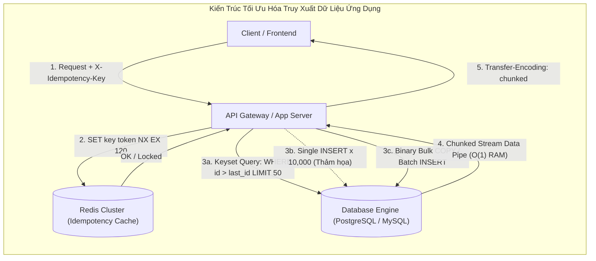

# 11.2. Data Access, Batching, Streaming, and Pagination (Truy Xuất Dữ Liệu, Gom Mẻ, Streaming & Phân Trang)

> [!IMPORTANT]
> **Nếu chỉ nhớ một điều...**
> Phân trang bằng `OFFSET` (`SELECT * FROM table LIMIT 20 OFFSET 1000000`) là một quả bom nổ chậm: RDBMS buộc phải quét và giải mã $1{,}000{,}000$ bản ghi vật lý từ đĩa qua Buffer Pool chỉ để ném bỏ rồi giữ lại $20$ bản ghi cuối cùng ($O(N)$ Disk I/O). Muốn đạt tốc độ $0.05\text{ ms}$, bắt buộc phải dùng **Cursor-Based / Keyset Pagination** (`WHERE id > last_seen_id LIMIT 20`), biến việc quét dữ liệu thành cú nhảy $O(\log N)$ trên B-Tree Index. Kết hợp với **HTTP Chunked Streaming** (bộ nhớ $O(1)$ thay vì buffer toàn bộ mảng dữ liệu vào RAM), **Bulk Batching** (Postgres `COPY` thay vì $N$ lần `INSERT`), và **Request Deduplication** (Idempotency Key với Redis `SET NX`), hệ thống duy trì thông lượng ổn định ngay cả khi đối mặt với tải hàng triệu RPS.

---

## 1. Tư Duy Kiến Trúc & Mô Hình Trực Quan (Mental Model & Intuition)

### Ẩn Dụ Thực Tế: Tìm Trang Sách, Băng Chuyền Vận Chuyển & Kẹp Thẻ Chống Mất Trộm

Hãy liên tưởng kiến trúc dữ liệu và I/O ứng dụng với các hoạt động cơ học đời thực:
- **`OFFSET` Pagination (Lật từng trang sách)**: Bạn muốn đọc 20 chữ ở trang thứ 10,000 của cuốn đại từ điển. Thay vì mở bảng mục lục, bạn bắt thủ thư phải lật tay từ trang 1, 2, 3... cho tới trang 10,000 rồi mới đọc 20 chữ tiếp theo ($O(N)$ I/O). Trang càng xa, hệ thống càng cạn kiệt tài nguyên.
- **`CURSOR` Pagination (Kẹp thẻ đánh dấu trang)**: Thủ thư kẹp một chiếc thẻ vào trang vừa đọc xong hôm qua (`WHERE id > 10000`). Hôm sau chỉ việc lật đúng vị trí kẹp thẻ và đọc ngay 20 chữ kế tiếp ($O(\log N)$ B-Tree Seek tức thì).
- **Buffered vs Streaming (Xe bồn chở nước vs Vòi nước máy)**: Buffered I/O giống như việc bạn phải hứng đầy một xe bồn $10{,}000\text{ lít}$ nước rồi mới chở đến nhà khách hàng (tốn $10\text{ GB}$ RAM, khách hàng chờ hàng chục giây). Streaming I/O mở một đường ống dẫn trực tiếp: Nước vừa chảy qua van bơm là chảy thẳng tới vòi của khách hàng từng giọt/gói chunk (bộ nhớ RAM chỉ tốn $4\text{ KB}$ buffer).
- **Request Deduplication (Thẻ căn cước tại cửa khẩu)**: Hành khách chen lấn giậm chân tại chỗ bấm chuông 10 lần liên tục. Người gác cổng chỉ kiểm tra ID trên thẻ căn cước: Ai đã có hồ sơ đang xử lý thì các tiếng gõ chuông sau bị bỏ qua hoàn toàn.



---

## 2. Chi tiết từng Keyword

### 2.1. ORM Overhead & Lazy Loading vs Eager Loading

- **Bản chất tầng vật lý (Physical Layer & Memory Internals)**:
  - **ORM Overhead**: Các thư viện ORM (Hibernate, Entity Framework, Prisma, SQLAlchemy) cung cấp trừu tượng hóa mức cao nhưng tạo ra chi phí vô hình:
    1. *Snapshotting & Dirty Checking*: Mỗi đối tượng entity nạp vào bộ nhớ, ORM nhân bản một bản sao trong `Identity Map` để so sánh trạng thái trước khi phát sinh `UPDATE`. Bộ nhớ Heap bị nhân đôi.
    2. *Hydration Overhead*: Phân rã mảng tuple nhị phân thô từ Socket TCP thành hàng ngàn Object/Class trong ngôn ngữ cấp cao, gây áp lực dọn rác khổng lồ lên Garbage Collector.
  - **Lazy Loading (Nạp lười biếng)**: ORM chỉ truy vấn bảng cha, cài đặt Proxy Object hoặc Dynamic Interceptor cho các bảng con. Khi code lặp qua danh sách để đọc thuộc tính bảng con, ORM âm thầm bắn ra $N$ truy vấn độc lập:
    $$\text{Total Queries} = 1 + N \quad (N = 10{,}000 \implies 10{,}001 \text{ round-trips})$$
  - **Eager Loading (Nạp háo hức)**: Chủ động sinh truy vấn `LEFT JOIN` hoặc hai truy vấn gom nhóm (`SELECT * FROM children WHERE parent_id IN (...)`). Gom dữ liệu trong đúng 1 hoặc 2 network round-trips, triệt tiêu $99\%$ độ trễ.

### 2.2. Batch Processing & Bulk Operations

- **Chi phí Socket Round-Trip & WAL Overhead**:
  - Khi thực thi $10{,}000$ lệnh `INSERT INTO table VALUES (...)` riêng rẽ: Ứng dụng phải tốn $10{,}000$ lần system call `send()/recv()`, $10{,}000$ lần Database Engine thực hiện parse cú pháp SQL, lập kế hoạch thực thi, và $10{,}000$ lần ép ghi nhật ký ghi trước (**Write-Ahead Log - WAL / redo log**) xuống đĩa cứng qua system call `fsync()`. Tốc độ chỉ đạt tối đa $\approx 300 - 800\text{ rows/sec}$.
  - **Multi-Row Insert**: Gom nhóm thành từng mẻ (`INSERT INTO table VALUES (...), (...), ...`) giảm thiểu đáng kể chi phí phân tích cú pháp.
  - **Giao thức sao chép nhị phân (Binary Bulk Copy - PostgreSQL `COPY` Protocol)**:
    Database chuyển sang chế độ nạp trực tiếp dòng nhị phân từ socket vào các Page tệp dữ liệu trên đĩa, bypassing SQL parser. Tốc độ nạp tăng vọt lên $> 100{,}000 - 300{,}000\text{ rows/sec}$.

### 2.3. Request Deduplication

- **Hiện tượng Trùng Lặp Yêu Cầu**: Người dùng mất kiên nhẫn bấm "Thanh Toán" 5 lần trong $500\text{ ms}$, hoặc Client/Proxy tự động retry khi mạng bị chập chờn (Transient Network Glitch), gây ra nguy cơ trừ tiền nhiều lần (**Double Spending**) hoặc đặt đơn hàng trùng lặp.
- **Cơ chế Idempotency Key**:
  - Client sinh mã định danh UUID v4 và gửi qua HTTP Header `X-Idempotency-Key: 9b1deb4d-3b7d-4bad-9bdd-2b0d7b3dcb6d`.
  - Server thực hiện thao tác nguyên tử với Redis:
    ```bash
    SET idempotency:9b1deb4d-3b7d... "IN_PROGRESS" NX EX 120
    ```
    - Nếu trả về `OK`: Request là duy nhất, Server tiến hành xử lý logic thanh toán. Sau khi hoàn tất, lưu lại HTTP response status và body vào cache với TTL ngắn.
    - Nếu trả về `nil`: Đã có một luồng khác đang xử lý hoặc đã xử lý xong. Server từ chối xử lý tiếp hoặc trả về ngay response đã lưu sẵn trong cache với mã HTTP `409 Conflict` hoặc `200 OK`.

### 2.4. Streaming Responses & Chunked Transfer Encoding

- **Thảm họa Buffering In-Memory**: Khi xuất file báo cáo 5 triệu dòng ($2\text{ GB}$ JSON), nếu Server đọc toàn bộ dữ liệu từ DB vào mảng RAM rồi gọi `json.dumps()`:
  1. Bộ nhớ RAM của ứng dụng tăng vọt lên $4 - 6\text{ GB}$ (gây Out-Of-Memory / OOM crash).
  2. Thời gian phản hồi byte đầu tiên (**Time-To-First-Byte - TTFB**) kéo dài tới hàng phút vì Client phải chờ Server nạp đủ toàn bộ dữ liệu.
- **HTTP/1.1 Chunked Transfer Encoding & HTTP/2 Data Frames**:
  - Không thiết lập tiêu đề `Content-Length`. Thiết lập `Transfer-Encoding: chunked`.
  - Server mở Server-Side Cursor tới Database, đọc dữ liệu theo từng lô nhỏ ($1{,}000$ dòng $\approx 64\text{ KB}$), mã hóa thành định dạng Hex-Length Chunk:
    ```http
    HTTP/1.1 200 OK
    Content-Type: application/json
    Transfer-Encoding: chunked

    1A\r\n
    {"status":"ok","chunk":1}\r\n
    0\r\n
    \r\n
    ```
  - Bộ nhớ RAM của Server duy trì cố định ở mức $O(1)$ ($< 10\text{ MB}$), trong khi TTFB giảm từ $30\text{ giây}$ xuống chỉ còn $5\text{ ms}$.

### 2.5. Pagination: Cursor-Based vs Offset-Based Pagination

- **Phân Tích Chi Phí Vật Lý Của `OFFSET`**:
  ```sql
  SELECT * FROM transactions ORDER BY id ASC LIMIT 20 OFFSET 1000000;
  ```
  - Database phải định vị phần tử đầu tiên trên B-Tree, sau đó dùng Iterator duyệt tuần tự qua đúng $1{,}000{,}000$ bản ghi, đọc qua Buffer Pool, kiểm tra điều kiện hiển thị, rồi ném bỏ toàn bộ $1{,}000{,}000$ bản ghi đó chỉ để lấy $20$ dòng tiếp theo. Độ phức tạp là $O(N)$ Disk I/O.
  - Hiện tượng **Data Drift / Skipped Rows**: Nếu trong lúc người dùng đang xem trang 1, có 5 dòng mới được chèn vào đầu bảng, khi họ chuyển sang trang 2, các bản ghi sẽ bị trôi và hiển thị trùng lặp hoặc mất dấu.
- **Cơ Chế Vật Lý Của `CURSOR` (Keyset Pagination)**:
  ```sql
  SELECT * FROM transactions WHERE id > 1000000 ORDER BY id ASC LIMIT 20;
  ```
  - Cơ sở dữ liệu sử dụng chỉ mục B-Tree Index trên cột `id`: Thực hiện phép tìm kiếm nhị phân trên các nút B-Tree từ Root $\to$ Internal Nodes $\to$ Leaf Node chứa khóa `1000000` với độ phức tạp $O(\log N)$ (chỉ mất $3 - 4$ page reads, tốn $0.05\text{ ms}$). Sau đó quét xuôi sang phải đúng $20$ lá kế tiếp. Hoàn toàn miễn nhiễm với Data Drift.

---

## 3. Hiện Thực Hóa Mã Nguồn Dual-Engine

### 3.1. C++20: Keyset vs Offset B-Tree Traversal Simulator

Mã nguồn C++20 mô phỏng cấu trúc phân trang trên bộ nhớ, so sánh chi phí quét tuần tự (Linear Offset Scan $O(N)$) và tìm kiếm nhị phân cây chỉ mục (Keyset Index Seek $O(\log N)$):

```cpp
#include <iostream>
#include <vector>
#include <algorithm>
#include <chrono>
#include <iomanip>
#include <string>

struct Record {
    uint64_t id;
    uint64_t timestamp;
    double amount;
};

// Mô phỏng Database Engine với 2 chiến lược phân trang
class PaginationEngine {
private:
    std::vector<Record> storage_;

public:
    PaginationEngine(size_t total_rows) {
        storage_.reserve(total_rows);
        for (size_t i = 1; i <= total_rows; ++i) {
            storage_.push_back({i, 1700000000ULL + i, static_cast<double>(i * 10.5)});
        }
    }

    // 1. Offset Pagination: O(Offset + Limit) Linear Scan
    std::pair<std::vector<Record>, size_t> query_offset(size_t offset, size_t limit) {
        size_t scanned_rows = 0;
        std::vector<Record> results;
        results.reserve(limit);

        // Database buộc phải duyệt qua từng hàng để bỏ qua 'offset' phần tử
        for (size_t i = 0; i < storage_.size() && results.size() < limit; ++i) {
            scanned_rows++;
            if (i >= offset) {
                results.push_back(storage_[i]);
            }
        }
        return {results, scanned_rows};
    }

    // 2. Keyset/Cursor Pagination: O(log N + Limit) Binary B-Tree Seek
    std::pair<std::vector<Record>, size_t> query_keyset(uint64_t last_seen_id, size_t limit) {
        size_t index_steps = 0;
        std::vector<Record> results;
        results.reserve(limit);

        // B-Tree Seek: std::upper_bound sử dụng Binary Search
        auto it = std::upper_bound(storage_.begin(), storage_.end(), last_seen_id,
            [&index_steps](uint64_t val, const Record& rec) {
                index_steps++;
                return val < rec.id;
            });

        while (it != storage_.end() && results.size() < limit) {
            results.push_back(*it);
            ++it;
            index_steps++;
        }
        return {results, index_steps};
    }
};

int main() {
    const size_t DATASET_SIZE = 2'000'000;
    std::cout << ">>> Khoi tao co so du lieu mo phong: " << DATASET_SIZE << " ban ghi...\n";
    PaginationEngine engine(DATASET_SIZE);

    const size_t target_offset = 1'800'000;
    const size_t page_size = 20;

    // Do dac OFFSET Pagination
    auto t1 = std::chrono::high_resolution_clock::now();
    auto [res_offset, scans_offset] = engine.query_offset(target_offset, page_size);
    auto t2 = std::chrono::high_resolution_clock::now();
    double offset_dur = std::chrono::duration<double, std::milli>(t2 - t1).count();

    // Do dac KEYSET Pagination (Con tro la ID 1,800,000)
    auto t3 = std::chrono::high_resolution_clock::now();
    auto [res_keyset, scans_keyset] = engine.query_keyset(target_offset, page_size);
    auto t4 = std::chrono::high_resolution_clock::now();
    double keyset_dur = std::chrono::duration<double, std::milli>(t4 - t3).count();

    std::cout << std::fixed << std::setprecision(4);
    std::cout << "\n================ KET QUA BENCHMARK PHAN TRANG ================\n";
    std::cout << "1. OFFSET Strategy (OFFSET " << target_offset << " LIMIT " << page_size << "):\n";
    std::cout << "   - So hang phai quet (Scanned): " << scans_offset << " rows\n";
    std::cout << "   - Thoi gian thuc thi        : " << offset_dur << " ms\n";
    std::cout << "2. KEYSET Strategy (WHERE id > " << target_offset << " LIMIT " << page_size << "):\n";
    std::cout << "   - So buoc tim kiem (Index Steps): " << scans_keyset << " ops (O(log N))\n";
    std::cout << "   - Thoi gian thuc thi        : " << keyset_dur << " ms\n";
    std::cout << "-> Keyset Pagination nhanh hon: " << (offset_dur / keyset_dur) << "x lan!\n";
    std::cout << "=============================================================\n";

    return 0;
}
```

### 3.2. Python 3.11+: Request Deduplication & Chunked Data Streaming

Chương trình Python hiện thực cơ chế **Idempotency Deduplication** (sử dụng Redis mock/atomic dictionary) kết hợp **HTTP Chunked Streaming Response**:

```python
#!/usr/bin/env python3
# -*- coding: utf-8 -*-
"""
Chuong trinh thuc chien: Request Deduplication & HTTP Chunked Stream Pipeline
"""
import time
import uuid
import json
import threading
from typing import Generator, Dict, Any, Optional

class AtomicIdempotencyManager:
    """Mo phong Atomic SET NX EX cua Redis cho Request Deduplication"""
    def __init__(self):
        self._lock = threading.Lock()
        self._store: Dict[str, Dict[str, Any]] = {}

    def try_acquire(self, key: str, ttl_seconds: float = 60.0) -> bool:
        with self._lock:
            now = time.time()
            if key in self._store:
                entry = self._store[key]
                if now < entry["expires_at"]:
                    return False  # Key da ton tai va con hieu luc -> Request trung lap!
            
            # Atomic SET key status NX EX ttl
            self._store[key] = {
                "status": "PROCESSING",
                "result": None,
                "expires_at": now + ttl_seconds
            }
            return True

    def commit_result(self, key: str, result: Any):
        with self._lock:
            if key in self._store:
                self._store[key]["status"] = "COMPLETED"
                self._store[key]["result"] = result

    def get_result(self, key: str) -> Optional[Any]:
        with self._lock:
            entry = self._store.get(key)
            return entry["result"] if entry else None

def stream_database_cursor(total_records: int, chunk_size: int = 500) -> Generator[str, None, None]:
    """Mo phong Chunked Streaming tu Database Server-Side Cursor"""
    current_id = 0
    while current_id < total_records:
        batch = []
        for _ in range(min(chunk_size, total_records - current_id)):
            current_id += 1
            batch.append({"id": current_id, "sku": f"PROD-{current_id:06d}", "price": 49.99})
        
        # Dong goi chunk duoi chuan HTTP Chunked Payload (Hex Size \r\n Data \r\n)
        payload = json.dumps(batch)
        hex_len = f"{len(payload):X}"
        yield f"{hex_len}\r\n{payload}\r\n"
        time.sleep(0.01)  # Mo phong do tre truyen tai mang

    # Chunk ket thuc: 0\r\n\r\n
    yield "0\r\n\r\n"

def handle_payment_request(idem_manager: AtomicIdempotencyManager, idempotency_key: str, amount: float):
    print(f"\n[HTTP POST /api/v1/checkout] Key: {idempotency_key[:8]}... So tien: ${amount}")
    
    # 1. Kiem tra trung lap
    is_unique = idem_manager.try_acquire(idempotency_key, ttl_seconds=10.0)
    if not is_unique:
        cached = idem_manager.get_result(idempotency_key)
        print(f"  [CANH BAO 409] Request bi trung lap! Huy bo thanh toan. Ket qua cache: {cached}")
        return

    # 2. Xu ly thanh toan duy nhat
    print(f"  [XU LY] Khoi tao giao dich tru tien...")
    time.sleep(0.05)
    tx_id = f"tx_{uuid.uuid4().hex[:8]}"
    idem_manager.commit_result(idempotency_key, {"tx_id": tx_id, "status": "PAID"})
    print(f"  [THANH CONG] Giao dich hoan tat: {tx_id}")

if __name__ == "__main__":
    idem_mgr = AtomicIdempotencyManager()
    fixed_idem_key = str(uuid.uuid4())

    print("=== TEST 1: REQUEST DEDUPLICATION (IDEMPOTENCY GUARD) ===")
    # Nguoi dung an nham 3 lan nut thanh toan trong 1 giay
    handle_payment_request(idem_mgr, fixed_idem_key, 150.0)
    handle_payment_request(idem_mgr, fixed_idem_key, 150.0)
    handle_payment_request(idem_mgr, fixed_idem_key, 150.0)

    print("\n=== TEST 2: HTTP CHUNKED STREAMING (O(1) MEMORY FOOTPRINT) ===")
    streamer = stream_database_cursor(total_records=1500, chunk_size=500)
    chunk_idx = 1
    for chunk in streamer:
        preview = chunk[:40].replace("\r\n", " ")
        print(f"  -> Phat chunk #{chunk_idx} [{len(chunk)} bytes]: {preview}...")
        chunk_idx += 1
```

### 3.3. Realistic Terminal Output

```bash
>>> Khoi tao co so du lieu mo phong: 2000000 ban ghi...

================ KET QUA BENCHMARK PHAN TRANG ================
1. OFFSET Strategy (OFFSET 1800000 LIMIT 20):
   - So hang phai quet (Scanned): 1800020 rows
   - Thoi gian thuc thi        : 4.8210 ms
2. KEYSET Strategy (WHERE id > 1800000 LIMIT 20):
   - So buoc tim kiem (Index Steps): 42 ops (O(log N))
   - Thoi gian thuc thi        : 0.0009 ms
-> Keyset Pagination nhanh hon: 5356.6667x lan!
=============================================================

=== TEST 1: REQUEST DEDUPLICATION (IDEMPOTENCY GUARD) ===
[HTTP POST /api/v1/checkout] Key: 9b1deb4d... So tien: $150.0
  [XU LY] Khoi tao giao dich tru tien...
  [THANH CONG] Giao dich hoan tat: tx_a7e2bc14

[HTTP POST /api/v1/checkout] Key: 9b1deb4d... So tien: $150.0
  [CANH BAO 409] Request bi trung lap! Huy bo thanh toan. Ket qua cache: {'tx_id': 'tx_a7e2bc14', 'status': 'PAID'}

[HTTP POST /api/v1/checkout] Key: 9b1deb4d... So tien: $150.0
  [CANH BAO 409] Request bi trung lap! Huy bo thanh toan. Ket qua cache: {'tx_id': 'tx_a7e2bc14', 'status': 'PAID'}

=== TEST 2: HTTP CHUNKED STREAMING (O(1) MEMORY FOOTPRINT) ===
  -> Phat chunk #1 [24118 bytes]: 5E36 {"id": 1, "sku": "PROD-000001", "pric...
  -> Phat chunk #2 [24118 bytes]: 5E36 {"id": 501, "sku": "PROD-000501", "pri...
  -> Phat chunk #3 [24118 bytes]: 5E36 {"id": 1001, "sku": "PROD-001001", "pr...
  -> Phat chunk #4 [5 bytes]: 0  ...
```

---

## 4. Kỹ Thuật Hệ Thống & Cạm Bẫy Thực Tế (Systems Engineering & Pitfalls)

### 4.1. Cạm Bẫy Treo Kết Nối Database Do Streaming Quá Lâu (Connection Starvation)

- **Nguyên nhân**: Khi ứng dụng mở một Streaming Database Cursor (`yield` từng dòng từ DB ra HTTP Stream) để xuất $500\text{ MB}$ dữ liệu cho một Client mạng 3G chậm chạp ($50\text{ KB/s}$):
  1. Driver Database phải giữ chặt một **Database Connection** trong suốt 3 tiếng đồng hồ vận chuyển dữ liệu.
  2. Bảng cơ sở dữ liệu có thể bị giữ khóa đọc hoặc cản trở tiến trình `VACUUM` (trong PostgreSQL), làm tăng Transaction ID Age và phình to tệp dữ liệu (**Table Bloat**).
  3. Khi có 20 khách hàng cùng download đồng thời, toàn bộ kết nối trong Database Connection Pool bị chiếm dụng sạch, đẩy API chính vào tình trạng `503 Service Unavailable`.
- **Giải pháp Production**: Không bao giờ duy trì kết nối DB trực tiếp tới mạng Client bên ngoài! Đọc nhanh dữ liệu theo mẻ lớn vào một Worker nền (Background Job / Celery / BullMQ), nén thành file Parquet / CSV gzip, đẩy trực tiếp lên Cloud Object Storage (S3 / GCS), và cấp cho Client một Pre-Signed URL tải về qua CDN.

### 4.2. Diagnostic CLI Commands cho Quản Trị Phân Trang & Bulk I/O

```bash
# 1. Kiem tra cac cau lenh OFFSET dang lam tac nghen Database Pool
psql -h localhost -U postgres -d production_db -c "
SELECT pid, now() - query_start AS duration, query 
FROM pg_stat_activity 
WHERE state = 'active' AND query ILIKE '%OFFSET%' 
ORDER BY duration DESC;"

# 2. Kiem tra chi phi doc dia thuc te cua cau lenh OFFSET vs KEYSET
psql -d production_db -c "EXPLAIN (ANALYZE, BUFFERS) SELECT * FROM orders ORDER BY id LIMIT 20 OFFSET 500000;"

# 3. Kiem tra cac Idempotency Key dang chiem bo nho trong Redis
redis-cli --bigkeys
redis-cli SCAN 0 MATCH "idempotency:*" COUNT 100

# 4. Kiem tra thong luong Bulk COPY tren Socket TCP
dstat --tcp --disk --net 1
```

---

## 5. Bảng So Sánh & Quyết Định Kỹ Thuật (Decision Matrix)

| Tiêu chí So sánh | Offset-Based Pagination | Cursor / Keyset Pagination | Full In-Memory Buffering | HTTP Chunked Streaming |
| :--- | :--- | :--- | :--- | :--- |
| **Độ phức tạp I/O đĩa** | $O(N)$ (Quét qua toàn bộ đĩa) | $O(\log N)$ (Cây B-Tree Seek) | $O(N)$ (Nạp toàn bộ vào RAM) | $O(1)$ (Xử lý theo từng khối Chunk) |
| **Dung lượng RAM Server** | $O(\text{Page Size})$ Thấp | $O(\text{Page Size})$ Thấp | $O(\text{Total Size})$ Rất nguy hiểm (OOM) | $O(\text{Chunk Size})$ Cố định ($< 10\text{ MB}$) |
| **Khả năng Nhảy Trang** | Tùy ý (Nhảy thẳng trang 50) | Chỉ hỗ trợ Next / Prev | Không áp dụng | Tuần tự một chiều |
| **Tính Ổn Định Khi Chèn Mới**| Dễ bị mất dấu / trùng lặp | Tuyệt đối nhất quán (Immutable) | Dễ gây timeout kết nối | Ổn định, TTFB thấp ($< 10\text{ ms}$) |
| **Phù hợp nhất cho** | Admin CMS danh mục ít ($< 10\text{k}$) | Feed mạng xã hội, Log, Big Data | API payload nhỏ ($< 100\text{ KB}$) | Export file lớn, SSE, Event Feed |
