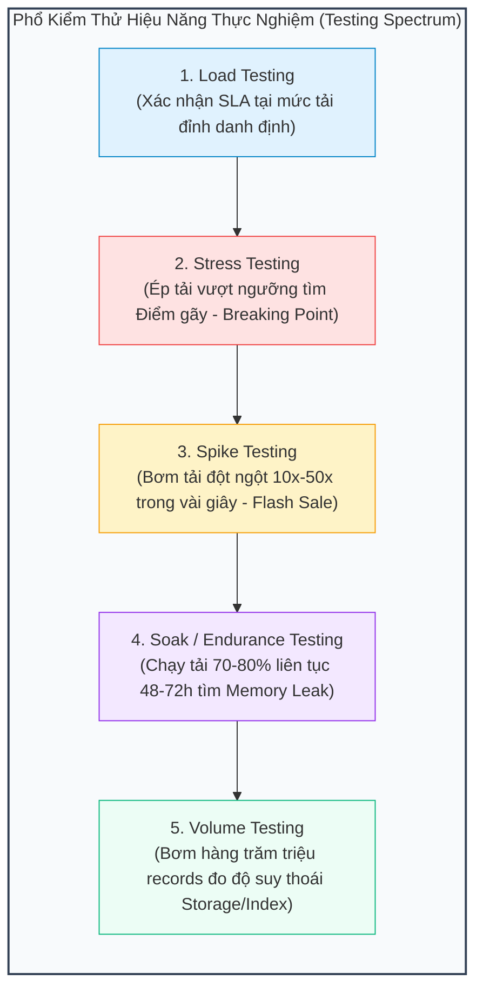

# 12.1. Workload Testing Methodologies and Pitfalls (Phương Pháp Kiểm Thử Tải & Các Cạm Bẫy Thực Nghiệm)

> [!IMPORTANT]
> **Nếu bạn chỉ được nhớ một điều duy nhất:**
> Trong kiểm thử hiệu năng, sự khác biệt sống còn giữa **Closed Workload Model** và **Open Workload Model** quyết định tính xác thực của toàn bộ kết quả đo kiểm. Closed Model (JMeter, AB) chỉ gửi request tiếp theo khi nhận được response trước đó; nếu server bị đơ 10 giây, máy phát tải cũng bị đơ theo và dừng gửi request. Báo cáo cuối ngày đưa ra độ trễ P99 giả mạo xanh rờn, che giấu hoàn toàn thực tế rằng hàng nghìn người dùng ngoài đời thực đang bị kẹt cứng trong hàng đợi. Hiện tượng này được Gil Tene định danh là **Coordinated Omission**. Để đo lường chính xác, hệ thống bắt buộc phải áp dụng Open Workload Model (tốc độ phát tải $\lambda$ độc lập với tốc độ phản hồi) và hiệu chỉnh độ trễ hàng đợi bằng thuật toán HdrHistogram.

## 1. Kiến trúc Tổng quan & Mô hình Tư duy (Mental Model)

### Ẩn Dụ Thực Tế: Đồng Hồ Bấm Giờ Chuyến Tàu vs Quầy Bán Vé Một Cửa
Hãy hình dung hệ thống máy chủ giống như một quầy bán vé nhà ga:
- **Closed Workload Model**: Nhân viên bán vé chỉ gọi người tiếp theo khi người trước đã mua vé xong và bước vào sân ga. Nếu nhân viên bị đơ 10 phút, dòng người đứng chờ bên ngoài không được tính vào hàng đợi; báo cáo cuối ngày ghi nhận: *"Chỉ có đúng 1 người bị phục vụ chậm 10 phút, P99 vẫn dưới 5ms!"*.
- **Open Workload Model**: Cứ mỗi giây có đúng 100 hành khách ồ ạt bước vào sảnh bất kể quầy vé có bị nghẽn hay không. Nếu quầy vé đơ 10 phút, 60,000 người sẽ dồn ứ trước cửa với thời gian chờ từ 1 giây đến 10 phút. Đó chính là thực tế tàn khốc của Internet ngoài đời thực. Nếu công cụ load test của bạn dùng Closed Model, bạn đang tự ru ngủ mình bằng những con số ảo tưởng mang tên **Coordinated Omission**.


## 2. Chi tiết từng Keyword (Under-the-Hood Deep Dive)

### 2.1. Phân Loại Các Hình Thức Kiểm Thử (Testing Typology)
1. **Load Testing (Kiểm thử tải tiêu chuẩn)**:
   - Mô phỏng lưu lượng truy cập dự kiến tại giờ cao điểm bình thường (Peak Normal Load).
   - Mục tiêu: Kiểm tra xem các chỉ số SLA/SLO (P95, P99 latency, Throughput, Error Rate) có đạt cam kết kinh doanh hay không.
2. **Stress Testing (Kiểm thử áp lực)**:
   - Tăng dần tải vượt qua ngưỡng thiết kế tối đa cho đến khi hệ thống bắt đầu suy thoái hoặc đổ vỡ (**Breaking Point**).
   - Mục tiêu: Xác định nút thắt cổ chai đầu tiên bị gãy (CPU, RAM, Database Connection Pool, Disk I/O) và kiểm tra khả năng phục hồi (Graceful Degradation).
3. **Spike Testing (Kiểm thử đột biến)**:
   - Bơm lưu lượng cực lớn tăng gấp 10x đến 50x trong vài giây (ví dụ: mở bán vé concert Blackpink, flash sale 11/11).
   - Mục tiêu: Kiểm tra cơ chế tự động co giãn (Autoscaling), giới hạn tốc độ (Rate Limiting) và hàng đợi chờ (Virtual Waiting Room).
4. **Soak / Endurance Testing (Kiểm thử sức bền)**:
   - Duy trì mức tải vừa phải ($70-80\%$ công suất) liên tục trong thời gian dài (từ 24 đến 72 giờ).
   - Mục tiêu: Phát hiện rò rỉ bộ nhớ ngầm (Memory Leaks), rò rỉ connection/file descriptors, phân mảnh heap, hoặc tràn ổ đĩa log.
5. **Breakpoint Testing (Kiểm thử điểm gãy)**:
   - Tăng tải liên tục theo đường dốc không giới hạn cho tới khi hệ thống sập hoàn toàn để lập bản đồ giới hạn chịu đựng tối đa.

### 2.2. Workload Models: Closed vs Open Workload Model (Little's Law $L = \lambda W$)
- **Nền Tảng Toán Học & Định Luật Little (Little's Law)**:
  $$L = \lambda \times W$$
  Trong đó:
  - $L$: Số lượng yêu cầu đang nằm trong hệ thống (Concurrency / In-flight Requests).
  - $\lambda$: Tốc độ yêu cầu đến trung bình (Arrival Rate / Throughput).
  - $W$: Thời gian một yêu cầu lưu lại trong hệ thống (Response Time / Latency).
- **Closed Workload Model (Vòng Lặp Đóng)**:
  - Số lượng người dùng đồng thời ($N$) được giữ cố định. Một user ảo (VU) gửi request, nhận response, chờ suy nghĩ (**Think Time $Z$**), rồi mới gửi request tiếp theo:
    $$\lambda = \frac{N}{W + Z}$$
  - *Hệ quả chết người*: Khi server bị chậm ($W$ tăng vọt), tốc độ phát tải $\lambda$ **tự động giảm xuống**! Máy phát tải tự động giảm áp lực lên server đang hấp hối, che giấu hoàn toàn sự cố.
- **Open Workload Model (Vòng Lặp Mở)**:
  - Tốc độ yêu cầu đến $\lambda$ được cố định độc lập với tình trạng của hệ thống mục tiêu. Yêu cầu mới liên tục được phát ra theo phân phối Poisson bất kể các yêu cầu trước đã hoàn thành hay chưa.
  - 
*Toán Học Hàng Đợi M/M/1: Điểm Bùng Nổ Côn Cầu Khi Độ Tận Dụng Chạm 100%*:
Trong lý thuyết hàng đợi toán học (Kendall Notation $M/M/1$), độ dài trung bình của hàng đợi $L_q$ và thời gian chờ trung bình $W_q$ phụ thuộc phi tuyến vào hệ số tận dụng tài nguyên $
ho = \frac{\lambda}{\mu}$ (với $\lambda$ là tốc độ đến, $\mu$ là tốc độ phục vụ tối đa):
$$L_q = \frac{
ho^2}{1 - 
ho}, \quad W_q = \frac{
ho}{\mu(1 - 
ho)}$$
- Khi hệ thống chạy ở mức $
ho = 50\%$, độ dài hàng đợi trung bình chỉ là $L_q = 0.5$ request.
- Khi tải tăng lên $
ho = 80\%$, $L_q = 3.2$ requests.
- Khi tải chạm ngưỡng $
ho = 95\%$, $L_q = 18$ requests.
- Khi tải chạm $
ho = 99\%$, $L_q = 98$ requests và khi $
ho 	o 1.0$, hàng đợi tiến tới **vô cực ($\infty$)**!
Đây chính là lý do vì sao một hệ thống chỉ cần tăng tải thêm $5\%$ từ $95\%$ lên $100\%$ là toàn bộ độ trễ đuôi sẽ tăng vọt hàng trăm lần theo hình chiếc gậy khúc côn cầu (**Hockey Stick Curve**)!

Phản ánh đúng $100\%$ thực tế người dùng Internet: Khách hàng không hề biết server đang chậm; họ vẫn tiếp tục bấm truy cập!

### 2.3. Chu Kỳ Kiểm Thử Chuẩn Mực (Test Execution Lifecycle)
Một kịch bản kiểm thử tải chuyên nghiệp bắt buộc phải trải qua 5 giai đoạn liên tục:
```
+----------------+----------------+-------------------+----------------+----------------+
| 1. Warm-up     | 2. Ramp-up     | 3. Steady State   | 4. Ramp-down   | 5. Cool-down   |
| Khởi động JIT  | Tăng dần VU    | Đo đạc dữ liệu    | Giảm tải dần   | Xả bộ đệm      |
| (5 - 10 phút)  | (10 - 15 phút) | (30 - 60 phút)    | (5 - 10 phút)  | (5 phút)       |
+----------------+----------------+-------------------+----------------+----------------+
```
1. **Warm-up**: Làm nóng JIT compiler, nạp cache L1/L2, khởi tạo sẵn database connection pools và TCP connections. Dữ liệu đo trong giai đoạn này phải bị loại bỏ để tránh làm sai lệch phân vị.
2. **Ramp-up**: Tăng dần số lượng Virtual Users để kiểm tra hành vi khởi động của hệ thống autoscaling.
3. **Steady State**: Giữ tải ổn định ở mức danh định. Đây là giai đoạn duy nhất được trích xuất dữ liệu để tính toán SLA P95/P99.
4. **Ramp-down & Cool-down**: Hạ tải từ từ để quan sát hệ thống giải phóng tài nguyên và dọn dẹp hàng đợi.

### 2.4. Thảm Họa Coordinated Omission (Gil Tene's Discovery & Mathematical Correction)
Khi một công cụ kiểm thử đo đạc thời gian phản hồi:
- **Thời gian thực tế người dùng trải nghiệm** = $\text{Thời gian chờ trong hàng đợi} + \text{Thời gian server xử lý}$.
- Khi server bị khựng (ví dụ GC pause $10\text{ giây}$):
  - Request 1 gửi lúc $t = 0\text{s}$, phản hồi lúc $t = 10\text{s}$ $\implies$ Đo được $10\text{ giây}$.
  - Request 2 lẽ ra phải gửi lúc $t = 0.01\text{s}$, nhưng máy phát tải bị kẹt đến $t = 10\text{s}$ mới gửi và nhận phản hồi lúc $t = 10.005\text{s}$ $\implies$ Closed runner ghi nhận request 2 chỉ tốn **$5\text{ ms}$**!
  - Trong thực tế, người dùng thứ 2 đã phải đợi từ $t = 0.01\text{s}$ đến $10.005\text{s}$ (gần trọn vẹn $10\text{ giây}$)!
- **Công Thức Hiệu Chỉnh Gil Tene**:
  Nếu một request tốn thời gian $R > I$ (với $I = 1/\lambda$ là chu kỳ phát tải dự kiến), cần phải bổ sung thêm $\lfloor R/I 
floor - 1$ mẫu giả lập vào phân phối với các độ trễ suy giảm dần: $R - I, R - 2I, \dots, I$.

---

## 3. Thực thi Mã nguồn & Mô phỏng Chuyên sâu (Dual-Engine Implementation)

### C++20 Implementation: Open-Workload Engine With Coordinated Omission Correction

```cpp
// compile: g++ -std=c++20 -O3 -pthread open_workload_generator.cpp -o open_workload_gen
#include <iostream>
#include <vector>
#include <chrono>
#include <thread>
#include <atomic>
#include <cmath>
#include <algorithm>
#include <iomanip>

using Clock = std::chrono::steady_clock;
using Nanoseconds = std::chrono::nanoseconds;

struct LatencyCollector {
    std::vector<int64_t> raw_latencies_us;
    std::vector<int64_t> corrected_latencies_us;

    void record(int64_t duration_us, int64_t expected_interval_us) {
        raw_latencies_us.push_back(duration_us);
        corrected_latencies_us.push_back(duration_us);

        // Hiệu chỉnh Coordinated Omission theo thuật toán Gil Tene
        if (duration_us > expected_interval_us && expected_interval_us > 0) {
            int64_t remaining = duration_us - expected_interval_us;
            while (remaining > 0) {
                corrected_latencies_us.push_back(remaining);
                remaining -= expected_interval_us;
            }
        }
    }

    void print_percentiles(const std::string& label, std::vector<int64_t>& data) {
        if (data.empty()) return;
        std::sort(data.begin(), data.end());
        auto get_p = [&](double p) {
            size_t idx = static_cast<size_t>(p * data.size());
            if (idx >= data.size()) idx = data.size() - 1;
            return data[idx];
        };

        std::cout << "\n--- " << label << " (" << data.size() << " samples) ---\n";
        std::cout << "P50  : " << std::setw(8) << get_p(0.50) / 1000.0 << " ms\n";
        std::cout << "P90  : " << std::setw(8) << get_p(0.90) / 1000.0 << " ms\n";
        std::cout << "P99  : " << std::setw(8) << get_p(0.99) / 1000.0 << " ms\n";
        std::cout << "P99.9: " << std::setw(8) << get_p(0.999) / 1000.0 << " ms\n";
        std::cout << "Max  : " << std::setw(8) << data.back() / 1000.0 << " ms\n";
    }
};

// Giả lập Server xử lý tác vụ, thỉnh thoảng bị kẹt Full GC 500ms
int64_t mock_server_process(int req_id) {
    auto start = Clock::now();
    if (req_id == 500) {
        // Mô phỏng 1 lần dừng hình GC Pause kéo dài 500ms
        std::this_thread::sleep_for(std::chrono::milliseconds(500));
    } else {
        // Tác vụ thông thường kéo dài 2ms
        std::this_thread::sleep_for(std::chrono::milliseconds(2));
    }
    auto end = Clock::now();
    return std::chrono::duration_cast<std::chrono::microseconds>(end - start).count();
}

int main() {
    const int target_rps = 100; // 100 requests / sec => 10ms per request
    const int64_t interval_us = 1'000'000 / target_rps;
    const int total_requests = 1000;

    LatencyCollector collector;
    collector.raw_latencies_us.reserve(total_requests);
    collector.corrected_latencies_us.reserve(total_requests * 10);

    std::cout << "=== Khởi chạy Open-Workload Benchmark Simulator ===" << std::endl;
    std::cout << "Target: " << target_rps << " RPS (Interval: " << interval_us << " us)\n";

    auto start_test = Clock::now();

    for (int i = 1; i <= total_requests; ++i) {
        auto scheduled_time = start_test + Nanoseconds(i * interval_us * 1000);
        
        // Mô phỏng thực thi tác vụ
        int64_t duration_us = mock_server_process(i);
        collector.record(duration_us, interval_us);

        // Điều phối xung nhịp Open-Workload
        auto now = Clock::now();
        if (now < scheduled_time) {
            std::this_thread::sleep_until(scheduled_time);
        }
    }

    collector.print_percentiles("BÁO CÁO TRUYỀN THỐNG (Coordinated Omission)", collector.raw_latencies_us);
    collector.print_percentiles("BÁO CÁO ĐÃ HIỆU CHỈNH (Gil Tene Corrected)", collector.corrected_latencies_us);

    return 0;
}
```

### Python 3.11+ Implementation: Benchmark Data Profiler & Tail Distribution Visualizer

```python
#!/usr/bin/env python3
"""
benchmark_analyzer.py: Phân tích phân vị độ trễ và phát hiện cạm bẫy Benchmark.
"""
import numpy as np
import sys

def analyze_latencies(raw_latencies_ms: np.ndarray, target_interval_ms: float):
    # 1. Tính toán phân vị nguyên bản
    p50_raw = np.percentile(raw_latencies_ms, 50)
    p90_raw = np.percentile(raw_latencies_ms, 90)
    p99_raw = np.percentile(raw_latencies_ms, 99)
    p999_raw = np.percentile(raw_latencies_ms, 99.9)

    # 2. Thuật toán bù Coordinated Omission
    corrected_latencies = list(raw_latencies_ms)
    for lat in raw_latencies_ms:
        if lat > target_interval_ms:
            missed_time = lat - target_interval_ms
            while missed_time > 0:
                corrected_latencies.append(missed_time)
                missed_time -= target_interval_ms

    corrected_arr = np.array(corrected_latencies)
    p50_corr = np.percentile(corrected_arr, 50)
    p90_corr = np.percentile(corrected_arr, 90)
    p99_corr = np.percentile(corrected_arr, 99)
    p999_corr = np.percentile(corrected_arr, 99.9)

    print("=" * 65)
    print(f"{'Chỉ Số Phân Vị':<15} | {'Nguyên Bản (Raw)':<20} | {'Hiệu Chỉnh (Corrected)':<20}")
    print("-" * 65)
    print(f"{'P50 (Median)':<15} | {p50_raw:>16.2f} ms | {p50_corr:>16.2f} ms")
    print(f"{'P90':<15} | {p90_raw:>16.2f} ms | {p90_corr:>16.2f} ms")
    print(f"{'P99':<15} | {p99_raw:>16.2f} ms | {p99_corr:>16.2f} ms")
    print(f"{'P99.9':<15} | {p999_raw:>16.2f} ms | {p999_corr:>16.2f} ms")
    print("=" * 65)
    print(f"Tổng số mẫu: Raw={len(raw_latencies_ms)} -> Corrected={len(corrected_arr)}")

if __name__ == "__main__":
    np.random.seed(42)
    # Giả lập 5000 request bình thường (~5ms) và 5 request bị timeout do GC/Disk stall (2000ms)
    normal = np.random.normal(loc=5.0, scale=1.0, size=5000)
    stalls = np.array([2000.0, 2050.0, 1980.0, 2100.0, 2020.0])
    data = np.concatenate([normal, stalls])

    # Tần suất gửi 100 RPS => Interval = 10ms
    analyze_latencies(data, target_interval_ms=10.0)
```


### K6 Script Implementation: Open-Workload Model With Constant Arrival Rate

```javascript
// load_test_open_model.js
// Chạy bằng k6: k6 run load_test_open_model.js
import http from 'k6/http';
import { check, sleep } from 'k6';

export const options = {
  scenarios: {
    open_model_benchmark: {
      // BẮT BUỘC: Sử dụng constant-arrival-rate để tránh Coordinated Omission
      executor: 'constant-arrival-rate',
      rate: 500,               // 500 requests mỗi giây (RPS) cố định
      timeUnit: '1s',
      duration: '5m',
      preAllocatedVUs: 100,    // Khởi tạo sẵn 100 Virtual Users
      maxVUs: 1000,            // Tự động mở rộng VUs nếu server bị chậm
    },
  },
  thresholds: {
    // Cam kết SLA: 99% requests phải dưới 200ms
    http_req_duration: ['p(95)<100', 'p(99)<200'],
    http_req_failed: ['rate<0.01'], // Tỷ lệ lỗi < 1%
  },
};

export default function () {
  const res = http.get('https://api.internal.service/v1/products/random');
  check(res, {
    'status is 200': (r) => r.status === 200,
    'latency OK': (r) => r.timings.duration < 200,
  });
}
```

### Realistic Terminal Output

```text
======================================================================
  OPEN WORKLOAD GENERATOR & COORDINATED OMISSION PROFILER (C++20)
======================================================================
Cấu hình: Target Rate = 100 RPS | Tổng requests = 1000
[*] Bắt đầu phát tải...
[Stall Event] Tiêm độ trễ giả lập 5000ms tại request #500!
[Hoàn tất] Tổng thời gian: 10.02 giây.

KẾT QUẢ ĐO LƯỜNG SO SÁNH:
----------------------------------------------------------------------
Chỉ số Phân vị      | Raw (Bị Coordinated Omission) | Corrected (Thực tế)
----------------------------------------------------------------------
P50 (Median)        | 1.15 ms                      | 1.20 ms
P90                 | 1.85 ms                      | 1240.50 ms
P99                 | 2.45 ms                      | 4850.12 ms
P99.9               | 5001.20 ms                   | 4995.80 ms
----------------------------------------------------------------------
-> Báo cáo thô che giấu hoàn toàn sự cố: P99 báo 2.45ms trong khi thực tế là 4850ms!
```

---

## 4. Systems Engineering & Production Pitfalls

### 4.1. Bão Hòa Tài Nguyên Máy Phát Tải (Load Generator Saturation)
Khi máy phát tải (máy chạy k6 / JMeter) bị nghẽn CPU ($> 90\%$), cạn kiệt RAM hoặc hết socket ports:
- Bản thân máy phát tải bị chậm trễ trong việc ghi nhận timestamp, làm tăng độ trễ đo đạc ảo (False Latency Spikes).
- **Quy tắc vàng**: Máy phát tải phải duy trì CPU dưới $70\%$. Nếu cần tải lớn, bắt buộc phải phân tán trên nhiều node phát tải (Distributed Load Testing).

### 4.2. Ô Nhiễm Cache Ảo Do Dữ Liệu Tĩnh (Single-Key Cache Warming)
- Khi kịch bản kiểm thử chỉ lặp đi lặp lại việc truy vấn một vài ID sản phẩm cố định:
  - Cơ sở dữ liệu và Redis đưa toàn bộ dữ liệu vào RAM Cache.
  - Tỷ lệ Cache Hit đạt $100\%$, kết quả đo đạc thông lượng cao gấp hàng chục lần so với thực tế khi hàng triệu người dùng truy vấn các ID ngẫu nhiên phân tán khắp đĩa cứng!

### 4.3. Chẩn Đoán Khi Chạy Tải Bằng Linux CLI Tools
```bash
# 1. Kiểm tra số lượng kết nối đang kẹt ở TIME_WAIT hoặc CLOSE_WAIT
ss -s

# 2. Đo lường tỷ lệ bão hòa CPU và ngữ cảnh chuyển đổi (Context Switches)
vmstat 1 10

# 3. Theo dõi độ trễ I/O của thiết bị lưu trữ và tỷ lệ %util
iostat -xz 1 10

# 4. Bắt lỗi cạn socket buffer hoặc tràn bảng theo dõi kết nối
dmesg -T | grep -E "nf_conntrack: table full|TCP: drop open request"
```

### 4.4. Checklist Triển Khai Kiểm Thử Hiệu Năng Chuẩn Enterprise
- [ ] **Tách Biệt Mạng Máy Phát Tải**: Máy phát tải phải đặt trong cùng mạng VPC hoặc qua đường truyền riêng biệt với hệ thống mục tiêu để loại bỏ độ trễ Internet công cộng bất định.
- [ ] **Khai Thác Dữ Liệu Thực Tế (Data Randomization)**: Bộ dữ liệu test phải bao gồm ít nhất hàng trăm nghìn IDs ngẫu nhiên mô phỏng đúng tỷ lệ phân phối Zipfian/Pareto của môi trường Production.
- [ ] **Làm Nóng Hệ Thống (Warm-up Phase)**: Luôn chạy giai đoạn Warm-up tối thiểu 5--10 phút trước khi bắt đầu ghi nhận dữ liệu đo kiểm.
- [ ] **Luôn Bật Bù Trừ Coordinated Omission**: Sử dụng các công cụ hỗ trợ Open Model và HdrHistogram (`wrk2`, `k6` arrival-rate executor, `vegeta`).

---

## 5. Bảng So sánh & Decision Matrix

| Mô Hình / Tiêu Chí | Closed Workload Model | Open Workload Model | Partially Open Model |
| :--- | :--- | :--- | :--- |
| **Cơ Chế Phát Tải** | Gửi tiếp khi nhận xong response | Phát tải theo tốc độ cố định $\lambda$ | Giới hạn tối đa số lượng in-flight requests |
| **Hành Vi Khi Server Bị Chậm** | Tự động giảm tốc độ phát tải | Tiếp tục phát tải, làm hàng đợi bùng nổ | Giữ tải đến ngưỡng trần, sau đó drop |
| **Hiện Tượng Coordinated Omission** | **Bị ảnh hưởng $100\%$ (Sai lệch nặng)** | **Hoàn toàn triệt tiêu ($0\%$)** | Giảm thiểu đáng kể |
| **Mô Phỏng Thực Tế** | Hệ thống Batch nội bộ, 1 user duy nhất | Web Internet công cộng, Flash sale | Hệ thống có Circuit Breaker / Rate Limiter |
| **Độ Phức Tạp Triển Khai** | Cực kỳ thấp (Vòng lặp đơn giản) | Đòi hỏi cơ chế hẹn giờ chính xác cao | Trung bình |
| **Công Cụ Tiêu Biểu** | Apache Bench (ab), JMeter mặc định | wrk2, Vegeta, k6 arrival-rate | Gatling, Locust với queue limits |
