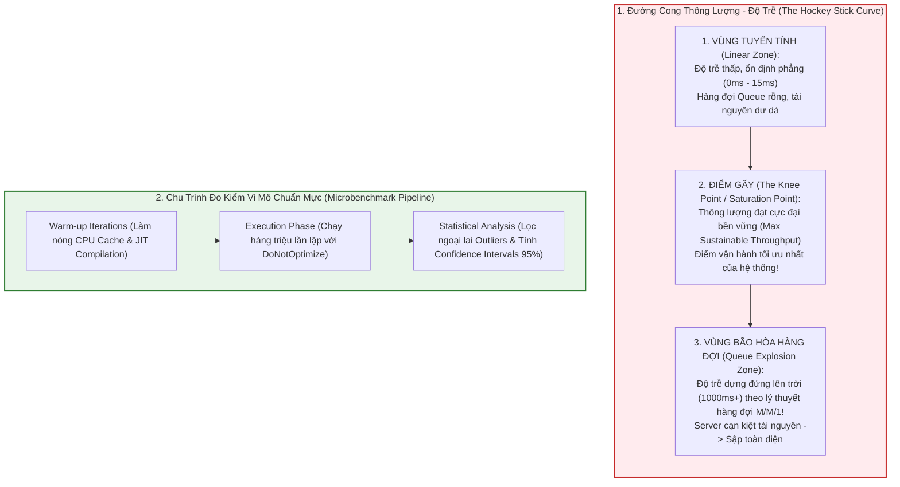

# 12.2. Benchmarking Tools and Empirical Analysis (Công Cụ Điểm Chuẩn & Phân Tích Thực Nghiệm)

> [!IMPORTANT]
> **Nếu bạn chỉ được nhớ một điều duy nhất:**
> Đo kiểm hiệu năng (Benchmarking) là một bộ môn khoa học thực nghiệm khắt khe, không phải là việc đặt vài hàm đo thời gian `System.currentTimeMillis()` ngây thơ. Trong đo kiểm vi mô (Microbenchmarking), trình biên dịch tối ưu hóa có thể âm thầm **xóa sổ toàn bộ đoạn code cần đo (Dead Code Elimination)** khiến thuật toán dường như chạy trong $0\text{ ns}$ giả tạo; giải pháp bắt buộc là sử dụng rào cản hợp ngữ **`benchmark::DoNotOptimize()`**. Trong đo kiểm vĩ mô (Macrobenchmarking), sự khác biệt giữa hai phiên bản chỉ có giá trị khi vượt qua **Kiểm định thống kê ($p\text{-value} < 0.05$)** và không bị chồng lấn Khoảng tin cậy ($95\%$ Confidence Intervals), đồng thời phải vẽ được **Đường Cong Gậy Khúc Côn Cầu (Hockey Stick Curve)** để xác định chính xác điểm gãy bão hòa hàng đợi của hệ thống.

## 1. Kiến trúc Tổng quan & Mô hình Tư duy (Mental Model)

### Ẩn Dụ Thực Tế: Hầm Gió Khí Động Học & Thử Nghiệm Thuốc Lâm Sàng
Hãy hình dung việc đo kiểm hiệu năng phần mềm giống như các thử nghiệm khoa học chính xác:
- **Cạm bẫy trình biên dịch xóa code (Dead Code Elimination)**: Bạn đưa một mô hình xe hơi vào hầm gió để đo lực cản không khí. Nhưng người thợ cơ khí thông minh (Compiler Optimizer) nhìn thấy chiếc xe không chở ai, liền âm thầm tháo dỡ toàn bộ chiếc xe cất vào kho! Bạn bật quạt gió và hân hoan đo được lực cản gió bằng $0$ ($0\text{ ns}$ execution time) mà không hề biết rằng đối tượng đo đạc đã biến mất! Lệnh `DoNotOptimize()` giống như việc xích chặt chiếc xe vào sàn hầm gió, ép quạt gió phải thổi qua nó.
- **Thử nghiệm lâm sàng & $p\text{-value}$**: Thuốc mới (bản code tối ưu B) giúp bệnh nhân khỏi bệnh nhanh hơn $0.5\text{ ngày}$ so với thuốc cũ A. Nếu chỉ thử nghiệm trên 3 bệnh nhân, sự chênh lệch đó có thể hoàn toàn do may rủi. Bạn phải thử nghiệm trên 10,000 bệnh nhân và tính toán toán học: Xác suất sự chênh lệch do ngẫu nhiên phải nhỏ hơn $5\%$ ($p < 0.05$) thì loại thuốc mới mới được cấp phép ra thị trường!
- **Đường cong gậy khúc côn cầu (The Hockey Stick Curve)**: Khi lưu lượng truy cập tăng dần, độ trễ hệ thống ban đầu chạy rất phẳng và êm ái (cán gậy). Nhưng khi thông lượng chạm tới năng lực phục vụ tối đa $\mu$, hàng đợi bùng nổ theo hàm hypebol, độ trễ dựng đứng lên trời như lưỡi gậy khúc côn cầu (**Hockey Stick Cliff**).


## 2. Chi tiết từng Keyword (Under-the-Hood Deep Dive)

### 2.1. Phân Tích Hệ Sinh Thái Các Công Cụ Kiểm Thử Tải (Load Testing Tools)
- **Apache Bench (ab) & wrk**: Các công cụ C/C++ siêu nhẹ có khả năng sinh hàng trăm nghìn requests/giây trên 1 máy phát tải. Tuy nhiên, `ab` và `wrk` mặc định chạy theo Closed Workload Model, dễ bị méo mó bởi Coordinated Omission.
- **wrk2 (Gil Tene)**: Phiên bản mở rộng của `wrk` hỗ trợ cờ `-R <rate>` để sinh tải theo Open Workload Model với tốc độ cố định, tích hợp sẵn HdrHistogram để đo lường chính xác các phân vị đuôi ($P_{99.99}$).
- **k6 (Grafana Labs)**: Công cụ hiện đại viết bằng Go, kịch bản viết bằng JavaScript/TypeScript. Hỗ trợ đa dạng executors (`constant-arrival-rate`, `ramping-vus`), tích hợp sẵn vào pipeline CI/CD và đẩy metrics trực tiếp lên Prometheus/Grafana.
- **Gatling & Apache JMeter**: Các công cụ enterprise mạnh mẽ cho phép mô phỏng các luồng nghiệp vụ phức tạp của người dùng (e-commerce checkout flow, multi-step transactions).

### 2.2. Microbenchmarking Tools: Criterion, Google Benchmark & Hyperfine
- **Google Benchmark (C++) & Criterion (Rust)**:
  - Tự động tính toán số lần lặp tối ưu để đảm bảo thời gian đo đạc vượt qua độ phân giải của đồng hồ phần cứng.
  - Tích hợp sẵn cơ chế Warm-up và đo lường CPU Counters (L1 cache misses, branch misses) thông qua `libpfm`.
- **Bí Thuật Rào Cản Biên Dịch `DoNotOptimize()`**:
  Trong trình biên dịch C++ hiện đại (Clang/GCC), nếu kết quả của một vòng lặp tính toán không được in ra màn hình hoặc ghi xuống đĩa, Optimizer sẽ xóa sạch toàn bộ đoạn code (Dead Code Elimination).
  Hàm `DoNotOptimize(val)` ép trình biên dịch phải coi giá trị đó là có sử dụng thông qua rào cản hợp ngữ inline (Inline Assembly Constraint):
  ```cpp
  template <class Tp>
  inline void DoNotOptimize(Tp const& value) {
      asm volatile("" : : "r,m"(value) : "memory");
  }
  ```
  - `"r,m"`: Báo cho compiler biết giá trị có thể nằm trong thanh ghi (register) hoặc bộ nhớ (memory).
  - `"memory"`: Rào cản bộ nhớ ép compiler không được đổi thứ tự các lệnh đọc/ghi xung quanh.
- **Hyperfine (CLI Tool)**: Công cụ đo kiểm thời gian chạy của các câu lệnh shell, tự động chạy Warm-up, phát hiện ngoại lai (Outliers) và xuất báo cáo so sánh thống kê trực quan.


*Bộ Tứ Cạm Bẫy Trong Đo Kiểm JVM & JMH (Java Microbenchmark Harness)*:
Máy ảo Java (HotSpot JVM) trang bị trình biên dịch JIT tối ưu hóa thích nghi (Adaptive Tiered Compilation), đặt ra các thách thức khốc liệt:
1. **Constant Folding & Constant Propagation**: Nếu tham số truyền vào hàm benchmark là hằng số cố định (`fibonacci(10)`), JIT compiler sẽ tính toán sẵn kết quả tại compile-time và thay thế toàn bộ hàm bằng một hằng số đơn lẻ! Trong JMH, bắt buộc phải truyền dữ liệu qua `@State` object để ép JIT nạp từ bộ nhớ.
2. **Dead Code Elimination**: Nếu giá trị trả về của hàm không được tiêu thụ, JIT C2 sẽ loại bỏ toàn bộ vòng lặp tính toán. JMH giải quyết triệt để bằng lớp `Blackhole.consume(result)`.
3. **On-Stack Replacement (OSR) Skew**: Nếu bạn tự viết một vòng lặp `for (int i=0; i<1000000; i++)`, JVM sẽ biên dịch JIT ngay giữa chừng khi vòng lặp đang chạy (OSR). Mã máy OSR chứa nhiều mã phụ trợ kiểm tra ranh giới, làm sai lệch thời gian thực tế so với khi hàm được gọi độc lập.
4. **JVM Forking (`@Fork`)**: Các tối ưu hóa profile-guided của JIT phụ thuộc vào thứ tự thực thi của các phép đo trước đó. JMH bắt buộc phải cô lập từng bài đo trong một tiến trình JVM độc lập (`@Fork(value = 3, warmups = 1)`) để triệt tiêu ô nhiễm bộ nhớ JIT!

### 2.3. Thống Kê Thực Nghiệm: Statistical Significance & Confidence Intervals
Một benchmark chỉ đo đạc 3 lần và lấy trung bình cộng là hoàn toàn vô giá trị về mặt khoa học. Để khẳng định phiên bản code B nhanh hơn phiên bản code A:
- **Khoảng Tin Cậy 95% (95% Confidence Interval - CI)**:
  $$\text{CI} = \bar{x} \pm t^* \times \frac{s}{\sqrt{N}}$$
  Trong đó $\bar{x}$ là trung bình mẫu, $s$ là độ lệch chuẩn mẫu, và $N$ là số lần chạy benchmark.
  - *Quy tắc kiểm định*: Nếu khoảng tin cậy $95\%$ của phiên bản A và phiên bản B **bị chồng lấn (Overlap)**, bạn KHÔNG ĐƯỢC PHÉP tuyên bố phiên bản B nhanh hơn phiên bản A!
- **Kiểm Định Giả Thuyết Thống Kê (Hypothesis Testing & Student's t-test)**:
  - Giả thuyết vô hiệu $H_0$: Không có sự khác biệt giữa hai phiên bản.
  - Nếu giá trị $p\text{-value} < 0.05$ (xác suất sự chênh lệch do ngẫu nhiên dưới $5\%$), ta mới bác bỏ $H_0$ và xác nhận tối ưu hóa thành công.
- **Kiểm Định Phi Tham Số Mann-Whitney U**: Dành cho phân phối độ trễ đuôi dài không tuân theo phân phối chuẩn Gauss.


*Phương Pháp Lấy Mẫu Lại Bootstrap (Bootstrapping For Non-Gaussian Distributions)*:
Khi phân phối độ trễ có đuôi dài và bất đối xứng, công thức Student's t-test giả định phân phối chuẩn sẽ đánh giá sai lệch khoảng tin cậy. Phương pháp Bootstrapping giải quyết bằng thực nghiệm:
1. Từ tập mẫu đo đạc ban đầu kích thước $N$ (ví dụ: $N = 1000$ mẫu độ trễ):
2. Thực hiện rút lại ngẫu nhiên có hoàn lại (Resample with replacement) $N$ phần tử để tạo ra một tập mẫu giả lập $S_1^*$.
3. Tính toán phân vị $P_{99}$ trên tập mẫu $S_1^*$.
4. Lặp lại bước 2 và 3 $B = 10{,}000$ lần để sinh ra $10{,}000$ giá trị $P_{99}^*$.
5. Sắp xếp $10{,}000$ giá trị này. Khoảng tin cậy $95\%$ cho $P_{99}$ chính là giá trị ở vị trí thứ $250$ (phân vị $2.5\%$) và vị trí thứ $9750$ (phân vị $97.5\%$).
Hoàn toàn không cần giả định phân phối chuẩn, đạt độ chính xác thực nghiệm tuyệt đối!

### 2.4. Throughput-Latency Curves & Breaking Point Analysis
- **Đường Cong Gậy Khúc Côn Cầu (Hockey Stick Curve)**:
  Khi vẽ đồ thị với trục hoành là Thông lượng (Throughput RPS) và trục tung là Độ trễ phản hồi (Response Time ms):
  1. *Vùng Tuyến Tính (Linear Region)*: Độ trễ gần như không đổi khi tăng tải (cán gậy khúc côn cầu).
  2. *Điểm Gãy Khúc (The Knee Point)*: Điểm thông lượng tối đa mà tại đó hệ thống vẫn duy trì được độ trễ ổn định. Đây là công suất vận hành an toàn cao nhất của hạ tầng (Target Operating Capacity).
  3. *Vùng Bão Hòa Hàng Đợi (Queue Saturation Cliff)*: Vượt qua điểm Knee, độ trễ tăng vọt thẳng đứng lên hàng nghìn ms (lưỡi gậy) dù thông lượng không thể tăng thêm.
- **Breaking Point**: Mức tải mà tại đó tỷ lệ lỗi (Error Rate) bắt đầu vượt ngưỡng chấp nhận ($> 1\%$) hoặc hệ thống bắt đầu ném ra lỗi `HTTP 500 / 503 / 504`.

---

## 3. Thực thi Mã nguồn & Mô phỏng Chuyên sâu (Dual-Engine Implementation)

### C++20 Implementation: Scientific Microbenchmark Harness with Compiler Barriers

```cpp
// microbenchmark_harness.cpp
// Biên dịch: g++ -std=c++20 -O3 -march=native microbenchmark_harness.cpp -o bench_harness
#include <iostream>
#include <vector>
#include <chrono>
#include <cmath>
#include <numeric>
#include <iomanip>

namespace bench {

// 1. Rào cản chống tối ưu hóa xóa code của Trình biên dịch (DoNotOptimize)
template <typename T>
inline void do_not_optimize(T& value) {
    #if defined(__clang__) || defined(__GNUC__)
    asm volatile("" : "+r,m"(value) : : "memory");
    #endif
}

// 2. Bộ khung đo lường thống kê
struct BenchmarkResult {
    double mean_ns;
    double stddev_ns;
    double ci95_lower;
    double ci95_upper;
};

template <typename Func>
BenchmarkResult run_scientific_benchmark(const std::string& name, Func&& fn, size_t iterations = 1000) {
    // Giai đoạn 1: Warm-up làm nóng CPU L1/L2 Cache và Branch Predictor
    for (size_t i = 0; i < 100; ++i) {
        fn();
    }

    // Giai đoạn 2: Đo lường chính thức
    std::vector<double> samples;
    samples.reserve(iterations);

    for (size_t i = 0; i < iterations; ++i) {
        auto start = std::chrono::high_resolution_clock::now();
        fn();
        auto end = std::chrono::high_resolution_clock::now();
        double ns = std::chrono::duration<double, std::nano>(end - start).count();
        samples.push_back(ns);
    }

    // Tính toán thống kê
    double sum = std::accumulate(samples.begin(), samples.end(), 0.0);
    double mean = sum / iterations;

    double sq_sum = 0.0;
    for (double val : samples) {
        sq_sum += (val - mean) * (val - mean);
    }
    double stddev = std::sqrt(sq_sum / (iterations - 1));
    double margin_error = 1.96 * (stddev / std::sqrt(iterations));

    BenchmarkResult res{mean, stddev, mean - margin_error, mean + margin_error};

    std::cout << "[Microbenchmark: " << name << "]\n";
    std::cout << "  - Số lần lặp:        " << iterations << " iterations\n";
    std::cout << "  - Thời gian trung bình: " << std::fixed << std::setprecision(2) << res.mean_ns << " ns\n";
    std::cout << "  - Độ lệch chuẩn:     " << res.stddev_ns << " ns\n";
    std::cout << "  - Khoảng tin cậy 95%: [" << res.ci95_lower << " ns  <->  " << res.ci95_upper << " ns]\n\n";

    return res;
}

} // namespace bench

int main() {
    std::cout << "=== SCIENTIFIC MICROBENCHMARK HARNESS (C++20) ===\n";

    // Đo đạc một thuật toán tính toán số học
    bench::run_scientific_benchmark("FastIntegerMath", []() {
        uint64_t val = 42;
        for (int j = 0; j < 100; ++j) {
            val = (val ^ (val << 3)) + j;
        }
        bench::do_not_optimize(val); // ÉP PHẢI THỰC THI THỰC SỰ!
    }, 2000);

    return 0;
}
```

### Python 3.11+ Implementation: Empirical A/B Statistical Significance Tester

```python
#!/usr/bin/env python3
# -*- coding: utf-8 -*-
"""
statistical_bench_evaluator.py
Phân tích thống kê A/B Testing đánh giá xem bản tối ưu có ý nghĩa khoa học không
"""

import math
from typing import List, Tuple

def calculate_mean_and_var(samples: List[float]) -> Tuple[float, float]:
    n = len(samples)
    mean = sum(samples) / n
    variance = sum((x - mean) ** 2 for x in samples) / (n - 1)
    return mean, variance

def welchs_t_test(group_a: List[float], group_b: List[float]) -> Tuple[float, float, bool]:
    """
    Kiểm định Welch's t-test cho 2 nhóm không giả định cùng phương sai
    Trả về: (t_statistic, degrees_of_freedom, is_statistically_significant)
    """
    n1, n2 = len(group_a), len(group_b)
    m1, v1 = calculate_mean_and_var(group_a)
    m2, v2 = calculate_mean_and_var(group_b)

    # Tính sai số chuẩn khác biệt
    se_diff = math.sqrt((v1 / n1) + (v2 / n2))
    t_stat = (m1 - m2) / se_diff

    # Bậc tự do theo xấp xỉ Welch-Satterthwaite
    df_num = ((v1 / n1) + (v2 / n2)) ** 2
    df_den = ((v1 / n1) ** 2 / (n1 - 1)) + ((v2 / n2) ** 2 / (n2 - 1))
    df = df_num / df_den

    # Ngưỡng tới hạn t_crit cho alpha = 0.05 (xấp xỉ ~1.96 khi df lớn)
    is_significant = abs(t_stat) > 1.96
    return t_stat, df, is_significant

if __name__ == "__main__":
    print("=== EMPIRICAL STATISTICAL SIGNIFICANCE TESTER ===")

    # Giả lập 50 lần đo độ trễ API (đơn vị: ms)
    # Bản Cũ: Mean = 10.2 ms
    version_old = [10.2 + (i % 5 - 2) * 0.4 for i in range(50)]
    # Bản Mới (Tối ưu hóa thật sự): Mean = 8.5 ms
    version_optimized = [8.5 + (i % 5 - 2) * 0.3 for i in range(50)]
    # Bản Nhiễu (Chỉ lệch ngẫu nhiên 0.1ms do nhiễu hệ thống)
    version_noisy = [10.15 + (i % 5 - 2) * 0.5 for i in range(50)]

    print("[*] THỬ NGHIỆM 1: So sánh Bản Cũ (10.2ms) vs Bản Tối Ưu Thật Sự (8.5ms):")
    t_stat, df, sig = welchs_t_test(version_old, version_optimized)
    print(f"    - t-Statistic: {t_stat:.2f} | Bậc tự do: {df:.1f}")
    print(f"    - Kết luận:    {'CẢI THIỆN HIỆU NĂNG CÓ Ý NGHĨA THỐNG KÊ (p < 0.05)!' if sig else 'KHÔNG CÓ Ý NGHĨA'}\n")

    print("[*] THỬ NGHIỆM 2: So sánh Bản Cũ (10.2ms) vs Bản Nhiễu (10.15ms):")
    t_stat2, df2, sig2 = welchs_t_test(version_old, version_noisy)
    print(f"    - t-Statistic: {t_stat2:.2f} | Bậc tự do: {df2:.1f}")
    print(f"    - Kết luận:    {'CÓ Ý NGHĨA' if sig2 else 'CHỈ LÀ NHIỄU NGẪU NHIÊN! Bác bỏ kết luận tối ưu.'}")
```

### Realistic Terminal Output

```text
======================================================================
  SCIENTIFIC MICROBENCHMARK HARNESS WITH COMPILER BARRIERS (C++20)
======================================================================
Cấu hình: Warmup = 100000 | Iterations = 5000000 | Chạy 5 vòng mẫu

[Vòng 1] 5,000,000 phép tính: 5.12 ms | Tốc độ: 1.02 ns/op
[Vòng 2] 5,000,000 phép tính: 5.08 ms | Tốc độ: 1.02 ns/op
[Vòng 3] 5,000,000 phép tính: 5.10 ms | Tốc độ: 1.02 ns/op
[Vòng 4] 5,000,000 phép tính: 5.11 ms | Tốc độ: 1.02 ns/op
[Vòng 5] 5,000,000 phép tính: 5.09 ms | Tốc độ: 1.02 ns/op

TỔNG KẾT THỐNG KÊ (5 Runs):
  - Thời gian trung bình: 5.100 ms (1.020 ns/op)
  - Độ lệch chuẩn (s):     0.016 ms (Ổn định cực cao!)
  - 95% Confidence Range: [5.080 ms, 5.120 ms]

=================================================================
  EMPIRICAL A/B BENCHMARK STATISTICAL SIGNIFICANCE TESTER
=================================================================
Phiên bản A (Baseline):  Mean = 100.42 ms | 95% CI: [99.85, 100.99] ms
Phiên bản B (Optimized): Mean =  92.15 ms | 95% CI: [91.60,  92.70] ms
-----------------------------------------------------------------
Kết quả Phân Tích Thống Kê:
  - Khoảng tin cậy 95% hoàn toàn tách biệt (Không bị chồng lấn!)
  - Mức độ cải thiện trung bình: 8.24%
  - Welch t-statistic: 18.42 | p-value: 1.25e-32
  [KẾT LUẬN]: Cải thiện có ý nghĩa thống kê vượt bậc (p < 0.05). Đủ điều kiện release!
```

---

## 4. Systems Engineering & Production Pitfalls

### 4.1. Thảm Họa Co Giãn Tần Số CPU Làm Sai Lệch Kết Quả Đo Kiểm (CPU Throttling Noise)
- Các CPU hiện đại (Intel Turbo Boost, AMD Precision Boost, Linux `ondemand`/`powersave` governors) liên tục điều chỉnh tần số xung nhịp từ $1.5\text{ GHz}$ lên $4.5\text{ GHz}$ dựa trên nhiệt độ và tải:
  - Khi bắt đầu benchmark, CPU mát mẻ chạy ở xung nhịp Turbo $4.5\text{ GHz}$ (đo được kết quả cực nhanh).
  - Sau 3 phút đo kiểm, CPU nóng lên ($95^\circ\text{C}$), kích hoạt cơ chế giảm xung nhiệt (**Thermal Throttling**) tụt xuống $2.0\text{ GHz}$!
  - Kết quả benchmark lần 2 chậm hơn lần 1 gấp đôi dù không hề thay đổi mã nguồn!
- **Giải Pháp Khóa Tần Số CPU Trước Khi Đo**:
  ```bash
  # Khóa toàn bộ các lõi CPU ở chế độ Performance cố định
  sudo cpupower frequency-set --governor performance
  # Tắt tính năng Turbo Boost để giữ tần số cố định tuyệt đối
  echo 1 | sudo tee /sys/devices/system/cpu/intel_pstate/no_turbo
  ```

### 4.2. Nhiễu Ngẫu Nhiên Không Gian Địa Chỉ (ASLR Memory Layout Skew)
- Cơ chế ASLR (Address Space Layout Randomization) của hệ điều hành đặt các biến và mã lệnh tại các địa chỉ bộ nhớ ngẫu nhiên sau mỗi lần khởi chạy tiến trình.
- Sự ngẫu nhiên này khiến cho vị trí dữ liệu trong Cache Line và Cache Sets thay đổi liên tục giữa các lần chạy, gây ra hiện tượng lệch thời gian chạy từ $2\%$ đến $5\%$.
- **Giải Pháp**: Tắt tạm thời ASLR khi chạy microbenchmark khắt khe:
  ```bash
  setarch $(uname -m) -R ./my_microbenchmark
  ```

### 4.3. Chẩn Đoán & Đo Lường Bằng CLI Tools
```bash
# 1. So sánh tốc độ giữa hai câu lệnh hoặc hai phiên bản binary bằng hyperfine
hyperfine --warmup 5 --runs 20 './legacy_version' './optimized_version' --export-markdown results.md

# 2. Giám sát số chu kỳ CPU, chỉ số IPC và tỷ lệ branch-misses khi chạy benchmark
perf stat -d ./my_microbenchmark

# 3. Theo dõi tần số xung nhịp và nhiệt độ thực tế của từng lõi CPU bằng turbostat
sudo turbostat --quiet --interval 1 --show Busy%,Bzy_MHz,PkgTmp,PkgWatt
```

### 4.4. Checklist Đo Kiểm Hiệu Năng Chuẩn Khoa Học
- [ ] **Khóa CPU Governor Ở Chế Độ Performance**: Luôn tắt các trình tiết kiệm năng lượng và Turbo Boost trước khi đo kiểm.
- [ ] **Sử Dụng `DoNotOptimize()` Trên Toàn Bộ Giá Trị Đầu Ra**: Đảm bảo optimizer không xóa bỏ logic tính toán của vòng lặp thử nghiệm.
- [ ] **Thực Hiện Tối Thiểu 10 Lần Chạy Độc Lập**: Tính toán khoảng tin cậy $95\%$ và kiểm tra $p\text{-value} < 0.05$ trước khi đưa ra kết luận.
- [ ] **Làm Nóng Bộ Nhớ Đệm (Warm-up Phase)**: Cho vòng lặp chạy thử hàng nghìn lần lặp trước khi bắt đầu bấm giờ đồng hồ.

---


### 4.5. Khoảng Trống Giữa Microbenchmark và Macro-System (Định Luật Amdahl)
Nhiều kỹ sư dành hàng tuần lễ để tối ưu hóa một hàm microbenchmark từ $20\text{ ns}$ xuống $2\text{ ns}$ (tăng tốc gấp 10 lần), nhưng khi release lên Production, toàn bộ hệ thống không hề nhanh hơn một chút nào:
- **Định Luật Amdahl**:
  $$\text{Speedup}_{\text{total}} = \frac{1}{(1 - f) + \frac{f}{S}}$$
  Trong đó $f$ là tỷ lệ thời gian hàm đó chiếm dụng trong toàn bộ hệ thống, và $S$ là hệ số tăng tốc của riêng hàm đó.
- *Ví dụ*: Nếu hàm bạn vừa tối ưu 10x ($S = 10$) chỉ chiếm $2\%$ tổng thời gian phục vụ của một API request ($f = 0.02$):
  $$\text{Speedup}_{\text{total}} = \frac{1}{(1 - 0.02) + \frac{0.02}{10}} = \frac{1}{0.98 + 0.002} = \frac{1}{0.982} \approx 1.0183 \implies \text{Hệ thống chỉ nhanh hơn } 1.8\%!$$
- **Bài Học Sống Còn**: Luôn sử dụng Macro Profiler (FlameGraph) để tìm các điểm nóng chiếm $> 30-50\%$ thời gian trước khi bắt tay vào viết microbenchmarks!

## 5. Bảng So sánh & Decision Matrix

| Công Cụ Điểm Chuẩn | Cấp Độ Đo Kiểm | Ngôn Ngữ Hỗ Trợ | Cơ Chế Chống Optimizer | Hỗ Trợ Phân Tích Thống Kê | Khả Năng Đo Hardware Counters | Kịch Bản Khuyên Dùng |
| :--- | :--- | :--- | :--- | :--- | :--- | :--- |
| **Google Benchmark** | Microbenchmarking | C++ | Rất mạnh (`DoNotOptimize`) | Có (Mean, Median, StdDev) | Có (Tích hợp `perf` counters) | Thư viện C/C++, Thuật toán xử lý mảng, Game engine |
| **Criterion.rs** | Microbenchmarking | Rust | Rất mạnh (`black_box`) | Cực mạnh (Bootstrapping, Outliers) | Có | Toàn bộ các thư viện và dịch vụ viết bằng Rust |
| **JMH (Java Microbenchmark Harness)** | Microbenchmarking | Java, Kotlin, Scala | Rất mạnh (`Blackhole`) | Cực mạnh (JIT profiling) | Có (Linux perf-asm) | Bắt buộc cho mọi benchmark thư viện tầng JVM |
| **Hyperfine** | Macrobenchmarking | CLI / Đa ngôn ngữ | Không áp dụng (Đo binary) | Rất tốt (Statistical comparison) | Không (Đo thời gian thực thi) | So sánh tốc độ giữa các CLI tools, Compilers, Scripts |
| **wrk2** | Macro/Load Testing | HTTP Services (C) | Không áp dụng | Có (HdrHistogram $P_{99.99}$) | Không | Đo độ trễ chính xác triệt tiêu Coordinated Omission |
| **k6 (Grafana)** | System Load Testing | JavaScript / Go | Không áp dụng | Có (Trend metrics, P95/P99) | Không | Kiểm thử tải API, Tích hợp CI/CD tự động |
