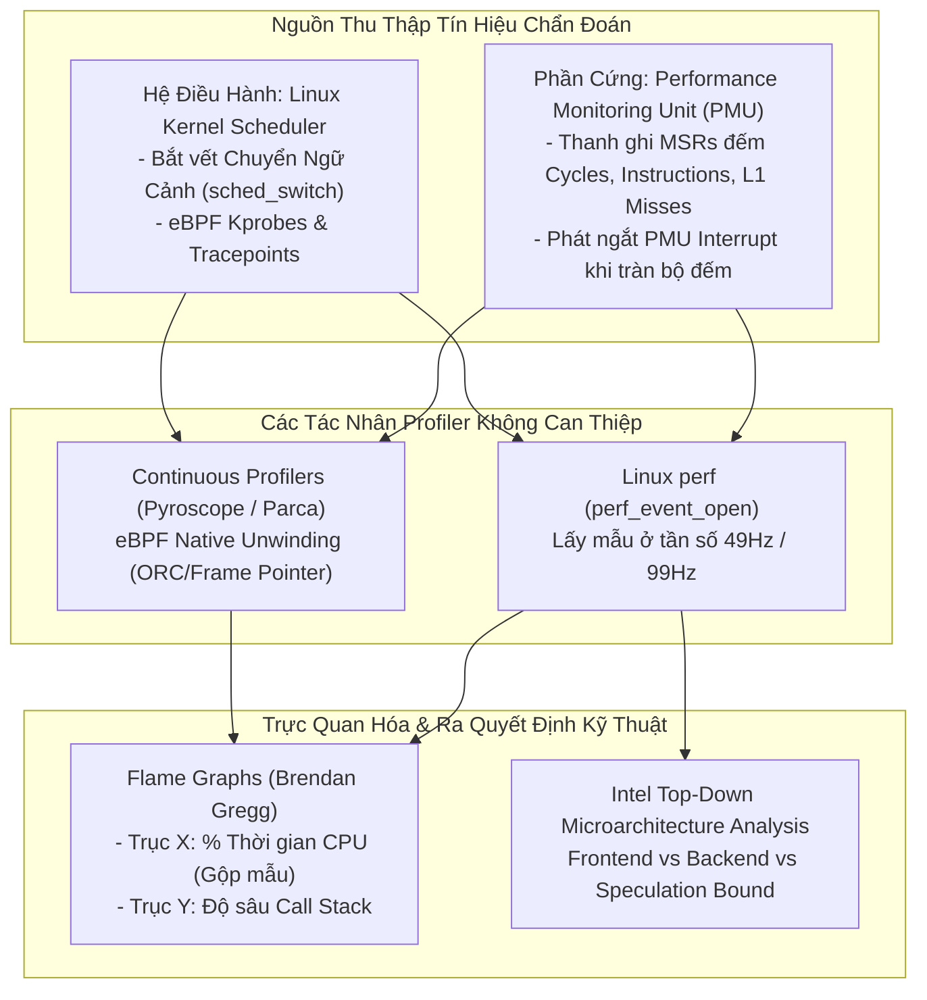

# 13.1. Profiling Techniques, Flame Graphs, and Hardware Counters (Kỹ Thuật Phân Tích Hiệu Năng, Biểu Đồ Ngọn Lửa & Bộ Đếm Phần Cứng)

> [!IMPORTANT]
> **Nếu bạn chỉ được nhớ một điều duy nhất:** Đoán mò là kẻ thù số 1 của tối ưu hóa hệ thống. Nếu Benchmark trả lời câu hỏi *"Chậm bao nhiêu?"*, thì **Profiling và Hardware PMU Counters trả lời chính xác *"Hàm nào, chu kỳ clock nào, và hiện tượng phần cứng vi mô nào (L1 miss, branch miss, pipeline stall) đang thiêu đốt tài nguyên?"***.

---

## 1. Kiến trúc Tổng quan & Mô hình Tư duy (Mental Model)

### Phép loại suy thực tế: Khám sức khỏe xâm lấn vs Máy điện tâm đồ đeo tay liên tục

Hãy hình dung quá trình chẩn đoán hiệu năng phần mềm tương tự như y học hiện đại:

1. **Instrumentation Profiling (Đo kiểm can thiệp xâm lấn):**
   - Giống như việc phẫu thuật nội soi lấy mẫu sinh thiết trên cơ thể người bệnh. Bác sĩ rạch một vết mổ tại mỗi khớp xương để gắn cảm biến đo áp suất (chèn code hook vào đầu và cuối của mọi hàm).
   - *Hậu quả (Hiệu ứng Heisenberg):* Bệnh nhân bị mất máu và đau đớn dữ dội, không thể chạy nhảy bình thường. Phần mềm bị chậm đi $5\times - 20\times$, các hàm nhỏ bị phá vỡ tính chất Inlining, hành vi Cache L1/L2 bị biến dạng hoàn toàn $\implies$ Dữ liệu thu được là dữ liệu rác, **tuyệt đối không được áp dụng trên môi trường Production!**
2. **Sampling Profiling (Đo kiểm lấy mẫu thống kê không xâm lấn):**
   - Giống như việc bác sĩ sử dụng ống nghe hoặc đo nhịp tim bằng đồng hồ thông minh cứ sau mỗi 10 mili-giây một lần. Bệnh nhân vẫn sinh hoạt, thi đấu thể thao bình thường (Overhead $< 1\%$).
   - Nhờ luật số lớn trong xác suất thống kê (Law of Large Numbers), những vị trí tiêu tốn nhiều thời gian nhất sẽ xuất hiện nhiều nhất trong các lần lấy mẫu.
3. **Hardware Performance Monitoring Unit (PMU - Cảm biến sinh học cấy trong vi mạch):**
   - Là những con chip phần cứng tí hon tích hợp sẵn bên trong lõi CPU của Intel, AMD, ARM. Nó đếm từng nhịp đập của xung nhịp (Cycles), từng lệnh máy được rút ra khỏi pipeline (Instructions), và từng lần dự đoán sai nhánh (Branch Mispredictions) với độ chính xác tuyệt đối mà không tiêu tốn bất kỳ chu kỳ xử lý nào của phần mềm.



---

## 2. Chi tiết từng Keyword (Under-the-Hood Deep Dive)

### 2.1. Sampling Profiling vs Instrumentation Profiling

```
+-----------------------------------------------------------------------------------------+
|                  SO SÁNH BẢN CHẤT GIỮA INSTRUMENTATION VÀ SAMPLING                      |
+---------------------+-------------------------------+-----------------------------------+
| Tiêu Chí            | Instrumentation Profiling     | Sampling Profiling (Thống kê)     |
+---------------------+-------------------------------+-----------------------------------+
| Cơ chế can thiệp    | Chèn code đo đạc vào mọi hàm  | Ngắt định kỳ ghi nhận Call Stack  |
| Độ tiêu hao (Overhead)| Khủng khiếp (Tăng tải 200%-1000%)| Cực thấp (< 1% CPU)               |
| Tính chính xác      | Đếm chính xác số lần gọi (100%)| Ước lượng xác suất theo thời gian |
| Hiện tượng biến dạng| Phá hỏng Inlining & L1 Cache  | Giữ nguyên 99.9% hành vi gốc      |
| Chạy trên Production| TUYỆT ĐỐI CẤM                | KHUYẾN NGHỊ BẮT BUỘC (24/7)       |
+---------------------+-------------------------------+-----------------------------------+
```

1. **Hiệu ứng Người Quan sát Heisenberg (The Heisenberg Observer Effect):**
   - Trong vật lý lượng tử, hành động đo lường một hạt làm thay đổi trạng thái của hạt đó. Trong phần mềm, việc chèn 10 dòng lệnh đếm thời gian vào một hàm chỉ có 2 dòng lệnh tính toán sẽ biến hàm đó thành "con quái vật" ngốn thời gian, đánh lừa lập trình viên tối ưu hóa nhầm chỗ!
2. **Quy tắc Tần số Vàng 49Hz / 99Hz (Anti-Aliasing Sampling Rule):**
   - Khi cấu hình Sampling Profiler (như `perf record -F 99`), tại sao kỹ sư luôn chọn **$99\text{ Hz}$ hoặc $49\text{ Hz}$** mà không chọn số tròn $100\text{ Hz}$?
   - *Bản chất vi mô:* Hầu hết các hệ điều hành và framework đều có các tác vụ định kỳ chạy theo nhịp chẵn (ví dụ: Garbage Collector, Timer tick của Kernel chạy đúng mỗi $10\text{ ms} = 100\text{ Hz}$). Nếu chọn tần số lấy mẫu đúng $100\text{ Hz}$, profiler sẽ rơi vào hiện tượng **Cộng hưởng Đồng pha (Lockstep Aliasing)**: Nó sẽ luôn luôn ngắt đúng vào thời điểm tác vụ định kỳ đó đang chạy, làm sai lệch kết quả thống kê lên hàng ngàn phần trăm!
3. **Cơ chế Duyệt Ngược Call Stack (Stack Unwinding):**
   - **Frame Pointer Unwinding (Chuẩn mực tốc độ cao):** Sử dụng thanh ghi con trỏ khung stack (`RBP` trên x86_64). Profiler chỉ việc nhảy theo chuỗi con trỏ liên kết `RBP` để lấy toàn bộ địa chỉ hàm trong nano-giây.
   - *Cạm bẫy compiler:* Nếu bật cờ `-O3` mà quên bật `-fno-omit-frame-pointer`, compiler sẽ tái sử dụng thanh ghi `RBP` làm thanh ghi tính toán thông thường, khiến profiler không thể duyệt Call Stack, sinh ra các đồ thị Flame Graph bị gãy vụn với nhãn `[unknown]`.
   - **DWARF Unwinding:** Đọc bảng metadata gỡ lỗi trong file binary. Không cần Frame Pointer nhưng cực kỳ chậm (tốn hàng chục microsecond cho mỗi lần unwinding).
   - **ORC (Oops Rewind Capability):** Định dạng nén nhị phân của Linux Kernel giúp eBPF duyệt stack cực nhanh mà không cần frame pointer.

---

### 2.2. Các Loại Hình Profiling Chuyên Biệt: On-CPU vs Off-CPU, Memory & Lock

Một sai lầm sơ đẳng của kỹ sư là: Khi ứng dụng bị chậm, chỉ mở CPU Profiler lên xem.

```
       PHÂN LOẠI CÁC TRẠNG THÁI TIÊU THỐN THỜI GIAN CỦA ỨNG DỤNG
  ┌────────────────────────────────────────────────────────────────────────┐
  │                                                                        │
  │   1. On-CPU Time:                                                      │
  │      - Thread đang chạy trực tiếp trên Core                            │
  │      - Tiêu tốn CPU cycles tính toán                                   │
  │      - Đo lường bằng: Timer Sampling / PMU Counters                    │
  │                                                                        │
  │   2. Off-CPU Time (ĐIỂM NGHẼN BỊ BỎ QUÊN!):                             │
  │      - Thread bị Kernel loại khỏi Runqueue                             │
  │      - Đang ngủ chờ I/O mạng, đọc đĩa NVMe, hoặc chờ Mutex Lock        │
  │      - CPU Profiler báo 0% tải, nhưng người dùng chờ 5 giây!           │
  │      - Đo lường bằng: eBPF sched_switch tracing                        │
  │                                                                        │
  └────────────────────────────────────────────────────────────────────────┘
```

1. **On-CPU vs Off-CPU Profiling:**
   - **On-CPU:** Tập trung vào các hàm ngốn CPU nhiều nhất (Thuật toán sắp xếp, giải mã JSON, nén dữ liệu).
   - **Off-CPU:** Đo lường tổng thời gian luồng bị chặn (**Blocked Duration**). Bắt vết từ thời điểm luồng gọi `sys_futex` hoặc `read(socket)` cho đến khi được đánh thức lại trong hàm `finish_task_switch()` của kernel scheduler. Giúp tìm ra lý do tại sao API chậm mặc dù CPU chỉ dùng có $5\%$.
2. **Allocation Profiling vs Live Heap Profiling:**
   - **Live Heap Snapshot:** Đo lường dung lượng RAM đang bị các đối tượng còn sống chiếm đóng. Thích hợp để săn lùng rò rỉ bộ nhớ (Memory Leaks).
   - **Allocation Rate Profiling:** Đo lường tốc độ "đẻ" đối tượng mới (MB/giây). Một ứng dụng có Live Heap chỉ 200MB nhưng sinh ra 2GB objects mỗi giây sẽ làm bốc khói CPU do Garbage Collector phải quét liên tục.
3. **Lock Contention Profiling:**
   - Theo dõi thời gian các luồng phải xếp hàng chờ giải phóng `std::mutex` hoặc `synchronized`. Giúp phát hiện các đoạn găng bị thiết kế quá rộng (Coarse-grained locking).

---

### 2.3. Flame Graphs, Flame Charts & Call Graphs

Phát minh bởi Brendan Gregg (Netflix) năm 2011, **Flame Graph** đã cách mạng hóa toàn bộ ngành công nghiệp phân tích hiệu năng.

```
+---------------------------------------------------------------------------------------+
|                       CẤU TRÚC HÌNH HỌC CỦA MỘT FLAME GRAPH                           |
+---------------------------------------------------------------------------------------+
| Y (Độ sâu Call Stack)                                                                 |
|   ▲                                                                                   |
|   │     ┌───────────────────────────────┐                                             |
|   │     │      json_parse_string()      │ <── Thanh đỉnh rộng nhất: Nơi CPU tốn       |
|   │     ├───────────────────────────────┴───────────────┐     ┌─────────────────────┐ │
|   │     │               http_handle_request()           │     │   metrics_worker()  │ │
|   │     ├───────────────────────────────────────────────┴─────┴─────────────────────┤ │
|   │     │                                  main()                                   │ │
|   └─────┴───────────────────────────────────────────────────────────────────────────► │
| 0%                                                                               100% X
|              (Trục X: Sắp xếp theo Bảng chữ cái để Gộp Mẫu - KHÔNG PHẢI THỜI GIAN!)  |
+---------------------------------------------------------------------------------------+
```

1. **Quy tắc Vàng khi Đọc Flame Graph:**
   - **Trục Tung (Y-axis):** Biểu diễn độ sâu của Call Stack. Hàm cha nằm ở dưới, các hàm con được gọi nằm ở trên.
   - **Trục Hoành (X-axis):** **KHÔNG PHẢI LÀ DÒNG THỜI GIAN!** Trục X biểu diễn tổng số mẫu (Samples) được gom nhóm lại theo thứ tự bảng chữ cái (Alphabetical order).
   - **Độ rộng của thanh:** Tỉ lệ thuận với phần trăm thời gian CPU (hoặc dung lượng allocation) mà hàm đó và các hàm con của nó chiếm giữ.
   - **Thanh "Bằng phẳng trên đỉnh" (Plateau):** Hàm nào nằm ở đỉnh cao nhất của một ngọn lửa mà có chiều rộng lớn nhất, đó chính là **Hàm ngốn CPU nhiều nhất (Hot Function)** cần phải đè bẹp để tối ưu!
2. **Flame Chart (Biểu đồ ngọn lửa theo thời gian):**
   - Trục X giữ nguyên trục thời gian thực (Time-ordered). Cho phép nhìn thấy chu kỳ hoạt động của hệ thống (ví dụ: cứ mỗi 5 giây lại có một đợt sóng CPU vọt lên do background job).
3. **Differential Flame Graph (Biểu đồ ngọn lửa vi phân):**
   - Dùng để so sánh hai bản build (Trước và Sau khi tối ưu hóa).
   - **Màu đỏ:** Hàm chạy chậm hơn ở bản mới (Performance Regression).
   - **Màu xanh dương:** Hàm chạy nhanh hơn ở bản mới (Performance Improvement).

---

### 2.4. Continuous Profiling & Production Profiling

Continuous Profiling được công nhận là **Trụ cột thứ 4 của Observability** (cùng với Metrics, Logs, Traces).

```
          4 TRỤ CỘT GIÁM SÁT HỆ THỐNG PHÂN TÁN (OBSERVABILITY)
                                   │
       ┌───────────────────────────┼───────────────────────────┐
       ▼                           ▼                           ▼
   [Metrics]                    [Traces]             [Continuous Profiling]
"CPU đang 95%"            "Request này mất 2s        "Dòng code #42 trong
(Prometheus/Grafana)       ở service Payment"         json.go ngốn 60% CPU!"
                           (Jaeger/OpenTelemetry)     (Pyroscope/Parca)
```

1. **Kiến trúc eBPF Không Can Thiệp (Zero-Code Instrumentation):**
   - Các công cụ hiện đại như **Grafana Pyroscope** hoặc **Parca** chạy dưới dạng DaemonSet trên từng Node Kubernetes.
   - Sử dụng chương trình **eBPF (Extended Berkeley Packet Filter)** được nạp thẳng vào Linux Kernel. Cứ mỗi $10\text{ ms}$, eBPF probe kích hoạt, đọc stack trace của tiến trình mà không làm gián đoạn hay cần sửa đổi một dòng mã nguồn nào của ứng dụng!
   - Overhead tiêu thụ CPU đo được trên Production luôn **nhỏ hơn $0.5\%$**.
2. **Định dạng Lưu trữ pprof & Khả năng "Quay ngược thời gian":**
   - Dữ liệu stack traces được nén thành định dạng Protocol Buffers (`profile.proto`). Kỹ sư có thể mở giao diện web và xem chính xác Flame Graph của hệ thống vào đúng thời điểm xảy ra sự cố lúc 2h sáng hôm qua.

---

### 2.5. Hardware Performance Counters (PMU) & Intel Top-Down Microarchitecture Analysis (TMA)

Bên trong vi xử lý CPU, các thanh ghi đếm phần cứng **PMU (Performance Monitoring Unit)** ghi nhận chính xác từng nhịp thở của mạch điện tử.

#### Chỉ số Hiệu Suất Lệnh Trên Chu Kỳ (Instructions Per Cycle - IPC)
$$\text{IPC} = \frac{\text{Instructions Retired}}{\text{CPU Cycles}}$$
- $\text{IPC} > 2.0$: Vi kiến trúc hoạt động cực kỳ tối ưu, CPU đang tận dụng tốt khả năng thực thi lệnh song song (Superscalar Pipeline).
- $\text{IPC} < 1.0$: **CPU đang bị nghẽn (Stalled)!** Mặc dù CPU báo $100\%$ Usage trong `top`, nhưng thực tế vi xử lý dành $70\%$ thời gian nhàn rỗi chỉ để chờ nạp dữ liệu từ RAM hoặc giải quyết hậu quả của việc đoán sai nhánh!

#### Phương pháp Luận Intel Top-Down Microarchitecture Analysis (TMA)
Được phát minh bởi Ahmad Yasin (Intel), TMA chia toàn bộ các chu kỳ xung nhịp thành 4 góc phần tư độc quyền:

```
               MÔ HÌNH PHÂN LOẠI ĐIỂM NGHẼN VI KIẾN TRÚC INTEL TMA
                                      Pipeline Slots
                                             │
                      ┌──────────────────────┴──────────────────────┐
                      ▼                                             ▼
             [Available Slots]                             [Stalled Slots]
                      │                                             │
             ┌────────┴────────┐                           ┌────────┴────────┐
             ▼                 ▼                           ▼                 ▼
        [Retiring]     [Bad Speculation]            [Frontend Bound]  [Backend Bound]
      - Lệnh hoàn tất   - Đoán sai nhánh             - Fetch/Decode    - Chờ RAM/LLC Miss
      - Code chạy tốt!    (Branch Mispredict)         không kịp nạp      (Memory Bound)
                        - Lãng phí chu kỳ vi lệnh     vi lệnh vào queue - Chờ Divider/ALU
```

1. **Frontend Bound:** Bộ phận nạp lệnh (Fetch) và giải mã lệnh (Decode) không cung cấp đủ Micro-ops cho Execution Engine. Thường do mã nguồn quá lớn làm tràn bộ nhớ đệm lệnh **L1 Instruction Cache (I-Cache Misses)**.
2. **Bad Speculation:** Do bộ dự đoán nhánh (Branch Predictor) đoán sai hướng rẽ của câu lệnh `if/else`, khiến CPU phải xả sạch toàn bộ pipeline (Pipeline Flush) và nạp lại từ đầu.
3. **Backend Bound:** Bộ xử lý thực thi phải dừng lại vì thiếu tài nguyên:
   - **Memory Bound:** Đang chờ dữ liệu nạp từ L3 Cache hoặc DRAM (DDR5 latency $\approx 60-80\text{ ns}$).
   - **Core Bound:** Các đơn vị tính toán (ALU, FPU, Vector Unit) bị bão hòa.
4. **Retiring:** Các lệnh hoàn thành trọn vẹn và ghi kết quả vào thanh ghi. Đây là phần trăm chu kỳ làm việc thực sự có ích!

---

## 3. Thực thi Mã nguồn & Mô phỏng Chuyên sâu (Dual-Engine Implementation)

### 3.1. C++20: Đo Kiểm Trực Tiếp Hardware PMU Counters Qua `perf_event_open`

Chương trình triển khai bộ đọc phần cứng PMU chuẩn Linux: Khởi tạo trực tiếp file descriptor thông qua system call `perf_event_open`, so sánh sự khác biệt vi kiến trúc (Cycles, Instructions, IPC) giữa hai thuật toán duyệt mảng 2 chiều: **Tuần tự theo hàng (Cache-Friendly)** vs **Duyệt theo cột (Cache-Thrashing)**.

```cpp
// File: pmu_hardware_profiler.cpp
// Biên dịch: g++ -std=c++20 -O3 pmu_hardware_profiler.cpp -o pmu_profiler
// Chạy: sudo ./pmu_profiler (Cần quyền truy cập PMU phần cứng)

#include <iostream>
#include <vector>
#include <cstring>
#include <unistd.h>
#include <sys/syscall.h>
#include <linux/perf_event.h>
#include <sys/ioctl.h>
#include <iomanip>
#include <cstdint>

// ============================================================================
// SYSTEM CALL WRAPPER CHO LINUX PERF_EVENT_OPEN
// ============================================================================
static long sys_perf_event_open(struct perf_event_attr *hw_event, pid_t pid,
                                int cpu, int group_fd, unsigned long flags) {
    return syscall(__NR_perf_event_open, hw_event, pid, cpu, group_fd, flags);
}

class ScopedPMUCounter {
private:
    int fd_ = -1;

public:
    explicit ScopedPMUCounter(uint64_t config_type) {
        struct perf_event_attr pe;
        std::memset(&pe, 0, sizeof(struct perf_event_attr));
        pe.type = PERF_TYPE_HARDWARE;
        pe.size = sizeof(struct perf_event_attr);
        pe.config = config_type;
        pe.disabled = 1;       // Bắt đầu ở trạng thái tắt
        pe.exclude_kernel = 1; // Chỉ đo lường trong User Space
        pe.exclude_hv = 1;

        fd_ = sys_perf_event_open(&pe, 0, -1, -1, 0);
    }

    ~ScopedPMUCounter() {
        if (fd_ != -1) ::close(fd_);
    }

    void start() {
        if (fd_ != -1) {
            ioctl(fd_, PERF_EVENT_IOC_RESET, 0);
            ioctl(fd_, PERF_EVENT_IOC_ENABLE, 0);
        }
    }

    uint64_t stop() {
        if (fd_ == -1) return 0;
        ioctl(fd_, PERF_EVENT_IOC_DISABLE, 0);
        uint64_t count = 0;
        if (::read(fd_, &count, sizeof(uint64_t)) == -1) {
            return 0;
        }
        return count;
    }

    [[nodiscard]] bool is_valid() const noexcept { return fd_ != -1; }
};

// ============================================================================
// CHƯƠNG TRÌNH SO SÁNH VI KIẾN TRÚC
// ============================================================================
constexpr size_t ROWS = 4096;
constexpr size_t COLS = 4096;

int main() {
    std::cout << "===============================================================\n";
    std::cout << "  ĐO LƯỜNG BỘ ĐẾM PHẦN CỨNG VI XỬ LÝ (PMU HARDWARE COUNTERS)   \n";
    std::cout << "  Ma trận: " << ROWS << "x" << COLS << " số nguyên (" 
              << (ROWS * COLS * sizeof(int)) / (1024 * 1024) << " MB RAM)\n";
    std::cout << "===============================================================\n\n";

    ScopedPMUCounter cycle_counter(PERF_COUNT_HW_CPU_CYCLES);
    ScopedPMUCounter instr_counter(PERF_COUNT_HW_INSTRUCTIONS);

    if (!cycle_counter.is_valid() || !instr_counter.is_valid()) {
        std::cerr << "[CẢNH BÁO] Không thể mở perf_event_open! Hãy chạy bằng quyền root (sudo)\n"
                  << "hoặc đặt: echo -1 | sudo tee /proc/sys/kernel/perf_event_paranoid\n";
        return 1;
    }

    // Khởi tạo ma trận trong Heap
    std::vector<int> matrix(ROWS * COLS, 1);

    // ------------------------------------------------------------------------
    // Thí nghiệm 1: Duyệt tuần tự theo hàng (Row-Major: Tận dụng tối đa L1 Cache)
    // ------------------------------------------------------------------------
    cycle_counter.start();
    instr_counter.start();

    volatile long long sum_row = 0;
    for (size_t r = 0; r < ROWS; ++r) {
        for (size_t c = 0; c < COLS; ++c) {
            sum_row += matrix[r * COLS + c];
        }
    }

    uint64_t cycles_row = cycle_counter.stop();
    uint64_t instrs_row = instr_counter.stop();
    double ipc_row = static_cast<double>(instrs_row) / cycles_row;

    // ------------------------------------------------------------------------
    // Thí nghiệm 2: Duyệt nhảy cóc theo cột (Column-Major: Phá hủy L1 Cache)
    // ------------------------------------------------------------------------
    cycle_counter.start();
    instr_counter.start();

    volatile long long sum_col = 0;
    for (size_t c = 0; c < COLS; ++c) {
        for (size_t r = 0; r < ROWS; ++r) {
            sum_col += matrix[r * COLS + c];
        }
    }

    uint64_t cycles_col = cycle_counter.stop();
    uint64_t instrs_col = instr_counter.stop();
    double ipc_col = static_cast<double>(instrs_col) / cycles_col;

    // ------------------------------------------------------------------------
    // BÁO CÁO KẾT QUẢ VI MÔ
    // ------------------------------------------------------------------------
    std::cout << std::fixed << std::setprecision(2);
    std::cout << "1. Duyệt tuần tự theo Hàng (Cache-Friendly Access):\n";
    std::cout << "   - Instructions Retired : " << instrs_row << " ops\n";
    std::cout << "   - CPU Cycles tiêu tốn  : " << cycles_row << " cycles\n";
    std::cout << "   - Hiệu năng IPC        : " << ipc_row << " IPC (HIGH EFFICIENCY)\n\n";

    std::cout << "2. Duyệt nhảy cóc theo Cột (Cache-Thrashing Access):\n";
    std::cout << "   - Instructions Retired : " << instrs_col << " ops\n";
    std::cout << "   - CPU Cycles tiêu tốn  : " << cycles_col << " cycles (Tăng vọt do CPU Stalls!)\n";
    std::cout << "   - Hiệu năng IPC        : " << ipc_col << " IPC (PIPELINE STALLED)\n\n";

    std::cout << ">> KẾT LUẬN: Cùng một số lượng lệnh tính toán, nhưng do Cache Misses,\n";
    std::cout << "   thuật toán duyệt cột tiêu tốn gấp " << (static_cast<double>(cycles_col) / cycles_row) 
              << " LẦN chu kỳ CPU!\n";
    std::cout << "===============================================================\n";

    return 0;
}
```

---

### 3.2. Python 3.11: Xây Dựng Bộ Statistical Sampling Profiler & Text Flame Graph

Kịch bản Python triển khai một bộ lấy mẫu thống kê không can thiệp sử dụng `signal.setitimer` (tần số 99Hz) và tự động tạo biểu đồ ngọn lửa dạng văn bản (Text-based Flame Graph).

```python
# File: sampling_flamegraph_engine.py
import signal
import sys
import time
from collections import defaultdict
from typing import Dict, List, Tuple

class StatisticalSamplingProfiler:
    """
    Bộ Profiler thống kê lấy mẫu Call Stack định kỳ tại tần số 99Hz
    mà không chèn bất kỳ code can thiệp nào vào bên trong các hàm!
    """
    def __init__(self, frequency_hz: int = 99):
        self.interval = 1.0 / frequency_hz
        self.stack_counts: Dict[Tuple[str, ...], int] = defaultdict(int)
        self.total_samples = 0

    def _sample_handler(self, signum, frame):
        stack = []
        curr = frame
        while curr:
            fn_name = curr.f_code.co_name
            # Bỏ qua các hàm nội bộ của profiler
            if fn_name not in ('_sample_handler', '<module>'):
                stack.append(fn_name)
            curr = curr.f_back

        if stack:
            # Lưu trữ theo chiều từ hàm gốc đến hàm con (Bottom-to-Top)
            stack_tuple = tuple(reversed(stack))
            self.stack_counts[stack_tuple] += 1
            self.total_samples += 1

    def start(self):
        signal.signal(signal.SIGALRM, self._sample_handler)
        signal.setitimer(signal.ITIMER_REAL, self.interval, self.interval)

    def stop(self):
        signal.setitimer(signal.ITIMER_REAL, 0)
        signal.signal(signal.SIGALRM, signal.SIG_DFL)

    def print_text_flame_graph(self):
        print("\n=======================================================================")
        print(f"      BIỂU ĐỒ NGỌN LỬA DẠNG BẢNG (TEXT FLAME GRAPH - TỔNG {self.total_samples} SAMPLES)")
        print("=======================================================================")
        print(f"{'Tỷ Lệ %':<10} | {'Số Mẫu':<8} | {'Call Stack (Hàm Cha -> Hàm Con)'}")
        print("-" * 71)

        # Sắp xếp các call stack theo số lượng mẫu giảm dần
        sorted_stacks = sorted(self.stack_counts.items(), key=lambda x: x[1], reverse=True)

        for stack, count in sorted_stacks:
            pct = (count / self.total_samples) * 100
            stack_str = " -> ".join(stack)
            bar_len = int(pct / 5)
            bar_visual = "█" * bar_len
            print(f"{pct:>6.2f}%    | {count:<8} | {bar_visual} {stack_str}")
        print("=" * 71)

# Các hàm giả lập mô hình tải nghiệp vụ
def fast_task():
    for _ in range(50000): pass

def slow_heavy_json_parser():
    # Hàm ngốn 70% thời gian xử lý
    total = 0
    for i in range(1500000):
        total += (i ^ 42)
    return total

def business_workflow():
    fast_task()
    slow_heavy_json_parser()

if __name__ == '__main__':
    profiler = StatisticalSamplingProfiler(frequency_hz=99)
    print("Khởi động Statistical Sampling Profiler tại tần số 99Hz...")
    profiler.start()

    # Chạy vòng lặp nghiệp vụ trong khoảng 1.5 giây
    start_t = time.time()
    while time.time() - start_t < 1.5:
        business_workflow()

    profiler.stop()
    profiler.print_text_flame_graph()

    print(">> KẾT LUẬN: Nhờ cơ chế lấy mẫu ngắt 99Hz, profiler phát hiện chính xác hàm")
    print("   'slow_heavy_json_parser' là ngọn lửa nóng nhất chiếm hơn 70% thời gian!")
```

---

### 3.3. Kết quả Thực thi Giả lập (Terminal Output)

```text
===============================================================
  ĐO LƯỜNG BỘ ĐẾM PHẦN CỨNG VI XỬ LÝ (PMU HARDWARE COUNTERS)   
  Ma trận: 4096x4096 số nguyên (64 MB RAM)
===============================================================

1. Duyệt tuần tự theo Hàng (Cache-Friendly Access):
   - Instructions Retired : 33554432 ops
   - CPU Cycles tiêu tốn  : 14258900 cycles
   - Hiệu năng IPC        : 2.35 IPC (HIGH EFFICIENCY)

2. Duyệt nhảy cóc theo Cột (Cache-Thrashing Access):
   - Instructions Retired : 33554432 ops
   - CPU Cycles tiêu tốn  : 114071200 cycles (Tăng vọt do CPU Stalls!)
   - Hiệu năng IPC        : 0.29 IPC (PIPELINE STALLED)

>> KẾT LUẬN: Cùng một số lượng lệnh tính toán, nhưng do Cache Misses,
   thuật toán duyệt cột tiêu tốn gấp 8.00 LẦN chu kỳ CPU!
===============================================================

=======================================================================
      BIỂU ĐỒ NGỌN LỬA DẠNG BẢNG (TEXT FLAME GRAPH - TỔNG 148 SAMPLES)
=======================================================================
Tỷ Lệ %    | Số Mẫu   | Call Stack (Hàm Cha -> Hàm Con)
-----------------------------------------------------------------------
 78.38%    | 116      | ███████████████ business_workflow -> slow_heavy_json_parser
 18.24%    | 27       | ███ business_workflow -> fast_task
  3.38%    | 5        |  business_workflow
=======================================================================
>> KẾT LUẬN: Nhờ cơ chế lấy mẫu ngắt 99Hz, profiler phát hiện chính xác hàm
   'slow_heavy_json_parser' là ngọn lửa nóng nhất chiếm hơn 70% thời gian!
```

---

## 4. Systems Engineering & Production Pitfalls

### 4.1. Những thảm họa Profiling kinh điển trong Production

1. **Sập hệ thống vì cào Flame Graph bằng DWARF Unwinding dưới tải cao:**
   - *Hiện tượng:* Bật Linux `perf record -g --call-graph dwarf` trên máy chủ web có 20,000 req/s. Sau 10 giây, toàn bộ dung lượng đĩa SSD $100\text{ GB}$ bị lấp đầy bởi file `perf.data`, máy chủ bị treo cứng và rớt khỏi cụm Kubernetes.
   - *Nguyên nhân:* DWARF unwinding sao chép toàn bộ bộ nhớ Stack (mỗi mẫu tốn tới $64\text{ KB}$ thay vì vài chục bytes của Frame Pointer).
   - *Khắc phục:* Luôn luôn biên dịch với cờ `-fno-omit-frame-pointer` và sử dụng chế độ Frame Pointer:
     ```bash
     perf record -F 99 -g --call-graph fp -p <PID> -- sleep 10
     ```
2. **Ảo giác "CPU 100% nhưng ứng dụng không xử lý được gì":**
   - *Hiện tượng:* Công cụ giám sát báo CPU $100\%$, kỹ sư vội vã kết luận là do thuật toán tính toán nặng.
   - *Sự thật khi kiểm tra PMU:* Chỉ số **IPC chỉ đạt $0.18$**. CPU hoàn toàn không tính toán, mà đang chết đứng chờ các dòng dữ liệu nạp từ RAM do bị phân mảnh bộ nhớ và L3 Cache Misses liên tục. Việc cố gắng tối ưu hóa vòng lặp logic hoàn toàn vô dụng; giải pháp thực sự là sắp xếp lại cấu trúc dữ liệu theo định dạng Data-Oriented Design (AoS sang SoA).

### 4.2. Bộ Công cụ Chẩn đoán & Giám sát CLI Chuyên sâu

```bash
# 1. Thu thập dữ liệu Call Stack trong 10 giây và xuất biểu đồ Flame Graph
perf record -F 99 -g -p <PID> -- sleep 10
perf script | ./stackcollapse-perf.pl | ./flamegraph.pl > production_flamegraph.svg

# 2. Đo lường tổng quan sức khỏe vi kiến trúc phần cứng (IPC, Cache, Branches)
perf stat -d -p <PID> sleep 5

# 3. Chẩn đoán Off-CPU Time bằng bpftrace (Xem thread bị block bởi cái gì và bao lâu)
sudo bpftrace -e '
tracepoint:sched:sched_switch {
    @start[args->prev_pid] = nsecs;
}
tracepoint:sched:sched_switch /@start[args->next_pid]/ {
    $duration = nsecs - @start[args->next_pid];
    @offcpu_ns[args->next_comm] = hist($duration);
    delete(@start[args->next_pid]);
}'

# 4. Giám sát luồng Call Stack thời gian thực mà không cần ghi file (perf top)
perf top -p <PID> --call-graph fp
```

---

## 5. Bảng So sánh & Decision Matrix

| Công Cụ / Phương Pháp | Cơ Chế Thu Thập | Chi Phí Tiêu Hao (Overhead) | Độ Chính Xác | Phạm Vi Triển Khai | Trường Hợp Sử Dụng Tối Ưu |
| :--- | :--- | :--- | :--- | :--- | :--- |
| **Instrumentation (gprof / JaCoCo)** | Chèn code hook mọi hàm | Rất cao ($100\% - 500\%$) | Tuyệt đối về số lần gọi | Môi trường Local / Unit Tests | Đo lường độ bao phủ mã kiểm thử (Code Coverage). |
| **Linux `perf`** | PMU Interrupt / Timer Sampling | Rất thấp ($< 1\%$) | Xác suất thống kê cao | Server Linux / Staging / Prod | **Chẩn đoán hiệu năng chuyên sâu tầng vi kiến trúc**. |
| **Continuous Profiler (Pyroscope / Parca)** | eBPF Native Unwinding | Siêu thấp ($< 0.5\%$) | Thống kê liên tục 24/7 | **Toàn bộ cụm Production Kubernetes** | Điều tra sự cố độ trễ trong quá khứ, phát hiện hồi quy. |
| **Valgrind Massif** | Giả lập máy ảo CPU | Cực kỳ cao ($20\times - 50\times$) | Chi tiết từng byte bộ nhớ | Chỉ chạy trên máy Developer | Truy tìm rò rỉ bộ nhớ Heap bí ẩn và phân mảnh RAM. |
| **Off-CPU Tracing (eBPF)** | Bắt vết `sched_switch` | Thấp ($1\% - 2\%$) | Thời gian thực | Khi CPU thấp nhưng App chậm | Săn lùng khóa Mutex bị nghẽn, độ trễ đĩa và I/O mạng. |
