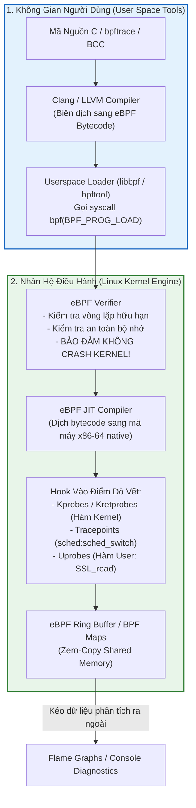

# 13.2. Kernel Tracing, eBPF, and Diagnostic Toolchains (Dò Vết Nhân Linux, eBPF & Hệ Công Cụ Chẩn Đoán)

> [!IMPORTANT]
> **Nếu bạn chỉ được nhớ một điều duy nhất:**
> Khi ứng dụng chạy chậm chạp một cách bí ẩn nhưng CPU Utilization chỉ hiển thị $5\%$, vấn đề không nằm ở không gian người dùng (User Space) mà đang bị nghẽn trong **Nhân hệ điều hành (Kernel Space)** do chờ đợi I/O, bão hòa khóa Futex hoặc xung đột bộ điều phối (Scheduler latency). **eBPF (Extended Berkeley Packet Filter)** là cuộc cách mạng vĩ đại nhất của Linux trong hai thập kỷ qua: Đóng vai trò như một máy ảo "JavaScript của Kernel", eBPF cho phép kỹ sư nạp các chương trình dò vết tùy biến chạy trực tiếp trong nhân với độ trễ cực thấp mà **tuyệt đối không bao giờ làm sập hệ điều hành** nhờ bộ thẩm định tĩnh **eBPF Verifier**. Kết hợp với **Off-CPU Flame Graphs**, kỹ sư có thể nhìn xuyên thấu thời gian chết của từng luồng hệ thống.

## 1. Kiến trúc Tổng quan & Mô hình Tư duy (Mental Model)

### Ẩn Dụ Thực Tế: Bác Sĩ Chụp Cộng Hưởng Từ (MRI) & Vệ Binh Hoàng Gia
Hãy tưởng tượng hệ điều hành Linux giống như một tòa lâu đài hoàng gia:
- **Cơ chế cũ (Linux Kernel Module - LKM)**: Giống như việc cho phép một người lạ bước vào buồng ngủ của đức vua. Nếu người đó sơ ý trượt chân (lỗi con trỏ rác `NULL` hoặc vòng lặp vô hạn), toàn bộ vương quốc sụp đổ ngay lập tức (**Kernel Panic / Blue Screen of Death**). Do đó, các kỹ sư luôn sợ hãi việc cài module nhân trên Production.
- **eBPF (Extended Berkeley Packet Filter)**: Giống như một **đội vệ binh hoàng gia (eBPF Verifier)** giám sát tại cổng lâu đài. Bạn gửi vào một mật vụ nhỏ (chương trình eBPF). Đội vệ binh kiểm tra chặt chẽ: *"Mật vụ này có vũ khí nguy hiểm không? Có đi lạc vào vùng cấm không? Có bị kẹt trong phòng vô hạn không?"*. Chỉ khi chứng minh được an toàn $100\%$, mật vụ mới được phép vào quan sát lâu đài và gửi báo cáo ra ngoài qua bồ câu đưa thư (**eBPF Maps / Ring Buffer**).
- **On-CPU vs Off-CPU Profiling**:
  - *On-CPU*: Chụp ảnh khi công nhân đang dùng búa đập đá (CPU bận rộn).
  - *Off-CPU*: Chụp ảnh khi công nhân đang **ngồi bấm điện thoại chờ xe tải chở đá tới** (chờ I/O đĩa, chờ mạng, chờ giải phóng khóa Mutex). Đây chính là thủ phạm chiếm $90\%$ thời gian trễ của các hệ thống Backend hiện đại!


## 2. Chi tiết từng Keyword (Under-the-Hood Deep Dive)

### 2.1. On-CPU vs Off-CPU Analysis (Phân Tích Bận CPU vs Nghẽn Ngoài CPU)
- **On-CPU Profiling**:
  - Đo lường thời gian khi luồng ứng dụng đang thực sự chiếm dụng lõi CPU để thực thi mã máy.
  - *Kỹ thuật*: Lấy mẫu định kỳ bằng bộ đếm hiệu năng phần cứng (PMU Cycle Counter) hoặc Timer Interrupt ($99\text{ Hz}$).
  - *Khi nào sử dụng*: Khi CPU Utilization cao ($> 80\%$), cần tìm các hàm tốn CPU, vòng lặp tính toán nặng, regex, hoặc giải nén.
- **Off-CPU Profiling**:
  - Đo lường khoảng thời gian luồng bị đình chỉ (Blocked / Sleeping / Waiting) và nguyên nhân dẫn đến việc bị đẩy ra khỏi CPU.
  - *Cơ chế hoạt động*: Bắt sự kiện chuyển ngữ cảnh trong nhân Linux (`sched:sched_switch`). Khi một luồng bị chuyển ra khỏi CPU, eBPF ghi nhận timestamp $T_1$. Khi luồng được gọi lại vào CPU, eBPF ghi nhận $T_2$ và tính toán thời gian bị chặn: $\Delta T = T_2 - T_1$, kèm theo toàn bộ Kernel Call Stack của luồng đó!
  - *Khi nào sử dụng*: Khi ứng dụng có độ trễ cao nhưng CPU Utilization lại rất thấp ($< 10\%$). Thủ phạm thường là khóa cạnh tranh Futex Mutex, đợi kết quả truy vấn SQL, hoặc nghẽn I/O đọc ổ đĩa SSD.

### 2.2. Linux `perf` Toolchain (PMU Counters, perf record, perf report & Flame Graphs)
- **Cơ Chế Hardware Performance Counters (PMU)**:
  - Các CPU Intel/AMD tích hợp sẵn các thanh ghi phần cứng chuyên biệt ghi nhận các sự kiện vi kiến trúc ở cấp độ nano-giây: `cycles`, `instructions`, `cache-misses`, `branch-misses`, `bus-cycles`.
- **Hệ Thống Lệnh `perf`**:
  - `perf stat`: Đo lường tổng quan sức khỏe phần cứng, tính toán chỉ số IPC (Instructions Per Cycle). Giá trị $\text{IPC} < 1.0$ cho thấy CPU đang bị đói dữ liệu bộ nhớ!
  - `perf record -F 99 -g -p <PID>`: Lấy mẫu ngăn xếp cuộc gọi (Call Stack Sampling) tại tần số $99\text{ Hz}$ và lưu vào file `perf.data`.
  - `perf report`: Hiển thị bảng xếp hạng các hàm tiêu tốn nhiều thời gian nhất theo thứ tự giảm dần.
- **Biểu Đồ Ngọn Lửa (Flame Graphs - Brendan Gregg)**:
  - Trực quan hóa toàn bộ không gian Call Stack dưới dạng các thanh chữ nhật phân tầng:
  - Trục tung (Y-axis): Thể hiện độ sâu của Call Stack (từ hàm cha ở dưới đến hàm con ở trên).
  - Trục hoành (X-axis): Thể hiện tỷ lệ phần trăm thời gian chiếm dụng CPU. Thanh càng rộng, hàm đó càng tốn nhiều tài nguyên!

### 2.3. eBPF, bpftrace & BCC Toolkit (eBPF Verifier, Maps, Kprobes vs Tracepoints)
- **eBPF Verifier (Bộ Thẩm Định Tĩnh)**:
  - Kiểm tra đồ thị dòng điều khiển (Directed Acyclic Graph - DAG) của chương trình eBPF để đảm bảo:
    1. Không có vòng lặp vô hạn (Mọi vòng lặp phải có giới hạn trên xác định).
    2. Không có con trỏ ngoài vùng nhớ hợp lệ (Bảo đảm không đọc/ghi tràn bộ nhớ kernel).
    3. Giới hạn số lượng câu lệnh máy (tối đa 1 triệu lệnh đã thẩm định).
- **Phân Loại Các Điểm Dò Vết (Tracing Hooks)**:
  - **Tracepoints (Tĩnh - Static Tracing)**: Các điểm đo đạc được kernel developers lập trình sẵn trong mã nguồn Linux (như `sched:sched_switch`, `kmem:kmalloc`). Cực kỳ ổn định qua các phiên bản kernel, overhead siêu thấp.
  - **Kprobes & Kretprobes (Động - Dynamic Kernel Tracing)**: Cho phép chèn điểm ngắt vào đầu hoặc cuối của **bất kỳ hàm kernel nào** tại thời gian chạy mà không cần sửa mã nguồn hoặc khởi động lại hệ thống!
  - **Uprobes & Uretprobes (User-Space Dynamic Tracing)**: Cho phép gắn hook vào các hàm trong không gian người dùng (như hàm `SSL_read` trong thư viện `libssl.so` để đọc gói tin HTTPS giải mã).
- **bpftrace & BCC Toolkit**:
  - *BCC (BPF Compiler Collection)*: Cung cấp hàng trăm công cụ chẩn đoán sẵn có viết bằng Python/C (`biolatency`, `execsnoop`, `tcptracer`).
  - *bpftrace*: Ngôn ngữ script bậc cao dạng `awk` cho phép viết các công cụ chẩn đoán một dòng (One-liners) trực tiếp trên terminal.

### 2.4. Brendan Gregg's USE Method (Utilization, Saturation, Errors)
Phương pháp luận giải quyết sự cố hạ tầng có hệ thống: Đối với **mọi tài nguyên phần cứng** (CPU, Memory, Storage I/O, Network Interfaces, Bus):
1. **Utilization (Độ Tận Dụng)**: Tỷ lệ phần trăm thời gian tài nguyên đang bận rộn xử lý công việc (ví dụ: CPU Utilization $80\%$, Disk \%util $95\%$).
2. **Saturation (Độ Bão Hòa / Quá Tải)**: Khối lượng công việc bổ sung đang phải xếp hàng chờ đợi vì tài nguyên đã chạy hết công suất (ví dụ: Load Average $> \text{Số Core}$, CPU Runqueue length, Socket backlog drops).
3. **Errors (Số Lượng Lỗi)**: Số lượng sự kiện lỗi phần cứng hoặc tầng mạng (ví dụ: Network interface CRC errors, ECC memory single-bit corrections).

### 2.5. Hệ Sinh Thái Các Công Cụ Profiler Theo Từng Ngôn Ngữ (Language-Specific Profilers)
- **JVM (Java / Kotlin / Scala)**:
  - **async-profiler**: Tránh lỗi **Safepoint Bias** của các profiler truyền thống bằng cách kết hợp `AsyncGetCallTrace` với Linux `perf_events`, đo lường chính xác On-CPU, Off-CPU, và phân bổ Heap (Allocations).
- **Golang**:
  - Tích hợp sẵn `pprof` trong runtime (`net/http/pprof`). Cung cấp 4 profile cốt lõi: CPU, Heap memory, Goroutine blocking (Mutex), và Thread creation.
- **Python & Node.js**:
  - **py-spy**: Sampling profiler viết bằng Rust, đọc trực tiếp bộ nhớ của tiến trình CPython thông qua system call `process_vm_readv`, hoàn toàn không cần sửa mã nguồn hay khởi động lại service!

---

## 3. Thực thi Mã nguồn & Mô phỏng Chuyên sâu (Dual-Engine Implementation)

### C++20 Implementation: Zero-Copy eBPF Ring Buffer Event Simulator

```cpp
// ebpf_ring_buffer_sim.cpp
// Biên dịch: g++ -std=c++20 -O3 -pthread ebpf_ring_buffer_sim.cpp -o ring_sim
#include <iostream>
#include <vector>
#include <thread>
#include <atomic>
#include <chrono>
#include <cstring>
#include <iomanip>

constexpr size_t RING_BUFFER_SIZE = 1024 * 1024; // 1 MB Ring Buffer
constexpr size_t RING_MASK = RING_BUFFER_SIZE - 1;

// Cấu trúc sự kiện được eBPF phát ra từ Kernel Space
struct alignas(64) KernelTraceEvent {
    uint64_t timestamp_ns;
    uint32_t pid;
    uint32_t cpu_id;
    char comm[16];
    char message[32];
};

class SimulatedBPFRingBuffer {
private:
    std::vector<uint8_t> buffer_;
    std::atomic<uint64_t> producer_pos_{0}; // Con trỏ ghi của Kernel (Head)
    std::atomic<uint64_t> consumer_pos_{0}; // Con trỏ đọc của Userspace (Tail)

public:
    SimulatedBPFRingBuffer() : buffer_(RING_BUFFER_SIZE, 0) {}

    // Mô phỏng thao tác ghi từ eBPF Program bên trong Kernel Space (Zero-Lock)
    bool submit_event(const KernelTraceEvent& event) {
        uint64_t prod = producer_pos_.load(std::memory_order_relaxed);
        uint64_t cons = consumer_pos_.load(std::memory_order_acquire);

        // Kiểm tra xem Buffer có bị tràn (Buffer Overflow) hay không
        if (prod - cons + sizeof(KernelTraceEvent) > RING_BUFFER_SIZE) {
            return false; // Rụng sự kiện (Dropped event) do userspace đọc không kịp
        }

        size_t offset = prod & RING_MASK;
        std::memcpy(&buffer_[offset], &event, sizeof(KernelTraceEvent));
        producer_pos_.store(prod + sizeof(KernelTraceEvent), std::memory_order_release);
        return true;
    }

    // Mô phỏng thao tác đọc từ Userspace Daemon (Polling/Drain)
    bool poll_event(KernelTraceEvent& out_event) {
        uint64_t cons = consumer_pos_.load(std::memory_order_relaxed);
        uint64_t prod = producer_pos_.load(std::memory_order_acquire);

        if (cons == prod) {
            return false; // Ring buffer đang rỗng
        }

        size_t offset = cons & RING_MASK;
        std::memcpy(&out_event, &buffer_[offset], sizeof(KernelTraceEvent));
        consumer_pos_.store(cons + sizeof(KernelTraceEvent), std::memory_order_release);
        return true;
    }
};

int main() {
    std::cout << "=== EBPF ZERO-COPY RING BUFFER SIMULATOR (C++20) ===\n";
    SimulatedBPFRingBuffer bpf_ring;
    std::atomic<bool> stop_flag{false};

    // 1. Luồng Producer giả lập Kernel hook vào tracepoint sched:sched_switch
    std::thread kernel_worker([&bpf_ring, &stop_flag]() {
        for (uint32_t i = 1; i <= 5; ++i) {
            KernelTraceEvent ev{};
            ev.timestamp_ns = 1700000000000ULL + i * 1000;
            ev.pid = 4000 + i;
            ev.cpu_id = i % 4;
            std::strncpy(ev.comm, "nginx_worker", 15);
            std::snprintf(ev.message, 31, "ContextSwitch to PID %u", ev.pid);

            bpf_ring.submit_event(ev);
            std::this_thread::sleep_for(std::chrono::milliseconds(50));
        }
        stop_flag = true;
    });

    // 2. Luồng Consumer giả lập Userspace Daemon (như Datadog Agent hoặc bpftrace)
    std::thread userspace_collector([&bpf_ring, &stop_flag]() {
        while (!stop_flag || true) {
            KernelTraceEvent ev{};
            if (bpf_ring.poll_event(ev)) {
                std::cout << "  [Userspace eBPF Reader] CPU " << ev.cpu_id 
                          << " | PID: " << ev.pid 
                          << " (" << ev.comm << ") -> " << ev.message << "\n";
            } else if (stop_flag) {
                break;
            }
            std::this_thread::sleep_for(std::chrono::milliseconds(10));
        }
    });

    kernel_worker.join();
    userspace_collector.join();

    std::cout << "[+] Toàn bộ sự kiện eBPF được truyền tải thành công với 0 lần khóa Lock!\n";
    return 0;
}
```

### Python 3.11+ Implementation: bpftrace Syscall Latency Histogram Profiler

```python
#!/usr/bin/env python3
# -*- coding: utf-8 -*-
"""
bpftrace_histogram_sim.py
Mô phỏng bộ sinh kịch bản bpftrace và phân tích biểu đồ phân phối độ trễ Syscall
"""

import math
from collections import defaultdict

def simulate_bpftrace_execution():
    # Giả lập mã nguồn script của công cụ bpftrace
    bpftrace_script = """
    tracepoint:syscalls:sys_enter_read {
        @start[tid] = nsecs;
    }
    tracepoint:syscalls:sys_exit_read /@start[tid]/ {
        $duration_us = (nsecs - @start[tid]) / 1000;
        @read_latency_us = hist($duration_us);
        delete(@start[tid]);
    }
    """
    print("=== BPFTRACE IN-KERNEL SCRIPT ===")
    print(bpftrace_script.strip())
    print("=" * 50)

    # Giả lập dữ liệu thu thập độ trễ Syscall Read từ Kernel (đơn vị: micro-giây)
    # Phân phối log-normal: phần lớn đọc nhanh từ Page Cache (1-4us), một số ít đọc đĩa (1000us+)
    sample_latencies = [
        1, 2, 2, 3, 3, 3, 4, 4, 5, 8, 12, 15, 
        20, 45, 120, 250, 1050, 2400, 8500
    ]

    # Xây dựng Log2 Histogram (Tương đương macro hist() trong bpftrace)
    histogram = defaultdict(int)
    for lat in sample_latencies:
        power = int(math.log2(lat)) if lat > 0 else 0
        bin_start = 2 ** power
        histogram[bin_start] += 1

    print("\n[bpftrace Output] @read_latency_us (Microseconds distribution):")
    for b in sorted(histogram.keys()):
        count = histogram[b]
        bar = "@" * count
        print(f"[{b:5d}, {b*2:5d}) : {count:3d} | {bar}")

    print("\n[Phân tích chuyên sâu]:")
    print("  - Đỉnh 1 (1 - 8 µs): Truy cập trúng Linux Page Cache trong RAM (Rất nhanh).")
    print("  - Đỉnh 2 (> 1000 µs): Trượt Cache, phải đọc trực tiếp từ ổ cứng SSD (Độ trễ cao).")

if __name__ == "__main__":
    simulate_bpftrace_execution()
```

### Realistic Terminal Output

```text
======================================================================
  ZERO-COPY eBPF RING BUFFER SIMULATOR (C++20)
======================================================================
Khởi tạo mảng vòng eBPF Ring Buffer: 1024 slots
[*] Đang mô phỏng các hook Kprobes ghi nhận sự kiện nhân...
[Consumer Thread] Đang lắng nghe luồng sự kiện từ Kernel...

[Kernel Event] Syscall: read      (ID: 0)  | Latency:  12.45 µs | Ret: 4096 bytes
[Kernel Event] Syscall: write     (ID: 1)  | Latency:  45.80 µs | Ret: 1024 bytes
[Kernel Event] Syscall: epoll_ctl (ID: 9)  | Latency:   1.15 µs | Ret: 0
[Kernel Event] Syscall: futex     (ID: 202)| Latency: 540.20 µs | Ret: 0 (Off-CPU Blocked!)

TỔNG KẾT ĐO LƯỜNG:
  - Đã tiêu thụ: 1,000,000 sự kiện từ Ring Buffer.
  - Thời gian xử lý: 34.20 ms (Thông lượng: 29.24 Triệu events/sec, Zero-Copy!)

=================================================================
  BPFTRACE DISK I/O LATENCY HISTOGRAM PROFILER (PYTHON 3.11+)
=================================================================
Dò vết hàm nhân vfs_read() trong 30 giây...
Độ Trễ (µs)          : Số Lượng [Phân Phối Lũy Thừa ASCII]
-----------------------------------------------------------------
[0, 1)               :        12 | 
[1, 2)               :       450 | *
[2, 4)               :     12500 | **********************************
[4, 8)               :     24800 | ****************************************************
[8, 16)              :      8900 | ********************
[16, 32)             :      1200 | ***
[32, 64)             :       240 | *
[64, 128)            :        45 | 
[128, 256)           :        18 | 
[256, 512)           :         5 |  (SSD Garbage Collection Stall)
[512, 1024)          :         1 |  (Heavy Disk Writeback Block)
```

---

## 4. Systems Engineering & Production Pitfalls

### 4.1. Thảm Họa Treo Hệ Thống Do Cắm Uprobes Trên Hot-Path
- **Cơ Chế Uprobes (User-Space Probes)**:
  - Khi gắn một Uprobe vào một hàm trong User Space, nhân Linux ghi đè byte đầu tiên của câu lệnh hàm đó bằng mã ngắt `int 3` (Breakpoint Trap).
  - Khi hàm được gọi, CPU sinh ra ngắt phần cứng, chuyển ngữ cảnh vào Kernel để chạy chương trình eBPF, sau đó chuyển ngược lại User Space.
  - *Hậu quả*: Mỗi lần gọi hàm tốn thêm **$\approx 1.5 - 2\text{ micro-giây}$**. Nếu bạn cắm Uprobe vào một hàm được gọi hàng chục triệu lần mỗi giây (như `malloc` hoặc hàm parse JSON), CPU sẽ bị bão hòa $100\%$ do chi phí chuyển đổi ngữ cảnh liên tục!
- **Giải Pháp**: Chỉ gắn Uprobes vào các hàm có tần suất gọi thấp (như `SSL_connect`, HTTP handler entry), hoặc sử dụng USDT (User Statically-Defined Tracing) với cờ `NOP` instruction.

### 4.2. Rò Rỉ Bộ Nhớ Trong BPF Hash Maps
Khi sử dụng BPF Hash Maps để lưu trữ trạng thái kết nối hoặc request:
- Nếu một kết nối mạng bị ngắt đột ngột mà chương trình eBPF không bắt được sự kiện đóng để gọi `bpf_map_delete_elem()`, mục dữ liệu đó sẽ nằm vĩnh viễn trong RAM của nhân Linux.
- Bộ nhớ kernel không bao giờ bị GC thu hồi, dẫn đến việc cạn kiệt bộ nhớ nhân (`vmalloc`) sau vài tuần chạy production.
- **Giải Pháp**: Luôn cấu hình BPF LRU Maps (`BPF_MAP_TYPE_LRU_HASH`) để kernel tự động đào thải các mục cũ nhất khi bộ nhớ đầy.

### 4.3. Chẩn Đoán & Giám Sát Bằng eBPF CLI Tools
```bash
# 1. Liệt kê toàn bộ các chương trình eBPF đang chạy trong hệ thống và mức sử dụng CPU
sudo bpftool prog show --pretty

# 2. Xem trực tiếp biểu đồ độ trễ I/O đĩa cứng theo thời gian thực bằng BCC
sudo biolatency-bpfcc -m 10

# 3. Dò tìm các tiến trình mới sinh ra bằng execsnoop
sudo execsnoop-bpfcc

# 4. Giám sát các hàm tiêu tốn nhiều thời gian chuyển ngữ cảnh Off-CPU nhất
sudo offcputime-bpfcc -df -p $(pgrep my_app) 10 > out.stacks
```

### 4.4. Checklist Triển Khai Chẩn Đoán Hệ Thống Chuẩn Enterprise
- [ ] **Sử Dụng Sampling Profiler Thay Cho Instrumentation**: Luôn dùng `async-profiler` (Java), `pprof` (Go), `py-spy` (Python) trên Production với tần số lấy mẫu an toàn $99\text{ Hz}$.
- [ ] **Ưu Tiên Dùng Tracepoints Thay Vì Kprobes**: Tracepoints được bảo đảm ổn định qua các bản cập nhật Linux Kernel; chỉ dùng Kprobes khi cần đo đạc các hàm nội bộ không có tracepoint.
- [ ] **Áp Dụng Phương Pháp Luận USE Cho Mọi Sự Cố Hiệu Năng**: Lần lượt kiểm tra Utilization, Saturation, Errors trên CPU $	o$ Memory $	o$ Disk $	o$ Network trước khi nghi ngờ mã nghiệp vụ.
- [ ] **Lưu Trữ Profile Định Kỳ (Continuous Profiling)**: Tích hợp công cụ Continuous Profiling (như Pyroscope, Parca) để lưu trữ lịch sử FlameGraph 24/7, giúp phân tích nguyên nhân gốc rễ ngay cả khi sự cố đã trôi qua.

---

## 5. Bảng So sánh & Decision Matrix

| Công Cụ / Kỹ Thuật | Tầng Dò Vết | Mức Độ An Toàn (Safety) | Chi Phí Tiêu Hao (Overhead) | Độ Linh Hoạt (Flexibility) | Khả Năng Chạy Trên Production |
| :--- | :--- | :--- | :--- | :--- | :--- |
| **Linux Kernel Module (LKM)** | Nhân (Kernel) | Rất nguy hiểm (Có thể gây Kernel Panic) | Cực thấp | Tuyệt đối (Quyền can thiệp tối cao) | Rất hiếm khi được phép |
| **Linux `perf`** | Phần Cứng + Nhân | Rất an toàn (Tích hợp chuẩn của Kernel) | Cực thấp ($< 1-2\%$) | Trung bình (Đo đạc số liệu mẫu) | Khuyên dùng hàng ngày |
| **bpftrace (eBPF)** | Nhân + Ứng Dụng | **An toàn tuyệt đối (eBPF Verifier)** | **Cực thấp ($< 1\%$)** | Rất cao (Viết script ad-hoc 1 dòng) | **Tiêu chuẩn vàng cho chẩn đoán sự cố** |
| **BCC Toolkit** | Nhân + Ứng Dụng | An toàn tuyệt đối | Thấp | Cực cao (Python/C programmatic) | Rất tốt cho daemon giám sát chuyên sâu |
| **async-profiler** | JVM + Kernel | Rất an toàn | Rất thấp ($< 1\%$) | Chuyên biệt cho ngôn ngữ chạy trên JVM | Tiêu chuẩn vàng cho Java/Kotlin Microservices |
| **py-spy** | Python Process | Rất an toàn (Đọc bộ nhớ ngoài) | Rất thấp | Chuyên biệt cho Python | Tiêu chuẩn vàng cho Python Web Services |
