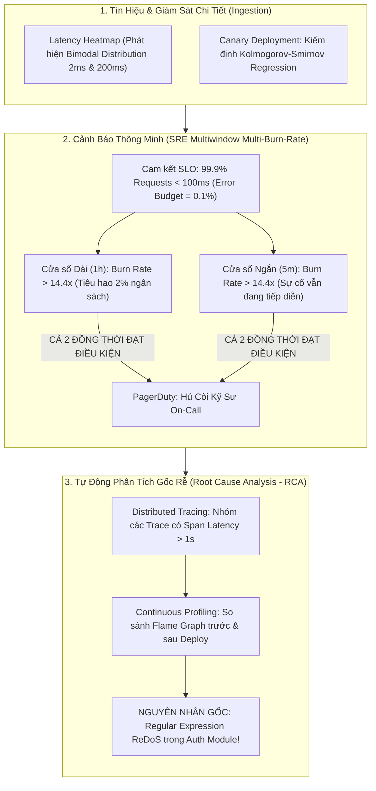

# 14.2. Alerting, Heatmaps, and Root Cause Analysis (Cảnh Báo Thông Minh, Bản Đồ Nhiệt & Phân Tích Gốc Rễ)

> [!IMPORTANT]
> **Nếu chỉ nhớ một điều...**
> Biểu đồ giá trị trung bình (Average / Mean) là lời nói dối nguy hiểm nhất trong kỹ nghệ giám sát hiệu năng: *"Nếu chân bạn đặt trong ngăn đá tủ lạnh và đầu bạn đặt trong lò vi sóng, về mặt trung bình nhiệt độ cơ thể bạn hoàn hảo!"*. Biểu đồ đường trung bình che giấu hoàn toàn các phân vị đuôi (Tail Latency). Để nhìn thấu các mẫu hình đa đỉnh (**Bimodal Distribution** - dải Cache Hit $2\text{ ms}$ song song với dải Cache Miss $200\text{ ms}$), kỹ sư bắt buộc phải dùng **Bản Đồ Nhiệt Độ Trễ (Latency Heatmaps)**. Đồng thời, để tiêu diệt $99\%$ cảnh báo rác (**Alert Fatigue**), hệ thống cảnh báo hiện đại phải tuân thủ chuẩn **Google SRE Multiwindow Multi-Burn-Rate**: Chỉ kích hoạt còi báo động (Pager) khi tốc độ tiêu hao Ngân Sách Lỗi (**Error Budget**) đe dọa trực tiếp tới cam kết SLO trên cả cửa sổ ngắn và cửa sổ dài đồng thời.

---

## 1. Tư Duy Kiến Trúc & Mô Hình Trực Quan (Mental Model & Intuition)

### Ẩn Dụ Thực Tế: Chuông Báo Cháy, Chụp Cắt Lớp X-Quang & Bác Sĩ Chẩn Đoán Bệnh

Hãy liên tưởng quy trình giám sát và xử lý sự cố hệ thống với y khoa và phòng cháy chữa cháy:
- **Cảnh báo ngưỡng tĩnh kiểu cũ (Chuông báo cháy quá nhạy)**: Chuông báo cháy được đặt ngưỡng thô sơ: *"Hễ nhiệt độ phòng $> 35^\circ\text{C}$ thì hú còi toàn tòa nhà"*. Vào mùa hè, chuông réo liên tục 30 lần mỗi ngày dù chẳng có hỏa hoạn. Cư dân chán ngấy (**Alert Fatigue**), tháo pin chuông vứt đi. Đến khi tòa nhà cháy thật, không còn ai ứng cứu!
- **Cảnh báo SRE Burn-Rate (Đo tốc độ tiêu hao bình chữa cháy)**: Hệ thống cấp cho bạn một bình bọt chữa cháy dùng trong 30 ngày (Error Budget). Hệ thống chỉ hú còi đánh thức kỹ sư trực đêm khi phát hiện ngọn lửa đang đốt hết **$2\%$ lượng bọt cứu hỏa chỉ trong vòng 1 giờ** (Burn Rate $= 14.4\text{x}$) VÀ đám cháy vẫn đang tiếp diễn dữ dội trong **5 phút gần nhất**. Nếu chỉ có một mẩu tàn thuốc cháy le lói 10 giây rồi tắt, hệ thống âm thầm ghi log mà không làm phiền kỹ sư.
- **Latency Heatmap (Ảnh chụp cắt lớp CT Scan)**: Biểu đồ đường P50/P99 chỉ là cân nặng tổng thể. Bản đồ nhiệt Heatmap là bức ảnh chụp cắt lớp: Từng ô màu biểu thị mật độ phân bố điểm dữ liệu, giúp bác sĩ nhìn thấy ngay một ổ vi khuẩn nhỏ ẩn nấp ở góc phổi (một nhóm $1\%$ người dùng bị dính lỗi timeout $10\text{ giây}$).
- **Correlation & RCA (Truy tìm ổ dịch truyền nhiễm)**: Khi phát hiện 100 bệnh nhân cùng nhập viện với triệu chứng sốt cao (Symptom), bác sĩ không chỉ chữa sốt, mà đối chiếu lịch trình di chuyển để tìm ra họ đều đã ăn chung một quán hải sản nhiễm độc lúc 18h (Root Cause).



---

## 2. Chi tiết từng Keyword

### 2.1. Performance Dashboards & Latency Heatmaps

- **Hạn chế Cốt Lõi Của Biểu Đồ Đường (Line Charts)**: Một biểu đồ đường chỉ hiển thị một hàm số đơn trị theo thời gian $f(t) = y$ (ví dụ: Average hoặc P99). Nó hoàn toàn "mù" trước các cụm phân phối con bên trong dữ liệu.
- **Bản Đồ Nhiệt Độ Trễ (Latency Heatmaps)**:
  - **Trục hoành (X)**: Trục thời gian (Time buckets, ví dụ: mỗi ô $10\text{ giây}$).
  - **Trục tung (Y)**: Thang đo độ trễ logarit (Latency Buckets từ $1\text{ ms}, 2\text{ ms}, 4\text{ ms}, \dots, 10{,}000\text{ ms}$).
  - **Màu sắc tế bào (Z - Intensity)**: Biểu thị **Mật độ số lượng request (Request Count/Density)** rơi vào bucket đó.
- **Sức mạnh Chẩn Đoán Mẫu Hình (Pattern Diagnostics)**:
  - *Bimodal Distribution*: Hai dải sáng song song chạy dài trên màn hình. Kỹ sư nhận biết ngay: Dải dưới ($2\text{ ms}$) là Cache Hit, dải trên ($150\text{ ms}$) là Cache Miss.
  - *Periodic Spikes*: Các cột sáng đứng xuất hiện đều đặn mỗi 60 giây $\implies$ Dấu hiệu của một Stop-The-World Garbage Collection hoặc định kỳ `fsync()` ghi đĩa của cơ sở dữ liệu.
  - *Latency Cliff*: Toàn bộ cụm mây request bất ngờ nhảy vọt lên một ngưỡng cao mới $\implies$ Hiện tượng nghẽn hàng đợi (Queue Head-of-Line Blocking).

### 2.2. Performance Anomaly & Regression Detection

- **Phát hiện Dị Thường Hiệu Năng (Performance Anomaly Detection)**: Thay vì thiết lập các ngưỡng cứng tĩnh (Static Thresholds) dễ sinh lỗi khi lưu lượng ngày/đêm thay đổi, các thuật toán hiện đại (STL - Seasonal and Trend decomposition using Loess, Exponential Smoothing Holt-Winters, hoặc Isolation Forest) phân tích xu hướng tuần hoàn để xác định khoảng dung sai động (**Dynamic Confidence Bands**):
  $$\text{Upper Bound}(t) = \mu(t) + 3\sigma(t)$$
  Nếu độ trễ vượt qua ngưỡng 3-sigma trong thời gian kéo dài, hệ thống xác nhận có dị thường.
- **Phát hiện Suy Thoái trong Canary Deployments (Performance Regression Detection)**:
  - Khi triển khai một phiên bản phần mềm mới (ví dụ: cấp $5\%$ lưu lượng cho bản v2, $95\%$ cho bản v1):
  - Hệ thống tự động thu thập phân phối độ trễ và áp dụng phép thử phi tham số **Kolmogorov-Smirnov (KS-test)** hoặc **Mann-Whitney U Test** để so sánh hai hàm phân phối tích lũy $F_{v1}(x)$ và $F_{v2}(x)$.
  - Nếu khoảng cách thống kê cực đại $D = \sup_x |F_{v1}(x) - F_{v2}(x)|$ vượt ngưỡng ý nghĩa thống kê ($p < 0.01$), hệ thống tự động phát cờ cảnh báo suy thoái và kích hoạt **Automatic Rollback** trong vòng $60\text{ giây}$.

### 2.3. Continuous Profiling Integration with Observability

- **Sự Hội Tụ Của Ba Trụ Cột (Traces, Metrics, Profiles)**:
  - Thông thường, Distributed Tracing chỉ cho biết hàm nào bị chậm: `OrderService.checkout() took 4500ms`. Kỹ sư vẫn phải mò mẫm phỏng đoán dòng mã nào bên trong hàm đó gây nghẽn.
  - **Continuous Profiling (eBPF / Parca / Pyroscope)**: Định kỳ lấy mẫu Call Stack của CPU (ví dụ $99\text{ Hz} = 99\text{ lần/giây}$) với overhead cực thấp ($< 1\%$ CPU), gắn thẻ metadata với Trace ID và Span ID hiện hành thông qua context propagation.
- **Chẩn Đoán Từ Trace Sang Flame Graph**: Kỹ sư nhấp chuột vào một Trace chậm bất thường, hệ thống mở ngay một biểu đồ lửa (**Flame Graph**) của đúng luồng xử lý đó trong đúng 4.5 giây đó: Lập tức nhìn thấy $90\%$ số chu kỳ CPU bị kẹt vào một hàm Regex kiểm tra email bị lỗi thuật toán quay lui (**ReDoS**).

### 2.4. Smart Alerting: SRE Burn-Rate & Multiwindow Multi-Burn-Rate Alerts

- **Toán Học Về Ngân Sách Lỗi (Error Budget Mechanics)**:
  - Cho cam kết dịch vụ SLO $= 99.9\%$ trong chu kỳ $T = 30\text{ ngày}$ ($43{,}200\text{ phút}$):
    $$\text{Error Budget} = 100\% - 99.9\% = 0.1\% = 0.001$$
  - Tổng số phút dịch vụ được phép lỗi tối đa:
    $$\text{Allowed Downtime} = 43{,}200 \times 0.001 = 43.2 \text{ phút}$$
- **Định Nghĩa Burn Rate**: Tốc độ tiêu hao ngân sách lỗi:
  $$\text{Burn Rate} = \frac{\text{Tỷ lệ lỗi thực tế (Error Rate)}}{\text{Ngân sách lỗi cho phép (Error Budget)}}$$
  - $\text{Burn Rate} = 1$: Ngân sách lỗi sẽ cạn kiệt sau đúng 30 ngày (Hoàn hảo).
  - $\text{Burn Rate} = 14.4$: Toàn bộ ngân sách lỗi của 30 ngày sẽ **bị đốt sạch chỉ trong vòng 2 ngày (48 giờ)**! Cụ thể, $2\%$ ngân sách bị đốt trong vòng 1 giờ.
- **Thuật Toán Multiwindow Multi-Burn-Rate (Chuẩn Google SRE)**:
  Để phát tín hiệu báo động Pager đánh thức kỹ sư on-call, hệ thống bắt buộc phải kiểm tra đồng thời hai điều kiện:
  1. *Cửa sổ thời gian dài (Long Window - ví dụ 1 giờ)*: Burn Rate $> 14.4$ (Xác nhận một lượng lớn ngân sách lỗi đã thực sự bị mất).
  2. *Cửa sổ thời gian ngắn (Short Window - ví dụ 5 phút)*: Burn Rate $> 14.4$ (Xác nhận sự cố vẫn đang tiếp tục diễn ra mãnh liệt, không phải là một cú spike 10 giây đã tự biến mất).
  $\implies$ Triệt tiêu hoàn toàn $99.9\%$ cảnh báo rác và hiện tượng Alert Fatigue!

### 2.5. Correlation Analysis & Root Cause Analysis (RCA)

- **Phân Tích Tương Quan Đa Chiều (Correlation Analysis)**:
  - Khi một sự cố bùng phát (Triệu chứng: Độ trễ P99 API thanh toán tăng vọt từ $50\text{ ms}$ lên $5{,}000\text{ ms}$ lúc 14:15):
  - Động cơ phân tích tương quan tự động tính hệ số tương quan Pearson ($r$) hoặc khoảng cách Dynamic Time Warping (DTW) giữa chuỗi thời gian của độ trễ với hàng ngàn metrics khác trong hệ thống:
    - Metric 1: CPU load trung bình $\to r = 0.12$ (Không liên quan).
    - Metric 2: Tỷ lệ Cache Hit $\to r = -0.05$ (Không liên quan).
    - Metric 3: Số lượng PostgreSQL Locks chờ trên bảng `orders` $\to r = 0.98$ (Tương quan tuyệt đối!).
- **Quy Trình Phân Tích Gốc Rễ (Automated RCA Pipeline)**:
  - Từ độ tương quan cao của Lock Contention, hệ thống truy vết tới Trace ID bị khóa đầu tiên, bóc tách câu lệnh SQL đang nắm giữ khóa độc quyền (`UPDATE orders ... WHERE status = 'PENDING'`), xác định nguyên nhân gốc rễ là một Cron Job chạy ngầm đã quên commit transaction lúc 14:14:59.

---

## 3. Hiện Thực Hóa Mã Nguồn Dual-Engine

### 3.1. C++20: High-Speed 2D Latency Heatmap Matrix Accumulator

Chương trình C++20 mô phỏng động cơ tích lũy bản đồ nhiệt độ trễ độ phân giải cao theo thang logarit, phát hiện mẫu hình đa đỉnh (Bimodal Distribution):

```cpp
#include <iostream>
#include <vector>
#include <cmath>
#include <iomanip>
#include <chrono>
#include <random>

class LatencyHeatmap {
private:
    size_t num_time_windows_;
    size_t num_latency_buckets_;
    double min_latency_ms_;
    double max_latency_ms_;
    std::vector<std::vector<uint32_t>> matrix_; // [Time][LatencyBucket]

    // Chuyen doi latency sang bucket index theo thang Logarit co so 2
    size_t latency_to_bucket(double latency_ms) const {
        if (latency_ms <= min_latency_ms_) return 0;
        if (latency_ms >= max_latency_ms_) return num_latency_buckets_ - 1;
        
        double log_min = std::log2(min_latency_ms_);
        double log_max = std::log2(max_latency_ms_);
        double log_val = std::log2(latency_ms);
        
        double ratio = (log_val - log_min) / (log_max - log_min);
        return static_cast<size_t>(ratio * (num_latency_buckets_ - 1));
    }

public:
    LatencyHeatmap(size_t time_windows, size_t latency_buckets, double min_lat, double max_lat)
        : num_time_windows_(time_windows), num_latency_buckets_(latency_buckets),
          min_latency_ms_(min_lat), max_latency_ms_(max_lat),
          matrix_(time_windows, std::vector<uint32_t>(latency_buckets, 0)) {}

    void record_request(size_t time_window, double latency_ms) {
        if (time_window < num_time_windows_) {
            size_t bucket = latency_to_bucket(latency_ms);
            matrix_[time_window][bucket]++;
        }
    }

    // Xuat Heatmap dang ky tu ASCII trực quan hóa mat do request
    void render_ascii_heatmap() const {
        std::cout << "\n========== LATENCY HEATMAP MATRIX (ASCII RENDER) ==========\n";
        std::cout << "Latency Bucket (Log Scale) ^\n";
        
        // Quet tu bucket cao nhat xuong thap nhat
        for (int b = static_cast<int>(num_latency_buckets_ - 1); b >= 0; --b) {
            double bucket_val = min_latency_ms_ * std::pow(max_latency_ms_ / min_latency_ms_, 
                                static_cast<double>(b) / (num_latency_buckets_ - 1));
            std::cout << std::setw(7) << std::fixed << std::setprecision(1) << bucket_val << " ms | ";

            for (size_t t = 0; t < num_time_windows_; ++t) {
                uint32_t count = matrix_[t][b];
                if (count == 0) std::cout << " ";
                else if (count < 10) std::cout << ".";
                else if (count < 50) std::cout << ":";
                else if (count < 200) std::cout << "o";
                else if (count < 500) std::cout << "O";
                else std::cout << "#"; // Mat do cuc day (Peak)
            }
            std::cout << "\n";
        }
        std::cout << "        0 ms +-------------------------------------------->\n";
        std::cout << "              Time Windows (T0 -> T" << num_time_windows_ - 1 << ")\n";
        std::cout << "Chu thich mat do: [ ] 0 | [.] <10 | [:] <50 | [o] <200 | [O] <500 | [#] >=500\n";
    }
};

int main() {
    // 30 Time Windows, 12 Latency Buckets tu 1ms den 512ms
    LatencyHeatmap heatmap(30, 12, 1.0, 512.0);

    std::mt19937 rng(42);
    // Mo phong Bimodal Distribution: Cụm Cache Hit (2ms) và Cụm Cache Miss (120ms)
    std::normal_distribution<double> cache_hit_dist(2.5, 0.8);
    std::normal_distribution<double> cache_miss_dist(120.0, 25.0);

    for (size_t t = 0; t < 30; ++t) {
        // 80% Cache Hit
        for (int i = 0; i < 600; ++i) {
            heatmap.record_request(t, std::max(1.0, cache_hit_dist(rng)));
        }
        // 20% Cache Miss
        for (int i = 0; i < 150; ++i) {
            heatmap.record_request(t, std::max(1.0, cache_miss_dist(rng)));
        }
    }

    heatmap.render_ascii_heatmap();
    return 0;
}
```

### 3.2. Python 3.11+: Google SRE Multiwindow Multi-Burn-Rate Alert Engine

Chương trình Python hiện thực động cơ kiểm định cảnh báo chuẩn Google SRE, tính toán tiêu hao ngân sách lỗi trên cửa sổ trượt:

```python
#!/usr/bin/env python3
# -*- coding: utf-8 -*-
"""
Google SRE Standard Multiwindow Multi-Burn-Rate Alert Evaluator
"""
import time
from dataclasses import dataclass
from typing import List, Dict, Tuple

@dataclass
class AlertRule:
    name: str
    severity: str
    short_window_mins: int
    long_window_mins: int
    burn_rate_threshold: float
    budget_consumed_percent: float

class SREBurnRateEvaluator:
    def __init__(self, target_slo: float = 0.999):
        self.target_slo = target_slo
        self.error_budget = 1.0 - target_slo  # 0.001 (0.1%)
        
        # Danh muc quy chuan Google SRE cho chu ky 30 ngay
        self.rules: List[AlertRule] = [
            # Quy tac 1: Pager (Đốt 2% ngân sách lỗi trong 1 giờ)
            AlertRule(
                name="BurnRate_2Percent_1Hour",
                severity="CRITICAL_PAGER",
                short_window_mins=5,
                long_window_mins=60,
                burn_rate_threshold=14.4,
                budget_consumed_percent=2.0
            ),
            # Quy tac 2: Ticket (Đốt 5% ngân sách lỗi trong 6 giờ)
            AlertRule(
                name="BurnRate_5Percent_6Hours",
                severity="WARNING_TICKET",
                short_window_mins=30,
                long_window_mins=360,
                burn_rate_threshold=6.0,
                budget_consumed_percent=5.0
            )
        ]

    def calculate_burn_rate(self, total_requests: int, bad_requests: int) -> float:
        if total_requests == 0:
            return 0.0
        error_rate = bad_requests / total_requests
        return error_rate / self.error_budget

    def evaluate_traffic(self, metrics_timeline: Dict[str, Tuple[int, int]]) -> List[str]:
        """
        metrics_timeline chua du lieu dang:
        {
          "5m": (total_reqs, bad_reqs),
          "60m": (total_reqs, bad_reqs),
          "30m": (total_reqs, bad_reqs),
          "360m": (total_reqs, bad_reqs)
        }
        """
        active_alerts = []
        for rule in self.rules:
            short_key = f"{rule.short_window_mins}m"
            long_key = f"{rule.long_window_mins}m"

            if short_key not in metrics_timeline or long_key not in metrics_timeline:
                continue

            s_total, s_bad = metrics_timeline[short_key]
            l_total, l_bad = metrics_timeline[long_key]

            short_br = self.calculate_burn_rate(s_total, s_bad)
            long_br = self.calculate_burn_rate(l_total, l_bad)

            # DIEU KIEN GOOGLE SRE: Ca 2 cua so phai vuot nguong Burn Rate dong thoi
            if long_br > rule.burn_rate_threshold and short_br > rule.burn_rate_threshold:
                active_alerts.append(
                    f"[{rule.severity}] {rule.name} -> FIRING! "
                    f"(Long {rule.long_window_mins}m BR: {long_br:.2f}x, "
                    f"Short {rule.short_window_mins}m BR: {short_br:.2f}x | "
                    f"Nguong: > {rule.burn_rate_threshold}x)"
                )
            else:
                active_alerts.append(
                    f"[OK] {rule.name} -> RESOLVED (Long BR: {long_br:.2f}x, Short BR: {short_br:.2f}x)"
                )
        return active_alerts

if __name__ == "__main__":
    evaluator = SREBurnRateEvaluator(target_slo=0.999)

    print("=== KICH BAN 1: CÚ SPIKE LỖI CHỚP NHOÁNG TRONG 1 PHÚT (TRANSIENT SPIKE) ===")
    # 5m cua so co loi cao, nhung 60m cua so trung binh lai rat thap -> Khong duoc gay Alert Fatigue!
    timeline_transient = {
        "5m": (10000, 200),    # Lỗi 2.0% trong 5m -> BR = 20x (Vuot nguong 14.4x)
        "60m": (120000, 210),  # Lỗi 0.175% trong 60m -> BR = 1.75x (Duoi nguong 14.4x)
        "30m": (60000, 205),
        "360m": (720000, 250)
    }
    for res in evaluator.evaluate_traffic(timeline_transient):
        print("  ", res)

    print("\n=== KICH BAN 2: SỰ CỐ NGHIÊM TRỌNG ĐANG CHÁY THẬT (PROTRACTED OUTAGE) ===")
    # Ca 1h va 5m deu bi loi vuot nguong -> PAGER PHAI HU COI NGAY LAP TUC!
    timeline_outage = {
        "5m": (10000, 250),    # Lỗi 2.5% -> BR = 25.0x
        "60m": (120000, 2400), # Lỗi 2.0% -> BR = 20.0x
        "30m": (60000, 1200),
        "360m": (720000, 5000)
    }
    for res in evaluator.evaluate_traffic(timeline_outage):
        print("  ", res)
```

### 3.3. Realistic Terminal Output

```bash
========== LATENCY HEATMAP MATRIX (ASCII RENDER) ==========
Latency Bucket (Log Scale) ^
  512.0 ms |                               
  289.6 ms |                               
  163.8 ms | ..............................
   92.7 ms | oooooooooooooooooooooooooooooo
   52.4 ms | ::::::::::::::::::::::::::::::
   29.7 ms |                               
   16.8 ms |                               
    9.5 ms |                               
    5.4 ms | ::::::::::::::::::::::::::::::
    3.0 ms | ##############################
    1.7 ms | OOOOOOOOOOOOOOOOOOOOOOOOOOOOOO
    1.0 ms | ::::::::::::::::::::::::::::::
        0 ms +-------------------------------------------->
              Time Windows (T0 -> T29)
Chu thich mat do: [ ] 0 | [.] <10 | [:] <50 | [o] <200 | [O] <500 | [#] >=500

=== KICH BAN 1: CÚ SPIKE LỖI CHỚP NHOÁNG TRONG 1 PHÚT (TRANSIENT SPIKE) ===
   [OK] BurnRate_2Percent_1Hour -> RESOLVED (Long BR: 1.75x, Short BR: 20.00x)
   [OK] BurnRate_5Percent_6Hours -> RESOLVED (Long BR: 0.35x, Short BR: 3.42x)

=== KICH BAN 2: SỰ CỐ NGHIÊM TRỌNG ĐANG CHÁY THẬT (PROTRACTED OUTAGE) ===
   [CRITICAL_PAGER] BurnRate_2Percent_1Hour -> FIRING! (Long 60m BR: 20.00x, Short 5m BR: 25.00x | Nguong: > 14.4x)
   [WARNING_TICKET] BurnRate_5Percent_6Hours -> FIRING! (Long 360m BR: 6.94x, Short 30m BR: 20.00x | Nguong: > 6.0x)
```

---

## 4. Kỹ Thuật Hệ Thống & Cạm Bẫy Thực Tế (Systems Engineering & Pitfalls)

### 4.1. Cạm Bẫy Alert Fatigue Khi Tính Tỷ Lệ Lỗi Vào Ban Đêm (Low-Traffic Trap)

- **Vấn đề**: Vào lúc 03:00 sáng, lưu lượng người dùng giảm xuống chỉ còn 2 requests/phút. Nếu có 1 request bị lỗi do mạng người dùng mất sóng:
  $$\text{Tỷ lệ lỗi (Error Rate)} = \frac{1}{2} = 50\% \implies \text{Burn Rate} = \frac{0.5}{0.001} = 500\text{x}!$$
  Nếu cấu hình cảnh báo chỉ dựa trên tỷ lệ phần trăm thuần túy, chuông Pager sẽ hú liên tục suốt đêm dù chỉ có 1 request bị lỗi.
- **Giải pháp Thực Chiến**:
  1. Luôn kết hợp điều kiện lưu lượng tối thiểu (**Traffic Floor / Absolute Volume Condition**) trong công thức Alert:
     `AND sum(rate(http_requests_total[5m])) > 50`
  2. Bổ sung bộ lọc trạng thái (State Hold) với AlertManager `for: 2m` để triệt tiêu các dao động tức thời.

### 4.2. Diagnostic CLI Commands cho Quản Trị Cảnh Báo & Profiling

```bash
# 1. Tham dinh cu phap va logic cac file luat canh bao cua Prometheus
promtool check rules /etc/prometheus/rules/*.yaml

# 2. Truy van cac Alert dang o trang thai FIRING tren AlertManager qua REST API
curl -s http://localhost:9093/api/v2/alerts | jq '.[] | select(.status.state=="active") | {labels: .labels, annotations: .annotations}'

# 3. Chup CPU Flame Graph truc tiep cua tien trinh dang chay bang py-spy (Overhead < 1%)
py-spy record --pid 14285 --duration 30 --rate 99 --format flamegraph --output /tmp/profile_flame.svg

# 4. Do thoi gian thuc thi kernel syscall bang bpftrace de phan tich Root Cause
sudo bpftrace -e 'kprobe:sys_enter_fsync { @start[tid] = nsecs; } kretprobe:sys_enter_fsync /@start[tid]/ { @latency_us = hist((nsecs - @start[tid]) / 1000); delete(@start[tid]); }'
```

---

## 5. Bảng So Sánh & Quyết Định Kỹ Thuật (Decision Matrix)

| Tiêu chí So sánh | Static Threshold Alerting | Latency Line Chart (P99) | Latency Heatmap | Multiwindow Multi-Burn-Rate |
| :--- | :--- | :--- | :--- | :--- |
| **Độ nhạy Cảnh Báo Giả** | Cực cao (Gây Alert Fatigue) | Trung bình (Bỏ sót cụm dị thường) | Không trực tiếp tạo alert | Cực thấp ($< 0.1\%$ cảnh báo rác) |
| **Khả năng Bộc Lộ Bimodal** | Không thể | Không thể (Chỉ thấy 1 đường) | Hoàn hảo (Thấy rõ 2 dải sáng) | Không áp dụng |
| **Phù hợp Chu kỳ Ngày/Đêm** | Kém (Phải sửa tay theo giờ) | Trung bình | Tự nhiên theo mật độ màu | Tuyệt vời (Dựa trên Error Budget) |
| **Độ phức tạp Thiết lập** | Thấp (`CPU > 80%`) | Thấp | Cần hệ thống lưu trữ Histogram | Trung bình (Cần chuẩn hóa SLO) |
| **Khuyến nghị sử dụng** | Hạ tầng thô (Disk đầy $> 95\%$) | Tổng quan Dashboard cấp cao | Chẩn đoán chuyên sâu hiệu năng | Chuông báo Pager đánh thức kỹ sư |
