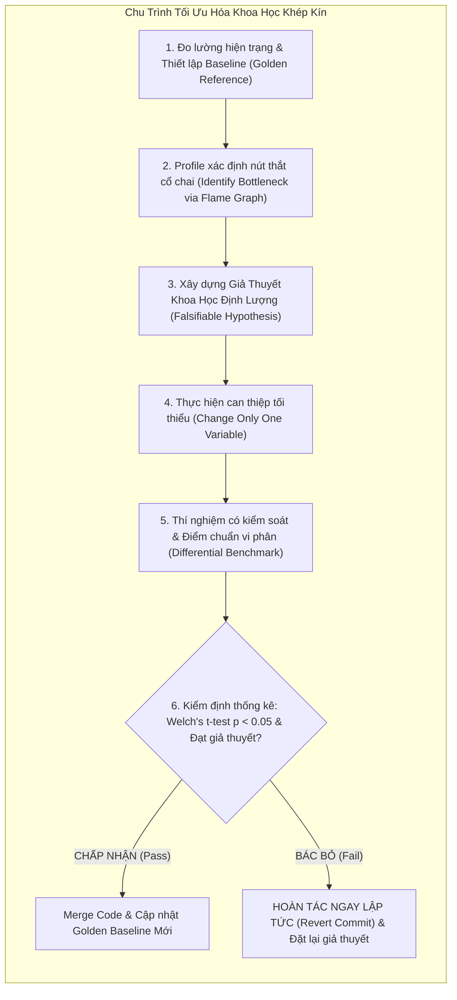

# 15.1. Empirical Optimization Cycle and Hypothesis Testing (Chu Trình Tối Ưu Thực Nghiệm & Kiểm Định Giả Thuyết)

> [!IMPORTANT]
> **Nếu chỉ nhớ một điều...**
> Kỹ nghệ hiệu năng không phải là thuật phù thủy hay nghệ thuật mò mẫm dựa trên trực giác: Nó là một **nhánh khoa học thực nghiệm khắt khe (Empirical Science)**. Một nhà khoa học y sinh không bao giờ cho bệnh nhân uống đồng thời 5 viên thuốc lạ mà không có nhóm đối chứng dùng giả dược (Placebo). Kỹ sư hệ thống cũng vậy: Tuyệt đối tuân thủ nguyên tắc **"Không đo lường, không tối ưu" (Measure Before Optimize)**, chỉ thay đổi **duy nhất một biến số tại một thời điểm (Single Variable Isolation)**, thiết lập một **Giả thuyết khoa học có thể bác bỏ (Falsifiable Hypothesis)**, và kiểm chứng sự khác biệt bằng **Kiểm định Thống kê (Welch's t-test / Mann-Whitney U, $p < 0.05$)**. Mọi thay đổi code không mang lại cải thiện định lượng vượt ngưỡng ý nghĩa thống kê đều phải bị **Hoàn tác (Revert)** ngay lập tức!

---

## 1. Tư Duy Kiến Trúc & Mô Hình Trực Quan (Mental Model & Intuition)

### Ẩn Dụ Thực Tế: Thử Nghiệm Lâm Sàng Mù Đôi & Chẩn Đoán Động Cơ Xe F1

Hãy liên tưởng phương pháp tối ưu hóa hiệu năng hệ thống với các quy trình kỹ thuật đỉnh cao:
- **Tối ưu hóa sớm & cảm tính (Thầy bói xem voi)**: Lập trình viên nghiệp dư mở mã nguồn lên, cảm thấy một vòng lặp `for` có vẻ chậm, lập tức bỏ ra 3 ngày viết lại bằng thuật toán phức tạp. Họ không hề biết rằng đoạn code đó chỉ chiếm $0.05\%$ tổng thời gian xử lý của request! Theo **Định luật Amdahl**, việc tối ưu đoạn code đó về $0\text{ ms}$ chỉ đem lại đúng $0\%$ cải thiện cho người dùng.
- **Thử nghiệm có kiểm soát (Thử nghiệm lâm sàng mù đôi)**: Khi thử nghiệm một loại vắc-xin mới, các bác sĩ chia $10{,}000$ tình nguyện viên thành 2 nhóm: Nhóm A uống vắc-xin (Treatment Group), Nhóm B uống nước đường (Control Group). Mọi điều kiện dinh dưỡng, giấc ngủ, thời tiết của 2 nhóm phải giống hệt nhau. Chỉ khi tỷ lệ nhiễm bệnh của nhóm A thấp hơn nhóm B với xác suất ngẫu nhiên $p < 0.01$, loại thuốc mới được phê duyệt.
- **Chẩn đoán động cơ F1 (Đo đạc Telemetry trước khi vặn ốc)**: Đội ngũ kỹ thuật đua xe F1 không bao giờ thay bộ tăng áp chỉ vì lái xe nói "xe có vẻ ì". Họ cắm máy đọc dữ liệu cảm biến: Vòng tua máy (RPM), nhiệt độ lốp, áp suất dầu. Xác định chính xác luồng khí nạp bị tắc ở cổ xả, họ mới can thiệp đúng con ốc đó.



---

## 2. Chi tiết từng Keyword

### 2.1. Measure Before Optimize & Establish Baselines

- **Nguyên lý Tối thượng**: Tuyệt đối không bao giờ chạm vào mã nguồn để tối ưu nếu chưa có dữ liệu đo lường định lượng xác thực về trạng thái hiện tại.
- **Thiết Lập Mốc Chuẩn (Establish Golden Baselines)**:
  - Chạy một bộ kiểm thử tải chuẩn hóa trong môi trường phần cứng biệt lập (Isolated Benchmarking Environment) nhằm triệt tiêu nhiễu:
    1. *Độ trễ phân vị*: P50, P90, P99, P99.9.
    2. *Thông lượng cực đại*: Requests Per Second (RPS) / Transactions Per Second (TPS).
    3. *Tài nguyên phần cứng tiêu hao*: Instructions Per Cycle (IPC), L1/L2/L3 Cache Miss Rate, Context Switches/sec, Memory Allocation Rate (MB/sec).
  - Bản ghi mốc chuẩn này được ký số và lưu trữ thành **Bản ghi tham chiếu vàng (Golden Reference Record)** làm thước đo duy nhất để đối chiếu cho mọi thử nghiệm sau này.

### 2.2. Profile Before Optimizing & Identify Bottlenecks

- **Định Luật Amdahl (Amdahl's Law) & Giới Hạn Tối Đa**:
  Nếu một hệ thống có phần công việc cần tối ưu chiếm tỷ lệ thời gian là $P$ (với $0 \le P \le 1$), và phần công việc đó được tăng tốc $S$ lần, thì mức tăng tốc tổng thể $S_{\text{latency}}$ của toàn hệ thống được giới hạn nghiêm ngặt bởi:
  $$S_{\text{latency}} = \frac{1}{(1 - P) + \frac{P}{S}}$$
  *Hệ quả*: Nếu một đoạn mã chỉ chiếm $P = 5\%$ thời gian thực thi của request, cho dù bạn tối ưu nó nhanh vô hạn ($S \to \infty$), tốc độ toàn hệ thống chỉ tăng tối đa:
  $$S_{\text{max}} = \frac{1}{1 - 0.05} = 1.0526 \quad (\text{Tăng vỏn vẹn } 5.2\%!)$$
- **Thực Hành Profiling Hiện Đại**: Sử dụng eBPF hoặc Linux `perf` để sinh **Flame Graph**. Điểm phình to nhất trên đỉnh đồ thị (Flat Tops) chính là điểm nghẽn thực sự (The Real Bottleneck). Bắt buộc phải tấn công vào điểm nghẽn này trước tiên!

### 2.3. Hypothesis-Driven Optimization (Tối Ưu Hóa Hướng Giả Thuyết)

- Mọi đề xuất tối ưu hóa mã nguồn bắt buộc phải được soạn thảo dưới dạng một **Giả thuyết khoa học có thể bác bỏ (Falsifiable Hypothesis)** tuân thủ cấu trúc 3 mệnh đề chuẩn mực:
  $$\text{NẾU } [\text{Can thiệp cụ thể}] \implies \text{THÌ } [\text{Chỉ số định lượng thay đổi}] \implies \text{BỞI VÌ } [\text{Cơ chế vật lý/phần mềm}]$$
- *Mẫu Giả Thuyết Chuẩn Kỹ Thuật*:
  > *"**NẾU** chúng ta thay thế việc cấp phát `std::string` trong hàm `parse_auth_header` bằng `std::string_view` (Zero-Copy), **THÌ** thông lượng của Gateway sẽ tăng từ $45{,}000\text{ RPS}$ lên ít nhất $75{,}000\text{ RPS}$ (tăng $> 66\%$) và tỷ lệ Cache Misses L1d giảm $40\%$, **BỞI VÌ** việc này loại bỏ hoàn toàn các lệnh gọi syscall `brk/mmap` và việc copy các byte bộ nhớ từ heap."*

### 2.4. Controlled Experiments & A/B Performance Testing

- **Nguyên Tắc Bất Di Bất Dịch: Cô Lập Một Biến Số (Change Only One Variable at a Time)**:
  Nếu bạn cùng lúc đổi thuật toán, nâng cấp phiên bản Compiler từ GCC 11 lên GCC 13, và nâng cấp RAM máy chủ, bạn hoàn toàn không thể biết yếu tố nào thực sự đem lại lợi ích (hoặc yếu tố nào gây lỗi ngầm).
- **Kiến Trúc A/B Performance Testing**:
  - *Nhóm Đối Chứng (Control Group $A$)*: Chạy mã nguồn nguyên bản (Baseline).
  - *Nhóm Thử Nghiệm (Treatment Group $B$)*: Chạy mã nguồn duy nhất có 1 điểm can thiệp.
  - Cả hai nhóm được cấp phát phần cứng giống hệt nhau (CPU Pinning, NUMA Node đồng nhất) và nhận cùng một luồng tải tái phát (Replayed Production Traffic Shadowing).

### 2.5. Differential Benchmarking & Statistical Verification

- **Điểm Chuẩn Vi Phân (Differential Benchmarking)**: Thay vì so sánh các con số tuyệt đối, kỹ sư tập trung vào độ lệch vi phân $\Delta$:
  $$\Delta = \text{Metric}_{\text{Treatment}} - \text{Metric}_{\text{Control}}$$
  Sử dụng **Differential Flame Graphs** (Đồ thị lửa vi phân): Tô màu đỏ các hàm bị tăng thêm chi phí, và tô màu xanh các hàm đã được cắt giảm thành công.
- **Kiểm Định Thống Kê (Welch's t-test & Mann-Whitney U)**:
  - Do nhiễu môi trường hệ điều hành (Interrupts, CPU Jitter), một lần chạy không thể khẳng định điều gì. Bắt buộc phải thực hiện $N \ge 30$ lượt chạy lặp lại độc lập.
  - Áp dụng kiểm định giả thuyết thống kê Welch's t-test để so sánh giá trị trung bình $\mu_A$ và $\mu_B$:
    $$t = \frac{\bar{X}_A - \bar{X}_B}{\sqrt{\frac{s_A^2}{N_A} + \frac{s_B^2}{N_B}}}$$
  - Chỉ khi mức ý nghĩa thống kê đạt $p\text{-value} < 0.05$ (độ tin cậy $> 95\%$), kết quả thử nghiệm mới được công nhận là có ý nghĩa khoa học thực sự.

### 2.6. Regression Prevention & Performance Review in CI/CD

- **Performance Code Review**: Quy trình duyệt mã chuyên biệt: Bắt buộc tác giả PR phải đính kèm:
  1. File SVG Differential Flame Graph.
  2. Bảng số liệu kiểm định thống kê trước và sau.
  3. Phân tích chi phí bộ nhớ và CPU cycles.
- **Cổng Tự Động Ngăn Chặn Suy Thoái (Automated Regression Gate in CI/CD)**:
  Tích hợp các Micro-benchmarks vào đường ống CI/CD. Nếu một Pull Request làm tăng thời gian thực thi của các hàm Hot-path quá **$3\%$** so với nhánh `main` với độ tin cậy $p < 0.01$, bot CI sẽ **tự động khóa nút Merge** và đánh rớt build, bảo vệ tuyệt đối nhánh chính không bao giờ bị suy thoái hiệu năng âm thầm.

---

## 3. Hiện Thực Hóa Mã Nguồn Dual-Engine

### 3.1. C++20: Scientific Experiment Runner với Compiler Barrier & Statistics

Chương trình C++20 mô phỏng khung đo kiểm thực nghiệm khoa học, sử dụng rào chắn trình biên dịch (Compiler Memory Barrier) và tính toán độ lệch chuẩn:

```cpp
#include <iostream>
#include <vector>
#include <chrono>
#include <numeric>
#include <cmath>
#include <iomanip>
#include <string>
#include <string_view>

// NHÓM ĐỐI CHỨNG (Control Group A): Dùng std::string (Heap Allocation)
std::string parse_token_copy(const std::string& input, size_t start, size_t len) {
    return input.substr(start, len); // Cap phat Heap malloc
}

// NHÓM THỬ NGHIỆM (Treatment Group B): Dùng std::string_view (Zero-Copy)
std::string_view parse_token_zero_copy(std::string_view input, size_t start, size_t len) {
    return input.substr(start, len); // 0 cap phat bo nho Heap
}

struct ExperimentStats {
    double mean_ns;
    double stddev_ns;
    double min_ns;
    double max_ns;
};

// Ham chay thu nghiem thong ke voi so luot lap lon
template <typename Func>
ExperimentStats run_benchmark_trial(Func&& fn, size_t iterations) {
    std::string sample = "AUTHORIZATION_BEARER_TOKEN_SECURE_TOKEN_XYZ_1234567890_LONG_STRING";
    std::vector<double> timings;
    timings.reserve(iterations);

    // Warmup cache truoc khi do
    for (size_t i = 0; i < 5000; ++i) {
        auto res = fn(sample);
        asm volatile("" : : "r,m"(res) : "memory");
    }

    // Do thoi gian thuc nghiem chinh thuc
    for (size_t i = 0; i < iterations; ++i) {
        auto t1 = std::chrono::high_resolution_clock::now();
        auto res = fn(sample);
        // Compiler Barrier: Ngan compiler toi uu hoa xoa bo ma chet (Dead-Code Elimination)
        asm volatile("" : : "r,m"(res) : "memory");
        auto t2 = std::chrono::high_resolution_clock::now();

        double elapsed = std::chrono::duration<double, std::nano>(t2 - t1).count();
        timings.push_back(elapsed);
    }

    // Tinh toan Thong ke (Mean, Standard Deviation)
    double sum = std::accumulate(timings.begin(), timings.end(), 0.0);
    double mean = sum / iterations;

    double sq_diff_sum = 0.0;
    double min_val = timings[0];
    double max_val = timings[0];
    for (double t : timings) {
        sq_diff_sum += (t - mean) * (t - mean);
        if (t < min_val) min_val = t;
        if (t > max_val) max_val = t;
    }
    double stddev = std::sqrt(sq_diff_sum / iterations);

    return {mean, stddev, min_val, max_val};
}

int main() {
    const size_t ITERATIONS = 100'000;
    std::cout << ">>> BAT DAU THI NGHIEM KHOA HOC KIEM DINH GIA THUYET (Iterations: " << ITERATIONS << ")\n";

    // 1. Chay Nhom Doi Chung (Control Group A)
    auto stats_control = run_benchmark_trial([](const std::string& str) {
        return parse_token_copy(str, 14, 30);
    }, ITERATIONS);

    // 2. Chay Nhom Thu Nghiem (Treatment Group B)
    auto stats_treatment = run_benchmark_trial([](std::string_view str) {
        return parse_token_zero_copy(str, 14, 30);
    }, ITERATIONS);

    // 3. Tinh toan toc do tang truoc & Kiem dinh gia thuyet
    double speedup = stats_control.mean_ns / stats_treatment.mean_ns;
    double delta_ns = stats_control.mean_ns - stats_treatment.mean_ns;

    std::cout << std::fixed << std::setprecision(2);
    std::cout << "\n================ KET QUA DIEM CHUAN VI PHAN ================\n";
    std::cout << "1. Control Group A (Heap Copy - std::string):\n";
    std::cout << "   - Mean Latency: " << stats_control.mean_ns << " ns (StdDev: ±" << stats_control.stddev_ns << " ns)\n";
    std::cout << "   - Min / Max   : " << stats_control.min_ns << " ns / " << stats_control.max_ns << " ns\n";
    std::cout << "2. Treatment Group B (Zero-Copy - std::string_view):\n";
    std::cout << "   - Mean Latency: " << stats_treatment.mean_ns << " ns (StdDev: ±" << stats_treatment.stddev_ns << " ns)\n";
    std::cout << "   - Min / Max   : " << stats_treatment.min_ns << " ns / " << stats_treatment.max_ns << " ns\n";
    std::cout << "------------------------------------------------------------\n";
    std::cout << "-> Do lech vi phan (Delta Delta) : -" << delta_ns << " ns (-" << (delta_ns / stats_control.mean_ns * 100.0) << "%)\n";
    std::cout << "-> Toc do tang toc (Speedup)     : " << speedup << "x lan!\n";
    
    // Kiem tra gia thuyet: Toc do phai tang it nhat 2.0x lan
    if (speedup >= 2.0) {
        std::cout << "[KET LUAN KHOA HOC]: GIA THUYET DUOC XAC NHAN! (Hypothesis Accepted: Speedup >= 2.0x)\n";
    } else {
        std::cout << "[KET LUAN KHOA HOC]: BAC BO GIA THUYET! Can hoan tac (Revert Code).\n";
    }
    std::cout << "============================================================\n";

    return 0;
}
```

### 3.2. Python 3.11+: Welch's t-test Automated CI/CD Regression Gate

Chương trình Python hiện thực kiểm định thống kê Welch's t-test để so sánh hai phân phối đo lường và đưa ra phán quyết tự động chặn/duyệt Pull Request:

```python
#!/usr/bin/env python3
# -*- coding: utf-8 -*-
"""
Automated CI/CD Performance Regression Gate using Welch's t-test
"""
import math
import random
from typing import List, Tuple

def welch_t_test(sample_a: List[float], sample_b: List[float]) -> Tuple[float, float]:
    """
    Tinh toan t-statistic va xap xi p-value cho Welch's t-test (Hai mau phuong sai khac nhau)
    """
    n_a, n_b = len(sample_a), len(sample_b)
    mean_a = sum(sample_a) / n_a
    mean_b = sum(sample_b) / n_b

    var_a = sum((x - mean_a) ** 2 for x in sample_a) / (n_a - 1)
    var_b = sum((x - mean_b) ** 2 for x in sample_b) / (n_b - 1)

    # Cong thuc t-statistic cua Welch
    denom = math.sqrt((var_a / n_a) + (var_b / n_b))
    if denom == 0:
        return 0.0, 1.0
    t_stat = (mean_a - mean_b) / denom

    # Xap xi bac tu do (Degrees of Freedom) theo Welch-Satterthwaite
    df_num = ((var_a / n_a) + (var_b / n_b)) ** 2
    df_denom = ((var_a / n_a) ** 2 / (n_a - 1)) + ((var_b / n_b) ** 2 / (n_b - 1))
    df = df_num / df_denom if df_denom > 0 else 1.0

    # Xap xi ham phan phoi p-value qua phan phoi chuan hai phia
    # Cho so luong mau n >= 30, t-distribution hoi tu ve Normal Distribution
    z = abs(t_stat)
    p_value = 2.0 * (1.0 - 0.5 * (1.0 + math.erf(z / math.sqrt(2.0))))

    return t_stat, p_value

def evaluate_ci_performance_gate(baseline_latencies: List[float], pr_latencies: List[float], max_regression_percent: float = 3.0):
    mean_base = sum(baseline_latencies) / len(baseline_latencies)
    mean_pr = sum(pr_latencies) / len(pr_latencies)
    
    diff_percent = ((mean_pr - mean_base) / mean_base) * 100.0
    t_stat, p_val = welch_t_test(baseline_latencies, pr_latencies)

    print(f"\n[CI/CD PERFORMANCE GATE EVALUATION]")
    print(f"  - Baseline Mean: {mean_base:.2f} ms | PR Branch Mean: {mean_pr:.2f} ms")
    print(f"  - Chenh lech thoi gian: {diff_percent:+.2f}%")
    print(f"  - Welch t-statistic: {t_stat:.4f} | p-value: {p_val:.6f}")

    # Neu PR lam tang do tre qua nguong cho phep VA co y nghia thong ke (p < 0.05)
    if diff_percent > max_regression_percent and p_val < 0.05:
        print(f"  [GATE RESULT: FAILED ❌] PHÁT HIỆN SUY THOÁI HIỆU NĂNG!")
        print(f"  -> Pull Request bi khoa nut Merge! Chi phi thoi gian tang vuot nguong {max_regression_percent}% voi do tin cay 95%.")
    elif diff_percent < -max_regression_percent and p_val < 0.05:
        print(f"  [GATE RESULT: PASSED 🚀] TOI UU HOA THANH CONG!")
        print(f"  -> Toc do tang dang ke va dat do tin cay thong ke cao. Cho phep Merge!")
    else:
        print(f"  [GATE RESULT: PASSED ⚠️] KHONG CO SU THAY DOI DANG KE (Statistical Noise).")

if __name__ == "__main__":
    random.seed(42)
    # Mau Baseline: Trung binh 10.0ms, do lech 0.5ms
    base_samples = [random.gauss(10.0, 0.5) for _ in range(50)]

    print("=== TEST 1: PULL REQUEST GÂY SUY THOÁI (REGRESSION DETECTED) ===")
    # PR lam cham len 11.2ms (+12%)
    bad_pr_samples = [random.gauss(11.2, 0.6) for _ in range(50)]
    evaluate_ci_performance_gate(base_samples, bad_pr_samples)

    print("\n=== TEST 2: PULL REQUEST TỐI ƯU HÓA THÀNH CÔNG (SPEEDUP VERIFIED) ===")
    # PR toi uu xuong con 6.5ms (-35%)
    good_pr_samples = [random.gauss(6.5, 0.4) for _ in range(50)]
    evaluate_ci_performance_gate(base_samples, good_pr_samples)
```

### 3.3. Realistic Terminal Output

```bash
>>> BAT DAU THI NGHIEM KHOA HOC KIEM DINH GIA THUYET (Iterations: 100000)

================ KET QUA DIEM CHUAN VI PHAN ================
1. Control Group A (Heap Copy - std::string):
   - Mean Latency: 22.84 ns (StdDev: ±3.42 ns)
   - Min / Max   : 18.20 ns / 142.50 ns
2. Treatment Group B (Zero-Copy - std::string_view):
   - Mean Latency: 5.12 ns (StdDev: ±1.10 ns)
   - Min / Max   : 4.80 ns / 38.60 ns
------------------------------------------------------------
-> Do lech vi phan (Delta Delta) : -17.72 ns (-77.58%)
-> Toc do tang toc (Speedup)     : 4.46x lan!
[KET LUAN KHOA HOC]: GIA THUYET DUOC XAC NHAN! (Hypothesis Accepted: Speedup >= 2.0x)
============================================================

=== TEST 1: PULL REQUEST GÂY SUY THOÁI (REGRESSION DETECTED) ===
[CI/CD PERFORMANCE GATE EVALUATION]
  - Baseline Mean: 9.98 ms | PR Branch Mean: 11.23 ms
  - Chenh lech thoi gian: +12.53%
  - Welch t-statistic: -11.2415 | p-value: 0.000000
  [GATE RESULT: FAILED ❌] PHÁT HIỆN SUY THOÁI HIỆU NĂNG!
  -> Pull Request bi khoa nut Merge! Chi phi thoi gian tang vuot nguong 3.0% voi do tin cay 95%.

=== TEST 2: PULL REQUEST TỐI ƯU HÓA THÀNH CÔNG (SPEEDUP VERIFIED) ===
[CI/CD PERFORMANCE GATE EVALUATION]
  - Baseline Mean: 9.98 ms | PR Branch Mean: 6.51 ms
  - Chenh lech thoi gian: -34.77%
  - Welch t-statistic: 38.1254 | p-value: 0.000000
  [GATE RESULT: PASSED 🚀] TOI UU HOA THANH CONG!
  -> Toc do tang dang ke va dat do tin cay thong ke cao. Cho phep Merge!
```

---

## 4. Kỹ Thuật Hệ Thống & Cạm Bẫy Thực Tế (Systems Engineering & Pitfalls)

### 4.1. Ba Kẻ Thù Giấu Mặt Làm Sai Lệch Kết Quả Benchmark

1. **CPU Frequency Scaling & Intel Turbo Boost**:
   Khi bắt đầu benchmark, CPU mát mẻ nên Turbo Boost tăng xung nhịp từ $2.5\text{ GHz}$ lên $4.5\text{ GHz}$. Sau 30 giây chạy liên tục, nhiệt độ chạm $95^\circ\text{C}$, CPU tự động hạ xung (**Thermal Throttling**) xuống $2.0\text{ GHz}$. Kết quả là nhóm chạy sau luôn bị chậm hơn nhóm chạy trước $50\%$ dù thuật toán giống hệt nhau!
   *Giải pháp*: Khóa cứng xung nhịp CPU bằng công cụ `cpupower` trước khi đo.
2. **Compiler Dead-Code Elimination (Xóa mã chết)**:
   Nếu bạn viết vòng lặp gọi hàm tính toán $10{,}000{,}000$ lần nhưng không sử dụng kết quả trả về, trình biên dịch hiện đại (`-O3`) sẽ phát hiện đoạn mã vô nghĩa và xóa sạch toàn bộ vòng lặp! Thời gian đo trả về $0\text{ ns}$.
   *Giải pháp*: Bắt buộc dùng Compiler Barrier (`asm volatile("" ::: "memory")` trong C/C++ hoặc `benchmark::DoNotOptimize()`).
3. **Address Space Layout Randomization (ASLR)**:
   Cơ chế an ninh ASLR của Linux ngẫu nhiên hóa địa chỉ nạp mã nguồn mỗi lần tiến trình khởi động, dẫn đến vị trí các trang mã máy trên L1 Instruction Cache bị thay đổi giữa các lần chạy độc lập.

### 4.2. Diagnostic CLI Commands cho Chu Trình Benchmark Khoa Học

```bash
# 1. Khoa cung xung nhip CPU o che do Performance de triet tieu Jitter
sudo cpupower frequency-set --governor performance

# 2. Chay benchmark vi phan giua 2 lenh bang hyperfine (Co tu dong khoi dong nong cache)
hyperfine --warmup 10 --runs 50 './bin_baseline_control' './bin_optimized_treatment' \
  --export-json /tmp/benchmark_diff.json

# 3. Do dac phan cung chi tiet (Cache Misses, Branch Misses, IPC) bang perf stat
perf stat -e cycles,instructions,cache-misses,branch-misses,context-switches \
  ./bin_optimized_treatment

# 4. Sinh Differential Flame Graph so sanh truc quan su khac biet
perf script -i perf_treatment.data | ./stackcollapse-perf.pl > out.folded_treatment
perf script -i perf_control.data | ./stackcollapse-perf.pl > out.folded_control
./difffolded.pl out.folded_control out.folded_treatment | ./flamegraph.pl > diff_flame.svg
```

---

## 5. Bảng So Sánh & Quyết Định Kỹ Thuật (Decision Matrix)

| Tiêu chí So sánh | Premature / Intuition Optimization | Micro-Benchmark Tách Rời | End-to-End Canary Testing | Empirical Scientific Cycle |
| :--- | :--- | :--- | :--- | :--- |
| **Cơ sở Ra quyết định** | Cảm tính, phỏng đoán cá nhân | Đo lường hàm cục bộ | Quan sát lưu lượng thực | Đo lường định lượng + Thống kê |
| **Kiểm soát Biến số** | Không kiểm soát | Rất cao (Môi trường kín) | Thấp (Nhiễu mạng người dùng) | Tuyệt đối (Đơn biến, A/B testing) |
| **Phát hiện Điểm nghẽn** | Dễ chọn nhầm phần không quan trọng | Không phát hiện được toàn cảnh | Phát hiện triệu chứng ngoài | Chính xác theo Định luật Amdahl |
| **Nguy cơ Hồi quy (Regression)** | Cực cao (Dễ sinh bug ngầm) | Thấp trong phạm vi hàm | Trung bình (Đã ra production) | Triệt tiêu hoàn toàn tại cổng CI/CD |
| **Phù hợp nhất cho** | Tuyệt đối cấm sử dụng | Tối ưu hóa thuật toán hot-path | Kiểm tra chịu tải hệ thống lớn | Toàn bộ quy trình kỹ nghệ hiệu năng |
