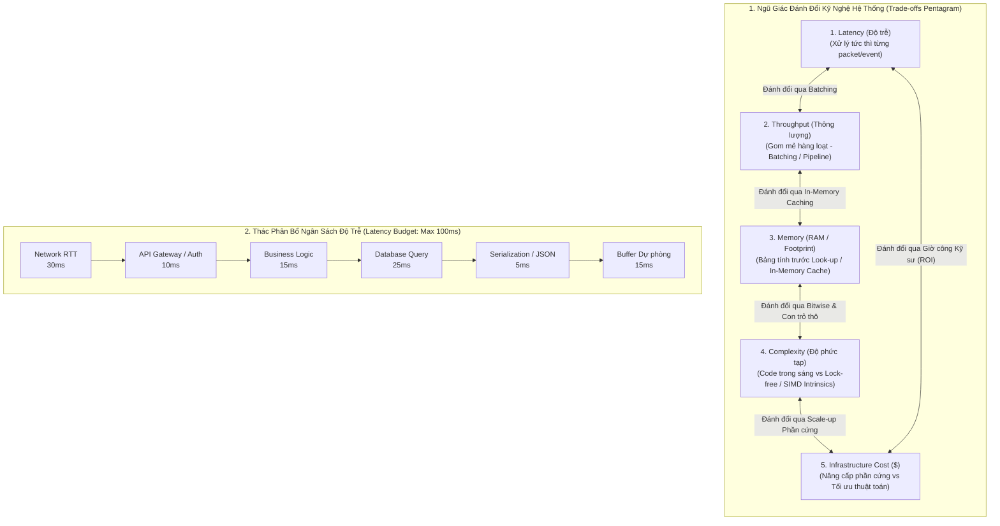

# 15.2. Engineering Trade-offs, Performance Budgets, and the Premature Optimization Trap (Các Đánh Đổi Kỹ Thuật, Ngân Sách Hiệu Năng & Cạm Bẫy Tối Ưu Sớm)

> [!IMPORTANT]
> **Nếu bạn chỉ được nhớ một điều duy nhất:** Trong kỹ nghệ hệ thống cao cấp, không có "bữa trưa miễn phí" và không tồn tại một giải pháp tối ưu tuyệt đối trên mọi khía cạnh. Mọi sự tối ưu hóa hiệu năng đều là một sự đánh đổi (**Trade-off**) có chủ đích giữa 5 chiều không gian: **Độ trễ (Latency)**, **Thông lượng (Throughput)**, **Bộ nhớ (RAM)**, **Độ phức tạp mã nguồn (Complexity & Maintainability)**, và **Chi phí hạ tầng (Infrastructure Cost)**. Đừng bao giờ rơi vào cạm bẫy tối ưu sớm (Premature Optimization Trap); hãy để dữ liệu Profiler dẫn đường, quản trị hiệu năng bằng Ngân Sách Hiệu Năng (Performance Budget) chặt chẽ trong CI/CD, và luôn ghi chép mọi quyết định đánh đổi vào Architecture Decision Records (ADRs).

---

## 1. Kiến trúc Tổng quan & Mô hình Tư duy (Mental Model)

### Ẩn dụ Xe Đua F1 và Ngân Sách Chi Tiêu Gia Đình (F1 Race Car vs Household Budget)
Hãy hình dung việc thiết kế một hệ thống phần mềm phân tán giống như việc chế tạo một phương tiện giao thông và quản lý chi tiêu tài chính:
- **Ngũ giác đánh đổi (The Trade-off Pentagram)**:
  - Một chiếc xe đua Công thức 1 (F1) có tốc độ cực hạn và thời gian gia tốc gần như bằng $0$ (tối ưu hóa độ trễ - Latency), nhưng tiêu tốn hàng triệu USD tiền nhiên liệu, bảo dưỡng đặc thù và đòi hỏi một đội ngũ kỹ sư túc trực 24/7 chỉ để giữ động cơ không bị nổ (đánh đổi chi phí hạ tầng và độ phức tạp mã nguồn).
  - Ngược lại, một chiếc xe buýt hai tầng có thể vận chuyển 100 hành khách cùng lúc với chi phí cực thấp (tối ưu hóa thông lượng - Throughput), nhưng độ trễ tăng cao vì phải dừng đỗ ở từng trạm và vận tốc tối đa khiêm tốn.
- **Cạm bẫy tối ưu sớm (Premature Optimization Trap)**: Kỹ sư dành 3 tuần lễ để dùng hợp ngữ SIMD AVX-512 và các kỹ thuật bitwise hack phức tạp để tối ưu một hàm in hóa đơn chỉ chạy **1 lần mỗi tháng**, trong khi vòng lặp truy vấn cơ sở dữ liệu $N+1$ trong luồng thanh toán chính đang xử lý hàng ngàn giao dịch mỗi giây lại bị bỏ qua hoàn toàn.
- **Ngân sách hiệu năng (Performance Budget)**: Giống như việc bạn đi siêu thị với ngân sách cố định đúng 1 triệu đồng trong ví. Bạn phân bổ cụ thể: 500 nghìn cho thực phẩm thiết yếu, 300 nghìn cho đồ dùng sinh hoạt, 200 nghìn dự phòng rủi ro. Nếu giỏ hàng vượt quá 1 triệu đồng, nhân viên thu ngân sẽ từ chối thanh toán. Tương tự, nếu một commit làm tăng độ trễ $P99$ của API vượt quá $100\text{ms}$ đã cam kết trong SLA, quy trình CI/CD sẽ tự động đánh trượt bản build (Gatekeeper failure).

### Sơ đồ Ngũ giác Đánh đổi và Thác Phân bổ Ngân sách Độ trễ



---

## 2. Chi tiết từng Keyword (Under-the-Hood Deep Dive)

### 2.1. The Four Classic Engineering Trade-offs (Bốn Cặp Đánh Đổi Kinh Điển)
Trong thiết kế hệ thống máy tính từ tầng vi kiến trúc phần cứng (CPU/Cache) đến tầng kiến trúc phân tán (Distributed Systems), kỹ sư luôn phải đối mặt với 4 cặp đánh đổi căn bản:
- **1. Latency vs Throughput (Độ trễ đối nghịch Thông lượng)**:
  - *Cơ chế vật lý*: Để đạt độ trễ cực thấp (Sub-millisecond), hệ thống phải xử lý từng thông điệp/gói tin ngay khi nó vừa xuất hiện trong hàng đợi (Interrupt-driven hoặc Busy polling). Tuy nhiên, cách này làm tiêu tốn chu kỳ CPU vào overhead chuyển ngữ cảnh (Context switch) và tiêu đề gói tin mạng (TCP/IP headers).
  - *Cơ chế gom mẻ (Batching)*: Gom 1000 messages lại thành một khối rồi mới flush xuống đĩa hoặc gửi qua socket sẽ tối đa hóa thông lượng (Throughput) nhờ tận dụng I/O liên tục (Sequential I/O) và vector hóa SIMD. Nhưng gói tin đầu tiên trong mẻ phải chờ gói tin cuối cùng được nạp, trực tiếp đẩy độ trễ (Latency) tăng vọt.
  - *Ví dụ thực tế*: Thuật toán Nagle trên TCP (`TCP_NODELAY`), Kafka `linger.ms` và `batch.size`.
- **2. Memory vs CPU (Bộ nhớ đối nghịch Chu kỳ Xử lý)**:
  - *Bản chất*: Tiền tính toán trước (Precomputation) và không gian lưu trữ đổi lấy tốc độ truy xuất.
  - *Bộ nhớ đổi lấy CPU*: Sử dụng bảng băm (Hash Table $O(1)$), bảng tra cứu tính trước (Look-up Table - LUT cho hàm lượng giác hoặc CRC32), hoặc In-Memory Cache (Redis/Memcached) lưu trữ kết quả tính toán phức tạp giúp CPU không phải chạy lại phép toán đó. Đổi lại, footprint bộ nhớ RAM phình to và đối mặt với rủi ro đụng trần OOM.
  - *CPU đổi lấy Bộ nhớ*: Nén dữ liệu (Zstandard, Gzip, Snappy) trên đĩa hoặc đường truyền giúp tiết kiệm $70\%$ dung lượng RAM/Disk, nhưng ngốn chu kỳ CPU để nén và giải nén liên tục.
- **3. Complexity vs Performance (Độ phức tạp mã nguồn đối nghịch Hiệu năng tối đa)**:
  - Mã nguồn idiomatic, trừu tượng hóa tốt (OOP, Clean Architecture, Interface) giúp đồng nghiệp dễ đọc, dễ kiểm thử và dễ bảo trì, nhưng thường đi kèm chi phí ẩn: gián tiếp con trỏ (Pointer indirection), điều vận ảo (Virtual method dynamic dispatch), và phân mảnh bộ nhớ Heap.
  - Tối ưu hóa hiệu năng cực đại (Zero-allocation, Lock-free Ring Buffer, Cache-line padding, Memory-mapped file, SIMD Intrinsics) mang lại tốc độ vượt bậc nhưng biến mã nguồn thành một mớ hỗn độn khó đọc, dễ phát sinh lỗi rò rỉ bộ nhớ, data race thầm lặng và khiến chi phí tuyển dụng, bảo trì hệ thống leo thang.
- **4. Cost vs Performance (Chi phí Hạ tầng đối nghịch Hiệu năng Kỹ thuật)**:
  - Quy luật hiệu suất giảm dần (Law of Diminishing Returns): Nâng cấu hình máy chủ từ 16 cores lên 64 cores có thể tốn gấp 4 lần tiền thuê Cloud mỗi tháng nhưng chỉ cải thiện $30\%$ thông lượng do nghẽn I/O bus và lock contention.
  - Bài toán ROI (Return on Investment): Dành 2 tháng lương của 3 Senior Engineers ($30,000) để tối ưu hóa một microservice chỉ giúp giảm hóa đơn AWS $50/tháng$ là một quyết định kỹ thuật thất bại về mặt kinh tế.

### 2.2. Cạm Bẫy Tối Ưu Sớm (Premature Optimization Trap - Donald Knuth)
- **Cội nguồn danh ngôn**: Trong bài báo năm 1974 "Structured Programming with go to Statements", nhà khoa học máy tính Donald Knuth đã đúc kết:
  > *"There is no doubt that the grail of efficiency leads to abuse. Programmers waste enormous amounts of time thinking about, or worrying about, the speed of noncritical parts of their programs, and these attempts at efficiency actually have a strong negative impact when debugging and maintenance are considered. We should forget about small efficiencies, say about 97% of the time: premature optimization is the root of all evil. Yet we should not pass up our opportunities in that critical 3%."*
- **Tâm lý học lập trình (Cognitive Biases)**: Lập trình viên thường có xu hướng vi tối ưu hóa (Micro-optimization) những đoạn mã họ vừa viết ra (như thay toán tử nhân bằng dịch bit `x << 1`, tự viết vòng lặp unrolling) vì nó mang lại cảm giác thỏa mãn trí tuệ tức thì.
- **Quy tắc 97/3 và Định luật Pareto**: Trong thực tế vận hành sản xuất:
  - $97\%$ khối lượng mã nguồn (mã validation, chuyển đổi DTO, định tuyến router, xử lý ngoại lệ hiếm gặp) hoàn toàn không ảnh hưởng đến độ trễ chung của hệ thống.
  - Chỉ có $3\%$ khối lượng mã nguồn (Hot-path) nằm trong các vòng lặp xử lý dữ liệu nặng hoặc I/O bound chiếm tới $80-90\%$ chu kỳ thực thi của CPU.
- **Nguyên tắc hành động**: Không bao giờ tối ưu hóa dựa trên phỏng đoán hoặc cảm tính. **Chỉ tối ưu hóa khi đã có số liệu đo đạc chính xác từ Profiler (FlameGraph, perf, async-profiler)** chứng minh đoạn mã đó là nút thắt cổ chai thực sự.

### 2.3. Optimization Prioritization & ROI Matrix (Ma Trận Ưu Tiên Tối Ưu & Định Luật Amdahl)
- **Định luật Amdahl (Amdahl's Law)**: Đặt ra giới hạn toán học cho mức độ tăng tốc tối đa (Speedup) của toàn bộ hệ thống khi chỉ tối ưu hóa một phần của chương trình:
  $$S_{\text{latency}} = \frac{1}{(1 - p) + \frac{p}{s}}$$
  Trong đó:
  - $p$: Tỷ lệ thời gian thực thi ban đầu của phần được tối ưu hóa ($0 \le p \le 1$).
  - $s$: Hệ số tăng tốc của riêng phần đó sau khi tối ưu.
  - *Ý nghĩa thực chiến*: Nếu một đoạn mã chỉ chiếm $p = 5\%$ ($0.05$) tổng thời gian chạy của request, thì dù bạn có dùng siêu máy tính hay thuật toán vi diệu để tăng tốc nó lên vô hạn lần ($s \to \infty$), toàn bộ hệ thống cũng chỉ tăng tốc tối đa:
    $$S_{\max} = \frac{1}{(1 - 0.05) + 0} = \frac{1}{0.95} \approx 1.0526 \quad (\text{chỉ nhanh hơn } 5.26\%!)$$
- **Ma trận Đánh giá ROI Hiệu năng (Impact vs Effort Matrix)**:

| Mức độ Nỗ lực (Effort) \ Mức độ Ảnh hưởng (Impact) | Tác động Thấp (Low Impact - Dưới 5% Speedup) | Tác động Cao (High Impact - Trên 30% Speedup) |
| :--- | :--- | :--- |
| **Nỗ lực Thấp (Low Effort - Dưới 1 ngày làm việc)** | **Fill-ins (Làm khi rảnh)**: Tinh chỉnh cờ cấu hình JVM, bật HTTP/2, bật Gzip cho file tĩnh. | **Quick Wins (Ưu tiên số 1)**: Thêm Missing Index trên DB column, sửa lỗi N+1 Query bằng JOIN/Eager loading. |
| **Nỗ lực Cao (High Effort - Vài tuần đến vài tháng)** | **Thankless Tasks / Money Pits (TỐI KỴ - Loại bỏ)**: Viết lại cả module bằng C/Rust chỉ để giảm $2\text{ms}$ ở trang quản trị nội bộ. | **Strategic Projects (Dự án Chiến lược - Lập kế hoạch kỹ)**: Thiết kế lại cơ chế phân vùng dữ liệu (Sharding), chuyển sang Event-Driven Kafka. |

### 2.4. Performance Budgets Enforcement (Ranh Giới Ngân Sách & CI/CD Gates)
- **Khái niệm Performance Budget**: Một tập hợp các ngưỡng giới hạn định lượng nghiêm ngặt mà hệ thống không được phép vượt qua trong quá trình phát triển tính năng mới. Ngân sách được phân rã trực tiếp từ Thỏa thuận Mức Dịch vụ (SLA - Service Level Agreement) và Mục tiêu Mức Dịch vụ (SLO - Service Level Objective).
- **Toán học Phân bổ Ngân sách Độ trễ (Latency Budget Waterfall)**:
  Giả sử cam kết SLO với khách hàng là phản hồi API $P99 \le 100\text{ms}$:
  $$T_{\text{total\_budget}} \ge T_{\text{network\_rtt}} + T_{\text{gateway\_auth}} + T_{\text{app\_logic}} + T_{\text{db\_queries}} + T_{\text{serialization}} + T_{\text{safety\_margin}}$$
  - $T_{\text{network\_rtt}} = 30\text{ms}$ (Độ trễ cáp quang và 4G/5G trung bình của người dùng).
  - $T_{\text{gateway\_auth}} = 10\text{ms}$ (Giải mã JWT, Rate limiting tại NGINX/Envoy).
  - $T_{\text{app\_logic}} = 15\text{ms}$ (Xử lý nghiệp vụ tại backend).
  - $T_{\text{db\_queries}} = 25\text{ms}$ (Tổng thời gian thực thi các câu truy vấn cơ sở dữ liệu).
  - $T_{\text{serialization}} = 5\text{ms}$ (Đóng gói JSON/Protobuf payload).
  - $T_{\text{safety\_margin}} = 15\text{ms}$ (Ngân sách dự phòng cho Garbage Collection pause hoặc network jitter).
- **Cơ chế Kiểm soát Tự động (Automated CI/CD Quality Gates)**:
  - Tích hợp công cụ đo đạc tự động (k6, Lighthouse CI, Locust) vào quy trình Pull Request (PR).
  - Nếu một tính năng mới làm bundle size frontend tăng quá $200\text{KB}$, hoặc làm độ trễ $P95$ của endpoint thanh toán tăng từ $120\text{ms}$ lên $160\text{ms}$ (vượt ngân sách $150\text{ms}$), pipeline CI/CD sẽ lập tức **Fail Build**, chặn merge PR và thông báo cho tác giả.

### 2.5. Performance Documentation & Architecture Decision Records (ADRs)
- **Hàng rào của Chesterton (Chesterton's Fence)**: Nguyên lý chỉ ra rằng không ai được phép phá bỏ một hàng rào hoặc một đoạn mã cho đến khi hiểu rõ lý do vì sao nó được dựng lên ở đó.
- Trong tối ưu hóa hiệu năng, một đoạn mã phức tạp (như dùng Unsafe memory, Custom ThreadPool, hoặc Bitwise mask) nếu không được ghi chép tài liệu tường minh sẽ bị một lập trình viên khác refactor về dạng code "sạch" ngây thơ vài tháng sau đó, làm sập hiệu năng toàn hệ thống.
- **Cấu trúc Tiêu chuẩn của một Performance ADR**:
  1. **Title & Status**: ADR-042: Sử dụng Arena Allocator thay thế malloc cho Network Packet Parser (Accepted).
  2. **Context**: Đo đạc Profiler cho thấy `malloc/free` chiếm $38\%$ tổng thời gian CPU và gây phân mảnh bộ nhớ khi xử lý $100,000\text{ RPS}$.
  3. **Decision & Trade-offs**: Chuyển sang Monotonic Arena Allocator. Đánh đổi: Tiết kiệm $35\%$ CPU, nhưng lãng phí thêm khoảng $15\%$ dung lượng RAM do cấp phát cố định trước theo từng luồng.
  4. **Empirical Benchmarks**: Dữ liệu chứng minh: Độ trễ $P99$ giảm từ $18.4\text{ms}$ xuống $4.2\text{ms}$.
  5. **Consequences & Maintenance Rules**: Các con trỏ phân bổ từ Arena không được tồn tại vượt quá chu kỳ vòng đời của một request. Không dùng `delete` thủ công.

---

## 3. Thực thi Mã nguồn & Mô phỏng Chuyên sâu (Dual-Engine Implementation)

### 3.1. C++20: Hot-Path Performance Budget Guard

Triển khai C++20 bộ bảo vệ ngân sách hiệu năng cục bộ (Scoped Performance Budget Guard) ứng dụng cơ chế RAII, đo đạc thời gian thực thi bằng đồng hồ có độ phân giải cao (`std::chrono::high_resolution_clock`), tự động phát hiện vi phạm ngân sách nano/micro-giây trong các vòng lặp tính toán khắt khe:

```cpp
// compile: g++ -std=c++20 -O3 performance_budget_guard.cpp -o performance_budget_guard
#include <iostream>
#include <chrono>
#include <string>
#include <iomanip>
#include <vector>
#include <numeric>
#include <cstdint>

class PerformanceBudgetGuard {
private:
    std::string task_name_;
    double budget_microseconds_;
    std::chrono::high_resolution_clock::time_point start_time_;

public:
    PerformanceBudgetGuard(std::string name, double budget_us)
        : task_name_(std::move(name)), budget_microseconds_(budget_us),
          start_time_(std::chrono::high_resolution_clock::now()) {}

    ~PerformanceBudgetGuard() noexcept {
        auto end_time = std::chrono::high_resolution_clock::now();
        double elapsed_us = std::chrono::duration<double, std::micro>(end_time - start_time_).count();

        std::cout << "[Budget Guard] Tác vụ '" << std::left << std::setw(20) << task_name_ << "': "
                  << std::fixed << std::setprecision(2) << std::setw(8) << elapsed_us << " us "
                  << "(Ngân sách tối đa: " << std::setw(8) << budget_microseconds_ << " us) -> ";

        if (elapsed_us > budget_microseconds_) {
            std::cout << "[VI PHẠM NGÂN SÁCH - BREACHED!]\n";
        } else {
            std::cout << "[ĐẠT TIÊU CHUẨN - PASSED]\n";
        }
    }
};

// Hàm mô phỏng tính toán trong hot-path
void execute_matrix_kernel(size_t iterations, double allowed_budget_us) {
    PerformanceBudgetGuard guard("VectorComputeKernel", allowed_budget_us);

    volatile uint64_t accumulator = 0;
    for (size_t i = 0; i < iterations; ++i) {
        accumulator += (i * 3) ^ (i >> 2);
    }
}

int main() {
    std::cout << "=== PERFORMANCE BUDGET GUARD ENGINE (C++20 RAII) ===\n";

    std::cout << "\n[*] Kịch bản 1: Tải công việc chuẩn định mức (Trong giới hạn ngân sách)...\n";
    execute_matrix_kernel(5'000, 250.0);

    std::cout << "\n[*] Kịch bản 2: Tải công việc đột biến vượt ngưỡng (Vi phạm ngân sách)...\n";
    execute_matrix_kernel(500'000, 250.0);

    return 0;
}
```

### 3.2. Python 3.11+: CI/CD Performance Budget Gatekeeper

Mã nguồn Python thực thi bộ thẩm định tự động các cam kết SLA/SLO (Latency $P95/P99$ và Peak Memory) từ kết quả chạy kiểm thử tải (Load Test Report). Script hoạt động như một Quality Gatekeeper trong đường ống CI/CD, tự động ngắt tiến trình (exit code 1) khi phát hiện thoái hóa hiệu năng:

```python
#!/usr/bin/env python3
"""
performance_budget_gatekeeper.py: Thẩm định chỉ số P95/P99 và Memory so với SLA/SLO Budget.
Yêu cầu: Python 3.11+
"""
import sys
from typing import Dict, TypedDict

class EndpointBudget(TypedDict):
    p95_ms: float
    p99_ms: float
    max_memory_mb: float

class ActualMetrics(TypedDict):
    p95_ms: float
    p99_ms: float
    max_memory_mb: float

# Ma trận Ngân Sách Hiệu Năng chuẩn mực cam kết với doanh nghiệp (SLA Budgets)
BUDGET_SLO_MATRIX: Dict[str, EndpointBudget] = {
    "api_login":      {"p95_ms": 50.0,  "p99_ms": 100.0, "max_memory_mb": 128.0},
    "api_checkout":   {"p95_ms": 150.0, "p99_ms": 300.0, "max_memory_mb": 256.0},
    "api_feed_read":  {"p95_ms": 30.0,  "p99_ms": 80.0,  "max_memory_mb": 64.0}
}

def evaluate_performance_gate(test_results: Dict[str, ActualMetrics]) -> bool:
    print("=" * 72)
    print("=== CI/CD AUTOMATED PERFORMANCE BUDGET GATEKEEPER EVALUATION ===")
    print("=" * 72)
    all_passed = True

    for endpoint, actual in sorted(test_results.items()):
        if endpoint not in BUDGET_SLO_MATRIX:
            continue

        budget = BUDGET_SLO_MATRIX[endpoint]
        p95_act = actual.get("p95_ms", 0.0)
        p99_act = actual.get("p99_ms", 0.0)
        mem_act = actual.get("max_memory_mb", 0.0)

        p95_ok = p95_act <= budget["p95_ms"]
        p99_ok = p99_act <= budget["p99_ms"]
        mem_ok = mem_act <= budget["max_memory_mb"]

        is_passed = p95_ok and p99_ok and mem_ok
        status_label = "PASSED" if is_passed else "FAILED (BUDGET BREACHED)"
        if not is_passed:
            all_passed = False

        print(f"\n[*] Endpoint: /{endpoint:<16} Status: [{status_label}]")
        print(f"    - P95 Latency : {p95_act:6.1f} ms | Ngân sách: {budget['p95_ms']:6.1f} ms -> [{'OK' if p95_ok else 'VI PHẠM'}]")
        print(f"    - P99 Latency : {p99_act:6.1f} ms | Ngân sách: {budget['p99_ms']:6.1f} ms -> [{'OK' if p99_ok else 'VI PHẠM'}]")
        print(f"    - Peak Memory : {mem_act:6.1f} MB | Ngân sách: {budget['max_memory_mb']:6.1f} MB -> [{'OK' if mem_ok else 'VI PHẠM'}]")

    print("\n" + "=" * 72)
    if all_passed:
        print("[SUCCESS] TOÀN BỘ CHỈ SỐ ĐẠT CHUẨN: Cho phép triển khai (Safe to Deploy).")
        return True
    else:
        print("[CRITICAL] TỪ CHỐI TRIỂN KHAI (CI BLOCKED): Bản build gây thoái hóa hiệu năng!")
        return False

if __name__ == "__main__":
    # Dữ liệu trích xuất từ k6 / Locust load testing sau khi chạy PR validation
    mock_pipeline_telemetry: Dict[str, ActualMetrics] = {
        "api_login":     {"p95_ms": 42.5,  "p99_ms": 88.0,  "max_memory_mb": 110.0},
        "api_checkout":  {"p95_ms": 182.4, "p99_ms": 345.0, "max_memory_mb": 220.0}, # Vi phạm Latency P95 và P99!
        "api_feed_read": {"p95_ms": 24.8,  "p99_ms": 64.2,  "max_memory_mb": 52.0}
    }

    is_deployable = evaluate_performance_gate(mock_pipeline_telemetry)
    # Trả về exit code 1 để ngắt CI/CD pipeline nếu có vi phạm
    sys.exit(0 if is_deployable else 1)
```

### 3.3. Kết quả Thực thi Terminal Mẫu

```text
=== KẾT QUẢ THỰC THI C++20 BUDGET GUARD ===
=== PERFORMANCE BUDGET GUARD ENGINE (C++20 RAII) ===

[*] Kịch bản 1: Tải công việc chuẩn định mức (Trong giới hạn ngân sách)...
[Budget Guard] Tác vụ 'VectorComputeKernel ':    17.20 us (Ngân sách tối đa:   250.00 us) -> [ĐẠT TIÊU CHUẨN - PASSED]

[*] Kịch bản 2: Tải công việc đột biến vượt ngưỡng (Vi phạm ngân sách)...
[Budget Guard] Tác vụ 'VectorComputeKernel ':  1725.40 us (Ngân sách tối đa:   250.00 us) -> [VI PHẠM NGÂN SÁCH - BREACHED!]

=== KẾT QUẢ THỰC THI PYTHON CI/CD GATEKEEPER ===
========================================================================
=== CI/CD AUTOMATED PERFORMANCE BUDGET GATEKEEPER EVALUATION ===
========================================================================

[*] Endpoint: /api_checkout     Status: [FAILED (BUDGET BREACHED)]
    - P95 Latency :  182.4 ms | Ngân sách:  150.0 ms -> [VI PHẠM]
    - P99 Latency :  345.0 ms | Ngân sách:  300.0 ms -> [VI PHẠM]
    - Peak Memory :  220.0 MB | Ngân sách:  256.0 MB -> [OK]

[*] Endpoint: /api_feed_read    Status: [PASSED]
    - P95 Latency :   24.8 ms | Ngân sách:   30.0 ms -> [OK]
    - P99 Latency :   64.2 ms | Ngân sách:   80.0 ms -> [OK]
    - Peak Memory :   52.0 MB | Ngân sách:   64.0 MB -> [OK]

[*] Endpoint: /api_login        Status: [PASSED]
    - P95 Latency :   42.5 ms | Ngân sách:   50.0 ms -> [OK]
    - P99 Latency :   88.0 ms | Ngân sách:  100.0 ms -> [OK]
    - Peak Memory :  110.0 MB | Ngân sách:  128.0 MB -> [OK]

========================================================================
[CRITICAL] TỪ CHỐI TRIỂN KHAI (CI BLOCKED): Bản build gây thoái hóa hiệu năng!
```

---

## 4. Systems Engineering & Production Pitfalls

### 4.1. Thảm họa Lạm dụng Caching để Che đậy Thuật toán Tồi
- **Triệu chứng phổ biến**: Một câu truy vấn cơ sở dữ liệu có độ phức tạp $O(N^2)$ (ví dụ: Full-table scan quét 10 triệu dòng) mất $3000\text{ms}$ để chạy. Thay vì đánh Index hoặc tối ưu lại câu lệnh SQL, kỹ sư gắn thêm một lớp đệm Redis Cache với TTL 10 phút. Sau khi có cache, độ trễ giảm xuống còn $2\text{ms}$ và nhóm phát triển tự chúc mừng thành công.
- **Hậu quả sản xuất (Production Outage)**:
  - **Thảm họa khởi động nguội (Cold Start Outage)**: Khi cụm Redis gặp sự cố hoặc bị flush dữ liệu trong giờ cao điểm, hàng ngàn requests đồng thời ập thẳng vào cơ sở dữ liệu (Cache Stampede / Thundering Herd), làm sập hoàn toàn database chỉ trong vài giây.
  - **Sự cố rò rỉ dữ liệu lỗi thời (Stale Data Corruption)**: Độ phức tạp của việc vô hiệu hóa cache (Cache Invalidation) tăng gấp bội, dẫn đến việc người dùng nhìn thấy thông tin thanh toán hoặc số dư tài khoản sai lệch.
- **Nguyên tắc kỹ nghệ**: Cache chỉ được dùng để giảm tải cho các tài nguyên vốn dĩ đã được tối ưu hóa tốt; tuyệt đối không bao giờ dùng Cache như một lớp băng dán che giấu các thuật toán yếu kém.

### 4.2. Cạm bẫy Micro-benchmarking mà Không có Profiler
- **Sai lầm**: Lập trình viên viết một đoạn code benchmark đồ chơi (Toy benchmark) đo lường một hàm tính toán chạy trong vòng lặp 1 tỷ lần bằng cách lấy hiệu số `time.now()`.
- **Hiện tượng đánh lừa của Trình biên dịch**: Trình biên dịch hiện đại (Clang, GCC) với cờ `-O3` sẽ nhận diện biến kết quả không được sử dụng ở bất kỳ đâu và kích hoạt kỹ thuật **Dead Code Elimination**, loại bỏ hoàn toàn toàn bộ vòng lặp. Kết quả đo được là $0.00\text{ms}$, khiến kỹ sư lầm tưởng thuật toán của mình nhanh vô địch.
- **Biện pháp khắc phục**: Luôn sử dụng từ khóa `volatile` hoặc các hàm ngăn chặn tối ưu như `benchmark::DoNotOptimize()` trong Google Benchmark framework.

### 4.3. Đánh đổi Đơn luồng làm Tổn hại Đa luồng (False Sharing)
- Một cấu trúc dữ liệu được tối ưu cực kỳ gọn gàng để vừa vặn trong bộ nhớ đơn luồng có thể gây ra hiện tượng **False Sharing** khi chạy trên vi xử lý đa lõi (Multi-core).
- Nếu hai luồng độc lập trên hai lõi CPU khác nhau liên tục ghi dữ liệu vào hai biến liền kề nhau nằm chung trên một dòng bộ nhớ đệm (Cache Line 64 bytes), giao thức đồng bộ bộ đệm (MESI protocol) sẽ liên tục vô hiệu hóa dòng cache đó trên các lõi khác, khiến tốc độ thực thi sụt giảm nghiêm trọng hơn cả việc dùng khóa mutex tường minh.

### 4.4. Công cụ Đo đạc & Chẩn đoán Dòng lệnh (CLI Diagnostics)
- Đo lường chính xác thời gian thực thi, chi phí phần cứng và số chu kỳ CPU của một tiến trình:
  ```bash
  # Phân tích thống kê chu kỳ CPU, cache misses, và branch misses của ứng dụng
  perf stat -e cycles,instructions,cache-misses,branch-misses ./my_app
  ```
- So sánh hiệu năng chính xác giữa hai phiên bản mã nguồn với phân tích độ lệch chuẩn:
  ```bash
  # Sử dụng công cụ đo lường thống kê hyperfine chuyên dụng
  hyperfine --warmup 3 './app_v1' './app_v2' --export-markdown benchmark_results.md
  ```
- Thống kê tỷ lệ tiêu hao thời gian vào các hàm gọi hệ thống (System calls):
  ```bash
  # Xác định xem tiến trình có đang tốn thời gian vào I/O hoặc lock context switches không
  strace -c -p $(pgrep my_app)
  ```

---

## 5. Bảng So sánh & Decision Matrix

### Ma trận Đánh đổi Kỹ thuật trong Tối ưu hóa Hiệu năng (Engineering Trade-off Matrix)

| Quyết định Kiến trúc | Lợi ích Đạt được (Wins) | Chi phí Đánh đổi (Trade-offs / Losses) | Ngữ cảnh Nên Áp dụng | Ngữ cảnh Tuyệt đối Tránh |
| :--- | :--- | :--- | :--- | :--- |
| **Gom mẻ (Batching I/O)** | Tăng thông lượng tổng (Throughput $\times 10$), giảm tải I/O bus và CPU overhead. | Tăng độ trễ phản hồi tức thời ($P99$ tăng), tốn RAM bộ đệm hàng đợi. | Xử lý dữ liệu lớn, ETL, Log shipping, Message Queue ingestion. | Các giao dịch tài chính yêu cầu phản hồi tức thời (Ultra Low Latency Trading). |
| **Bảng Tra cứu Tính Trước (Lookup Table)** | Triệt tiêu hoàn toàn chu kỳ tính toán CPU ($O(1)$ thay vì $O(\log N)$). | Tăng footprint bộ nhớ RAM, có thể gây Cache Miss nếu bảng quá lớn. | Bảng mã hóa ký tự, giải mã giao thức mạng, phép tính lượng giác cố định. | Không gian đầu vào không giới hạn (Unbounded input space). |
| **Cấu trúc Lock-free Ring Buffer** | Loại bỏ hoàn toàn Thread Context Switch và contention lock overhead. | Mã nguồn cực kỳ phức tạp, khó debug, dễ rơi vào CPU 100% khi busy wait. | Hot-path truyền nhận dữ liệu giữa luồng mạng và luồng xử lý chính. | Các tác vụ CRUD thông thường, logic nghiệp vụ có tần suất gọi thấp. |
| **Scale-up Phần cứng (Thêm RAM/CPU)** | Không tốn giờ công kỹ sư viết code, giải quyết tắc nghẽn tức thì. | Chi phí vận hành Cloud tăng vĩnh viễn mỗi tháng, không giải quyết được thuật toán $O(N^2)$. | Hệ thống đang bị quá tải khẩn cấp trong đợt siêu khuyến mãi (Black Friday). | Gặp lỗi phân mảnh bộ nhớ (Memory Leak) hoặc nghẽn khóa logic bên trong DB. |

---

## 6. Enterprise Production Checklist & Verification

- [ ] **Profiler-first Mandate**: Đã có biểu đồ ngọn lửa (FlameGraph) hoặc báo cáo đo đạc chi tiết chứng minh đoạn mã là nút thắt cổ chai thực sự trước khi bắt đầu tối ưu?
- [ ] **Thẩm định Amdahl**: Đoạn mã được tối ưu có chiếm trên $10\%$ tổng thời gian thực thi của cả hệ thống không?
- [ ] **Thiết lập Performance Budget**: Đã xác định rõ giới hạn trần độ trễ ($P95, P99$), dung lượng bộ nhớ đỉnh và kích thước payload trong file cấu hình CI/CD chưa?
- [ ] **Kiểm thử Hồi quy Tự động (Regression Gates)**: Quy trình kiểm thử tải tự động có ngăn chặn các Pull Request vi phạm ngân sách hiệu năng trước khi được merge vào nhánh chính không?
- [ ] **Ghi chép ADR Tường minh**: Mọi kỹ thuật vi tối ưu hóa hoặc thiết kế phi chuẩn đều được lưu trữ trong Architecture Decision Record kèm dữ liệu benchmark đối chứng trước và sau?
