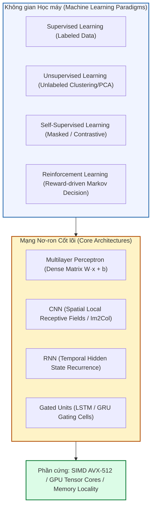
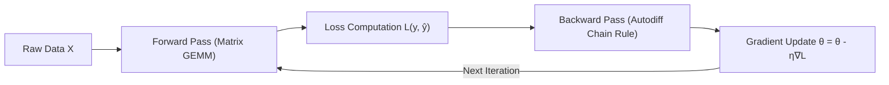
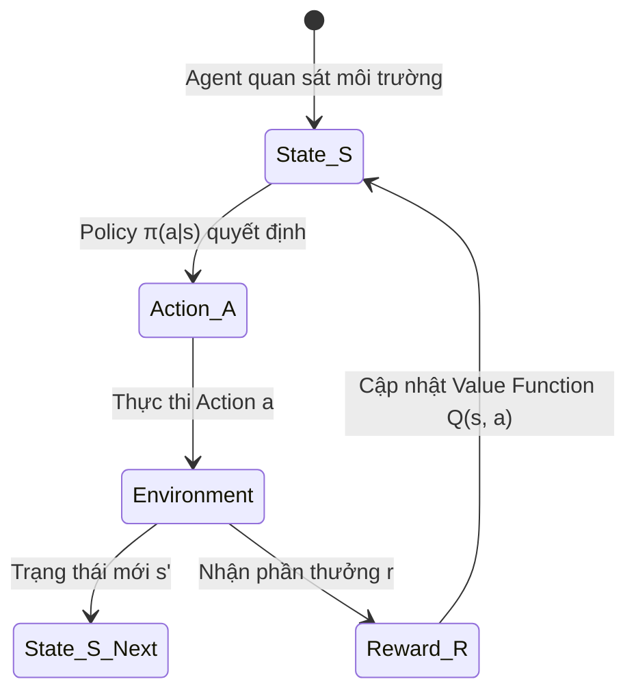
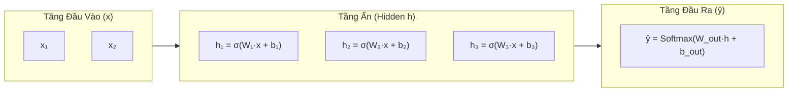
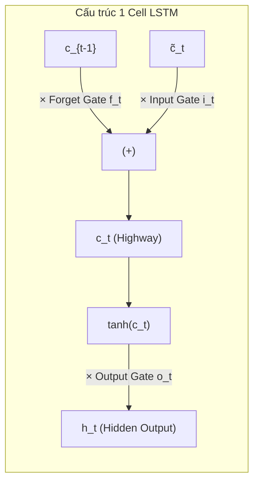

# 1.1. AI, Machine Learning Foundations & Neural Network Architectures

## Tổng quan về Nền tảng Trí tuệ Nhân tạo và Mạng Nơ-ron
Trí tuệ nhân tạo (Artificial Intelligence - AI) và Học máy (Machine Learning - ML) biểu diễn bước chuyển dịch căn bản từ lập trình tường minh (Explicit Programming / Rule-based) sang lập trình tối ưu hóa dựa trên dữ liệu (Data-driven Optimization). Thay vì viết thuật toán xác định ánh xạ $f: \mathcal{X} \to \mathcal{Y}$, hệ thống học máy tìm kiếm một hàm tham số hóa $f_\theta$ trong không gian giả thuyết $\mathcal{H}$ sao cho tối thiểu hóa hàm mất mát kỳ vọng (Expected Risk Minimization):
$$\theta^* = \arg\min_{\theta} \mathbb{E}_{(x, y) \sim \mathcal{D}} [\mathcal{L}(f_\theta(x), y)] \approx \arg\min_{\theta} \frac{1}{N} \sum_{i=1}^{N} \mathcal{L}(f_\theta(x_i), y_i)$$

Dưới góc nhìn Backend Engineering và Điện toán Hiệu năng cao (HPC), mạng nơ-ron sâu (Deep Neural Networks) là đồ thị tính toán định hướng không chu trình (Computation DAG) của các phép toán đại số tuyến tính khối lớn (GEMM - General Matrix Multiply) được tăng tốc trên phần cứng SIMD/GPU/TPU, kết hợp với các cơ chế vi phân tự động (Automatic Differentiation / Backpropagation).



---

## 2. Chi tiết từng Keyword (Under-the-Hood Deep Dive)

---

### 1. Artificial Intelligence (AI) & Machine Learning Fundamentals

#### 1. Khái niệm bản chất (What & Why)
- **AI Fundamentals**: Khoa học và kỹ thuật tạo ra các tác nhân thông minh (Intelligent Agents) có khả năng nhận thức môi trường (Perception), suy luận (Reasoning), lập kế hoạch (Planning) và đưa ra quyết định để tối đa hóa xác suất đạt mục tiêu.
- **Machine Learning Fundamentals**: Phân nhánh của AI tập trung vào việc suy diễn quy luật từ dữ liệu thống kê mà không cần lập trình cứng quy tắc nghiệp vụ. Vấn đề giải quyết: xử lý các bài toán phi cấu trúc hoặc bài toán mà số lượng quy tắc phân nhánh quá phức tạp để mã hóa thủ công (computer vision, nhận dạng giọng nói, phát hiện gian lận giao dịch thẻ).

#### 2. Cơ chế hoạt động sâu (Under the hood / Hardcore Internals)
- **Statistical Learning Theory & PAC Learning**: Mô hình học tìm cách tiệm cận cấu trúc phân phối xác suất chung $P(X, Y)$. Quá trình học cân bằng giữa **Bias (Độ chệch)** và **Variance (Độ phương sai)**.
- **Tầng tính toán phần cứng**: Quá trình huấn luyện giải bài toán tối ưu hóa lồi hoặc phi lồi thông qua Gradient Descent:
  $$\theta^{(t+1)} = \theta^{(t)} - \eta \nabla_\theta \mathcal{L}(\theta^{(t)})$$
  Phép toán gradient đòi hỏi tính đạo hàm riêng trên chuỗi nơ-ron thông qua Chain Rule, tương ứng với việc duyệt ngược đồ thị tính toán (Reverse-mode Automatic Differentiation), tiêu tốn băng thông bộ nhớ RAM/VRAM để lưu trữ các giá trị kích hoạt (Activation Caching).

#### 3. Sơ đồ minh họa


#### 4. Code ví dụ thực chiến (C++ Forward Pass & Tensor Representation)
Đoạn mã C++20 thiết kế cấu trúc Tensor cơ bản với phân bổ ô nhớ liền kề (Contiguous Linear Memory) tối ưu cache line CPU (L1/L2 Cache) cho phép nhân ma trận cơ bản của mạng nơ-ron:

```cpp
#include <iostream>
#include <vector>
#include <numeric>
#include <cmath>
#include <cassert>
#include <span>

class DenseTensor1D {
private:
    std::vector<float> data_;
public:
    explicit DenseTensor1D(size_t size, float init_val = 0.0f) : data_(size, init_val) {}
    
    [[nodiscard]] size_t size() const noexcept { return data_.size(); }
    [[nodiscard]] const float* raw_ptr() const noexcept { return data_.data(); }
    float* raw_ptr() noexcept { return data_.data(); }

    float& operator[](size_t idx) noexcept { return data_[idx]; }
    const float& operator[](size_t idx) const noexcept { return data_[idx]; }
};

// Hàm tính Linear Layer: y = W * x + b tối ưu Cache Locality
DenseTensor1D forward_dense_layer(
    std::span<const float> x, 
    std::span<const float> weights, // Flat matrix [OutFeatures x InFeatures]
    std::span<const float> bias,
    size_t out_features,
    size_t in_features
) {
    assert(x.size() == in_features);
    assert(weights.size() == out_features * in_features);
    assert(bias.size() == out_features);

    DenseTensor1D output(out_features, 0.0f);

    // Duyệt qua từng neuron đầu ra
    for (size_t i = 0; i < out_features; ++i) {
        float sum = bias[i];
        size_t row_offset = i * in_features;
        
        // Dot product tối ưu hóa truy cập tuần tự cache line 64-byte
        #pragma GCC ivdep
        for (size_t j = 0; j < in_features; ++j) {
            sum += weights[row_offset + j] * x[j];
        }
        // ReLU Activation
        output[i] = std::max(0.0f, sum);
    }
    return output;
}

int main() {
    std::vector<float> input = {0.5f, -1.2f, 3.0f};
    std::vector<float> weights = {
        0.1f,  0.2f, -0.3f,  // Neuron 0
        0.4f, -0.5f,  0.6f   // Neuron 1
    };
    std::vector<float> bias = {0.05f, -0.1f};

    auto out = forward_dense_layer(input, weights, bias, 2, 3);
    std::cout << "Neuron 0: " << out[0] << ", Neuron 1: " << out[1] << "\n";
    return 0;
}
```

#### 5. Ưu / Nhược điểm, Pitfalls & Anti-patterns
- **Overfitting / Underfitting**: Mô hình học thuộc lòng nhiễu trong tập train nhưng suy giảm khả năng tổng quát hóa trên dữ liệu thực tế. Khắc phục bằng Regularization ($L_1, L_2$), Dropout, Early Stopping.
- **Data Leakage (Rò rỉ dữ liệu)**: Dùng thông tin từ tập test/validation trong quá trình huấn luyện tiền xử lý (pre-processing/normalization).

#### 6. Ứng dụng thực tế trong Backend / Systems
- Hệ thống chấm điểm tín dụng (Credit Scoring), chống gian lận thẻ (Fraud Detection Real-time pipeline với độ trễ < 10ms), Dynamic Pricing trong hệ thống đặt xe hoặc thương mại điện tử.

---

### 2. Learning Paradigms: Supervised, Unsupervised, Self-Supervised, Reinforcement Learning

#### 1. Khái niệm bản chất (What & Why)
- **Supervised Learning**: Dữ liệu có nhãn $(x, y)$. Ánh xạ từ feature sang nhãn mục tiêu (Classification / Regression).
- **Unsupervised Learning**: Dữ liệu không nhãn $x$. Khám phá cấu trúc ẩn (Clustering như K-Means, Dimensionality Reduction như PCA, t-SNE).
- **Self-Supervised Learning (SSL)**: Tự tạo nhãn giám sát từ chính cấu trúc dữ liệu không nhãn (ví dụ: Masked Language Modeling trong BERT, Next Token Prediction trong GPT, Contrastive Learning trong SimCLR).
- **Reinforcement Learning (RL)**: Tác nhân tương tác với môi trường thông qua trạng thái $s \in \mathcal{S}$, hành động $a \in \mathcal{A}$, nhận phần thưởng $r \in \mathbb{R}$ và chuyển trạng thái $s'$. Mục tiêu: tối đa hóa phần thưởng tích lũy (Cumulative Discounted Return $\sum \gamma^t r_t$).

#### 2. Cơ chế hoạt động sâu (Under the hood / Hardcore Internals)
- **Markov Decision Process (MDP)**: Khung toán học của RL gồm bộ 5 $(\mathcal{S}, \mathcal{A}, \mathcal{P}, \mathcal{R}, \gamma)$. Phương trình Bellman là nền tảng:
  $$V^\pi(s) = \sum_{a} \pi(a|s) \sum_{s'} \mathcal{P}(s'|s, a) \left[ \mathcal{R}(s, a, s') + \gamma V^\pi(s') \right]$$
- **Contrastive Loss trong SSL**: Dùng hàm mất mát InfoNCE để tối đa hóa mutual information giữa các biểu diễn được tăng cường (augmented views) của cùng một mẫu:
  $$\mathcal{L}_{InfoNCE} = -\log \frac{\exp(\text{sim}(q, k_+) / \tau)}{\exp(\text{sim}(q, k_+) / \tau) + \sum_{k_-} \exp(\text{sim}(q, k_-) / \tau)}$$

#### 3. Sơ đồ minh họa


#### 4. Code ví dụ thực chiến (TypeScript Q-Learning Agent cho Dynamic Autoscaling)
Mô phỏng thuật toán Q-Learning để tự động scale số lượng worker container trong hệ thống Backend:

```typescript
interface StateActionKey {
  cpuUtilizationBucket: number; // 0: <40%, 1: 40-75%, 2: >75%
  action: number;               // -1: Scale Down, 0: Do Nothing, 1: Scale Up
}

class QLearningAutoscaler {
  private qTable: Map<string, number> = new Map();
  private alpha: number = 0.1;  // Learning rate
  private gamma: number = 0.9;  // Discount factor
  private epsilon: number = 0.2; // Exploration rate

  private getKey(bucket: number, action: number): string {
    return `${bucket}:${action}`;
  }

  public getQValue(bucket: number, action: number): number {
    return this.qTable.get(this.getKey(bucket, action)) ?? 0.0;
  }

  public selectAction(bucket: number): number {
    const actions = [-1, 0, 1];
    // Epsilon-greedy strategy
    if (Math.random() < this.epsilon) {
      return actions[Math.floor(Math.random() * actions.length)];
    }

    let bestAction = 0;
    let maxQ = -Infinity;
    for (const a of actions) {
      const q = this.getQValue(bucket, a);
      if (q > maxQ) {
        maxQ = q;
        bestAction = a;
      }
    }
    return bestAction;
  }

  public update(bucket: number, action: number, reward: number, nextBucket: number): void {
    const actions = [-1, 0, 1];
    let maxNextQ = -Infinity;
    for (const a of actions) {
      const q = this.getQValue(nextBucket, a);
      if (q > maxNextQ) maxNextQ = q;
    }

    const currentQ = this.getQValue(bucket, action);
    // Bellman update equation
    const newQ = currentQ + this.alpha * (reward + this.gamma * maxNextQ - currentQ);
    this.qTable.set(this.getKey(bucket, action), newQ);
  }
}

// Demo thực thi
const scaler = new QLearningAutoscaler();
let currentBucket = 2; // CPU cao > 75%
const chosenAction = scaler.selectAction(currentBucket);
console.log(`State High CPU -> Action: ${chosenAction} (1: Scale Up)`);
scaler.update(currentBucket, chosenAction, 10.0 /* High Reward for scaling up */, 1 /* Balanced */);
```

#### 5. Ưu / Nhược điểm, Pitfalls & Anti-patterns
- **Exploration vs Exploitation Dilemma**: Nếu khai thác (Exploit) quá sớm, agent rơi vào cục bộ hạ tối ưu; nếu khám phá (Explore) quá nhiều, hệ thống thực tế có thể gặp bất ổn hoặc sự cố downtime.
- **Sparse Rewards**: Trong RL, nếu tín hiệu thưởng chỉ xuất hiện ở bước cuối cùng, thuật toán hội tụ cực kỳ chậm.

#### 6. Ứng dụng thực tế trong Backend / Systems
- RLHF (Reinforcement Learning from Human Feedback) trong căn chỉnh LLM.
- Tối ưu hóa bộ định tuyến truy vấn CSDL phân tán (Adaptive Query Optimizer), tự động cân bằng tải (Dynamic Traffic Routing).

---

### 3. Deep Learning Fundamentals & Multilayer Perceptron (MLP)

#### 1. Khái niệm bản chất (What & Why)
- **Deep Learning**: Phương pháp biểu diễn học phân tầng (Hierarchical Feature Representation) bằng cách xếp chồng nhiều lớp nơ-ron phi tuyến tính.
- **Universal Approximation Theorem**: Mạng MLP với chỉ một tầng ẩn và hàm kích hoạt phi tuyến tính có khả năng xấp xỉ bất kỳ hàm liên tục nào trên tập compact với độ chính xác tùy ý.
- **Tại sao cần MLP**: Giải quyết sự bất lực của mô hình tuyến tính đơn giản trước bài toán phi tuyến (như bài toán XOR).

#### 2. Cơ chế hoạt động sâu (Under the hood / Hardcore Internals)
- **Backpropagation & Automatic Differentiation**:
  Quá trình lan truyền ngược tính gradient của hàm mất mát theo từng trọng số thông qua quy tắc chuỗi:
  $$\frac{\partial \mathcal{L}}{\partial W^{[l]}} = \delta^{[l]} \cdot (a^{[l-1]})^T, \quad \text{với } \delta^{[l]} = \left( (W^{[l+1]})^T \delta^{[l+1]} \right) \odot \sigma'(z^{[l]})$$
- **Vanishing & Exploding Gradients**:
  Khi tích các đạo hàm tầng sâu quá nhỏ ($< 1$, ví dụ hàm sigmoid có đạo hàm cực đại $0.25$), gradient tiêu biến về 0 khi về tới các lớp đầu tiên, khiến các lớp này không thể cập nhật. Ngược lại, nếu trị riêng của ma trận trọng số $> 1$, gradient bùng nổ vô tận (NaN/Inf).
  Giải pháp: Hàm kích hoạt **ReLU** ($\max(0, x)$), Khởi tạo trọng số He/Xavier, và Batch Normalization / Layer Normalization.

#### 3. Sơ đồ minh họa


#### 4. Code ví dụ thực chiến (C++ Backprop Step for Single Dense Neuron)
```cpp
#include <iostream>
#include <cmath>

struct NeuronGrad {
    float dW;
    float db;
    float dx;
};

// Đạo hàm hàm kích hoạt ReLU
inline float relu_prime(float z) noexcept {
    return z > 0.0f ? 1.0f : 0.0f;
}

// Lan truyền ngược qua 1 nơ-ron: z = w * x + b, a = relu(z)
NeuronGrad backward_single_neuron(float dL_da, float z, float x, float w) noexcept {
    float dL_dz = dL_da * relu_prime(z); // Local gradient qua hàm kích hoạt
    
    NeuronGrad grad;
    grad.dW = dL_dz * x;                // Đạo hàm theo trọng số w
    grad.db = dL_dz;                    // Đạo hàm theo bias b
    grad.dx = dL_dz * w;                // Đạo hàm truyền về đầu vào x của lớp trước
    return grad;
}

int main() {
    float x = 2.5f, w = 0.8f, b = 0.1f;
    float z = w * x + b; // 2.1
    float dL_da = 1.0f;  // Gradient từ hàm mất mát phía sau
    
    auto grad = backward_single_neuron(dL_da, z, x, w);
    std::cout << "dW: " << grad.dW << ", db: " << grad.db << ", dx: " << grad.dx << "\n";
    return 0;
}
```

#### 5. Ưu / Nhược điểm, Pitfalls & Anti-patterns
- **Dying ReLU**: Khi đầu vào của ReLU âm liên tục, gradient bằng 0 vĩnh viễn, nơ-ron "chết" và không bao giờ học tiếp. Giải pháp: Leaky ReLU ($\max(\alpha x, x)$ với $\alpha = 0.01$) hoặc GELU.
- **Memory Footprint**: Mỗi nơ-ron phải lưu giữ giá trị kích hoạt trung gian (intermediate activations) trong suốt forward pass để phục vụ backward pass, dẫn đến nghẽn dung lượng bộ nhớ GPU khi batch size lớn.

#### 6. Ứng dụng thực tế trong Backend / Systems
- Hệ thống phân loại log thời gian thực (Log Classification & Severity Prediction), nén biểu diễn đặc trưng (Autoencoders) trong an ninh mạng để phát hiện điểm dị thường (Anomaly Detection).

---

### 4. Convolutional Neural Networks (CNN) & Recurrent Architectures (RNN, LSTM, GRU)

#### 1. Khái niệm bản chất (What & Why)
- **CNN (Convolutional Neural Networks)**: Tận dụng 2 nguyên lý: **Trường tiếp nhận cục bộ (Local Receptive Fields)** và **Chia sẻ trọng số (Weight Sharing / Parameter Sharing)**. Giảm bớt số lượng tham số từ $\mathcal{O}(N \times M)$ xuống $\mathcal{O}(K \times K)$, đạt tính bất biến tịnh tiến (Translation Equivariance).
- **RNN (Recurrent Neural Networks)**: Mô hình xử lý dữ liệu chuỗi tuần tự thời gian $x_1, x_2, \dots, x_T$ bằng trạng thái ẩn tái sinh:
  $$h_t = \tanh(W_{hh} h_{t-1} + W_{xh} x_t + b_h)$$
- **LSTM (Long Short-Term Memory)**: Giải quyết vấn đề tiêu biến gradient trong RNN dài thông qua **Cell State** ($c_t$) đóng vai trò như đường cao tốc thông tin và 3 cổng điều khiển: Cổng quên (Forget Gate $f_t$), Cổng vào (Input Gate $i_t$), Cổng ra (Output Gate $o_t$).
- **GRU (Gated Recurrent Unit)**: Biến thể rút gọn của LSTM kết hợp Cell State và Hidden State, sử dụng 2 cổng: Cổng đặt lại (Reset Gate $r_t$) và Cổng cập nhật (Update Gate $z_t$).

#### 2. Cơ chế hoạt động sâu (Under the hood / Hardcore Internals)
- **Cơ chế Im2Col trong CNN**:
  Phép tích chập (Convolution) trên thực tế phần cứng không chạy bằng vòng lặp 6 lồng nhau chậm chạp. Nó được chuyển đổi qua giải thuật **`im2col` (Image to Column)** để trải phẳng các khối không gian thành ma trận 2D, chuyển toàn bộ phép tính tích chập về một phép nhân ma trận tổng quát (**GEMM - BLAS**) được tối ưu hóa bằng câu lệnh SIMD AVX-512 hoặc Tensor Core:
  $$\text{Conv2D}(I, K) \equiv \text{GEMM}(\text{KernelMatrix}, \text{im2col}(I))$$
- **LSTM Gating Equations**:
  $$\begin{aligned}
  f_t &= \sigma(W_f [h_{t-1}, x_t] + b_f) \\
  i_t &= \sigma(W_i [h_{t-1}, x_t] + b_i) \\
  \tilde{c}_t &= \tanh(W_c [h_{t-1}, x_t] + b_c) \\
  c_t &= f_t \odot c_{t-1} + i_t \odot \tilde{c}_t \quad (\text{Additive gradient flow! Không nhân dồn ma trận}) \\
  o_t &= \sigma(W_o [h_{t-1}, x_t] + b_o) \\
  h_t &= o_t \odot \tanh(c_t)
  \end{aligned}$$
  Đặc điểm then chốt: Đạo hàm $\frac{\partial c_t}{\partial c_{t-1}} = f_t$. Nếu $f_t \approx 1$, gradient có thể truyền ngược qua hàng trăm bước thời gian mà không bị suy hao theo hàm mũ.

#### 3. Sơ đồ minh họa


#### 4. Code ví dụ thực chiến (C++ GRU Cell Forward Step)
Đoạn mã C++ thể hiện cấu trúc toán học của GRU Cell phục vụ tính toán tuần tự chuỗi thời gian:

```cpp
#include <iostream>
#include <vector>
#include <cmath>

inline float sigmoid(float x) noexcept {
    return 1.0f / (1.0f + std::exp(-x));
}

struct GRUCell {
    float W_r, U_r, b_r; // Reset Gate weights
    float W_z, U_z, b_z; // Update Gate weights
    float W_h, U_h, b_h; // Candidate Hidden weights

    // Forward 1 step
    float step(float x_t, float h_prev) const noexcept {
        // Reset gate
        float r_t = sigmoid(W_r * x_t + U_r * h_prev + b_r);
        // Update gate
        float z_t = sigmoid(W_z * x_t + U_z * h_prev + b_z);
        // Candidate hidden state (sử dụng r_t để chọn lọc thông tin quá khứ)
        float h_tilde = std::tanh(W_h * x_t + U_h * (r_t * h_prev) + b_h);
        // Trạng thái ẩn mới: Nội suy tuyến tính giữa quá khứ và ứng viên mới
        float h_t = (1.0f - z_t) * h_prev + z_t * h_tilde;
        return h_t;
    }
};

int main() {
    GRUCell gru{0.5f, 0.2f, 0.0f, 0.4f, 0.3f, 0.0f, 0.6f, 0.1f, 0.0f};
    std::vector<float> time_series = {1.2f, 0.8f, -0.5f, 2.1f};
    float h = 0.0f; // Khởi tạo hidden state ban đầu

    std::cout << "GRU Sequential Propagation:\n";
    for (size_t t = 0; t < time_series.size(); ++t) {
        h = gru.step(time_series[t], h);
        std::cout << "Time step " << t << " -> h_t = " << h << "\n";
    }
    return 0;
}
```

#### 5. Ưu / Nhược điểm, Pitfalls & Anti-patterns
- **Nghẽn tuần tự của RNN/LSTM/GRU**: Do $h_t$ phụ thuộc trực tiếp vào $h_{t-1}$, việc tính toán không thể song song hóa triệt để trên phần cứng GPU/TPU qua trục thời gian. Đây chính là lý do khiến kiến trúc **Transformer (Self-Attention)** ra đời và thay thế RNN trong hầu hết các tác vụ xử lý ngôn ngữ tự nhiên.
- **CNN Context Limited**: CNN chỉ nắm bắt được quan hệ cục bộ trong phạm vi kích thước kernel; để bắt phụ thuộc tầm xa (Long-range dependencies) cần xếp chồng rất nhiều lớp tích chập làm tăng độ trễ inference.

#### 6. Ứng dụng thực tế trong Backend / Systems
- Dự đoán tải máy chủ theo chuỗi thời gian (Time-series Resource Forecasting) cảnh báo sớm nguy cơ cạn kiệt tài nguyên bộ nhớ/ổ đĩa.
- Phân tích tín hiệu cảm biến IoT công nghiệp và streaming telemetry trong các hệ thống giám sát phân tán.
