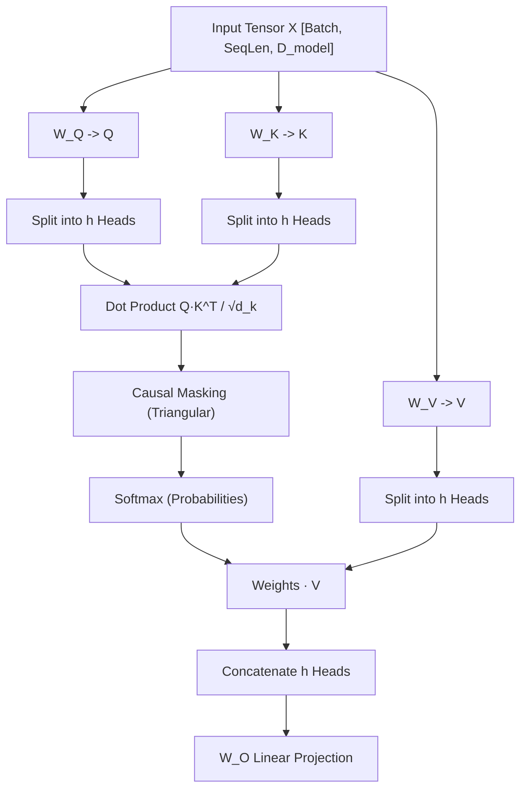
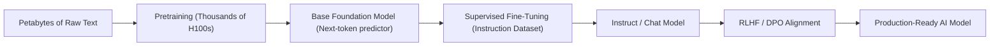
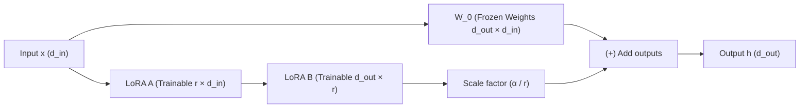

# 1.2. Transformers, Large Language Models (LLMs) & Fine-Tuning Paradigms

## Tổng quan về Kiến trúc Transformer và Mô hình Ngôn ngữ Lớn
Kiến trúc Transformer (Vaswani et al., 2017) đã tạo ra cuộc cách mạng trong Khoa học Máy tính bằng cách loại bỏ hoàn toàn các liên kết tuần tự tái quy (Recurrence) của RNN/LSTM, thay thế bằng cơ chế **Tự chú ý (Self-Attention)** có khả năng tính toán song song triệt để trên toàn bộ ngữ cảnh độ dài $N$.

Về mặt toán học, phép toán cốt lõi của Attention là một cơ chế tra cứu mờ (Soft Key-Value Lookup) trên không gian vector, tính toán phân phối xác suất tương quan giữa truy vấn ($Q$) và khóa ($K$) để tổng hợp giá trị ($V$):
$$\text{Attention}(Q, K, V) = \text{Softmax}\left(\frac{Q K^T}{\sqrt{d_k}}\right) V$$
Trong đó:
- $Q \in \mathbb{R}^{N \times d_k}$, $K \in \mathbb{R}^{M \times d_k}$, $V \in \mathbb{R}^{M \times d_v}$.
- Hệ số tỷ lệ $\frac{1}{\sqrt{d_k}}$ ngăn chặn tích vô hướng quá lớn làm cực trị hóa hàm Softmax (dẫn đến vanishing gradient).
- Độ phức tạp tính toán và bộ nhớ cơ sở là $\mathcal{O}(N^2)$ đối với độ dài chuỗi $N$.

```mermaid
graph TD
    subgraph TransformerStack["Kiến trúc Transformer Cốt lõi"]
        TokenIn["Input Tokens"] --> Embed["Token Embedding + Positional Encoding"]
        Embed --> MHA["Multi-Head Attention (Q, K, V Projections)"]
        MHA --> AddNorm1["Residual Add & RMSNorm / LayerNorm"]
        AddNorm1 --> FFN["Feed-Forward Network (SwiGLU / MLP)"]
        FFN --> AddNorm2["Residual Add & RMSNorm"]
        AddNorm2 --> Out["Output Logits"]
    end

    subgraph LLMLifecycle["Vòng đời LLM (Lifecycle)"]
        Pretrain["Pretraining (Causal Masked Next-Token Loss)"]
        SFT["Supervised Fine-Tuning (SFT / Instruction Tuning)"]
        PEFT_LoRA["PEFT / LoRA / QLoRA (Rank Decomposition)"]
        Deploy["Quantization (INT8/INT4/AWQ) & Distillation"]
        
        Pretrain --> SFT
        SFT --> PEFT_LoRA
        PEFT_LoRA --> Deploy
    end

    style TransformerStack fill:#eff6ff,stroke:#1d4ed8,stroke-width:2px
    style LLMLifecycle fill:#fefce8,stroke:#a16207,stroke-width:2px
```



---

## 2. Chi tiết từng Keyword (Under-the-Hood Deep Dive)

---

### 1. Attention Mechanism, Self-Attention & Multi-Head Attention

#### 1. Khái niệm bản chất (What & Why)
- **Attention Mechanism**: Khả năng phân bổ trọng số chú ý động giữa các phần tử trong chuỗi dữ liệu. Cho phép mô hình kết nối ngữ nghĩa trực tiếp giữa hai từ cách xa nhau mà không bị suy hao thông tin qua các bước chuyển trạng thái trung gian.
- **Self-Attention**: Trường hợp đặc biệt khi $Q, K, V$ đều được chiếu từ cùng một chuỗi đầu vào $X \in \mathbb{R}^{N \times d_{\text{model}}}$. Mỗi token tự đối chiếu với tất cả các token còn lại trong chuỗi.
- **Multi-Head Attention (MHA)**: Chiếu $Q, K, V$ thành $h$ không gian con khác nhau thông qua các ma trận trọng số $W_i^Q, W_i^K, W_i^V$. Giúp mô hình đồng thời chú ý tới nhiều khía cạnh thông tin khác nhau (ví dụ: một head bắt quan hệ ngữ pháp cú pháp, một head bắt quan hệ tham chiếu đại từ).

#### 2. Cơ chế hoạt động sâu (Under the hood / Hardcore Internals)
- **Công thức Multi-Head Attention**:
  $$\text{MultiHead}(Q, K, V) = \text{Concat}(\text{head}_1, \dots, \text{head}_h) W^O$$
  $$\text{với } \text{head}_i = \text{Attention}(Q W_i^Q, K W_i^K, V W_i^V)$$
- **Nghẽn bộ nhớ IO & FlashAttention**:
  Phép tính Attention truyền thống gặp nghẽn băng thông bộ nhớ GPU (**Memory Bandwidth Bound**) do phải ghi ma trận chú ý trung gian kích thước $S = \text{Softmax}(Q K^T / \sqrt{d_k}) \in \mathbb{R}^{N \times N}$ từ GPU SRAM vào HBM (High Bandwidth Memory), sau đó lại đọc ngược lại để nhân với $V$.
  Thuật toán **FlashAttention** (Dao et al.) giải quyết bài toán này bằng kỹ thuật Tiling: chia nhỏ $Q, K, V$ thành các khối vừa vặn trong bộ nhớ đệm cực nhanh SRAM (SRAM ~20TB/s vs HBM ~2TB/s trên A100), tính toán Online Softmax mà không cần bao giờ materialize toàn bộ ma trận $N \times N$ ra HBM, giảm độ phức tạp truy xuất bộ nhớ từ $\mathcal{O}(N^2)$ xuống $\mathcal{O}(N)$.

#### 3. Sơ đồ minh họa


#### 4. Code ví dụ thực chiến (C++ Scaled Dot-Product Self-Attention Engine)
Đoạn mã C++20 minh họa phép toán Self-Attention đơn nhân với tối ưu hóa tính toán Softmax số học ổn định (Numerically Stable Softmax):

```cpp
#include <iostream>
#include <vector>
#include <cmath>
#include <numeric>
#include <algorithm>

struct AttentionEngine {
    // Numerically stable softmax: Softmax(x_i) = exp(x_i - max(x)) / sum(exp(x_j - max(x)))
    static void stable_softmax(std::vector<float>& row) {
        float max_val = *std::max_element(row.begin(), row.end());
        float sum_exp = 0.0f;
        for (auto& val : row) {
            val = std::exp(val - max_val);
            sum_exp += val;
        }
        float inv_sum = 1.0f / (sum_exp + 1e-9f);
        for (auto& val : row) {
            val *= inv_sum;
        }
    }

    // Tính toán Scaled Dot-Product Attention cho chuỗi đơn giản
    // Input: Q, K, V với shape [seq_len, d_k]
    static std::vector<float> compute_attention(
        const std::vector<float>& Q,
        const std::vector<float>& K,
        const std::vector<float>& V,
        size_t seq_len,
        size_t d_k
    ) {
        float scale = 1.0f / std::sqrt(static_cast<float>(d_k));
        std::vector<float> scores(seq_len * seq_len, 0.0f);

        // 1. Matmul: S = (Q * K^T) * scale
        for (size_t i = 0; i < seq_len; ++i) {
            for (size_t j = 0; j < seq_len; ++j) {
                float dot = 0.0f;
                for (size_t d = 0; d < d_k; ++d) {
                    dot += Q[i * d_k + d] * K[j * d_k + d];
                }
                scores[i * seq_len + j] = dot * scale;
            }
        }

        // 2. Softmax theo từng hàng i
        for (size_t i = 0; i < seq_len; ++i) {
            std::vector<float> row(seq_len);
            for (size_t j = 0; j < seq_len; ++j) row[j] = scores[i * seq_len + j];
            stable_softmax(row);
            for (size_t j = 0; j < seq_len; ++j) scores[i * seq_len + j] = row[j];
        }

        // 3. Matmul: Output = Scores * V [seq_len, d_k]
        std::vector<float> output(seq_len * d_k, 0.0f);
        for (size_t i = 0; i < seq_len; ++i) {
            for (size_t d = 0; d < d_k; ++d) {
                float sum = 0.0f;
                for (size_t j = 0; j < seq_len; ++j) {
                    sum += scores[i * seq_len + j] * V[j * d_k + d];
                }
                output[i * d_k + d] = sum;
            }
        }
        return output;
    }
};

int main() {
    size_t seq_len = 2, d_k = 2;
    std::vector<float> Q = {1.0f, 0.0f,  0.0f, 1.0f};
    std::vector<float> K = {1.0f, 0.0f,  0.0f, 1.0f};
    std::vector<float> V = {10.0f, 20.0f, 30.0f, 40.0f};

    auto out = AttentionEngine::compute_attention(Q, K, V, seq_len, d_k);
    std::cout << "Attention Output Token 0: [" << out[0] << ", " << out[1] << "]\n";
    std::cout << "Attention Output Token 1: [" << out[2] << ", " << out[3] << "]\n";
    return 0;
}
```

#### 5. Ưu / Nhược điểm, Pitfalls & Anti-patterns
- **Memory Quadratic Explosion**: Độ phức tạp bộ nhớ tăng tỷ lệ bình phương theo độ dài context $\mathcal{O}(N^2)$. Với $N = 128\text{K}$, tính toán attention thô đòi hỏi hàng chục gigabytes bộ nhớ chỉ cho ma trận tương quan nếu không dùng FlashAttention hoặc RingAttention.

#### 6. Ứng dụng thực tế trong Backend / Systems
- Cốt lõi của mọi Transformer model (GPT-4, Claude, Gemini, LLaMA), BERT embedding engines trong elasticsearch semantic search.

---

### 2. Transformer Architecture: Encoder-Decoder, Positional Encoding, Embeddings

#### 1. Khái niệm bản chất (What & Why)
- **Encoder-Decoder Architecture**: Encoder xử lý chuỗi đầu vào thành biểu diễn ngữ cảnh ẩn (Context representations), Decoder sinh tuần tự từng token đầu ra dựa trên biểu diễn của Encoder thông qua Cross-Attention (tiêu biểu: T5, BART, mô hình dịch máy gốc).
- **Decoder-Only Architecture**: Loại bỏ Encoder, chỉ sử dụng Causal Masked Self-Attention để tự sinh token kế tiếp (tiêu biểu: GPT series, LLaMA, Mistral). Hiện là tiêu chuẩn thống trị của các LLM hiện đại.
- **Positional Encoding**: Do Self-Attention là phép toán bất biến hoán vị (Permutation Invariant), mô hình cần được "tiêm" thông tin về thứ tự từ. Bao gồm: Sinusoidal Positional Encoding, Học vị trí (Learned Absolute PE), và Mã hóa vị trí tương đối / RoPE (Rotary Position Embedding).
- **Embeddings & Vector Representations**: Ánh xạ token dạng số nguyên rời rạc $i \in \{0, \dots, V-1\}$ thành vector thực liên tục đa chiều trong không gian Euclid $\mathbb{R}^d$ bảo toàn ngữ nghĩa khoảng cách cosine.

#### 2. Cơ chế hoạt động sâu (Under the hood / Hardcore Internals)
- **Rotary Position Embedding (RoPE)**:
  Thay vì cộng trực tiếp vector vị trí vào embedding, RoPE xoay vector truy vấn $q$ và khóa $k$ trong không gian 2D phức:
  $$R_{\Theta, m}^d q_m = \begin{pmatrix} \cos m\theta_i & -\sin m\theta_i \\ \sin m\theta_i & \cos m\theta_i \end{pmatrix} \begin{pmatrix} q_m^{(2i)} \\ q_m^{(2i+1)} \end{pmatrix}$$
  Tính chất vượt trội của RoPE: Tích vô hướng $\langle R_m q, R_n k \rangle$ chỉ phụ thuộc thuần túy vào khoảng cách tương đối $(m - n)$, cho phép mô hình dễ dàng tổng quát hóa (extrapolate) lên ngữ cảnh dài hơn thông qua RoPE scaling (YaRN, Dynamic NTK-aware).

#### 3. Sơ đồ minh họa


#### 4. Code ví dụ thực chiến (C++ RoPE Implementation)
```cpp
#include <iostream>
#include <vector>
#include <cmath>

// Xoay 2 phần tử liên tiếp theo góc m * theta
void apply_rope_2d(float& x0, float& x1, size_t pos, float theta_base = 10000.0f) {
    float theta = 1.0f / std::pow(theta_base, 0.0f); // Tần số cơ bản cho cặp đầu
    float angle = static_cast<float>(pos) * theta;
    float cos_a = std::cos(angle);
    float sin_a = std::sin(angle);

    float new_x0 = x0 * cos_a - x1 * sin_a;
    float new_x1 = x0 * sin_a + x1 * cos_a;

    x0 = new_x0;
    x1 = new_x1;
}

int main() {
    float q0 = 1.0f, q1 = 0.5f;
    std::cout << "Original Q: [" << q0 << ", " << q1 << "]\n";
    apply_rope_2d(q0, q1, 5 /* position index */);
    std::cout << "Rotated Q at pos 5: [" << q0 << ", " << q1 << "]\n";
    return 0;
}
```

#### 5. Ưu / Nhược điểm, Pitfalls & Anti-patterns
- **Context Length Degradation**: Khi vượt quá chiều dài huấn luyện ban đầu, mô hình bị mất khả năng định vị chú ý (Attention dispersion). Cần các kỹ thuật nội suy RoPE đặc biệt.

#### 6. Ứng dụng thực tế trong Backend / Systems
- Triển khai Embedding Service hiệu năng cao hỗ trợ Vector Indexing trên Milvus/Qdrant.

---

### 3. LLMs, Foundation Models & Training Stages (Pretraining, Fine-Tuning, Instruction Tuning, SFT)

#### 1. Khái niệm bản chất (What & Why)
- **Large Language Models (LLMs) & Foundation Models**: Các mô hình có quy mô hàng tỷ đến hàng nghìn tỷ tham số được huấn luyện trên khối lượng dữ liệu khổng lồ cấp độ Petabyte (Common Crawl, GitHub, Wikipedia, Books), đóng vai trò nền tảng cho nhiều tác vụ hạ nguồn.
- **Pretraining (Tiền huấn luyện)**: Giai đoạn tốn kém tài nguyên nhất, mô hình học phân phối xác suất ngôn ngữ tự nhiên thông qua tác vụ Causal Language Modeling:
  $$\mathcal{L}_{\text{pretrain}} = -\sum_{t=1}^T \log P(w_t \mid w_1, w_2, \dots, w_{t-1}; \theta)$$
- **Supervised Fine-Tuning (SFT) / Instruction Tuning**: Huấn luyện mô hình cơ sở (Base model) trên tập dữ liệu dạng cặp `(Instruction, Response)` có cấu trúc chất lượng cao, chuyển hóa khả năng tự động hoàn thành văn bản thành khả năng tuân thủ mệnh lệnh và đối thoại hữu ích.

#### 2. Cơ chế hoạt động sâu (Under the hood / Hardcore Internals)
- **Chinchilla Scaling Laws**: Tối ưu hóa giữa số lượng tham số mô hình $N$ và số lượng token dữ liệu $D$: Để đạt hiệu quả tính toán tối ưu (Compute-optimal), cả $N$ và $D$ phải được tăng quy mô đồng thời theo tỷ lệ xấp xỉ ngang nhau ($D \approx 20N$).
- **Curriculum & Synthetic Data**: Giai đoạn SFT hiện đại sử dụng dữ liệu tổng hợp (Synthetic Data) được lọc nghiêm ngặt qua mô hình thẩm định (LLM-as-a-Judge) để loại bỏ nhiễu và định dạng sai lệch.

#### 3. Sơ đồ minh họa


#### 4. Code ví dụ thực chiến (TypeScript Prompt Formatter cho SFT/ChatML)
Đoạn mã TypeScript cấu trúc chuỗi token theo chuẩn ChatML (Chat Markup Language) phục vụ Inference hoặc chuẩn bị dữ liệu SFT:

```typescript
interface ChatMessage {
  role: 'system' | 'user' | 'assistant';
  content: string;
}

class ChatMLFormatter {
  private static readonly START_TOKEN = '<|im_start|>';
  private static readonly END_TOKEN = '<|im_end|>';

  public static formatPrompt(messages: ChatMessage[], addGenerationPrompt = true): string {
    let formatted = '';
    for (const msg of messages) {
      formatted += `${this.START_TOKEN}${msg.role}\n${msg.content.trim()}${this.END_TOKEN}\n`;
    }
    if (addGenerationPrompt) {
      formatted += `${this.START_TOKEN}assistant\n`;
    }
    return formatted;
  }
}

// Test format
const conversation: ChatMessage[] = [
  { role: 'system', content: 'You are an expert low-level C++ engineer.' },
  { role: 'user', content: 'Explain zero-copy I/O in Linux.' }
];

console.log(ChatMLFormatter.formatPrompt(conversation));
```

#### 5. Ưu / Nhược điểm, Pitfalls & Anti-patterns
- **Catastrophic Forgetting**: Quá trình SFT với tập dữ liệu hẹp làm mô hình quên đi các năng lực suy luận tổng quát đã học được ở giai đoạn pretraining. Cần trộn lẫn một tỷ lệ dữ liệu tiền huấn luyện gốc (Replay Buffer).

#### 6. Ứng dụng thực tế trong Backend / Systems
- Tự động hóa trích xuất dữ liệu không cấu trúc từ hóa đơn/hợp đồng vào CSDL SQL, trợ lý hỗ trợ khách hàng nội bộ.

---

### 4. Parameter-Efficient Fine-Tuning (PEFT, LoRA, QLoRA), Quantization & Knowledge Distillation

#### 1. Khái niệm bản chất (What & Why)
- **PEFT (Parameter-Efficient Fine-Tuning)**: Kỹ thuật tinh chỉnh mô hình lớn mà chỉ cập nhật một phần cực nhỏ (<1%) tham số, giữ cố định toàn bộ trọng số gốc.
- **LoRA (Low-Rank Adaptation)**: Giả thiết rằng ma trận thay đổi trọng số $\Delta W$ trong quá trình thích ứng có hạng nội tại thấp (Low intrinsic rank $r \ll d$). Phân rã $\Delta W = B \cdot A$, với $B \in \mathbb{R}^{d \times r}$ và $A \in \mathbb{R}^{r \times k}$.
- **QLoRA**: Đưa mô hình gốc về dạng lượng tử hóa 4-bit NormalFloat (NF4), giữ nguyên độ chính xác cao và chỉ gắn bộ adapter LoRA ở dạng 16-bit Brain Float (BF16), cho phép fine-tune mô hình 70B trên 1 GPU người dùng 48GB VRAM.
- **Quantization (Lượng tử hóa)**: Nén trọng số từ FP32/FP16 (32/16-bit float) sang INT8, INT4, FP4 hoặc FP8 để giảm 2-4 lần dung lượng VRAM và tăng tốc độ xử lý của Tensor Cores.
- **Knowledge Distillation**: Huấn luyện một mô hình nhỏ (Student) bắt chước phân phối xác suất đầu ra (Soft Logits) của một mô hình khổng lồ (Teacher).

#### 2. Cơ chế hoạt động sâu (Under the hood / Hardcore Internals)
- **Cơ chế LoRA Forward & Zero-Inference Latency**:
  Trong quá trình forward pass:
  $$h = W_0 x + \Delta W x = W_0 x + \frac{\alpha}{r} (B \cdot A) x$$
  Khi triển khai thực tế (Production Deployment), adapter có thể được cộng gộp trực tiếp vào trọng số gốc: $W_{\text{fused}} = W_0 + \frac{\alpha}{r} (B A)$. Do đó, thời gian đáp ứng (Inference Latency) hoàn toàn không bị trễ thêm bất kỳ mili-giây nào!
- **NF4 Quantization (NormalFloat 4-bit)**:
  Trọng số mạng nơ-ron sau khi tiền huấn luyện tuân theo phân phối chuẩn tắc $\mathcal{N}(0, \sigma^2)$. NF4 phân chia diện tích dưới đường cong mật độ xác suất chuẩn thành 16 khoảng có tích phân bằng nhau, tối đa hóa lượng thông tin biểu diễn trên mỗi bit (Information Entropy).

#### 3. Sơ đồ minh họa


#### 4. Code ví dụ thực chiến (C++ LoRA Linear Projection Simulation)
Đoạn mã C++ minh họa phép tính Forward Pass có gắn adapter LoRA với phép phân rã thứ bậc ma trận:

```cpp
#include <iostream>
#include <vector>
#include <cassert>

class LoRALinearLayer {
private:
    size_t in_dim_;
    size_t out_dim_;
    size_t rank_;
    float alpha_;

    std::vector<float> W0_; // Frozen Base weights [out_dim x in_dim]
    std::vector<float> A_;  // Adapter A [rank x in_dim]
    std::vector<float> B_;  // Adapter B [out_dim x rank]

public:
    LoRALinearLayer(size_t in_dim, size_t out_dim, size_t rank, float alpha)
        : in_dim_(in_dim), out_dim_(out_dim), rank_(rank), alpha_(alpha),
          W0_(out_dim * in_dim, 0.1f),
          A_(rank * in_dim, 0.01f),
          B_(out_dim * rank, 0.0f) {} // B thường khởi tạo bằng 0 để ΔW = 0 ban đầu

    std::vector<float> forward(const std::vector<float>& x) const {
        assert(x.size() == in_dim_);
        std::vector<float> out(out_dim_, 0.0f);

        // 1. Base Forward: y_base = W0 * x
        for (size_t i = 0; i < out_dim_; ++i) {
            float sum = 0.0f;
            for (size_t j = 0; j < in_dim_; ++j) {
                sum += W0_[i * in_dim_ + j] * x[j];
            }
            out[i] = sum;
        }

        // 2. LoRA Forward: y_lora = (B * (A * x)) * (alpha / rank)
        std::vector<float> Ax(rank_, 0.0f);
        for (size_t r = 0; r < rank_; ++r) {
            float sum = 0.0f;
            for (size_t j = 0; j < in_dim_; ++j) {
                sum += A_[r * in_dim_ + j] * x[j];
            }
            Ax[r] = sum;
        }

        float scale = alpha_ / static_cast<float>(rank_);
        for (size_t i = 0; i < out_dim_; ++i) {
            float sum = 0.0f;
            for (size_t r = 0; r < rank_; ++r) {
                sum += B_[i * rank_ + r] * Ax[r];
            }
            out[i] += sum * scale;
        }

        return out;
    }
};

int main() {
    LoRALinearLayer lora(4, 2, 2, 16.0f);
    std::vector<float> input = {1.0f, 2.0f, 3.0f, 4.0f};
    auto result = lora.forward(input);
    std::cout << "LoRA forward output: [" << result[0] << ", " << result[1] << "]\n";
    return 0;
}
```

#### 5. Ưu / Nhược điểm, Pitfalls & Anti-patterns
- **Quantization Error & Outlier Activations**: Trong các mô hình LLM lớn (>6.7B), một số ít kênh kích hoạt (features) có độ lớn cực đại đột biến ($>100$). Việc lượng tử hóa thô bạo (naive int8) làm phá vỡ phân phối này dẫn đến suy giảm nghiêm trọng perplexity. Kỹ thuật LLM.int8() hoặc AWQ phải tách riêng các outlier channel để tính toán ở dạng FP16.

#### 6. Ứng dụng thực tế trong Backend / Systems
- Multi-tenant LLM Serving: Lưu trữ một bản duy nhất của mô hình gốc 70B trong VRAM GPU, đồng thời nạp/rút hàng trăm adapter LoRA siêu nhẹ (mỗi adapter vài chục MB) tương ứng với từng khách hàng doanh nghiệp khác nhau mà không làm tốn thêm GPU.
