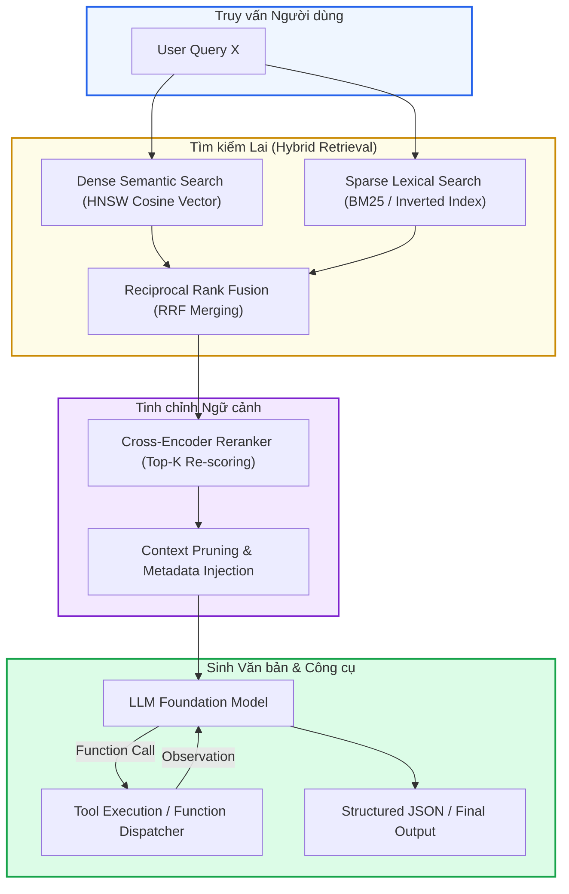
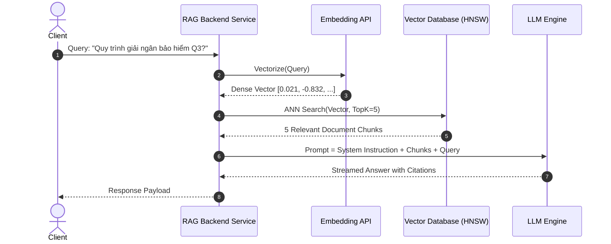
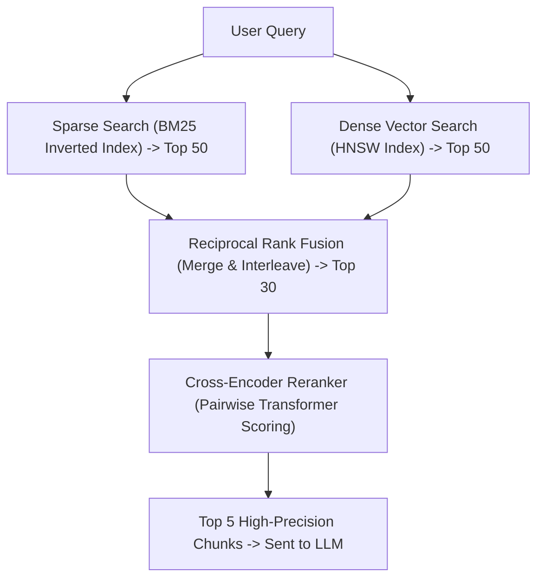
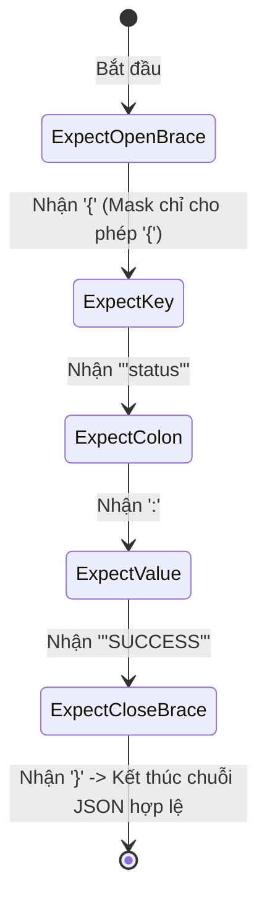
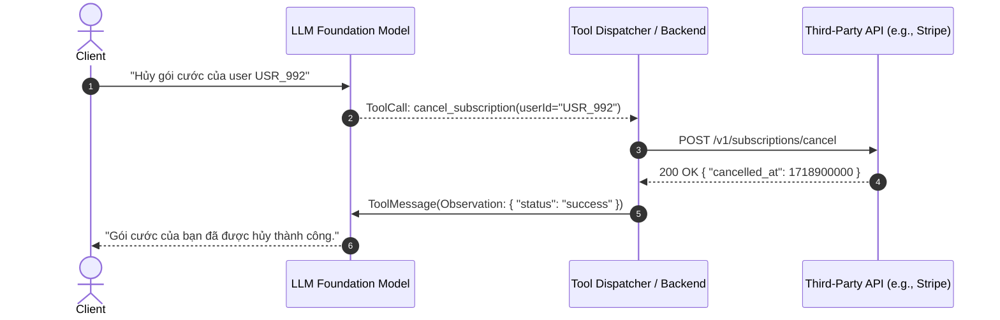

# 1.3. Retrieval-Augmented Generation (RAG), Context Engineering & Tool Use

## Tổng quan về RAG, Kỹ nghệ Ngữ cảnh và Giao tiếp Công cụ
Trong triển khai Backend hiện đại, các mô hình ngôn ngữ lớn (LLM) đối mặt với hai rào cản chí mạng: **Ảo giác thông tin (Hallucination)** và **Kiến thức tĩnh tại thời điểm huấn luyện (Knowledge Cutoff)**. Để đưa LLM vào môi trường Enterprise mà không cần tốn kém chi phí tái huấn luyện liên tục, kiến trúc **Retrieval-Augmented Generation (RAG)** và **Kỹ nghệ Ngữ cảnh (Context Engineering)** đã trở thành mô thức tiêu chuẩn.

Về bản chất hệ thống, RAG mở rộng bộ nhớ tham số tĩnh (Parametric Memory) của nơ-ron bằng một kho lưu trữ phi tham số động (Non-parametric External Memory - CSDL quan hệ, Vector DB, Knowledge Graph). Luồng tính toán sinh văn bản có điều kiện:
$$P(Y \mid X) = \sum_{D \in \mathcal{K}} P(D \mid X) \cdot P(Y \mid X, D)$$
Trong đó $P(D \mid X)$ là phân phối của tài liệu trích xuất từ cơ chế tìm kiếm lai (Hybrid Search), và $P(Y \mid X, D)$ là xác suất sinh của LLM dựa trên ngữ cảnh đã được tinh chỉnh qua Reranking và Context Compression.



---

## 2. Chi tiết từng Keyword (Under-the-Hood Deep Dive)

---

### 1. Retrieval-Augmented Generation (RAG) & Vector Databases

#### 1. Khái niệm bản chất (What & Why)
- **RAG (Retrieval-Augmented Generation)**: Kỹ thuật kết hợp giữa một bộ máy trích xuất thông tin (Information Retriever) và mô hình sinh (Text Generator). Thay vì ép LLM phải ghi nhớ mọi chi tiết dữ liệu nội bộ của tổ chức, hệ thống trích xuất các đoạn văn bản (chunks) liên quan nhất và nhúng trực tiếp vào prompt ngữ cảnh của LLM.
- **Vector Databases**: Cơ sở dữ liệu chuyên dụng được tối ưu hóa cho việc lưu trữ, lập chỉ mục và truy vấn hàng triệu đến hàng tỷ vector nhúng nhiều chiều (Dense Embeddings, ví dụ 1536 chiều từ OpenAI text-embedding-3 hoặc 768 chiều từ BERT). Ví dụ: Milvus, Qdrant, Pinecone, pgvector.

#### 2. Cơ chế hoạt động sâu (Under the hood / Hardcore Internals)
- **Chu trình Chunking & Embedding Drift**:
  Dữ liệu phi cấu trúc (PDF, Markdown, HTML) được phân đoạn bằng các giải thuật trích đoạn (Recursive Character Splitting, Semantic Chunking). Các đoạn chunk được nạp qua mô hình nhúng để tạo vector đặc trưng. Nếu mô hình nhúng thay đổi phiên bản, toàn bộ cơ sở dữ liệu vector bắt buộc phải re-index từ đầu (Embedding Drift).
- **Cấu trúc lưu trữ trong Vector DB**:
  Dữ liệu vector kích thước lớn không thể scan tuần tự $O(N)$ trong thời gian thực. Vector DB sử dụng các cấu trúc phân lớp đồ thị như **HNSW (Hierarchical Navigable Small World)** hoặc phân cụm lượng tử hóa tích **IVF-PQ (Inverted File with Product Quantization)** để đạt độ phức tạp tìm kiếm tiệm cận $O(\log N)$ với độ hồi tưởng (Recall) $> 95\%$.

#### 3. Sơ đồ minh họa


#### 4. Code ví dụ thực chiến (C++ Cosine Similarity Vector Matching)
Đoạn mã C++20 tối ưu hóa phép tính Khoảng cách Cosine giữa các vector nhúng với cờ tối ưu SIMD:

```cpp
#include <iostream>
#include <vector>
#include <cmath>
#include <cassert>
#include <span>

// Tính Cosine Similarity: cos(θ) = (A · B) / (||A|| * ||B||)
float cosine_similarity(std::span<const float> a, std::span<const float> b) {
    assert(a.size() == b.size());
    float dot = 0.0f;
    float norm_a = 0.0f;
    float norm_b = 0.0f;

    #pragma GCC ivdep
    for (size_t i = 0; i < a.size(); ++i) {
        dot += a[i] * b[i];
        norm_a += a[i] * a[i];
        norm_b += b[i] * b[i];
    }

    float denominator = std::sqrt(norm_a) * std::sqrt(norm_b);
    return (denominator < 1e-9f) ? 0.0f : (dot / denominator);
}

int main() {
    std::vector<float> query_vec = {0.12f, -0.45f, 0.88f, 0.03f};
    std::vector<float> doc1_vec  = {0.10f, -0.42f, 0.85f, 0.01f}; // Rất tương đồng
    std::vector<float> doc2_vec  = {-0.80f, 0.20f, -0.10f, 0.90f}; // Khác biệt hoàn toàn

    std::cout << "Sim(Query, Doc1): " << cosine_similarity(query_vec, doc1_vec) << "\n";
    std::cout << "Sim(Query, Doc2): " << cosine_similarity(query_vec, doc2_vec) << "\n";
    return 0;
}
```

#### 5. Ưu / Nhược điểm, Pitfalls & Anti-patterns
- **The "Lost in the Middle" Problem**: Các nghiên cứu chỉ ra rằng LLM ghi nhớ thông tin tốt nhất ở đầu và cuối chuỗi ngữ cảnh, nhưng dễ dàng bỏ qua thông tin nằm ở giữa một prompt quá dài.
- **Chunk Boundary Severing**: Cắt văn bản cứng theo số lượng ký tự làm đứt đoạn các thực thể quan trọng (như bảng biểu, mã code, câu phức).

#### 6. Ứng dụng thực tế trong Backend / Systems
- Hệ thống hỗ trợ tra cứu văn bản pháp lý nội bộ ngân hàng, trợ lý kỹ thuật tra cứu logs/runbooks sự cố của đội ngũ SRE.

---

### 2. Semantic Search, Hybrid Search & Reranking

#### 1. Khái niệm bản chất (What & Why)
- **Semantic Search**: Tìm kiếm dựa trên sự tương đồng ngữ nghĩa (Semantic proximity) thay vì khớp chuỗi ký tự chính xác. Ví dụ: "đồ uống giải khát mùa hè" có thể tìm ra "nước chanh" hoặc "trà đá".
- **Sparse vs Dense Search**: Sparse search (như BM25) dựa trên tần suất từ và nghịch đảo tần suất tài liệu (TF-IDF), cực mạnh với các từ khóa hiếm, mã lỗi, tên biến (SKU, UUID, Error Code). Dense search dựa trên vector nhúng, mạnh về hiểu ý định ngữ nghĩa tổng quát.
- **Hybrid Search**: Kết hợp cả Sparse Search và Dense Search để khắc phục nhược điểm của nhau.
- **Reranking**: Sau khi Hybrid Search lấy ra danh sách ứng viên thô (ví dụ Top 50), một mô hình chuyên biệt phân loại tương quan cao cấp (Cross-Encoder) sẽ chấm điểm lại toàn bộ ứng viên để chọn ra Top 5-10 tài liệu tinh túy nhất cho LLM.

#### 2. Cơ chế hoạt động sâu (Under the hood / Hardcore Internals)
- **Reciprocal Rank Fusion (RRF)**:
  Thuật toán tiêu chuẩn để kết hợp thứ hạng từ nhiều hệ thống tìm kiếm độc lập mà không cần chuẩn hóa thang điểm khác biệt giữa chúng:
  $$\text{RRF\_Score}(d \in D) = \sum_{m \in M} \frac{1}{k + r_m(d)}$$
  Trong đó $M$ là tập các hệ thống tìm kiếm (BM25, Dense Vector), $r_m(d)$ là thứ bậc (rank, từ 1, 2, ...) của tài liệu $d$ trong hệ thống $m$, và $k$ là hằng số làm mượt (thường đặt $k = 60$).
- **Cross-Encoder vs Bi-Encoder Architecture**:
  - *Bi-Encoder (Embedding Retrieval)*: Mã hóa Query và Document độc lập: $s = \langle E(Q), E(D) \rangle$. Rất nhanh ($O(1)$ sau khi pre-compute vector), nhưng bỏ lỡ tương tác qua lại giữa các từ.
  - *Cross-Encoder (Reranker)*: Nạp trực tiếp cặp `[CLS] Query [SEP] Document [SEP]` vào toàn bộ các lớp Self-Attention của mô hình. Tương tác từ-đối-từ trực tiếp cho độ chính xác vượt trội nhưng tốn compute cao, chỉ phù hợp làm tầng 2 (Re-ranking phase).

#### 3. Sơ đồ minh họa


#### 4. Code ví dụ thực chiến (TypeScript Reciprocal Rank Fusion Algorithm)
```typescript
interface SearchResult {
  docId: string;
  rank: number;
}

interface RankedDoc {
  docId: string;
  rrfScore: number;
}

class HybridSearchFusion {
  public static reciprocalRankFusion(
    denseResults: SearchResult[],
    sparseResults: SearchResult[],
    k: number = 60
  ): RankedDoc[] {
    const scores = new Map<string, number>();

    // 1. Duyệt kết quả Dense
    for (const item of denseResults) {
      const current = scores.get(item.docId) ?? 0;
      scores.set(item.docId, current + 1.0 / (k + item.rank));
    }

    // 2. Duyệt kết quả Sparse
    for (const item of sparseResults) {
      const current = scores.get(item.docId) ?? 0;
      scores.set(item.docId, current + 1.0 / (k + item.rank));
    }

    // 3. Sắp xếp kết quả giảm dần theo RRF Score
    const merged: RankedDoc[] = Array.from(scores.entries()).map(([docId, rrfScore]) => ({
      docId,
      rrfScore
    }));

    return merged.sort((a, b) => b.rrfScore - a.rrfScore);
  }
}

// Test fusion
const denseRes: SearchResult[] = [
  { docId: 'DOC_A', rank: 1 },
  { docId: 'DOC_B', rank: 2 },
  { docId: 'DOC_C', rank: 3 }
];

const sparseRes: SearchResult[] = [
  { docId: 'DOC_B', rank: 1 },
  { docId: 'DOC_D', rank: 2 },
  { docId: 'DOC_A', rank: 3 }
];

const fused = HybridSearchFusion.reciprocalRankFusion(denseRes, sparseRes);
console.log("Merged Ranking:", fused);
```

#### 5. Ưu / Nhược điểm, Pitfalls & Anti-patterns
- **Bỏ quên từ khóa chính xác**: Chỉ dùng Semantic Search mà không có Sparse Search sẽ làm hệ thống thất bại hoàn toàn khi người dùng tìm kiếm mã lỗi cụ thể như `ERR_CONNECTION_REFUSED_8812`.

#### 6. Ứng dụng thực tế trong Backend / Systems
- Công cụ tìm kiếm sản phẩm thương mại điện tử (E-Commerce Catalog Search) phục vụ hàng chục nghìn QPS.

---

### 3. Context Engineering, Prompt Engineering & Structured Outputs

#### 1. Khái niệm bản chất (What & Why)
- **Context Engineering**: Bộ môn thiết kế, tối ưu hóa và quản lý lượng thông tin đưa vào cửa sổ ngữ cảnh (Context Window) của LLM. Bao gồm: nén ngữ cảnh (Context Compression), loại bỏ thông tin thừa, phân vùng bộ nhớ và kiểm soát độ dài token.
- **Prompt Engineering**: Kỹ thuật định dạng chỉ dẫn (Directives, Few-shot Examples, Chain-of-Thought) để định hướng suy luận của mô hình.
- **Structured Outputs**: Yêu cầu LLM trả về dữ liệu tuân thủ nghiêm ngặt 100% một lược đồ định sẵn (JSON Schema, Pydantic, Protobuf) mà không có bất kỳ ký tự rác hoặc định dạng sai lệch nào.

#### 2. Cơ chế hoạt động sâu (Under the hood / Hardcore Internals)
- **Grammar-Guided Decoding / CFG Constraint**:
  Để đảm bảo đầu ra tuân thủ JSON Schema tuyệt đối, tầng suy luận của LLM (Inference Engine) không chỉ dựa vào việc "dặn dò" trong prompt. Các công nghệ hiện đại (như Outlines, llama.cpp BNF grammar, vLLM guided decoding) xây dựng một máy trạng thái hữu hạn (**Finite State Automaton - FSA**) hoặc văn phạm phi ngữ cảnh (**Context-Free Grammar - CFG**) từ JSON Schema.
  Ở mỗi bước sinh token, công cụ suy luận áp đặt một **Logit Masking**:
  $$\text{Logits}_{\text{masked}}[t] = \begin{cases} \text{Logits}[t] & \text{nếu token } t \text{ hợp lệ theo ngữ pháp hiện tại} \\ -\infty & \text{nếu token } t \text{ vi phạm JSON Schema} \end{cases}$$
  Nhờ đó, mô hình về mặt toán học không thể sinh ra JSON không hợp lệ!

#### 3. Sơ đồ minh họa


#### 4. Code ví dụ thực chiến (TypeScript Type-Safe Structured Output Validator)
```typescript
import { z } from 'zod';

// Định nghĩa JSON Schema bằng Zod
export const UserBillingReportSchema = z.object({
  userId: z.string().uuid(),
  totalBilledUsd: z.number().positive(),
  status: z.enum(['PAID', 'PENDING', 'OVERDUE']),
  items: z.array(z.string().min(1)).nonempty()
});

export type UserBillingReport = z.infer<typeof UserBillingReportSchema>;

// Hàm parse và validate bảo vệ Backend Service khỏi hallucination
export function parseLLMStructuredOutput(rawLLMResponse: string): UserBillingReport {
  try {
    const parsedJson = JSON.parse(rawLLMResponse);
    return UserBillingReportSchema.parse(parsedJson);
  } catch (error) {
    throw new Error(`Invalid LLM Output against Schema: ${error instanceof Error ? error.message : String(error)}`);
  }
}

// Test validation
const validMock = JSON.stringify({
  userId: "123e4567-e89b-12d3-a456-426614174000",
  totalBilledUsd: 149.99,
  status: "PAID",
  items: ["GPU Node A100", "Storage 500GB"]
});

console.log("Validated Record:", parseLLMStructuredOutput(validMock));
```

#### 5. Ưu / Nhược điểm, Pitfalls & Anti-patterns
- **Regex/Grammar Over-constraining**: Nếu biểu thức chính quy hoặc Schema quá chặt, mô hình có thể bị rơi vào ngõ cụt (Deadlock state) khi không có token nào trong vocabulary thỏa mãn ngữ thức, gây crash quá trình suy luận.

#### 6. Ứng dụng thực tế trong Backend / Systems
- Chuyển đổi ngôn ngữ tự nhiên thành câu lệnh truy vấn CSDL (Text-to-SQL / Text-to-Cypher) an toàn không dính cú pháp injection.

---

### 4. Function Calling & Tool Use

#### 1. Khái niệm bản chất (What & Why)
- **Function Calling**: Năng lực của mô hình ngôn ngữ trong việc phát hiện khi nào cần gọi một hàm ngoại vi, tự động trích xuất các tham số từ hội thoại của người dùng và sinh ra một cấu trúc JSON đại diện cho lời gọi hàm đó.
- **Tool Use**: Cơ chế mở rộng cho phép LLM tương tác với thế giới thực: gửi email, gọi REST API của bên thứ ba, truy vấn hệ thống thanh toán Stripe, thực thi mã code trong sandbox.

#### 2. Cơ chế hoạt động sâu (Under the hood / Hardcore Internals)
- **Vòng lặp ReAct (Reasoning + Acting)**:
  LLM luân phiên giữa 3 trạng thái:
  1. *Thought*: Mô hình tự suy luận về trạng thái hiện tại và mục tiêu cần đạt được.
  2. *Action*: Mô hình phát ra yêu cầu gọi Tool (ví dụ: `fetch_weather(city="Hanoi")`).
  3. *Observation*: Backend đón nhận Action, chạy hàm thực tế, thu được kết quả và đẩy ngược lại vào ngữ cảnh hội thoại với vai trò `role: "tool"`. Mô hình tiếp tục suy luận từ Observation này.

#### 3. Sơ đồ minh họa


#### 4. Code ví dụ thực chiến (TypeScript Secure Tool Dispatcher)
```typescript
interface ToolDefinition {
  name: string;
  description: string;
  execute: (args: Record<string, any>) => Promise<any>;
}

class ToolRegistry {
  private tools: Map<string, ToolDefinition> = new Map();

  public register(tool: ToolDefinition): void {
    this.tools.set(tool.name, tool);
  }

  public async dispatch(toolName: string, rawArgs: Record<string, any>): Promise<any> {
    const tool = this.tools.get(toolName);
    if (!tool) {
      throw new Error(`Tool not found: ${toolName}`);
    }
    console.log(`[ToolDispatcher] Invoking tool: ${toolName}`);
    return await tool.execute(rawArgs);
  }
}

// Demo khởi tạo và thực thi tool
const registry = new ToolRegistry();
registry.register({
  name: "get_account_balance",
  description: "Lấy số dư khả dụng của tài khoản ngân hàng",
  execute: async (args) => {
    return { accountId: args.accountId, balanceUsd: 5420.50, currency: "USD" };
  }
});

(async () => {
  const result = await registry.dispatch("get_account_balance", { accountId: "ACC_8831" });
  console.log("Tool Result:", result);
})();
```

#### 5. Ưu / Nhược điểm, Pitfalls & Anti-patterns
- **Tool Hallucination**: Mô hình tự bịa ra tên hàm hoặc truyền các tham số không tồn tại trong schema được cung cấp. Phải có tầng Dispatcher validation chặt chẽ trước khi thực thi.
- **Security Vulnerability**: Không được phép cho LLM gọi trực tiếp các lệnh hủy hoại (DROP TABLE, rm -rf) mà không có xác thực con người (Human-in-the-loop).

#### 6. Ứng dụng thực tế trong Backend / Systems
- Các hệ thống trợ lý DevOps tự động truy vấn metrics Prometheus và khởi động lại Pod Kubernetes khi có cảnh báo.
