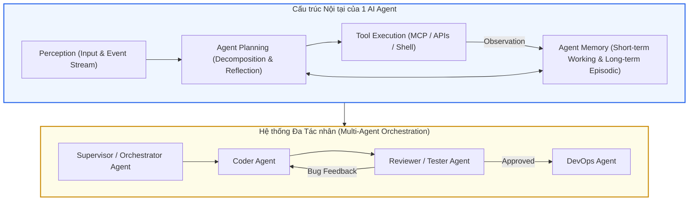
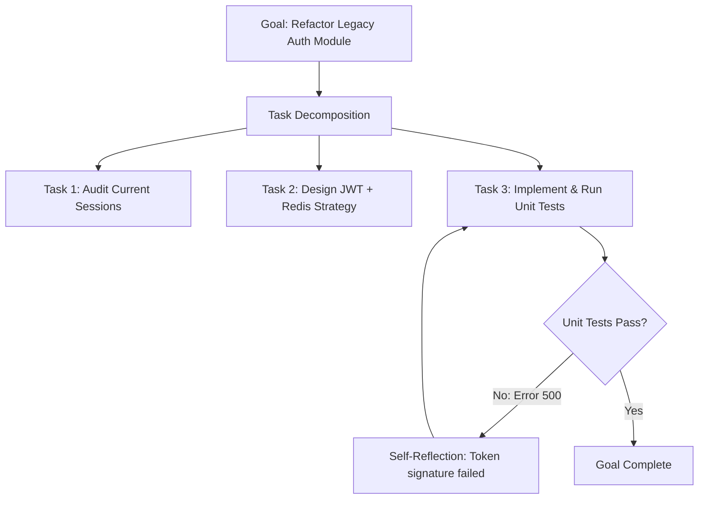
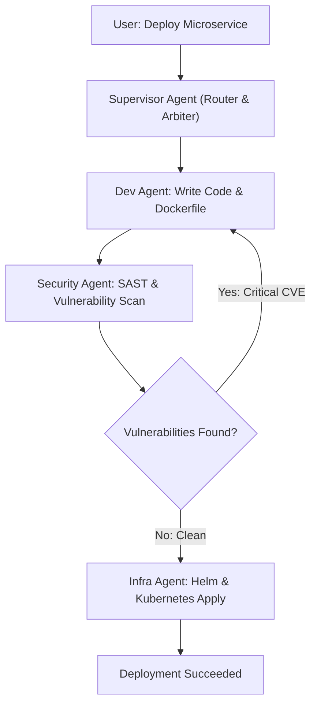
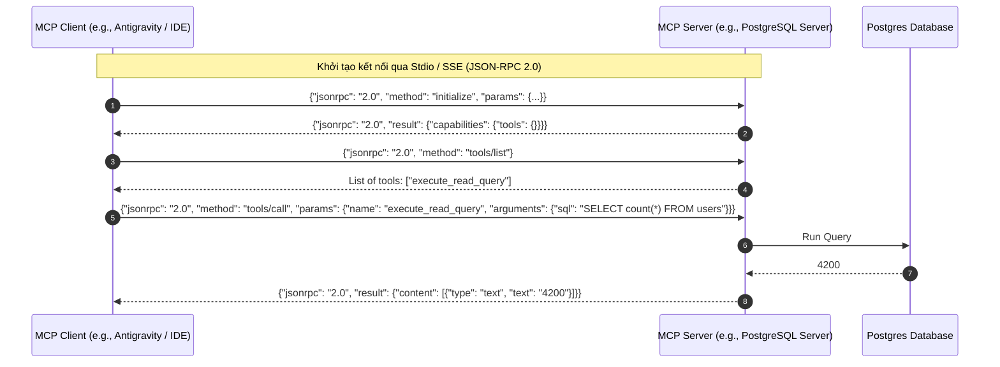

# 1.4. AI Agents, Multi-Agent Systems & Agentic Workflows

## Tổng quan về Tác nhân AI và Luồng công việc Agentic
Trong giai đoạn đầu của kỷ nguyên GenAI, các mô hình ngôn ngữ lớn hoạt động chủ yếu dưới dạng **Stateless Single-turn Prompt-Response** (Hỏi - Đáp đơn lẻ, không lưu trạng thái). Tuy nhiên, để giải quyết các bài toán kỹ thuật phức tạp đòi hỏi nhiều bước tính toán, thăm dò và tự sửa sai, hệ thống đã tiến hóa thành **Tác nhân AI (AI Agents)** và **Hệ thống Đa Tác nhân (Multi-Agent Systems)**.

Về bản chất điều khiển học (Cybernetics), một Agent là một thực thể tự trị có khả năng quan sát môi trường ($o_t \in \mathcal{O}$), duy trì trạng thái ký ức nội tại ($m_t \in \mathcal{M}$), lập kế hoạch hành động ($\pi: \mathcal{O} \times \mathcal{M} \to \mathcal{A}$), thực thi công cụ ($a_t \in \mathcal{A}$) và lặp lại chu trình cho tới khi mục tiêu toàn cục đạt được hoặc chạm giới hạn tài nguyên:
$$\text{Loop: } o_{t} \xrightarrow{} \text{Plan / Reason} \xrightarrow{} a_t \xrightarrow{} \text{Environment Execution} \xrightarrow{} o_{t+1} \xrightarrow{} \text{Reflect \& Update Memory}$$



---

## 2. Chi tiết từng Keyword (Under-the-Hood Deep Dive)

---

### 1. AI Agents, Agent Planning & Agent Memory

#### 1. Khái niệm bản chất (What & Why)
- **AI Agents**: Chương trình phần mềm tích hợp LLM làm "bộ não" điều khiển trung tâm, có khả năng tự động thực hiện chuỗi hành động hướng tới mục tiêu dài hạn mà không cần con người can thiệp từng bước.
- **Agent Planning (Lập kế hoạch)**: Năng lực chia nhỏ một mục tiêu lớn, phức tạp (ví dụ: "Xây dựng hệ thống thanh toán qua Stripe") thành đồ thị các nhiệm vụ con tuần tự hoặc song song (Task Decomposition), kèm theo khả năng tự đánh giá phản tư (Self-Reflection / Tree of Thoughts) để điều chỉnh kế hoạch khi gặp lỗi.
- **Agent Memory (Bộ nhớ Tác nhân)**:
  - *Short-term Memory*: Working memory lưu trữ ngữ cảnh hội thoại hiện tại, trạng thái các biến cục bộ trong cửa sổ Context Window.
  - *Long-term Memory*: Lưu trữ tri thức qua nhiều phiên làm việc (Episodic & Semantic memory), thường được hiện thực hóa bằng Vector Database (semantic retrieval) hoặc Knowledge Graphs.

#### 2. Cơ chế hoạt động sâu (Under the hood / Hardcore Internals)
- **Thuật toán Tree of Thoughts (ToT) & MCTS (Monte Carlo Tree Search)**:
  Thay vì sinh văn bản tuyến tính greedy một chiều, Agent tạo ra một cây không gian trạng thái các bước suy luận. Tại mỗi nhánh, Agent đánh giá điểm số triển vọng (Heuristic Value) và thực hiện quay lui (Backtracking) nếu nhánh đó dẫn đến ngõ cụt.
- **Memory Compression & Consolidation**:
  Khi Context Window tiệm cận giới hạn (ví dụ $128\text{K}$ tokens), hệ thống chạy background task để tóm tắt các hội thoại cũ thành bản ghi tri thức cô đọng (Memory Distillation), lưu vào CSDL quan hệ hoặc vector store, giải phóng token cho các tác vụ suy luận mới.

#### 3. Sơ đồ minh họa


#### 4. Code ví dụ thực chiến (TypeScript Planning & Working Memory State Machine)
Đoạn mã TypeScript xây dựng cơ chế phân rã tác vụ và quản lý trạng thái Working Memory cho một Coding Agent:

```typescript
interface SubTask {
  id: string;
  description: string;
  status: 'PENDING' | 'IN_PROGRESS' | 'COMPLETED' | 'FAILED';
  result?: string;
}

class AgentMemory {
  private shortTermLog: string[] = [];
  private taskPlan: SubTask[] = [];

  public setPlan(tasks: string[]): void {
    this.taskPlan = tasks.map((desc, idx) => ({
      id: `task_${idx + 1}`,
      description: desc,
      status: 'PENDING'
    }));
  }

  public getNextPendingTask(): SubTask | undefined {
    return this.taskPlan.find(t => t.status === 'PENDING');
  }

  public markTaskCompleted(id: string, output: string): void {
    const task = this.taskPlan.find(t => t.id === id);
    if (task) {
      task.status = 'COMPLETED';
      task.result = output;
      this.shortTermLog.push(`[${task.id}] Completed: ${output}`);
    }
  }

  public getWorkingContext(): string {
    return `Plan Progress:\n${JSON.stringify(this.taskPlan, null, 2)}\nWorking Log:\n${this.shortTermLog.join('\n')}`;
  }
}

// Test agent memory lifecycle
const memory = new AgentMemory();
memory.setPlan([
  "Clone repository and inspect directory tree",
  "Run pytest suite to establish baseline",
  "Apply refactor to database connection pool"
]);

const currentTask = memory.getNextPendingTask();
console.log("Current Task to Execute:", currentTask?.description);
if (currentTask) {
  memory.markTaskCompleted(currentTask.id, "Successfully cloned repo, found 15 source files.");
}
console.log("Updated Agent Memory State:\n", memory.getWorkingContext());
```

#### 5. Ưu / Nhược điểm, Pitfalls & Anti-patterns
- **Infinite Loop of Inaction**: Agent bị kẹt trong vòng lặp thử - sai vô tận (Trial-and-error Loop) khi gặp một lỗi lặp lại mà không có điều kiện dừng cứng (Max iterations budget).
- **Context Poisoning**: Một nhận định sai lầm ban đầu của Agent được ghi vào memory sẽ làm sai lệch toàn bộ các quyết định suy luận tiếp theo.

#### 6. Ứng dụng thực tế trong Backend / Systems
- Hệ thống AI tự động phân tích và khắc phục sự cố hệ thống (Autonomous Incident Remediation), tự động tối ưu hóa câu truy vấn CSDL chậm chạp (Automated SQL Tuning Agent).

---

### 2. Multi-Agent Systems, Orchestration & Agentic Workflows

#### 1. Khái niệm bản chất (What & Why)
- **Multi-Agent Systems (MAS)**: Hệ thống gồm nhiều Agent chuyên biệt hóa cao phối hợp cùng nhau. Thay vì một Agent "toàn năng" giải quyết mọi việc, MAS phân chia vai trò: Planner, Coder, Tester, Security Auditor.
- **Agent Orchestration**: Cơ chế điều phối luồng thực thi và giao tiếp giữa các tác nhân. Bao gồm: mô hình phân cấp (Hierarchical / Centralized Supervisor), mô hình tuần tự (Sequential Pipeline), và mô hình mạng ngang hàng cộng tác (Peer-to-peer / Gossip).
- **Agentic Workflows**: Các chu trình công việc tự động có sự kết hợp đan xen giữa suy luận của LLM và logic rẽ nhánh có điều kiện, kiểm thử tự động, và vòng phản hồi lặp lại (Iterative refinement loops).

#### 2. Cơ chế hoạt động sâu (Under the hood / Hardcore Internals)
- **Orchestration Patterns: Router, Fan-Out/Fan-In, State Machine**:
  - *Router*: LLM phân loại yêu cầu đầu vào để điều hướng tới Agent chuyên trách.
  - *Fan-out / Fan-in*: Chia nhỏ tài liệu lớn và kích hoạt nhiều worker agent song song, sau đó dùng một Aggregator Agent để tổng hợp kết quả.
  - *Graph-based Execution (như LangGraph, Temporal)*: Toàn bộ workflow được mô hình hóa thành State Machine có khả năng bền vững (Durable Execution), lưu checkpoint từng bước để phục hồi sau khi sập tiến trình.

#### 3. Sơ đồ minh họa


#### 4. Code ví dụ thực chiến (TypeScript Hierarchical Supervisor Dispatcher)
```typescript
interface AgentResponse {
  agentName: string;
  output: string;
  needsHandoverTo?: string;
}

interface SpecializedAgent {
  name: string;
  handle: (task: string) => Promise<AgentResponse>;
}

class SupervisorOrchestrator {
  private agents: Map<string, SpecializedAgent> = new Map();

  public register(agent: SpecializedAgent): void {
    this.agents.set(agent.name, agent);
  }

  public async executePipeline(initialAgent: string, task: string): Promise<void> {
    let currentAgentName: string | undefined = initialAgent;
    let currentInput = task;
    let stepCount = 0;
    const MAX_STEPS = 5;

    while (currentAgentName && stepCount < MAX_STEPS) {
      stepCount++;
      const agent = this.agents.get(currentAgentName);
      if (!agent) throw new Error(`Agent ${currentAgentName} not registered`);

      console.log(`[Step ${stepCount}] Dispatching to: ${currentAgentName}`);
      const res = await agent.handle(currentInput);
      console.log(`[${currentAgentName}] Output: ${res.output}`);

      currentAgentName = res.needsHandoverTo;
      currentInput = res.output;
    }
    console.log("Orchestration Finished.");
  }
}

// Demo triển khai 2 agents phối hợp
const orchestrator = new SupervisorOrchestrator();
orchestrator.register({
  name: 'Architect',
  handle: async (task) => ({
    agentName: 'Architect',
    output: `Architecture plan for: ${task}`,
    needsHandoverTo: 'Developer'
  })
});
orchestrator.register({
  name: 'Developer',
  handle: async (plan) => ({
    agentName: 'Developer',
    output: `Implementation generated based on: ${plan}`,
    needsHandoverTo: undefined // Dừng pipeline
  })
});

(async () => {
  await orchestrator.executePipeline('Architect', 'Build scalable Notification Gateway');
})();
```

#### 5. Ưu / Nhược điểm, Pitfalls & Anti-patterns
- **Cascade of Errors**: Khi một Agent ở mắt xích đầu tiên sinh ra dữ liệu rác hoặc ảo giác, các Agent phía sau tiếp nhận và khuếch đại sai sót, dẫn tới kết quả cuối cùng hoàn toàn vô nghĩa.
- **Chi phí Token bùng nổ**: Đa tác nhân gửi toàn bộ lịch sử qua lại cho nhau có thể làm tiêu tốn hàng triệu tokens trong vài phút nếu không có cơ chế cắt tỉa ngữ cảnh.

#### 6. Ứng dụng thực tế trong Backend / Systems
- Hệ thống kiểm thử phần mềm tự động (Autonomous End-to-End Testing): một agent viết test case, một agent giả lập hành vi người dùng, một agent phân tích crash logs.

---

### 3. Model Context Protocol (MCP) & Agent Communication Protocols

#### 1. Khái niệm bản chất (What & Why)
- **Model Context Protocol (MCP)**: Chuẩn giao tiếp mở do Anthropic công bố vào cuối năm 2024, cung cấp giao thức chuẩn mực (Open Standard) để kết nối các trợ lý AI/Agents với các nguồn dữ liệu bên ngoài (Data Sources), công cụ (Tools) và môi trường phát triển (Prompts/Resources).
- **Tại sao cần MCP**: Giải quyết vấn đề phân mảnh $M \times N$ tích hợp. Thay vì mỗi nhà cung cấp LLM phải tự viết plugin cho PostgreSQL, GitHub, Slack, Jira; các dịch vụ chỉ cần cài đặt một **MCP Server** duy nhất tuân thủ chuẩn, và mọi **MCP Client** (Claude Desktop, IDE Agent) đều có thể kết nối ngay lập tức.
- **Agent Communication Protocols**: Các giao thức truyền thông điệp giữa các agent (Agent-to-Agent - A2A), quy định định dạng thông điệp, đàm phán hợp đồng dữ liệu, và quản lý danh tính bảo mật của agent.

#### 2. Cơ chế hoạt động sâu (Under the hood / Hardcore Internals)
- **Kiến trúc MCP Client-Server & Vận chuyển JSON-RPC 2.0**:
  - Giao thức MCP vận hành hoàn toàn trên nền tảng **JSON-RPC 2.0**.
  - Tầng vận chuyển (Transport Layer) hỗ trợ hai cơ chế chính:
    1. *Standard Input / Standard Output (stdio)*: Dành cho các công cụ cục bộ (Local tools) chạy trên cùng máy tính, giao tiếp qua pipe của OS.
    2. *Server-Sent Events (SSE) qua HTTP*: Dành cho các dịch vụ MCP Server từ xa (Remote servers).
  - MCP định nghĩa 3 nhóm năng lực (Primitives):
    - **Resources**: Dữ liệu thụ động (như file, tài liệu, DB logs) để Agent đọc.
    - **Prompts**: Các mẫu chỉ dẫn được tham số hóa do Server định nghĩa trước.
    - **Tools**: Các hàm có thể thực thi (Executable functions) có JSON Schema cho tham số đầu vào.

#### 3. Sơ đồ minh họa


#### 4. Code ví dụ thực chiến (TypeScript MCP Server Stub)
Xây dựng một MCP Server đơn giản tuân thủ chuẩn JSON-RPC 2.0 qua stdio:

```typescript
import * as readline from 'readline';

interface JsonRpcRequest {
  jsonrpc: '2.0';
  id: number | string;
  method: string;
  params?: any;
}

class SimpleMCPServer {
  private rl = readline.createInterface({
    input: process.stdin,
    output: process.stdout,
    terminal: false
  });

  constructor() {
    this.rl.on('line', (line) => this.handleMessage(line));
  }

  private handleMessage(raw: string): void {
    try {
      const msg: JsonRpcRequest = JSON.parse(raw);
      if (msg.method === 'initialize') {
        this.sendResponse(msg.id, {
          protocolVersion: '2024-11-05',
          capabilities: { tools: {} },
          serverInfo: { name: 'DemoBackendMCPServer', version: '1.0.0' }
        });
      } else if (msg.method === 'tools/list') {
        this.sendResponse(msg.id, {
          tools: [{
            name: 'get_system_uptime',
            description: 'Returns host uptime in seconds',
            inputSchema: { type: 'object', properties: {} }
          }]
        });
      } else if (msg.method === 'tools/call' && msg.params?.name === 'get_system_uptime') {
        this.sendResponse(msg.id, {
          content: [{ type: 'text', text: `System uptime: ${process.uptime()}s` }]
        });
      }
    } catch (err) {
      // Bỏ qua hoặc phản hồi RPC parse error
    }
  }

  private sendResponse(id: number | string, result: any): void {
    const response = { jsonrpc: '2.0', id, result };
    process.stdout.write(JSON.stringify(response) + '\n');
  }
}

// Khởi chạy server lắng nghe stdin
new SimpleMCPServer();
```

#### 5. Ưu / Nhược điểm, Pitfalls & Anti-patterns
- **Security & Authorization Risks**: MCP cho phép Agent gọi công cụ tầng sâu vào CSDL và hệ điều hành. Nếu không có cơ chế RBAC và xác thực quyền gọi trên từng tool, Agent có thể bị lợi dụng để trích xuất dữ liệu nhạy cảm.

#### 6. Ứng dụng thực tế trong Backend / Systems
- Chuẩn hóa toàn bộ hệ sinh thái công cụ nội bộ của công ty (GitLab, AWS CLI, Kubernetes, Datadog) thành các MCP servers phục vụ các Coding Agents và SRE Agents.
