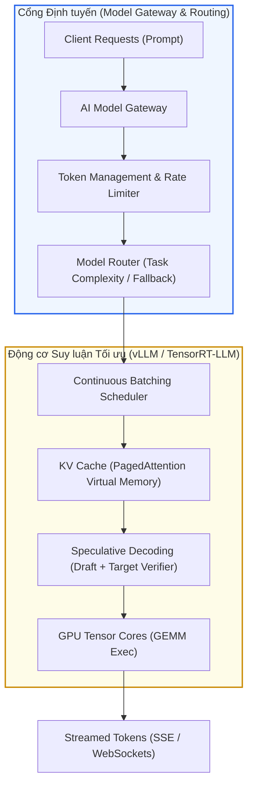
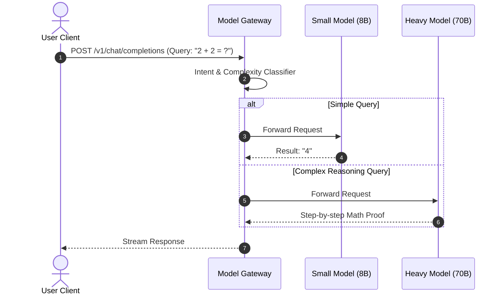
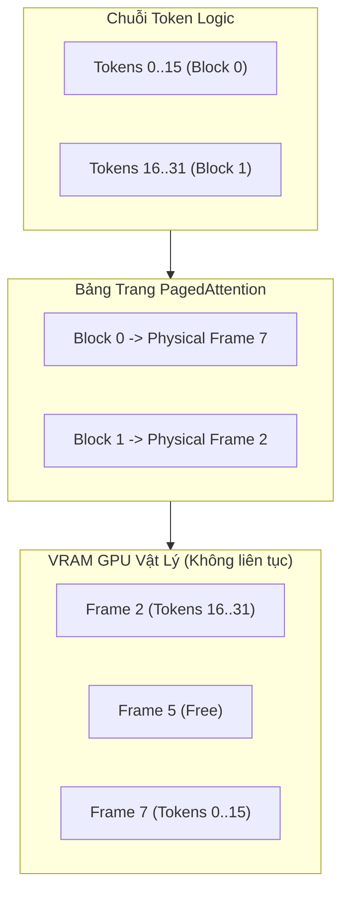
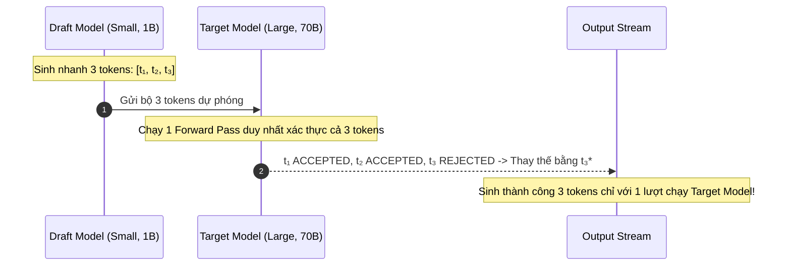

# 1.5. AI Inference, Optimization & High-Throughput Serving

## Tổng quan về Suy luận AI và Hạ tầng Phục vụ Mô hình
Trong khi quá trình Huấn luyện (Training) là bài toán tối ưu hóa thông lượng tính toán (Compute-Bound / Throughput-Optimized) chạy offline theo lô lớn, thì quá trình **Suy luận (AI Inference & Model Serving)** trên môi trường Production lại là bài toán cân bằng khắt khe giữa **Độ trễ phản hồi (Latency)** và **Hiệu quả chi phí (Cost Efficiency)**.

Về bản chất vận hành trên phần cứng tăng tốc (GPU H100, A100, TPU), quá trình sinh văn bản tự hồi quy (Autoregressive Token Generation) chia thành hai giai đoạn hoàn toàn khác biệt:
1. **Prefill Phase (Prompt Evaluation)**: Xử lý toàn bộ prompt đầu vào $N$ tokens song song. Giai đoạn này là **Compute-Bound** (Nghẽn năng lực tính toán của Tensor Cores).
2. **Decode Phase (Token Generation)**: Sinh tuần tự từng token mới $t+1$. Mỗi token sinh ra cần nạp lại toàn bộ trọng số mô hình từ VRAM. Giai đoạn này là **Memory-Bandwidth Bound** (Nghẽn băng thông nạp bộ nhớ HBM).

$$\text{Arithmetic Intensity} = \frac{\text{FLOPs}}{\text{Bytes transferred from Memory}}$$
Trong Decode Phase, Arithmetic Intensity cực thấp ($\sim 1 \text{ FLOP/Byte}$), khiến GPU dành phần lớn thời gian chờ dữ liệu từ VRAM thay vì tính toán. Các kỹ thuật tối ưu như **KV Cache**, **Continuous Batching**, và **Speculative Decoding** ra đời để giải quyết trực diện nghịch lý này.



---

## 2. Chi tiết từng Keyword (Under-the-Hood Deep Dive)

---

### 1. AI Inference, Model Serving, Model Gateway & Model Routing

#### 1. Khái niệm bản chất (What & Why)
- **AI Inference**: Quá trình đưa dữ liệu mới qua mạng nơ-ron đã được huấn luyện để tạo ra dự đoán (Output Logits / Probabilities).
- **Model Serving**: Hệ thống phần mềm hạ tầng chịu trách nhiệm lưu trữ, nạp mô hình vào bộ nhớ GPU/CPU, quản lý lifecycle, phục vụ các giao thức mạng (gRPC, HTTP/REST, WebSockets) với SLA độ trễ cao và khả năng chịu lỗi.
- **Model Gateway**: Điểm tập trung lưu lượng (Traffic Gateway) đứng trước các cụm suy luận, cung cấp các tính năng: Rate limiting theo User/Token, API Key Management, Thống kê chi phí (Cost Tracking), Thử nghiệm A/B, và Tự động chuyển hướng dự phòng (Failover).
- **Model Routing**: Kỹ thuật phân luồng yêu cầu thông minh. Ví dụ: Các câu hỏi đơn giản được định tuyến tới mô hình nhỏ siêu nhanh (như LLaMA-3-8B hoặc Claude 3.5 Haiku); các câu hỏi lập trình và suy luận logic phức tạp được chuyển tiếp tới mô hình lớn (GPT-4o hoặc Claude 3.5 Sonnet).

#### 2. Cơ chế hoạt động sâu (Under the hood / Hardcore Internals)
- **Các chỉ số SLA Inference sống còn**:
  - **TTFT (Time To First Token)**: Thời gian từ khi Client gửi request đến khi nhận được token đầu tiên (phản ánh thời gian chạy Prefill phase).
  - **TPOT (Time Per Output Token) / Inter-Token Latency**: Thời gian trung bình để sinh mỗi token tiếp theo (phản ánh tốc độ Decode phase, thường mục tiêu $> 30-50 \text{ tokens/s}$ để người dùng đọc mượt mà).
  - **Serving Throughput**: Tổng số tokens sinh ra trên mỗi giây trên toàn bộ cụm GPU (Tokens/sec/GPU).

#### 3. Sơ đồ minh họa


#### 4. Code ví dụ thực chiến (TypeScript Intelligent Model Router Gateway)
Đoạn mã TypeScript mô phỏng Gateway định tuyến linh hoạt dựa trên độ dài prompt và độ phức tạp:

```typescript
interface CompletionRequest {
  prompt: string;
  maxTokens: number;
}

interface ModelTarget {
  name: string;
  endpoint: string;
  costPer1kTokens: number;
}

class ModelRoutingGateway {
  private smallModel: ModelTarget = { name: "Llama-3-8B", endpoint: "http://gpu-cluster-1:8000", costPer1kTokens: 0.0002 };
  private largeModel: ModelTarget = { name: "Llama-3-70B", endpoint: "http://gpu-cluster-2:8000", costPer1kTokens: 0.0025 };

  public routeRequest(req: CompletionRequest): ModelTarget {
    const isCodeOrMath = /(function|class|algorithm|prove|integrate|select|insert)/i.test(req.prompt);
    const estimatedTokens = req.prompt.split(/\s+/).length * 1.3;

    // Định tuyến thông minh: tác vụ phức tạp hoặc prompt dài -> Large Model
    if (isCodeOrMath || estimatedTokens > 1500) {
      console.log(`[Gateway] Routing to LARGE model (${this.largeModel.name}) for complex reasoning.`);
      return this.largeModel;
    }

    console.log(`[Gateway] Routing to SMALL model (${this.smallModel.name}) for cost efficiency.`);
    return this.smallModel;
  }
}

// Test router
const gateway = new ModelRoutingGateway();
gateway.routeRequest({ prompt: "Hello, write a friendly email wishing a good morning.", maxTokens: 100 });
gateway.routeRequest({ prompt: "Write an algorithm in C++ to implement an lock-free ring buffer.", maxTokens: 500 });
```

#### 5. Ưu / Nhược điểm, Pitfalls & Anti-patterns
- **Throttling Cascade**: Khi lưu lượng tăng đột biến, nếu không có Token Bucket Rate Limiter ở Gateway, các GPU server sẽ bị tràn hàng đợi (Queue Saturation), làm tăng đột biến TTFT từ vài trăm mili-giây lên hàng chục giây.

#### 6. Ứng dụng thực tế trong Backend / Systems
- Hệ thống AI Proxy trung tâm của doanh nghiệp phục vụ định tuyến và phân bổ ngân sách cho hàng chục phòng ban khác nhau.

---

### 2. Token Management & KV Cache

#### 1. Khái niệm bản chất (What & Why)
- **Token Management**: Kiểm soát quá trình mã hóa từ (Tokenization qua BPE - Byte-Pair Encoding), giới hạn kích thước ngữ cảnh, cắt tỉa (Sliding Window / Prompt Truncation) và cấp phát bộ nhớ token.
- **KV Cache**: Trong quá trình tự sinh token kế tiếp, các giá trị Key ($K$) và Value ($V$) của các token trong quá khứ không hề thay đổi. Thay vì tính toán lại ma trận $K$ và $V$ của toàn bộ ngữ cảnh ở mỗi bước sinh token, ta lưu chúng vào bộ nhớ đệm (Key-Value Cache) trong VRAM.

#### 2. Cơ chế hoạt động sâu (Under the hood / Hardcore Internals)
- **Công thức tính dung lượng KV Cache**:
  Kích thước bộ nhớ KV Cache cho 1 chuỗi token yêu cầu lượng VRAM khổng lồ:
  $$\text{VRAM}_{\text{KVCache}} = 2 \times 2 \times B \times L \times H \times D_{\text{head}} \text{ bytes}$$
  Trong đó:
  - Hệ số 2 đầu tiên cho cả Key và Value.
  - Hệ số 2 thứ hai cho định dạng FP16 / BF16 (2 bytes/phần tử).
  - $B$: Batch size, $L$: Chiều dài chuỗi (Sequence length), $H$: Số lượng Head, $D_{\text{head}}$: Kích thước mỗi Head.
  *Ví dụ*: Với LLaMA-2-70B, context $4096$, batch size $16$, KV Cache tiêu tốn hơn **52 GB VRAM**, vượt xa dung lượng chứa trọng số nếu không được tối ưu!
- **PagedAttention (Kiến trúc vLLM)**:
  Lấy cảm hứng từ cơ chế Phân trang Bộ nhớ Ảo (Virtual Memory Paging) trong Hệ điều hành. Thay vì cấp phát một mảng nhớ liên tục (Contiguous Memory) tĩnh cho chuỗi với kích thước tối đa (gây lãng phí phân mảnh bộ nhớ bên trong - Internal Fragmentation lên đến 60-80%), PagedAttention chia nhỏ KV Cache thành các **Khối (Blocks/Pages)** kích thước cố định (ví dụ 16 tokens). Một bảng trang (Page Table) ánh xạ các block logic sang các block vật lý phân tán trong VRAM, triệt tiêu phân mảnh bộ nhớ.

#### 3. Sơ đồ minh họa


#### 4. Code ví dụ thực chiến (C++ KV Cache Block Allocator Simulation)
```cpp
#include <iostream>
#include <vector>
#include <memory>
#include <cassert>

constexpr size_t BLOCK_SIZE = 16; // 16 tokens per block
constexpr size_t HEAD_DIM = 128;

struct KVBlock {
    int physical_block_id;
    std::vector<float> keys;
    std::vector<float> values;

    explicit KVBlock(int id) 
        : physical_block_id(id), 
          keys(BLOCK_SIZE * HEAD_DIM, 0.0f), 
          values(BLOCK_SIZE * HEAD_DIM, 0.0f) {}
};

class BlockManager {
private:
    std::vector<int> free_blocks_;
public:
    explicit BlockManager(size_t total_blocks) {
        for (size_t i = 0; i < total_blocks; ++i) {
            free_blocks_.push_back(static_cast<int>(i));
        }
    }

    int allocate_block() {
        if (free_blocks_.empty()) {
            throw std::runtime_error("GPU Out of Memory: No free KV blocks!");
        }
        int blk = free_blocks_.back();
        free_blocks_.pop_back();
        return blk;
    }

    void free_block(int block_id) {
        free_blocks_.push_back(block_id);
    }

    [[nodiscard]] size_t free_count() const noexcept { return free_blocks_.size(); }
};

int main() {
    BlockManager mem_pool(1024); // Cụm 1024 physical blocks
    std::cout << "Initial free GPU blocks: " << mem_pool.free_count() << "\n";

    // Cấp phát cho một request mới sinh 35 tokens -> cần ceil(35 / 16) = 3 blocks
    std::vector<int> request_page_table;
    for (int i = 0; i < 3; ++i) {
        request_page_table.push_back(mem_pool.allocate_block());
    }

    std::cout << "Allocated physical frames: ";
    for (int blk : request_page_table) std::cout << blk << " ";
    std::cout << "\nRemaining free blocks: " << mem_pool.free_count() << "\n";
    return 0;
}
```

#### 5. Ưu / Nhược điểm, Pitfalls & Anti-patterns
- **OOM do KV Cache tràn**: Khi số lượng phiên kết nối đồng thời tăng cao, nếu không có cơ chế preemptive swapping (hoán chuyển KV Cache từ VRAM sang RAM máy chủ) hoặc abort request, toàn bộ server sẽ gặp lỗi `CUDA out of memory` làm crash tiến trình.

#### 6. Ứng dụng thực tế trong Backend / Systems
- Thành phần cốt lõi bên trong các runtime suy luận mã nguồn mở hiện đại: vLLM, TGI (Text Generation Inference), TensorRT-LLM.

---

### 3. Continuous Batching & Speculative Decoding

#### 1. Khái niệm bản chất (What & Why)
- **Continuous Batching (Dynamic / Cellular Batching)**: Kỹ thuật ghép lô ở cấp độ bước sinh token (Iteration-level Batching) thay vì cấp độ toàn bộ yêu cầu (Request-level Batching). Giải quyết vấn đề lãng phí tài nguyên khi các yêu cầu có độ dài sinh khác nhau.
- **Speculative Decoding**: Kỹ thuật tăng tốc độ sinh token mà hoàn toàn không làm suy giảm chất lượng đầu ra. Sử dụng một mô hình nhỏ siêu nhanh (Draft Model) để sinh trước $K$ token phỏng đoán, sau đó mô hình lớn đích (Target Model) chạy kiểm tra đồng thời $K$ token đó trong duy nhất 1 lần forward pass.

#### 2. Cơ chế hoạt động sâu (Under the hood / Hardcore Internals)
- **Cơ chế Continuous Batching (Orca Algorithm)**:
  Trong Static Batching, nếu Request A cần sinh 5 tokens và Request B cần sinh 500 tokens, GPU phải chờ Request B hoàn thành mới kết thúc batch, lãng phí compute của slot A suốt 495 iterations.
  Continuous Batching chạy một Scheduler ở mỗi iteration: Ngay khi Request A gặp token dừng `[EOS]`, slot của nó được giải phóng ngay lập tức và một Request C mới từ hàng đợi được chèn vào batch tiếp theo mà không cần khởi động lại cả batch.
- **Giải thuật Speculative Sampling**:
  Gọi $p(x)$ là phân phối của Target Model và $q(x)$ là phân phối của Draft Model. Với mỗi token $x$ do Draft Model sinh ra, chấp nhận token đó với xác suất:
  $$\alpha = \min\left(1, \frac{p(x)}{q(x)}\right)$$
  Nếu bị từ chối tại vị trí $i$, thuật toán dừng lại, lấy mẫu lại token $i$ từ phân phối hiệu chỉnh $\max(0, p(x) - q(x))$, và bỏ qua các token dự đoán từ $i+1$ trở đi. Kết quả sinh ra đảm bảo toán học có phân phối xác suất đồng nhất 100% với việc chạy mô hình lớn từ đầu! Tăng tốc độ từ $2 \times$ đến $3.5 \times$.

#### 3. Sơ đồ minh họa


#### 4. Code ví dụ thực chiến (C++ Speculative Sampling Verification Logic)
```cpp
#include <iostream>
#include <vector>
#include <random>
#include <algorithm>

struct VerificationResult {
    std::vector<int> accepted_tokens;
    int corrected_token;
};

// Hàm xác thực token của Speculative Decoding
VerificationResult verify_speculative_tokens(
    const std::vector<int>& draft_tokens,
    const std::vector<float>& p_target, // Xác suất từ mô hình lớn
    const std::vector<float>& q_draft   // Xác suất từ mô hình nhỏ
) {
    VerificationResult res;
    std::mt19937 gen(42);
    std::uniform_real_distribution<float> dist(0.0f, 1.0f);

    for (size_t i = 0; i < draft_tokens.size(); ++i) {
        float p = p_target[i];
        float q = q_draft[i];
        float acceptance_prob = std::min(1.0f, p / q);

        if (dist(gen) < acceptance_prob) {
            res.accepted_tokens.push_back(draft_tokens[i]);
        } else {
            // Bị từ chối: Dừng lại và lấy mẫu token sửa chữa
            res.corrected_token = 9999; // Giả lập token sửa chữa từ phân phối hiệu chỉnh
            return res;
        }
    }
    res.corrected_token = -1; // Tất cả đều được chấp nhận
    return res;
}

int main() {
    std::vector<int> draft = {101, 204, 305};
    std::vector<float> p_target = {0.9f, 0.85f, 0.2f};
    std::vector<float> q_draft  = {0.85f, 0.80f, 0.7f};

    auto res = verify_speculative_tokens(draft, p_target, q_draft);
    std::cout << "Accepted tokens count: " << res.accepted_tokens.size() << "\n";
    if (res.corrected_token != -1) {
        std::cout << "Rejected at tail, replaced with token: " << res.corrected_token << "\n";
    }
    return 0;
}
```

#### 5. Ưu / Nhược điểm, Pitfalls & Anti-patterns
- **Draft Model Misalignment**: Nếu mô hình nhỏ có phân phối quá xa rời mô hình lớn, tỷ lệ chấp nhận (Acceptance Rate) thấp ($<30\%$), chi phí chạy cả hai mô hình sẽ làm hệ thống chậm hơn so với chỉ chạy một mình mô hình lớn.

#### 6. Ứng dụng thực tế trong Backend / Systems
- Các dịch vụ LLM công cộng hàng đầu (ChatGPT, Claude, Groq) đều áp dụng Continuous Batching và Speculative Decoding để tối ưu hóa chi phí hàng triệu USD tiền điện toán mỗi ngày.
