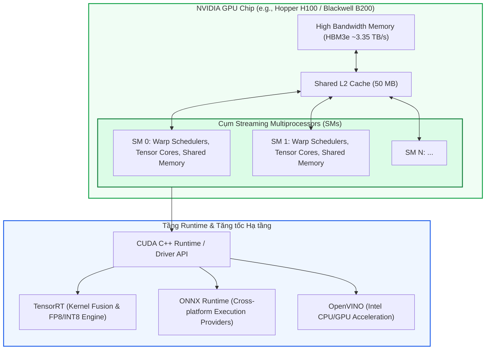
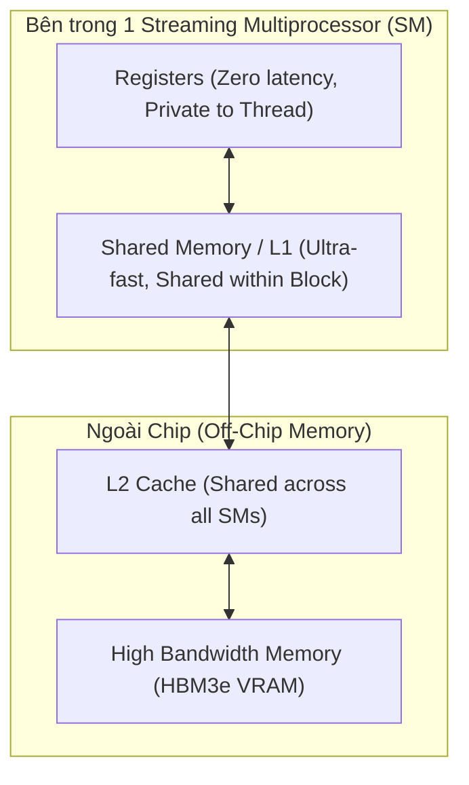
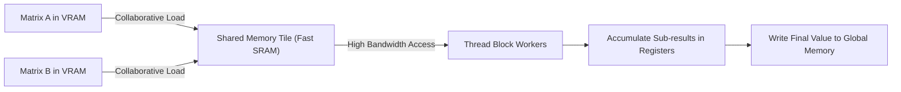
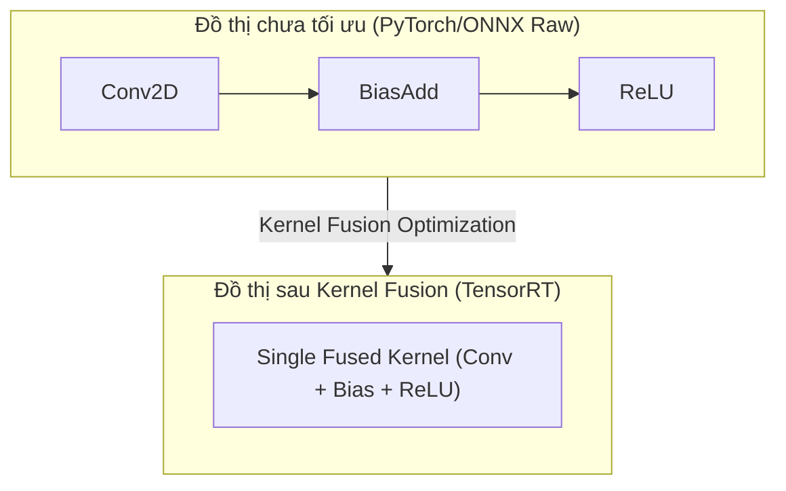

# 2.1. GPU Architecture, CUDA Programming & Hardware Acceleration

## Tổng quan về Kiến trúc GPU và Tăng tốc Phần cứng
Trong kiến trúc máy tính hiện đại, bộ xử lý đồ họa (GPU - Graphics Processing Unit) đã tiến hóa từ một bộ tăng tốc đường ống đồ họa cố định (Fixed-function Graphics Pipeline) thành bộ xử lý song song khối lượng lớn đa năng (**GPGPU - General-Purpose Computing on GPUs**). Trong khi CPU được tối ưu hóa để giảm thiểu độ trễ của một luồng đơn lẻ (**Latency-Optimized**, sở hữu bộ nhớ đệm L1/L2/L3 khổng lồ và logic điều khiển nhánh phức tạp), GPU lại được thiết kế triệt để để tối đa hóa thông lượng tính toán (**Throughput-Optimized**, sở hữu hàng chục nghìn nhân tính toán song song).

Về mặt mô hình lập trình phần cứng, GPU vận hành theo kiến trúc **SIMT (Single Instruction, Multiple Threads)**:
- Hàng ngàn luồng (threads) đồng thời thực thi cùng một chỉ lệnh máy trên các phần tử dữ liệu khác nhau.
- Các luồng được nhóm thành các **Warps** (mỗi warp gồm 32 luồng vật lý trên phần cứng NVIDIA) thực thi đồng bộ bước nhịp (Lockstep).
- Các phép toán nơ-ron được gia tốc ở cấp độ bóng bán dẫn bởi các nhân chuyên dụng **Tensor Cores**, có khả năng thực hiện phép toán nhân tích lũy ma trận tổng quát (**MMA - Matrix Multiply-Accumulate**) trong một chu kỳ xung nhịp duy nhất:
$$D = A \times B + C$$



---

## 2. Chi tiết từng Keyword (Under-the-Hood Deep Dive)

---

### 1. GPU Computing, GPU Architecture & Memory Hierarchy

#### 1. Khái niệm bản chất (What & Why)
- **GPU Computing**: Khai thác năng lực xử lý song song ồ ạt của hàng ngàn lõi GPU để giải quyết các bài toán tính toán khoa học, đồ họa và trí tuệ nhân tạo.
- **GPU Architecture**: Tổ chức phần cứng gồm nhiều Bộ đa xử lý dòng (**Streaming Multiprocessors - SM** trên NVIDIA, hoặc Compute Units - CU trên AMD). Mỗi SM chứa các nhân số nguyên (INT32), số thực (FP32, FP64), nhân Tensor Cores, Warp Schedulers, và các thanh ghi tốc độ cao.
- **GPU Memory Hierarchy**: Hệ thống phân cấp bộ nhớ có khoảng cách băng thông và độ trễ cực kỳ chênh lệch:
  - *Registers*: Tốc độ tức thời (~1 chu kỳ xung nhịp), dung lượng ~64K thanh ghi 32-bit mỗi SM.
  - *Shared Memory / L1 Data Cache*: Bộ nhớ lập trình được chia sẻ giữa các luồng trong cùng Thread Block, độ trễ ~20-30 chu kỳ, băng thông $> 10\text{ TB/s}$.
  - *L2 Cache*: Bộ nhớ đệm dùng chung cho toàn bộ các SM trên chip, dung lượng 40-50MB, băng thông ~5TB/s.
  - *Global Memory (HBM3/GDDR6)*: Bộ nhớ chính VRAM (80GB-192GB), độ trễ cao ~200-400 chu kỳ xung nhịp, băng thông ~2-3.35 TB/s.

#### 2. Cơ chế hoạt động sâu (Under the hood / Hardcore Internals)
- **Coalesced Memory Access (Truy cập bộ nhớ kết hợp)**:
  Khi 32 luồng trong một Warp cùng truy cập vào Global Memory, bộ điều khiển bộ nhớ (Memory Controller) chỉ cần phát ra một giao dịch bộ nhớ (Transaction) duy nhất (ví dụ 128 bytes) nếu các địa chỉ nhớ nằm liên tục và được căn chỉnh đúng (Memory-Aligned). Nếu các luồng truy cập phân tán (Strided hoặc Random Access), số lượng transaction sẽ nhân lên gấp 32 lần, làm sụt giảm nghiêm trọng hiệu suất nạp dữ liệu.
- **Bank Conflicts trong Shared Memory**:
  Shared Memory được chia thành 32 **Memory Banks** độc lập tương ứng với các từ nhớ 32-bit. Nếu nhiều luồng trong cùng một warp cùng truy xuất vào các địa chỉ khác nhau nhưng thuộc cùng một Bank, phần cứng buộc phải tuần tự hóa (Serialize) các truy xuất đó, gây ra tổn thất hiệu năng gọi là Bank Conflict.

#### 3. Sơ đồ minh họa


#### 4. Code ví dụ thực chiến (C++ / CUDA Kernel Vector Addition with Coalescing)
Đoạn mã CUDA C++ minh họa việc viết kernel cộng vector tuân thủ chuẩn Coalesced Memory Access:

```cpp
#include <iostream>
#include <vector>
#include <cuda_runtime.h>

// CUDA Kernel chạy song song trên hàng ngàn luồng GPU
__global__ void vector_add_coalesced(const float* __restrict__ a, 
                                     const float* __restrict__ b, 
                                     float* __restrict__ c, 
                                     int n) {
    // Tính chỉ số toàn cục duy nhất của luồng (Global Thread ID)
    int idx = blockIdx.x * blockDim.x + threadIdx.x;
    
    // Đảm bảo các luồng liền kề truy cập các ô nhớ a[idx], b[idx] liền kề (Coalesced Access)
    if (idx < n) {
        c[idx] = a[idx] + b[idx];
    }
}

int main() {
    int n = 1 << 20; // 1,048,576 phần tử
    size_t bytes = n * sizeof(float);

    // Cấp phát bộ nhớ trên Host CPU
    std::vector<float> h_a(n, 1.0f);
    std::vector<float> h_b(n, 2.0f);
    std::vector<float> h_c(n, 0.0f);

    // Cấp phát bộ nhớ trên GPU VRAM
    float *d_a, *d_b, *d_c;
    cudaMalloc(&d_a, bytes);
    cudaMalloc(&d_b, bytes);
    cudaMalloc(&d_c, bytes);

    // Sao chép dữ liệu từ CPU sang GPU (Host to Device)
    cudaMemcpy(d_a, h_a.data(), bytes, cudaMemcpyHostToDevice);
    cudaMemcpy(d_b, h_b.data(), bytes, cudaMemcpyHostToDevice);

    // Cấu hình Grid và Block (256 threads mỗi block)
    int threads_per_block = 256;
    int blocks_per_grid = (n + threads_per_block - 1) / threads_per_block;

    // Kích hoạt kernel
    vector_add_coalesced<<<blocks_per_grid, threads_per_block>>>(d_a, d_b, d_c, n);
    cudaDeviceSynchronize();

    // Sao chép kết quả về CPU (Device to Host)
    cudaMemcpy(h_c.data(), d_c, bytes, cudaMemcpyDeviceToHost);
    std::cout << "Vector Add Sample Result: c[0] = " << h_c[0] << ", c[n-1] = " << h_c[n - 1] << "\n";

    // Giải phóng bộ nhớ GPU
    cudaFree(d_a);
    cudaFree(d_b);
    cudaFree(d_c);
    return 0;
}
```

#### 5. Ưu / Nhược điểm, Pitfalls & Anti-patterns
- **Warp Divergence**: Khi có câu lệnh rẽ nhánh `if-else` và các luồng trong cùng một warp đi theo hai nhánh khác nhau, GPU phải tuần tự hóa việc thực thi cả hai nhánh, khiến 50% số lõi bị nhàn rỗi (Masked out).

#### 6. Ứng dụng thực tế trong Backend / Systems
- Viết custom kernel giải mã âm thanh hoặc trích xuất đặc trưng thời gian thực cho hạ tầng Video Streaming.

---

### 2. CUDA Programming & GPU Kernel Optimization

#### 1. Khái niệm bản chất (What & Why)
- **CUDA Programming**: Nền tảng điện toán song song và giao diện lập trình ứng dụng (API) độc quyền của NVIDIA cho phép lập trình viên sử dụng ngôn ngữ C/C++ để điều khiển GPU trực tiếp.
- **Kernel Optimization**: Nghệ thuật tối ưu hóa mã lệnh GPU để đạt tiệm cận giới hạn vật lý của phần cứng (Speed-of-light efficiency), bao gồm: tối ưu độ chiếm dụng SM (**Occupancy**), ẩn giấu độ trễ truy cập bộ nhớ (**Latency Hiding**), và tránh tràn thanh ghi (Register Spilling).

#### 2. Cơ chế hoạt động sâu (Under the hood / Hardcore Internals)
- **Occupancy & Latency Hiding**:
  Occupancy là tỷ lệ giữa số lượng active warps trên một SM so với số lượng warps tối đa mà phần cứng hỗ trợ. GPU không sử dụng kỹ thuật dự đoán nhánh phức tạp (Branch Prediction) như CPU; thay vào đó, khi một warp đang chờ dữ liệu nạp từ Global Memory (độ trễ 200 chu kỳ), Warp Scheduler sẽ **chuyển ngữ cảnh tức thì (Zero-overhead context switch)** sang một warp khác đã sẵn sàng thực thi chỉ lệnh toán học.
- **Tiled Matrix Multiplication sử dụng Shared Memory**:
  Thay vì mỗi luồng đọc ma trận trực tiếp từ VRAM chậm chạp, các luồng trong cùng block hợp tác nạp một khối vuông ma trận (Tile) vào Shared Memory siêu nhanh, thực hiện tính toán trên tile đó trước khi nạp khối tiếp theo, giảm tới 90% số lần truy cập VRAM.

#### 3. Sơ đồ minh họa


#### 4. Code ví dụ thực chiến (C++ CUDA Tiled Matrix Multiply Kernel Stub)
```cpp
#include <cuda_runtime.h>

constexpr int TILE_WIDTH = 16;

__global__ void matrix_multiply_tiled(const float* A, const float* B, float* C, int width) {
    // Khai báo bộ nhớ chia sẻ dùng chung cho Thread Block
    __shared__ float s_a[TILE_WIDTH][TILE_WIDTH];
    __shared__ float s_b[TILE_WIDTH][TILE_WIDTH];

    int bx = blockIdx.x, by = blockIdx.y;
    int tx = threadIdx.x, ty = threadIdx.y;

    int row = by * TILE_WIDTH + ty;
    int col = bx * TILE_WIDTH + tx;
    float sum = 0.0f;

    // Lặp qua các Tiles cần nạp
    for (int ph = 0; ph < width / TILE_WIDTH; ++ph) {
        // Hợp tác nạp dữ liệu vào Shared Memory
        s_a[ty][tx] = A[row * width + ph * TILE_WIDTH + tx];
        s_b[ty][tx] = B[(ph * TILE_WIDTH + ty) * width + col];

        // Rào chắn đồng bộ: Chờ tất cả luồng trong block nạp xong
        __syncthreads();

        // Nhân 2 khối trong Shared Memory
        for (int k = 0; k < TILE_WIDTH; ++k) {
            sum += s_a[ty][k] * s_b[k][tx];
        }

        // Rào chắn đồng bộ: Chờ tính xong trước khi nạp Tile tiếp theo
        __syncthreads();
    }

    if (row < width && col < width) {
        C[row * width + col] = sum;
    }
}
```

#### 5. Ưu / Nhược điểm, Pitfalls & Anti-patterns
- **Register Spilling**: Khi kernel sử dụng quá nhiều biến cục bộ vượt quá số lượng thanh ghi phần cứng cho phép trên mỗi luồng, trình biên dịch `nvcc` buộc phải đẩy các biến này vào **Local Memory** (thực chất là một vùng trên Global Memory VRAM chậm chạp), khiến hiệu năng sụt giảm nghiêm trọng.

#### 6. Ứng dụng thực tế trong Backend / Systems
- Xây dựng các thư viện tính toán nhúng tùy biến trong các microservices tài chính định lượng (High-Frequency Trading) chạy trên GPU.

---

### 3. Tensor Processing, TensorRT, ONNX Runtime & OpenVINO

#### 1. Khái niệm bản chất (What & Why)
- **Tensor Processing**: Khả năng xử lý các mảng đa chiều (Tensors) bằng các đơn vị phần cứng chuyên biệt (Tensor Cores của NVIDIA, Matrix Cores của AMD, hoặc TPU của Google).
- **TensorRT**: Bộ thư viện và công cụ suy luận hiệu năng cao độc quyền của NVIDIA cho phép tối ưu hóa đồ thị tính toán nơ-ron để đạt độ trễ thấp nhất và thông lượng tối đa trên phần cứng NVIDIA.
- **ONNX Runtime (Open Neural Network Exchange Runtime)**: Động cơ suy luận mã nguồn mở đa nền tảng của Microsoft hỗ trợ thực thi mô hình chuẩn hóa ONNX trên nhiều phần cứng khác nhau thông qua các **Execution Providers (EPs)** (như CUDA EP, TensorRT EP, DirectML, OpenVINO EP).
- **OpenVINO (Open Visual Inference and Neural Network Optimization)**: Bộ công cụ tối ưu hóa của Intel giúp tăng tốc độ suy luận mô hình AI trên các kiến trúc phần cứng của Intel (Intel Core CPU, Xeon, Intel Arc GPU, NPU).

#### 2. Cơ chế hoạt động sâu (Under the hood / Hardcore Internals)
- **Đồ thị Tối ưu hóa (Graph Optimization) & Kernel Fusion**:
  Trong một framework nạp mô hình thô (PyTorch), mỗi lớp (ví dụ: `Conv2D -> BiasAdd -> ReLU`) là một kernel riêng biệt được gọi nối tiếp nhau, gây ra chi phí kích hoạt kernel (Kernel Launch Overhead) và phải liên tục ghi/đọc dữ liệu trung gian vào VRAM.
  **TensorRT Engine Compiler** thực hiện:
  - *Vertical Layer Fusion*: Gộp `Conv + Bias + ReLU` thành một kernel duy nhất thực thi trong registers/SRAM.
  - *Horizontal Layer Fusion*: Gộp các lớp song song có cùng đầu vào (ví dụ 3 phép tính $Q, K, V$ projections trong Attention) thành một phép GEMM duy nhất.
  - *Precision Calibration*: Tự động chuyển đổi sang INT8/FP8 với độ suy hao tối thiểu nhờ bảng băm phân phối (KL-Divergence calibration).

#### 3. Sơ đồ minh họa


#### 4. Code ví dụ thực chiến (C++ ONNX Runtime C API Inference Execution)
Đoạn mã C++ minh họa việc tích hợp động cơ ONNX Runtime để nạp và suy luận mô hình nhúng trong một backend C++ service:

```cpp
#include <iostream>
#include <vector>
#include <onnxruntime_cxx_api.h>

void run_onnx_inference() {
    // 1. Khởi tạo ONNX Runtime Environment
    Ort::Env env(ORT_LOGGING_LEVEL_WARNING, "BackendInferenceService");
    Ort::SessionOptions session_options;
    session_options.SetIntraOpNumThreads(4);
    session_options.SetGraphOptimizationLevel(GraphOptimizationLevel::ORT_ENABLE_ALL);

    // Kích hoạt CUDA Execution Provider nếu có GPU
    // OrtCUDAProviderOptions cuda_options;
    // session_options.AppendExecutionProvider_CUDA(cuda_options);

    std::cout << "[ORT] Session initialized with graph optimizations enabled.\n";
    // Session sẽ nạp file mô hình đã serialize .onnx và thực thi Run()
}

int main() {
    run_onnx_inference();
    return 0;
}
```

#### 5. Ưu / Nhược điểm, Pitfalls & Anti-patterns
- **Vendor Lock-in của TensorRT**: File engine `.trt` sau khi compile chỉ có thể chạy đúng trên chính xác model GPU và phiên bản driver đã tạo ra nó (không tương thích ngược giữa các kiến trúc ví dụ giữa Ampere và Hopper).

#### 6. Ứng dụng thực tế trong Backend / Systems
- Chuẩn hóa quy trình MLOps: Huấn luyện trên PyTorch -> Xuất khẩu chuẩn ONNX -> Biên dịch TensorRT cho GPU production hoặc OpenVINO cho CPU edge servers.
