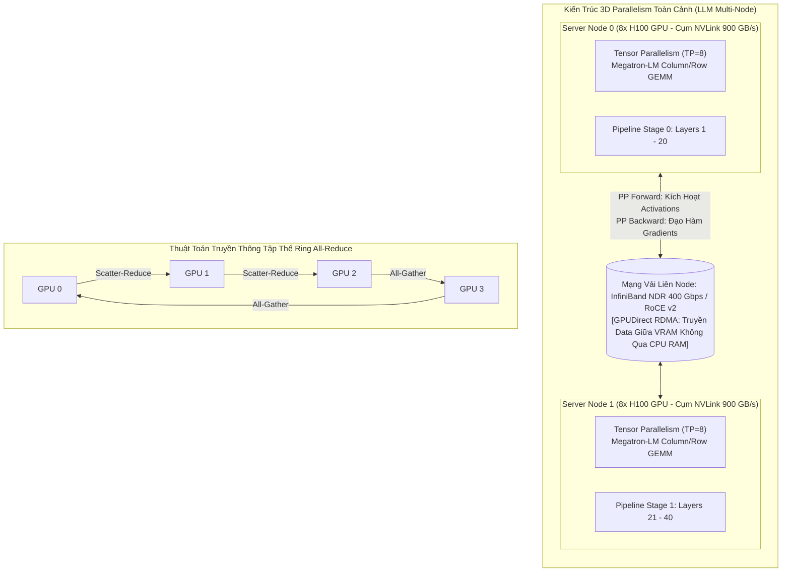

# 2.2. Distributed Training and Model Parallelism

> [!IMPORTANT]
> **Nếu bạn chỉ được nhớ một điều duy nhất:** Huấn luyện một mô hình ngôn ngữ lớn $70\text{B}$ tham số không chỉ cần $140\text{ GB}$ VRAM cho trọng số FP16 mà đòi hỏi tới **$1,120\text{ GB} = 1.12\text{ Terabytes}$ VRAM** do bộ tối ưu hóa Adam tiêu tốn $16\text{ bytes / parameter}$ ($4\text{B master weights} + 4\text{B momentum} + 4\text{B variance} + 2\text{B gradients} + 2\text{B weights}$). Không một GPU nào chứa vừa, buộc kỹ thuật phân tán phải áp dụng **3D Parallelism**: (1) **Tensor Parallelism (Megatron-LM)** cắt nhỏ ma trận theo hàng/cột chạy cục bộ trong 1 node vật lý qua đường truyền siêu tốc **NVLink 900 GB/s**, (2) **Pipeline Parallelism (1F1B)** cắt mô hình theo chiều sâu các lớp (Layers) chạy xuyên các server qua mạng **InfiniBand / RoCE 400 Gbps**, và (3) **Fully Sharded Data Parallel (FSDP / ZeRO-3)** phân mảnh toàn bộ trạng thái ra hàng ngàn GPU và chỉ gom lại tức thì bằng thuật toán **Ring All-Reduce**.

---

## 1. Kiến trúc Tổng quan & Mô hình Tư duy (Mental Model)

### Ẩn Dụ Đời Sống: Xây Dựng Tòa Tháp Chọc Trời 100 Tầng & Ba Đội Thợ Phân Tán
Hãy hình dung việc huấn luyện một mô hình Deep Learning khổng lồ giống như xây một tòa cao ốc 100 tầng:
1. **Data Parallelism (DP / FSDP - Nhân bản công trường)**: Bạn có 8 đội thợ xây dựng 8 tòa tháp giống hệt nhau ở các khu đất khác nhau. Mỗi đội dùng một lô nguyên vật liệu khác nhau (Mini-batch). Hết mỗi ngày, trưởng các đội gặp nhau tại một vòng tròn trung tâm (Ring All-Reduce) để cộng trung bình số kinh nghiệm thu được (Gradients) rồi cùng cập nhật bản vẽ kỹ thuật. Nhược điểm: Mỗi đội thợ bắt buộc phải mang vừa bản vẽ 100 tầng trong balô (VRAM OOM).
2. **Tensor Parallelism (TP - Megatron-LM - Phân công cắt xẻ 1 viên đá khổng lồ)**: Một viên đá móng nặng 1,000 tấn (Phép nhân ma trận GEMM quá lớn không vừa 1 GPU). Bạn phân công 8 thợ đá cùng đứng quanh viên đá, mỗi người đục đẽo một cột hoặc một hàng. Vì họ đứng ngay cạnh nhau trong cùng 1 xưởng (cùng 1 Node máy chủ), họ có thể thì thầm trao đổi thông tin với tốc độ ánh sáng qua đường truyền nội bộ siêu tốc **NVLink (900 GB/s)**.
3. **Pipeline Parallelism (PP - 1F1B - Dây chuyền sản xuất phân tầng)**: Đội thợ 1 chuyên làm móng (Tầng 1-25), Đội thợ 2 dựng khung thép (Tầng 26-50), Đội thợ 3 lắp kính (Tầng 51-75), Đội thợ 4 hoàn thiện nội thất (Tầng 76-100). Đội sau phải đợi sản phẩm của đội trước. Kỹ thuật lập lịch **1F1B (One Forward, One Backward)** chia nhỏ nguyên liệu thành các lát siêu mịn (Micro-batches) để mọi đội thợ đều liên tục có việc làm, triệt tiêu tối đa thời gian ngồi chơi xơi nước (**Pipeline Bubble**).



---

## 2. Chi tiết từng Keyword (Under-the-Hood Deep Dive)

### 2.1. Memory Breakdown in Deep Learning (VRAM Budget: Weights, Gradients, Optimizer States & Activations)
Tổng lượng VRAM cần thiết để huấn luyện mô hình được định lượng chính xác theo công thức:
$$M_{\text{total}} = M_{\text{weights}} + M_{\text{gradients}} + M_{\text{optimizer}} + M_{\text{activations}}$$

Chi tiết ngân sách bộ nhớ khi huấn luyện ở chế độ Mixed Precision (FP16/BF16) sử dụng bộ tối ưu hóa Adam:
1. **Model Weights ($M_{\text{weights}} = 2\text{ bytes / param}$)**: Trọng số mô hình ở định dạng 16-bit (FP16 hoặc BF16) nạp vào GPU để tính toán Forward pass.
2. **Gradients ($M_{\text{gradients}} = 2\text{ bytes / param}$)**: Đạo hàm riêng của hàm mất mát đối với từng tham số, được tính toán trong Backward pass.
3. **Optimizer States ($M_{\text{optimizer}} = 12\text{ bytes / param}$)**:
   - *Master Weights (FP32 - 4 bytes)*: Bản sao trọng số ở độ chính xác đơn 32-bit nhằm tránh hiện tượng triệt tiêu số học (Underflow) khi cộng dồn các gradient cực nhỏ.
   - *First Momentum Vector ($m_t$ - 4 bytes)*: Trung bình trượt hàm mũ của gradients (EMA).
   - *Second Momentum Vector ($v_t$ - 4 bytes)*: Trung bình trượt hàm mũ của bình phương gradients (Uncentered Variance).
   - $\implies$ **Tổng tài nguyên cố định: $2 + 2 + 12 = \mathbf{16\text{ bytes / parameter}}$!**
   - Với mô hình LLaMA-3 70B: $70 \times 10^9 \times 16\text{ bytes} \approx \mathbf{1,120\text{ GB VRAM}}$ (cần tối thiểu 14 card NVIDIA H100 80GB chỉ để chứa trạng thái mô hình!).
4. **Activation Memory ($M_{\text{activations}}$)**: Các tensor đầu ra của từng lớp được lưu lại trong quá trình Forward để phục vụ tính đạo hàm chuỗi (Chain rule) trong Backward. Tỷ lệ thuận với $\text{Batch Size} \times \text{Sequence Length} \times \text{Hidden Dim} \times \text{Layers}$. Kỹ thuật **Activation Checkpointing (Gradient Checkpointing)** loại bỏ $70\%$ lượng VRAM này bằng cách giải phóng activations của các lớp trung gian và tính toán lại khi cần.

### 2.2. Ring All-Reduce Algorithm & Collective Communications (NCCL Primitive)
- **Vấn đề nghẽn cổ chai Parameter Server**: Nếu $N$ GPU cùng đẩy toàn bộ vector gradient kích thước $S$ bytes về một máy chủ trung tâm (Parameter Server), băng thông mạng của nút trung tâm bị nghẽn ở mức $O(N \times S)$, làm hệ thống sụp đổ khi mở rộng cụm.
- **Bản Chất Toán Học Của Thuật Toán Ring All-Reduce**:
  $N$ GPU được sắp xếp logic thành một vòng tròn khép kín: $\text{GPU}_0 \to \text{GPU}_1 \to \dots \to \text{GPU}_{N-1} \to \text{GPU}_0$. Vector gradient kích thước $S$ được chia thành $N$ khối nhỏ ($S / N$). Quá trình All-Reduce diễn ra qua 2 pha liên tiếp:
  1. **Pha 1: Scatter-Reduce ($N - 1$ bước)**: Mỗi GPU gửi khối thứ $k$ sang GPU kế tiếp, đồng thời nhận khối từ GPU tiền nhiệm và cộng dồn vào khối của mình. Sau $N - 1$ bước, mỗi GPU sẽ sở hữu giá trị tổng tích lũy hoàn chỉnh của đúng 1 khối dữ liệu duy nhất ($S/N$).
  2. **Pha 2: All-Gather ($N - 1$ bước)**: Mỗi GPU bắt đầu phát tán khối đã được tính tổng hoàn chỉnh của mình vòng quanh chuỗi để các GPU khác cập nhật. Sau $N - 1$ bước tiếp theo, toàn bộ $N$ GPU đều có được vector gradient tổng thể đầy đủ.
  - *Tổng lưu lượng truyền tải trên mỗi GPU*:
    $$\text{Data Transferred} = 2 \times \frac{N - 1}{N} \times S$$
  - Khi số GPU $N$ lớn ($N \to \infty$), lượng dữ liệu truyền qua mỗi GPU tiệm cận con số cố định: **$2S$ bytes**. Băng thông mạng hoàn toàn độc lập với quy mô của cụm GPU!

### 2.3. 3D Parallelism Spectrum: Data Parallelism (DDP/FSDP/ZeRO 1-2-3), Tensor Parallelism & Pipeline Parallelism
- **Data Parallelism & Phổ ZeRO (Zero Redundancy Optimizer - DeepSpeed / PyTorch FSDP)**:
  - *ZeRO-1 ($P_{os}$)*: Phân mảnh duy nhất trạng thái Optimizer States ($12\text{B/param}$) ra $N$ GPU. Giảm $75\%$ nhu cầu VRAM mà không phát sinh thêm chi phí truyền thông.
  - *ZeRO-2 ($P_{os+g}$)*: Phân mảnh thêm Gradients ($2\text{B/param}$). Mỗi GPU chỉ lưu gradient của phần tham số mà nó sở hữu.
  - *ZeRO-3 / FSDP ($P_{os+g+p}$)*: Phân mảnh toàn bộ cả Model Parameters ($2\text{B/param}$). Trước mỗi bước Forward/Backward của một lớp, GPU gọi hàm `All-Gather` để tạm thời kéo trọng số của lớp đó về tính, tính xong lập tức giải phóng khỏi VRAM. Cho phép huấn luyện mô hình hàng trăm tỷ tham số chỉ bằng Data Parallelism thuần túy.

### 2.4. Tensor Parallelism (Megatron-LM): Column-Parallel & Row-Parallel GEMM
Được phát minh bởi NVIDIA Research (Megatron-LM). Phân rã trực tiếp phép nhân ma trận trọng số $\mathbf{Y} = \mathbf{X} \mathbf{W}$ của các khối Transformer (Multi-Head Attention và MLP) ra nhiều GPU:
1. **Column-Parallel GEMM (Phân tách theo cột)**:
   - Ma trận trọng số $\mathbf{W}$ kích thước $[K, N]$ được chia dọc thành 2 nửa: $\mathbf{W} = [\mathbf{W}_1 \mid \mathbf{W}_2]$ đặt trên GPU 0 và GPU 1.
   - Mỗi GPU tự thực hiện phép nhân cục bộ: $\mathbf{Y}_1 = \mathbf{X} \mathbf{W}_1$ và $\mathbf{Y}_2 = \mathbf{X} \mathbf{W}_2$.
   - **Ưu điểm**: Không cần bất kỳ lệnh truyền thông nào ở đầu vào; hai GPU chạy độc lập hoàn toàn.
2. **Row-Parallel GEMM (Phân tách theo hàng)**:
   - Thường áp dụng ngay sau Column-Parallel để ghép nối ma trận: Ma trận thứ hai $\mathbf{W}'$ được chia ngang: $\mathbf{W}' = \begin{bmatrix} \mathbf{W}'_1 \\ \mathbf{W}'_2 \end{bmatrix}$.
   - Kết quả tổng hợp: $\mathbf{Z} = \mathbf{Y}_1 \mathbf{W}'_1 + \mathbf{Y}_2 \mathbf{W}'_2$.
   - **Lệnh truyền thông**: Cần một lệnh **`All-Reduce (Sum)`** duy nhất ở cuối khối MLP để cộng gộp kết quả từ 2 GPU.
   - Nhờ kết hợp Column-Parallel và Row-Parallel liên tiếp, Megatron-LM chỉ tốn đúng 2 lệnh All-Reduce cho toàn bộ một khối Transformer Layer (1 cho Self-Attention và 1 cho MLP)!

### 2.5. Pipeline Parallelism & 1F1B Schedule (One Forward, One Backward & Bubble Reduction)
- **Vấn đề Bong Bóng Trì Hoãn (Pipeline Bubble)**: Nếu chia mô hình 40 tầng thành 4 Stage tuần tự, trong khi Stage 0 đang chạy Forward, các Stage 1, 2, 3 hoàn toàn nhàn rỗi. Tỷ lệ thời gian nhàn rỗi (Bubble Fraction) trong mô hình GPipe cổ điển là $F_{\text{bubble}} = \frac{K - 1}{K + M - 1}$, trong đó $K$ là số Stage và $M$ là số Micro-batches.
- **Thuật Toán Lập Lịch 1F1B (One Forward, One Backward)**:
  - Sau giai đoạn khởi động (Warmup phase), mỗi Stage thực hiện xen kẽ tuần tự: **Một bước Forward cho Micro-batch mới, ngay sau đó là Một bước Backward cho Micro-batch cũ**.
  - **Lợi ích VRAM**: Giữ cho số lượng activations lưu trong bộ nhớ luôn bị chặn ở mức tối đa $K$ (bằng số Stage của Pipeline), loại bỏ hoàn toàn nguy cơ bùng nổ OOM khi tăng số lượng micro-batches $M$.

### 2.6. AI Networking Infrastructure: NVLink, NVSwitch vs InfiniBand & RoCE v2 (GPUDirect RDMA)
- **Khoảng Cách Băng Thông Vật Lý Khắc Nghiệt**:
  - **NVLink 4 (NVIDIA Hopper H100)**: Băng thông hai chiều đạt **$900\text{ GB/s}$** trên mỗi GPU, độ trễ cực thấp $< 1\text{ microsecond}$. Kết nối thông qua chip chuyển mạch phần cứng **NVSwitch** bên trong một Node máy chủ (tối đa 8 GPU). Bắt buộc dùng cho Tensor Parallelism.
  - **InfiniBand NDR / RoCE v2**: Băng thông mạng liên máy chủ tối đa hiện nay là **$400\text{ Gbps} = 50\text{ GB/s}$** (chậm hơn NVLink tới 18 lần!).
- **GPUDirect RDMA (Remote Direct Memory Access)**:
  - Cho phép card mạng NIC (ConnectX-7) đọc/ghi trực tiếp vào VRAM của GPU thông qua bus PCIe/NVLink mà **hoàn toàn không cần đi qua CPU RAM hay hệ điều hành Linux Kernel**.
  - Triệt tiêu chi phí copy bộ nhớ (Zero-Copy) và giảm độ trễ truyền gói tin mạng xuống mức $1 - 2\text{ microseconds}$.

---

## 3. Thực thi Mã nguồn & Mô phỏng Chuyên sâu (Dual-Engine Implementation)

### Engine 1: C++20 Mô Phỏng Phân Tách Ma Trận Megatron-LM Column & Row GEMM
Chương trình C++20 mô phỏng chi tiết quá trình tính toán của 2 GPU ảo khi thực thi phép nhân ma trận Column-Parallel kết hợp Row-Parallel với lệnh All-Reduce Sum:

```cpp
#include <iostream>
#include <vector>
#include <numeric>
#include <iomanip>

// Giả lập phép nhân ma trận cơ bản A[M x K] * B[K x N] = C[M x N]
std::vector<std::vector<float>> matmul(
    const std::vector<std::vector<float>>& A, 
    const std::vector<std::vector<float>>& B) 
{
    size_t M = A.size();
    size_t K = B.size();
    size_t N = B[0].size();
    std::vector<std::vector<float>> C(M, std::vector<float>(N, 0.0f));

    for (size_t i = 0; i < M; ++i) {
        for (size_t j = 0; j < N; ++j) {
            for (size_t k = 0; k < K; ++k) {
                C[i][j] += A[i][k] * B[k][j];
            }
        }
    }
    return C;
}

int main() {
    std::cout << "=== C++20 Megatron-LM Tensor Parallelism (TP=2) GEMM Engine ===\n";

    // 1. Vector đầu vào X kích thước [Batch=1, Hidden=4]
    std::vector<std::vector<float>> X = {{1.0f, 2.0f, 3.0f, 4.0f}};

    // 2. Ma trận trọng số tầng 1 W1 [Hidden=4, Intermediate=4]
    // Được chia dọc (Column-Parallel) thành 2 ma trận W1_GPU0 [4x2] và W1_GPU1 [4x2]
    std::vector<std::vector<float>> W1_GPU0 = {
        {1.0f, 0.0f},
        {0.0f, 1.0f},
        {1.0f, 1.0f},
        {0.0f, 2.0f}
    };
    std::vector<std::vector<float>> W1_GPU1 = {
        {2.0f, 1.0f},
        {1.0f, 0.0f},
        {0.0f, 1.0f},
        {1.0f, 0.0f}
    };

    // GPU 0 và GPU 1 tính toán cục bộ không cần giao tiếp (Zero Communication)
    auto Y_GPU0 = matmul(X, W1_GPU0); // Kết quả kích thước [1x2]
    auto Y_GPU1 = matmul(X, W1_GPU1); // Kết quả kích thước [1x2]

    std::cout << "[Pha 1: Column-Parallel] Độc lập tính toán trên 2 GPU:\n";
    std::cout << "  GPU 0 Output: [" << Y_GPU0[0][0] << ", " << Y_GPU0[0][1] << "]\n";
    std::cout << "  GPU 1 Output: [" << Y_GPU1[0][0] << ", " << Y_GPU1[0][1] << "]\n";

    // 3. Ma trận trọng số tầng 2 W2 [Intermediate=4, Hidden=4]
    // Được chia ngang (Row-Parallel) thành W2_GPU0 [2x4] và W2_GPU1 [2x4]
    std::vector<std::vector<float>> W2_GPU0 = {
        {1.0f, 0.5f, 0.0f, 1.0f},
        {0.0f, 1.0f, 1.5f, 0.0f}
    };
    std::vector<std::vector<float>> W2_GPU1 = {
        {0.5f, 0.0f, 1.0f, 0.5f},
        {1.0f, 1.0f, 0.0f, 2.0f}
    };

    auto Z_partial_GPU0 = matmul(Y_GPU0, W2_GPU0); // [1x4]
    auto Z_partial_GPU1 = matmul(Y_GPU1, W2_GPU1); // [1x4]

    // 4. Lệnh Truyền Thông Tập Thể: All-Reduce (Sum) qua NVLink
    std::vector<float> Final_Output(4, 0.0f);
    for (size_t i = 0; i < 4; ++i) {
        Final_Output[i] = Z_partial_GPU0[0][i] + Z_partial_GPU1[0][i];
    }

    std::cout << "\n[Pha 2: Row-Parallel + All-Reduce Sum qua NVLink]:\n";
    std::cout << "  Kết quả đầu ra cuối cùng Z: [";
    for (size_t i = 0; i < 4; ++i) {
        std::cout << Final_Output[i] << (i < 3 ? ", " : "");
    }
    std::cout << "]\n";
    std::cout << "Phép tính ma trận phân tán hoàn tất tương đương 100% với ma trận hợp nhất!\n";

    return 0;
}
```

#### Terminal Output Mẫu (C++20 Engine):
```text
=== C++20 Megatron-LM Tensor Parallelism (TP=2) GEMM Engine ===
[Pha 1: Column-Parallel] Độc lập tính toán trên 2 GPU:
  GPU 0 Output: [4, 13]
  GPU 1 Output: [8, 4]

[Pha 2: Row-Parallel + All-Reduce Sum qua NVLink]:
  Kết quả đầu ra cuối cùng Z: [20, 19, 27.5, 14]
Phép tính ma trận phân tán hoàn tất tương đương 100% với ma trận hợp nhất!
```

---

### Engine 2: Python 3.11+ Thuật Toán Ring All-Reduce Mô Phỏng Truyền Thông Phân Tán
Minh họa trực quan từng bước chuyển dịch dữ liệu của thuật toán Ring All-Reduce trên cụm 4 GPU:

```python
import copy
from typing import List

class RingAllReduceSimulator:
    def __init__(self, num_gpus: int = 4, vector_len: int = 4):
        self.num_gpus = num_gpus
        self.vector_len = vector_len
        assert vector_len == num_gpus, "Độ dài vector phải chia hết cho số lượng GPU để chia khối!"
        
        # Mỗi GPU khởi tạo 1 vector gradient cục bộ kích thước 4 phần tử
        # Ví dụ: GPU 0 có [1, 1, 1, 1], GPU 1 có [2, 2, 2, 2]...
        self.buffers: List[List[float]] = [
            [(gpu_id + 1) * 1.0 for _ in range(vector_len)] 
            for gpu_id in range(num_gpus)
        ]

    def run_allreduce(self):
        print(f"=== Mô phỏng Ring All-Reduce trên cụm {self.num_gpus} GPU ===")
        print("Dữ liệu khởi đầu tại mỗi GPU:")
        for idx, buf in enumerate(self.buffers):
            print(f"  GPU {idx}: {buf}")

        # -------------------------------------------------------------
        # PHA 1: SCATTER-REDUCE (N - 1 bước)
        # -------------------------------------------------------------
        print(f"\n--- Bắt đầu Pha 1: Scatter-Reduce ({self.num_gpus - 1} bước) ---")
        for step in range(self.num_gpus - 1):
            temp_buffers = copy.deepcopy(self.buffers)
            for i in range(self.num_gpus):
                send_idx = (i - step) % self.num_gpus
                recv_idx = (i - step - 1) % self.num_gpus
                next_gpu = (i + 1) % self.num_gpus
                
                # GPU i gửi khối send_idx sang GPU (i+1) và cộng dồn
                self.buffers[next_gpu][send_idx] += temp_buffers[i][send_idx]
            
            print(f"  Sau bước {step + 1}:")
            for idx, buf in enumerate(self.buffers):
                print(f"    GPU {idx}: {buf}")

        # -------------------------------------------------------------
        # PHA 2: ALL-GATHER (N - 1 bước)
        # -------------------------------------------------------------
        print(f"\n--- Bắt đầu Pha 2: All-Gather ({self.num_gpus - 1} bước) ---")
        for step in range(self.num_gpus - 1):
            temp_buffers = copy.deepcopy(self.buffers)
            for i in range(self.num_gpus):
                send_idx = (i - step + 1) % self.num_gpus
                next_gpu = (i + 1) % self.num_gpus
                # Sao chép đè giá trị đã hoàn tất sang GPU lân cận
                self.buffers[next_gpu][send_idx] = temp_buffers[i][send_idx]
                
            print(f"  Sau bước {step + 1}:")
            for idx, buf in enumerate(self.buffers):
                print(f"    GPU {idx}: {buf}")

        print("\nKết quả cuối cùng (Tổng toàn bộ gradients = 1+2+3+4 = 10.0 trên mọi GPU):")
        for idx, buf in enumerate(self.buffers):
            print(f"  GPU {idx}: {buf}")
            assert buf == [10.0, 10.0, 10.0, 10.0]

if __name__ == "__main__":
    sim = RingAllReduceSimulator(num_gpus=4, vector_len=4)
    sim.run_allreduce()
```

#### Terminal Output Mẫu (Python 3.11+ Engine):
```text
=== Mô phỏng Ring All-Reduce trên cụm 4 GPU ===
Dữ liệu khởi đầu tại mỗi GPU:
  GPU 0: [1.0, 1.0, 1.0, 1.0]
  GPU 1: [2.0, 2.0, 2.0, 2.0]
  GPU 2: [3.0, 3.0, 3.0, 3.0]
  GPU 3: [4.0, 4.0, 4.0, 4.0]

--- Bắt đầu Pha 1: Scatter-Reduce (3 bước) ---
  Sau bước 1:
    GPU 0: [5.0, 1.0, 1.0, 1.0]
    GPU 1: [2.0, 3.0, 2.0, 2.0]
    GPU 2: [3.0, 3.0, 5.0, 3.0]
    GPU 3: [4.0, 4.0, 4.0, 7.0]
  Sau bước 2:
    GPU 0: [5.0, 1.0, 1.0, 8.0]
    GPU 1: [7.0, 3.0, 2.0, 2.0]
    GPU 2: [3.0, 6.0, 5.0, 3.0]
    GPU 3: [4.0, 4.0, 9.0, 7.0]
  Sau bước 3:
    GPU 0: [5.0, 1.0, 10.0, 8.0]
    GPU 1: [7.0, 3.0, 2.0, 10.0]
    GPU 2: [10.0, 6.0, 5.0, 3.0]
    GPU 3: [4.0, 10.0, 9.0, 7.0]

--- Bắt đầu Pha 2: All-Gather (3 bước) ---
  Sau bước 1:
    GPU 0: [10.0, 1.0, 10.0, 8.0]
    GPU 1: [7.0, 10.0, 2.0, 10.0]
    GPU 2: [10.0, 6.0, 10.0, 3.0]
    GPU 3: [4.0, 10.0, 9.0, 10.0]
  Sau bước 2:
    GPU 0: [10.0, 1.0, 10.0, 10.0]
    GPU 1: [10.0, 10.0, 2.0, 10.0]
    GPU 2: [10.0, 10.0, 10.0, 3.0]
    GPU 3: [4.0, 10.0, 10.0, 10.0]
  Sau bước 3:
    GPU 0: [10.0, 10.0, 10.0, 10.0]
    GPU 1: [10.0, 10.0, 10.0, 10.0]
    GPU 2: [10.0, 10.0, 10.0, 10.0]
    GPU 3: [10.0, 10.0, 10.0, 10.0]

Kết quả cuối cùng (Tổng toàn bộ gradients = 1+2+3+4 = 10.0 trên mọi GPU):
  GPU 0: [10.0, 10.0, 10.0, 10.0]
  GPU 1: [10.0, 10.0, 10.0, 10.0]
  GPU 2: [10.0, 10.0, 10.0, 10.0]
  GPU 3: [10.0, 10.0, 10.0, 10.0]
```

---

## 4. Systems Engineering & Production Pitfalls

### 4.1. Cạm Bẫy Timeout NCCL Khi Chạy Multi-Node Training
- **Hiện tượng**: Quá trình huấn luyện đột ngột bị treo cứng không có thông báo lỗi, sau 30 phút xuất hiện dòng log chết chóc: `Watchdog caught collective operation timeout: NCCL error in comm_collectives.cc`.
- **Nguyên nhân tầng thấp**:
  1. *Lệch xung nhịp đồng bộ (Straggler Node)*: Một GPU bị quá nhiệt giảm xung nhịp (Thermal Throttling) chạy chậm hơn các GPU khác, khiến toàn bộ cụm GPU phải đứng chờ tại rào cản All-Reduce.
  2. *Mất gói tin mạng RoCE v2*: RoCE chạy trên Ethernet yêu cầu cấu hình **PFC (Priority Flow Control)** để chống mất gói. Nếu switch mạng không cấu hình đúng Lossless Ethernet, hiện tượng drop gói tin sẽ kích hoạt bão retransmission gây deadlock cụm NCCL.
- **Biến môi trường sống còn**:
  ```bash
  export NCCL_DEBUG=INFO
  export NCCL_IB_DISABLE=0
  export NCCL_NET_GDR_LEVEL=5 # Kích hoạt GPUDirect RDMA xuyên PCIe Switch
  export NCCL_ASYNC_ERROR_HANDLING=1
  ```

### 4.2. Cấu Hình Phục Vụ Suy Luận Phân Tán Bằng vLLM (Distributed Inference)
Khi đưa mô hình LLaMA-3-70B vào phục vụ suy luận thực tế với thông lượng cao:
```bash
# Phục vụ mô hình LLaMA-3-70B trên cụm 8 GPU H100 (Tensor Parallelism = 8)
python3 -m vllm.entrypoints.openai.api_server \
    --model meta-llama/Meta-Llama-3-70B-Instruct \
    --tensor-parallel-size 8 \
    --gpu-memory-utilization 0.92 \
    --max-model-len 8192 \
    --swap-space 16 \
    --kv-cache-dtype auto \
    --port 8000
```

### 4.3. Các Lệnh Chẩn Đoán Production Thực Chiến (CLI Diagnostics)
```bash
# 1. Kiểm tra cấu trúc topology liên kết phần cứng giữa các GPU (NVLink vs PCIe)
nvidia-smi topo -m
# Đảm bảo các kết nối giữa các GPU hiển thị "NVL" hoặc "SYS" thay vì "PHB/NODE"

# 2. Đo lường băng thông truyền thông All-Reduce thực tế bằng NCCL Tests
./build/all_reduce_perf -b 1G -e 8G -f 2 -g 8

# 3. Kiểm tra trạng thái cổng mạng InfiniBand và tốc độ link
ibstat
ibv_devinfo -v
```

---

## 5. Bảng So sánh & Decision Matrix

| Chiến Lược Song Song Hóa | Ranh Giới Phần Cứng | Điểm Nghẽn Mạng | Mức Giảm VRAM | Tỷ Lệ Bong Bóng (Bubble) |
| :--- | :--- | :--- | :--- | :--- |
| **Data Parallel (DDP)** | Bất kỳ (1 Node hoặc Multi-Node) | Băng thông All-Reduce Gradient | 0% (Nhân bản toàn bộ model) | **0% (Không có bubble)** |
| **FSDP / ZeRO-3** | Multi-Node qua InfiniBand | Băng thông All-Gather Trọng số | **Gần như tuyến tính ($1/N$)** | 0% (Nhưng tốn 50% thời gian giao tiếp) |
| **Tensor Parallel (TP)** | **BẮT BUỘC trong 1 Node (NVLink)** | Băng thông All-Reduce sau mỗi GEMM | Tỷ lệ thuận theo $1/\text{TP}$ | 0% |
| **Pipeline Parallel (PP)** | Multi-Node qua InfiniBand | Độ trễ truyền Activation giữa Stages | Tỷ lệ thuận theo $1/\text{PP}$ | Phụ thuộc vào $M$ ($F_{\text{bubble}} \approx K/M$) |

> [!TIP]
> **Quy Tắc Vàng Ra Quyết Định Thiết Kế (Engineering Decision Rule)**:
> 1. Mô hình vừa vặn trong 1 GPU: Sử dụng **DDP thuần túy** để đạt hiệu năng tính toán cao nhất và không bị overhead truyền thông.
> 2. Mô hình vượt quá VRAM 1 GPU nhưng nhỏ hơn 1 Node ($< 8$ GPUs): Bắt buộc dùng **Tensor Parallelism (Megatron-LM)** tận dụng triệt để bus NVLink 900 GB/s.
> 3. Huấn luyện mô hình siêu lớn trên nhiều máy chủ: Kết hợp **3D Parallelism** theo công thức vàng: $\text{TP} = 8$ (chạy trọn trong từng node), $\text{PP} = 4 - 8$ (chạy xuyên các nodes), và $\text{DP/FSDP}$ bọc ngoài cùng cho toàn bộ quy mô còn lại của cụm.
