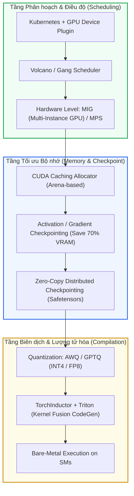
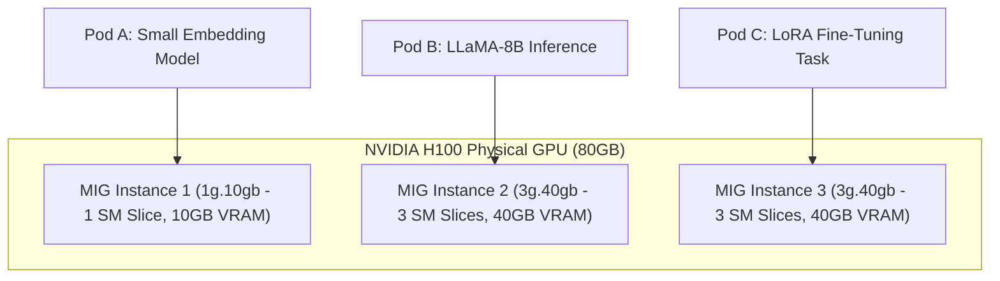
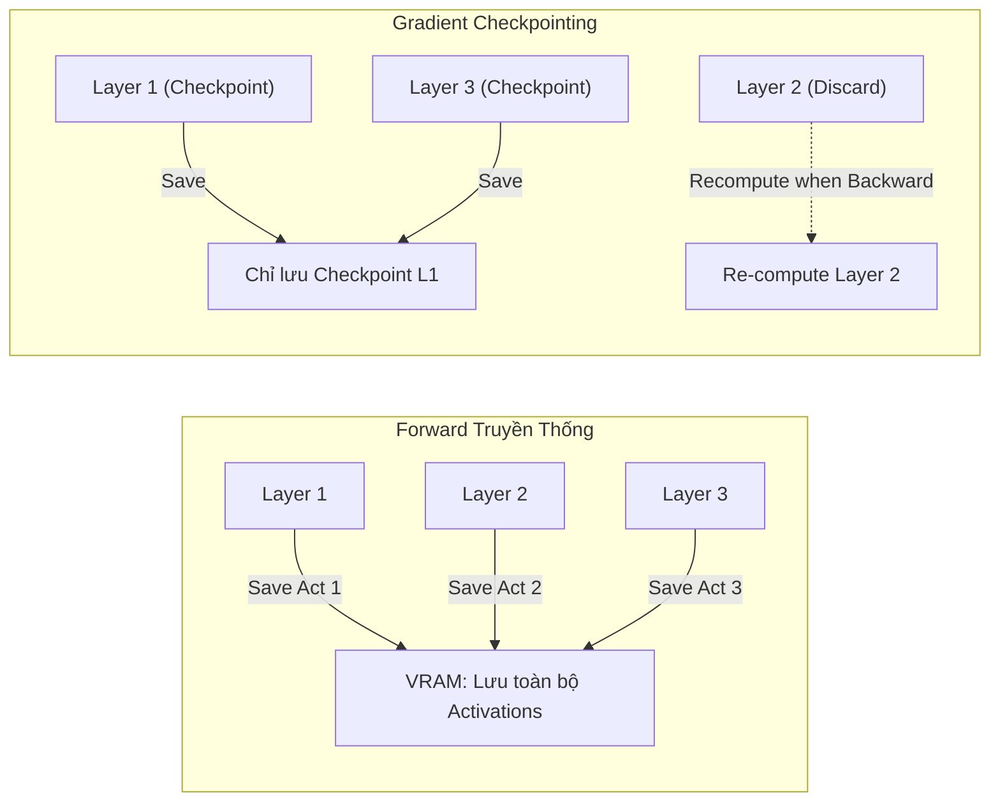
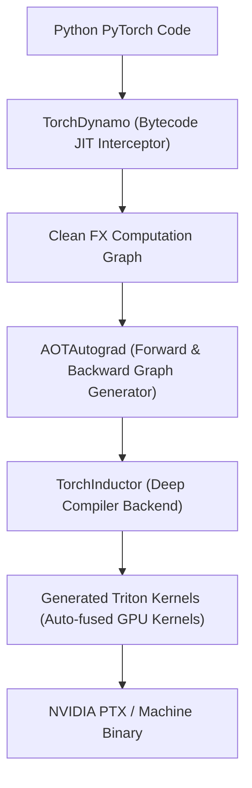

# 2.3. GPU Resource Management, Sharding, Checkpointing & Compilation

## Tổng quan về Quản lý Tài nguyên GPU và Tối ưu hóa Biên dịch Mô hình
Hạ tầng điện toán GPU trong các trung tâm dữ liệu AI là nguồn tài nguyên có chi phí đầu tư và vận hành cực kỳ đắt đỏ. Một cụm máy chủ 8x NVIDIA H100 tiêu tốn hàng trăm nghìn USD cùng mức tiêu thụ điện năng lên tới 10.2 kW mỗi rack. Do đó, bài toán kỹ thuật cốt lõi của Backend/AI Infrastructure Engineer là **tối đa hóa hiệu suất sử dụng GPU (GPU Utilization > 85%)** và **ngăn chặn rủi ro cạn kiệt bộ nhớ VRAM (Out-Of-Memory - OOM)**.

Về mặt kiến trúc hệ thống, điều này đạt được nhờ 3 trụ cột kỹ thuật:
1. **Phân hoạch và Điều độ tài nguyên (GPU Scheduling & Virtualization)**: Ảo hóa GPU vật lý thành các phân vùng cô lập bằng **MIG (Multi-Instance GPU)** hoặc chia sẻ luồng thời gian qua **MPS (Multi-Process Service)**.
2. **Quản lý bộ nhớ và Điểm kiểm soát (Memory Management & Checkpointing)**: Tái tính toán kích hoạt (**Activation Recomputation / Gradient Checkpointing**) để đánh đổi năng lực tính toán lấy dung lượng bộ nhớ.
3. **Biên dịch mô hình hạ tầng sâu (Model Compilation & Triton)**: Chuyển đổi mã Python/PyTorch cấp cao thành các GPU kernel máy tối ưu thông qua **TorchDynamo**, **TorchInductor** và ngôn ngữ **OpenAI Triton**.



---

## 2. Chi tiết từng Keyword (Under-the-Hood Deep Dive)

---

### 1. GPU Scheduling, Resource Management & Memory Management

#### 1. Khái niệm bản chất (What & Why)
- **GPU Scheduling**: Cơ chế phân phối và gán tác vụ (Jobs/Pod) vào các thiết bị GPU vật lý trong cụm phân tán nhằm tránh tranh chấp tài nguyên và giảm thiểu hiện tượng phân mảnh GPU.
- **GPU Resource Management**:
  - *Time-Slicing*: Chia sẻ GPU theo thời gian giữa nhiều tiến trình. Dễ bị ảnh hưởng tiêu cực bởi hiện tượng "hàng xóm ồn ào" (Noisy Neighbor) và không đảm bảo QoS.
  - *MPS (Multi-Process Service)*: Cho phép nhiều tiến trình CUDA chạy đồng thời trên cùng một GPU, gộp các luồng lại vào chung một ngữ cảnh phần cứng để tăng độ chiếm dụng SM.
  - *MIG (Multi-Instance GPU)*: Tính năng phần cứng trên NVIDIA A100/H100, chia tách 1 GPU vật lý thành tối đa 7 thực thể GPU độc lập hoàn toàn ở cấp độ phần cứng (Hardware-level isolation về nhân SM, bộ nhớ đệm L2, và băng thông VRAM).
- **GPU Memory Management**: Quản lý việc cấp phát và giải phóng các khối nhớ trong VRAM thông qua CUDA runtime API (`cudaMalloc`, `cudaFree`).

#### 2. Cơ chế hoạt động sâu (Under the hood / Hardcore Internals)
- **Cơ chế CUDA Caching Allocator (Arena Allocator)**:
  Lệnh gọi `cudaMalloc` của hệ điều hành là một tác vụ đồng bộ hóa phần cứng cực kỳ chậm chạp (Độ trễ hàng chục micro-giây và yêu cầu khóa driver).
  Để giải quyết vấn đề này, các framework như PyTorch hoặc vLLM cài đặt một **Caching Allocator**:
  - Khi khởi động, nó xin cấp phát trước các khối nhớ khổng lồ (**Memory Pools / Arenas**) từ GPU driver.
  - Các yêu cầu cấp phát tensor sau đó được xử lý hoàn toàn trong User-space thông qua các thuật toán Best-Fit hoặc Segregated Free Lists mà không cần gọi xuống GPU driver.
  - *Vấn đề phân mảnh bộ nhớ (External Memory Fragmentation)*: Do các tensor có vòng đời và kích thước khác nhau liên tục được cấp phát và giải phóng, bộ nhớ bị phân mảnh thành nhiều mảnh nhỏ. Dù tổng dung lượng trống còn nhiều, hệ thống vẫn ném lỗi `CUDA OOM` vì không tìm được một dải nhớ liên tục (Contiguous Memory Block) đủ lớn.

#### 3. Sơ đồ minh họa


#### 4. Code ví dụ thực chiến (C++ CUDA Stream-Ordered Async Allocator)
Đoạn mã C++20 sử dụng giao diện hiện đại `cudaMallocAsync` (bộ cấp phát bộ nhớ theo luồng phi đồng bộ ra mắt từ CUDA 11.2) để loại bỏ chi phí đồng bộ hóa máy chủ:

```cpp
#include <iostream>
#include <cuda_runtime.h>

void test_async_memory_allocation() {
    cudaStream_t stream;
    cudaStreamCreate(&stream);

    size_t size = 1024 * 1024 * sizeof(float); // 4MB
    float* d_ptr = nullptr;

    // Cấp phát bộ nhớ phi đồng bộ trực tiếp gắn với CUDA Stream (Stream-Ordered Allocation)
    cudaError_t err = cudaMallocAsync(reinterpret_cast<void**>(&d_ptr), size, stream);
    if (err != cudaSuccess) {
        std::cerr << "cudaMallocAsync failed: " << cudaGetErrorString(err) << "\n";
        return;
    }

    // Thực thi các kernel trên stream này...
    
    // Giải phóng phi đồng bộ: Khối nhớ sẽ tự động được thu hồi vào Pool khi các lệnh trước đó trên stream hoàn thành
    cudaFreeAsync(d_ptr, stream);

    cudaStreamSynchronize(stream);
    cudaStreamDestroy(stream);
    std::cout << "[CUDA Async Mem] Successfully allocated and freed memory pool without CPU blocking.\n";
}

int main() {
    test_async_memory_allocation();
    return 0;
}
```

#### 5. Ưu / Nhược điểm, Pitfalls & Anti-patterns
- **Memory Leak do tham chiếu Python giữ ngầm Tensor**: Trong các microservices AI viết bằng Python, việc lưu một tensor vào danh sách toàn cục hoặc trong traceback của Exception sẽ khiến Caching Allocator không thể thu hồi vùng nhớ VRAM đó, dẫn đến rò rỉ bộ nhớ dần dần qua từng request.

#### 6. Ứng dụng thực tế trong Backend / Systems
- Thiết lập cụm Kubernetes sử dụng **NVIDIA GPU Operator** và **Karpenter** để tự động cấp phát và thu hồi các máy chủ GPU Spot Instances theo nhu cầu thực tế.

---

### 2. Model Sharding & Model Checkpointing

#### 1. Khái niệm bản chất (What & Why)
- **Model Sharding**: Phân chia các tầng trọng số của một mô hình thành nhiều mảnh độc lập (Shards) lưu trữ trên các ổ đĩa phân tán hoặc các nút mạng khác nhau.
- **Model Checkpointing**: Quá trình tuần tự hóa và lưu trạng thái trọng số, trạng thái bộ tối ưu (Optimizer States), và siêu tham số huấn luyện xuống bộ lưu trữ bền vững (NVMe SSD, S3/GCS Object Storage) theo định kỳ.
- **Activation Checkpointing (Gradient Checkpointing)**: Kỹ thuật tối ưu bộ nhớ trong quá trình huấn luyện: Thay vì lưu giữ toàn bộ các giá trị kích hoạt (Activations) của tất cả các lớp trong Forward Pass để phục vụ Backward Pass, hệ thống chỉ lưu giữ một số điểm kiểm soát (Checkpoints). Khi thực hiện Backward Pass, hệ thống sẽ tính toán lại (Recompute) các kích hoạt của các lớp ở giữa.

#### 2. Cơ chế hoạt động sâu (Under the hood / Hardcore Internals)
- **Đánh đổi Kỹ thuật trong Gradient Checkpointing**:
  - Tiết kiệm bộ nhớ: Giảm dung lượng VRAM cho Activations từ $\mathcal{O}(N)$ xuống $\mathcal{O}(\sqrt{N})$.
  - Chi phí: Phải thực hiện Forward Pass thêm một lần nữa cho mỗi khối, làm tăng khoảng 20% đến 30% thời gian tính toán của chu kỳ huấn luyện. Tuy nhiên, điều này cho phép tăng gấp 4 lần kích thước Batch Size hoặc tăng gấp 4 lần chiều dài chuỗi Context.
- **Định dạng Checkpoint Hiện đại (Safetensors vs PyTorch Pickle)**:
  - *PyTorch `.pt` / `.bin`*: Sử dụng thư viện `pickle` của Python. Chứa rủi ro an ninh nghiêm trọng (Lỗ hổng thực thi mã từ xa - Arbitrary Code Execution) và yêu cầu nạp toàn bộ file vào RAM rồi mới copy sang GPU.
  - *Safetensors (Hugging Face / Rust)*: Sử dụng định dạng nhị phân thuần túy không thể thực thi mã độc. Hỗ trợ cơ chế **Zero-Copy Memory-Mapping (`mmap`)**: Trọng số được nạp trực tiếp từ NVMe SSD vào VRAM GPU thông qua Direct I/O mà không cần qua tầng đệm trung gian của CPU RAM, tăng tốc độ nạp mô hình gấp 5-10 lần.

#### 3. Sơ đồ minh họa


#### 4. Code ví dụ thực chiến (C++ Memory-Mapped Safetensors Header Parser Stub)
```cpp
#include <iostream>
#include <fstream>
#include <string>
#include <cstdint>

// Đoạn mã minh họa việc đọc tiêu đề 8-byte N của định dạng Safetensors
void inspect_safetensors_header(const std::string& filepath) {
    std::ifstream file(filepath, std::ios::binary);
    if (!file.is_open()) {
        std::cout << "[Safetensors] Demo file not found, displaying spec logic.\n";
        return;
    }

    uint64_t header_size = 0;
    // 8 bytes đầu tiên của file safetensors là một số nguyên unsigned 64-bit chỉ độ dài JSON header
    file.read(reinterpret_cast<char*>(&header_size), sizeof(header_size));

    std::string header_json(header_size, ' ');
    file.read(&header_json[0], header_size);

    std::cout << "Safetensors Header Size: " << header_size << " bytes\n";
    std::cout << "Header Metadata JSON: " << header_json.substr(0, 100) << "...\n";
}

int main() {
    inspect_safetensors_header("model.safetensors");
    return 0;
}
```

#### 5. Ưu / Nhược điểm, Pitfalls & Anti-patterns
- **Checkpointing I/O Stalls**: Lưu checkpoint mô hình 70B (hơn 140GB) qua mạng NFS truyền thống sẽ làm "đóng băng" (Stall) toàn bộ cụm huấn luyện trong vài chục phút. Cần sử dụng Asynchronous Checkpointing và mạng lưu trữ phân tán hiệu năng cao (như Lustre, GPFS).

#### 6. Ứng dụng thực tế trong Backend / Systems
- Hệ thống tự động lưu và phục hồi trạng thái huấn luyện khi phát sinh sự cố hỏng hóc phần cứng (Node Failure & Automatic Job Resumption) trên các cụm GPU lớn.

---

### 3. Model Quantization & Model Compilation (PTQ, QAT, AWQ, Triton)

#### 1. Khái niệm bản chất (What & Why)
- **Model Quantization**: Chuyển đổi định dạng số học của trọng số và giá trị kích hoạt từ độ chính xác cao (FP32, BF16, FP16) sang độ chính xác thấp hơn (FP8, INT8, INT4).
  - *PTQ (Post-Training Quantization)*: Lượng tử hóa trực tiếp mô hình đã huấn luyện hoàn chỉnh mà không cần chạy lại quy trình đào tạo.
  - *QAT (Quantization-Aware Training)*: Mô phỏng nhiễu lượng tử hóa ngay trong quá trình huấn luyện để mạng nơ-ron tự điều chỉnh thích nghi với độ phân giải thấp.
  - *AWQ (Activation-aware Weight Quantization)*: Nhận định rằng chỉ có 1% trọng số tương ứng với các giá trị kích hoạt lớn là tối quan trọng; AWQ bảo vệ 1% trọng số này ở độ chính xác cao và chỉ lượng tử hóa 99% trọng số còn lại.
- **Model Compilation**: Quá trình phân tích đồ thị tính toán nơ-ron tĩnh hoặc động, tự động thực hiện các phép biến đổi tối ưu hóa, và sinh mã máy (Code Generation) trực tiếp cho GPU mà không cần thông qua trình thông dịch Python.

#### 2. Cơ chế hoạt động sâu (Under the hood / Hardcore Internals)
- **Kiến trúc PyTorch 2.0 Compiler Stack**:
  - **TorchDynamo**: Sử dụng CPython Frame Evaluation API để chặn và phân tích bytecode Python tại thời điểm chạy (Just-in-time), trích xuất các đồ thị tính toán PyTorch sạch (FX Graphs) trong khi vẫn duy trì tính tương thích hoàn toàn với mã Python động.
  - **AOTAutograd**: Tự động dò vết và tạo đồ thị cho cả hai chiều Forward và Backward trước khi thực thi.
  - **TorchInductor**: Backend sinh mã chính, nhận đồ thị FX và tự động sinh ra mã kernel **OpenAI Triton** tối ưu hóa cao độ cho GPU NVIDIA hoặc C++ OpenMP cho CPU.
- **OpenAI Triton Language**:
  Triton cho phép lập trình viên viết các GPU kernel hiệu năng ngang ngửa CUDA C++ thuần túy nhưng với mức độ trừu tượng hóa cao hơn. Triton tự động xử lý việc đồng bộ hóa nội bộ block, tối ưu hóa phân bổ Shared Memory, và tự động vector hóa dữ liệu để tương thích với Tensor Cores.

#### 3. Sơ đồ minh họa


#### 4. Code ví dụ thực chiến (C++ Symmetric INT8 Quantization Mapping)
Đoạn mã C++20 thực hiện phép lượng tử hóa đối xứng ánh xạ số thực sang số nguyên 8-bit INT8:

```cpp
#include <iostream>
#include <vector>
#include <cmath>
#include <algorithm>
#include <cstdint>

struct QuantizedTensor {
    std::vector<int8_t> qdata;
    float scale;
};

// Lượng tử hóa đối xứng: q = clip(round(x / scale), -127, 127)
QuantizedTensor quantize_symmetric_int8(const std::vector<float>& x) {
    float max_abs = 0.0f;
    for (float val : x) {
        max_abs = std::max(max_abs, std::abs(val));
    }

    float scale = max_abs / 127.0f;
    QuantizedTensor result;
    result.scale = scale;
    result.qdata.resize(x.size());

    float inv_scale = (scale > 1e-9f) ? (1.0f / scale) : 1.0f;

    for (size_t i = 0; i < x.size(); ++i) {
        float q = std::round(x[i] * inv_scale);
        q = std::clamp(q, -127.0f, 127.0f);
        result.qdata[i] = static_cast<int8_t>(q);
    }
    return result;
}

int main() {
    std::vector<float> weights = {-3.5f, -0.2f, 0.0f, 1.8f, 3.5f};
    auto q = quantize_symmetric_int8(weights);

    std::cout << "Scale Factor: " << q.scale << "\n";
    std::cout << "INT8 Values: ";
    for (auto val : q.qdata) std::cout << static_cast<int>(val) << " ";
    std::cout << "\n";
    return 0;
}
```

#### 5. Ưu / Nhược điểm, Pitfalls & Anti-patterns
- **Dynamic Shapes Compilation Overhead**: Khi kích thước batch hoặc chiều dài token thay đổi liên tục giữa các request, trình biên dịch có thể bị rơi vào tình trạng liên tục tái biên dịch đồ thị (Graph Re-compilation), gây nghẽn hệ thống ở giai đoạn khởi động (JIT Warm-up Latency).

#### 6. Ứng dụng thực tế trong Backend / Systems
- Đóng gói mô hình nơ-ron thành engine biên dịch nhúng trong các thiết bị Autonomous Edge Robots hoặc Gateway thanh toán trực tuyến.
