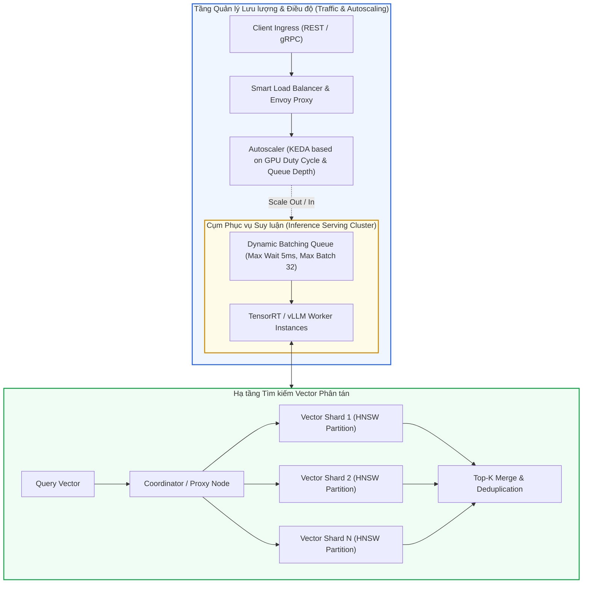
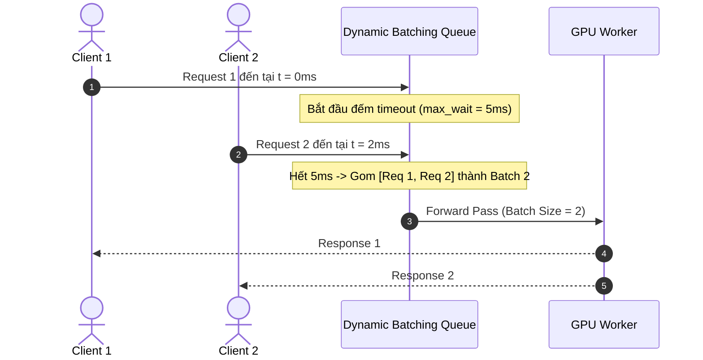
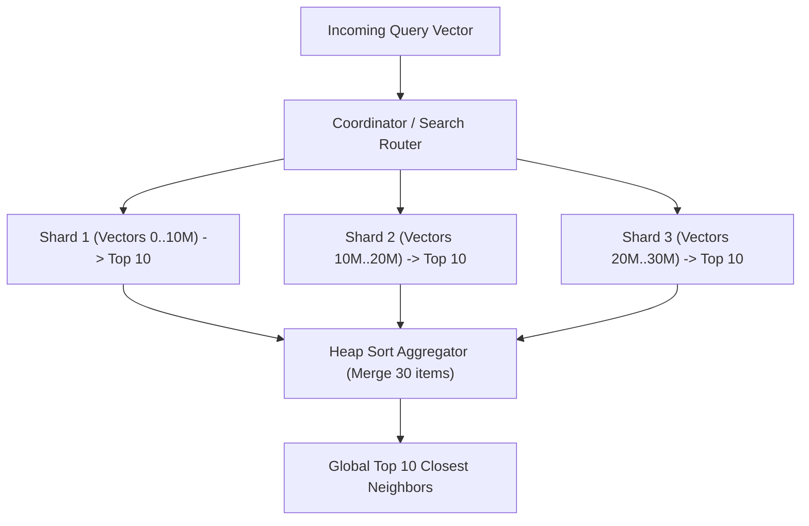
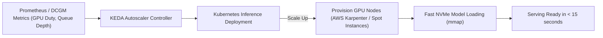

# 2.4. Inference Serving, Vector Search Infrastructure & Capacity Optimization

## Tổng quan về Hạ tầng Phục vụ Suy luận, Tìm kiếm Vector và Tối ưu Hóa Dung lượng
Trong việc xây dựng các hệ thống AI cấp quy mô sản xuất (Production-Scale AI Systems), bài toán kỹ thuật không chỉ dừng lại ở độ chính xác của mô hình học máy mà chuyển trọng tâm sang **Hiệu năng Vận hành Hạ tầng (Infrastructure Operational Efficiency)**. Một hệ thống phục vụ suy luận phải giải quyết đồng thời bài toán tam giác đánh đổi (Trilemma): **Độ trễ thấp (Low Latency < 50ms)**, **Thông lượng cao (High Throughput > 10,000 QPS)**, và **Tối ưu chi phí hạ tầng (Cost Optimization)**.

Hạ tầng suy luận hiện đại bao gồm hai thành phần tính toán cốt lõi:
1. **Động cơ Phục vụ Suy luận và Ghép lô Động (Dynamic & Continuous Batching Engines)**: Tối ưu hóa việc tận dụng năng lực tính toán của GPU bằng cách gom cụm các yêu cầu độc lập theo thời gian thực.
2. **Hạ tầng Tìm kiếm Vector Phân tán (Distributed Vector Search Infrastructure)**: Lưu trữ và định tuyến hàng tỷ vector nhúng với độ trễ phản hồi phần nghìn giây.



---

## 2. Chi tiết từng Keyword (Under-the-Hood Deep Dive)

---

### 1. Inference Batching: Static, Dynamic & Continuous Batching

#### 1. Khái niệm bản chất (What & Why)
- **Inference Batching**: Kỹ thuật gom nhiều yêu cầu suy luận độc lập từ các người dùng khác nhau vào một ma trận tensor duy nhất để nạp vào GPU cùng một lúc.
- **Tại sao cần Batching**: Phép toán suy luận trên GPU bị giới hạn bởi tốc độ nạp trọng số từ VRAM (Memory Bandwidth Bound). Khi tăng kích thước Batch Size từ 1 lên 32, GPU chỉ cần nạp ma trận trọng số mô hình một lần duy nhất từ VRAM nhưng có thể tính toán cho 32 yêu cầu đồng thời, tăng thông lượng hệ thống (Throughput) lên gấp hàng chục lần với mức chi phí tài nguyên tương đương.
- **Dynamic Batching**: Cơ chế hàng đợi tự động gom các request đến rải rác trong một khoảng thời gian chờ cho phép (ví dụ `max_queue_delay_microseconds = 5000`) thành một batch trước khi gửi xuống GPU.

#### 2. Cơ chế hoạt động sâu (Under the hood / Hardcore Internals)
- **So sánh 3 Chiến lược Ghép Lô**:
  1. *Static Batching*: Chờ đủ số lượng request cố định (ví dụ $B = 32$) mới chạy. Gây độ trễ kinh hoàng (Latency tail) khi lưu lượng thấp vì request đầu tiên phải chờ request thứ 32 xuất hiện.
  2. *Dynamic Batching (Triton Inference Server)*: Sử dụng thuật toán đồng hồ đo thời gian (Timeout Timer): Batch được kích hoạt ngay khi: Đủ kích thước `max_batch_size` HOẶC Hết thời gian chờ `max_queue_delay`.
  3. *Continuous Batching*: Ghép lô ở cấp độ từng bước giải mã token (Token-level iteration), loại bỏ hoàn toàn padding thừa thãi khi các câu có độ dài văn bản chênh lệch lớn.

#### 3. Sơ đồ minh họa


#### 4. Code ví dụ thực chiến (C++ Lock-Free Dynamic Batching Queue Engine)
Đoạn mã C++20 xây dựng bộ điều phối Dynamic Batcher với thời gian chờ giới hạn bảo vệ SLA:

```cpp
#include <iostream>
#include <vector>
#include <chrono>
#include <thread>
#include <mutex>
#include <condition_variable>

struct InferenceRequest {
    int id;
    std::vector<float> input_tensor;
};

class DynamicBatcher {
private:
    std::vector<InferenceRequest> queue_;
    std::mutex mtx_;
    std::condition_variable cv_;
    size_t max_batch_size_;
    std::chrono::milliseconds max_wait_;
    bool running_ = true;

public:
    DynamicBatcher(size_t max_batch, std::chrono::milliseconds max_wait)
        : max_batch_size_(max_batch), max_wait_(max_wait) {}

    void enqueue(InferenceRequest req) {
        std::lock_guard<std::mutex> lock(mtx_);
        queue_.push_back(std::move(req));
        if (queue_.size() >= max_batch_size_) {
            cv_.notify_one();
        }
    }

    std::vector<InferenceRequest> get_batch() {
        std::unique_lock<std::mutex> lock(mtx_);
        // Chờ cho đến khi đủ batch hoặc hết thời gian timeout
        cv_.wait_for(lock, max_wait_, [this]() {
            return queue_.size() >= max_batch_size_ || !running_;
        });

        if (queue_.empty()) return {};

        size_t batch_count = std::min(queue_.size(), max_batch_size_);
        std::vector<InferenceRequest> batch(
            std::make_move_iterator(queue_.begin()),
            std::make_move_iterator(queue_.begin() + batch_count)
        );
        queue_.erase(queue_.begin(), queue_.begin() + batch_count);
        return batch;
    }

    void shutdown() {
        {
            std::lock_guard<std::mutex> lock(mtx_);
            running_ = false;
        }
        cv_.notify_all();
    }
};

int main() {
    DynamicBatcher batcher(4 /* max 4 */, std::chrono::milliseconds(10) /* max wait 10ms */);

    // Đẩy 2 request
    batcher.enqueue({1, {0.1f, 0.2f}});
    batcher.enqueue({2, {0.3f, 0.4f}});

    // Lấy batch sau khi timeout kích hoạt
    auto batch = batcher.get_batch();
    std::cout << "[Batcher] Dispatched batch of size: " << batch.size() << " to GPU execution.\n";
    batcher.shutdown();
    return 0;
}
```

#### 5. Ưu / Nhược điểm, Pitfalls & Anti-patterns
- **Head-of-Line Blocking**: Trong Dynamic Batching truyền thống, nếu một request trong batch yêu cầu độ dài xử lý quá dài, tất cả các request ngắn hơn đi chung batch đó đều bị giữ lại không thể trả về cho client.

#### 6. Ứng dụng thực tế trong Backend / Systems
- Cấu hình hạ tầng **Triton Inference Server** của NVIDIA phục vụ nhận diện khuôn mặt và phát hiện biển số xe thời gian thực.

---

### 2. Embedding Serving & Vector Search Infrastructure

#### 1. Khái niệm bản chất (What & Why)
- **Embedding Serving**: Các dịch vụ Backend chuyên biệt hóa cho việc nhận văn bản thô và trả về vector đặc trưng (Dense Vector) với độ trễ siêu thấp (<5ms). Thường sử dụng các mô hình nhỏ (như BERT-base, BGE-small) được tối ưu hóa bằng TensorRT/ONNX.
- **Vector Search Infrastructure**: Cụm hạ tầng phân tán chịu trách nhiệm lưu trữ, lập chỉ mục và thực hiện tìm kiếm láng giềng gần đúng (**Approximate Nearest Neighbor - ANN**) trên quy mô hàng trăm triệu đến hàng tỷ vector. Tiêu biểu: Milvus Distributed Cluster, Qdrant Distributed, Vespa.

#### 2. Cơ chế hoạt động sâu (Under the hood / Hardcore Internals)
- **Kiến trúc Phân vùng Cụm Vector (Vector Sharding Strategies)**:
  - *Document-ID Sharding*: Vector được phân tán ngẫu nhiên hoặc băm theo Khóa chính (Hash of DocID) trên $K$ phân vùng (Shards). Khi truy vấn, Coordinator Node phải thực hiện **Scatter-Gather** (Gửi truy vấn tới toàn bộ $K$ shard, mỗi shard trả về Top-N, sau đó Coordinator gộp lại và sắp xếp lại). Dễ mở rộng dung lượng ghi nhưng tốn CPU của toàn cụm cho mỗi truy vấn đọc.
  - *Centroid / Cluster-based Sharding*: Sử dụng thuật toán phân cụm K-Means để chia không gian vector thành các cụm lớn. Mỗi Shard lưu trữ một cụm không gian. Khi truy vấn, Coordinator chỉ cần gửi yêu cầu tới 1-2 shard gần nhất với vector truy vấn, giảm 90% tải tính toán của cụm.
- **SIMD Distance Optimization**:
  Các phép toán tính khoảng cách Euclidean ($L_2$) hoặc Inner Product trên vector 768 chiều được tính toán bằng các tập chỉ lệnh CPU **AVX-512** (chạy song song 16 số thực float32 trong một chu kỳ CPU) hoặc **ARM NEON**.

#### 3. Sơ đồ minh họa


#### 4. Code ví dụ thực chiến (C++ Min-Heap Top-K Similarity Collector)
Đoạn mã C++20 sử dụng cấu trúc Min-Heap để trích xuất Top-K kết quả gần nhất với độ phức tạp bộ nhớ tối ưu $\mathcal{O}(K)$:

```cpp
#include <iostream>
#include <vector>
#include <queue>

struct Candidate {
    int doc_id;
    float score;

    // So sánh để duy trì Min-Heap theo điểm số
    bool operator>(const Candidate& other) const noexcept {
        return score > other.score;
    }
};

class TopKCollector {
private:
    size_t k_;
    std::priority_queue<Candidate, std::vector<Candidate>, std::greater<Candidate>> min_heap_;

public:
    explicit TopKCollector(size_t k) : k_(k) {}

    void add(int doc_id, float score) {
        if (min_heap_.size() < k_) {
            min_heap_.push({doc_id, score});
        } else if (score > min_heap_.top().score) {
            min_heap_.pop();
            min_heap_.push({doc_id, score});
        }
    }

    std::vector<Candidate> get_results() {
        std::vector<Candidate> results;
        while (!min_heap_.empty()) {
            results.push_back(min_heap_.top());
            min_heap_.pop();
        }
        return results;
    }
};

int main() {
    TopKCollector collector(3); // Giữ Top 3
    collector.add(101, 0.82f);
    collector.add(102, 0.95f);
    collector.add(103, 0.61f);
    collector.add(104, 0.89f);

    auto top_items = collector.get_results();
    std::cout << "Top K Elements Collected:\n";
    for (const auto& item : top_items) {
        std::cout << "DocID: " << item.doc_id << " (Score: " << item.score << ")\n";
    }
    return 0;
}
```

#### 5. Ưu / Nhược điểm, Pitfalls & Anti-patterns
- **RAM Explosion during HNSW Build**: Xây dựng đồ thị chỉ mục HNSW trên hàng chục triệu vector đòi hỏi lượng RAM cực lớn (thường gấp 1.5 - 2 lần dung lượng vector gốc do các con trỏ liên kết cạnh đồ thị). Cần áp dụng On-Disk Indexing (như DiskANN) nếu dung lượng RAM hạn chế.

#### 6. Ứng dụng thực tế trong Backend / Systems
- Hệ thống cá nhân hóa tin tức và bảng tin (Feed Recommendation Engine) phục vụ hàng triệu người dùng hoạt động đồng thời.

---

### 3. AI Workload Scheduling, Autoscaling & Cost Optimization

#### 1. Khái niệm bản chất (What & Why)
- **AI Workload Scheduling**: Điều phối các tiến trình suy luận và huấn luyện trên cụm máy chủ hỗn hợp (Heterogeneous Cluster gồm nhiều loại GPU: T4, A10G, A100, H100).
- **AI Infrastructure Autoscaling**: Tự động tăng/giảm số lượng GPU Worker Pods dựa trên nhu cầu thực tế của người dùng.
- **Tại sao CPU/Memory HPA truyền thống thất bại**: Các hệ thống Autoscaler Kubernetes truyền thống (dựa trên CPU hoặc Memory %) hoàn toàn vô dụng với GPU. Một GPU có thể đang chạy 100% compute nhưng hàng đợi request vẫn trống rỗng (do một request đơn lẻ chiếm dụng), hoặc ngược lại hàng đợi request đang ứ đọng hàng nghìn tin nhắn trong khi GPU utilization báo cáo mức thấp. Cần sử dụng các chỉ số chuyên biệt: **Queue Length**, **Pending Inference Requests**, và **Time to First Token (TTFT) P99**.
- **AI Cost Optimization**: Tối đa hóa tỷ lệ hiệu năng trên mỗi đồng chi phí (Tokens per Dollar) thông qua việc kết hợp GPU Spot Instances, mô hình kích thước động và tối ưu hóa hạ tầng.

#### 2. Cơ chế hoạt động sâu (Under the hood / Hardcore Internals)
- **KEDA (Kubernetes Event-driven Autoscaling) for AI**:
  KEDA lắng nghe các chỉ số từ Prometheus hoặc hàng đợi thông điệp (Kafka, RabbitMQ, hoặc custom inference metrics server):
  $$\text{Desired Replicas} = \left\lceil \frac{\text{Current Queue Depth}}{\text{Target Queue Length Per Worker}} \right\rceil$$
- **Cold-Start Latency Mitigation**:
  Thời gian khởi động một GPU Pod chứa mô hình lớn rất lâu (có thể mất 3-5 phút để kéo image Docker 20GB và nạp 140GB trọng số từ ổ đĩa vào VRAM). Các kỹ thuật giảm thiểu:
  - *Warm Pools / Pre-warmed Standby Replicas*: Giữ một số lượng node đệm tối thiểu.
  - *Fast Container Image Loading*: Dùng **Starlight** hoặc **eStargz** để tải lười (Lazy-pulling) container layers.
  - *Persistent Volume Caching*: Giữ sẵn file trọng số mô hình trên NVMe SSD cục bộ của Host để bỏ qua việc tải từ S3.

#### 3. Sơ đồ minh họa


#### 4. Code ví dụ thực chiến (TypeScript Autoscaling Metric Policy Evaluator)
```typescript
interface ClusterMetrics {
  currentReplicas: number;
  totalPendingRequests: number;
  targetRequestsPerReplica: number;
  avgTtftMs: number;
  slaMaxTtftMs: number;
}

class AIScalingPolicyEngine {
  public static calculateTargetReplicas(metrics: ClusterMetrics, minReplicas = 1, maxReplicas = 20): number {
    // 1. Tính toán dựa trên dung lượng hàng đợi
    let desired = Math.ceil(metrics.totalPendingRequests / metrics.targetRequestsPerReplica);

    // 2. Nếu độ trễ P99 TTFT vượt ngưỡng SLA cho phép, cưỡng chế tăng thêm 25% pods
    if (metrics.avgTtftMs > metrics.slaMaxTtftMs) {
      console.warn(`[Autoscaler] SLA Breached! TTFT is ${metrics.avgTtftMs}ms (Max: ${metrics.slaMaxTtftMs}ms). Emergency scaling.`);
      desired = Math.max(desired, Math.ceil(metrics.currentReplicas * 1.25));
    }

    // 3. Giới hạn trong khoảng an toàn (Clamping)
    const finalReplicas = Math.min(Math.max(desired, minReplicas), maxReplicas);
    console.log(`[Autoscaler] Current: ${metrics.currentReplicas} -> Target Replicas: ${finalReplicas}`);
    return finalReplicas;
  }
}

// Test policy
const metrics: ClusterMetrics = {
  currentReplicas: 4,
  totalPendingRequests: 120,
  targetRequestsPerReplica: 15,
  avgTtftMs: 450.0,
  slaMaxTtftMs: 300.0 // Bị vi phạm SLA
};

AIScalingPolicyEngine.calculateTargetReplicas(metrics);
```

#### 5. Ưu / Nhược điểm, Pitfalls & Anti-patterns
- **Throttling Trashing (Dao động co giãn liên tục)**: Cấu hình thời gian làm nguội (Cooldown / Scale-down Stabilization Window) quá ngắn sẽ khiến hệ thống liên tục tắt/bật Pod GPU, gây lãng phí chi phí khởi động và làm đứt đoạn các request đang xử lý.

#### 6. Ứng dụng thực tế trong Backend / Systems
- Hệ thống quản lý hạ tầng GPU đa đám mây (Multi-Cloud GPU Fleet) giúp tiết kiệm hàng triệu USD chi phí Cloud mỗi năm cho các công ty khởi nghiệp AI.
