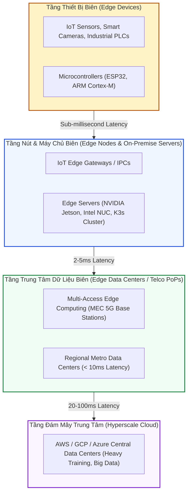
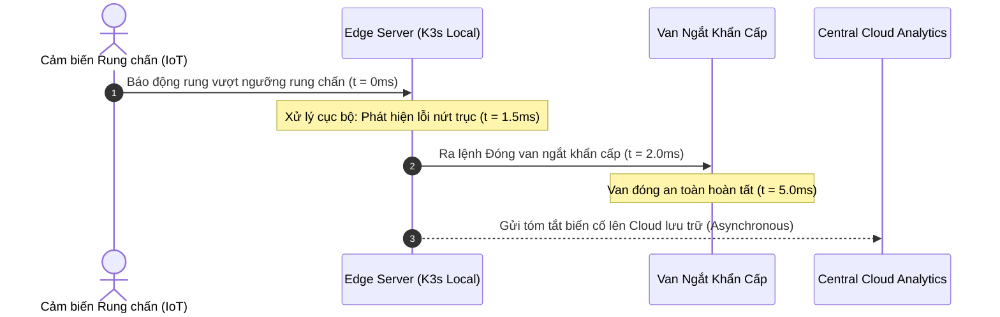
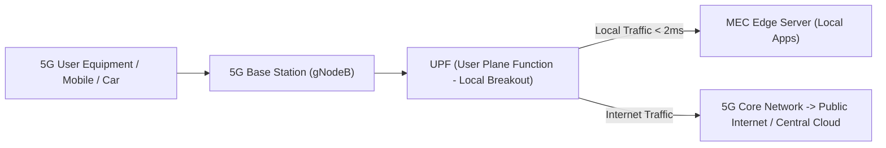
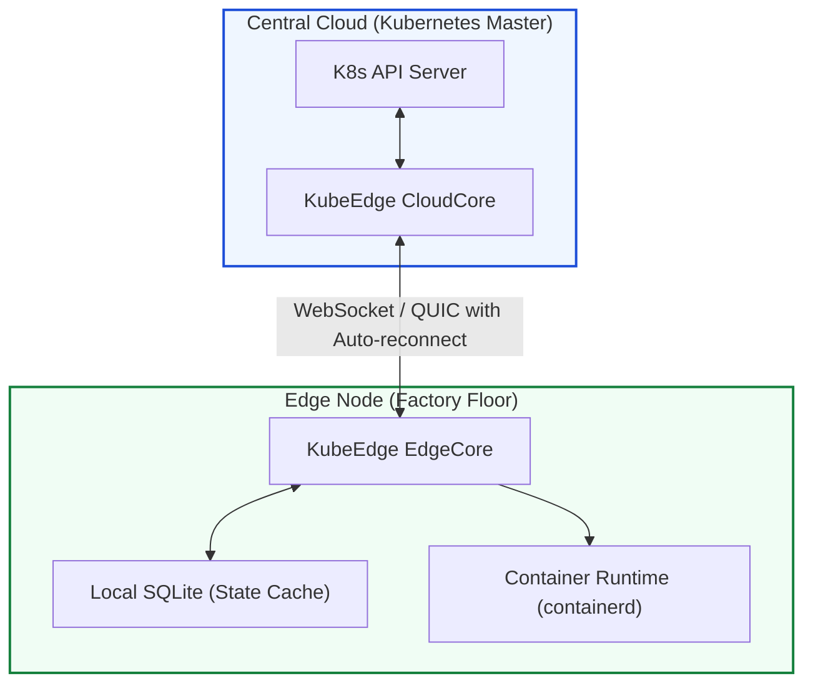

# 3.1. Edge Computing Fundamentals, Architecture & Edge-Cloud Collaboration

## Tổng quan về Điện toán Biên và Kiến trúc Liên tục Biên - Mây
Trong mô hình điện toán đám mây tập trung truyền thống (Centralized Cloud Computing), toàn bộ dữ liệu sinh ra từ hàng tỷ thiết bị IoT, điện thoại di động và cảm biến công nghiệp đều được truyền ngược về các trung tâm dữ liệu khổng lồ (Hyperscale Cloud Data Centers) để xử lý. Mô hình này đang chạm tới các giới hạn vật lý nghiêm trọng:
1. **Độ trễ truyền dẫn (Propagation Latency)**: Tốc độ ánh sáng trong sợi quang học ($\sim 200,000\text{ km/s}$) khiến việc truyền gói tin hai chiều qua hàng ngàn kilomet tiêu tốn hàng chục đến hàng trăm mili-giây, không thể đáp ứng các bài toán thời gian thực như xe tự hành (Autonomous Vehicles), phẫu thuật từ xa hoặc robot công nghiệp.
2. **Chi phí và tắc nghẽn băng thông mạng (Bandwidth Saturation)**: Việc đẩy hàng Petabyte video thô lên Cloud mỗi ngày gây tắc nghẽn hạ tầng viễn thông và phát sinh chi phí truyền dữ liệu (Egress Bandwidth Cost) khổng lồ.
3. **Quyền riêng tư và chủ quyền dữ liệu (Data Sovereignty)**: Dữ liệu y tế và an ninh quốc gia bị hạn chế di chuyển ra khỏi phạm vi cục bộ.

**Điện toán Biên (Edge Computing)** giải quyết triệt để vấn đề này bằng cách đưa năng lực tính toán (Compute), lưu trữ (Storage) và mạng (Networking) về gần nhất có thể với nơi dữ liệu được tạo ra (Data Generation Source). Toàn bộ hệ thống được nhìn nhận như một dải phổ thống nhất gọi là **Dải liên tục Biên - Mây (Edge-Cloud Continuum)**.



---

## 2. Chi tiết từng Keyword (Under-the-Hood Deep Dive)

---

### 1. Edge Computing Fundamentals & Edge Architecture

#### 1. Khái niệm bản chất (What & Why)
- **Edge Computing Fundamentals**: Mô hình điện toán phân tán đẩy logic xử lý và lưu trữ dữ liệu ra ngoài biên mạng (Periphery of the network), gần với người dùng cuối hoặc nguồn dữ liệu vật lý.
- **Tại sao cần Edge**: Tối ưu hóa "Local Loop" xử lý: Cho phép hệ thống ra quyết định trong thời gian thực dưới 5 mili-giây, hoạt động ổn định ngay cả khi mất kết nối Internet hoàn toàn (Offline Autonomous Operation), và giảm 80-90% băng thông tải lên Cloud bằng cách chỉ gửi lên các siêu dữ liệu hoặc sự kiện bất thường đã qua xử lý.
- **Edge Architecture**: Kiến trúc phân tầng gồm 3 hoặc 4 lớp: Thiết bị biên (Devices) -> Cổng biên (Gateways) -> Máy chủ biên (Edge Servers / MEC) -> Đám mây tập trung (Cloud).

#### 2. Cơ chế hoạt động sâu (Under the hood / Hardcore Internals)
- **Quy tắc phân định Độ trễ (Latency Budget Allocation)**:
  Trong các hệ thống điều khiển công nghiệp (Industrial Control Systems - ICS), ngân sách thời gian được tính toán nghiêm ngặt:
  $$\text{Latency}_{\text{Total}} = \text{Sensor Read} + \text{Local Ingress} + \text{Edge Compute (Inference)} + \text{Actuator Command} < 10\text{ ms}$$
  Nếu đẩy dữ liệu qua mạng WAN lên Cloud, chỉ riêng TCP 3-way handshake và TLS handshake đã tiêu tốn tối thiểu $30\text{ - }60\text{ ms}$, phá vỡ hoàn toàn SLA an toàn thời gian thực.

#### 3. Sơ đồ minh họa


#### 4. Code ví dụ thực chiến (C++ Low-Latency Real-Time Telemetry Ingestion Loop)
Đoạn mã C++20 thiết kế vòng lặp tiếp nhận và phản hồi tín hiệu biên với bộ nhớ cấp phát tĩnh (No Heap Allocations) đảm bảo không bị dừng tiến trình bởi bộ thu dọn rác hay phân mảnh bộ nhớ:

```cpp
#include <iostream>
#include <array>
#include <chrono>

struct TelemetryPacket {
    uint32_t sensor_id;
    float temperature;
    float pressure;
    uint64_t timestamp_ns;
};

class EdgeController {
private:
    float temp_threshold_ = 85.0f; // Ngưỡng cảnh báo độ C
public:
    // Xử lý tức thì không cấp phát động (Zero Allocation Path)
    [[nodiscard]] bool process_packet_fastpath(const TelemetryPacket& packet) noexcept {
        if (packet.temperature > temp_threshold_) {
            // Kích hoạt phản xạ khẩn cấp tại biên
            trigger_local_emergency_stop(packet.sensor_id);
            return true;
        }
        return false;
    }

private:
    void trigger_local_emergency_stop(uint32_t id) noexcept {
        // Giao tiếp trực tiếp với GPIO / Bus phần cứng
        std::cout << "[EDGE FASTPATH] EMERGENCY: Overheat on sensor " << id << "! Actuator Triggered.\n";
    }
};

int main() {
    EdgeController controller;
    TelemetryPacket normal_pkt{101, 72.5f, 1.2f, 1000000000ULL};
    TelemetryPacket critical_pkt{102, 91.2f, 1.8f, 1000005000ULL};

    controller.process_packet_fastpath(normal_pkt);
    controller.process_packet_fastpath(critical_pkt);
    return 0;
}
```

#### 5. Ưu / Nhược điểm, Pitfalls & Anti-patterns
- **Môi trường vật lý khắc nghiệt**: Thiết bị biên thường đặt tại các nhà máy, trạm phát sóng hoặc ngoài trời, chịu nhiệt độ cao, rung lắc, và nguồn điện chập chờn. Không thể áp dụng các giả định về môi trường máy chủ lý tưởng của phòng máy Data Center.

#### 6. Ứng dụng thực tế trong Backend / Systems
- Hệ thống phát hiện sự cố dây chuyền sản xuất tự động hóa trong các nhà máy sản xuất linh kiện bán dẫn.

---

### 2. Edge Nodes, Devices, Servers & Edge Data Centers

#### 1. Khái niệm bản chất (What & Why)
- **Edge Devices**: Các thiết bị phần cứng đầu cuối có năng lực tính toán hạn chế (như cảm biến thông minh, Raspberry Pi, camera IP, vi điều khiển ARM/RISC-V).
- **Edge Servers & Nodes**: Máy chủ vật lý cỡ nhỏ hoặc máy tính công nghiệp (Industrial PC - IPC) đặt ngay tại văn phòng chi nhánh, cửa hàng bán lẻ, hoặc sàn nhà xưởng, sở hữu từ 8 đến 64 cores CPU và có thể gắn kèm GPU nhúng (như NVIDIA Jetson Orin).
- **Edge Data Centers (Trung tâm Dữ liệu Biên)**: Các trung tâm dữ liệu quy mô nhỏ (công suất từ 50kW đến vài trăm kW) đặt tại các trạm chuyển tiếp viễn thông (Cell Towers) hoặc các điểm tập trung Internet (IXP) ở cấp thành phố, cung cấp hạ tầng **MEC (Multi-Access Edge Computing)** trong mạng di động 5G.

#### 2. Cơ chế hoạt động sâu (Under the hood / Hardcore Internals)
- **MEC (Multi-Access Edge Computing) trong kiến trúc 5G**:
  Trong mạng 5G tiêu chuẩn (3GPP Architecture), chức năng mặt phẳng dữ liệu người dùng (**UPF - User Plane Function**) có thể được triển khai trực tiếp tại trạm gốc (gNodeB) ở rìa mạng. Nhờ cơ chế **Local Breakout (LBO)**, lưu lượng của người dùng được tách luồng và định tuyến trực tiếp vào Edge Server nội bộ mà không cần phải đi qua lõi mạng (5G Core) trung tâm, giảm độ trễ mạng Radio (Air Interface + Backhaul) xuống chỉ còn $1\text{ ms}$.

#### 3. Sơ đồ minh họa


#### 4. Code ví dụ thực chiến (TypeScript Edge Health Monitoring Beacon)
```typescript
interface EdgeNodeHealth {
  nodeId: string;
  cpuTempCelsius: number;
  memoryUsagePercent: number;
  diskFreeGb: number;
  isUpstreamConnected: boolean;
}

class EdgeNodeSupervisor {
  private nodeId: string;

  constructor(nodeId: string) {
    this.nodeId = nodeId;
  }

  public collectMetrics(): EdgeNodeHealth {
    // Thu thập trạng thái phần cứng của node biên
    return {
      nodeId: this.nodeId,
      cpuTempCelsius: 64.2,
      memoryUsagePercent: 58.0,
      diskFreeGb: 12.4,
      isUpstreamConnected: false // Giả lập trạng thái tạm thời đứt mạng
    };
  }

  public evaluateLocalSafety(health: EdgeNodeHealth): void {
    if (health.cpuTempCelsius > 80.0) {
      console.warn(`[Node ${health.nodeId}] Critical thermal warning! Throttling non-essential edge workloads.`);
    }
    if (!health.isUpstreamConnected) {
      console.log(`[Node ${health.nodeId}] Operating in Autonomous Offline Mode.`);
    }
  }
}

// Test supervisor
const supervisor = new EdgeNodeSupervisor("EDGE_NODE_FACTORY_01");
const health = supervisor.collectMetrics();
supervisor.evaluateLocalSafety(health);
```

#### 5. Ưu / Nhược điểm, Pitfalls & Anti-patterns
- **Rủi ro an ninh vật lý (Physical Security)**: Khác với trung tâm dữ liệu đám mây có bảo vệ và camera giám sát 24/7, máy chủ biên đặt tại các cửa hàng hoặc trạm viễn thông có thể bị kẻ gian tiếp cận vật lý, tháo ổ cứng hoặc cắm USB độc hại. Cần mã hóa toàn bộ ổ đĩa (Full Disk Encryption) và TPM.

#### 6. Ứng dụng thực tế trong Backend / Systems
- Triển khai cụm máy chủ biên quản lý hệ thống POS thanh toán và kiểm kê kho tự động tại chuỗi hàng ngàn cửa hàng tiện lợi.

---

### 3. Cloud-Edge Collaboration, Edge-Cloud Continuum & Orchestration

#### 1. Khái niệm bản chất (What & Why)
- **Cloud-Edge Collaboration**: Sự phối hợp nhịp nhàng giữa Biên và Mây. Biên phụ trách các tác vụ thời gian thực, lọc dữ liệu và suy luận tức thì; Đám mây phụ trách tổng hợp dữ liệu toàn cục, huấn luyện lại mô hình học máy (Retraining), lưu trữ dài hạn và quản trị tập trung.
- **Edge-Cloud Continuum**: Khái niệm coi toàn bộ tài nguyên từ thiết bị nhỏ nhất cho đến cụm máy chủ đám mây khổng lồ như một môi trường thực thi thống nhất, trong đó ứng dụng có thể dịch chuyển linh hoạt giữa các tầng dựa trên điều kiện mạng và tải tính toán.
- **Edge Orchestration & Workload Scheduling**: Hệ thống điều phối khối lượng công việc tự động quyết định xem một container hoặc vi dịch vụ nên được chạy ở đâu (Biên hay Mây) dựa trên các ràng buộc về độ trễ, băng thông, dung lượng pin và chi phí.

#### 2. Cơ chế hoạt động sâu (Under the hood / Hardcore Internals)
- **Kiến trúc KubeEdge / OpenYurt**:
  Để mở rộng Kubernetes ra hàng chục nghìn node biên có đường truyền mạng chập chờn:
  - Máy chủ trung tâm chạy **CloudCore**: Đóng vai trò cầu nối đồng bộ giữa Kubernetes API Server và các node biên.
  - Node biên chạy **EdgeCore**: Chứa một runtime cục bộ siêu nhẹ và một cơ sở dữ liệu nhúng (như SQLite). Mọi cấu hình Pod, Secret, ConfigMap được lưu đệm (cache) vào SQLite cục bộ.
  - Khi đường truyền mạng giữa Cloud và Edge bị đứt, Kubelet truyền thống sẽ đánh dấu node là `NotReady` và sau đó xóa bỏ các Pod (Pod Eviction). Nhưng trong KubeEdge, **EdgeCore duy trì trạng thái tự trị (Autonomous Mode)**: Các container tại biên vẫn tiếp tục chạy bình thường và tự khởi động lại nếu bị sập mà không cần sự điều khiển của Cloud Master!

#### 3. Sơ đồ minh họa


#### 4. Code ví dụ thực chiến (TypeScript Edge-to-Cloud Workload Placement Decision Engine)
```typescript
interface WorkloadProfile {
  name: string;
  maxAllowableLatencyMs: number;
  computeIntensityGFlops: number;
  payloadSizeKb: number;
}

enum ExecutionPlacement {
  LOCAL_EDGE = 'LOCAL_EDGE',
  REGIONAL_MEC = 'REGIONAL_MEC',
  CENTRAL_CLOUD = 'CENTRAL_CLOUD'
}

class WorkloadPlacementEngine {
  public static decidePlacement(workload: WorkloadProfile, currentNetworkLatencyMs: number): ExecutionPlacement {
    // 1. Nếu tác vụ có yêu cầu độ trễ cực nghiêm ngặt (< 10ms) -> Buộc chạy tại Local Edge
    if (workload.maxAllowableLatencyMs <= 10) {
      return ExecutionPlacement.LOCAL_EDGE;
    }

    // 2. Nếu mạng hiện tại quá chậm để truyền payload lên Cloud trong giới hạn SLA
    const estimatedTransferTimeMs = (workload.payloadSizeKb / 1024) * 8; // Giả định mạng 1MB/s
    if (currentNetworkLatencyMs + estimatedTransferTimeMs > workload.maxAllowableLatencyMs) {
      return ExecutionPlacement.LOCAL_EDGE;
    }

    // 3. Nếu tác vụ đòi hỏi năng lực tính toán cực lớn mà edge không kham nổi -> Chuyển lên Cloud
    if (workload.computeIntensityGFlops > 500) {
      return ExecutionPlacement.CENTRAL_CLOUD;
    }

    return ExecutionPlacement.REGIONAL_MEC;
  }
}

// Test Placement
const realTimeVision: WorkloadProfile = {
  name: "DefectInspection",
  maxAllowableLatencyMs: 15,
  computeIntensityGFlops: 20,
  payloadSizeKb: 2048
};

const placement = WorkloadPlacementEngine.decidePlacement(realTimeVision, 35 /* 35ms latency to Cloud */);
console.log(`Optimal Execution Placement for ${realTimeVision.name}: ${placement}`);
```

#### 5. Ưu / Nhược điểm, Pitfalls & Anti-patterns
- **Split-Brain và Xung đột Trạng thái**: Khi một cụm node biên bị cô lập mạng tạm thời và tự thực hiện các thay đổi dữ liệu, việc hòa giải (Reconciliation) dữ liệu khi mạng phục hồi có thể dẫn đến xung đột dữ liệu nghiêm trọng nếu không sử dụng các cấu trúc dữ liệu như CRDTs.

#### 6. Ứng dụng thực tế trong Backend / Systems
- Hệ thống quản lý và cập nhật firmware qua sóng viễn thông (FOTA - Firmware Over-The-Air) cho hàng triệu ô tô thông minh kết nối.
