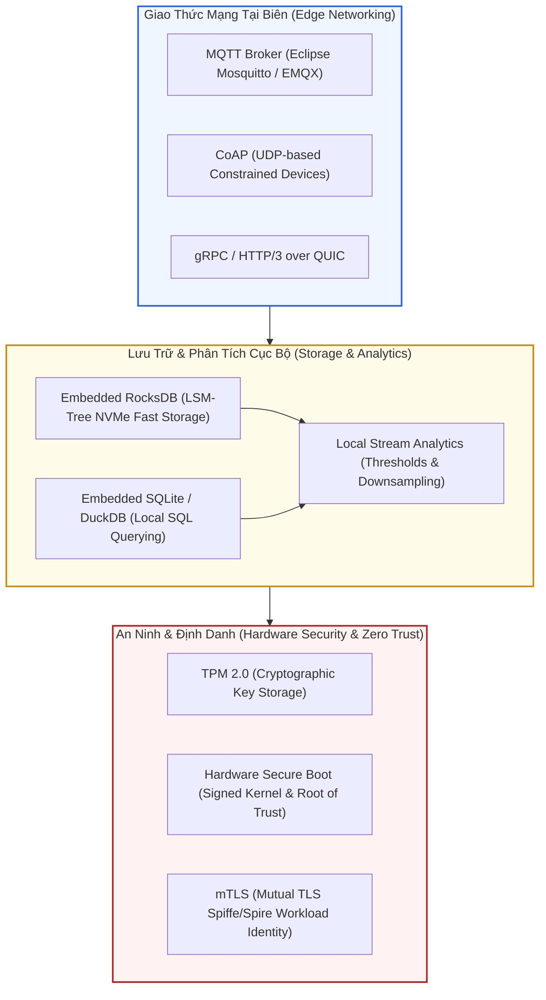
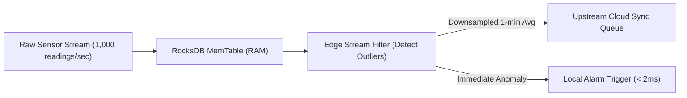
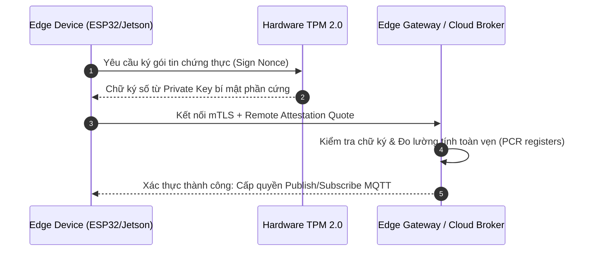
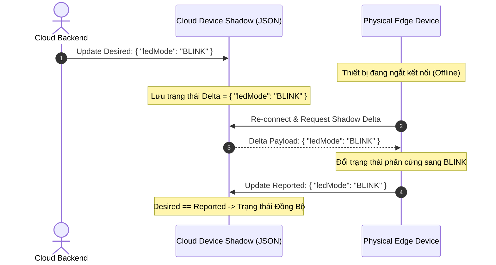

# 3.2. Edge Storage, Networking, Security & Device Management

## Tổng quan về Lưu trữ, Mạng, An toàn và Quản lý Thiết bị tại Biên
Hạ tầng biên (Edge Infrastructure) hoạt động trong một môi trường hoàn toàn khác biệt so với các trung tâm dữ liệu tập trung: tài nguyên lưu trữ cục bộ bị giới hạn, kết nối mạng diện rộng (WAN/Cellular) thường xuyên chập chờn hoặc có băng thông đắt đỏ, và rủi ro bị xâm nhập vật lý luôn hiện hữu.

Để vận hành các dịch vụ backend tại biên một cách tin cậy, hệ thống phải đáp ứng 4 yêu cầu kỹ thuật nền tảng:
1. **Lưu trữ và Bộ đệm Tinh gọn (Edge Storage & Caching)**: Sử dụng các cơ sở dữ liệu nhúng hiệu năng cao (Embedded Key-Value Stores như RocksDB, SQLite) có khả năng ghi tuần tự nhanh và tự động nén dữ liệu theo chu kỳ thời gian.
2. **Giao thức Mạng Tối ưu cho IoT/Edge (Edge Networking)**: Áp dụng các giao thức truyền tải nhị phân tiêu thụ ít năng lượng và chịu lỗi cao như **MQTT (Message Queuing Telemetry Transport)**, **CoAP (Constrained Application Protocol)** và **gRPC qua HTTP/3**.
3. **Phòng thủ An ninh Không tin cậy (Zero-Trust Edge Security)**: Tích hợp phần cứng bảo mật gốc (**TPM 2.0**, **Secure Boot**) và xác thực định danh song phương (**mTLS**).
4. **Quản trị Thiết bị Quy mô lớn (Edge Device Management & Analytics)**: Quản lý hàng triệu vòng đời thiết bị thông qua mô hình Bản sao số (**Digital Twin / Device Shadow**).



---

## 2. Chi tiết từng Keyword (Under-the-Hood Deep Dive)

---

### 1. Edge Caching, Edge Storage, Edge Data Processing & Edge Analytics

#### 1. Khái niệm bản chất (What & Why)
- **Edge Storage**: Các giải pháp lưu trữ dữ liệu cục bộ trên máy chủ biên. Do hạn chế về dung lượng ổ đĩa SSD/eMMC, edge storage tập trung vào việc ghi tốc độ cao dữ liệu chuỗi thời gian (Time-series) và tự động dọn dẹp theo thời gian sống (TTL Eviction).
- **Edge Caching**: Lưu trữ tạm thời các nội dung tĩnh, dữ liệu cấu hình hoặc kết quả truy vấn phổ biến ngay tại biên để người dùng hoặc thiết bị cục bộ truy cập với độ trễ < 1ms mà không cần gửi request lên Cloud.
- **Edge Data Processing & Analytics**: Thực hiện việc lọc, làm sạch, tổng hợp (Aggregation) và phân tích thống kê dữ liệu ngay tại nguồn. Ví dụ: Cảm biến đo nhiệt độ 1,000 lần mỗi giây; Edge Analytics sẽ tính trung bình mỗi 10 giây và chỉ gửi 1 giá trị tóm tắt lên Cloud (giảm tải 10,000 lần băng thông truyền dẫn).

#### 2. Cơ chế hoạt động sâu (Under the hood / Hardcore Internals)
- **Cơ chế Lưu trữ LSM-Tree trong RocksDB tại Biên**:
  Các thiết bị biên thường sử dụng bộ nhớ flash NAND (eMMC hoặc SD card) có số lần ghi hữu hạn (Wear-out limit). Nếu sử dụng CSDL quan hệ truyền thống cập nhật tại chỗ (B-Tree In-place Update), ổ flash sẽ nhanh chóng bị hỏng do hiện tượng khuếch đại ghi (**Write Amplification**).
  RocksDB sử dụng cấu trúc **LSM-Tree (Log-Structured Merge-Tree)**:
  - Mọi thao tác ghi mới đều được ghi tuần tự vào bộ nhớ RAM (**MemTable**) và file nhật ký tuần tự (**WAL**).
  - Khi MemTable đầy, nó được xả tuần tự (Sequential Flush) thành các file SSTable bất biến trên đĩa. Việc ghi tuần tự liên tục giúp kéo dài tuổi thọ phần cứng lưu trữ của thiết bị biên lên gấp nhiều lần.

#### 3. Sơ đồ minh họa


#### 4. Code ví dụ thực chiến (C++ Circular Ring Buffer for Edge Telemetry Windowing)
Đoạn mã C++20 xây dựng bộ đệm vòng (Circular Ring Buffer) tĩnh không cấp phát bộ nhớ động phục vụ tính toán trung bình trượt (Moving Average) tại biên:

```cpp
#include <iostream>
#include <array>
#include <numeric>

template <typename T, size_t Capacity>
class EdgeRingBuffer {
private:
    std::array<T, Capacity> buffer_{};
    size_t head_ = 0;
    size_t count_ = 0;

public:
    void push(T val) noexcept {
        buffer_[head_] = val;
        head_ = (head_ + 1) % Capacity;
        if (count_ < Capacity) {
            count_++;
        }
    }

    [[nodiscard]] double compute_average() const noexcept {
        if (count_ == 0) return 0.0;
        double sum = 0.0;
        for (size_t i = 0; i < count_; ++i) {
            sum += buffer_[i];
        }
        return sum / static_cast<double>(count_);
    }

    [[nodiscard]] size_t size() const noexcept { return count_; }
};

int main() {
    EdgeRingBuffer<float, 5> telemetry_window;
    telemetry_window.push(20.5f);
    telemetry_window.push(21.0f);
    telemetry_window.push(22.5f);
    telemetry_window.push(20.0f);
    telemetry_window.push(21.5f);

    std::cout << "[Edge Analytics] Window Size: " << telemetry_window.size() << "\n";
    std::cout << "[Edge Analytics] 5-sample Moving Average: " << telemetry_window.compute_average() << " °C\n";
    
    // Đẩy thêm 1 phần tử mới ghi đè phần tử cũ nhất
    telemetry_window.push(35.0f); // Tăng nhiệt đột ngột
    std::cout << "[Edge Analytics] Updated Moving Average: " << telemetry_window.compute_average() << " °C\n";
    return 0;
}
```

#### 5. Ưu / Nhược điểm, Pitfalls & Anti-patterns
- **Flash Memory Exhaustion (Tràn đĩa)**: Thiết bị biên bị mất kết nối Internet kéo dài nhưng dữ liệu vẫn tiếp tục được ghi vào đĩa mà không có chính sách tự xoay vòng (Log Rotation) hoặc ghi đè (FIFO retention policy), dẫn tới đĩa đầy 100% làm treo toàn bộ hệ điều hành.

#### 6. Ứng dụng thực tế trong Backend / Systems
- Hệ thống trạm quan trắc thủy văn tự động ghi dữ liệu mực nước và chỉ gửi cảnh báo qua vệ tinh khi phát hiện nguy cơ lũ quét.

---

### 2. Edge Networking, Protocols (MQTT, CoAP) & Edge Security

#### 1. Khái niệm bản chất (What & Why)
- **Edge Networking**: Các giải pháp thiết kế mạng kết nối giữa thiết bị biên với gateway và giữa gateway với đám mây trung tâm.
- **MQTT (Message Queuing Telemetry Transport)**: Giao thức truyền thông điệp dạng Publish/Subscribe siêu nhẹ chạy trên nền TCP, kích thước tiêu đề gói tin chỉ 2 bytes, hỗ trợ 3 mức đảm bảo chất lượng dịch vụ (QoS 0: At most once, QoS 1: At least once, QoS 2: Exactly once), cực kỳ phù hợp cho mạng di động không ổn định.
- **CoAP (Constrained Application Protocol)**: Giao thức ứng dụng dạng RESTful (GET, POST, PUT, DELETE) nhưng chạy trên nền UDP, hỗ trợ truyền thông multicast và có chi phí header cực nhỏ cho vi điều khiển siêu hạn chế tài nguyên.
- **Edge Security**: Bảo vệ toàn diện thiết bị biên trước các hình thức can thiệp vật lý (Tampering), tấn công giả mạo (Spoofing) và do thám mạng (Man-in-the-Middle).

#### 2. Cơ chế hoạt động sâu (Under the hood / Hardcore Internals)
- **Hardware Root of Trust & TPM 2.0**:
  Một thiết bị biên an toàn dựa trên vi mạch **TPM (Trusted Platform Module)** hoặc Secure Element:
  - *Secure Boot*: Khi thiết bị khởi động, BIOS/UEFI kiểm tra chữ ký điện tử của Bootloader; Bootloader kiểm tra chữ ký của Kernel Linux; Kernel kiểm tra chữ ký của Root Filesystem. Nếu bất kỳ byte nào bị sửa đổi trái phép, phần cứng từ chối khởi động.
  - *Remote Attestation*: Thiết bị biên chứng minh cho Cloud biết rằng nó đang chạy phần mềm chính hãng nguyên bản bằng cách gửi một bản tóm tắt băm (Cryptographic Hash) được ký bởi khóa riêng tư không thể trích xuất nằm bên trong chip TPM.
- **Mutual TLS (mTLS) with SPIFFE/SPIRE**:
  Các container chạy tại biên được cấp phát một định danh mã hóa **SVID (SPIFFE Verifiable Identity Document)** dạng chứng chỉ X.509 có thời hạn ngắn (ví dụ 1 giờ), tự động xoay vòng khóa, đảm bảo mọi giao tiếp nội bộ biên đều được mã hóa tuyệt đối.

#### 3. Sơ đồ minh họa


#### 4. Code ví dụ thực chiến (TypeScript MQTT Client with Auto-Reconnect & QoS Management)
```typescript
interface MQTTMessage {
  topic: string;
  payload: string;
  qos: 0 | 1 | 2;
}

class EdgeMQTTClient {
  private isConnected = false;
  private offlineBuffer: MQTTMessage[] = [];

  public connect(brokerUrl: string): void {
    console.log(`[MQTT] Connecting to broker: ${brokerUrl} via TLS 1.3...`);
    // Giả lập kết nối thành công
    this.isConnected = true;
    this.flushOfflineBuffer();
  }

  public publish(topic: string, data: object, qos: 0 | 1 | 2 = 1): void {
    const msg: MQTTMessage = {
      topic,
      payload: JSON.stringify(data),
      qos
    };

    if (!this.isConnected) {
      console.warn(`[MQTT] Offline! Storing message to local NVMe buffer. Topic: ${topic}`);
      this.offlineBuffer.push(msg);
      return;
    }

    console.log(`[MQTT] Published to ${topic} (QoS ${qos}): ${msg.payload}`);
  }

  private flushOfflineBuffer(): void {
    console.log(`[MQTT] Connection restored. Flushing ${this.offlineBuffer.length} buffered messages.`);
    while (this.offlineBuffer.length > 0) {
      const msg = this.offlineBuffer.shift();
      if (msg) console.log(`[MQTT Flush] Sent: ${msg.topic}`);
    }
  }

  public simulateNetworkDrop(): void {
    this.isConnected = false;
    console.warn("[MQTT] Network link dropped! Operating in disconnected mode.");
  }
}

// Test MQTT Resilience
const client = new EdgeMQTTClient();
client.connect("ssl://mqtt.edge.factory.internal:8883");
client.publish("factory/press/line1", { status: "OK", pressure: 101.3 });

client.simulateNetworkDrop();
client.publish("factory/press/line1", { status: "WARNING", pressure: 108.5 }); // Được đệm vào offline buffer
client.connect("ssl://mqtt.edge.factory.internal:8883"); // Phục hồi và xả buffer
```

#### 5. Ưu / Nhược điểm, Pitfalls & Anti-patterns
- **Hardcoded Secret Keys**: Lưu cứng Private Key hoặc Password trong file cấu hình `.env` hoặc trong mã nhị phân của ứng dụng biên. Bất kỳ ai có quyền truy cập vật lý vào thiết bị đều có thể dùng lệnh `strings` hoặc đọc thẻ nhớ để trích xuất khóa bí mật.

#### 6. Ứng dụng thực tế trong Backend / Systems
- Hệ thống điều khiển lưới điện thông minh (Smart Grid Telemetry) truyền dữ liệu công tơ điện tử mã hóa an toàn qua mạng di động NB-IoT.

---

### 3. Edge Device Management & Digital Twins

#### 1. Khái niệm bản chất (What & Why)
- **Edge Device Management**: Tập hợp các công cụ và quy trình để giám sát, cấu hình, kiểm tra sức khỏe và cập nhật phần mềm từ xa cho hàng ngàn hoặc hàng triệu thiết bị phân tán địa lý.
- **Device Shadow / Digital Twin (Bản sao số)**: Một bản ghi trạng thái số (thường ở định dạng JSON) được lưu trữ trên Cloud hoặc Gateway, phản ánh trạng thái hiện tại (Reported State) và trạng thái mong muốn (Desired State) của một thiết bị vật lý, ngay cả khi thiết bị đó đang ở trạng thái ngắt kết nối (Offline).

#### 2. Cơ chế hoạt động sâu (Under the hood / Hardcore Internals)
- **Cơ chế Hòa giải Trạng thái (State Reconciliation Pattern)**:
  - Ứng dụng Cloud gửi yêu cầu thay đổi cấu hình bằng cách cập nhật:
    `desired: { "firmwareVersion": "v2.1.0", "samplingRateHz": 50 }`
  - Khi thiết bị biên kết nối lại mạng, nó tải về trạng thái `desired`.
  - Thiết bị áp dụng cấu hình cục bộ và gửi lại báo cáo:
    `reported: { "firmwareVersion": "v2.1.0", "samplingRateHz": 50 }`
  - Nếu `desired == reported`, hệ thống đạt trạng thái đồng thuận hoàn hảo.

#### 3. Sơ đồ minh họa


#### 4. Code ví dụ thực chiến (TypeScript Device Shadow Delta Reconciliation Engine)
```typescript
interface DeviceState {
  samplingIntervalSec: number;
  relayActive: boolean;
  powerLimitWatts: number;
}

interface DeviceShadowDocument {
  desired: Partial<DeviceState>;
  reported: Partial<DeviceState>;
}

class DeviceShadowEngine {
  public static calculateDelta(shadow: DeviceShadowDocument): Partial<DeviceState> {
    const delta: Partial<DeviceState> = {};
    for (const key in shadow.desired) {
      const stateKey = key as keyof DeviceState;
      if (shadow.desired[stateKey] !== shadow.reported[stateKey]) {
        (delta as any)[stateKey] = shadow.desired[stateKey];
      }
    }
    return delta;
  }
}

// Demo Reconciliation
const currentShadow: DeviceShadowDocument = {
  desired: { samplingIntervalSec: 5, relayActive: true, powerLimitWatts: 2500 },
  reported: { samplingIntervalSec: 10, relayActive: false, powerLimitWatts: 2500 }
};

const deltaToApply = DeviceShadowEngine.calculateDelta(currentShadow);
console.log("Configuration Delta to apply to Edge hardware:", deltaToApply);
```

#### 5. Ưu / Nhược điểm, Pitfalls & Anti-patterns
- **Firmware Brick Risk (Treo thiết bị)**: Quá trình cập nhật OTA bị mất nguồn điện giữa chừng khi đang ghi đè phân vùng bootloader. Cần thiết kế phân vùng ổ đĩa kép **A/B Partitioning** với cơ chế tự động Rollback nếu phiên bản mới không vượt qua kiểm tra khởi động an toàn.

#### 6. Ứng dụng thực tế trong Backend / Systems
- Hệ thống quản lý hàng triệu trạm sạc xe điện thông minh (EV Charging Stations) trên toàn cầu.
