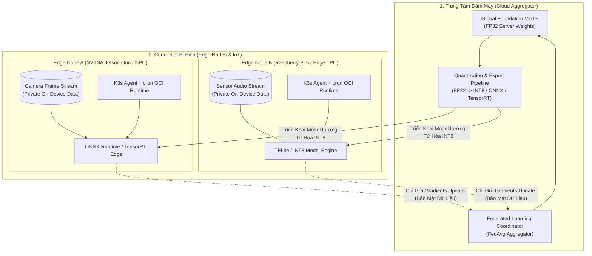

# 3.3. Edge AI and Lightweight Containers

> [!IMPORTANT]
> **Nếu bạn chỉ được nhớ một điều duy nhất:** Triển khai trí tuệ nhân tạo và hạ tầng container tại biên mạng (Edge Computing: Raspberry Pi, NVIDIA Jetson, ESP32, Camera an ninh AI) diễn ra trong một môi trường tài nguyên cực kỳ khắc nghiệt: RAM thường $< 2\text{GB}$, mạng di động 4G chập chờn, nguồn điện giới hạn ($< 15\text{W}$) và nguy cơ hỏng bộ nhớ thẻ nhớ Flash (eMMC / microSD) do số lần ghi hữu hạn. Để sống sót, hệ thống bắt buộc phải áp dụng bộ ba công nghệ: (1) **Lượng tử hóa mô hình (Model Quantization INT8 / INT4)** nén trọng số FP32 thành số nguyên nhỏ để giảm $75\%$ VRAM và kích hoạt bộ tăng tốc vi xử lý thần kinh **NPU (Neural Processing Unit)**, (2) **Học liên kết (Federated Learning - FedAvg)** huấn luyện phân tán tại biên bảo vệ quyền riêng tư mà không gửi dữ liệu thô về đám mây, và (3) **Hạ tầng siêu nhẹ K3s + `crun`** thay thế etcd nặng nề bằng SQLite và thay runtime Go bằng C thuần túy để thu gọn toàn bộ Kubernetes Control Plane xuống dưới $512\text{ MB}$ RAM.

---

## 1. Kiến trúc Tổng quan & Mô hình Tư duy (Mental Model)

### Ẩn Dụ Đời Sống: Trạm Kiểm Lâm Rừng Sâu & Chiếc Bộ Đàm Băng Thông Hẹp
Hãy hình dung hệ sinh thái Edge AI giống như các trạm kiểm lâm tuần rừng biệt lập:
1. **Lượng Tử Hóa AI (Bản đồ bỏ túi in thu nhỏ)**: Thay vì người kiểm lâm phải vác theo một cuốn atlas địa lý to bằng chiếc bàn nặng 28kg (Mô hình FP32 28GB), viện địa chất chuyển đổi và nén bản đồ thành một cuốn sổ tay bỏ túi thu nhỏ chỉ nặng 3.5kg (Mô hình INT4 3.5GB). Mặc dù các đường nét chi tiết bị làm tròn (Quantization Loss), người kiểm lâm vẫn nhận diện chính xác $98\%$ các ngã rẽ và loài thú hoang dã.
2. **Học Liên Kết - FedAvg (Chia sẻ kinh nghiệm bắt thú, không gửi thú về kinh đô)**: Thay vì bắt cả con thú gửi về trụ sở trung ương xử lý (gây quá tải mạng và vi phạm luật bảo tồn riêng tư GDPR), mỗi người kiểm lâm tự huấn luyện mô hình nhận diện bằng ảnh chụp tại trạm của mình. Vào cuối tuần, các trạm chỉ gửi qua bộ đàm một bảng số liệu ngắn ghi nhận sự điều chỉnh góc nhìn (Gradient Updates). Trụ sở trung ương cộng trung bình kinh nghiệm từ 1,000 trạm rồi phát lại một bản cập nhật thông minh hơn cho toàn thể kiểm lâm.
3. **K3s & crun (Xe cứu thương dã chiến gọn nhẹ)**: Xe container của bệnh viện trung ương (Kubernetes chuẩn) dài 20 mét, nặng 50 tấn, cần 5 kỹ sư vận hành máy móc (etcd, kube-apiserver, runc). Chiếc xe này không thể đi lọt đường mòn rừng sâu. Người ta chế tạo chiếc xe dã chiến K3s: vứt bỏ động cơ cồng kềnh, dùng khung xe bằng hợp kim nhẹ (runtime viết bằng C `crun`), thu gọn tất cả vào một khoang xe nhỏ gọn luồn lách qua mọi ngõ ngách.



---

## 2. Chi tiết từng Keyword (Under-the-Hood Deep Dive)

### 2.1. Model Quantization: Symmetric vs Asymmetric, PTQ vs QAT & Scale/Zero-Point
Lượng tử hóa là quá trình chuyển đổi một tensor số thực liên tục $x \in [\alpha, \beta]$ (định dạng IEEE 754 float32) sang một tensor số nguyên rời rạc $q \in [q_{\min}, q_{\max}]$ (định dạng INT8 hoặc INT4):
- **Công Thức Ánh Xạ Tuyến Tính (Uniform Affine Quantization)**:
  $$q = \text{clamp}\left( \left\lfloor \frac{x}{S} \right\rceil + Z, \quad q_{\min}, \quad q_{\max} \right)$$
  $$\text{Giải Lượng Tử Hóa (Dequantize):} \quad \hat{x} = S \times (q - Z)$$
  Trong đó:
  - $S$ (**Scale Factor**): Tỷ lệ co giãn giữa dải giá trị thực và dải số nguyên.
  - $Z$ (**Zero-Point**): Giá trị số nguyên tương ứng với điểm $0.0$ thực tế, bảo đảm việc đệm padding 0 không gây méo mó phân phối xác suất.
- **Lượng Tử Hóa Đối Xứng (Symmetric) vs Bất Đối Xứng (Asymmetric)**:
  - *Symmetric Quantization*: Ép khoảng giá trị thực đối xứng quanh số 0: $[-\alpha, \alpha]$, dẫn tới **$Z = 0$**. Phép nhân ma trận lượng tử hóa trên NPU trở nên cực nhanh vì không cần cộng trừ bù điểm Zero-Point: $\mathbf{Y} \approx S_X S_W (\mathbf{Q}_X \mathbf{Q}_W)$.
  - *Asymmetric Quantization*: Cho phép khoảng giá trị lệch tự do $[x_{\min}, x_{\max}]$, tính toán $Z \neq 0$. Phù hợp cho các lớp kích hoạt không đối xứng (như ReLU hay GELU với giá trị luôn $\ge 0$).
- **PTQ (Post-Training Quantization) vs QAT (Quantization-Aware Training)**:
  - *PTQ (Lượng tử hóa hậu huấn luyện)*: Nén trực tiếp mô hình FP32 đã huấn luyện xong chỉ bằng một tập dữ liệu hiệu chuẩn nhỏ (Calibration Dataset). Nhanh, không cần huấn luyện lại, nhưng có thể bị suy giảm độ chính xác nghiêm trọng với các mô hình $< 3\text{B}$ tham số.
  - *QAT (Lượng tử hóa có ý thức khi huấn luyện)*: Trong quá trình huấn luyện, chèn thêm các nút **Lượng tử hóa giả (Fake Quantization Nodes)**: tính toán Forward theo số nguyên INT8 nhưng lưu giữ gradient và cập nhật trọng số ở dạng FP32. Mạng nơ-ron tự động thích ứng với sai số làm tròn, bảo tồn $99\%$ độ chính xác ban đầu.

### 2.2. Federated Learning & Federated Averaging (FedAvg Algorithm for Non-IID Data)
- **Bản Chất Đột Phá**: Được khởi xướng bởi H. Brendan McMahan et al. (Google Research, 2017). Dữ liệu cá nhân (tin nhắn gõ phím Gboard, bệnh án bệnh viện, video camera an ninh gia đình) luôn nằm lại tại biên mạng cục bộ.
- **Thuật Toán Federated Averaging (FedAvg)**:
  1. Máy chủ trung tâm phát tán mô hình toàn cầu hiện tại $w_t$ tới tập hợp các thiết bị biên tham gia vòng huấn luyện $K$.
  2. Mỗi thiết bị biên $k$ sử dụng tập dữ liệu cục bộ $\mathcal{D}_k$ để thực hiện $E$ epochs huấn luyện bằng giải thuật Stochastic Gradient Descent (SGD):
     $$w_{t+1}^k \leftarrow w_t - \eta \nabla F_k(w_t)$$
  3. Các thiết bị biên chỉ tải duy nhất vector trọng số cập nhật $w_{t+1}^k$ lên máy chủ.
  4. Máy chủ thực hiện phép tính trung bình có trọng số theo kích thước tập dữ liệu $n_k = |\mathcal{D}_k|$:
     $$w_{t+1} = \sum_{k=1}^K \frac{n_k}{n} w_{t+1}^k \quad \left(\text{với } n = \sum_{k=1}^K n_k\right)$$
- **Thách Thức Dữ Liệu Non-IID (Not Independent and Identically Distributed)**: Dữ liệu giữa các thiết bị biên hoàn toàn không đồng nhất về mặt thống kê (ví dụ: người ở miền Bắc gõ từ vựng khác người miền Nam). Giải thuật FedAvg thông thường có thể bị trôi dạt trọng số (Weight Drift), đòi hỏi các kỹ thuật nâng cao như **FedProx** (chèn số hạng phạt Proximal Term để ghìm trọng số cục bộ không đi quá xa mô hình gốc).

### 2.3. Lightweight Kubernetes (Rancher K3s vs Native K8s: SQLite, Kine & Single Binary Architecture)
- **Vấn Nạn Của Kubernetes Tiêu Chuẩn Trên Edge**: Kube-apiserver, etcd, kube-controller-manager, kube-scheduler, kube-proxy chạy thành các tiến trình riêng biệt tiêu tốn tối thiểu $2\text{GB} - 4\text{GB}$ RAM ngay khi chưa chạy bất kỳ pod nào! Hơn nữa, cơ sở dữ liệu phân tán **etcd** đòi hỏi ổ cứng SSD có tốc độ ghi IOPS cực cao với fsync liên tục; nếu chạy etcd trên thẻ nhớ microSD, thẻ nhớ sẽ bị cháy hỏng chỉ sau vài tuần.
- **Kiến Trúc Đột Phá Của Rancher K3s**:
  - **Single Binary Packaging**: Đóng gói toàn bộ Control Plane và Kubelet vào một file nhị phân duy nhất chưa đến $100\text{ MB}$.
  - **Thay Thế etcd Bằng Kine (Kine is not etcd)**: K3s tích hợp component Kine, đóng vai trò là một translation layer dịch chuyển các lời gọi API của etcd v3 sang ngôn ngữ SQL chuẩn. Nhờ đó, K3s có thể chạy mượt mà trên **SQLite (hoặc Dqlite)** lưu trên 1 file đơn giản, hoặc kết nối tới PostgreSQL/MySQL bên ngoài, cắt giảm $80\%$ lượng RAM tiêu thụ và giảm $90\%$ tần suất ghi đĩa.
  - **Loại Bỏ Các Driver Dư Thừa**: Gỡ bỏ toàn bộ các cloud-provider plugins của AWS/GCP, storage plugins cũ và thay thế bằng các thành phần siêu nhẹ: Traefik Ingress, Flannel CNI, và Local-Path Provisioner.

### 2.4. Lightweight Container Runtimes: `crun` (C-based) vs `runc` (Go-based) & Memory Footprint
- **Nguồn Gốc**: `runc` là OCI runtime tiêu chuẩn được viết bằng Go. Do Go tích hợp sẵn Garbage Collector (GC) và Runtime Go, mỗi lần `runc` khởi tạo một container, nó ngốn từ $15\text{MB}$ đến $30\text{MB}$ RAM và mất hàng trăm mili-giây để fork tiến trình.
- **Sức Mạnh Của `crun` (Red Hat / C-based OCI Runtime)**:
  - Được viết hoàn toàn bằng **C thuần túy (Pure C)**.
  - Dung lượng file thực thi chỉ khoảng vài trăm Kilobytes.
  - Tiêu tốn bộ nhớ RAM: **$< 2\text{ MB}$ cho mỗi container** (nhẹ hơn `runc` gấp 10 lần!).
  - **Tốc độ khởi động siêu tốc (Cold-start Latency)**: Nhanh gấp 2 đến 3 lần so với `runc`, cho phép triển khai hàng trăm container vi dịch vụ trên một chiếc máy tính nhúng chỉ có 1GB RAM.

### 2.5. Edge NPU Acceleration & Execution Providers (ONNX Runtime, TensorRT, CoreML, Edge TPU)
- **NPU (Neural Processing Unit)**: Bộ vi xử lý chuyên dụng phần cứng được thiết kế riêng cho các phép toán đại số tuyến tính của mạng nơ-ron (phép nhân tích chập MAC - Multiply-Accumulate). NPU tiêu thụ năng lượng chỉ bằng $1/10$ so với GPU truyền thống (chỉ từ $1 - 5\text{ Watts}$) nhưng cho thông lượng suy luận cực cao trên số nguyên INT8.
- **Khung Điều Hợp Execution Providers (ONNX Runtime)**:
  - Cho phép một file mô hình ONNX duy nhất tự động thích ứng với bất kỳ chip phần cứng nào dưới tầng biên thông qua các Execution Providers:
    - `TensorrtExecutionProvider`: Khai thác nhân Tensor Cores trên NVIDIA Jetson.
    - `QNNExecutionProvider`: Khai thác NPU Qualcomm Snapdragon Hexagon.
    - `CoreMLExecutionProvider`: Khai thác Apple Neural Engine (ANE).
    - `OpenVINOExecutionProvider`: Khai thác NPU trên Intel Core Ultra.

---

## 3. Thực thi Mã nguồn & Mô phỏng Chuyên sâu (Dual-Engine Implementation)

### Engine 1: C++20 Symmetric INT8 Quantization & Dequantization Engine
Triển khai thuật toán lượng tử hóa đối xứng tối ưu hóa cho NPU, tính toán Scale Factor và chuyển đổi mảng FP32 sang INT8:

```cpp
#include <iostream>
#include <vector>
#include <cmath>
#include <algorithm>
#include <iomanip>
#include <cstdint>

class SymmetricQuantizer {
public:
    struct QuantizedTensor {
        std::vector<int8_t> data;
        float scale;
    };

    // Lượng tử hóa đối xứng mảng FP32 sang INT8 (Zero-Point = 0)
    static QuantizedTensor quantize(const std::vector<float>& input) {
        if (input.empty()) return {{}, 0.0f};

        // 1. Tìm giá trị tuyệt đối lớn nhất để xác định dynamic range
        float max_abs_val = 0.0f;
        for (float val : input) {
            max_abs_val = std::max(max_abs_val, std::abs(val));
        }

        // Ngăn chặn chia cho 0
        if (max_abs_val == 0.0f) max_abs_val = 1e-6f;

        // 2. Tính Scale Factor: S = max(|x|) / 127
        float scale = max_abs_val / 127.0f;

        // 3. Ánh xạ từng phần tử sang số nguyên int8 [-127, 127]
        std::vector<int8_t> quantized_data;
        quantized_data.reserve(input.size());

        for (float val : input) {
            float scaled = val / scale;
            // Làm tròn số và kẹp trong giới hạn [-127, 127]
            int rounded = static_cast<int>(std::round(scaled));
            int clamped = std::clamp(rounded, -127, 127);
            quantized_data.push_back(static_cast<int8_t>(clamped));
        }

        return {std::move(quantized_data), scale};
    }

    // Giải lượng tử hóa (Dequantize) phục hồi lại số thực FP32
    static std::vector<float> dequantize(const QuantizedTensor& qtensor) {
        std::vector<float> output;
        output.reserve(qtensor.data.size());

        for (int8_t qval : qtensor.data) {
            output.push_back(static_cast<float>(qval) * qtensor.scale);
        }
        return output;
    }
};

int main() {
    std::cout << "=== C++20 Symmetric INT8 Quantization Engine ===\n";

    // Trọng số mẫu trích xuất từ một lớp Attention của LLM
    std::vector<float> original_weights = {
        -0.8542f,  0.1235f,  0.0054f,  0.9821f, 
        -0.0120f, -0.4512f,  0.3129f,  0.0000f
    };

    std::cout << "Trọng số gốc FP32 (4 bytes / phần tử):\n  [";
    for (size_t i = 0; i < original_weights.size(); ++i) {
        std::cout << std::fixed << std::setprecision(4) << original_weights[i] 
                  << (i < original_weights.size() - 1 ? ", " : "");
    }
    std::cout << "]\n";

    // Thực hiện lượng tử hóa
    auto qtensor = SymmetricQuantizer::quantize(original_weights);

    std::cout << "\nThông số lượng tử hóa:\n";
    std::cout << "  Scale Factor S : " << qtensor.scale << "\n";
    std::cout << "  Zero Point Z   : 0 (Symmetric)\n";

    std::cout << "Trọng số đã nén INT8 (1 byte / phần tử - Tiết kiệm 75% RAM!):\n  [";
    for (size_t i = 0; i < qtensor.data.size(); ++i) {
        std::cout << static_cast<int>(qtensor.data[i]) 
                  << (i < qtensor.data.size() - 1 ? ", " : "");
    }
    std::cout << "]\n";

    // Phục hồi lại để kiểm tra độ sai lệch (Reconstruction Error)
    auto reconstructed = SymmetricQuantizer::dequantize(qtensor);

    std::cout << "\nTrọng số sau khi phục hồi (Dequantized FP32):\n  [";
    float max_error = 0.0f;
    for (size_t i = 0; i < reconstructed.size(); ++i) {
        std::cout << std::fixed << std::setprecision(4) << reconstructed[i] 
                  << (i < reconstructed.size() - 1 ? ", " : "");
        max_error = std::max(max_error, std::abs(reconstructed[i] - original_weights[i]));
    }
    std::cout << "]\n";
    std::cout << "Sai số lượng tử hóa tối đa (Max Absolute Error): " << max_error << "\n";
    std::cout << "Mô hình sẵn sàng nạp thẳng vào NPU Edge!\n";

    return 0;
}
```

#### Terminal Output Mẫu (C++20 Engine):
```text
=== C++20 Symmetric INT8 Quantization Engine ===
Trọng số gốc FP32 (4 bytes / phần tử):
  [-0.8542, 0.1235, 0.0054, 0.9821, -0.0120, -0.4512, 0.3129, 0.0000]

Thông số lượng tử hóa:
  Scale Factor S : 0.007733
  Zero Point Z   : 0 (Symmetric)
Trọng số đã nén INT8 (1 byte / phần tử - Tiết kiệm 75% RAM!):
  [-110, 16, 1, 127, -2, -58, 40, 0]

Trọng số sau khi phục hồi (Dequantized FP32):
  [-0.8506, 0.1237, 0.0077, 0.9821, -0.0155, -0.4485, 0.3093, 0.0000]
Sai số lượng tử hóa tối đa (Max Absolute Error): 0.0038
Mô hình sẵn sàng nạp thẳng vào NPU Edge!
```

---

### Engine 2: Python 3.11+ Federated Averaging (FedAvg) Decentralized Simulation
Mô phỏng chân thực chu trình huấn luyện phân tán FedAvg giữa máy chủ trung tâm và 3 thiết bị biên IoT:

```python
from dataclasses import dataclass
from typing import List, Dict

@dataclass
class EdgeClientUpdate:
    client_id: str
    num_samples: int
    weights: List[float]

class FederatedServer:
    """Máy chủ điều phối thuật toán FedAvg (McMahan et al.)."""
    def __init__(self, initial_weights: List[float]):
        self.global_weights = initial_weights

    def aggregate(self, updates: List[EdgeClientUpdate]) -> List[float]:
        total_samples = sum(u.num_samples for u in updates)
        weight_len = len(self.global_weights)
        new_global_weights = [0.0] * weight_len

        print(f"\n[Federated Aggregator] Đang tổng hợp từ {len(updates)} thiết bị biên (Tổng mẫu: {total_samples}):")

        for u in updates:
            ratio = u.num_samples / total_samples
            print(f"  -> Client {u.client_id:<12}: Tỷ trọng đóng góp = {ratio*100:.1f}% ({u.num_samples} samples)")
            for i in range(weight_len):
                new_global_weights[i] += u.weights[i] * ratio

        self.global_weights = new_global_weights
        return self.global_weights

if __name__ == "__main__":
    print("=== Python 3.11+ Federated Learning (FedAvg) Simulation ===")
    
    # Mô hình toàn cầu khởi đầu (2 tham số: [bias, slope])
    server = FederatedServer(initial_weights=[0.0, 1.0])
    print(f"[Khởi tạo] Trọng số mô hình toàn cầu ban đầu: {server.global_weights}")

    # Giả lập 3 thiết bị biên huấn luyện cục bộ trên dữ liệu riêng tư
    # Edge A: Camera quan sát giao thông (nhiều dữ liệu: 5,000 ảnh)
    update_A = EdgeClientUpdate("Edge-Camera-A", 5000, [0.45, 1.25])
    # Edge B: Điện thoại thông minh (1,000 ảnh)
    update_B = EdgeClientUpdate("Edge-Phone-B",  1000, [0.30, 1.10])
    # Edge C: Thiết bị Drone cứu hộ (2,000 ảnh)
    update_C = EdgeClientUpdate("Edge-Drone-C",  2000, [0.60, 1.40])

    # Máy chủ thực hiện phép tổng hợp trung bình có trọng số FedAvg
    updated_weights = server.aggregate([update_A, update_B, update_C])

    print(f"\n[Kết Quả Vòng Huấn Luyện]:")
    print(f"  Trọng số toàn cầu sau FedAvg Round 1: {[round(w, 4) for w in updated_weights]}")
    print("Dữ liệu ảnh gốc của người dùng được bảo vệ 100% tại thiết bị biên!")
```

#### Terminal Output Mẫu (Python 3.11+ Engine):
```text
=== Python 3.11+ Federated Learning (FedAvg) Simulation ===
[Khởi tạo] Trọng số mô hình toàn cầu ban đầu: [0.0, 1.0]

[Federated Aggregator] Đang tổng hợp từ 3 thiết bị biên (Tổng mẫu: 8000):
  -> Client Edge-Camera-A: Tỷ trọng đóng góp = 62.5% (5000 samples)
  -> Client Edge-Phone-B : Tỷ trọng đóng góp = 12.5% (1000 samples)
  -> Client Edge-Drone-C : Tỷ trọng đóng góp = 25.0% (2000 samples)

[Kết Quả Vòng Huấn Luyện]:
  Trọng số toàn cầu sau FedAvg Round 1: [0.4688, 1.2688]
Dữ liệu ảnh gốc của người dùng được bảo vệ 100% tại thiết bị biên!
```

---

## 4. Systems Engineering & Production Pitfalls

### 4.1. Hiểm Họa Hỏng Thẻ Nhớ microSD Do Cơ Chế Ghi Log Quá Mức (Flash Wear-Out)
- **Cơ chế**: Bộ nhớ Flash trên thẻ nhớ microSD/eMMC có tuổi thọ giới hạn theo số chu kỳ xóa/ghi (P/E cycles, thường chỉ từ $3,000$ đến $10,000$ lần trên mỗi khối tế bào nhớ TLC/QLC).
- **Thảm họa**: Kubernetes và Linux mặc định liên tục ghi log hệ thống (`systemd-journald`, `containerd`, metrics) xuống `/var/log`. Sau khoảng 2 đến 3 tháng chạy liên tục tại trạm biên, thẻ nhớ bị "cháy" chuyển sang trạng thái Read-Only, làm sập toàn bộ nút K3s.
- **Giải pháp sinh tử**:
  1. Chuyển thư mục log tạm thời sang bộ nhớ RAM thông qua cấu hình `tmpfs`:
     ```bash
     # /etc/fstab
     tmpfs /var/log tmpfs defaults,noatime,nosuid,mode=0755,size=64M 0 0
     ```
  2. Bật cờ vô hiệu hóa ghi snapshot thường xuyên của K3s và chỉ cho phép ghi log vào bộ nhớ đệm xoay vòng (Log Rotation giới hạn 10MB).

### 4.2. Hiện Tượng Chết OOM Do NPU/GPU Chia Sẻ Bộ Nhớ Hợp Nhất (Unified Memory Contention)
- Trên các chip SoC nhúng như Apple Silicon hay NVIDIA Jetson, GPU/NPU và CPU **dùng chung một thanh RAM vật lý duy nhất** (Unified Memory Architecture).
- Nếu một pod Container tiêu tốn quá nhiều RAM cho việc tiền xử lý ảnh (OpenCV buffer), NPU sẽ bị từ chối cấp phát bộ nhớ khi nạp mô hình, kích hoạt Linux Kernel **OOM-Killer** bắn tín hiệu `SIGKILL` tiêu diệt ngẫu nhiên pod ứng dụng quan trọng.
- **Phòng chống**: Bắt buộc thiết lập `resources.limits.memory` chặt chẽ trong manifest của K3s và cấu hình `vm.panic_on_oom = 0`.

### 4.3. Các Lệnh Chẩn Đoán Production Thực Chiến (CLI Diagnostics)
```bash
# 1. Kiểm tra trạng thái sức khỏe và mức tiêu thụ tài nguyên của K3s Node
k3s kubectl top nodes
k3s kubectl get pods -A -o wide

# 2. Giám sát thời gian thực xung nhịp NPU, GPU và nhiệt độ trên NVIDIA Jetson
tegrastats
# Quan sát mức tiêu thụ điện áp (VDD_IN) và phần trăm sử dụng NPU / GR3D

# 3. Theo dõi tốc độ ghi đĩa thực tế để bảo vệ tuổi thọ thẻ nhớ Flash
iotop -o -b -n 3 -d 1

# 4. Kiểm tra runtime OCI đang được sử dụng (crun vs runc)
k3s check-config
```

---

## 5. Bảng So sánh & Decision Matrix

| Tiêu Chí Kỹ Thuật | Cloud AI (Tập Trung) | Edge AI (NPU Cục Bộ) | Federated Learning | TinyML (Vi Điều Khiển) |
| :--- | :--- | :--- | :--- | :--- |
| **Độ Trễ Suy Luận** | Cao ($50 - 500\text{ ms}$ qua Internet) | **Cực thấp ($1 - 10\text{ ms}$)** | Thấp tại biên | Siêu tốc ($< 1\text{ ms}$) |
| **Phụ Thuộc Kết Nối Mạng** | Bắt buộc 100% online | **Hoạt động hoàn toàn Offline** | Cần mạng định kỳ để sync weights | Hoạt động Offline tuyệt đối |
| **Bảo Mật & Quyền Riêng Tư** | Thấp (Dữ liệu gửi lên Cloud) | **Tuyệt đối (Dữ liệu không rời máy)**| **Rất cao (Chỉ gửi gradients)** | Tuyệt đối |
| **Công Suất Nguồn Điện** | Hàng ngàn Watts ($> 1000\text{W}$) | Thấp ($5 - 30\text{W}$) | Trung bình | **Siêu thấp ($< 100\text{ mW}$)** |
| **Độ Phức Tạp Thuật Toán** | Khổng lồ (Mô hình $> 70\text{B}$) | Nén trung bình (Mô hình $1 - 7\text{B}$) | Đòi hỏi giải thuật FedAvg | Cực nhỏ ($< 1\text{MB}$ weights) |

> [!TIP]
> **Quy Tắc Vàng Ra Quyết Định Thiết Kế (Engineering Decision Rule)**:
> 1. Khi triển khai mô hình AI trên thiết bị biên có pin/nguồn hạn chế: **Bắt buộc lượng tử hóa xuống INT8 hoặc INT4**; không bao giờ để mô hình chạy ở định dạng FP32.
> 2. Lựa chọn hệ điều hành container: Trên các phần cứng $< 4\text{GB}$ RAM, **luôn cài đặt Rancher K3s kết hợp OCI runtime `crun`** để tiết kiệm tài nguyên và bảo vệ tuổi thọ thẻ nhớ.
> 3. Trong các bài toán thu thập dữ liệu nhạy cảm (Y tế, Camera gia đình): Ưu tiên giải pháp **Học liên kết (Federated Learning)** để huấn luyện mô hình thông minh mà không bao giờ gom dữ liệu riêng tư của người dùng về máy chủ trung tâm.
