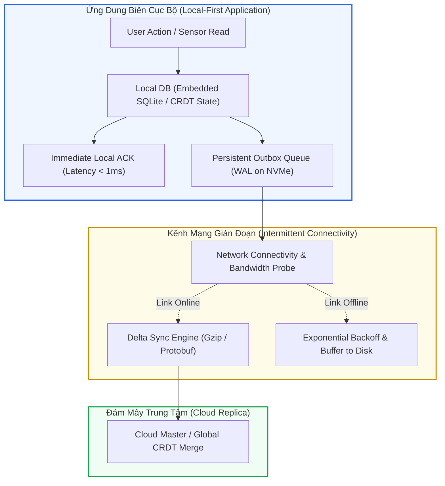
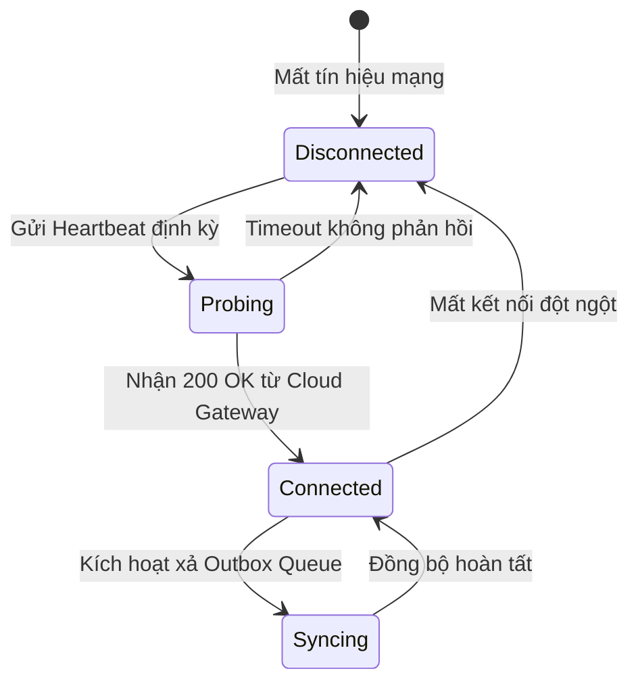
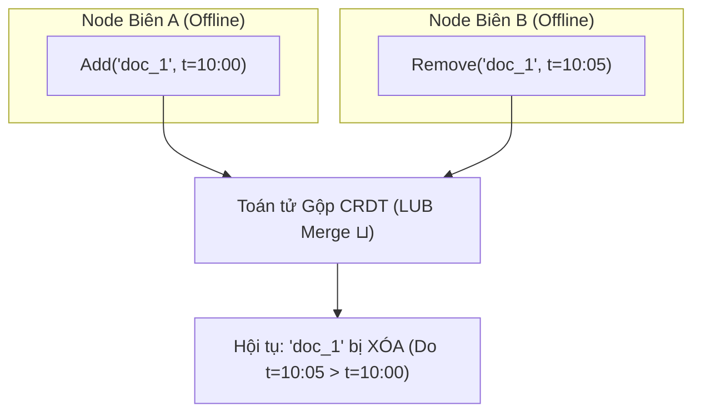
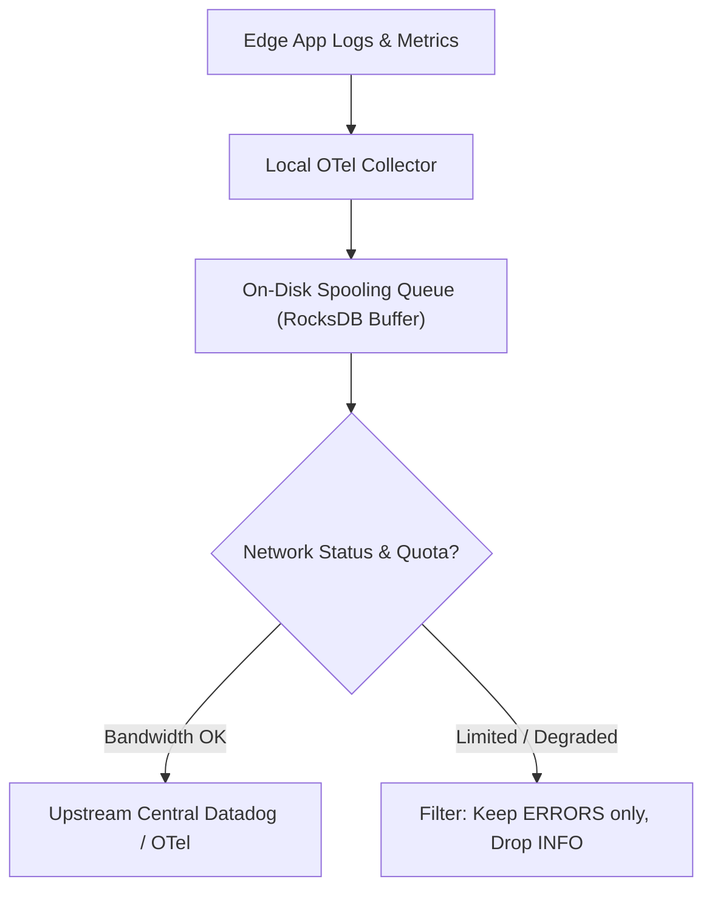

# 3.4. Distributed Edge Systems, Offline-First Architecture & Synchronization

## Tổng quan về Hệ thống Biên Phân tán và Kiến trúc Ưu tiên Ngoại tuyến
Trong môi trường mạng biên (Edge Computing Environments) — từ các giàn khoan dầu ngoài khơi, tàu hàng viễn dương, máy bay thương mại, cho tới các hầm mỏ sâu dưới lòng đất — kết nối mạng tới Internet và trung tâm dữ liệu Cloud không bao giờ được coi là một hằng số đảm bảo. Thay vào đó, đặc tính cố hữu của hạ tầng biên là **Kết nối Gián đoạn (Intermittent Network Connectivity)**, độ trễ biến thiên bất định (High Latency Jitter), và tỷ lệ mất gói tin cao.

Theo **Định lý CAP (Brewer's CAP Theorem)**, khi phân vùng mạng (Network Partition - $P$) xảy ra — điều diễn ra như cơm bữa tại biên — hệ thống phân tán bắt buộc phải lựa chọn giữa Tính nhất quán (Consistency - $C$) và Tính sẵn sàng (Availability - $A$). Để hệ thống không bao giờ bị tê liệt khi đứt cáp quang hoặc mất sóng vệ tinh, kiến trúc biên bắt buộc phải chuyển dịch từ mô hình "Cloud-dependent" sang mô hình **Ưu tiên Ngoại tuyến (Offline-First / Local-First Architecture)**:
$$\text{Local-First Directive: } \text{Mutations Commit Locally First} \implies \text{Asynchronous Peer-to-Peer Reconciliation}$$
Mọi thao tác ghi của người dùng được xác nhận thành công ngay lập tức vào bộ lưu trữ cục bộ, sau đó được đồng bộ hóa hòa giải (Reconciliation) lên Cloud bằng các cấu trúc dữ liệu không xung đột (**CRDTs - Conflict-free Replicated Data Types**).



---

## 2. Chi tiết từng Keyword (Under-the-Hood Deep Dive)

---

### 1. Intermittent Network Connectivity, Edge Connectivity & Offline-First Architecture

#### 1. Khái niệm bản chất (What & Why)
- **Intermittent Network Connectivity**: Hiện tượng đường truyền mạng giữa biên và mây bị đứt quãng ngẫu nhiên, không thể đoán trước, hoặc chỉ khả dụng trong một khoảng thời gian ngắn (ví dụ: vệ tinh bay qua quỹ đạo tầm thấp LEO trong 15 phút mỗi giờ).
- **Offline-First Architecture**: Triết lý thiết kế hệ thống coi trạng thái ngắt kết nối (Offline) là một chế độ hoạt động bình thường cấp một (First-class citizen) chứ không phải là một ngoại lệ lỗi (Exception). Hệ thống duy trì đầy đủ tính năng đọc/ghi cục bộ mà không bị block bởi mạng.
- **Transactional Outbox Pattern tại Biên**: Mọi sự kiện nghiệp vụ và các thay đổi dữ liệu cục bộ được ghi vào một bảng hàng đợi `Outbox` bền vững nằm trong cùng một giao dịch nguyên tử (ACID Transaction) của cơ sở dữ liệu nhúng cục bộ. Một tiến trình nền sẽ quét hàng đợi này và đẩy lên Cloud ngay khi mạng phục hồi.

#### 2. Cơ chế hoạt động sâu (Under the hood / Hardcore Internals)
- **Cơ chế Thăm dò Mạng Đa tầng (Multi-tier Connectivity Probing)**:
  Các ứng dụng biên không thể chỉ dựa vào sự kiện `link up/down` của card mạng hệ điều hành (vì card mạng LAN vẫn sáng đèn nhưng đường truyền WAN vệ tinh đã đứt).
  Hệ thống chạy một máy trạng thái thăm dò:
  - Gửi các gói tin thăm dò nhị phân siêu nhẹ (**ICMP Ping** hoặc **HTTP HEAD /health**) với chu kỳ thích ứng (Adaptive Interval).
  - Sử dụng thuật toán đo băng thông hiệu dụng (**Active Bandwidth Estimation**) để điều chỉnh kích thước gói tin đồng bộ phù hợp trước khi bắt đầu tải lô dữ liệu lớn.

#### 3. Sơ đồ minh họa


#### 4. Code ví dụ thực chiến (TypeScript Persistent Outbox with Auto-Sync Engine)
Đoạn mã TypeScript xây dựng cơ chế Outbox bền vững lưu trữ thay đổi cục bộ và tự động xả hàng đợi khi mạng thông suốt:

```typescript
interface OutboxRecord {
  id: string;
  operation: 'CREATE' | 'UPDATE' | 'DELETE';
  payload: Record<string, any>;
  timestamp: number;
}

class OfflineFirstOutbox {
  private queue: OutboxRecord[] = [];
  private isOnline = false;

  public commitLocalMutation(operation: 'CREATE' | 'UPDATE' | 'DELETE', payload: Record<string, any>): void {
    const record: OutboxRecord = {
      id: `evt_${Date.now()}_${Math.random().toString(36).substring(2, 7)}`,
      operation,
      payload,
      timestamp: Date.now()
    };

    // 1. Lưu bền vững vào hàng đợi cục bộ (Local ACID Write)
    this.queue.push(record);
    console.log(`[Local Write] Committed transaction ${record.id} to local SQLite. Queue Size: ${this.queue.length}`);

    // 2. Thử đồng bộ nếu mạng đang sẵn sàng
    if (this.isOnline) {
      this.flushQueue();
    }
  }

  public setNetworkStatus(online: boolean): void {
    this.isOnline = online;
    console.log(`[Network Probe] Connectivity changed: ${online ? "ONLINE" : "OFFLINE"}`);
    if (this.isOnline) {
      this.flushQueue();
    }
  }

  private flushQueue(): void {
    console.log(`[Sync Engine] Draining ${this.queue.length} mutations to upstream cloud...`);
    while (this.isOnline && this.queue.length > 0) {
      const item = this.queue.shift();
      if (item) {
        console.log(`[Upstream Push] Synced event ${item.id} (${item.operation})`);
      }
    }
  }
}

// Demo hoạt động khi đứt mạng
const outbox = new OfflineFirstOutbox();
outbox.setNetworkStatus(false); // Đứt mạng

outbox.commitLocalMutation('CREATE', { itemId: "PART_99", status: "INSTALLED" });
outbox.commitLocalMutation('UPDATE', { itemId: "PART_99", inspector: "ENG_DOE" });

// Khôi phục kết nối mạng
outbox.setNetworkStatus(true);
```

#### 5. Ưu / Nhược điểm, Pitfalls & Anti-patterns
- **Thundering Herd khi mạng phục hồi**: Hàng chục ngàn thiết bị biên đồng thời xả hàng triệu bản ghi Outbox lên Cloud cùng một giây khi đường truyền vệ tinh kết nối lại, làm sập hoàn toàn hệ thống Cloud API. Cần áp dụng cơ chế **Exponential Backoff with Full Jitter**:
  $$t_{\text{sleep}} = \text{random}(0, \min(T_{\max}, T_{\text{base}} \times 2^{\text{attempt}}))$$

#### 6. Ứng dụng thực tế trong Backend / Systems
- Ứng dụng ghi nhật ký hành trình bay (Flight Electronic Logbook) của phi công trên buồng lái máy bay, tự động đồng bộ về máy chủ sân bay khi máy bay hạ cánh.

---

### 2. Edge Synchronization, Distributed Edge Systems & CRDTs

#### 1. Khái niệm bản chất (What & Why)
- **Edge Synchronization**: Quá trình hòa giải và đồng nhất dữ liệu giữa các node biên với nhau và giữa các node biên với đám mây trung tâm sau các khoảng thời gian hoạt động ngoại tuyến.
- **Distributed Edge Systems**: Hệ thống gồm nhiều node biên kết nối ngang hàng (P2P Mesh Network) trong một mạng cục bộ (Local Area Network), có khả năng tiếp tục phối hợp làm việc nhóm ngay cả khi toàn bộ kết nối ra Internet bị cắt đứt hoàn toàn.
- **CRDTs (Conflict-free Replicated Data Types)**: Cấu trúc dữ liệu phân tán có tính chất toán học đặc biệt: Cho phép nhiều bản sao dữ liệu bị thay đổi đồng thời trên các node khác nhau mà không cần bất kỳ sự phối hợp (Coordination) hoặc khóa phân tán (Distributed Locks) nào, và luôn tự động hội tụ về một trạng thái thống nhất hoàn toàn thông qua một phép toán gộp thỏa mãn 3 tính chất: **Giao hoán (Commutative)**, **Kết hợp (Associative)**, và **Lũy đẳng (Idempotent)**.

#### 2. Cơ chế hoạt động sâu (Under the hood / Hardcore Internals)
- **Toán học của Bán giàn (Join-Semilattice)**:
  Một CRDT dựa trên trạng thái (State-based CRDT / CvRDT) được định nghĩa là một nửa dàn liên kết $(\mathcal{S}, \sqcup)$, trong đó $\sqcup$ là toán tử gộp (LUB - Least Upper Bound):
  1. *Giao hoán*: $x \sqcup y = y \sqcup x$ (Thứ tự nhận gói tin qua mạng không ảnh hưởng tới kết quả cuối cùng).
  2. *Kết hợp*: $(x \sqcup y) \sqcup z = x \sqcup (y \sqcup z)$ (Gói tin bị chia tách hoặc gộp lô vẫn cho kết quả như nhau).
  3. *Lũy đẳng*: $x \sqcup x = x$ (Gói tin bị gửi trùng lặp nhiều lần do mạng chập chờn không làm thay đổi trạng thái).
- **LWW-Element-Set (Last-Write-Wins Element Set)**:
  Mỗi phần tử được thêm vào (Add Set) hoặc xóa đi (Remove Set) đều gắn kèm một dấu thời gian (Logical/Hybrid Timestamp $t$). Phép gộp so sánh dấu thời gian: Phần tử nào có timestamp lớn hơn sẽ chiến thắng, giải quyết xung đột triệt để mà không cần con người can thiệp.

#### 3. Sơ đồ minh họa


#### 4. Code ví dụ thực chiến (C++ PN-Counter: Positive-Negative Distributed CRDT Counter)
Đoạn mã C++20 cài đặt bộ đếm tăng/giảm phân tán (PN-Counter) không bao giờ bị mất dữ liệu khi nhiều node biên đồng thời thay đổi:

```cpp
#include <iostream>
#include <vector>
#include <algorithm>
#include <cassert>

class PNCounter {
private:
    std::vector<int> P_; // Vector đếm số lần Tăng (Chỉ tăng dần)
    std::vector<int> N_; // Vector đếm số lần Giảm (Chỉ tăng dần)
    size_t node_id_;

public:
    PNCounter(size_t total_nodes, size_t my_id) 
        : P_(total_nodes, 0), N_(total_nodes, 0), node_id_(my_id) {}

    void increment(int val = 1) noexcept {
        P_[node_id_] += val;
    }

    void decrement(int val = 1) noexcept {
        N_[node_id_] += val;
    }

    [[nodiscard]] int value() const noexcept {
        int total_p = 0, total_n = 0;
        for (int p : P_) total_p += p;
        for (int n : N_) total_n += n;
        return total_p - total_n;
    }

    // Toán tử gộp CRDT LUB (Lũy đẳng, Giao hoán, Kết hợp): Lấy max của từng phần tử
    void merge(const PNCounter& other) noexcept {
        for (size_t i = 0; i < P_.size(); ++i) {
            P_[i] = std::max(P_[i], other.P_[i]);
            N_[i] = std::max(N_[i], other.N_[i]);
        }
    }
};

int main() {
    // Giả lập 2 node biên độc lập
    PNCounter node_a(2, 0); // Node 0
    PNCounter node_b(2, 1); // Node 1

    // Node A tăng 5 đơn vị tại kho A khi mất mạng
    node_a.increment(5);
    // Node B giảm 2 đơn vị tại kho B khi mất mạng
    node_b.decrement(2);

    std::cout << "Local value Node A: " << node_a.value() << " (Expected 5)\n";
    std::cout << "Local value Node B: " << node_b.value() << " (Expected -2)\n";

    // Hai node kết nối lại và trao đổi trạng thái
    node_a.merge(node_b);
    node_b.merge(node_a);

    std::cout << "Converged value Node A: " << node_a.value() << " (Expected 3)\n";
    std::cout << "Converged value Node B: " << node_b.value() << " (Expected 3)\n";
    return 0;
}
```

#### 5. Ưu / Nhược điểm, Pitfalls & Anti-patterns
- **Tombstone Accumulation (Rác bia mộ)**: Trong các cấu trúc Set CRDT, khi một phần tử bị xóa, hệ thống không thể xóa vật lý ô nhớ mà phải lưu lại một bản ghi "bia mộ" (Tombstone) để đảm bảo không bị thêm lại bởi các node khác chưa nhận được thông tin. Theo thời gian, dung lượng bộ nhớ dành cho Tombstones sẽ phình to nếu không có giải thuật dọn rác phân tán (Garbage Collection of Tombstones).

#### 6. Ứng dụng thực tế trong Backend / Systems
- Hệ thống quản lý hàng tồn kho phân tán giữa các xe tải vận chuyển hàng hóa di động.

---

### 3. Edge Observability

#### 1. Khái niệm bản chất (What & Why)
- **Edge Observability**: Việc giám sát sức khỏe, dấu vết thực thi (Tracing), và nhật ký hoạt động (Logs) của các microservices biên qua môi trường mạng băng thông thấp, chập chờn.
- **Tại sao Agent giám sát Cloud thông thường thất bại**: Các công cụ như Datadog Agent hoặc Fluentd cấu hình mặc định liên tục phát luồng stream telemetry lên Internet. Khi đặt tại biên, chúng sẽ nuốt trọn 100% băng thông mạng vệ tinh đắt đỏ và ném ngoại lệ crash liên tục khi mất kết nối mạng.

#### 2. Cơ chế hoạt động sâu (Under the hood / Hardcore Internals)
- **Vector on-disk Buffer & Edge Downsampling**:
  Sử dụng các công cụ thu thập telemetry hiện đại như **Vector (Datadog)** hoặc **OpenTelemetry Collector** chạy ở chế độ cục bộ:
  - Nhật ký log và metric được nạp vào một hàng đợi bền vững trên đĩa SSD cục bộ (**Disk-backed Queue**).
  - *Adaptive Downsampling*: Nếu mạng chậm hoặc mất kết nối, hệ thống tự động gộp (Aggregate) dữ liệu: ví dụ chỉ lưu metric P99 và đếm lỗi, tạm dừng gửi các log `DEBUG` và `INFO`, chỉ ưu tiên gửi các log `CRITICAL` và `FATAL` qua kênh khẩn cấp.

#### 3. Sơ đồ minh họa


#### 4. Code ví dụ thực chiến (TypeScript Adaptive Telemetry Filter)
```typescript
interface TelemetryRecord {
  level: 'DEBUG' | 'INFO' | 'WARN' | 'ERROR';
  message: string;
}

class EdgeTelemetryExporter {
  public static filterRecordsForEdgeTransmission(records: TelemetryRecord[], isLowBandwidthMode: boolean): TelemetryRecord[] {
    if (!isLowBandwidthMode) {
      return records; // Băng thông tốt: gửi toàn bộ
    }
    // Chế độ mạng yếu: Cắt bỏ 100% DEBUG và INFO để tiết kiệm chi phí viễn thông
    console.log("[Edge Observability] Low-bandwidth cellular detected. Filtering out non-essential logs.");
    return records.filter(r => r.level === 'WARN' || r.level === 'ERROR');
  }
}

// Test Adaptive Observability
const rawLogs: TelemetryRecord[] = [
  { level: 'DEBUG', message: 'Socket read 128 bytes' },
  { level: 'INFO', message: 'Heartbeat cycle completed' },
  { level: 'ERROR', message: 'Actuator 4 failed to open in 200ms' }
];

const filtered = EdgeTelemetryExporter.filterRecordsForEdgeTransmission(rawLogs, true /* Low Bandwidth */);
console.log("Transmitted records:", filtered);
```

#### 5. Ưu / Nhược điểm, Pitfalls & Anti-patterns
- **Clock Drift (Trôi dạt đồng hồ)**: Các thiết bị biên không có kết nối Internet liên tục sẽ không thể đồng bộ giao thức NTP. Đồng hồ phần cứng (RTC) có thể bị lệch hàng giây hoặc hàng phút, khiến các log và trace khi gửi lên Cloud bị sắp xếp sai thứ tự thời gian nguyên nhân - kết quả. Cần sử dụng Logical Timestamps (Lamport Timestamps / Hybrid Logical Clocks).

#### 6. Ứng dụng thực tế trong Backend / Systems
- Hệ thống giám sát dấu vết phân tán cho hạm đội tàu viễn dương xuyên đại dương.
