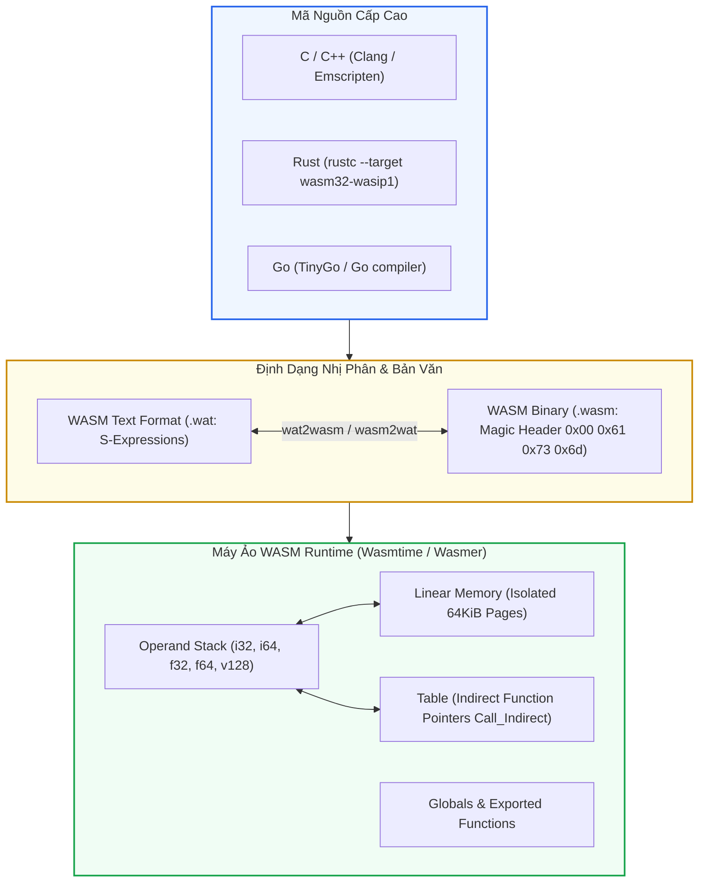
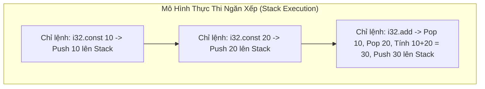
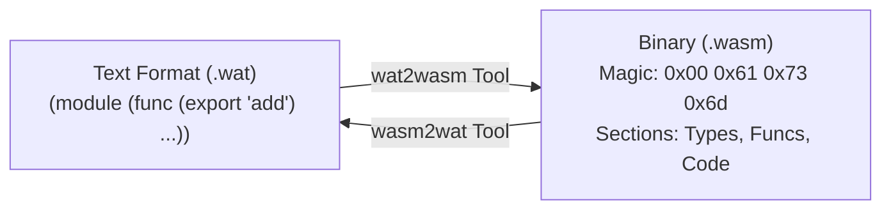
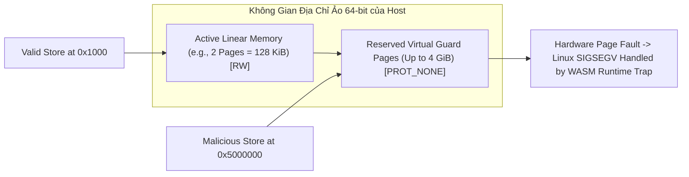

# 4.1. WebAssembly (WASM) Architecture, Virtual Machine & Memory Model

## Tổng quan về Kiến trúc WebAssembly và Mô hình Máy ảo
WebAssembly (thường viết tắt là **WASM**) là một định dạng chỉ lệnh nhị phân cấp thấp (Binary Instruction Format) có kích thước nhỏ gọn, tốc độ tải nhanh và được thiết kế theo tiêu chuẩn mở của W3C. Ban đầu được tạo ra để mang lại hiệu năng tính toán tiệm cận mã máy gốc (Near-Native Speed) cho trình duyệt web, WASM đã nhanh chóng bứt phá trở thành một công nghệ nền tảng mang tính cách mạng cho **Hạ tầng Backend, Điện toán Đám mây và Máy chủ (Server-Side WebAssembly)**.

Về mặt khoa học máy tính và lý thuyết máy ảo:
1. **Kiến trúc Máy ảo Ngăn xếp (Stack-based Virtual Machine)**: Khác với kiến trúc máy ảo dựa trên thanh ghi (Register-based VM như LuaJIT hay Dalvik), máy ảo WASM vận hành dựa trên một ngăn xếp toán hạng (**Operand Stack**). Các chỉ lệnh lấy tham số từ đỉnh stack và đẩy kết quả trở lại stack.
2. **Luồng Điều khiển Có Cấu trúc (Structured Control Flow)**: WASM hoàn toàn cấm các lệnh nhảy địa chỉ tùy ý (`goto` hay arbitrary jumps). Mọi rẽ nhánh đều phải tuân thủ nghiêm ngặt các khối lồng nhau có cấu trúc (`block`, `loop`, `if-else`, `br`). Điều này loại bỏ hoàn toàn các kỹ thuật tấn công chèn mã khai thác kinh điển như **ROP (Return-Oriented Programming)**.
3. **Mô hình Bộ nhớ Tuyến tính Độc lập (Linear Memory Model)**: Một mảng byte liên tục, độc lập, có thể mở rộng theo các trang kích thước chuẩn **64 KiB**, được cách ly hoàn toàn khỏi không gian bộ nhớ của tiến trình chủ (Host Process).



---

## 2. Chi tiết từng Keyword (Under-the-Hood Deep Dive)

---

### 1. WebAssembly Fundamentals, VM & Execution Model

#### 1. Khái niệm bản chất (What & Why)
- **WebAssembly Fundamentals**: Định dạng mã nhị phân di động (Portable), độc lập với kiến trúc phần cứng CPU (chạy tốt trên x86_64, ARM64, RISC-V), có khả năng thực thi an toàn trong một môi trường sandbox cô lập.
- **WASM Virtual Machine**: Máy ảo thực thi mã bytecode WASM. VM duy trì 3 vùng trạng thái:
  - *Values Stack*: Ngăn xếp chứa các giá trị dữ liệu trung gian.
  - *Control Stack*: Ngăn xếp lưu vết các khối lệnh và điểm nhảy điều khiển.
  - *Store*: Không gian trạng thái toàn cục chứa các Module Instances, Memories, Tables và Globals.
- **Hệ thống Kiểu Dữ liệu Cốt lõi (Core Value Types)**:
  WASM ở tầng cơ sở chỉ hỗ trợ 5 kiểu dữ liệu nguyên thủy cơ bản:
  - `i32`: Số nguyên 32-bit (dùng cho cả logic boolean, con trỏ bộ nhớ 32-bit).
  - `i64`: Số nguyên 64-bit (hỗ trợ con trỏ bộ nhớ WASM64).
  - `f32`: Số thực dấu phẩy động 32-bit (IEEE 754).
  - `f64`: Số thực dấu phẩy động 64-bit (IEEE 754).
  - `v128`: Vector 128-bit phục vụ các phép toán SIMD.

#### 2. Cơ chế hoạt động sâu (Under the hood / Hardcore Internals)
- **Cơ chế Structured Control Flow & Label Branching**:
  Chỉ lệnh `br <label>` trong WASM không nhảy tới một nhãn dòng bất kỳ. Nó nhảy thoát ra khỏi khối lệnh:
  - Khi nằm trong một `block ... end`, `br 0` sẽ **nhảy thoát ra khỏi khối** (Tương đương lệnh `break`).
  - Khi nằm trong một `loop ... end`, `br 0` sẽ **nhảy ngược lại đầu vòng lặp** (Tương đương lệnh `continue`).
  Nhờ quy tắc này, trình biên dịch VM có thể xác minh tính đúng đắn của toàn bộ luồng thực thi trong duy nhất **1 lần quét (Single-pass Validation)** với độ phức tạp thời gian tuyến tính $\mathcal{O}(N)$, ngăn chặn hoàn toàn các lỗi Stack Overflow hoặc nhảy vào giữa thân hàm.

#### 3. Sơ đồ minh họa


#### 4. Code ví dụ thực chiến (C++ Stack-based Bytecode VM Interpreter Simulation)
Đoạn mã C++20 mô phỏng nguyên lý hoạt động của một máy ảo thực thi chỉ lệnh kiểu ngăn xếp giống như WASM:

```cpp
#include <iostream>
#include <vector>
#include <cstdint>
#include <cassert>

enum class OpCode : uint8_t {
    CONST_I32 = 0x41,
    ADD_I32   = 0x6A,
    MUL_I32   = 0x6C,
    RETURN    = 0x0F
};

class MiniWasmVM {
private:
    std::vector<int32_t> stack_;
public:
    int32_t execute(const std::vector<uint8_t>& bytecode) {
        size_t ip = 0; // Instruction Pointer
        while (ip < bytecode.size()) {
            auto op = static_cast<OpCode>(bytecode[ip++]);
            switch (op) {
                case OpCode::CONST_I32: {
                    // Đọc giá trị i32 (giả lập 1 byte) và push vào stack
                    int32_t val = static_cast<int32_t>(bytecode[ip++]);
                    stack_.push_back(val);
                    break;
                }
                case OpCode::ADD_I32: {
                    assert(stack_.size() >= 2);
                    int32_t b = stack_.back(); stack_.pop_back();
                    int32_t a = stack_.back(); stack_.pop_back();
                    stack_.push_back(a + b);
                    break;
                }
                case OpCode::MUL_I32: {
                    assert(stack_.size() >= 2);
                    int32_t b = stack_.back(); stack_.pop_back();
                    int32_t a = stack_.back(); stack_.pop_back();
                    stack_.push_back(a * b);
                    break;
                }
                case OpCode::RETURN:
                    return stack_.empty() ? 0 : stack_.back();
            }
        }
        return stack_.empty() ? 0 : stack_.back();
    }
};

int main() {
    MiniWasmVM vm;
    // Chuỗi Bytecode: (5 + 10) * 2
    std::vector<uint8_t> bytecode = {
        0x41, 5,   // i32.const 5
        0x41, 10,  // i32.const 10
        0x6A,      // i32.add (stack = [15])
        0x41, 2,   // i32.const 2
        0x6C,      // i32.mul (stack = [30])
        0x0F       // return
    };

    int32_t result = vm.execute(bytecode);
    std::cout << "[MiniWasmVM] Computed Result: " << result << " (Expected 30)\n";
    return 0;
}
```

#### 5. Ưu / Nhược điểm, Pitfalls & Anti-patterns
- **Chi phí Chuyển đổi Ngữ cảnh (Host-WASM Boundary Crossing)**: Việc truyền dữ liệu phức tạp (như chuỗi ký tự, JSON, đối tượng lồng nhau) qua ranh giới giữa Host (C++/Node.js) và WASM đòi hỏi phải sao chép bộ nhớ vào Linear Memory và giải mã (Serialization Overhead).

#### 6. Ứng dụng thực tế trong Backend / Systems
- Chạy các hàm xử lý tính toán chuyên sâu (như nén ảnh, xử lý PDF, tính toán mật mã học) bên trong các Backend Server Node.js hoặc Go với tốc độ tương đương C++.

---

### 2. WASM Binary Format (.wasm) & WASM Text Format (.wat)

#### 1. Khái niệm bản chất (What & Why)
- **WASM Binary Format (`.wasm`)**: Định dạng nhị phân nhỏ gọn được mã hóa đặc biệt. Bắt đầu bằng 4 bytes ma thuật (`\0asm` tương ứng `0x00 0x61 0x73 0x6d`) theo sau bởi 4 bytes phiên bản (`0x01 0x00 0x00 0x00`).
- **WASM Text Format (`.wat`)**: Biểu diễn dạng văn bản có thể đọc được của WebAssembly dựa trên các biểu thức lồng nhau **S-Expressions** (Lisp-style). Sử dụng cho việc gỡ lỗi, kiểm toán bảo mật và học tập.
- **WASM Modules**: Đơn vị triển khai, nạp và biên dịch của WebAssembly. Gồm nhiều Section độc lập: Types, Imports, Functions, Tables, Memories, Globals, Exports, Start, và Code.

#### 2. Cơ chế hoạt động sâu (Under the hood / Hardcore Internals)
- **Mã hóa Số nguyên LEB128 (Little-Endian Base 128)**:
  Để tối ưu hóa kích thước file tải qua mạng, WASM sử dụng chuẩn nén số nguyên biến thiên độ dài **LEB128**. Một số nguyên nhỏ như `42` chỉ tiêu tốn đúng 1 byte thay vì 4 bytes (`i32`), giúp giảm kích thước file `.wasm` trung bình 30-50% so với định dạng ELF hoặc PE truyền thống.
- **Cấu trúc Sections bên trong File WASM**:
  - `Type Section (ID 1)`: Khai báo tất cả các chữ ký hàm (Function Signatures).
  - `Import Section (ID 2)`: Khai báo các hàm hoặc bộ nhớ được mượn từ Host.
  - `Function Section (ID 3)`: Ánh xạ chỉ số hàm sang chỉ số kiểu.
  - `Memory Section (ID 5)`: Định nghĩa giới hạn kích thước Linear Memory.
  - `Export Section (ID 7)`: Danh sách các hàm mà WASM cung cấp cho Host gọi vào.
  - `Code Section (ID 10)`: Thân bytecode thực thi của các hàm.

#### 3. Sơ đồ minh họa


#### 4. Code ví dụ thực chiến (WASM Text Format .wat Sample)
Ví dụ file `.wat` tính tổng hai số nguyên 32-bit:

```wasm
(module
  ;; Khai báo hàm add nhận vào 2 tham số i32, trả về 1 giá trị i32
  (func $add (param $lhs i32) (param $rhs i32) (result i32)
    local.get $lhs     ;; Push lhs lên Operand Stack
    local.get $rhs     ;; Push rhs lên Operand Stack
    i32.add            ;; Pop 2 số, cộng tổng và đẩy kết quả lên stack
  )
  ;; Export hàm add ra ngoài để Host có thể gọi
  (export "add" (func $add))
)
```

#### 5. Ưu / Nhược điểm, Pitfalls & Anti-patterns
- **Thiếu Debug Symbols mặc định**: File `.wasm` sau khi tối ưu hóa đã bị loại bỏ toàn bộ tên biến và tên hàm thành các chỉ số số nguyên (`$func0`, `$func1`). Cần sinh kèm DWARF debug info (`.debug_info`) để có thể gỡ lỗi dòng code gốc trong môi trường production.

#### 6. Ứng dụng thực tế trong Backend / Systems
- Nạp động các module tính toán logic nghiệp vụ từ file nhị phân nhỏ nhẹ (Dynamic Code Loading) mà không cần khởi động lại tiến trình máy chủ.

---

### 3. WASM Memory Model & Linear Memory

#### 1. Khái niệm bản chất (What & Why)
- **WASM Memory Model**: Mô hình bộ nhớ sandbox độc lập. WASM module không có quyền truy cập vào bảng trang (Page Tables), không gian địa chỉ ảo, hay các con trỏ bộ nhớ của tiến trình máy chủ (Host Process).
- **Linear Memory (Bộ nhớ Tuyến tính)**: Một mảng byte liên tục duy nhất đại diện cho toàn bộ không gian RAM của module.
- **Kích thước Trang Chuẩn (Page Size = 64 KiB)**:
  Linear Memory được cấp phát theo các khối chuẩn hóa $64\text{ KiB} = 65,536\text{ bytes}$.
  Các chỉ lệnh điều khiển:
  - `memory.size`: Trả về số lượng trang hiện tại.
  - `memory.grow`: Mở rộng kích thước bộ nhớ thêm $N$ trang một cách linh hoạt tại thời điểm chạy.

#### 2. Cơ chế hoạt động sâu (Under the hood / Hardcore Internals)
- **Phòng thủ Bảo vệ Vùng nhớ bằng Tín hiệu Hệ điều hành (Guard Pages & Signal Handling)**:
  Làm thế nào để đảm bảo một chương trình WASM độc hại không đọc/ghi vượt quá kích thước Linear Memory của nó (Out-Of-Bounds Memory Access)?
  - *Phương pháp kiểm tra ranh giới thô (Naive Bounds Checking)*: Trình biên dịch chèn một câu lệnh so sánh `cmp index, max_limit` trước mỗi thao tác đọc/ghi nhớ `i32.load` / `i32.store`. Cách này làm giảm 20-30% tốc độ thực thi.
  - *Phương pháp Guard Pages của WASM Runtime hiện đại (Wasmtime)*:
    Wasmtime sử dụng `mmap` để cấp phát trước một dải địa chỉ ảo khổng lồ **4 GiB (hoặc 8 GiB)** trong không gian 64-bit của CPU nhưng **chỉ commit vật lý số trang thực sự cần dùng**. Phần dải địa chỉ còn lại được gắn quyền bảo vệ `PROT_NONE`.
    Khi WASM cố tình truy cập vượt biên, phần cứng MMU của CPU sẽ kích hoạt một lỗi vi phạm trang (**Page Fault / SIGSEGV**). Runtime bắt tín hiệu `SIGSEGV` này và chuyển hóa thành một **WASM Trap** an toàn mà hoàn toàn không tốn chi phí kiểm tra bounds checking trên từng lệnh nhớ!

#### 3. Sơ đồ minh họa


#### 4. Code ví dụ thực chiến (C++ Linear Memory Emulation with Out-Of-Bounds Trapping)
```cpp
#include <iostream>
#include <vector>
#include <cstdint>
#include <cstring>
#include <stdexcept>

constexpr size_t WASM_PAGE_SIZE = 65536; // 64 KiB

class WasmLinearMemory {
private:
    std::vector<uint8_t> memory_;
public:
    explicit WasmLinearMemory(size_t initial_pages) 
        : memory_(initial_pages * WASM_PAGE_SIZE, 0) {}

    // Mô phỏng chỉ lệnh i32.store
    void store_i32(uint32_t offset, int32_t value) {
        if (offset + sizeof(int32_t) > memory_.size()) {
            throw std::out_of_range("WASM Trap: Out-of-bounds memory access in store_i32!");
        }
        std::memcpy(&memory_[offset], &value, sizeof(int32_t));
    }

    // Mô phỏng chỉ lệnh i32.load
    int32_t load_i32(uint32_t offset) {
        if (offset + sizeof(int32_t) > memory_.size()) {
            throw std::out_of_range("WASM Trap: Out-of-bounds memory access in load_i32!");
        }
        int32_t val = 0;
        std::memcpy(&val, &memory_[offset], sizeof(int32_t));
        return val;
    }

    // Mô phỏng chỉ lệnh memory.grow
    int32_t grow(size_t additional_pages) {
        size_t old_pages = memory_.size() / WASM_PAGE_SIZE;
        memory_.resize((old_pages + additional_pages) * WASM_PAGE_SIZE, 0);
        return static_cast<int32_t>(old_pages);
    }
};

int main() {
    WasmLinearMemory mem(1); // 1 trang = 64 KiB
    std::cout << "[Linear Memory] Initialized 64 KiB.\n";

    // Ghi và đọc hợp lệ
    mem.store_i32(1024, 8888);
    std::cout << "Read value at 1024: " << mem.load_i32(1024) << "\n";

    // Cố tình ghi vượt quá 64 KiB -> Phải kích hoạt Trap
    try {
        mem.store_i32(70000, 9999);
    } catch (const std::exception& e) {
        std::cerr << "[Caught Trap Exception]: " << e.what() << "\n";
    }
    return 0;
}
```

#### 5. Ưu / Nhược điểm, Pitfalls & Anti-patterns
- **Linear Memory Fragmenting**: Do Linear Memory là một khối duy nhất, nếu ứng dụng C/C++ biên dịch sang WASM liên tục gọi `malloc` và `free` mà không gom cụm, bộ nhớ bị phân mảnh bên trong nhưng Linear Memory không thể tự co lại (Shrink) sau khi đã `memory.grow`.

#### 6. Ứng dụng thực tế trong Backend / Systems
- Cô lập các plugin do người dùng thứ ba viết (User-Defined Functions - UDF) trong cơ sở dữ liệu hoặc API Gateway an toàn tuyệt đối.
