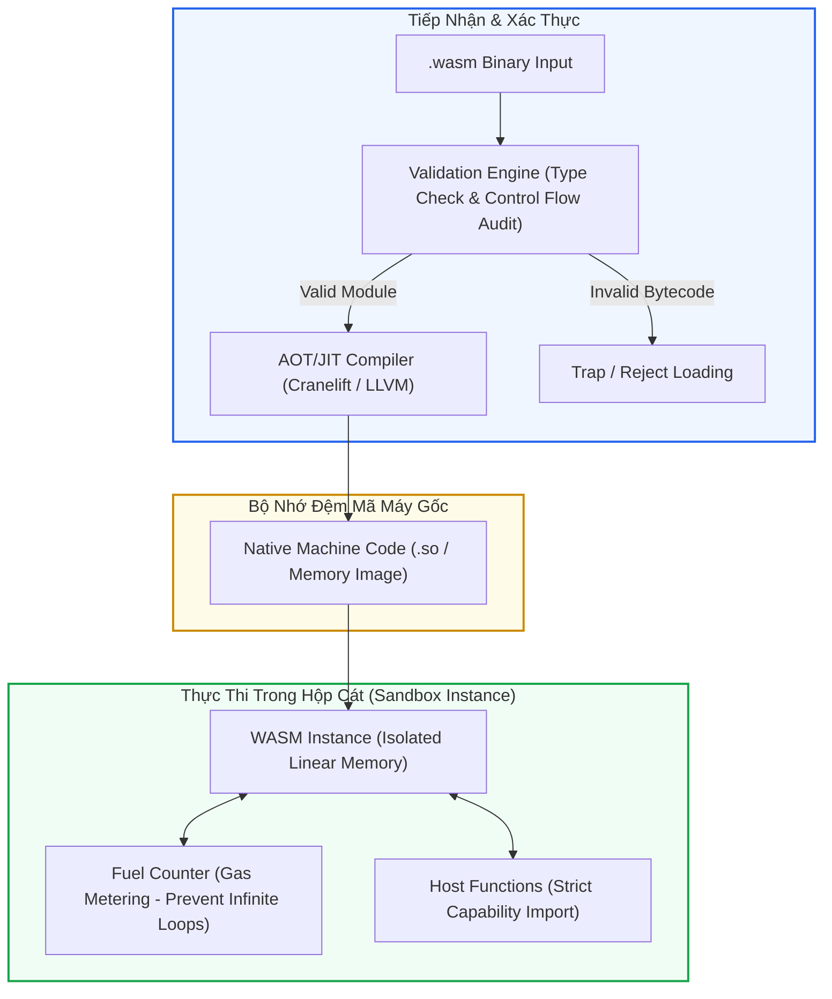
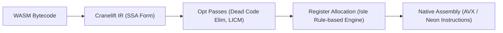
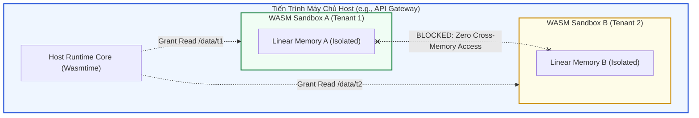
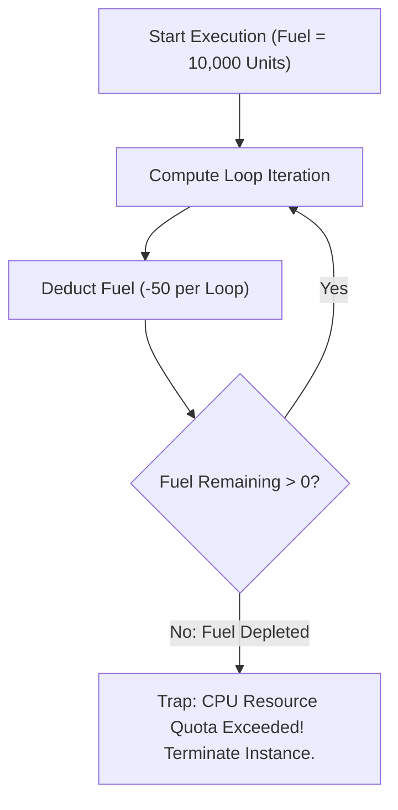

# 4.2. WASM Compilation, Sandboxing, Security & Resource Governance

## Tổng quan về Biên dịch, Cách ly An toàn và Quản trị Tài nguyên WASM
Một trong những lý do khiến WebAssembly được ví như "Container thế hệ mới" (Next-Gen Containerization) là nhờ cơ chế **Cách ly Lỗi bằng Phần mềm (Software Fault Isolation - SFI)**. Thay vì dựa dẫm vào các cơ chế ảo hóa nặng nề của hệ điều hành như Linux Namespaces, cgroups và máy chủ ảo hypervisor (vốn tiêu tốn hàng trăm megabytes RAM và có thời gian khởi động tính bằng giây), WASM thực hiện cách ly an toàn cấp độ phần mềm ngay bên trong một tiến trình duy nhất.

Về mặt kiến trúc thực thi:
1. **Xác thực Tĩnh Toàn diện (Static Validation Pass)**: Trước khi một byte mã nào được phép thực thi, máy ảo quét toàn bộ module để chứng minh về mặt toán học rằng module đó tuân thủ tính an toàn kiểu (Type Safety), không có các chỉ lệnh bộ nhớ bất hợp pháp và không thể thoát ra khỏi không gian Linear Memory.
2. **Biên dịch AOT / JIT Cực Nhanh (AOT/JIT Compilation via Cranelift)**: Bytecode được chuyển đổi thành mã máy gốc (Native Machine Code) thông qua các trình biên dịch tối ưu hóa chuyên biệt như **Cranelift** hoặc **LLVM**.
3. **Quản trị Tài nguyên Tuyệt đối (Fuel & Epoch Metering)**: Kiểm soát chặt chẽ thời gian CPU và dung lượng RAM của code không tin cậy thông qua cơ chế đếm chỉ lệnh tiêu thụ ("Fuel / Gas") hoặc ngắt định kỳ theo kỷ nguyên (Epoch-based Interruption).



---

## 2. Chi tiết từng Keyword (Under-the-Hood Deep Dive)

---

### 1. WASM Compilation & Validation

#### 1. Khái niệm bản chất (What & Why)
- **WASM Validation**: Quy trình kiểm tra tính toàn vẹn và an toàn của file nhị phân WASM trước khi thực thi. Đảm bảo: Kiểu dữ liệu trên ngăn xếp khớp hoàn hảo với chữ ký hàm, mọi điểm rẽ nhánh đều nằm trong các khối hợp lệ, và không có chỉ lệnh nào bị thiếu toán hạng.
- **WASM Compilation**:
  - *JIT (Just-In-Time) Compilation*: Biên dịch bytecode sang mã máy tại thời điểm module được nạp vào bộ nhớ.
  - *AOT (Ahead-Of-Time) Compilation*: Biên dịch file `.wasm` thành thư viện động chia sẻ (`.so` hoặc `.dylib`) trước khi triển khai lên máy chủ. Khi khởi chạy, hệ thống chỉ việc nạp file nhị phân gốc vào RAM, đưa thời gian khởi động nguội (**Cold Start**) về dưới **50 micro-giây**!

#### 2. Cơ chế hoạt động sâu (Under the hood / Hardcore Internals)
- **Kiến trúc Trình biên dịch Cranelift (Wasmtime Backend)**:
  Cranelift là trình sinh mã máy (Code Generator) viết bằng Rust, được tối ưu hóa đặc biệt cho WASM:
  - Khác với LLVM (tập trung tối ưu hóa sâu khiến thời gian biên dịch rất chậm, có thể mất hàng chục giây), Cranelift được thiết kế để cân bằng: **Tốc độ biên dịch cực nhanh kết hợp với chất lượng mã máy đầu ra đạt 85-90% so với GCC/Clang -O3**.
  - Cranelift biến đổi WASM bytecode thành biểu diễn trung gian (**Cranelift IR** dạng SSA - Static Single Assignment), áp dụng các phép tối ưu hóa cục bộ (Dead Code Elimination, Constant Folding), và phát ra mã máy x86_64/ARM64 trực tiếp.

#### 3. Sơ đồ minh họa


#### 4. Code ví dụ thực chiến (C++ Static Type & Stack Depth Validator Simulation)
Đoạn mã C++20 mô phỏng cơ chế kiểm tra kiểu và độ sâu ngăn xếp tĩnh của một Validator:

```cpp
#include <iostream>
#include <vector>
#include <string>
#include <cstdint>
#include <stdexcept>

enum class ValType { I32, I64, F32, F64 };

class BytecodeValidator {
private:
    std::vector<ValType> simulated_stack_;
public:
    void push(ValType t) {
        simulated_stack_.push_back(t);
    }

    ValType pop() {
        if (simulated_stack_.empty()) {
            throw std::runtime_error("Validation Error: Stack underflow during verification!");
        }
        ValType t = simulated_stack_.back();
        simulated_stack_.pop_back();
        return t;
    }

    void validate_i32_add() {
        // Lệnh i32.add yêu cầu 2 toán hạng i32 trên đỉnh stack
        ValType op2 = pop();
        ValType op1 = pop();
        if (op1 != ValType::I32 || op2 != ValType::I32) {
            throw std::runtime_error("Validation Error: Type mismatch in i32.add! Expected I32 operands.");
        }
        push(ValType::I32); // Đẩy kết quả I32 trở lại stack
    }

    [[nodiscard]] size_t current_depth() const noexcept { return simulated_stack_.size(); }
};

int main() {
    BytecodeValidator validator;
    try {
        validator.push(ValType::I32);
        validator.push(ValType::I32);
        validator.validate_i32_add();
        std::cout << "[Validation Passed] Correct i32.add instruction. Stack depth: " << validator.current_depth() << "\n";

        // Thử nghiệm lỗi sai kiểu
        validator.push(ValType::F64);
        validator.validate_i32_add(); // Sẽ ném ngoại lệ vì thiếu 1 toán hạng và sai kiểu!
    } catch (const std::exception& e) {
        std::cerr << "[Validation Rejected]: " << e.what() << "\n";
    }
    return 0;
}
```

#### 5. Ưu / Nhược điểm, Pitfalls & Anti-patterns
- **JIT Compilation Jitter**: Nếu biên dịch JIT tại thời điểm nhận request đầu tiên, người dùng đầu tiên sẽ phải chịu độ trễ cao (JIT Warm-up Penalty). Giải pháp: Bắt buộc sử dụng AOT Compilation (`wasmtime compile`) trong quy trình CI/CD.

#### 6. Ứng dụng thực tế trong Backend / Systems
- Nền tảng Serverless Edge (như Cloudflare Workers, Fastly Compute@Edge) nạp và chạy hàng triệu hàm người dùng với thời gian khởi động 0ms.

---

### 2. WASM Sandboxing, Runtime Isolation & Security

#### 1. Khái niệm bản chất (What & Why)
- **WASM Sandboxing**: Môi trường hộp cát an toàn khép kín. Một module WASM mặc định là một "hộp kín hoàn toàn": Nó không có quyền truy cập hệ thống tệp (File System), không có socket mạng, không thể đọc thời gian thực, không thể tương tác với phần cứng trừ khi được máy chủ (Host) cấp quyền tường minh thông qua các hàm Import.
- **Software Fault Isolation (SFI)**: Kỹ thuật nhốt mã thực thi trong một ranh giới địa chỉ logic mà không cần tạo tiến trình OS riêng biệt (Separate OS Process). Hàng ngàn sandbox WASM có thể chạy an toàn bên trong cùng một không gian địa chỉ tiến trình của máy chủ backend mà không sợ bị rò rỉ dữ liệu chéo.

#### 2. Cơ chế hoạt động sâu (Under the hood / Hardcore Internals)
- **Capability-Based Security Model (Mô hình Bảo mật Dựa trên Năng lực)**:
  WASM tuân thủ nguyên lý đặc quyền tối thiểu (Principle of Least Privilege). Khác với các chương trình nhị phân thông thường (có thể gọi bất kỳ hàm `syscall` nào của nhân Linux để mở file `/etc/passwd`), WASM không có khái niệm `syscall`.
  Nếu một module cần đọc một file, Host phải tạo ra một đối tượng File Descriptor có phạm vi cụ thể và chuyển nó vào module như một capability token. Module không thể tự ý chế tạo hoặc đoán số file descriptor khác.
- **Chống lại Tấn công Kênh Kề (Spectre Defense)**:
  Để phòng ngừa các đòn tấn công thời gian (Timing Attacks / Spectre) nhằm đo lường bộ nhớ đệm CPU Cache, các WASM runtime loại bỏ các bộ định thời có độ phân giải cao (ví dụ làm tròn thời gian hệ thống thành các bước 1ms hoặc 5ms) và cấm tạo luồng chia sẻ bộ nhớ nếu chưa kích hoạt cờ bảo mật nghiêm ngặt.

#### 3. Sơ đồ minh họa


#### 4. Code ví dụ thực chiến (C++ Host Function Binding & Sandboxed Export Execution)
Đoạn mã C++20 minh họa việc Host cung cấp một hàm an toàn (Host Function) cho module WASM gọi ra để ghi log:

```cpp
#include <iostream>
#include <string>
#include <string_view>
#include <functional>

// Host Function: Chỉ cho phép ghi log ra stdout với tiền tố xác thực, không cấp quyền truy cập file hệ thống
void host_print_log(std::string_view message) {
    std::cout << "[SECURE HOST AUDIT LOG]: " << message << "\n";
}

// Giả lập môi trường Host gọi vào một hàm được Export từ WASM Sandbox
class SandboxedPluginRunner {
private:
    std::function<void(std::string_view)> host_logger_;
public:
    explicit SandboxedPluginRunner(std::function<void(std::string_view)> logger)
        : host_logger_(std::move(logger)) {}

    void execute_untrusted_plugin() {
        // Plugin trong Sandbox muốn ghi log -> Buộc phải gọi qua Host Function đã được cấp phép
        host_logger_("Plugin execution started. Processing sanitized payload.");
    }
};

int main() {
    SandboxedPluginRunner runner(host_print_log);
    runner.execute_untrusted_plugin();
    return 0;
}
```

#### 5. Ưu / Nhược điểm, Pitfalls & Anti-patterns
- **Over-privileged Host Exports**: Host cung cấp một hàm export cho phép WASM thực thi shell command tùy ý (`system(cmd)`). Điều này phá vỡ hoàn toàn mọi tầng phòng thủ sandbox của WebAssembly.

#### 6. Ứng dụng thực tế trong Backend / Systems
- Nền tảng Env Proxy / Istio Service Mesh sử dụng **Envoy WebAssembly Filter** để chạy các plugin kiểm tra header và xác thực token JWT mà không lo sợ plugin bị crash làm sập toàn bộ proxy.

---

### 3. Resource Governance: Fuel, Epoch Metering & Cold Start Optimization

#### 1. Khái niệm bản chất (What & Why)
- **WASM Resource Limits**: Cơ chế hạn chế mức độ tiêu thụ tài nguyên phần cứng (CPU time, RAM) của code chạy trong sandbox, ngăn chặn các cuộc tấn công từ chối dịch vụ (DoS) do vòng lặp vô tận hoặc cấp phát rác làm tràn bộ nhớ.
- **Fuel Metering (Đo lường Nhiên liệu / Gas)**: Cơ chế trừ điểm tương tự như Gas trong Ethereum Smart Contracts: Mỗi chỉ lệnh máy được gán một lượng "fuel" tiêu thụ. Khi mức fuel giảm về 0, runtime lập tức dừng thực thi và ném ngoại lệ Trap.
- **Epoch-based Interruption**: Cơ chế hẹn giờ ngắt theo kỷ nguyên dựa trên luồng nền của hệ điều hành. Cứ sau mỗi chu kỳ (ví dụ 10ms), Host tăng một biến đếm toàn cục; các instance WASM kiểm tra biến đếm này và tự động dừng lại nếu vượt quá số chu kỳ cho phép.
- **Cold Start Optimization**: Kỹ thuật giảm thời gian khởi tạo một container WASM từ hàng trăm mili-giây xuống mức micro-giây thông qua cơ chế Copy-on-Write (`fork` / memory snapshotting).

#### 2. Cơ chế hoạt động sâu (Under the hood / Hardcore Internals)
- **So sánh Fuel vs Epoch-based Interruption**:
  - *Fuel Injection*: Trình biên dịch chèn thêm các chỉ lệnh kiểm tra số học vào đầu mỗi khối cơ bản (Basic Block) của code. Cách này có độ chính xác tuyệt đối (Deterministic Execution), nhưng làm giảm 15-25% tốc độ thực thi của code.
  - *Epoch Interruption*: Không chèn thêm code vào thân vòng lặp. Runtime chỉ kiểm tra cờ ngắt bất đồng bộ. Đạt **100% hiệu năng mã máy gốc (Zero Overhead)**, cực kỳ phù hợp cho các hệ thống Backend phục vụ hàng chục ngàn QPS.

#### 3. Sơ đồ minh họa


#### 4. Code ví dụ thực chiến (TypeScript Fuel Metering Logic for Untrusted Code Execution)
```typescript
class FuelExhaustedError extends Error {
  constructor() {
    super("WASM Trap: Out of Fuel! Infinite loop or excessive computation terminated.");
  }
}

class MeteredWasmRuntime {
  private fuelRemaining: number;

  constructor(initialFuel: number) {
    this.fuelRemaining = initialFuel;
  }

  // Được gọi tự động trước mỗi khối chỉ lệnh
  public consumeFuel(units: number): void {
    this.fuelRemaining -= units;
    if (this.fuelRemaining <= 0) {
      throw new FuelExhaustedError();
    }
  }

  public runUntrustedComputation(iterations: number): void {
    console.log(`[Runtime] Starting execution with ${this.fuelRemaining} fuel units.`);
    for (let i = 0; i < iterations; i++) {
      this.consumeFuel(10); // Mỗi vòng lặp tiêu tốn 10 fuel
    }
    console.log(`[Runtime] Execution finished successfully. Remaining fuel: ${this.fuelRemaining}`);
  }
}

// Test Fuel Quota
const runtime = new MeteredWasmRuntime(500); // Cấp 500 fuel units
try {
  runtime.runUntrustedComputation(30);  // Tiêu tốn 300 -> Hợp lệ
  runtime.runUntrustedComputation(100); // Tiêu tốn thêm 1000 -> Sẽ ném Trap ngoại lệ
} catch (err) {
  if (err instanceof FuelExhaustedError) {
    console.error(`[Security Action]: ${err.message}`);
  }
}
```

#### 5. Ưu / Nhược điểm, Pitfalls & Anti-patterns
- **Fuel Non-determinism across Host Architectures**: Nếu cấu hình số lượng fuel trên mỗi chỉ lệnh không đồng nhất giữa CPU x86 và ARM, cùng một đoạn mã có thể chạy thành công trên máy chủ này nhưng lại bị trừ hết fuel và sập trên máy chủ khác.

#### 6. Ứng dụng thực tế trong Backend / Systems
- Các nền tảng nạp biểu thức tính thuế hoặc tính giá bảo hiểm tùy biến do đối tác tải lên, đảm bảo đối tác không thể viết code treo làm nghẽn thread pool của server.
