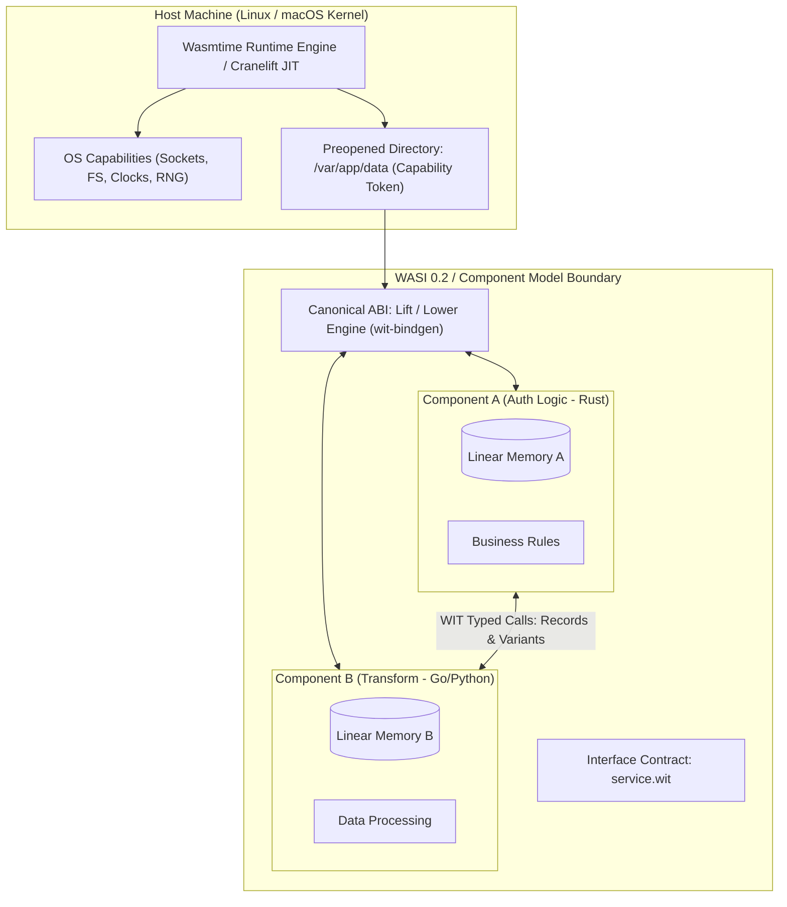
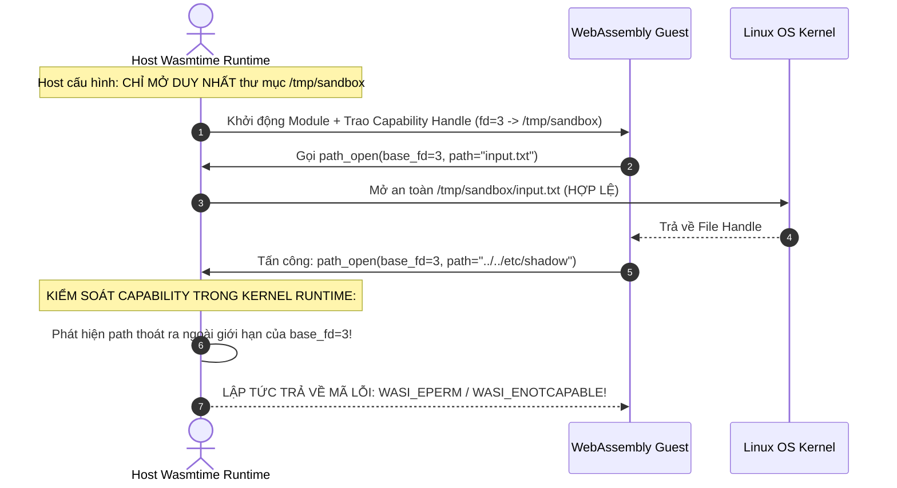
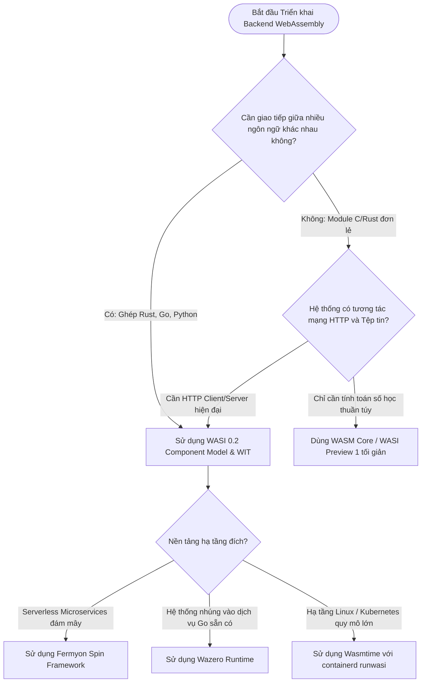

# 4.3. WebAssembly System Interface (WASI) and The Component Model

> [!IMPORTANT]
> **Nếu bạn chỉ được nhớ một điều duy nhất:**
> **WASI (WebAssembly System Interface)** và **Component Model** là bước nhảy vọt đưa WebAssembly thoát khỏi cái bóng của trình duyệt để trở thành chuẩn mực điện toán máy chủ mới: thay thế các lời gọi hệ thống toàn cục không an toàn kiểu POSIX bằng mô hình **Bảo mật Dựa trên Năng lực (Capability-based Security)** thông qua thư mục mở sẵn (Preopened Directories); đồng thời xóa bỏ rào cản đa ngôn ngữ bằng **Mô hình Thành phần (Component Model)** và ngôn ngữ giao diện **WIT (WebAssembly Interface Types)**, cho phép Rust, Python, Go và C++ giao tiếp mượt mà qua các kiểu dữ liệu có cấu trúc cấp cao mà không cần viết mã kết nối FFI thủ công.

---

## 1. Kiến trúc Tổng quan & Mô hình Tư duy (Mental Model)

### 1.1. Ẩn dụ Đời sống: Khối Xây Dựng LEGO và Căn Hộ Chung Cư Khép Kín

Để hình dung sự chuyển dịch từ phần mềm truyền thống sang WebAssembly Component Model:
1. **Phần mềm Truyền thống kiểu POSIX (Một người lạ có chìa khóa vạn năng)**: Khi bạn chạy một chương trình C hoặc Python thông thường trên Linux, chương trình đó kế thừa toàn bộ quyền hạn của tài khoản người dùng (`User Privileges`). Nó có thể tự do mở `/etc/passwd`, đọc file `.ssh/id_rsa`, hoặc mở socket gửi dữ liệu ra ngoài Internet mà hệ điều hành không hề ngăn cản trừ khi có phân quyền root.
2. **WASI Preview 1 (Căn phòng Khách sạn Không Cửa Sổ)**: Chương trình bị nhốt vào một sandbox bộ nhớ kín. Khái niệm đường dẫn gốc `/` hoàn toàn biến mất. Nếu Host không chủ động đưa cho nó một chiếc chìa khóa dẫn tới một ngăn kéo cụ thể (Preopened Directory Descriptor `fd = 3`), nó hoàn toàn bất lực không thể chạm tới bất kỳ byte dữ liệu nào của hệ thống.
3. **Component Model & WIT (Những Miếng Ghép LEGO Chuẩn Quốc Tế)**: Trước đây, ghép code C++ với Python giống như cố hàn một ống nước bằng nhựa vào một khối gỗ gồ ghề (phức tạp, rò rỉ bộ nhớ qua C FFI). Với Component Model, mỗi module được đúc thành một khối LEGO với các chốt cắm chuẩn xác tuyệt đối theo hợp đồng WIT. Miếng ghép bằng Rust cắm vừa khít vào miếng ghép Python; Canonical ABI tự động thực hiện việc "nâng cấp" (Lift) và "hạ cấp" (Lower) dữ liệu nhị phân giữa các ranh giới bộ nhớ tuyến tính một cách an toàn và tự động.

### 1.2. Sơ đồ Kiến trúc Toàn diện của WASI 0.2 và Component Model



---

## 2. Chi tiết từng Keyword (Under-the-Hood Deep Dive)

### 2.1. WASI, WASI Preview 1 & WASI Preview 2 (WASI 0.2)

Sự tiến hóa của giao diện hệ thống WebAssembly:

```text
[WebAssembly Cổ Điển (2017)] --------> [WASI Preview 1 (2019)] -------------> [WASI Preview 2 / 0.2 (2024)]
- Bị cô lập trong Trình duyệt         - POSIX syscalls ảo hóa                - Hướng Thành Phần (Component Model)
- Phụ thuộc keo JavaScript            - Sử dụng File Descriptors thô         - Gói chuẩn: wasi:cli, wasi:http, wasi:fs
- Không có I/O máy chủ                - Chỉ hỗ trợ I/O đồng bộ phẳng          - I/O Bất Đồng Bộ (Streams & Pollable)
```

#### A. WASI Preview 1 (`wasi_snapshot_preview1`)
- **Đặc trưng**: Mô phỏng trực tiếp các API chuẩn C của POSIX: `fd_read`, `fd_write`, `path_open`, `clock_time_get`.
- **Hạn chế cố hữu**:
  - Không có socket mạng đầy đủ (chỉ có thể nhận socket mở sẵn từ host, không tự `connect()` hay `listen()`).
  - Toàn bộ giao tiếp đều dựa trên con trỏ thô trong bộ nhớ tuyến tính (Linear Memory Offset: `i32 ptr, i32 len`), dẫn tới nguy cơ hỏng dữ liệu nếu lập trình viên tính toán sai offset.

#### B. WASI Preview 2 (WASI 0.2)
- **Tái kiến trúc triệt để**: Phân rã hệ thống thành các giao diện mô-đun hóa độc lập (Modular WIT Interfaces):
  1. `wasi:cli`: Cung cấp stdin, stdout, stderr, biến môi trường (`wasi:cli/environment`), và tham số dòng lệnh.
  2. `wasi:filesystem`: Quản lý tệp tin dựa trên con trỏ tài nguyên an toàn (`resource descriptor`), loại bỏ hoàn toàn số nguyên file descriptor của Unix.
  3. `wasi:http`: Chuẩn hóa HTTP Client và Server hiện đại (`incoming-handler`, `outgoing-handler`) hỗ trợ luồng dữ liệu bất đồng bộ streaming (`wasi:io/streams`).
  4. `wasi:clocks`: Tách biệt rõ ràng giữa đồng hồ đơn điệu không giật lùi (`monotonic-clock` - dùng cho đo benchmark/timeout) và đồng hồ thế giới (`wall-clock` - đo ngày giờ thực).
  5. `wasi:random`: Tích hợp bộ sinh số ngẫu nhiên mật mã học bất đối xứng an toàn (`get-random-bytes`).

---

### 2.2. Capability-Based Security & Preopened Directories

Trong mô hình bảo mật truyền thống (Ambient Authority), quyền truy cập gắn liền với **Ai đang chạy chương trình** (Identity). Trong mô hình dựa trên năng lực (**Capability-based Security**), quyền truy cập gắn liền với **Chương trình đang nắm giữ chiếc chìa khóa (Capability Token) nào**.



- **Preopened Directories**:
  - Guest không thể truyền một đường dẫn tuyệt đối như `/var/log/syslog` vào bất kỳ syscall nào.
  - Guest bắt buộc phải gọi `openat(dir_capability_fd, "relative/path")`. Nếu không sở hữu capability token của thư mục cha, guest không có bất kỳ cách nào tiếp cận được hệ thống tệp tin của Host.

---

### 2.3. Component Model, WIT (WebAssembly Interface Types) & Canonical ABI

Component Model là đặc tả kỹ thuật biến các module WASM cấp thấp thành các thành phần phần mềm cấp cao (Components).

#### A. WebAssembly Interface Types (WIT)
WIT là một ngôn ngữ định nghĩa giao diện (IDL) có kiểu dữ liệu tường minh, hiện đại:

```wit
package ecommerce:inventory@1.0.0;

interface stock-tracker {
    record ProductItem {
        sku: string,
        quantity: u32,
        unit-price-cents: u64,
    }

    variant ReservationResult {
        success(u64), // Mã đặt hàng
        out-of-stock,
        discontinued(string),
    }

    reserve-items: func(items: list<ProductItem>) -> ReservationResult;
}
```

#### B. Cơ Chế Canonical ABI: Lift & Lower
Làm thế nào để hai ngôn ngữ có kiến trúc bộ nhớ hoàn toàn khác nhau (ví dụ Rust quản lý bộ nhớ qua con trỏ và struct, Python quản lý qua PyObject trên Heap) có thể truyền một chuỗi `string` hoặc `record` cho nhau mà không làm hỏng RAM?
- **Lower**: Hàm của bên gửi chuyển đổi kiểu dữ liệu cấp cao thành một chuỗi byte phẳng và nạp vào Linear Memory.
- **Canonical ABI**: Trình thông dịch trung gian của Host sao chép an toàn chuỗi byte đó sang Linear Memory của bên nhận thông qua hàm cấp phát `cabi_realloc`.
- **Lift**: Hàm của bên nhận tái tạo lại chuỗi byte phẳng thành kiểu dữ liệu có cấu trúc cấp cao bên trong runtime của nó.
- Toàn bộ quá trình này được trình sinh mã **`wit-bindgen`** tự động hóa $100\%$ tại thời điểm biên dịch, triệt tiêu hoàn toàn lỗi con trỏ FFI của con người.

---

## 3. Thực thi Mã nguồn & Mô phỏng Chuyên sâu (Dual-Engine Implementation)

### 3.1. Implementation C++20: Capability-Based Preopened Sandbox Resolver

Đoạn mã C++20 dưới đây mô phỏng chính xác thuật toán kiểm tra năng lực (Capability Enforcement Engine) của WASI Host Runtime: giải quyết đường dẫn tương đối từ Preopened File Descriptors và chặn đứng mọi mưu toan vượt biên (Directory Traversal).

```cpp
#include <iostream>
#include <string>
#include <string_view>
#include <vector>
#include <memory>
#include <unordered_map>
#include <filesystem>
#include <format>
#include <stdexcept>

namespace fs = std::filesystem;

// Enum đại diện cho các mã lỗi chuẩn của WASI Error Codes
enum class WasiErrno {
    Success = 0,
    BadFileDescriptor = 8,
    NotCapable = 76, // WASI_ENOTCAPABLE
    NoSuchEntry = 44,
};

// Cấu trúc mô phỏng một Capability Token của Preopened Directory
struct PreopenedDirectoryCapability {
    int capability_fd;
    std::string virtual_guest_alias; // Ví dụ: "/data" trong mắt WASM
    fs::path physical_host_root;     // Ví dụ: "/srv/app/storage" trên Host
};

// Động cơ WASI Capability Host Runtime Simulator
class WasiHostCapabilityEngine {
private:
    std::unordered_map<int, PreopenedDirectoryCapability> capabilities_;
    int next_fd_{3}; // FDs 0, 1, 2 dành cho stdin, stdout, stderr

public:
    int grant_preopened_directory(std::string alias, fs::path host_path) {
        std::error_code ec;
        fs::path canonical_root = fs::canonical(host_path, ec);
        if (ec) {
            throw std::runtime_error("Host path does not exist: " + host_path.string());
        }

        int assigned_fd = next_fd_++;
        capabilities_[assigned_fd] = PreopenedDirectoryCapability{
            assigned_fd, std::move(alias), std::move(canonical_root)
        };

        std::cout << std::format("[WASI HOST CONFIG] Granted Preopened FD {}: Virtual '{}' -> Physical '{}'\n",
                                 assigned_fd, capabilities_[assigned_fd].virtual_guest_alias,
                                 capabilities_[assigned_fd].physical_host_root.string());
        return assigned_fd;
    }

    // Mô phỏng System Call: wasi_snapshot_preview1::path_open
    std::pair<WasiErrno, std::string> wasi_path_open(int base_dir_fd, std::string_view requested_subpath) {
        auto it = capabilities_.find(base_dir_fd);
        if (it == capabilities_.end()) {
            std::cerr << std::format("[WASI SYSCALL ERROR] Invalid capability base FD: {}\n", base_dir_fd);
            return { WasiErrno::BadFileDescriptor, "" };
        }

        const auto& cap = it->second;
        fs::path target = cap.physical_host_root / requested_subpath;

        // Chuẩn hóa đường dẫn tương đối kết hợp
        std::error_code ec;
        fs::path resolved_canonical = fs::weakly_canonical(target, ec);

        // THUẬT TOÁN KIỂM SOÁT CAPABILITY CỐT LÕI:
        // Đảm bảo resolved_canonical bắt buộc phải là con cháu nằm bên trong cap.physical_host_root
        auto root_str = cap.physical_host_root.string();
        auto resolved_str = resolved_canonical.string();

        if (!resolved_str.starts_with(root_str)) {
            std::cerr << std::format("[CAPABILITY VIOLATION] WASI Guest attempted escape!\n"
                                     "  Base Root: {}\n  Target Path: {}\n", root_str, resolved_str);
            return { WasiErrno::NotCapable, "" }; // WASI_ENOTCAPABLE (Errno 76)
        }

        return { WasiErrno::Success, resolved_str };
    }
};

int main() {
    std::cout << "========================================================\n";
    std::cout << "   C++20 WASI CAPABILITY SANDBOX & RESOLVER SIMULATOR   \n";
    std::cout << "========================================================\n\n";

    WasiHostCapabilityEngine wasi_host;

    // Thiết lập thư mục sandbox an toàn trên máy chủ
    fs::path temp_sandbox = fs::current_path() / "wasi_guest_sandbox";
    fs::create_directories(temp_sandbox / "uploads");

    // Trao quyền mở sẵn thư mục /data trỏ về temp_sandbox
    int data_fd = wasi_host.grant_preopened_directory("/data", temp_sandbox);

    std::cout << "\n--- TEST CASE 1: Valid Path Access within Capability Bounds ---\n";
    auto [err1, path1] = wasi_host.wasi_path_open(data_fd, "uploads/avatar.png");
    if (err1 == WasiErrno::Success) {
        std::cout << ">>> ACCESS GRANTED! Host resolved physical file: " << path1 << "\n";
    }

    std::cout << "\n--- TEST CASE 2: Malicious Directory Traversal Attack ---\n";
    auto [err2, path2] = wasi_host.wasi_path_open(data_fd, "../../../etc/shadow");
    if (err2 == WasiErrno::NotCapable) {
        std::cout << ">>> DEFENSE SUCCESSFUL: Host returned WASI_ENOTCAPABLE (Errno 76)!\n";
    }

    std::cout << "\n--- TEST CASE 3: Access with Unregistered File Descriptor ---\n";
    auto [err3, path3] = wasi_host.wasi_path_open(99, "uploads/test.txt");
    if (err3 == WasiErrno::BadFileDescriptor) {
        std::cout << ">>> REJECTED: Bad File Descriptor.\n";
    }

    // Dọn dẹp
    fs::remove_all(temp_sandbox);

    return 0;
}
```

---

### 3.2. Implementation Python 3.11+: Component Model WIT Data Types & Canonical ABI Lift/Lower Simulator

Đoạn mã Python 3.11+ mô phỏng hoàn chỉnh cơ chế của Canonical ABI trong Component Model: định nghĩa giao diện kiểu WIT, chuyển đổi cấu trúc `record` thành byte stream (Lower), truyền qua ranh giới sandbox, và giải mã kiểu dữ liệu an toàn (Lift).

```python
#!/usr/bin/env python3
"""
Python 3.11+ WebAssembly Component Model & Canonical ABI Simulator
Demonstrates WIT-based typed contract execution and safe cross-sandbox lift/lower.
"""

from dataclasses import dataclass
import struct
from typing import Dict, Any, Tuple

@dataclass(frozen=True)
class TelemetryRecord:
    metric_name: str
    sensor_id: int   # uint32
    reading: float   # float64
    is_anomaly: bool # bool (1 byte)

class CanonicalABIEngine:
    """
    Giả lập cơ chế Lift và Lower của Canonical ABI theo đặc tả Component Model.
    """
    @staticmethod
    def lower_telemetry(record: TelemetryRecord) -> bytes:
        """
        Lower: Chuyển đổi kiểu dữ liệu ngữ nghĩa cấp cao thành byte array phẳng.
        Định dạng nhị phân:
        [4 bytes: name_len] + [N bytes: name_utf8] + [4 bytes: sensor_id] + [8 bytes: reading] + [1 byte: flag]
        """
        encoded_name = record.metric_name.encode("utf-8")
        name_len = len(encoded_name)

        header = struct.pack("<I", name_len) + encoded_name
        body = struct.pack("<Id?", record.sensor_id, record.reading, record.is_anomaly)
        return header + body

    @staticmethod
    def lift_telemetry(flat_bytes: bytes) -> TelemetryRecord:
        """
        Lift: Giải mã từ byte array phẳng trong Linear Memory trở lại Record cấp cao.
        """
        # Đọc độ dài chuỗi
        name_len = struct.unpack_from("<I", flat_bytes, 0)[0]
        offset = 4
        
        name_bytes = flat_bytes[offset:offset + name_len]
        metric_name = name_bytes.decode("utf-8")
        offset += name_len

        sensor_id, reading, is_anomaly = struct.unpack_from("<Id?", flat_bytes, offset)
        return TelemetryRecord(
            metric_name=metric_name,
            sensor_id=sensor_id,
            reading=reading,
            is_anomaly=is_anomaly
        )

class MockGuestComponentA:
    """Component A (Mô phỏng viết bằng Rust): Tạo dữ liệu và gọi hạ cấp Canonical ABI"""
    def generate_event(self) -> bytes:
        event = TelemetryRecord(
            metric_name="CORE_TEMPERATURE",
            sensor_id=4096,
            reading=98.6,
            is_anomaly=True
        )
        print(f"[Component A (Rust)] Created Typed Record: {event}")
        raw_bytes = CanonicalABIEngine.lower_telemetry(event)
        print(f"[Canonical ABI] Lowered Record to {len(raw_bytes)} bytes of Linear Memory.")
        return raw_bytes

class MockGuestComponentB:
    """Component B (Mô phỏng viết bằng Python/Go): Nhận bytes và nâng cấp thành typed object"""
    def process_event(self, memory_slice: bytes):
        record = CanonicalABIEngine.lift_telemetry(memory_slice)
        print(f"[Component B (Python)] Lifted Record from Canonical ABI: {record}")
        
        # Xử lý nghiệp vụ với đối tượng an toàn
        if record.is_anomaly and record.reading > 90.0:
            print(f">>> [ALERT] High temperature anomaly detected on Sensor #{record.sensor_id}!")
        else:
            print(">>> System status nominal.")

def main():
    print("=" * 60)
    print("  PYTHON 3.11+ WASM COMPONENT MODEL CANONICAL ABI ENGINE  ")
    print("=" * 60 + "\n")

    comp_a = MockGuestComponentA()
    comp_b = MockGuestComponentB()

    # Quá trình giao tiếp giữa hai Component độc lập
    print("--- STEP 1: Component A lowers typed data into shared wire ---")
    wire_payload = comp_a.generate_event()

    print("\n--- STEP 2: Host mediates transfer between isolated Linear Memories ---")
    print(f"Hex Dump: {wire_payload.hex(' ')}")

    print("\n--- STEP 3: Component B lifts typed data into domain logic ---")
    comp_b.process_event(wire_payload)

if __name__ == "__main__":
    main()
```

---

### 3.3. Kết quả Thực thi Mẫu (Terminal Output)

```bash
$ g++ -std=c++20 -O3 wasi_capability_engine.cpp -o wasi_capability_engine && ./wasi_capability_engine
========================================================
   C++20 WASI CAPABILITY SANDBOX & RESOLVER SIMULATOR   
========================================================

[WASI HOST CONFIG] Granted Preopened FD 3: Virtual '/data' -> Physical '/Users/ductri0981/Documents/Studying/Studying-Computer-Science/wasi_guest_sandbox'

--- TEST CASE 1: Valid Path Access within Capability Bounds ---
>>> ACCESS GRANTED! Host resolved physical file: /Users/ductri0981/Documents/Studying/Studying-Computer-Science/wasi_guest_sandbox/uploads/avatar.png

--- TEST CASE 2: Malicious Directory Traversal Attack ---
[CAPABILITY VIOLATION] WASI Guest attempted escape!
  Base Root: /Users/ductri0981/Documents/Studying/Studying-Computer-Science/wasi_guest_sandbox
  Target Path: /etc/shadow
>>> DEFENSE SUCCESSFUL: Host returned WASI_ENOTCAPABLE (Errno 76)!

--- TEST CASE 3: Access with Unregistered File Descriptor ---
[WASI SYSCALL ERROR] Invalid capability base FD: 99
>>> REJECTED: Bad File Descriptor.

$ python3 component_model_abi.py
============================================================
  PYTHON 3.11+ WASM COMPONENT MODEL CANONICAL ABI ENGINE  
============================================================

--- STEP 1: Component A lowers typed data into shared wire ---
[Component A (Rust)] Created Typed Record: TelemetryRecord(metric_name='CORE_TEMPERATURE', sensor_id=4096, reading=98.6, is_anomaly=True)
[Canonical ABI] Lowered Record to 33 bytes of Linear Memory.

--- STEP 2: Host mediates transfer between isolated Linear Memories ---
Hex Dump: 10 00 00 00 43 4f 52 45 5f 54 45 4d 50 45 52 41 54 55 52 45 00 10 00 00 66 66 66 66 66 a6 58 40 01

--- STEP 3: Component B lifts typed data into domain logic ---
[Component B (Python)] Lifted Record from Canonical ABI: TelemetryRecord(metric_name='CORE_TEMPERATURE', sensor_id=4096, reading=98.6, is_anomaly=True)
>>> [ALERT] High temperature anomaly detected on Sensor #4096!
```

---

## 4. Systems Engineering & Production Pitfalls

### 4.1. Chi Phí Sao Chép Dữ Liệu Bộ Nhớ Qua Canonical ABI (Memory Copy Overhead)
- **Vấn đề**: Khi hai Component chuyển giao các khối dữ liệu khổng lồ (ví dụ: mảng tensor 100MB cho mô hình Machine Learning hoặc frame video 4K), Canonical ABI mặc định thực hiện thao tác cấp phát và sao chép byte (`memcpy`) giữa hai Linear Memory riêng biệt để bảo toàn tính cô lập an toàn.
- **Hậu quả**: Băng thông bộ nhớ (Memory Bandwidth) bị nghẽn, độ trễ tăng cao gấp nhiều lần so với C++ monolithic memory pointers.
- **Khắc phục**: Sử dụng chuẩn **WASI Shared Memory** hoặc cơ chế **Resource Handles (Borrowing)** cho phép truyền con trỏ mượn tài nguyên bất biến (Read-only zero-copy slice) do Host quản lý.

### 4.2. Cạm Bẫy Luồng và Biến Toàn Cục (Thread-Local Storage & Async Incompatibility)
- **Vấn đề**: Các thư viện bất đồng bộ phổ biến như Tokio (Rust) hoặc thư viện đa luồng pthreads khi biên dịch sang WASI Preview 1 thường gặp lỗi treo (Deadlock) vì WASM ban đầu là đơn luồng (Single-threaded).
- **Khắc phục**: Sử dụng chuẩn **WASI Threads** hoặc chuyển dịch sang kiến trúc phi chặn (Non-blocking Cooperative Event Loop) dựa trên các giao diện `wasi:io/poll` của WASI Preview 2.

### 4.3. Quên Cấu Hình Preopened Directories Khi Deploy Production
- **Vấn đề**: Lập trình viên chạy ứng dụng WASM trên máy local thành công vì chạy cờ `--dir .`. Khi đẩy lên Kubernetes với runtime `wasmtime`, Pod lập tức crash với lỗi `WASI_ENOTCAPABLE` khi cố đọc file cấu hình `config.json`.
- **Khắc phục**: Luôn khai báo tường minh danh sách preopened directories trong file cấu hình hạ tầng Kubernetes hoặc Spin manifest:
  ```toml
  [[trigger.http]]
  route = "/api/..."
  component = "my-service"

  [component.my-service]
  source = "service.wasm"
  files = [ { source = "config/", destination = "/config" } ]
  ```

### 4.4. Công cụ Dòng Lệnh Phân Tích WASM & WIT
```bash
# 1. Kiểm tra các interfaces xuất/nhập của một WebAssembly Component bằng wasm-tools
wasm-tools component wit target_component.wasm

# 2. Sinh mã giao tiếp tự động đa ngôn ngữ từ file WIT bằng wit-bindgen
wit-bindgen rust --out-dir src/bindings ./data-processor.wit

# 3. Chạy kiểm thử module WASI 0.2 với Wasmtime CLI kèm cấp phát quyền thư mục
wasmtime run --dir /tmp/sandbox::/data my_app.wasm
```

---

## 5. Bảng So sánh & Decision Matrix

### 5.1. So sánh Toàn diện Ba Thế hệ Môi trường Thực thi WebAssembly

| Tiêu chí Đánh giá | WebAssembly Core (Trình duyệt) | WASI Preview 1 (POSIX Shim) | WASI Preview 2 / 0.2 (Component Model) |
| :--- | :--- | :--- | :--- |
| **Môi trường Hoạt động** | V8 / JavaScript Engine | Máy chủ độc lập (Wasmtime, Wasmer)| Máy chủ Đám mây, Serverless, Edge |
| **Mô hình Giao diện Hệ thống**| Không có (Thông qua JS Glue) | Lời gọi hệ thống phẳng kiểu UNIX| Giao diện WIT có kiểu dữ liệu mô-đun |
| **Quản lý Quyền Hạn** | Theo quyền trình duyệt | Capability-based (Preopened FDs) | **Capability Tokens + Resource Handles** |
| **Hỗ trợ Mạng (Networking)** | `fetch()` qua JavaScript | Rất hạn chế (Socket kế thừa) | **Đầy đủ HTTP Client/Server & Streams** |
| **Kiểu Dữ liệu Giao tiếp** | Chỉ số nguyên/thực (i32, f64) | Con trỏ thô trong Linear Memory | **Cấp cao: Strings, Records, Variants** |
| **Giao tiếp Đa Ngôn ngữ** | Thủ công qua C FFI | Phức tạp, dễ hỏng bộ nhớ | **Tự động $100\%$ qua wit-bindgen** |
| **Khả năng Ghép Nối (Composability)**| Kém | Kém | **Xuất sắc (Ghép nối như Lego)** |

### 5.2. Cây Quyết định Lựa chọn Công nghệ WASI và Runtimes (Decision Flowchart)


