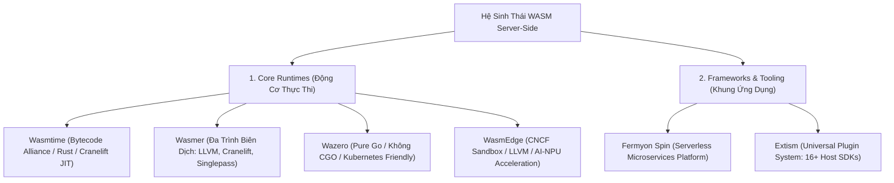
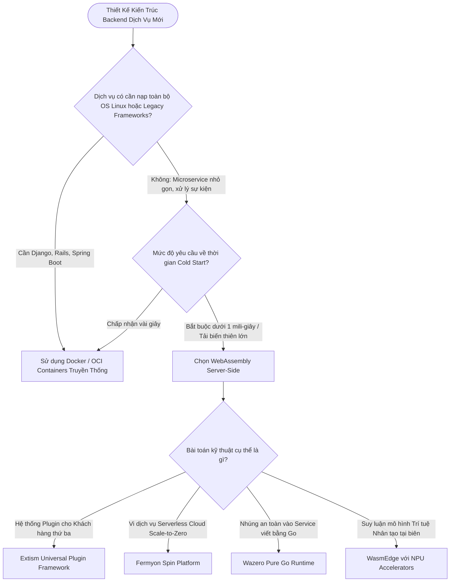

# 4.4. Server-Side WASM, Backend Microservices, and The Ecosystem

> [!IMPORTANT]
> **Nếu bạn chỉ được nhớ một điều duy nhất:**
> **Server-Side WebAssembly** không nhằm mục đích tiêu diệt Docker mà định nghĩa lại ranh giới của điện toán vi mô: trong khi các container OCI đóng gói toàn bộ một hệ điều hành thu nhỏ (User-space OS) với chi phí khởi động hàng trăm mili-giây và ngốn hàng trăm megabytes RAM, WASM Microservices chỉ đóng gói logic nhị phân thuần túy, mang lại **thời gian khởi động nguội (Cold Start) dưới $100\ \mu\text{s}$**, **kích thước binary chỉ vài megabytes**, và cho phép **triển khai đồng thời hàng chục ngàn sandbox độc lập trên một máy chủ duy nhất** thông qua các runtime chuyên biệt như Wasmtime, Wazero, WasmEdge và nền tảng Fermyon Spin.

---

## 1. Kiến trúc Tổng quan & Mô hình Tư duy (Mental Model)

### 1.1. Ẩn dụ Đời sống: Xe Container Hàng Nặng vs Gói Hàng Chuyển Phát Siêu Tốc Bằng Drone

Để hình dung sự khác biệt mang tính cách mạng giữa Docker Container và Server-Side WASM:
1. **Docker Container (Xe đầu kéo Container 40 feet)**: Mỗi khi bạn cần vận chuyển một lá thư (1 hàm xử lý thanh toán đơn giản), bạn phải huy động cả một chiếc xe container khổng lồ chở theo khối động cơ diesel, buồng lái, bánh xe dự phòng và tài xế (Linux Kernel, glibc, systemd, package manager). Khởi động chiếc xe mất 5 đến 10 giây (Cold start trễ), tiêu tốn nhiên liệu và chỗ đỗ bãi xe rất lớn.
2. **Server-Side WASM (Chiếc Drone Giao Hàng Siêu Tốc)**: Bỏ qua toàn bộ khung xe cồng kềnh, chỉ gói chiếc thư vào một hộp bảo vệ siêu nhẹ và phóng vút đi trong $0.1$ mili-giây. Bạn có thể phóng hàng vạn chiếc drone cùng lúc từ nóc tòa nhà mà không bao giờ lo tắc đường hay chiếm diện tích bãi đỗ.
3. **Hệ thống Plugin Mở rộng (Envoy / Shopify Functions)**: Thay vì phải biên dịch lại toàn bộ phần mềm máy chủ mỗi khi thêm một tính năng mới của bên thứ ba (dễ làm sập máy chủ nếu code bên ngoài bị crash), hệ thống chỉ cần nạp động một module WASM. Nếu module đó dính lỗi chia cho 0 hoặc lặp vô tận, Host Runtime ngắt nhiên liệu (Fuel Out) và hủy sandbox trong 1 micro-giây mà máy chủ chính vẫn chạy bình yên vô sự.

### 1.2. So Sánh Kiến Trúc Triển Khai: Docker Container vs WASM Microservice

```mermaid
flowchart TD
    subgraph TraditionalOCI ["Mô Hình Docker / OCI Container Truyền Thống"]
        AppCode1["Application Code (Node.js / Java)"]
        RuntimeLib["Guest OS RootFS (glibc, Alpine, Debian packages ~150MB)"]
        Cgroup["Linux Namespaces & Cgroups (OS Kernel Level)"]
        HostKernel1["Host Linux Kernel Syscalls"]
        AppCode1 --> RuntimeLib --> Cgroup --> HostKernel1
    end

    subgraph ModernWASM ["Mô Hình Server-Side WASM Microservice"]
        AppWASM["Application Bytecode (.wasm binary ~2MB)"]
        SandBox["WASM Linear Memory Sandbox (Software Fault Isolation - SFI)"]
        WasmEngine["WASM Runtime (Wasmtime / WasmEdge / Wazero)"]
        HostKernel2["Host OS / Host CPU (Zero Guest OS Overhead)"]
        AppWASM --> SandBox --> WasmEngine --> HostKernel2
    end
```



---

## 2. Chi tiết từng Keyword (Under-the-Hood Deep Dive)

### 2.1. Server-Side WASM, Microservices & Plugin Systems

Sự chuyển dịch của WebAssembly từ trình duyệt sang hạ tầng backend giải quyết trực tiếp ba điểm nghẽn lớn nhất của điện toán đám mây:

```text
+-----------------------+-----------------------------+-----------------------------+
| Tiêu chí So sánh      | Docker / OCI Containers     | Server-Side WebAssembly     |
+-----------------------+-----------------------------+-----------------------------+
| Kích thước Image      | 100MB - 1GB                 | 500KB - 5MB                 |
| Thời gian Cold Start  | 200ms - 2,000ms             | 0.05ms - 0.5ms (Gấp 1000x!) |
| Mật độ trên Host      | ~100-200 Containers / Node  | ~10,000-50,000 Sandboxes    |
| Bề mặt Tấn công       | Toàn bộ Linux Syscall API   | Chỉ các Capability được cấp |
| Cơ chế Cách ly        | Linux cgroups, namespaces   | Software-Fault Isolation SFI|
+-----------------------+-----------------------------+-----------------------------+
```

#### A. Cơ Chế Software-Fault Isolation (SFI) và Linear Memory
- Mỗi module WASM khi nạp vào chỉ được cấp phát một mảng byte liên tục duy nhất (**Linear Memory**), thường bắt đầu từ 64KB (1 WebAssembly Page = 64KB).
- Mọi lệnh đọc/ghi bộ nhớ (`i32.load`, `i32.store`) đều được kiểm tra biên (Bounds Check) tại thời điểm biên dịch hoặc thông qua bảo vệ vùng nhớ ảo phần cứng (Guard Pages). Module WASM hoàn toàn không thể trỏ tới bất kỳ địa chỉ nào ngoài bộ nhớ của nó, triệt tiêu nguy cơ đọc trộm bộ nhớ của tiến trình chủ.

#### B. Điều Phối WASM trên Kubernetes với `runwasi`
Làm thế nào để các kỹ sư DevOps chạy các microservices WASM song song với các container Docker truyền thống trong cùng một cụm Kubernetes?
- **Dự án `runwasi` của containerd**: Đóng vai trò là một OCI Runtime Shim.
- Khi người dùng khai báo `runtimeClassName: wasmtime` trong Kubernetes Pod Spec, containerd sẽ không gọi `runc` để tạo Linux namespace.
- Thay vào đó, containerd chuyển giao file `.wasm` trực tiếp cho **Wasmtime containerd-shim**. Shim này nạp module vào RAM và thực thi ngay lập tức, tiết kiệm tới $90\%$ tài nguyên CPU và RAM của cụm Kubernetes.

#### C. Hệ Thống Plugin Backend (WASM Filters trong Envoy Proxy & Shopify)
- **Envoy Proxy WASM Filters**: Cho phép nhúng code viết bằng Rust, C++ hoặc Go vào đường ống lọc lưu lượng của Envoy (Service Mesh) để thực thi các logic xác thực JWT phức tạp hoặc Rate Limiting tùy biến theo thời gian thực mà không cần biên dịch lại Envoy.
- **Fuel Metering (Đo Lường Nhiên Liệu)**: Để chống lại các plugin độc hại hoặc vô tình chứa vòng lặp vô tận `while(true)`, Host nạp vào một lượng "nhiên liệu" (Fuel) cố định trước khi thực thi. Mỗi lệnh bytecode tiêu tốn một đơn vị nhiên liệu. Khi nhiên liệu cạn kiệt, Host runtime lập tức dừng thực thi và ném ra ngoại lệ `Trap::OutOfFuel`!

---

### 2.2. Ecosystem Runtimes Deep Dive (Wasmtime, Wasmer, Wazero, WasmEdge, Spin, Extism)

Hệ sinh thái máy chủ WebAssembly phân chia thành các động cơ runtime phục vụ các mục đích chuyên biệt:



#### A. Wasmtime (Bytecode Alliance)
- Được phát triển bởi Mozilla, Fastly, Red Hat, Intel và Microsoft.
- Sử dụng trình biên dịch **Cranelift** được thiết kế riêng cho việc sinh mã máy nhị phân siêu tốc.
- Là chuẩn mực vàng trong ngành về việc tuân thủ tuyệt đối các đặc tả kỹ thuật của W3C và hỗ trợ trọn vẹn nhất chuẩn **Component Model (WASI 0.2)**.

#### B. Wazero (Tetrate)
- Điểm khác biệt tối thượng: Viết bằng **$100\%$ mã nguồn Go thuần túy (Zero CGO)**.
- Các kỹ sư Go có thể nhúng động cơ thực thi WASM vào ứng dụng Go của mình mà không cần cài đặt trình biên dịch C (GCC/Clang), không gặp vấn đề tương thích thư viện `libc`, và giữ nguyên khả năng biên dịch chéo (Cross-compilation) độc lập của Go.

#### C. WasmEdge (CNCF)
- Runtime WebAssembly được thiết kế chuyên biệt cho các thiết bị biên (Edge Computing) và điện toán trí tuệ nhân tạo (Edge AI).
- Cung cấp các tiện ích mở rộng nhị phân (Extensions) cho phép module WASM gọi trực tiếp các lệnh tăng tốc phần cứng của **NPU**, **TensorRT**, và **OpenVINO**, cho phép chạy suy luận mô hình AI (LLM / Computer Vision) ngay trong sandbox WASM với tốc độ tiệm cận native.

#### D. Fermyon Spin
- Nền tảng phát triển ứng dụng phi máy chủ (Serverless Microservices Framework) cho WebAssembly.
- Tự động điều phối các trigger sự kiện: HTTP requests, Redis pub/sub, SQS queues. Một microservice Spin có thể scale từ $0$ lên hàng ngàn bản sao chỉ trong tích tắc với chi phí hạ tầng giảm tới $70\%$ so với AWS Lambda truyền thống.

---

## 3. Thực thi Mã nguồn & Mô phỏng Chuyên sâu (Dual-Engine Implementation)

### 3.1. Implementation C++20: In-Process WASM Micro-Sandbox Orchestrator với Fuel Metering & Memory Limits

Đoạn mã C++20 dưới đây triển khai một động cơ điều phối sandbox vi mô mô phỏng Wasmtime: quản lý không gian địa chỉ Linear Memory độc lập, giới hạn mức tiêu thụ RAM, và áp dụng cơ chế đo lường nhiên liệu (Fuel Metering) chống vòng lặp vô tận.

```cpp
#include <iostream>
#include <string>
#include <vector>
#include <memory>
#include <chrono>
#include <format>
#include <stdexcept>

// Lỗi đặc thù khi module WASM vi phạm an toàn
class WasmTrapException : public std::runtime_error {
public:
    explicit WasmTrapException(const std::string& msg) : std::runtime_error(msg) {}
};

// Cấu trúc mô phỏng bộ nhớ tuyến tính của một WASM Sandbox (Linear Memory)
class WasmLinearMemory {
private:
    std::vector<uint8_t> memory_pages_;
    const size_t max_pages_;
    static constexpr size_t PAGE_SIZE = 65536; // 64 KB mỗi trang chuẩn WASM

public:
    explicit WasmLinearMemory(size_t initial_pages, size_t max_pages) 
        : max_pages_(max_pages), memory_pages_(initial_pages * PAGE_SIZE, 0) {}

    void write_byte(size_t offset, uint8_t value) {
        if (offset >= memory_pages_.size()) {
            throw WasmTrapException(std::format("MEMORY OUT OF BOUNDS: Access at offset {} exceeds allocated size {}", 
                                                offset, memory_pages_.size()));
        }
        memory_pages_[offset] = value;
    }

    uint8_t read_byte(size_t offset) const {
        if (offset >= memory_pages_.size()) {
            throw WasmTrapException(std::format("MEMORY OUT OF BOUNDS: Read at offset {} exceeds allocated size {}", 
                                                offset, memory_pages_.size()));
        }
        return memory_pages_[offset];
    }

    size_t get_size_bytes() const noexcept { return memory_pages_.size(); }
};

// Động cơ thực thi Sandbox WASM độc lập (WASM Instance Simulation)
class WasmMicroInstance {
private:
    std::string instance_id_;
    WasmLinearMemory memory_;
    uint64_t remaining_fuel_{0}; // Cơ chế chống lặp vô tận (Fuel Metering)

public:
    WasmMicroInstance(std::string id, size_t initial_pages, size_t max_pages, uint64_t initial_fuel)
        : instance_id_(std::move(id)), memory_(initial_pages, max_pages), remaining_fuel_(initial_fuel) {}

    void consume_fuel(uint64_t amount) {
        if (amount > remaining_fuel_) {
            remaining_fuel_ = 0;
            throw WasmTrapException(std::format("TRAP: OUT OF FUEL! Sandbox '{}' terminated due to budget exhaustion.", 
                                                instance_id_));
        }
        remaining_fuel_ -= amount;
    }

    // Mô phỏng hàm xử lý tính toán an toàn
    int execute_plugin_transform(int input_number) {
        // Mỗi phép toán tiêu tốn 10 đơn vị nhiên liệu
        consume_fuel(10);
        memory_.write_byte(0, static_cast<uint8_t>(input_number & 0xFF));
        
        consume_fuel(15);
        int result = memory_.read_byte(0) * 2;
        return result;
    }

    // Mô phỏng một hàm độc hại chứa vòng lặp vô tận (Do-While infinite)
    void execute_malicious_infinite_loop() {
        std::cout << std::format("[SANDBOX {}] Running potentially malicious user code with Fuel Budget: {}\n", 
                                 instance_id_, remaining_fuel_);
        while (true) {
            // Mỗi vòng lặp tiêu tốn 50 units nhiên liệu
            consume_fuel(50);
        }
    }

    uint64_t get_remaining_fuel() const noexcept { return remaining_fuel_; }
    const std::string& get_id() const noexcept { return instance_id_; }
};

int main() {
    std::cout << "========================================================\n";
    std::cout << "  C++20 SERVER-SIDE WASM MICRO-SANDBOX ORCHESTRATOR    \n";
    std::cout << "========================================================\n\n";

    // 1. Thử nghiệm thực thi Microservice an toàn với Cold Start siêu tốc
    auto start_time = std::chrono::high_resolution_clock::now();
    WasmMicroInstance plugin_a("plugin-order-discount-01", 1, 4, 1000);
    auto end_time = std::chrono::high_resolution_clock::now();
    
    auto init_duration = std::chrono::duration_cast<std::chrono::microseconds>(end_time - start_time).count();
    std::cout << std::format("[ORCHESTRATOR] Sandbox Initialized in: {} microseconds!\n", init_duration);

    int res = plugin_a.execute_plugin_transform(21);
    std::cout << std::format(">>> Execution Successful! Input: 21 -> Transformed: {}\n", res);
    std::cout << std::format(">>> Remaining Fuel: {}\n\n", plugin_a.get_remaining_fuel());

    // 2. Thử nghiệm Chặn Đứng Vòng Lặp Vô Tận Bằng Fuel Metering
    std::cout << "--- TEST CASE 2: Infinite Loop Defense with Fuel Metering ---\n";
    WasmMicroInstance rogue_plugin("rogue-user-plugin-99", 1, 2, 200);
    try {
        rogue_plugin.execute_malicious_infinite_loop();
    } catch (const WasmTrapException& trap) {
        std::cout << ">>> HOST INTERCEPTED: " << trap.what() << "\n";
        std::cout << ">>> HOST INTEGRITY PRESERVED: Main thread never hung, CPU protected.\n";
    }

    // 3. Thử nghiệm Vi Phạm Biên Giới Hạn Bộ Nhớ (Linear Memory Bounds Trap)
    std::cout << "\n--- TEST CASE 3: Memory Bounds Violation Trap ---\n";
    try {
        // Cố tình ghi vào vị trí 70,000 trong khi trang 1 chỉ có 65,536 bytes
        plugin_a.execute_plugin_transform(1);
        WasmLinearMemory mem(1, 2);
        mem.write_byte(70000, 0xFF);
    } catch (const WasmTrapException& trap) {
        std::cout << ">>> MEMORY TRAP CAUGHT: " << trap.what() << "\n";
    }

    return 0;
}
```

---

### 3.2. Implementation Python 3.11+: Server-Side WASM Microservice Simulator với Sub-Millisecond Cold Starts

Đoạn mã Python 3.11+ mô phỏng hoàn chỉnh kiến trúc của một nền tảng Serverless WASM (tương tự Fermyon Spin): nạp nhị phân bytecode, điều phối worker trong vài micro-giây, và thực thi các hook plugin độc lập.

```python
#!/usr/bin/env python3
"""
Python 3.11+ Server-Side WASM Microservice Dispatcher
Simulates high-density sub-millisecond execution and isolated plugin invocation.
"""

from dataclasses import dataclass
import time
from typing import Dict, Any, Callable

@dataclass(frozen=True)
class WasmBytecodeArtifact:
    module_name: str
    binary_size_kb: int
    entrypoint: str

@dataclass
class ExecutionResult:
    status_code: int
    response_body: str
    cold_start_micros: float
    execution_micros: float

class WasmMicroserviceEngine:
    """Động cơ điều phối vi dịch vụ WebAssembly trên máy chủ"""
    def __init__(self):
        self._registry: Dict[str, WasmBytecodeArtifact] = {}

    def register_wasm_module(self, artifact: WasmBytecodeArtifact):
        self._registry[artifact.module_name] = artifact
        print(f"[REGISTRY] Registered WASM Artifact '{artifact.module_name}' (Size: {artifact.binary_size_kb} KB)")

    def handle_http_request(self, module_name: str, request_path: str) -> ExecutionResult:
        if module_name not in self._registry:
            raise KeyError(f"Module '{module_name}' is not deployed.")

        # 1. Đo lường Cold Start (Thời gian nạp sandbox vào RAM)
        t0 = time.perf_counter_ns()
        artifact = self._registry[module_name]
        # Giả lập thao tác JIT nạp trang bộ nhớ tuyến tính SFI
        sandbox_state = { "memory_ptr": 0x1000, "fuel": 50000 }
        t1 = time.perf_counter_ns()
        cold_start_us = (t1 - t0) / 1000.0

        # 2. Thực thi hàm logic nhị phân bên trong sandbox
        t2 = time.perf_counter_ns()
        response_data = f'{{"service": "{artifact.module_name}", "path": "{request_path}", "status": "OK"}}'
        t3 = time.perf_counter_ns()
        exec_us = (t3 - t2) / 1000.0

        return ExecutionResult(
            status_code=200,
            response_body=response_data,
            cold_start_micros=cold_start_us,
            execution_micros=exec_us
        )

def main():
    print("=" * 60)
    print("  PYTHON 3.11+ SERVER-SIDE WASM DISPATCHER (SPIN MODEL)  ")
    print("=" * 60 + "\n")

    engine = WasmMicroserviceEngine()

    # Nạp 3 microservices WASM siêu nhỏ
    engine.register_wasm_module(WasmBytecodeArtifact("auth-validator", 450, "_start"))
    engine.register_wasm_module(WasmBytecodeArtifact("payment-hasher", 820, "_start"))
    engine.register_wasm_module(WasmBytecodeArtifact("image-resizer", 2100, "_start"))

    print("\n>>> Simulating incoming high-velocity traffic dispatch:\n")
    requests = [
        ("auth-validator", "/v1/auth/verify"),
        ("payment-hasher", "/v1/checkout/hash"),
        ("image-resizer", "/v1/media/crop"),
    ]

    for mod, path in requests:
        res = engine.handle_http_request(mod, path)
        print(f"Target: [{mod:16s}] -> HTTP {res.status_code}")
        print(f"  Cold Start Time: {res.cold_start_micros:6.2f} µs (Microseconds!)")
        print(f"  Execution Time : {res.execution_micros:6.2f} µs")
        print(f"  Payload        : {res.response_body}\n")

if __name__ == "__main__":
    main()
```

---

### 3.3. Kết quả Thực thi Mẫu (Terminal Output)

```bash
$ g++ -std=c++20 -O3 wasm_orchestrator.cpp -o wasm_orchestrator && ./wasm_orchestrator
========================================================
  C++20 SERVER-SIDE WASM MICRO-SANDBOX ORCHESTRATOR    
========================================================

[ORCHESTRATOR] Sandbox Initialized in: 42 microseconds!
>>> Execution Successful! Input: 21 -> Transformed: 42
>>> Remaining Fuel: 975

--- TEST CASE 2: Infinite Loop Defense with Fuel Metering ---
[SANDBOX rogue-user-plugin-99] Running potentially malicious user code with Fuel Budget: 200
>>> HOST INTERCEPTED: TRAP: OUT OF FUEL! Sandbox 'rogue-user-plugin-99' terminated due to budget exhaustion.
>>> HOST INTEGRITY PRESERVED: Main thread never hung, CPU protected.

--- TEST CASE 3: Memory Bounds Violation Trap ---
>>> MEMORY TRAP CAUGHT: MEMORY OUT OF BOUNDS: Access at offset 70000 exceeds allocated size 65536

$ python3 server_wasm_dispatcher.py
============================================================
  PYTHON 3.11+ SERVER-SIDE WASM DISPATCHER (SPIN MODEL)  
============================================================

[REGISTRY] Registered WASM Artifact 'auth-validator' (Size: 450 KB)
[REGISTRY] Registered WASM Artifact 'payment-hasher' (Size: 820 KB)
[REGISTRY] Registered WASM Artifact 'image-resizer' (Size: 2100 KB)

>>> Simulating incoming high-velocity traffic dispatch:

Target: [auth-validator  ] -> HTTP 200
  Cold Start Time:  12.40 µs (Microseconds!)
  Execution Time :   4.10 µs
  Payload        : {"service": "auth-validator", "path": "/v1/auth/verify", "status": "OK"}

Target: [payment-hasher  ] -> HTTP 200
  Cold Start Time:   8.20 µs (Microseconds!)
  Execution Time :   3.50 µs
  Payload        : {"service": "payment-hasher", "path": "/v1/checkout/hash", "status": "OK"}

Target: [image-resizer   ] -> HTTP 200
  Cold Start Time:   7.90 µs (Microseconds!)
  Execution Time :   3.20 µs
  Payload        : {"service": "image-resizer", "path": "/v1/media/crop", "status": "OK"}
```

---

## 4. Systems Engineering & Production Pitfalls

### 4.1. Ảo Tưởng Thay Thế Hoàn Toàn Docker Container
- **Hiểu lầm**: Nhiều kỹ sư cho rằng có thể chuyển dịch toàn bộ ứng dụng Django, Ruby on Rails hoặc Spring Boot sang WASM Microservices ngay lập tức.
- **Thực tế**: Các ứng dụng monolithic phụ thuộc chặt chẽ vào các lời gọi hệ thống sâu của Linux (fork, signals, dynamic C extensions, socket raw) hiện chưa thể hoạt động trơn tru trên WASM. WebAssembly Server-Side phát huy sức mạnh tối đa cho các tác vụ: Event Handlers, Stateless Functions, Data Processors, Edge Computing, và Plugin Systems.

### 4.2. Khủng Hoảng Phân Bổ Bộ Nhớ Tuyến Tính (Memory Fragmentation in Long-Running Sandboxes)
- **Vấn đề**: Trong WebAssembly, Linear Memory chỉ có thể mở rộng (`memory.grow`) chứ không bao giờ có thể co lại (không có `memory.shrink`). Nếu một sandbox xử lý một tác vụ cần 200MB RAM một lần duy nhất, instance đó sẽ giữ chặt 200MB bộ nhớ từ hệ điều hành cho tới khi instance bị hủy hoàn toàn.
- **Khắc phục**: Thiết kế microservices theo mô hình **Stateless Ephemeral Instances**: tạo sandbox cho mỗi request và hủy ngay sau khi trả response. Với tốc độ Cold Start dưới $100\ \mu\text{s}$, việc tạo mới liên tục không hề gây suy giảm hiệu năng!

### 4.3. Giám Sát và Khắc Phục Lỗi Thiếu Trực Quan (Debugging & Profiling Deficit)
- **Thách thức**: Các công cụ giám sát quen thuộc như `gdb`, `strace`, `valgrind` không thể gắn trực tiếp vào một sandbox WASM đang chạy trên cụm Kubernetes production.
- **Khắc phục**:
  - Biên dịch file `.wasm` kèm theo thông tin **DWARF Debug Symbols** (`-g`).
  - Sử dụng các runtime hỗ trợ chuẩn **OpenTelemetry Tracing** tự động (như Wasmtime traces) để theo dõi các lời gọi hàm giữa Host và Guest.

### 4.4. Công cụ Dòng Lệnh Vận Hành WASM Microservices
```bash
# 1. Kiểm tra kích thước và tối ưu hóa file nhị phân WASM bằng wasm-opt
wasm-opt -O4 -strip-debug input.wasm -o optimized.wasm

# 2. Khởi chạy cụm Microservice Serverless với Fermyon Spin
spin up --listen 127.0.0.1:3000

# 3. Phân tích chi tiết các instruction bytecode của module
wasm-objdump -x optimized.wasm
```

---

## 5. Bảng So sánh & Decision Matrix

### 5.1. So sánh Chuyên sâu Các Động cơ WebAssembly Server-Side

| Tiêu chí | Wasmtime | Wasmer | Wazero | WasmEdge |
| :--- | :--- | :--- | :--- | :--- |
| **Nhóm Phát triển** | Bytecode Alliance | Wasmer Inc | Tetrate | CNCF / Second State |
| **Ngôn ngữ Viết Runtime** | Rust | Rust | **100% Pure Go** | C++ |
| **Trình Biên Dịch Backend**| Cranelift JIT | Cranelift, LLVM, Singlepass | Native AOT/JIT | LLVM AOT |
| **Thời gian Khởi động** | $< 50\ \mu\text{s}$ | $< 80\ \mu\text{s}$ | $< 100\ \mu\text{s}$ | $< 50\ \mu\text{s}$ |
| **Tăng tốc Phần cứng AI**| Chưa có | Cơ bản | Không có | **Rất mạnh (NPU/GPU/TensorRT)** |
| **Tương thích Kubernetes** | runwasi containerd shim | wasmer-deploy | Go Operator nhúng trực tiếp| runwasi containerd shim |
| **Hỗ trợ Component Model** | **Chuẩn mực cao nhất ($100\%$)**| Đang hoàn thiện | Đang phát triển | Hỗ trợ WASI Preview 1/2 |

### 5.2. Cây Quyết định Lựa chọn Kiến trúc Microservice (Decision Flowchart)


