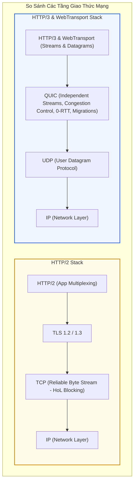
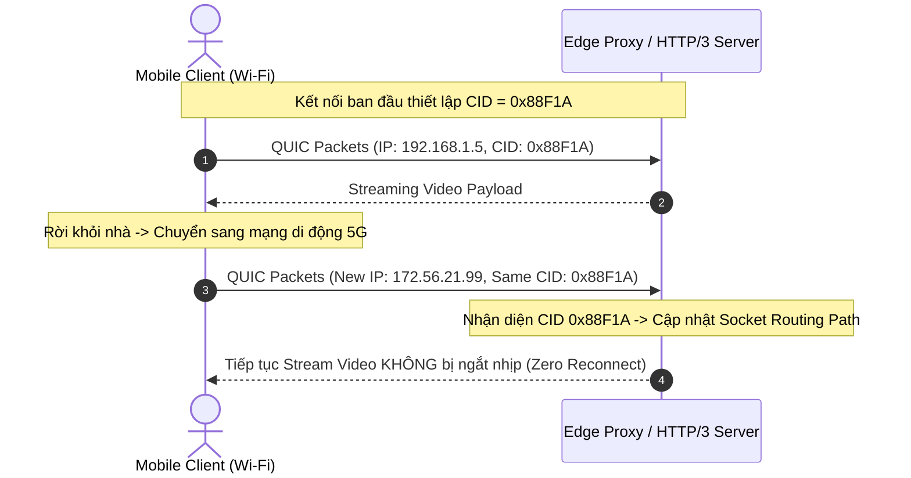
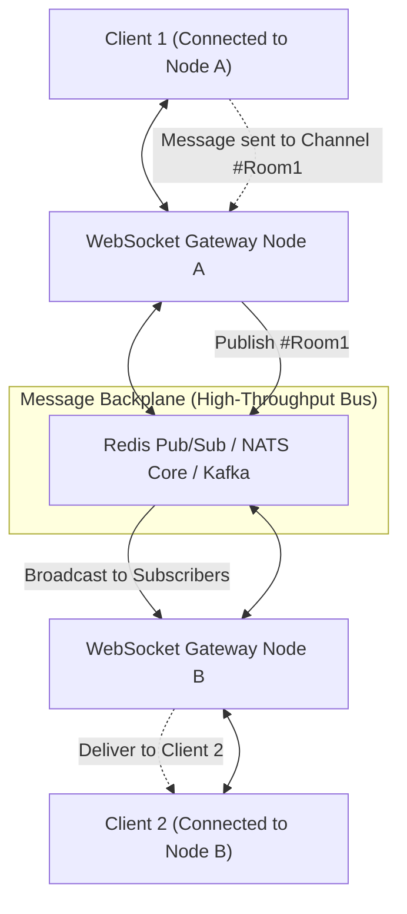
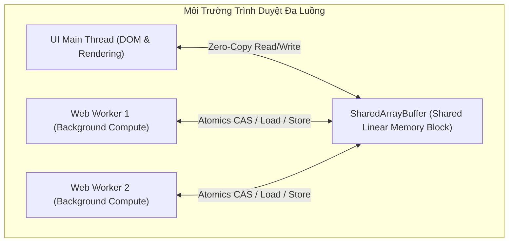

# 5.1. Modern Transport Protocols & Real-Time Web Evolution (QUIC, HTTP/3 & WebTransport)

## Tổng quan về Sự Tiến hóa Giao thức Vận chuyển và Web Thời gian Thực
Trong suốt gần 3 thập kỷ, hạ tầng web và dịch vụ backend vận hành chủ yếu dựa trên nền tảng giao thức **TCP (Transmission Control Protocol)** và **TLS (Transport Layer Security)**. Mặc dù cung cấp khả năng truyền dữ liệu tin cậy và kiểm soát nghẽn (Congestion Control) ổn định, TCP bộc lộ các hạn chế kiến trúc cố hữu khi đối mặt với các ứng dụng hiện đại yêu cầu độ trễ cực thấp:
1. **Nghẽn đầu hàng gói tin (Transport-Layer Head-of-Line Blocking)**: Dù HTTP/2 đã giới thiệu kỹ thuật ghép kênh (Multiplexing) ở tầng ứng dụng, tất cả các luồng (Streams) vẫn đi chung một kết nối TCP đơn lẻ. Khi chỉ một gói tin bị mất trên đường truyền mạng, toàn bộ các luồng khác đều bị chặn lại cho đến khi gói tin đó được truyền lại thành công.
2. **Chi phí thiết lập kết nối chậm chạp (Handshake Latency)**: Việc bắt tay TCP 3 bước (3-way handshake) cộng với bắt tay TLS 1.3 tiêu tốn từ $2 \text{ đến } 3 \text{ RTT (Round Trip Times)}$ trước khi byte dữ liệu ứng dụng đầu tiên có thể được truyền đi.
3. **Hiện tượng đứt kết nối khi di động (IP/Port 4-Tuple Fragility)**: Kết nối TCP bị ràng buộc cứng vào bộ 4 giá trị `(Source IP, Source Port, Dest IP, Dest Port)`. Khi người dùng di chuyển từ sóng Wi-Fi sang mạng di động 4G/5G, địa chỉ IP thay đổi khiến kết nối TCP bị ngắt và buộc phải bắt tay lại từ đầu.

Sự xuất hiện của giao thức **QUIC** (chạy trên nền **UDP**) và **HTTP/3** đã giải quyết triệt để các vấn đề này, mở ra kỷ nguyên mới cho **WebTransport**, **WebRTC** và kiến trúc thời gian thực cấp quy mô lớn (**WebSockets at Scale**).



---

## 2. Chi tiết từng Keyword (Under-the-Hood Deep Dive)

---

### 1. HTTP/3, QUIC & WebTransport

#### 1. Khái niệm bản chất (What & Why)
- **QUIC (Quick UDP Internet Connections)**: Giao thức tầng vận chuyển hiện đại được IETF chuẩn hóa (RFC 9000). QUIC chuyển toàn bộ logic tin cậy, ghép luồng và kiểm soát tắc nghẽn từ Nhân hệ điều hành (OS Kernel Space của TCP) lên Không gian Người dùng (User Space trên nền UDP), tích hợp sẵn mã hóa **TLS 1.3** trực tiếp vào tiêu đề gói tin.
- **HTTP/3**: Thế hệ thứ ba của giao thức HTTP, ánh xạ toàn bộ ngữ nghĩa HTTP (Headers, Methods, Status Codes, QPACK compression) lên nền tảng giao thức QUIC thay vì TCP.
- **WebTransport**: Giao thức web thế hệ tiếp theo cung cấp giao diện tương tác hai chiều Client-Server hiệu năng cao: Hỗ trợ cả **Luồng tin cậy (Reliable Streams - đơn hướng hoặc hai chiều)** VÀ **Gói tin không tin cậy (Unreliable Datagrams tương tự UDP)**. Vượt trội hơn WebSockets trong các tác vụ stream âm thanh/video thời gian thực, game trực tuyến và giao tiếp điều khiển IoT.

#### 2. Cơ chế hoạt động sâu (Under the hood / Hardcore Internals)
- **Loại bỏ HoL Blocking thông qua Independent Stream Framing**:
  Trong QUIC, mỗi luồng (Stream) mang một mã định danh riêng biệt (`Stream ID`). Các gói tin UDP chứa các frame dữ liệu của nhiều stream khác nhau. Nếu một gói tin chứa dữ liệu của Stream 1 bị rơi mất, bộ đệm của hệ điều hành chỉ tạm dừng xử lý Stream 1, trong khi Stream 2, Stream 3 vẫn tiếp tục được chuyển giao tức thì cho ứng dụng người dùng.
- **0-RTT Connection Resumption**:
  Nếu client đã từng kết nối tới server trước đó, thông qua cơ chế khóa mã hóa chia sẻ trước (**PSK - Pre-Shared Key**), client có thể gửi ngay dữ liệu HTTP Request (ví dụ `GET /index.html`) trong **ngay chính gói tin mở đầu đầu tiên (0-RTT)** mà không cần chờ đợi bắt tay!
- **Connection Migration (Di trú Kết nối thông qua Connection ID)**:
  QUIC không định danh phiên truyền thông bằng địa chỉ IP/Port. Thay vào đó, nó sử dụng một chuỗi nhị phân ngẫu nhiên gọi là **Connection ID (CID)**. Khi điện thoại chuyển từ Wi-Fi sang 5G, địa chỉ IP thay đổi nhưng CID được giữ nguyên; Server nhận gói tin từ IP mới vẫn tiếp tục phiên làm việc mà không làm rớt kết nối stream của người dùng.

#### 3. Sơ đồ minh họa


#### 4. Code ví dụ thực chiến (TypeScript WebTransport Unreliable Datagram Client & Server Stub)
Đoạn mã TypeScript minh họa việc sử dụng API WebTransport để truyền tín hiệu độ trễ cực thấp qua kênh Datagram UDP:

```typescript
// Giao diện mô phỏng WebTransport Web API hiện đại
class RealtimeTelemetryClient {
  private transport: any;

  public async connect(url: string): Promise<void> {
    console.log(`[WebTransport] Connecting to QUIC endpoint: ${url}`);
    // @ts-ignore - WebTransport native browser/node API
    if (typeof WebTransport !== 'undefined') {
      // this.transport = new WebTransport(url);
      // await this.transport.ready;
    }
    console.log("[WebTransport] 0-RTT Connection established. Session ID active.");
  }

  // Gửi gói tin Unreliable Datagram (Tương đương UDP thô nhưng được mã hóa TLS 1.3)
  public async sendFastCoordinate(x: number, y: number, z: number): Promise<void> {
    const buffer = new ArrayBuffer(12);
    const view = new DataView(buffer);
    view.setFloat32(0, x, true);
    view.setFloat32(4, y, true);
    view.setFloat32(8, z, true);

    // Gửi qua datagram writer mà không lo nghẽn Head-of-line
    console.log(`[Datagram Sent] Coords: (${x.toFixed(2)}, ${y.toFixed(2)}, ${z.toFixed(2)}) - Size: 12 bytes`);
  }
}

// Test Telemetry
const client = new RealtimeTelemetryClient();
client.connect("https://edge.game.internal:4433/transport");
client.sendFastCoordinate(104.2, 55.1, 980.0);
```

#### 5. Ưu / Nhược điểm, Pitfalls & Anti-patterns
- **UDP Throttling & UDP Blocking của các Tường lửa Doanh nghiệp**: Một số mạng nội bộ công ty hoặc trường học chặn toàn bộ lưu lượng UDP trên cổng 443 do lo ngại rủi ro bảo mật hoặc chống tấn công khuếch đại DNS/UDP. Ứng dụng Backend luôn bắt buộc phải có cơ chế **Fallback tự động về TCP / HTTP/2** (thông qua header `Alt-Svc: h3=":443"`).

#### 6. Ứng dụng thực tế trong Backend / Systems
- Hạ tầng livestream tương tác triệu người xem và hệ thống đồng bộ vị trí xe tự hành trong thành phố thông minh.

---

### 2. Real-Time Web: Server-Sent Events (SSE), WebRTC & WebSockets at Scale

#### 1. Khái niệm bản chất (What & Why)
- **Server-Sent Events (SSE)**: Cơ chế đẩy dữ liệu một chiều từ máy chủ về máy khách (Server-to-Client Unidirectional Stream) chạy trên giao thức HTTP tiêu chuẩn với `Content-Type: text/event-stream`. Tự động kết nối lại khi rớt mạng, vượt tường lửa dễ dàng. Trở thành tiêu chuẩn thống trị để stream từng token của các ứng dụng LLM AI (ChatGPT, Claude API).
- **WebSockets**: Giao thức hai chiều song công toàn phần (Full-duplex Bidirectional) thiết lập qua quá trình nâng cấp HTTP (`Upgrade: websocket`). Phù hợp cho các ứng dụng có tần suất tương tác hai chiều cao liên tục (sàn giao dịch chứng khoán, chat nhóm).
- **WebSockets at Scale**: Thử thách kiến trúc khi quản lý đồng thời từ 1 triệu đến 10 triệu kết nối WebSocket mở thường trực trên cụm máy chủ backend phân tán.
- **WebRTC (Web Real-Time Communication)**: Bộ giao thức cho phép truyền thông đa phương tiện âm thanh, hình ảnh và dữ liệu trực tiếp ngang hàng (**Peer-to-Peer**) với độ trễ dưới 200 mili-giây.

#### 2. Cơ chế hoạt động sâu (Under the hood / Hardcore Internals)
- **Tối ưu hóa Bộ nhớ Kết nối WebSocket nhàn rỗi (Socket Memory Footprint)**:
  Trên hệ điều hành Linux, mỗi kết nối TCP tiêu tốn:
  - Cấu trúc dữ liệu socket trong nhân (Kernel Socket Buffer: `rmem` và `wmem`, mặc định 128KB - 256KB mỗi chiều). Nếu giữ 1,000,000 kết nối, dung lượng RAM nhân có thể ngốn hơn 200 GB!
  - *Tối ưu hóa Kernel Sysctl*: Giảm kích thước bộ đệm tối thiểu:
    `sysctl -w net.ipv4.tcp_rmem="4096 4096 16384"`
    `sysctl -w net.ipv4.tcp_wmem="4096 4096 16384"`
  - *Tầng người dùng (User-space Event Loop)*: Sử dụng các thư viện C/C++ hiệu năng cao như **`uWebSockets`** (dựa trên `epoll` / `kqueue` và SIMD parser), giảm lượng RAM cho mỗi kết nối nhàn rỗi xuống chỉ còn **khoảng 2 KiB - 4 KiB/socket**, cho phép 1 máy chủ đơn lẻ duy trì hơn **1 triệu kết nối đồng thời (C1000K Problem solved)**!
- **Kiến trúc Backplane Phân tán (Distributed Pub/Sub Backplane)**:
  Khi Client A kết nối tới Server Node 1 và Client B kết nối tới Server Node 2: Để A gửi được tin nhắn cho B, hệ thống backend sử dụng một lớp Message Backplane trung gian (như **Redis Pub/Sub**, **NATS JetStream**, hoặc **Kafka**) để phát tán thông điệp giữa các node máy chủ.

#### 3. Sơ đồ minh họa


#### 4. Code ví dụ thực chiến (C++ High-Throughput SSE Frame Generator)
Đoạn mã C++20 định dạng luồng SSE cho token streaming tối ưu hóa chuỗi không cấp phát bộ nhớ rác:

```cpp
#include <iostream>
#include <string>
#include <string_view>
#include <sstream>

class SSEEventFormatter {
public:
    // Sinh gói tin chuẩn SSE: id, event type, data và kết thúc bằng 2 ký tự xuống dòng \n\n
    static std::string format_chunk(uint64_t event_id, std::string_view event_type, std::string_view json_data) {
        std::string buffer;
        buffer.reserve(json_data.size() + 64); // Cấp phát trước bộ nhớ

        buffer.append("id: ").append(std::to_string(event_id)).append("\n");
        buffer.append("event: ").append(event_type).append("\n");
        buffer.append("data: ").append(json_data).append("\n\n");
        return buffer;
    }
};

int main() {
    uint64_t msg_id = 1;
    std::string token1 = R"({"token": "Deep", "finish": false})";
    std::string token2 = R"({"token": "Learning", "finish": true})";

    std::cout << "[SSE Stream Output]:\n";
    std::cout << SSEEventFormatter::format_chunk(msg_id++, "token_delta", token1);
    std::cout << SSEEventFormatter::format_chunk(msg_id++, "token_delta", token2);
    return 0;
}
```

#### 5. Ưu / Nhược điểm, Pitfalls & Anti-patterns
- **Connection Storms (Cơn bão kết nối lại)**: Khi một máy chủ WebSocket trong cụm bị khởi động lại, 100,000 clients đồng thời kết nối lại vào các node còn lại cùng lúc, gây hiệu ứng domino làm sập toàn bộ các máy chủ khác. Bắt buộc phải áp dụng Jittered Reconnect Interval trên client.

#### 6. Ứng dụng thực tế trong Backend / Systems
- Cổng streaming kết quả AI sinh văn bản (AI LLM Token Stream Gateway) và hệ thống bảng giá chứng khoán thời gian thực.

---

### 3. Browser-Edge Primitives: Web Workers, Service Workers, WebGPU & Web Components

#### 1. Khái niệm bản chất (What & Why)
- **Web Workers**: Luồng thực thi ngầm chạy trong tiến trình riêng biệt với UI Main Thread, cho phép chạy các tác vụ tính toán nặng (giải mã file, mã hóa dữ liệu) mà không làm đơ giật giao diện người dùng.
- **Service Workers**: Trình đại diện mạng (Programmable Network Proxy) chạy ngầm có khả năng chặn và can thiệp vào toàn bộ các request mạng HTTP từ trình duyệt, quản lý bộ đệm Cache API ngoại tuyến, và nhận thông báo đẩy (Push Notifications).
- **Shared Workers**: Luồng chạy ngầm được chia sẻ giữa nhiều tab hoặc cửa sổ trình duyệt khác nhau thuộc cùng một domain gốc (Origin), đóng vai trò như một bộ tập trung kết nối mạng (Connection Hub).
- **WebGPU**: Giao diện lập trình đồ họa và tính toán GPU cấp thấp hiện đại cho web (kế thừa WebGL), mang lại kiến trúc tương đồng với Vulkan, Metal và DirectX 12, cho phép chạy trực tiếp các mô hình AI lớn và thuật toán tính toán ma trận song song ngay trên GPU người dùng trong trình duyệt.
- **Web Components**: Bộ tiêu chuẩn mở của W3C (Custom Elements, Shadow DOM, HTML Templates) cho phép tạo ra các thành phần giao diện đóng gói độc lập, không phụ thuộc vào bất kỳ framework JS nào (React, Vue, Angular).

#### 2. Cơ chế hoạt động sâu (Under the hood / Hardcore Internals)
- **SharedArrayBuffer & Atomics trong Web Workers**:
  Thông thường, dữ liệu truyền giữa Main Thread và Web Worker phải thông qua cơ chế sao chép tuần tự hóa `postMessage` (Structured Clone Algorithm).
  Để đạt hiệu năng tính toán tối đa, các luồng có thể chia sẻ trực tiếp một vùng nhớ nhị phân **`SharedArrayBuffer`**:
  - Không cần sao chép bộ nhớ (Zero Memory Copy).
  - Sử dụng đối tượng **`Atomics`** (các chỉ lệnh CPU nguyên tử như `Atomics.compareExchange`, `Atomics.wait`, `Atomics.notify`) để cài đặt Mutex, Spinlock và rào chắn đồng bộ hóa đa luồng trực tiếp trong JavaScript!

#### 3. Sơ đồ minh họa


#### 4. Code ví dụ thực chiến (TypeScript SharedArrayBuffer Atomic Lock Simulation)
```typescript
class SimpleAtomicSpinLock {
  private lockState: Int32Array;

  constructor(sharedBuffer: SharedArrayBuffer, offsetIndex = 0) {
    this.lockState = new Int32Array(sharedBuffer, offsetIndex, 1);
  }

  public acquire(): void {
    // Thử chuyển từ 0 (unlocked) sang 1 (locked) bằng CAS atomic operation
    while (Atomics.compareExchange(this.lockState, 0, 0, 1) !== 0) {
      // Đang bị chiếm dụng: chờ thông báo nguyên tử
      Atomics.wait(this.lockState, 0, 1, 100 /* timeout 100ms */);
    }
  }

  public release(): void {
    Atomics.store(this.lockState, 0, 0); // Mở khóa
    Atomics.notify(this.lockState, 0, 1); // Đánh thức luồng khác
  }
}

// Test lock initialization
if (typeof SharedArrayBuffer !== 'undefined') {
  const sab = new SharedArrayBuffer(4);
  const spinlock = new SimpleAtomicSpinLock(sab);
  spinlock.acquire();
  console.log("[Atomic Lock] Acquired successfully in shared memory.");
  spinlock.release();
  console.log("[Atomic Lock] Released.");
}
```

#### 5. Ưu / Nhược điểm, Pitfalls & Anti-patterns
- **Cross-Origin Isolation Requirements**: Để kích hoạt `SharedArrayBuffer` (sau các biến cố lỗ hổng Spectre), máy chủ backend bắt buộc phải gửi hai header HTTP bảo mật nghiêm ngặt:
  `Cross-Origin-Opener-Policy: same-origin`
  `Cross-Origin-Embedder-Policy: require-corp`
  Nếu thiếu các header này, trình duyệt sẽ vô hiệu hóa hoàn toàn bộ nhớ chia sẻ.

#### 6. Ứng dụng thực tế trong Backend / Systems
- Chạy các mô hình phân loại âm thanh và khử nhiễu trực tiếp trên trình duyệt máy khách (Client-side AI via WebGPU) giúp tiết kiệm hàng triệu USD chi phí máy chủ GPU backend.
