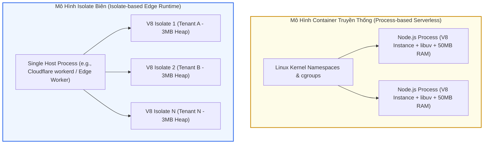
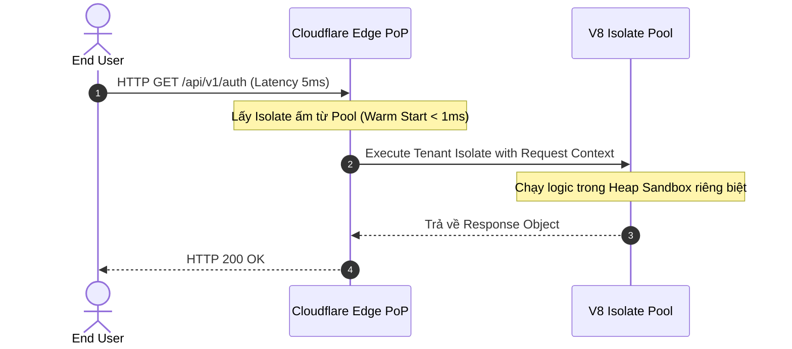
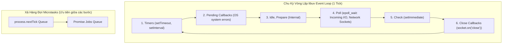
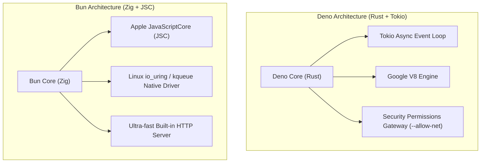

# 5.2. Edge & Serverless Runtimes: V8 Isolates, Node.js Internals, Deno & Bun

## Tổng quan về Sự Tiến hóa của Runtime Backend: Từ Máy chủ Tập trung tới V8 Isolates
Trong hơn một thập kỷ, mô hình triển khai máy chủ JavaScript/TypeScript thống trị là chạy một tiến trình **Node.js** bên trong một container Linux. Mặc dù kiến trúc này đã chứng minh tính hiệu quả cho hàng triệu dịch vụ backend, nó bộc lộ hai nhược điểm chí mạng trong kỷ nguyên **Serverless** và **Điện toán Biên (Edge Computing)**:
1. **Chi phí bộ nhớ và thời gian khởi động (Cold Start Overhead)**: Mỗi container Node.js yêu cầu nạp toàn bộ một phiên bản của máy ảo VRAM, thư viện chuẩn C++, và hệ điều hành, tiêu tốn tối thiểu từ 30MB - 100MB RAM và mất từ 300ms - 1,000ms để khởi động nguội.
2. **Khả năng mở rộng đa khách hàng (Multi-Tenant Density)**: Không thể chạy hàng triệu hàm serverless của các khách hàng khác nhau trên cùng một máy chủ nếu mỗi hàm là một tiến trình OS riêng biệt.

Cuộc cách mạng **Kiến trúc Dựa trên Isolate (Isolate-Based Execution)** — tiên phong bởi Google Chrome và Cloudflare Workers — đã thay đổi hoàn toàn cuộc chơi. Thay vì phân tách bằng tiến trình hệ điều hành, hệ thống tận dụng **V8 Isolates**: Hàng ngàn ngữ cảnh máy ảo JavaScript độc lập hoàn toàn về vùng nhớ Heap, có thể khởi động trong vòng **dưới 5 mili-giây** và tiêu tốn chỉ khoảng **3MB - 5MB RAM** bên trong duy nhất một tiến trình máy chủ. Song song đó là sự bùng nổ của các thế hệ runtime hiện đại: **Deno** (viết bằng Rust) và **Bun** (viết bằng Zig).



---

## 2. Chi tiết từng Keyword (Under-the-Hood Deep Dive)

---

### 1. Edge Functions, Edge Runtime & Isolate-Based Execution (V8 Isolates)

#### 1. Khái niệm bản chất (What & Why)
- **Edge Functions**: Các đoạn mã logic backend ngắn gọn (Micro-functions) được triển khai và thực thi tự động tại hàng trăm trung tâm dữ liệu phân tán (PoPs) trên toàn cầu của các nhà cung cấp CDN (Cloudflare, Vercel, Fastly), xử lý yêu cầu cách người dùng cuối chỉ vài mili-giây.
- **Edge Runtime**: Môi trường thực thi tối giản hóa, không hỗ trợ đầy đủ các module độc quyền của Node.js (như `fs`, `child_process`), mà tuân thủ nghiêm ngặt các tiêu chuẩn **Web Standards** (W3C APIs: `fetch`, `Request`, `Response`, `TransformStream`, `Crypto`).
- **Isolate-Based Execution**: Mô hình thực thi trong đó nhiều khách hàng chia sẻ chung một tiến trình máy chủ vật lý, nhưng mã nguồn của mỗi khách hàng được nhốt trong một **V8 Isolate** riêng biệt.
- **V8 Isolates**: Thực thể độc lập hoàn toàn bên trong V8 Engine: Mỗi Isolate sở hữu Heap bộ nhớ riêng, Garbage Collector riêng, và Call Stack riêng. Một Isolate hoàn toàn không thể đọc hoặc ghi đè vào bộ nhớ của Isolate khác.

#### 2. Cơ chế hoạt động sâu (Under the hood / Hardcore Internals)
- **Cơ chế Snapshotting trong V8 Isolates**:
  Làm thế nào để một V8 Isolate có thể khởi động trong vòng dưới 1 mili-giây?
  - Trong quá trình build, runtime nạp sẵn toàn bộ các thư viện chuẩn (Web APIs) và mã nguồn của ứng dụng, thực hiện biên dịch và khởi tạo trạng thái Heap ban đầu.
  - Runtime chụp lại ảnh chụp bộ nhớ nhị phân (**V8 Heap Snapshot**) lưu xuống đĩa.
  - Khi có một request mới tới từ người dùng, máy chủ chỉ cần ánh xạ (mmap) Heap Snapshot này vào RAM. Toàn bộ các đối tượng, hàm, biến toàn cục đã sẵn sàng thực thi ngay lập tức mà không cần qua các bước khởi tạo tốn thời gian!

#### 3. Sơ đồ minh họa


#### 4. Code ví dụ thực chiến (C++ V8 Embedder Isolate Isolation Stub)
Đoạn mã C++20 minh họa cách nhúng V8 Engine và khởi tạo hai Isolate cô lập hoàn toàn bộ nhớ trong cùng một tiến trình:

```cpp
#include <iostream>
#include <memory>

// Giả lập giao diện nhúng của Google V8 Engine
class MockV8Isolate {
private:
    int tenant_id_;
    size_t heap_size_kb_;
public:
    MockV8Isolate(int tenant_id, size_t heap_limit) 
        : tenant_id_(tenant_id), heap_size_kb_(heap_limit) {}

    void execute_script(const char* js_source) {
        std::cout << "[V8 Isolate " << tenant_id_ << "] Heap Limit: " 
                  << heap_size_kb_ << "KB -> Running Script: " << js_source << "\n";
    }
};

int main() {
    // Khởi tạo 2 Isolate độc lập cho 2 khách hàng khác nhau trong cùng 1 tiến trình C++
    auto tenantA = std::make_unique<MockV8Isolate>(101, 4096 /* 4MB Heap */);
    auto tenantB = std::make_unique<MockV8Isolate>(102, 4096 /* 4MB Heap */);

    tenantA->execute_script("const secret = 'TENANT_A_KEY'; return secret;");
    tenantB->execute_script("const secret = 'TENANT_B_KEY'; return secret;");

    std::cout << "[V8 Host] Both isolates executed in isolated memory spaces without IPC overhead.\n";
    return 0;
}
```

#### 5. Ưu / Nhược điểm, Pitfalls & Anti-patterns
- **CPU Starvation trong Isolate**: Nếu một Isolate của người dùng chạy một vòng lặp vô tận đơn luồng (`while(true){}`), nó có thể chiếm dụng toàn bộ luồng CPU của tiến trình host nếu runtime không cấu hình ngắt nhịp (Watchdog Timer / V8 TerminateExecution API).

#### 6. Ứng dụng thực tế trong Backend / Systems
- Hệ thống Edge Middleware kiểm tra A/B Testing và xác thực người dùng tại các node biên Cloudflare/Vercel.

---

### 2. Node.js Runtime Internals: libuv, Event Loop & Thread Pool

#### 1. Khái niệm bản chất (What & Why)
- **Node.js Runtime Internals**: Cấu trúc kiến trúc bên trong của Node.js, bao gồm: Google V8 Engine (thực thi JavaScript), **libuv** (thư viện C đa nền tảng phụ trách I/O bất đồng bộ và Vòng lặp sự kiện - Event Loop), c-ares (DNS), llhttp (HTTP parser), và OpenSSL (mật mã học).
- **libuv Event Loop**: Vòng lặp đơn luồng (Single-threaded Loop) chịu trách nhiệm theo dõi và phân phối các sự kiện I/O dựa trên các cơ chế thông báo sự kiện hiệu năng cao của nhân hệ điều hành (`epoll` trên Linux, `kqueue` trên macOS, `IOCP` trên Windows).
- **libuv Thread Pool**: Nhóm luồng ngầm viết bằng C (mặc định 4 threads, điều chỉnh qua biến môi trường `UV_THREADPOOL_SIZE`) được Node.js sử dụng để xử lý các tác vụ blocking mà hệ điều hành không hỗ trợ I/O bất đồng bộ thực sự (như thao tác tệp `fs.*`, mã hóa `crypto.pbkdf2`, nén `zlib`, và tra cứu `dns.lookup`).

#### 2. Cơ chế hoạt động sâu (Under the hood / Hardcore Internals)
- **6 Giai đoạn Tuần tự của libuv Event Loop**:
  Trong mỗi vòng quay (Tick) của Event Loop, nó duyệt qua 6 pha theo thứ tự nghiêm ngặt:
  1. **Timers**: Thực thi các callback của `setTimeout()` và `setInterval()`.
  2. **Pending Callbacks**: Thực thi các callback I/O bị hoãn lại từ vòng lặp trước.
  3. **Idle, Prepare**: Sử dụng nội bộ bởi libuv.
  4. **Poll**: Pha quan trọng nhất: Chờ đợi các sự kiện I/O mới (kết nối mạng, dữ liệu đọc từ socket) thông qua lời gọi hệ thống `epoll_wait()`. Nếu hàng đợi trống và có timers đến hạn, nó sẽ chuyển sang pha tiếp theo.
  5. **Check**: Thực thi các callback của `setImmediate()`.
  6. **Close Callbacks**: Thực thi các sự kiện đóng tài nguyên (ví dụ: `socket.on('close', ...)`).
- **Microtask Queue vs Macrotask Queue**:
  Giữa mỗi pha và giữa các callback riêng lẻ, Node.js sẽ xả cạn hàng đợi **Microtasks**:
  $$\text{Priority: } \text{process.nextTick()} \quad > \quad \text{Promise.then() / catch() / finally()}$$
  Nếu một hàm liên tục gọi đệ quy `process.nextTick()`, Event Loop sẽ bị "bỏ đói" (Starvation) và không bao giờ chuyển sang được pha Poll I/O!

#### 3. Sơ đồ minh họa


#### 4. Code ví dụ thực chiến (TypeScript Event Loop Execution Phase Demystification)
Đoạn mã TypeScript chứng minh thứ tự thực thi của các pha trong Event Loop:

```typescript
console.log("1. Synchronous Code Execution");

setTimeout(() => {
  console.log("5. Timers Phase: setTimeout executed");
}, 0);

setImmediate(() => {
  console.log("6. Check Phase: setImmediate executed");
});

Promise.resolve().then(() => {
  console.log("3. Microtask Queue: Promise.then executed");
});

process.nextTick(() => {
  console.log("2. Microtask Queue (Highest Priority): process.nextTick executed");
});

console.log("4. End of Synchronous Call Stack");
```

#### 5. Ưu / Nhược điểm, Pitfalls & Anti-patterns
- **Chặn Event Loop (Blocking the Event Loop)**: Chạy các phép toán tính toán CPU nặng (như giải mã JSON dung lượng 100MB hoặc mã hóa chuỗi lặp) trên main thread sẽ làm đóng băng toàn bộ Event Loop, khiến server không thể chấp nhận thêm bất kỳ kết nối mạng nào mới. Cần đẩy các tác vụ này sang `Worker Threads` hoặc child processes.

#### 6. Ứng dụng thực tế trong Backend / Systems
- Cấu hình tối ưu biến `UV_THREADPOOL_SIZE=64` trên các cụm máy chủ Node.js xử lý hàng chục ngàn thao tác băm mật khẩu `bcrypt` mỗi phút.

---

### 3. Modern Alternative Runtimes: Deno & Bun

#### 1. Khái niệm bản chất (What & Why)
- **Deno (Ryan Dahl - Tác giả gốc của Node.js)**: Runtime thế hệ mới được xây dựng bằng **Rust** và **Tokio**. Thiết kế theo triết lý bảo mật mặc định (Secure by default: không có quyền đọc ổ đĩa, truy cập mạng trừ khi được cấp cờ tường minh), hỗ trợ TypeScript nguyên bản không cần cấu hình, tích hợp sẵn công cụ định dạng (fmt), kiểm thử (test) và đóng gói (bundle).
- **Bun (Jarred Sumner)**: Bộ công cụ và runtime JavaScript toàn diện cực nhanh được viết bằng ngôn ngữ **Zig**. Sử dụng engine **JavaScriptCore (JSC)** của WebKit thay vì Google V8.
- **Tại sao Bun đạt tốc độ vượt trội**: Tối ưu hóa sâu ở tầng bộ nhớ cấp thấp: Viết lại từ đầu toàn bộ các tầng mạng HTTP server, parser, và SQLite client bằng Zig; tận dụng các lời gọi hệ thống hiện đại của Linux như **`io_uring`** để xử lý I/O không chặn với chi phí chuyển đổi ngữ cảnh tối thiểu.

#### 2. Cơ chế hoạt động sâu (Under the hood / Hardcore Internals)
- **Bảng So sánh Bản chất Kỹ thuật: Node.js vs Deno vs Bun**:

| Tiêu chí | Node.js | Deno | Bun |
| :--- | :--- | :--- | :--- |
| **Ngôn ngữ Lõi** | C++ | Rust | Zig |
| **JS Engine** | Google V8 | Google V8 | Apple JavaScriptCore (JSC) |
| **Hệ thống I/O** | libuv (C) | Tokio (Rust) | Custom Zig I/O Engine (`io_uring`) |
| **Bảo mật (Security)** | Không có sandbox (Full host access) | Sandbox mặc định (`--allow-net`, `--allow-read`) | Tương thích Node.js (Full host access) |
| **Hỗ trợ TypeScript** | Cần transpile (ts-node / tsc / esbuild) | Tích hợp sẵn (SWC in Rust) | Tích hợp sẵn (Custom Zig Lexer & Transpiler) |
| **Hệ thống Gói** | npm / yarn / pnpm | URL imports + JSR + npm tương thích | Tích hợp sẵn `bun install` (Nhanh hơn npm 10-30 lần) |

#### 3. Sơ đồ minh họa


#### 4. Code ví dụ thực chiến (TypeScript Bun Native High-Performance HTTP Server)
Đoạn mã TypeScript minh họa việc sử dụng API máy chủ mạng siêu tốc gốc của Bun (`Bun.serve`):

```typescript
// Chạy trực tiếp bằng lệnh: bun run server.ts (Không cần ts-node, không cần compile)
const server = Bun.serve({
  port: 3000,
  // Tận dụng parser HTTP viết bằng Zig siêu nhanh
  fetch(req) {
    const url = new URL(req.url);
    if (url.pathname === "/health") {
      return new Response(JSON.stringify({ status: "HEALTHY", runtime: "Bun/Zig" }), {
        headers: { "Content-Type": "application/json" }
      });
    }
    return new Response("Bun High-Performance Edge Engine Running!", { status: 200 });
  },
  error(error) {
    return new Response(`Server Internal Error: ${error.message}`, { status: 500 });
  }
});

console.log(`[Bun Server] Listening on http://localhost:${server.port}`);
```

#### 5. Ưu / Nhược điểm, Pitfalls & Anti-patterns
- **Tính tương thích hệ sinh thái Node.js của Bun**: Mặc dù Bun hỗ trợ phần lớn Node-API và các thư viện npm phổ biến, một số package native C++ phụ thuộc sâu vào cấu trúc V8 nội bộ có thể không chạy được trên nền tảng JavaScriptCore của Bun.

#### 6. Ứng dụng thực tế trong Backend / Systems
- Sử dụng Bun làm công cụ chạy kiểm thử tự động (Unit Test Runner) trong các pipeline CI/CD giúp giảm thời gian chạy test từ 5 phút xuống còn 15 giây.
