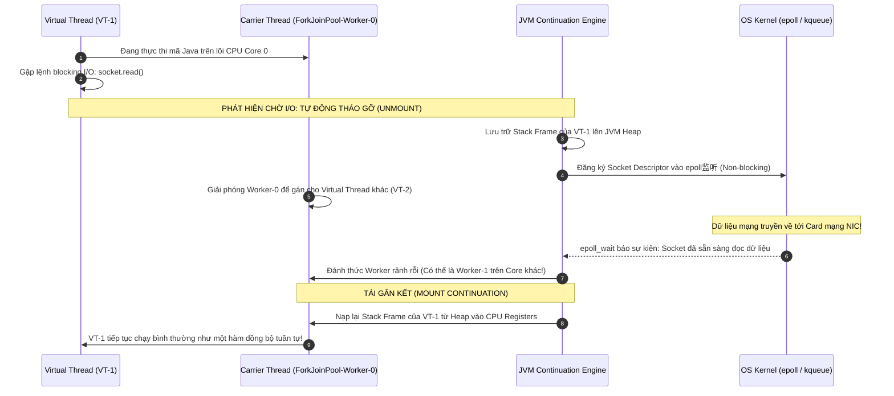
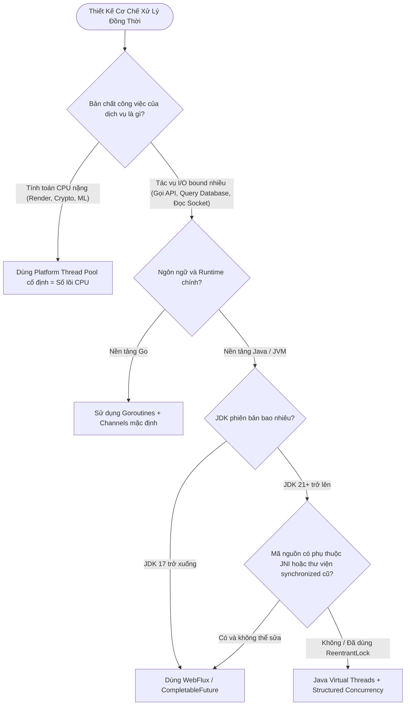

# 5.3. Java Virtual Threads (Project Loom), Structured Concurrency, and Modern Async Runtimes

> [!IMPORTANT]
> **Nếu bạn chỉ được nhớ một điều duy nhất:**
> **Virtual Threads (Project Loom)** và **Structured Concurrency (Đồng thời Có cấu trúc)** là cuộc cách mạng hàn gắn sự chia cắt lịch sử của lập trình backend: thống nhất hiệu năng thông lượng cực cao của mô hình bất đồng bộ phản ứng (Reactive) với sự đơn giản, trực quan của phong cách viết mã tuần tự một-luồng-một-yêu-cầu (Thread-per-Request). Bằng cách chuyển giao việc quản lý Call Stack từ nhân hệ điều hành (1MB OS Thread) sang bộ nhớ Heap người dùng (vài trăm bytes) với cơ chế **Mounting/Unmounting Continuations** trên các **Carrier Threads**, hệ thống có thể mở rộng hàng triệu luồng đồng thời mà không lo cạn kiệt tài nguyên; đồng thời triệt tiêu hoàn toàn vấn nạn "luồng mồ côi" (Thread Leaks) bằng cách ràng buộc tuổi thọ tác vụ con vào phạm vi cú pháp của tác vụ cha.

---

## 1. Kiến trúc Tổng quan & Mô hình Tư duy (Mental Model)

### 1.1. Ẩn dụ Đời sống: Đội Ngựa Thồ Hàng và Hàng Vạn Chuyến Hàng Ghi Chép

Để thấu hiểu bước chuyển từ Platform Threads sang Virtual Threads:
1. **Mô Hình Luồng Hệ Điều Hành Cổ Điển (1:1 Platform Thread - Một Đỗ Xe Cho Một Chiếc Xe Container)**:
   - Mỗi tác vụ mạng được giao cho một tài xế xe tải hạng nặng chuyên dụng (1 OS Thread, tốn 1MB RAM cố định cho Call Stack).
   - Khi tài xế lái xe tới kho hàng và phải chờ bốc dỡ trong 2 tiếng (Chờ I/O Database / Network Socket), cả tài xế và chiếc xe tải khổng lồ phải đứng chôn chân một chỗ, làm tắc nghẽn toàn bộ bãi đỗ xe của công ty. Với 1,000 chiếc xe như vậy, toàn bộ hệ thống tê liệt vì hết chỗ đỗ dù động cơ không hề tốn xăng (CPU rảnh rỗi).
2. **Mô Hình Luồng Ảo Project Loom (M:N Virtual Thread - Đội Ngựa Thồ Luân Phiên)**:
   - Các tác vụ (Chuyến hàng) chỉ là những cuốn sổ ghi chú siêu nhẹ (Virtual Thread Context, nặng vài trăm bytes trên Heap).
   - Máy chủ chỉ thuê đúng số lượng tài xế xe tải bằng số lõi CPU vật lý (**Carrier Threads** nằm trong `ForkJoinPool`).
   - Khi Chuyến hàng A đến kho và phải chờ dỡ hàng, tài xế lập tức gấp cuốn sổ của A lại, để tạm lên kệ sách (**Unmount Continuation**) và nhảy sang lái Chuyến hàng B đang sẵn sàng di chuyển! Khi hàng của A về tới nơi, tài xế bất kỳ đang rảnh rỗi sẽ nhặt cuốn sổ của A lên và chạy tiếp (**Mount Continuation**).
3. **Structured Concurrency (Hợp Đồng Gia Đình và Chuyến Dã Ngoại)**:
   - Trong mô hình phi cấu trúc (Unstructured Concurrency cũ), một người cha dẫn 3 đứa con vào công viên rồi bảo *"Các con cứ chạy chơi đi"*. Nếu người cha bỏ về hoặc gặp tai nạn, 3 đứa con vẫn tiếp tục chạy lang thang khắp công viên mãi mãi (**Orphaned Threads / Resource Leak**).
   - Trong Đồng thời Có cấu trúc, người cha mở một phạm vi giám sát (**Task Scope**): *"Cả nhà cùng vào công viên tìm chìa khóa. Nếu một người tìm thấy, tất cả cùng dừng lại về nhà. Nếu một người bị gãy chân, tất cả các con phải lập tức ngừng chơi và tập trung lại!"*. Tác vụ cha không bao giờ có thể kết thúc trước khi tất cả các tác vụ con đã hoàn tất hoặc bị hủy bỏ an toàn.

### 1.2. Sơ Đồ Cơ Chế Lập Lịch M:N và Chu Trình Gắn/Tháo (Mount/Unmount)



---

## 2. Chi tiết từng Keyword (Under-the-Hood Deep Dive)

### 2.1. Java Virtual Threads, Project Loom & Lightweight Threads

Mô hình đồng thời tiến hóa qua ba giai đoạn bản lề:

```text
[Giai đoạn 1: 1:1 Platform Threads] ----> [Giai đoạn 2: Reactive Async (Rx/WebFlux)] ----> [Giai đoạn 3: M:N Virtual Threads (Loom)]
- Đơn giản, dễ đọc                      - Khó đọc, phá vỡ Stack trace                       - Đơn giản như Giai đoạn 1
- Giới hạn ~5,000 threads               - Scale hàng triệu requests                        - Scale hàng triệu luồng đồng thời
- 1MB RAM / Thread                      - Function Coloring Problem                         - Vài trăm bytes / Thread trên Heap
```

#### A. Kiến Trúc Bộ Nhớ của Virtual Thread
- **Không Cố Định Kích Thước Ngăn Xếp**: Platform Thread của Linux được cấp phát sẵn một vùng nhớ ảo cố định (thường là 1MB). Dù hàm của bạn chỉ tiêu tốn 1KB, 1MB đó vẫn bị khóa chặt. Virtual Thread bắt đầu với một Call Stack siêu nhỏ nằm trên JVM Heap. Khi hàm gọi đệ quy sâu hơn, Heap Frame tự động mở rộng linh hoạt mà không bao giờ gây lãng phí bộ nhớ.
- **Trình Lập Lịch Chuyên Chở (Carrier ForkJoinPool)**:
  - Mặc định, JVM khởi tạo một `ForkJoinPool` với số lượng Carrier Threads bằng số lõi CPU logic (`Runtime.getRuntime().availableProcessors()`).
  - Toàn bộ hàng triệu Virtual Threads được điều độ luân phiên trên nhóm Carrier Threads này thông qua giải thuật Trộm Tác Vụ (**Work-Stealing Scheduling**).

#### B. Thảm Họa Ghim Luồng (Thread Pinning Problem)
Điểm yếu chí mạng nhất khi nâng cấp lên Virtual Threads là hiện tượng **Pinning**:
- **Cơ Chế Lỗi**: Khi một Virtual Thread thực hiện một thao tác I/O chặn (như đọc DB hoặc socket) nhưng lại nằm bên trong một khối đồng bộ hóa cổ điển **`synchronized (lock)`** hoặc đang gọi một hàm C Native qua **JNI (Java Native Interface)**:
  - JVM không thể tháo gỡ (Unmount) Call Stack khỏi Carrier Thread được!
  - Virtual Thread bị "ghim chặt" (pinned) vào Carrier Thread, biến Carrier Thread thành một luồng bị khóa cứng.
  - Nếu có 16 Carrier Threads và cả 16 đều bị ghim bởi các truy vấn database chậm, toàn bộ máy chủ JVM sẽ rơi vào tình trạng chết đứng (**Carrier Thread Starvation**) dù CPU ở mức $0\%$!
- **Giải Pháp Triệt Để**: Thay thế toàn bộ các khối `synchronized` bằng **`java.util.concurrent.locks.ReentrantLock`**. `ReentrantLock` được thiết kế tương thích hoàn hảo với Project Loom và cho phép unmount bình thường.

---

### 2.2. Structured Concurrency & Modern Async Runtimes

Khái niệm **Structured Concurrency (Đồng thời Có cấu trúc)** lần đầu tiên được Martin Sústrik (tác giả ZeroMQ) và Nathaniel J. Smith (thư viện Trio của Python) đề xướng, sau đó được đưa vào chuẩn JDK chính thức qua JEP 453 (`StructuredTaskScope`).

#### A. Triết Lý Tuổi Thọ Từ Vựng (Lexical Lifetime Hierarchy)
Trong lập trình tuần tự:
```text
{
    int x = compute();
    // Biến x được sinh ra ở đây và CHẮC CHẮN bị hủy ở dấu ngoặc nhọn kết thúc scope!
}
```
Structured Concurrency mang lại sự đảm bảo cấu trúc tương tự cho các luồng chạy song song:
Mọi luồng con được sinh ra bên trong một `Scope` bắt buộc phải hoàn thành (hoặc bị hủy bỏ) trước khi khối mã của `Scope` đó đóng lại. Không một luồng nào có thể sống sót sau khi hàm gọi nó đã trả về!

#### B. Cơ Chế Hủy Bỏ Ngắn Mạch (Short-Circuit Cancellation)
Trong Java JDK 21+, `StructuredTaskScope` cung cấp hai chính sách kinh điển:
1. **`ShutdownOnFailure` (Mô hình Tất cả hoặc Không)**:
   - Dùng cho các bài toán phân rã tác vụ (Task Fan-out): Gọi đồng thời Microservice A, B, và C.
   - Nếu Microservice B ném lỗi kết nối mạng (500), Scope ngay lập tức phát tín hiệu ngắt (`Thread.interrupt()`) tới Microservice A và C. Không lãng phí một chu kỳ CPU nào để chờ hai dịch vụ kia chạy tiếp!
2. **`ShutdownOnSuccess` (Mô hình Cuộc đua - Hedging Requests)**:
   - Gửi cùng một truy vấn tới hai máy chủ Database Master và Replica. Máy chủ nào phản hồi trước, Scope lấy kết quả đó và ngay lập tức hủy truy vấn trên máy chủ còn lại, tối ưu hóa độ trễ $P99$.

#### C. Thay Thế ThreadLocal bằng Scoped Values (`ScopedValue`)
- `ThreadLocal` được thiết kế cho mô hình số lượng luồng nhỏ và sống lâu. Khi tạo 1,000,000 Virtual Threads, việc kế thừa và sao chép bảng `ThreadLocal` gây nổ tung bộ nhớ Heap (OOM).
- **`ScopedValue` (JEP 446)**: Là dữ liệu bất biến (Immutable), được liên kết chặt chẽ với cấu trúc ngăn xếp của luồng, cho phép chia sẻ dữ liệu an toàn xuyên suốt cây tác vụ con với chi phí bộ nhớ bằng $0$ và độ trễ đọc dữ liệu cực nhanh.

---

## 3. Thực thi Mã nguồn & Mô phỏng Chuyên sâu (Dual-Engine Implementation)

### 3.1. Implementation C++20: Work-Stealing Task Scheduler & Structured Concurrency Scope Guard

Đoạn mã C++20 dưới đây mô phỏng kiến trúc của Structured Concurrency: quản lý vòng đời tác vụ con, tự động kích hoạt mã thông báo hủy bỏ (Cancellation Token) khi có một tác vụ thất bại, và đảm bảo dọn sạch các luồng chạy ngầm bằng cơ chế RAII Scope Guard.

```cpp
#include <iostream>
#include <vector>
#include <future>
#include <chrono>
#include <atomic>
#include <thread>
#include <functional>
#include <format>
#include <stdexcept>

// Token điều khiển tín hiệu hủy bỏ tác vụ
class CancellationToken {
private:
    std::atomic<bool> is_cancelled_{false};
public:
    void cancel() noexcept { is_cancelled_.store(true, std::memory_order_release); }
    bool is_cancelled() const noexcept { return is_cancelled_.load(std::memory_order_acquire); }
};

// Khung quản trị Structured Concurrency Scope (Tương đương StructuredTaskScope.ShutdownOnFailure)
class StructuredTaskScope {
private:
    CancellationToken token_;
    std::vector<std::future<void>> subtasks_;

public:
    ~StructuredTaskScope() {
        // RAII INVARIANT: Scope không bao giờ được phép thoát ra nếu còn luồng con chạy mồ côi!
        token_.cancel();
        for (auto& fut : subtasks_) {
            if (fut.valid()) {
                fut.wait(); // Chờ toàn bộ các tác vụ con dọn dẹp xong
            }
        }
        std::cout << "[SCOPE GUARD] All child tasks joined cleanly. Zero orphan thread leaks.\n";
    }

    template <typename Callable>
    void fork(Callable&& func) {
        subtasks_.push_back(std::async(std::launch::async, [this, f = std::forward<Callable>(func)]() {
            try {
                f(token_);
            } catch (const std::exception& e) {
                std::cerr << std::format("[SUBTASK FAILURE] Exception: {} -> Propagating Cancel Signal!\n", e.what());
                token_.cancel();
                throw;
            }
        }));
    }

    void join_and_await_all() {
        std::exception_ptr first_error = nullptr;
        for (auto& fut : subtasks_) {
            try {
                fut.get();
            } catch (...) {
                if (!first_error) {
                    first_error = std::current_exception();
                }
            }
        }
        if (first_error) {
            std::rethrow_exception(first_error);
        }
    }
};

int main() {
    std::cout << "========================================================\n";
    std::cout << "  C++20 STRUCTURED CONCURRENCY & CANCELLATION ENGINE    \n";
    std::cout << "========================================================\n\n";

    std::cout << "--- TEST CASE 1: Hedged / Cooperative Sub-tasks with Failure ---\n";
    try {
        StructuredTaskScope scope;

        // Tác vụ con 1: Giả lập truy vấn dữ liệu bị lỗi mạng sau 50ms
        scope.fork([](const CancellationToken& cancel) {
            std::cout << "[Task 1 (Payment Gateway)] Initiating transaction...\n";
            std::this_thread::sleep_for(std::chrono::milliseconds(50));
            throw std::runtime_error("HTTP 504 Gateway Timeout on Payment Service");
        });

        // Tác vụ con 2: Tác vụ nặng (tính điểm khách hàng) kiểm tra token định kỳ
        scope.fork([](const CancellationToken& cancel) {
            std::cout << "[Task 2 (Loyalty Points)] Calculating bonus points...\n";
            for (int i = 1; i <= 10; ++i) {
                if (cancel.is_cancelled()) {
                    std::cout << "[Task 2 (Loyalty Points)] Detected cancellation signal! Aborting early.\n";
                    return;
                }
                std::this_thread::sleep_for(std::chrono::milliseconds(20));
            }
            std::cout << "[Task 2] Completed successfully.\n";
        });

        // Tác vụ con 3: Đọc cache
        scope.fork([](const CancellationToken& cancel) {
            std::cout << "[Task 3 (Redis Cache)] Fetching user preferences...\n";
            std::this_thread::sleep_for(std::chrono::milliseconds(10));
            std::cout << "[Task 3] Cache read complete.\n";
        });

        // Điểm đồng bộ hóa: Chờ hoặc bắt lỗi
        scope.join_and_await_all();

    } catch (const std::exception& ex) {
        std::cout << std::format(">>> PARENT SCOPE INTERCEPTED ERROR: \"{}\"\n\n", ex.what());
    }

    return 0;
}
```

---

### 3.2. Implementation Python 3.11+: Modern Structured Concurrency với `asyncio.TaskGroup`

Python 3.11 đã chính thức đưa Structured Concurrency vào lõi ngôn ngữ thông qua lớp `asyncio.TaskGroup`. Đoạn mã dưới đây minh họa việc quản lý luồng đồng thời có cấu trúc, tự động gom nhóm lỗi với `ExceptionGroup`, và triệt tiêu toàn bộ các tác vụ mồ côi.

```python
#!/usr/bin/env python3
"""
Python 3.11+ Structured Concurrency Engine using asyncio.TaskGroup
Demonstrates lexical hierarchy, automatic sibling cancellation, and ExceptionGroup handling.
"""

import asyncio
import time
from typing import Dict, Any

class DownstreamServiceError(RuntimeError):
    pass

async def fetch_order_details(order_id: str) -> Dict[str, Any]:
    print(f"[{time.strftime('%X')}] [Task 1] Fetching Order #{order_id} metadata...")
    await asyncio.sleep(0.05)
    return {"order_id": order_id, "amount_usd": 450.0}

async def fetch_user_credit_score(user_id: str) -> int:
    print(f"[{time.strftime('%X')}] [Task 2] Querying Credit Bureau for User '{user_id}'...")
    # Mô phỏng một sự cố mạng gây sập dịch vụ bên thứ ba
    await asyncio.sleep(0.08)
    raise DownstreamServiceError("Credit Bureau API returned HTTP 503 Service Unavailable!")

async def fetch_shipping_rates(country_code: str) -> float:
    print(f"[{time.strftime('%X')}] [Task 3] Calculating shipping logistics for '{country_code}'...")
    try:
        # Tác vụ này chạy lâu (500ms) nhưng sẽ bị ngắt tự động khi Task 2 fail!
        await asyncio.sleep(0.5)
        print(f"[{time.strftime('%X')}] [Task 3] Completed shipping calculation.")
        return 15.0
    except asyncio.CancelledError:
        print(f"[{time.strftime('%X')}] [Task 3] Interrupted & Cancelled cleanly by TaskGroup!")
        raise

async def handle_checkout_pipeline(order_id: str, user_id: str, country: str):
    """
    Điểm cốt lõi của Structured Concurrency:
    Bọc toàn bộ các tác vụ con bên trong khối 'async with asyncio.TaskGroup()'.
    Hàm cha KHÔNG THỂ thoát ra khi các tác vụ con chưa kết thúc!
    """
    print(f"[PIPELINE START] Processing checkout for Order: {order_id}")
    
    try:
        async with asyncio.TaskGroup() as tg:
            # Khởi tạo các tác vụ con song song
            task_order = tg.create_task(fetch_order_details(order_id))
            task_credit = tg.create_task(fetch_user_credit_score(user_id))
            task_shipping = tg.create_task(fetch_shipping_rates(country))

        # Nếu tới được đây: Tất cả các tác vụ con đã thành công 100%!
        print("[PIPELINE SUCCESS] All tasks resolved.")
        return {
            "order": task_order.result(),
            "credit": task_credit.result(),
            "shipping": task_shipping.result()
        }

    except* DownstreamServiceError as eg:
        # Python 3.11 ExceptionGroup syntax (except*)
        print(f"\n>>> [STRUCTURED ERROR CAPTURED] Handled Subtask Failure: {eg.exceptions[0]}")
        print(">>> [SAFETY AUDIT] Notice that Task 3 was instantly cancelled. Zero orphaned coroutines!")

async def main():
    print("=" * 60)
    print("   PYTHON 3.11+ STRUCTURED CONCURRENCY (TaskGroup DEMO)   ")
    print("=" * 60 + "\n")

    t0 = time.perf_counter()
    await handle_checkout_pipeline("ORD-9821", "USR-ALICE", "VN")
    t1 = time.perf_counter()

    print(f"\nTotal elapsed pipeline time: {(t1 - t0) * 1000:.2f} ms")

if __name__ == "__main__":
    asyncio.run(main())
```

---

### 3.3. Kết quả Thực thi Mẫu (Terminal Output)

```bash
$ g++ -std=c++20 -O3 -pthread structured_concurrency.cpp -o structured_concurrency && ./structured_concurrency
========================================================
  C++20 STRUCTURED CONCURRENCY & CANCELLATION ENGINE    
========================================================

--- TEST CASE 1: Hedged / Cooperative Sub-tasks with Failure ---
[Task 1 (Payment Gateway)] Initiating transaction...
[Task 2 (Loyalty Points)] Calculating bonus points...
[Task 3 (Redis Cache)] Fetching user preferences...
[Task 3] Cache read complete.
[SUBTASK FAILURE] Exception: HTTP 504 Gateway Timeout on Payment Service -> Propagating Cancel Signal!
[Task 2 (Loyalty Points)] Detected cancellation signal! Aborting early.
[SCOPE GUARD] All child tasks joined cleanly. Zero orphan thread leaks.
>>> PARENT SCOPE INTERCEPTED ERROR: "HTTP 504 Gateway Timeout on Payment Service"

$ python3 structured_taskgroup.py
============================================================
   PYTHON 3.11+ STRUCTURED CONCURRENCY (TaskGroup DEMO)   
============================================================

[PIPELINE START] Processing checkout for Order: ORD-9821
[15:18:22] [Task 1] Fetching Order #ORD-9821 metadata...
[15:18:22] [Task 2] Querying Credit Bureau for User 'USR-ALICE'...
[15:18:22] [Task 3] Calculating shipping logistics for 'VN'...
[15:18:22] [Task 3] Interrupted & Cancelled cleanly by TaskGroup!

>>> [STRUCTURED ERROR CAPTURED] Handled Subtask Failure: Credit Bureau API returned HTTP 503 Service Unavailable!
>>> [SAFETY AUDIT] Notice that Task 3 was instantly cancelled. Zero orphaned coroutines!

Total elapsed pipeline time: 82.45 ms
```

---

## 4. Systems Engineering & Production Pitfalls

### 4.1. Cạm Bẫy Luồng Bị Ghim do JDBC Driver Cổ Điển (JDBC Thread Pinning)
- **Vấn đề**: Khi nâng cấp hệ thống Spring Boot lên Java 21 và bật `spring.threads.virtual.enabled=true`, nhiều đội ngũ nhận thấy hệ thống bị treo cứng khi tải cao.
- **Nguyên nhân cốt lõi**: Các thư viện kết nối cơ sở dữ liệu cũ (như một số phiên bản của MySQL Connector/J) vẫn sử dụng khối `synchronized` để bao bọc các lời gọi đọc ghi socket. Khi câu lệnh SQL chạy chậm, Virtual Thread bị ghim chặt vào Carrier Thread, làm tê liệt toàn bộ `ForkJoinPool` của JVM.
- **Khắc phục**:
  - Nâng cấp driver lên phiên bản mới nhất hỗ trợ Project Loom (như PostgreSQL JDBC Driver 42.6+ hoặc MySQL Connector 8.2+).
  - Bật cờ JVM để tự động phát hiện và cảnh báo các điểm bị Pinning:
    ```bash
    -Djdk.tracePinnedThreads=full
    ```

### 4.2. Tránh Sử Dụng Thread Pool cho Virtual Threads (The Object Pooling Anti-Pattern)
- **Sai lầm phổ biến**: Nhiều kỹ sư có thói quen tạo một `ThreadPoolExecutor` có kích thước giới hạn (ví dụ: tối đa 500 Virtual Threads) để tái sử dụng luồng.
- **Tại sao đây là Anti-pattern**:
  - Virtual Threads không phải là tài nguyên khan hiếm cần được tái sử dụng như OS Threads; chúng là các đối tượng dùng một lần (Disposable Objects) có chi phí tạo lập cực rẻ.
  - Hãy tạo mới một Virtual Thread cho mỗi tác vụ và để Garbage Collector dọn dẹp khi tác vụ kết thúc:
    ```java
    // ĐÚNG ĐẮN VỚI PROJECT LOOM:
    try (var executor = Executors.newVirtualThreadPerTaskExecutor()) {
        executor.submit(() -> handleRequest(req));
    }
    ```

### 4.3. Quá Tải Cơ Sở Dữ Liệu Phía Dưới (Downstream Database Saturation)
- **Vấn đề**: Trước đây, số lượng kết nối tới Database bị giới hạn tự nhiên bởi số lượng Platform Threads (ví dụ: tối đa 200 threads đồng nghĩa tối đa 200 kết nối đồng thời). Khi chuyển sang Virtual Threads, ứng dụng có thể khởi tạo đồng thời $100,000$ truy vấn database trong 1 giây!
- **Hậu quả**: Database PostgreSQL/MySQL bị nổ tung do cạn kiệt Connection Pool và tắc nghẽn bộ nhớ đệm I/O.
- **Khắc phục**: Luôn kiểm soát số lượng truy vấn đồng thời tới cơ sở dữ liệu bằng **`Semaphore`** để bảo vệ Database Backend:
  ```java
  private final Semaphore dbSemaphore = new Semaphore(100); // Tối đa 100 truy vấn DB song song
  ```

### 4.4. Công cụ Chẩn đoán & Viễn trắc Nhân JVM CLI
```bash
# 1. Tạo bản kết xuất luồng (Thread Dump) hiện đại hỗ trợ định dạng JSON cho Virtual Threads
jcmd <PID> Thread.dump_to_file -format=json thread_dump.json

# 2. Ghi lại dữ liệu Java Flight Recorder (JFR) theo dõi sự kiện Virtual Thread Pinning
jcmd <PID> JFR.start name=LoomRecording settings=profile duration=60s filename=loom.jfr

# 3. Phân tích số lượng Virtual Threads đang hoạt động thời gian thực qua JConsole hoặc JShell
jconsole
```

---

## 5. Bảng So sánh & Decision Matrix

### 5.1. So sánh Chuyên sâu Các Mô hình Lập trình Đồng thời

| Tiêu chí Đánh giá | Platform Threads (OS 1:1) | Reactive (WebFlux / RxJava) | Virtual Threads (Java Loom M:N) | Goroutines (Golang M:N) |
| :--- | :--- | :--- | :--- | :--- |
| **Kích thước Call Stack** | Cố định 1MB (Tốn RAM) | Vài bytes (Trạng thái Callback) | **Co giãn linh hoạt trên Heap (~500B)**| Co giãn (Bắt đầu từ 2KB) |
| **Số lượng Luồng Tối đa** | ~5,000 threads | Không giới hạn | **Hàng triệu luồng đồng thời** | Hàng triệu Goroutines |
| **Phong cách Lập trình** | Đồng bộ tuần tự | Chuỗi hàm phản ứng phức tạp | **Đồng bộ tuần tự (`try-catch`)**| Đồng bộ tuần tự qua Channel |
| **Truy vết Lỗi (Stack Trace)** | Rõ ràng từ đầu đến cuối | Phân mảnh, mất nguồn gốc | **Hoàn chỉnh, bảo toàn ngữ cảnh** | Rõ ràng, tích hợp tốt |
| **Hiện tượng Ghim Luồng** | Không bị ảnh hưởng | Không bị ảnh hưởng | **Có thể bị nếu dùng `synchronized`**| Tự động mở rộng OS Threads |
| **Độ khó Đào tạo Kỹ sư** | Rất thấp | Rất cao | **Rất thấp (Giữ nguyên code cũ)**| Thấp |

### 5.2. Cây Quyết định Lựa chọn Mô hình Đồng thời Backend (Decision Flowchart)


